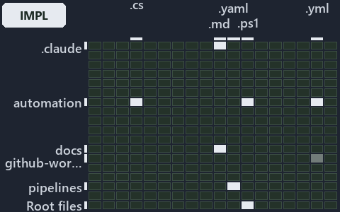

---
catzc:
  immutable:
    with_body_sha: b2de28286074
    repo_status: locked
    path: docs/explanation/.assets/grid/adr-auto-bundle--invoke-importer-in-code-order--implementation.grid.md
    source: docs/explanation/.assets/adr-auto-bundle--invoke-importer-in-code-order--implementation.drawio.png
    role: asset-description
    language: markdown
    filetype: md
    track: docs
    tracktype: documentation
---

# Invoke-Importer loads, asserts one run mode, tidies up and unloads, in one call chain: the world-map minimap

```text
Where the files that cite ADR-AUTO-BUNDLE sit in the repository: tracks down, file languages across.
6 of 342 cells lit, holding 25 files.
```



This is the world-map minimap in the sidebar of the implementation diagram of [Invoke-Importer loads, asserts one run mode, tidies up and
unloads, in one call chain][29], which explains [ADR-AUTO-BUNDLE][1]. It lights every cell of the world map that holds a file citing those
codes, so it shows where the decision lives in the repository. Each lit cell has its reason below, naming the code that selects it.

## What the minimap shows

The grid crosses the 18 tracks (rows) with the 19 file languages (columns) of the world map and lights 6 cells, filled in ink. A cell lit
only by passing mentions (citations in body comments, not in a file's header or text) is touched: a lighter ink. Every other cell is idle, a
grey box: it holds files the slide's ADR codes do not select, or no file at all (288 of the 342 cells hold none). The minimap shows where
the slide sits, not how many files a cell holds; the world-map PDFs show the counts.

- .claude × markdown: 3 lit of 90 files
- automation × powershell: 1 lit of 1629 files
- automation × yaml: 2 lit of 112 files
- docs × markdown: 17 lit of 2742 files
- github-workflows × yaml: 1 lit of 2 files, touched
- pipelines × pipeline-yaml: 1 lit of 9 files

## Key

A lit row prints its track's name; a lit column prints a short code, the first extension of its file language:

- `.md`: markdown
- `.yaml`: pipeline-yaml
- `.ps1`: powershell
- `.yml`: yaml

## Why each cell is lit

### .claude × markdown (3 lit files)

Placed: the root folder `.claude/` names the track .claude ([ADR-DSGN-TRACK#1][2]); the extension `.md` names the file language markdown
([ADR-DSGN-TRACK#6][3]). Lit ([ADR-DSGN-TRACK#12][4]) by:

- [.claude/plans/plan-layers-vocabulary-rename-contracts.md][5]: selected by [ADR-AUTO-BUNDLE][1]: the file cites it at line 495 (text),
  line 557 (text) and line 918 (text).
- [.claude/plans/plan-module-kinds-tracks.md][6]: selected by [ADR-AUTO-BUNDLE][1]: the file cites it at line 336 (text).
- [.claude/plans/prompt-module-model-1-prepare.md][7]: selected by [ADR-AUTO-BUNDLE][1]: the file cites it at line 19 (text).

### automation × powershell (1 lit file)

Placed: the root folder `automation/` names the track automation ([ADR-DSGN-TRACK#1][2]); the extension `.ps1` names the file language
powershell ([ADR-DSGN-TRACK#6][3]). Lit ([ADR-DSGN-TRACK#12][4]) by:

- [pwsh/Catzc.Base.Exporter/Build-Modules.ps1][8]: selected by [ADR-AUTO-BUNDLE][1]: the file cites it at line 2 (text).

### automation × yaml (2 lit files)

Placed: the root folder `automation/` names the track automation ([ADR-DSGN-TRACK#1][2]); the extension `.yml` names the file language yaml
([ADR-DSGN-TRACK#6][3]). Lit ([ADR-DSGN-TRACK#12][4]) by:

- [pwsh/Catzc.Base.Docs/configs/adrs.yml][9]: selected by [ADR-AUTO-BUNDLE][1]: the file cites it at line 142 (text).
- [pwsh/Catzc.Base.Docs/configs/glossary.yml][10]: selected by [ADR-AUTO-BUNDLE][1]: the file cites it at line 501 (text).

### docs × markdown (17 lit files)

Placed: the root folder `docs/` names the track docs ([ADR-DSGN-TRACK#1][2]); the extension `.md` names the file language markdown
([ADR-DSGN-TRACK#6][3]). Lit ([ADR-DSGN-TRACK#12][4]) by:

- [docs/adr/automation/dora-explains.md][11]: selected by [ADR-AUTO-BUNDLE][1]: the file cites it at line 437 (text).
- [docs/adr/automation/platform-bundle.md][1]: selected by [ADR-AUTO-BUNDLE][1]: the ADR's own file.
- [docs/adr/glossary.md][12]: selected by [ADR-AUTO-BUNDLE][1]: the file cites it at line 595 (text).
- [docs/adr/index.md][13]: selected by [ADR-AUTO-BUNDLE][1]: the file cites it at line 173 (text).
- [docs/references/pwsh/catzc-base-contracts/Publish-ContractRelease.ps1.md][14]: selected by [ADR-AUTO-BUNDLE][1]: the file cites it
  at line 20 (text).
- [docs/references/pwsh/catzc-base-exporter/Assert-CatzcBundle.ps1.md][15]: selected by [ADR-AUTO-BUNDLE][1]: the file cites it at
  line 14 (text).
- [docs/references/pwsh/catzc-base-exporter/Build-Modules.ps1.md][16]: selected by [ADR-AUTO-BUNDLE][1]: the file cites it at line 14
  (text).
- [docs/references/pwsh/catzc-base-exporter/Export-Catzc.ps1.md][17]: selected by [ADR-AUTO-BUNDLE][1]: the file cites it at line 14
  (text).
- [docs/references/pwsh/catzc-base-exporter/Install-Catzc.ps1.md][18]: selected by [ADR-AUTO-BUNDLE][1]: the file cites it at line 15
  (text).
- [docs/references/pwsh/catzc-base-exporter/Resolve-CatzcBuildVersion.ps1.md][19]: selected by [ADR-AUTO-BUNDLE][1]: the file cites it
  at line 14 (text).
- [docs/references/pwsh/catzc-base-exporter/configs/exporter.yml.md][20]: selected by [ADR-AUTO-BUNDLE][1]: the file cites it at line
  17 (text).
- [docs/references/pwsh/catzc-base-exporter/private/Assert-BundleFootprint.ps1.md][21]: selected by [ADR-AUTO-BUNDLE][1]: the file
  cites it at line 15 (text).
- [docs/references/pwsh/catzc-base-exporter/private/New-CatzcNuGetPackage.ps1.md][22]: selected by [ADR-AUTO-BUNDLE][1]: the file
  cites it at line 14 (text).
- [docs/references/pwsh/catzc-base-exporter/types/ExporterBundle.cs.md][23]: selected by [ADR-AUTO-BUNDLE][1]: the file cites it at
  line 13 (text).
- [docs/references/pwsh/catzc-base-exporter/types/ExporterConfig.cs.md][24]: selected by [ADR-AUTO-BUNDLE][1]: the file cites it at
  line 12 (text).
- [docs/references/pwsh/internal/Catzc.Internal.Builder.psm1.md][25]: selected by [ADR-AUTO-BUNDLE][1]: the file cites it at line 14
  (text).
- [docs/references/pwsh/internal/assets/Import-Catzc.ps1.md][26]: selected by [ADR-AUTO-BUNDLE][1]: the file cites it at line 15
  (text).

### github-workflows × yaml (1 lit file, touched)

Placed: the root folder `.github/` names the track github-workflows ([ADR-DSGN-TRACK#1][2]); the extension `.yml` names the file language
yaml ([ADR-DSGN-TRACK#6][3]). Lit ([ADR-DSGN-TRACK#12][4]) by:

- [.github/workflows/ci-automation.yml][27]: selected by [ADR-AUTO-BUNDLE][1]: the file cites it at line 48 (body comment) (a passing
  mention only).

### pipelines × pipeline-yaml (1 lit file)

Placed: the root folder `pipelines/` names the track pipelines ([ADR-DSGN-TRACK#1][2]); the extension `.yaml` names the file language
pipeline-yaml ([ADR-DSGN-TRACK#6][3]). Lit ([ADR-DSGN-TRACK#12][4]) by:

- [pipelines/ci-automation.yaml][28]: selected by [ADR-AUTO-BUNDLE][1]: a pipeline that cites nothing itself carries its globset's
  citations, which cite it at `pwsh/Catzc.Base.Docs/configs/adrs.yml` line 142 (text),
  `pwsh/Catzc.Base.Docs/configs/glossary.yml` line 501 (text) and `pwsh/Catzc.Base.Exporter/Build-Modules.ps1` line 2 (text).

## Keywords

- [world map][30]
- [track][31]
- [file language][32]
- [cell][33]
- [lit cell][34]
- [.claude][35]: a track
- [automation][35]: a track
- [docs][35]: a track
- [github-workflows][35]: a track
- [pipelines][35]: a track
- [markdown][36]: a file language
- [pipeline-yaml][36]: a file language
- [powershell][36]: a file language
- [yaml][36]: a file language

Terms the cited ADRs define:

- [bundle][37], defined by [ADR-AUTO-BUNDLE#1][38]

[1]: ../../../adr/automation/platform-bundle.md
[2]: ../../../adr/design/tracks.md#rule-adr-dsgn-track1
[3]: ../../../adr/design/tracks.md#rule-adr-dsgn-track6
[4]: ../../../adr/design/tracks.md#rule-adr-dsgn-track12
[5]: ../../../../.claude/plans/plan-layers-vocabulary-rename-contracts.md
[6]: ../../../../.claude/plans/plan-module-kinds-tracks.md
[7]: ../../../../.claude/plans/prompt-module-model-1-prepare.md
[8]: ../../../../pwsh/Catzc.Base.Exporter/Build-Modules.ps1
[9]: ../../../../pwsh/Catzc.Base.Docs/configs/adrs.yml
[10]: ../../../../pwsh/Catzc.Base.Docs/configs/glossary.yml
[11]: ../../../adr/automation/dora-explains.md
[12]: ../../../adr/glossary.md
[13]: ../../../adr/index.md
[14]: ../../../references/pwsh/catzc-base-contracts/Publish-ContractRelease.ps1.md
[15]: ../../../references/pwsh/catzc-base-exporter/Assert-CatzcBundle.ps1.md
[16]: ../../../references/pwsh/catzc-base-exporter/Build-Modules.ps1.md
[17]: ../../../references/pwsh/catzc-base-exporter/Export-Catzc.ps1.md
[18]: ../../../references/pwsh/catzc-base-exporter/Install-Catzc.ps1.md
[19]: ../../../references/pwsh/catzc-base-exporter/Resolve-CatzcBuildVersion.ps1.md
[20]: ../../../references/pwsh/catzc-base-exporter/configs/exporter.yml.md
[21]: ../../../references/pwsh/catzc-base-exporter/private/Assert-BundleFootprint.ps1.md
[22]: ../../../references/pwsh/catzc-base-exporter/private/New-CatzcNuGetPackage.ps1.md
[23]: ../../../references/pwsh/catzc-base-exporter/types/ExporterBundle.cs.md
[24]: ../../../references/pwsh/catzc-base-exporter/types/ExporterConfig.cs.md
[25]: ../../../references/pwsh/internal/Catzc.Internal.Builder.psm1.md
[26]: ../../../references/pwsh/internal/assets/Import-Catzc.ps1.md
[27]: ../../../../.github/workflows/ci-automation.yml
[28]: ../../../../pipelines/ci-automation.yaml
[29]: ../../automation/invoke-importer-in-code-order.md
[30]: ../../../adr/glossary.md#world-map
[31]: ../../../adr/glossary.md#track
[32]: ../../../adr/glossary.md#file-language
[33]: ../../../adr/glossary.md#cell
[34]: ../../../adr/glossary.md#lit-cell
[35]: ../../../../pwsh/Catzc.Base.Variants/configs/variants.yml
[36]: ../../../../pwsh/Catzc.Base.Languages/configs/languages.yml
[37]: ../../../adr/glossary.md#bundle
[38]: ../../../adr/automation/platform-bundle.md#rule-adr-auto-bundle1
