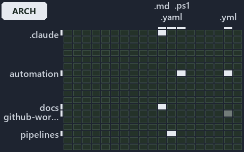

---
catzc:
  immutable:
    with_body_sha: dda15c014469
    repo_status: locked
    path: docs/explanation/.assets/grid/adr-auto-bundle--two-entries-feed-one-importer--architecture.grid.md
    source: docs/explanation/.assets/adr-auto-bundle--two-entries-feed-one-importer--architecture.drawio.png
    kind: asset-description
    language: markdown
    filetype: md
    track: docs
    tracktype: documentation
---

# Two entry scripts feed one importer, and the importer leaves once the load is done: the world-map minimap

```text
Where the files that cite ADR-AUTO-BUNDLE sit in the repository: tracks down, file languages across.
8 of 324 cells lit, holding 27 files.
```



This is the world-map minimap in the sidebar of the architecture diagram of [Two entry scripts feed one importer, and the importer leaves
once the load is done][32], which explains [ADR-AUTO-BUNDLE][1]. It lights every cell of the world map that holds a file citing those codes,
so it shows where the decision lives in the repository. Each lit cell has its reason below, naming the code that selects it.

## What the minimap shows

The grid crosses the 18 tracks (rows) with the 18 file languages (columns) of the world map and lights 8 cells, filled in ink. A cell lit
only by passing mentions (citations in body comments, not in a file's header or text) is touched: a lighter ink. Every other cell is idle, a
grey box: it holds files the slide's ADR codes do not select, or no file at all (271 of the 324 cells hold none). The minimap shows where
the slide sits, not how many files a cell holds; the world-map PDFs show the counts.

- .claude × markdown: 3 lit of 91 files
- automation × csharp: 2 lit of 286 files
- automation × powershell: 9 lit of 1619 files
- automation × yaml: 2 lit of 112 files
- docs × markdown: 8 lit of 2220 files
- github-workflows × yaml: 1 lit of 2 files, touched
- pipelines × pipeline-yaml: 1 lit of 9 files
- Root files × powershell: 1 lit of 1 file

## Key

A lit row prints its track's name; a lit column prints a short code, the first extension of its file language:

- `.cs`: csharp
- `.md`: markdown
- `.yaml`: pipeline-yaml
- `.ps1`: powershell
- `.yml`: yaml

## Why each cell is lit

### .claude × markdown (3 lit files)

Placed: the root folder `.claude/` names the track .claude ([ADR-DSGN-TRACK#1][2]); the extension `.md` names the file language markdown
([ADR-DSGN-TRACK#6][3]). Lit ([ADR-DSGN-TRACK#12][4]) by:

- [.claude/plans/plan-layers-vocabulary-rename-contracts.md][5]: selected by [ADR-AUTO-BUNDLE][1]: the file cites it at line 24 (text), line
  524 (text), line 586 (text) and line 947 (text).
- [.claude/plans/plan-module-kinds-tracks.md][6]: selected by [ADR-AUTO-BUNDLE][1]: the file cites it at line 355 (text).
- [.claude/plans/prompt-module-model-1-prepare.md][7]: selected by [ADR-AUTO-BUNDLE][1]: the file cites it at line 39 (text).

### automation × csharp (2 lit files)

Placed: the root folder `automation/` names the track automation ([ADR-DSGN-TRACK#1][2]); the extension `.cs` names the file language csharp
([ADR-DSGN-TRACK#6][3]). Lit ([ADR-DSGN-TRACK#12][4]) by:

- [automation/Catzc.Base.Exporter/types/ExporterBundle.cs][8]: selected by [ADR-AUTO-BUNDLE][1]: the file cites it at line 20 (text).
- [automation/Catzc.Base.Exporter/types/ExporterConfig.cs][9]: selected by [ADR-AUTO-BUNDLE][1]: the file cites it at line 21 (text).

### automation × powershell (9 lit files)

Placed: the root folder `automation/` names the track automation ([ADR-DSGN-TRACK#1][2]); the extension `.ps1` names the file language
powershell ([ADR-DSGN-TRACK#6][3]). Lit ([ADR-DSGN-TRACK#12][4]) by:

- [automation/.internal/assets/Import-Catzc.ps1][10]: selected by [ADR-AUTO-BUNDLE][1]: the file cites it at line 20 (header).
- [automation/Catzc.Base.Contracts/Publish-ContractRelease.ps1][11]: selected by [ADR-AUTO-BUNDLE][1]: the file cites it at line 21 (header)
  and line 36 (header).
- [automation/Catzc.Base.Exporter/Assert-CatzcBundle.ps1][12]: selected by [ADR-AUTO-BUNDLE][1]: the file cites it at line 22 (header) and
  line 29 (header).
- [automation/Catzc.Base.Exporter/Build-Modules.ps1][13]: selected by [ADR-AUTO-BUNDLE][1]: the file cites it at line 22 (header), line 27
  (header) and line 73 (text).
- [automation/Catzc.Base.Exporter/Export-Catzc.ps1][14]: selected by [ADR-AUTO-BUNDLE][1]: the file cites it at line 20 (header) and line 26
  (header).
- [automation/Catzc.Base.Exporter/Install-Catzc.ps1][15]: selected by [ADR-AUTO-BUNDLE][1]: the file cites it at line 21 (header) and line
  29 (header).
- [automation/Catzc.Base.Exporter/Resolve-CatzcBuildVersion.ps1][16]: selected by [ADR-AUTO-BUNDLE][1]: the file cites it at line 20
  (header) and line 28 (header).
- [automation/Catzc.Base.Exporter/private/Assert-BundleFootprint.ps1][17]: selected by [ADR-AUTO-BUNDLE][1]: the file cites it at line 22
  (header) and line 28 (header).
- [automation/Catzc.Base.Exporter/private/New-CatzcNuGetPackage.ps1][18]: selected by [ADR-AUTO-BUNDLE][1]: the file cites it at line 21
  (header) and line 26 (header).

### automation × yaml (2 lit files)

Placed: the root folder `automation/` names the track automation ([ADR-DSGN-TRACK#1][2]); the extension `.yml` names the file language yaml
([ADR-DSGN-TRACK#6][3]). Lit ([ADR-DSGN-TRACK#12][4]) by:

- [automation/Catzc.Base.Docs/configs/adrs.yml][19]: selected by [ADR-AUTO-BUNDLE][1]: the file cites it at line 161 (text).
- [automation/Catzc.Base.Docs/configs/glossary.yml][20]: selected by [ADR-AUTO-BUNDLE][1]: the file cites it at line 520 (text).

### docs × markdown (8 lit files)

Placed: the root folder `docs/` names the track docs ([ADR-DSGN-TRACK#1][2]); the extension `.md` names the file language markdown
([ADR-DSGN-TRACK#6][3]). Lit ([ADR-DSGN-TRACK#12][4]) by:

- [docs/adr/automation/dora-explains.md][21]: selected by [ADR-AUTO-BUNDLE][1]: the file cites it at line 507 (text).
- [docs/adr/automation/platform-bundle.md][1]: selected by [ADR-AUTO-BUNDLE][1]: the ADR's own file.
- [docs/adr/glossary.md][22]: selected by [ADR-AUTO-BUNDLE][1]: the file cites it at line 595 (text).
- [docs/adr/index.md][23]: selected by [ADR-AUTO-BUNDLE][1]: the file cites it at line 173 (text).
- [docs/references/automation/catzc-base-exporter/configs/exporter.yml.md][24]: selected by [ADR-AUTO-BUNDLE][1]: the file cites it at line
  33 (text).
- [docs/references/automation/catzc-base-exporter/types/ExporterBundle.cs.md][25]: selected by [ADR-AUTO-BUNDLE][1]: the file cites it at
  line 32 (text).
- [docs/references/automation/catzc-base-exporter/types/ExporterConfig.cs.md][26]: selected by [ADR-AUTO-BUNDLE][1]: the file cites it at
  line 31 (text).
- [docs/references/automation/internal/Catzc.Internal.Builder.psm1.md][27]: selected by [ADR-AUTO-BUNDLE][1]: the file cites it at line 34
  (text).

### github-workflows × yaml (1 lit file, touched)

Placed: the root folder `.github/` names the track github-workflows ([ADR-DSGN-TRACK#1][2]); the extension `.yml` names the file language
yaml ([ADR-DSGN-TRACK#6][3]). Lit ([ADR-DSGN-TRACK#12][4]) by:

- [.github/workflows/ci-automation.yml][28]: selected by [ADR-AUTO-BUNDLE][1]: the file cites it at line 64 (body comment) (a passing
  mention only).

### pipelines × pipeline-yaml (1 lit file)

Placed: the root folder `pipelines/` names the track pipelines ([ADR-DSGN-TRACK#1][2]); the extension `.yaml` names the file language
pipeline-yaml ([ADR-DSGN-TRACK#6][3]). Lit ([ADR-DSGN-TRACK#12][4]) by:

- [pipelines/ci-automation.yaml][29]: selected by [ADR-AUTO-BUNDLE][1]: a pipeline that cites nothing itself carries its globset's
  citations, which cite it at `automation/.internal/assets/Import-Catzc.ps1` line 20 (header),
  `automation/Catzc.Base.Contracts/Publish-ContractRelease.ps1` line 21 (header),
  `automation/Catzc.Base.Contracts/Publish-ContractRelease.ps1` line 36 (header), `automation/Catzc.Base.Docs/configs/adrs.yml` line 161
  (text), `automation/Catzc.Base.Docs/configs/glossary.yml` line 520 (text), `automation/Catzc.Base.Exporter/Assert-CatzcBundle.ps1` line 22
  (header), `automation/Catzc.Base.Exporter/Assert-CatzcBundle.ps1` line 29 (header), `automation/Catzc.Base.Exporter/Build-Modules.ps1`
  line 22 (header), `automation/Catzc.Base.Exporter/Build-Modules.ps1` line 27 (header), `automation/Catzc.Base.Exporter/Build-Modules.ps1`
  line 73 (text), `automation/Catzc.Base.Exporter/Export-Catzc.ps1` line 20 (header), `automation/Catzc.Base.Exporter/Export-Catzc.ps1` line
  26 (header), `automation/Catzc.Base.Exporter/Install-Catzc.ps1` line 21 (header), `automation/Catzc.Base.Exporter/Install-Catzc.ps1` line
  29 (header), `automation/Catzc.Base.Exporter/Resolve-CatzcBuildVersion.ps1` line 20 (header),
  `automation/Catzc.Base.Exporter/Resolve-CatzcBuildVersion.ps1` line 28 (header),
  `automation/Catzc.Base.Exporter/private/Assert-BundleFootprint.ps1` line 22 (header),
  `automation/Catzc.Base.Exporter/private/Assert-BundleFootprint.ps1` line 28 (header),
  `automation/Catzc.Base.Exporter/private/New-CatzcNuGetPackage.ps1` line 21 (header),
  `automation/Catzc.Base.Exporter/private/New-CatzcNuGetPackage.ps1` line 26 (header),
  `automation/Catzc.Base.Exporter/types/ExporterBundle.cs` line 20 (text) and `automation/Catzc.Base.Exporter/types/ExporterConfig.cs` line
  21 (text).

### Root files × powershell (1 lit file)

Placed: each file sits directly in the repository root, so it is a root file ([ADR-DSGN-TRACK#7][30]); the extension `.ps1` names the file
language powershell ([ADR-DSGN-TRACK#6][3]). Lit ([ADR-DSGN-TRACK#12][4]) by:

- [importer.ps1][31]: selected by [ADR-AUTO-BUNDLE][1]: a root file carries the citations of its owner module's files (files.yml), which
  cite it at `automation/.internal/assets/Import-Catzc.ps1` line 20 (header).

## Keywords

- [world map][33]
- [track][34]
- [file language][35]
- [cell][36]
- [lit cell][37]
- [root file][38]
- [.claude][39]: a track
- [automation][39]: a track
- [docs][39]: a track
- [github-workflows][39]: a track
- [pipelines][39]: a track
- [csharp][40]: a file language
- [markdown][40]: a file language
- [pipeline-yaml][40]: a file language
- [powershell][40]: a file language
- [yaml][40]: a file language

Terms the cited ADRs define:

- [bundle][41], defined by [ADR-AUTO-BUNDLE#1][42]

[1]: ../../../adr/automation/platform-bundle.md
[2]: ../../../adr/design/tracks.md#rule-adr-dsgn-track1
[3]: ../../../adr/design/tracks.md#rule-adr-dsgn-track6
[4]: ../../../adr/design/tracks.md#rule-adr-dsgn-track12
[5]: ../../../../.claude/plans/plan-layers-vocabulary-rename-contracts.md
[6]: ../../../../.claude/plans/plan-module-kinds-tracks.md
[7]: ../../../../.claude/plans/prompt-module-model-1-prepare.md
[8]: ../../../../automation/Catzc.Base.Exporter/types/ExporterBundle.cs
[9]: ../../../../automation/Catzc.Base.Exporter/types/ExporterConfig.cs
[10]: ../../../../automation/.internal/assets/Import-Catzc.ps1
[11]: ../../../../automation/Catzc.Base.Contracts/Publish-ContractRelease.ps1
[12]: ../../../../automation/Catzc.Base.Exporter/Assert-CatzcBundle.ps1
[13]: ../../../../automation/Catzc.Base.Exporter/Build-Modules.ps1
[14]: ../../../../automation/Catzc.Base.Exporter/Export-Catzc.ps1
[15]: ../../../../automation/Catzc.Base.Exporter/Install-Catzc.ps1
[16]: ../../../../automation/Catzc.Base.Exporter/Resolve-CatzcBuildVersion.ps1
[17]: ../../../../automation/Catzc.Base.Exporter/private/Assert-BundleFootprint.ps1
[18]: ../../../../automation/Catzc.Base.Exporter/private/New-CatzcNuGetPackage.ps1
[19]: ../../../../automation/Catzc.Base.Docs/configs/adrs.yml
[20]: ../../../../automation/Catzc.Base.Docs/configs/glossary.yml
[21]: ../../../adr/automation/dora-explains.md
[22]: ../../../adr/glossary.md
[23]: ../../../adr/index.md
[24]: ../../../references/automation/catzc-base-exporter/configs/exporter.yml.md
[25]: ../../../references/automation/catzc-base-exporter/types/ExporterBundle.cs.md
[26]: ../../../references/automation/catzc-base-exporter/types/ExporterConfig.cs.md
[27]: ../../../references/automation/internal/Catzc.Internal.Builder.psm1.md
[28]: ../../../../.github/workflows/ci-automation.yml
[29]: ../../../../pipelines/ci-automation.yaml
[30]: ../../../adr/design/tracks.md#rule-adr-dsgn-track7
[31]: ../../../../importer.ps1
[32]: ../../automation/two-entries-feed-one-importer.md
[33]: ../../../adr/glossary.md#world-map
[34]: ../../../adr/glossary.md#track
[35]: ../../../adr/glossary.md#file-language
[36]: ../../../adr/glossary.md#cell
[37]: ../../../adr/glossary.md#lit-cell
[38]: ../../../adr/glossary.md#root-file
[39]: ../../../../automation/Catzc.Base.Variants/configs/variants.yml
[40]: ../../../../automation/Catzc.Base.Languages/configs/languages.yml
[41]: ../../../adr/glossary.md#bundle
[42]: ../../../adr/automation/platform-bundle.md#rule-adr-auto-bundle1
