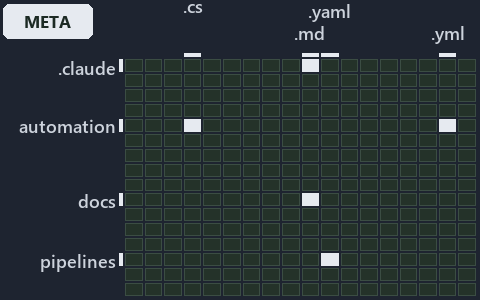

# docs/explanation/.assets/grid/adr-auto-depm--a-declared-allow-list-of-layers--meta.grid.md

`Grid minimap: adr-auto-depm--a-declared-allow-list-of-layers--meta`

The grid minimap of the slide `adr-auto-depm--a-declared-allow-list-of-layers--meta` (meta lens). The slide supports [ADR-AUTO-DEPM][1]; the
highlight of those ADR codes selects what is lit, and each reason below names the code that selects it.

## What the minimap shows

The grid crosses the 16 tracks (rows) with the 18 file languages (columns) of the world map and lights 5 cells, filled in ink. A cell lit
only by passing mentions (citations in body comments, not in a file's header or text) is touched: a lighter ink. Every other cell is idle, a
grey box: it holds files the slide's ADR codes do not select, or no file at all (237 of the 288 cells hold none). The minimap shows where
the slide sits, not how many files a cell holds; the world-map PDFs show the counts.

- .claude × markdown: 5 lit of 71 files
- automation × csharp: 3 lit of 274 files
- automation × yaml: 1 lit of 109 files
- docs × markdown: 6 lit of 2165 files
- pipelines × pipeline-yaml: 1 lit of 9 files

## Key

A lit row prints its track's name; a lit column prints a short code, the first extension of its file language:

- `.cs`: csharp
- `.md`: markdown
- `.yaml`: pipeline-yaml
- `.yml`: yaml

## Why each cell is lit

### .claude × markdown (5 lit files)

Placed: the root folder `.claude/` names the track .claude ([ADR-DSGN-TRACK#1][2]); the extension `.md` names the file language markdown
([ADR-DSGN-TRACK#6][3]). Lit ([ADR-DSGN-TRACK#12][4]) by:

- [.claude/plans/plan-adr-link-cleanup-prose-to-pages.md][5]: selected by [ADR-AUTO-DEPM][1]: the file cites it at line 177 (text).
- [.claude/plans/plan-assert-wait.md][6]: selected by [ADR-AUTO-DEPM][1]: the file cites it at line 80 (text).
- [.claude/plans/plan-module-kinds-tracks.md][7]: selected by [ADR-AUTO-DEPM][1]: the file cites it at line 35 (text), line 219 (text), line
  302 (text), line 306 (text), line 369 (text), line 375 (text), line 379 (text), line 398 (text), line 551 (text) and line 588 (text).
- [.claude/plans/prompt-k8s-kinds-2-implement.md][8]: selected by [ADR-AUTO-DEPM][1]: the file cites it at line 40 (text).
- [.claude/plans/prompt-module-model-1-prepare.md][9]: selected by [ADR-AUTO-DEPM][1]: the file cites it at line 41 (text).

### automation × csharp (3 lit files)

Placed: the root folder `automation/` names the track automation ([ADR-DSGN-TRACK#1][2]); the extension `.cs` names the file language csharp
([ADR-DSGN-TRACK#6][3]). Lit ([ADR-DSGN-TRACK#12][4]) by:

- [automation/Catzc.Base.ModuleSystem/types/DependenciesConfig.cs][10]: selected by [ADR-AUTO-DEPM][1]: the file cites it at line 21 (text).
- [automation/Catzc.Base.ModuleSystem/types/DependencyGraph.cs][11]: selected by [ADR-AUTO-DEPM][1]: the file cites it at line 20 (text).
- [automation/Catzc.Base.ModuleSystem/types/ModuleGroup.cs][12]: selected by [ADR-AUTO-DEPM][1]: the file cites it at line 20 (text).

### automation × yaml (1 lit file)

Placed: the root folder `automation/` names the track automation ([ADR-DSGN-TRACK#1][2]); the extension `.yml` names the file language yaml
([ADR-DSGN-TRACK#6][3]). Lit ([ADR-DSGN-TRACK#12][4]) by:

- [automation/Catzc.Base.Docs/configs/adrs.yml][13]: selected by [ADR-AUTO-DEPM][1]: the file cites it at line 154 (text).

### docs × markdown (6 lit files)

Placed: the root folder `docs/` names the track docs ([ADR-DSGN-TRACK#1][2]); the extension `.md` names the file language markdown
([ADR-DSGN-TRACK#6][3]). Lit ([ADR-DSGN-TRACK#12][4]) by:

- [docs/adr/automation/controlling-module-dependencies.md][1]: selected by [ADR-AUTO-DEPM][1]: the ADR's own file.
- [docs/adr/automation/dora-explains.md][14]: selected by [ADR-AUTO-DEPM][1]: the file cites it at line 415 (text).
- [docs/adr/index.md][15]: selected by [ADR-AUTO-DEPM][1]: the file cites it at line 165 (text).
- [docs/references/automation/catzc-base-modulesystem/types/DependenciesConfig.cs.md][16]: selected by [ADR-AUTO-DEPM][1]: the file cites it
  at line 31 (text).
- [docs/references/automation/catzc-base-modulesystem/types/DependencyGraph.cs.md][17]: selected by [ADR-AUTO-DEPM][1]: the file cites it at
  line 17 (text) and line 34 (text).
- [docs/references/automation/catzc-base-modulesystem/types/ModuleGroup.cs.md][18]: selected by [ADR-AUTO-DEPM][1]: the file cites it at
  line 17 (text) and line 32 (text).

### pipelines × pipeline-yaml (1 lit file)

Placed: the root folder `pipelines/` names the track pipelines ([ADR-DSGN-TRACK#1][2]); the extension `.yaml` names the file language
pipeline-yaml ([ADR-DSGN-TRACK#6][3]). Lit ([ADR-DSGN-TRACK#12][4]) by:

- [pipelines/ci-automation.yaml][19]: selected by [ADR-AUTO-DEPM][1]: a pipeline that cites nothing itself carries its globset's citations,
  which cite it at `automation/Catzc.Base.Docs/configs/adrs.yml` line 154 (text),
  `automation/Catzc.Base.ModuleSystem/types/DependenciesConfig.cs` line 21 (text),
  `automation/Catzc.Base.ModuleSystem/types/DependencyGraph.cs` line 20 (text) and `automation/Catzc.Base.ModuleSystem/types/ModuleGroup.cs`
  line 20 (text).

## Keywords

- [world map][20]
- [track][21]
- [file language][22]
- [cell][23]
- [lit cell][24]
- [.claude][25]: a track
- [automation][25]: a track
- [docs][25]: a track
- [pipelines][25]: a track
- [csharp][26]: a file language
- [markdown][26]: a file language
- [pipeline-yaml][26]: a file language
- [yaml][26]: a file language

[1]: ../../../adr/automation/controlling-module-dependencies.md
[2]: ../../../adr/design/tracks.md#rule-adr-dsgn-track1
[3]: ../../../adr/design/tracks.md#rule-adr-dsgn-track6
[4]: ../../../adr/design/tracks.md#rule-adr-dsgn-track12
[5]: ../../../../.claude/plans/plan-adr-link-cleanup-prose-to-pages.md
[6]: ../../../../.claude/plans/plan-assert-wait.md
[7]: ../../../../.claude/plans/plan-module-kinds-tracks.md
[8]: ../../../../.claude/plans/prompt-k8s-kinds-2-implement.md
[9]: ../../../../.claude/plans/prompt-module-model-1-prepare.md
[10]: ../../../../automation/Catzc.Base.ModuleSystem/types/DependenciesConfig.cs
[11]: ../../../../automation/Catzc.Base.ModuleSystem/types/DependencyGraph.cs
[12]: ../../../../automation/Catzc.Base.ModuleSystem/types/ModuleGroup.cs
[13]: ../../../../automation/Catzc.Base.Docs/configs/adrs.yml
[14]: ../../../adr/automation/dora-explains.md
[15]: ../../../adr/index.md
[16]: ../../../references/automation/catzc-base-modulesystem/types/DependenciesConfig.cs.md
[17]: ../../../references/automation/catzc-base-modulesystem/types/DependencyGraph.cs.md
[18]: ../../../references/automation/catzc-base-modulesystem/types/ModuleGroup.cs.md
[19]: ../../../../pipelines/ci-automation.yaml
[20]: ../../../adr/glossary.md#world-map
[21]: ../../../adr/glossary.md#track
[22]: ../../../adr/glossary.md#file-language
[23]: ../../../adr/glossary.md#cell
[24]: ../../../adr/glossary.md#lit-cell
[25]: ../../../../automation/Catzc.Base.Variants/configs/variants.yml
[26]: ../../../../automation/Catzc.Base.Languages/configs/languages.yml
