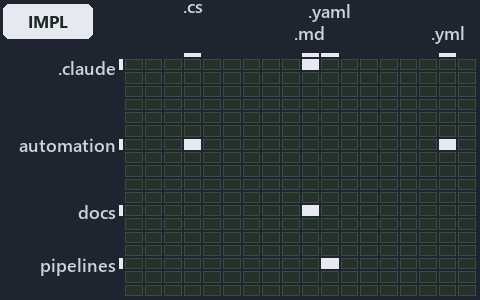

---
catzc:
  immutable:
    with_body_sha: "5c0c4e529dda"
    repo_status: locked
    path: docs/explanation/.assets/grid/adr-auto-depm--two-sections-unioned-into-one-allow-set--implementation.grid.md
    source: docs/explanation/.assets/adr-auto-depm--two-sections-unioned-into-one-allow-set--implementation.drawio.png
    kind: asset-description
    language: markdown
    filetype: md
    track: docs
    tracktype: documentation
---

# Two sections of dependencies.yml are unioned into one allow-set per source module: the world-map minimap

```text
Where the files that cite ADR-AUTO-DEPM sit in the repository: tracks down, file languages across.
5 of 324 cells lit, holding 18 files.
```



This is the world-map minimap in the sidebar of the implementation diagram of [Two sections of dependencies.yml are unioned into one
allow-set per source module][22], which explains [ADR-AUTO-DEPM][1]. It lights every cell of the world map that holds a file citing those
codes, so it shows where the decision lives in the repository. Each lit cell has its reason below, naming the code that selects it.

## What the minimap shows

The grid crosses the 18 tracks (rows) with the 18 file languages (columns) of the world map and lights 5 cells, filled in ink. A cell lit
only by passing mentions (citations in body comments, not in a file's header or text) is touched: a lighter ink. Every other cell is idle, a
grey box: it holds files the slide's ADR codes do not select, or no file at all (271 of the 324 cells hold none). The minimap shows where
the slide sits, not how many files a cell holds; the world-map PDFs show the counts.

- .claude × markdown: 5 lit of 91 files
- automation × csharp: 3 lit of 286 files
- automation × yaml: 1 lit of 112 files
- docs × markdown: 8 lit of 2220 files
- pipelines × pipeline-yaml: 1 lit of 9 files

## Key

A lit row prints its track's name; a lit column prints a short code, the first extension of its file language:

- `.cs`: csharp
- `.md`: markdown
- `.yaml`: pipeline-yaml
- `.yml`: yaml

## Why each cell is lit

### .claude × markdown (5 lit files)

Placed: the root folder `.claude/` names the track .claude ([ADR-DSGN-TRACK#1][2]); the extension `.md` names the file language markdown
([ADR-DSGN-TRACK#6][3]). Lit ([ADR-DSGN-TRACK#12][4]) by:

- [.claude/plans/plan-adr-link-cleanup-prose-to-pages.md][5]: selected by [ADR-AUTO-DEPM][1]: the file cites it at line 184 (text).
- [.claude/plans/plan-assert-wait.md][6]: selected by [ADR-AUTO-DEPM][1]: the file cites it at line 87 (text).
- [.claude/plans/plan-module-kinds-tracks.md][7]: selected by [ADR-AUTO-DEPM][1]: the file cites it at line 32 (text), line 226 (text), line
  309 (text), line 313 (text), line 376 (text), line 382 (text), line 386 (text), line 405 (text), line 561 (text) and line 598 (text).
- [.claude/plans/prompt-k8s-kinds-2-implement.md][8]: selected by [ADR-AUTO-DEPM][1]: the file cites it at line 37 (text).
- [.claude/plans/prompt-module-model-1-prepare.md][9]: selected by [ADR-AUTO-DEPM][1]: the file cites it at line 38 (text).

### automation × csharp (3 lit files)

Placed: the root folder `automation/` names the track automation ([ADR-DSGN-TRACK#1][2]); the extension `.cs` names the file language csharp
([ADR-DSGN-TRACK#6][3]). Lit ([ADR-DSGN-TRACK#12][4]) by:

- [automation/Catzc.Base.ModuleSystem/types/DependenciesConfig.cs][10]: selected by [ADR-AUTO-DEPM][1]: the file cites it at line 21 (text).
- [automation/Catzc.Base.ModuleSystem/types/DependencyGraph.cs][11]: selected by [ADR-AUTO-DEPM][1]: the file cites it at line 20 (text).
- [automation/Catzc.Base.ModuleSystem/types/ModuleGroup.cs][12]: selected by [ADR-AUTO-DEPM][1]: the file cites it at line 20 (text).

### automation × yaml (1 lit file)

Placed: the root folder `automation/` names the track automation ([ADR-DSGN-TRACK#1][2]); the extension `.yml` names the file language yaml
([ADR-DSGN-TRACK#6][3]). Lit ([ADR-DSGN-TRACK#12][4]) by:

- [automation/Catzc.Base.Docs/configs/adrs.yml][13]: selected by [ADR-AUTO-DEPM][1]: the file cites it at line 157 (text).

### docs × markdown (8 lit files)

Placed: the root folder `docs/` names the track docs ([ADR-DSGN-TRACK#1][2]); the extension `.md` names the file language markdown
([ADR-DSGN-TRACK#6][3]). Lit ([ADR-DSGN-TRACK#12][4]) by:

- [docs/adr/automation/controlling-module-dependencies.md][1]: selected by [ADR-AUTO-DEPM][1]: the ADR's own file.
- [docs/adr/automation/dora-explains.md][14]: selected by [ADR-AUTO-DEPM][1]: the file cites it at line 435 (text).
- [docs/adr/index.md][15]: selected by [ADR-AUTO-DEPM][1]: the file cites it at line 169 (text).
- [docs/references/.assets/automation/catzc-base-modulesystem/module-graph-declared-vs-observed.drawio.verify.md][16]: selected by
  [ADR-AUTO-DEPM][1]: the file cites it at line 16 (text), line 68 (text), line 75 (text), line 75 (text), line 92 (text) and line 94
  (text).
- [docs/references/automation/catzc-base-modulesystem/module-graph-declared-vs-observed.drawio.md][17]: selected by [ADR-AUTO-DEPM][1]: the
  file cites it at line 16 (text), line 133 (text) and line 137 (text).
- [docs/references/automation/catzc-base-modulesystem/types/DependenciesConfig.cs.md][18]: selected by [ADR-AUTO-DEPM][1]: the file cites it
  at line 31 (text).
- [docs/references/automation/catzc-base-modulesystem/types/DependencyGraph.cs.md][19]: selected by [ADR-AUTO-DEPM][1]: the file cites it at
  line 17 (text) and line 34 (text).
- [docs/references/automation/catzc-base-modulesystem/types/ModuleGroup.cs.md][20]: selected by [ADR-AUTO-DEPM][1]: the file cites it at
  line 17 (text) and line 32 (text).

### pipelines × pipeline-yaml (1 lit file)

Placed: the root folder `pipelines/` names the track pipelines ([ADR-DSGN-TRACK#1][2]); the extension `.yaml` names the file language
pipeline-yaml ([ADR-DSGN-TRACK#6][3]). Lit ([ADR-DSGN-TRACK#12][4]) by:

- [pipelines/ci-automation.yaml][21]: selected by [ADR-AUTO-DEPM][1]: a pipeline that cites nothing itself carries its globset's citations,
  which cite it at `automation/Catzc.Base.Docs/configs/adrs.yml` line 157 (text),
  `automation/Catzc.Base.ModuleSystem/types/DependenciesConfig.cs` line 21 (text),
  `automation/Catzc.Base.ModuleSystem/types/DependencyGraph.cs` line 20 (text) and `automation/Catzc.Base.ModuleSystem/types/ModuleGroup.cs`
  line 20 (text).

## Keywords

- [world map][23]
- [track][24]
- [file language][25]
- [cell][26]
- [lit cell][27]
- [.claude][28]: a track
- [automation][28]: a track
- [docs][28]: a track
- [pipelines][28]: a track
- [csharp][29]: a file language
- [markdown][29]: a file language
- [pipeline-yaml][29]: a file language
- [yaml][29]: a file language

[1]: ../../../adr/automation/controlling-module-dependencies.md
[2]: ../../../adr/design/tracks.md#rule-adr-dsgn-track1
[3]: ../../../adr/design/tracks.md#rule-adr-dsgn-track6
[4]: ../../../adr/design/tracks.md#rule-adr-dsgn-track12
[5]: ../../../../.claude/plans/plan-adr-link-cleanup-prose-to-pages.md
[6]: ../../../../.claude/plans/plan-assert-wait.md
[7]: ../../../../.claude/plans/plan-module-kinds-tracks.md
[8]: ../../../../.claude/plans/prompt-k8s-kinds-2-implement.md
[9]: ../../../../.claude/plans/prompt-module-model-1-prepare.md
[10]: ../../../../automation/Catzc.Base.ModuleSystem/types/DependenciesConfig.cs
[11]: ../../../../automation/Catzc.Base.ModuleSystem/types/DependencyGraph.cs
[12]: ../../../../automation/Catzc.Base.ModuleSystem/types/ModuleGroup.cs
[13]: ../../../../automation/Catzc.Base.Docs/configs/adrs.yml
[14]: ../../../adr/automation/dora-explains.md
[15]: ../../../adr/index.md
[16]: ../../../references/.assets/automation/catzc-base-modulesystem/module-graph-declared-vs-observed.drawio.verify.md
[17]: ../../../references/automation/catzc-base-modulesystem/module-graph-declared-vs-observed.drawio.md
[18]: ../../../references/automation/catzc-base-modulesystem/types/DependenciesConfig.cs.md
[19]: ../../../references/automation/catzc-base-modulesystem/types/DependencyGraph.cs.md
[20]: ../../../references/automation/catzc-base-modulesystem/types/ModuleGroup.cs.md
[21]: ../../../../pipelines/ci-automation.yaml
[22]: ../../automation/two-sections-unioned-into-one-allow-set.md
[23]: ../../../adr/glossary.md#world-map
[24]: ../../../adr/glossary.md#track
[25]: ../../../adr/glossary.md#file-language
[26]: ../../../adr/glossary.md#cell
[27]: ../../../adr/glossary.md#lit-cell
[28]: ../../../../automation/Catzc.Base.Variants/configs/variants.yml
[29]: ../../../../automation/Catzc.Base.Languages/configs/languages.yml
