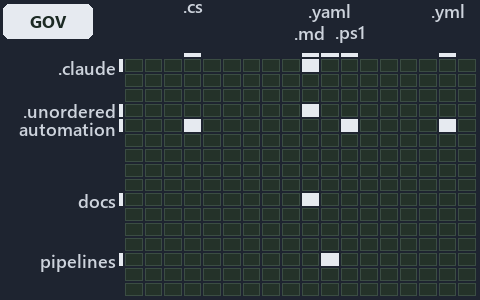

# docs/explanation/.assets/grid/adr-auto-failfast--one-rule-per-stage-and-two-gaps--governance.grid.md

`Grid minimap: adr-auto-failfast--one-rule-per-stage-and-two-gaps--governance`

The grid minimap of the slide `adr-auto-failfast--one-rule-per-stage-and-two-gaps--governance` (governance lens). The slide supports
[ADR-AUTO-DEFAULT][1] and [ADR-AUTO-FAILFAST][2]; the highlight of those ADR codes selects what is lit, and each reason below names the code
that selects it.

## What the minimap shows

The grid crosses the 16 tracks (rows) with the 18 file languages (columns) of the world map and lights 7 cells, filled in ink. A cell lit
only by passing mentions (citations in body comments, not in a file's header or text) is touched: a lighter ink. Every other cell is idle, a
grey box: it holds files the slide's ADR codes do not select, or no file at all (237 of the 288 cells hold none). The minimap shows where
the slide sits, not how many files a cell holds; the world-map PDFs show the counts.

- .claude × markdown: 21 lit of 71 files
- .unordered × markdown: 10 lit of 20 files
- automation × csharp: 30 lit of 274 files
- automation × powershell: 31 lit of 1579 files
- automation × yaml: 4 lit of 109 files
- docs × markdown: 60 lit of 2165 files
- pipelines × pipeline-yaml: 1 lit of 9 files

## Key

A lit row prints its track's name; a lit column prints a short code, the first extension of its file language:

- `.cs`: csharp
- `.md`: markdown
- `.yaml`: pipeline-yaml
- `.ps1`: powershell
- `.yml`: yaml

## Why each cell is lit

### .claude × markdown (21 lit files)

Placed: the root folder `.claude/` names the track .claude ([ADR-DSGN-TRACK#1][3]); the extension `.md` names the file language markdown
([ADR-DSGN-TRACK#6][4]). Lit ([ADR-DSGN-TRACK#12][5]) by:

- [.claude/CLAUDE.md][6]: selected by [ADR-AUTO-DEFAULT][1]: the file cites it at line 46 (text); selected by [ADR-AUTO-FAILFAST][2]: the
  file cites it at line 113 (text).
- [.claude/plans/decisions-2026-10-16.md][7]: selected by [ADR-AUTO-DEFAULT][1]: the file cites it at line 23 (text), line 51 (text), line
  62 (text), line 63 (text) and line 156 (text); selected by [ADR-AUTO-FAILFAST][2]: the file cites it at line 25 (text), line 71 (text),
  line 71 (text), line 193 (text) and line 200 (text).
- [.claude/plans/plan-adr-link-cleanup-prose-to-pages.md][8]: selected by [ADR-AUTO-DEFAULT][1]: the file cites it at line 25 (text), line
  177 (text) and line 466 (text).
- [.claude/plans/plan-assert-wait.md][9]: selected by [ADR-AUTO-DEFAULT][1]: the file cites it at line 31 (text) and line 85 (text);
  selected by [ADR-AUTO-FAILFAST][2]: the file cites it at line 32 (text), line 44 (text), line 57 (text), line 65 (text) and line 115
  (text).
- [.claude/plans/plan-bounded-folder-enumeration.md][10]: selected by [ADR-AUTO-DEFAULT][1]: the file cites it at line 26 (text), line 149
  (text), line 164 (text), line 182 (text), line 190 (text), line 210 (text), line 222 (text), line 326 (text) and line 344 (text); selected
  by [ADR-AUTO-FAILFAST][2]: the file cites it at line 27 (text), line 56 (text), line 302 (text) and line 303 (text).
- [.claude/plans/plan-config-defaults.md][11]: selected by [ADR-AUTO-DEFAULT][1]: the file cites it at line 35 (text), line 54 (text), line
  98 (text), line 142 (text), line 198 (text) and line 264 (text); selected by [ADR-AUTO-FAILFAST][2]: the file cites it at line 62 (text)
  and line 266 (text).
- [.claude/plans/plan-file-head-immutable-edges-classes.md][12]: selected by [ADR-AUTO-DEFAULT][1]: the file cites it at line 32 (text),
  line 227 (text) and line 341 (text).
- [.claude/plans/plan-layers-vocabulary-rename-contracts.md][13]: selected by [ADR-AUTO-DEFAULT][1]: the file cites it at line 27 (text),
  line 463 (text), line 500 (text), line 502 (text), line 642 (text) and line 734 (text).
- [.claude/plans/plan-lazy-types-load.md][14]: selected by [ADR-AUTO-DEFAULT][1]: the file cites it at line 31 (text), line 168 (text), line
  225 (text) and line 296 (text); selected by [ADR-AUTO-FAILFAST][2]: the file cites it at line 204 (text).
- [.claude/plans/plan-materialization-of-knowledge.md][15]: selected by [ADR-AUTO-DEFAULT][1]: the file cites it at line 26 (text), line 44
  (text) and line 117 (text).
- [.claude/plans/plan-minimal-robots-agents.md][16]: selected by [ADR-AUTO-FAILFAST][2]: the file cites it at line 25 (text) and line 91
  (text).
- [.claude/plans/plan-minimal-robots-capabilities.md][17]: selected by [ADR-AUTO-FAILFAST][2]: the file cites it at line 25 (text) and line
  131 (text).
- [.claude/plans/plan-module-kinds-tracks.md][18]: selected by [ADR-AUTO-DEFAULT][1]: the file cites it at line 34 (text), line 262 (text),
  line 326 (text) and line 369 (text).
- [.claude/plans/plan-out-artifacts.md][19]: selected by [ADR-AUTO-DEFAULT][1]: the file cites it at line 30 (text) and line 148 (text).
- [.claude/plans/plan-plans-body-sha-landing-zone.md][20]: selected by [ADR-AUTO-DEFAULT][1]: the file cites it at line 24 (text) and line
  172 (text).
- [.claude/plans/prompt-bounded-folder-enumeration-continue.md][21]: selected by [ADR-AUTO-FAILFAST][2]: the file cites it at line 19 (text)
  and line 40 (text).
- [.claude/plans/prompt-config-defaults-continue.md][22]: selected by [ADR-AUTO-DEFAULT][1]: the file cites it at line 37 (text).
- [.claude/plans/prompt-k8s-kinds-1-prepare.md][23]: selected by [ADR-AUTO-DEFAULT][1]: the file cites it at line 43 (text).
- [.claude/plans/prompt-module-model-1-prepare.md][24]: selected by [ADR-AUTO-DEFAULT][1]: the file cites it at line 19 (text), line 44
  (text) and line 59 (text).
- [.claude/plans/questionnaire-2026-10-16.md][25]: selected by [ADR-AUTO-FAILFAST][2]: the file cites it at line 141 (text).
- [.claude/skills/catzc-module/SKILL.md][26]: selected by [ADR-AUTO-DEFAULT][1]: the file cites it at line 27 (text) and line 40 (text).

### .unordered × markdown (10 lit files)

Placed: the root folder `.unordered/` names the track .unordered ([ADR-DSGN-TRACK#1][3]); the extension `.md` names the file language
markdown ([ADR-DSGN-TRACK#6][4]). Lit ([ADR-DSGN-TRACK#12][5]) by:

- [.unordered/15-10-2026/plan-adr-consistency.md][27]: selected by [ADR-AUTO-DEFAULT][1]: the file cites it at line 107 (text).
- [.unordered/15-10-2026/plan-built-bundle.md][28]: selected by [ADR-AUTO-DEFAULT][1]: the file cites it at line 12 (text), line 29 (text),
  line 110 (text), line 214 (text) and line 273 (text); selected by [ADR-AUTO-FAILFAST][2]: the file cites it at line 13 (text).
- [.unordered/15-10-2026/plan-caf-waf-automation.md][29]: selected by [ADR-AUTO-DEFAULT][1]: the file cites it at line 44 (text).
- [.unordered/15-10-2026/plan-concern-axis.md][30]: selected by [ADR-AUTO-DEFAULT][1]: the file cites it at line 30 (text).
- [.unordered/15-10-2026/plan-contracts.md][31]: selected by [ADR-AUTO-DEFAULT][1]: the file cites it at line 220 (text).
- [.unordered/15-10-2026/plan-diagram-wave-8.md][32]: selected by [ADR-AUTO-FAILFAST][2]: the file cites it at line 14 (text) and line 16
  (text).
- [.unordered/15-10-2026/plan-duration-categories.md][33]: selected by [ADR-AUTO-DEFAULT][1]: the file cites it at line 12 (text); selected
  by [ADR-AUTO-FAILFAST][2]: the file cites it at line 25 (text).
- [.unordered/15-10-2026/plan-explanation-drift.md][34]: selected by [ADR-AUTO-FAILFAST][2]: the file cites it at line 129 (text).
- [.unordered/15-10-2026/plan-strip-comments.md][35]: selected by [ADR-AUTO-DEFAULT][1]: the file cites it at line 77 (text).
- [.unordered/15-10-2026/plan-test-runtime.md][36]: selected by [ADR-AUTO-FAILFAST][2]: the file cites it at line 70 (text).

### automation × csharp (30 lit files)

Placed: the root folder `automation/` names the track automation ([ADR-DSGN-TRACK#1][3]); the extension `.cs` names the file language csharp
([ADR-DSGN-TRACK#6][4]). Lit ([ADR-DSGN-TRACK#12][5]) by:

- [automation/Catzc.Azure/types/AzureConfig.cs][37]: selected by [ADR-AUTO-DEFAULT][1]: the file cites it at line 21 (text).
- [automation/Catzc.Base.Contracts/types/ContractsConfig.cs][38]: selected by [ADR-AUTO-DEFAULT][1]: the file cites it at line 21 (text).
- [automation/Catzc.Base.Docs/types/AdrChecksConfig.cs][39]: selected by [ADR-AUTO-DEFAULT][1]: the file cites it at line 21 (text).
- [automation/Catzc.Base.Docs/types/AdrsConfig.cs][40]: selected by [ADR-AUTO-DEFAULT][1]: the file cites it at line 21 (text).
- [automation/Catzc.Base.Docs/types/CheckMode.cs][41]: selected by [ADR-AUTO-DEFAULT][1]: the file cites it at line 20 (text).
- [automation/Catzc.Base.Docs/types/CheckModes.cs][42]: selected by [ADR-AUTO-DEFAULT][1]: the file cites it at line 21 (text).
- [automation/Catzc.Base.Engines/types/ExecutionEngine.cs][43]: selected by [ADR-AUTO-FAILFAST][2]: the file cites it at line 22 (text).
- [automation/Catzc.Base.Languages/types/FileCarrier.cs][44]: selected by [ADR-AUTO-DEFAULT][1]: the file cites it at line 20 (text).
- [automation/Catzc.Base.Languages/types/FileCarriersConfig.cs][45]: selected by [ADR-AUTO-DEFAULT][1]: the file cites it at line 21 (text).
- [automation/Catzc.Base.Languages/types/GoConfig.cs][46]: selected by [ADR-AUTO-DEFAULT][1]: the file cites it at line 21 (text).
- [automation/Catzc.Base.Languages/types/LanguagesConfig.cs][47]: selected by [ADR-AUTO-DEFAULT][1]: the file cites it at line 21 (text).
- [automation/Catzc.Base.Languages/types/LayoutRow.cs][48]: selected by [ADR-AUTO-DEFAULT][1]: the file cites it at line 19 (text).
- [automation/Catzc.Base.Maps/types/MapsConfig.cs][49]: selected by [ADR-AUTO-DEFAULT][1]: the file cites it at line 21 (text).
- [automation/Catzc.Base.Maps/types/MapsHighlight.cs][50]: selected by [ADR-AUTO-DEFAULT][1]: the file cites it at line 20 (text).
- [automation/Catzc.Base.Maps/types/MapsLabels.cs][51]: selected by [ADR-AUTO-DEFAULT][1]: the file cites it at line 20 (text).
- [automation/Catzc.Base.Maps/types/MapsLimits.cs][52]: selected by [ADR-AUTO-DEFAULT][1]: the file cites it at line 20 (text).
- [automation/Catzc.Base.Maps/types/MapsPalette.cs][53]: selected by [ADR-AUTO-DEFAULT][1]: the file cites it at line 20 (text).
- [automation/Catzc.Base.QualityGates/types/CommentsConfig.cs][54]: selected by [ADR-AUTO-DEFAULT][1]: the file cites it at line 21 (text).
- [automation/Catzc.Base.QualityGates/types/EngineSetCheck.cs][55]: selected by [ADR-AUTO-DEFAULT][1]: the file cites it at line 21 (text).
- [automation/Catzc.Base.QualityGates/types/FileMetaKind.cs][56]: selected by [ADR-AUTO-DEFAULT][1]: the file cites it at line 20 (text).
- [automation/Catzc.Base.QualityGates/types/GeneratedWriter.cs][57]: selected by [ADR-AUTO-DEFAULT][1]: the file cites it at line 20 (text).
- [automation/Catzc.Base.QualityGates/types/LinksConfig.cs][58]: selected by [ADR-AUTO-DEFAULT][1]: the file cites it at line 21 (text).
- [automation/Catzc.Base.QualityGates/types/ParameterConsistencyConfig.cs][59]: selected by [ADR-AUTO-DEFAULT][1]: the file cites it at line
  21 (text).
- [automation/Catzc.Base.QualityGates/types/SourceCheck.cs][60]: selected by [ADR-AUTO-DEFAULT][1]: the file cites it at line 21 (text).
- [automation/Catzc.Base.QualityGates/types/SourceConventionsConfig.cs][61]: selected by [ADR-AUTO-DEFAULT][1]: the file cites it at line 21
  (text).
- [automation/Catzc.Base.QualityGates/types/TestPolicyConfig.cs][62]: selected by [ADR-AUTO-DEFAULT][1]: the file cites it at line 21
  (text).
- [automation/Catzc.Base.Timeouts/types/BashSafeguard.cs][63]: selected by [ADR-AUTO-FAILFAST][2]: the file cites it at line 21 (text).
- [automation/Catzc.Base.Timeouts/types/TimeoutExemptionsConfig.cs][64]: selected by [ADR-AUTO-DEFAULT][1]: the file cites it at line 21
  (text).
- [automation/Catzc.Base.Timeouts/types/TimeoutsConfig.cs][65]: selected by [ADR-AUTO-DEFAULT][1]: the file cites it at line 21 (text).
- [automation/Catzc.Tooling.Inspiration/types/InspirationConfig.cs][66]: selected by [ADR-AUTO-DEFAULT][1]: the file cites it at line 21
  (text).

### automation × powershell (31 lit files)

Placed: the root folder `automation/` names the track automation ([ADR-DSGN-TRACK#1][3]); the extension `.ps1` names the file language
powershell ([ADR-DSGN-TRACK#6][4]). Lit ([ADR-DSGN-TRACK#12][5]) by:

- [automation/Catzc.Azure.Cli/Assert-AzCliSubscriptionAccessible.ps1][67]: selected by [ADR-AUTO-FAILFAST][2]: the file cites it at line 21
  (header) and line 36 (header).
- [automation/Catzc.Base.Contracts/tests/Get-Contract.Tests.ps1][68]: selected by [ADR-AUTO-DEFAULT][1]: the file cites it at line 20
  (header), line 118 (text), line 286 (text) and line 302 (text).
- [automation/Catzc.Base.Contracts/tests/types/ContractsConfig.Tests.ps1][69]: selected by [ADR-AUTO-DEFAULT][1]: the file cites it at line
  20 (header), line 26 (text) and line 50 (text).
- [automation/Catzc.Base.Docs/Test-Glossary.ps1][70]: selected by [ADR-AUTO-FAILFAST][2]: the file cites it at line 21 (header) and line 41
  (header).
- [automation/Catzc.Base.Docs/private/Import-AdrCitationMapFile.ps1][71]: selected by [ADR-AUTO-FAILFAST][2]: the file cites it at line 20
  (header) and line 26 (header).
- [automation/Catzc.Base.Docs/tests/Test-Glossary.Tests.ps1][72]: selected by [ADR-AUTO-FAILFAST][2]: the file cites it at line 20 (header).
- [automation/Catzc.Base.Docs/tests/types/AdrChecksConfig.Tests.ps1][73]: selected by [ADR-AUTO-DEFAULT][1]: the file cites it at line 20
  (header) and line 28 (text).
- [automation/Catzc.Base.Docs/tests/types/CheckModes.Tests.ps1][74]: selected by [ADR-AUTO-DEFAULT][1]: the file cites it at line 20
  (header) and line 27 (text).
- [automation/Catzc.Base.Folders/tests/Get-ChildPath.Tests.ps1][75]: selected by [ADR-AUTO-DEFAULT][1]: the file cites it at line 19
  (header), line 87 (text) and line 93 (text); selected by [ADR-AUTO-FAILFAST][2]: the file cites it at line 20 (header) and line 71 (text).
- [automation/Catzc.Base.Folders/tests/types/FolderWalkConfig.Tests.ps1][76]: selected by [ADR-AUTO-DEFAULT][1]: the file cites it at line
  20 (header), line 26 (text), line 33 (text) and line 74 (text).
- [automation/Catzc.Base.Folders/tests/types/FolderWalker.Tests.ps1][77]: selected by [ADR-AUTO-DEFAULT][1]: the file cites it at line 19
  (header) and line 46 (text); selected by [ADR-AUTO-FAILFAST][2]: the file cites it at line 20 (header) and line 87 (text).
- [automation/Catzc.Base.Globs/Test-GlobSetAffected.ps1][78]: selected by [ADR-AUTO-FAILFAST][2]: the file cites it at line 21 (header) and
  line 43 (header).
- [automation/Catzc.Base.Languages/tests/types/FileCarriersConfig.Tests.ps1][79]: selected by [ADR-AUTO-DEFAULT][1]: the file cites it at
  line 19 (header) and line 55 (text).
- [automation/Catzc.Base.Languages/tests/types/LanguagesConfig.Tests.ps1][80]: selected by [ADR-AUTO-DEFAULT][1]: the file cites it at line
  20 (header) and line 155 (text).
- [automation/Catzc.Base.QualityGates/private/Get-LinkLineLimit.ps1][81]: selected by [ADR-AUTO-DEFAULT][1]: the file cites it at line 20
  (header) and line 27 (header).
- [automation/Catzc.Base.QualityGates/private/Test-TestRunOverBudget.ps1][82]: selected by [ADR-AUTO-FAILFAST][2]: the file cites it at line
  21 (header) and line 28 (header).
- [automation/Catzc.Base.QualityGates/private/Write-TestAutomationVerdict.ps1][83]: selected by [ADR-AUTO-FAILFAST][2]: the file cites it at
  line 23 (header) and line 43 (header).
- [automation/Catzc.Base.QualityGates/tests/Get-AdrCodesFileMetaFact.Tests.ps1][84]: selected by [ADR-AUTO-DEFAULT][1]: the file cites it at
  line 19 (header) and line 204 (text).
- [automation/Catzc.Base.QualityGates/tests/types/CommentsConfig.Tests.ps1][85]: selected by [ADR-AUTO-DEFAULT][1]: the file cites it at
  line 20 (header), line 28 (text), line 124 (text) and line 128 (text).
- [automation/Catzc.Base.QualityGates/tests/types/EngineSetCheck.Tests.ps1][86]: selected by [ADR-AUTO-DEFAULT][1]: the file cites it at
  line 20 (header) and line 32 (text).
- [automation/Catzc.Base.QualityGates/tests/types/FileMetaConfig.Tests.ps1][87]: selected by [ADR-AUTO-DEFAULT][1]: the file cites it at
  line 20 (header), line 40 (text) and line 90 (text).
- [automation/Catzc.Base.QualityGates/tests/types/LinksConfig.Tests.ps1][88]: selected by [ADR-AUTO-DEFAULT][1]: the file cites it at line
  20 (header) and line 27 (text).
- [automation/Catzc.Base.QualityGates/tests/types/SourceCheck.Tests.ps1][89]: selected by [ADR-AUTO-DEFAULT][1]: the file cites it at line
  20 (header) and line 26 (text).
- [automation/Catzc.Base.QualityGates/tests/types/SourceConventionsConfig.Tests.ps1][90]: selected by [ADR-AUTO-DEFAULT][1]: the file cites
  it at line 20 (header), line 27 (text) and line 51 (text).
- [automation/Catzc.Base.Reports/tests/types/OutputFormatsConfig.Tests.ps1][91]: selected by [ADR-AUTO-DEFAULT][1]: the file cites it at
  line 19 (header), line 66 (text) and line 88 (text).
- [automation/Catzc.Base.Timeouts/Assert-Wait.ps1][92]: selected by [ADR-AUTO-FAILFAST][2]: the file cites it at line 20 (header).
- [automation/Catzc.Base.Timeouts/Get-TestTimeLimits.ps1][93]: selected by [ADR-AUTO-FAILFAST][2]: the file cites it at line 20 (header) and
  line 26 (header).
- [automation/Catzc.Base.TypesSystem/Assert-LoadedTypesCurrent.ps1][94]: selected by [ADR-AUTO-FAILFAST][2]: the file cites it at line 21
  (header) and line 27 (header).
- [automation/Catzc.Base.TypesSystem/Build-BashTimeoutHook.ps1][95]: selected by [ADR-AUTO-FAILFAST][2]: the file cites it at line 22
  (header) and line 29 (header).
- [automation/Catzc.Tooling.Inspiration/Get-Inspiration.ps1][96]: selected by [ADR-AUTO-DEFAULT][1]: the file cites it at line 20 (header)
  and line 26 (header).
- [automation/Catzc.Tooling.Inspiration/tests/types/InspirationConfig.Tests.ps1][97]: selected by [ADR-AUTO-DEFAULT][1]: the file cites it
  at line 20 (header).

### automation × yaml (4 lit files)

Placed: the root folder `automation/` names the track automation ([ADR-DSGN-TRACK#1][3]); the extension `.yml` names the file language yaml
([ADR-DSGN-TRACK#6][4]). Lit ([ADR-DSGN-TRACK#12][5]) by:

- [automation/Catzc.Base.Docs/configs/adrs.yml][98]: selected by [ADR-AUTO-DEFAULT][1]: the file cites it at line 147 (text); selected by
  [ADR-AUTO-FAILFAST][2]: the file cites it at line 148 (text).
- [automation/Catzc.Base.Docs/configs/agents.yml][99]: selected by [ADR-AUTO-FAILFAST][2]: the file cites it at line 74 (body comment) and
  line 95 (text).
- [automation/Catzc.Base.Docs/configs/capabilities.yml][100]: selected by [ADR-AUTO-DEFAULT][1]: the file cites it at line 33 (body comment)
  (a passing mention only); selected by [ADR-AUTO-FAILFAST][2]: the file cites it at line 23 (text).
- [automation/Catzc.Base.QualityGates/configs/terminology.yml][101]: selected by [ADR-AUTO-FAILFAST][2]: the file cites it at line 599
  (text).

### docs × markdown (60 lit files)

Placed: the root folder `docs/` names the track docs ([ADR-DSGN-TRACK#1][3]); the extension `.md` names the file language markdown
([ADR-DSGN-TRACK#6][4]). Lit ([ADR-DSGN-TRACK#12][5]) by:

- [docs/adr/automation/dora-explains.md][102]: selected by [ADR-AUTO-DEFAULT][1]: the file cites it at line 293 (text); selected by
  [ADR-AUTO-FAILFAST][2]: the file cites it at line 310 (text).
- [docs/adr/automation/fail-fast-with-asserts.md][2]: selected by [ADR-AUTO-FAILFAST][2]: the ADR's own file.
- [docs/adr/automation/sensible-defaults.md][1]: selected by [ADR-AUTO-DEFAULT][1]: the ADR's own file.
- [docs/adr/index.md][103]: selected by [ADR-AUTO-DEFAULT][1]: the file cites it at line 158 (text); selected by [ADR-AUTO-FAILFAST][2]: the
  file cites it at line 159 (text).
- [docs/adr/repository/ai-agent-contract.md][104]: selected by [ADR-AUTO-FAILFAST][2]: the file cites it at line 18 (text) and line 55
  (text).
- [docs/references/automation/catzc-azure/types/AzureConfig.cs.md][105]: selected by [ADR-AUTO-DEFAULT][1]: the file cites it at line 17
  (text) and line 47 (text).
- [docs/references/automation/catzc-base-contracts/configs/contracts.yml.md][106]: selected by [ADR-AUTO-DEFAULT][1]: the file cites it at
  line 17 (text) and line 36 (text).
- [docs/references/automation/catzc-base-contracts/tests/types/ContractsConfig.Tests.ps1.md][107]: selected by [ADR-AUTO-DEFAULT][1]: the
  file cites it at line 17 (text) and line 31 (text).
- [docs/references/automation/catzc-base-contracts/types/ContractsConfig.cs.md][108]: selected by [ADR-AUTO-DEFAULT][1]: the file cites it
  at line 17 (text) and line 35 (text).
- [docs/references/automation/catzc-base-docs/configs/adr-checks.yml.md][109]: selected by [ADR-AUTO-DEFAULT][1]: the file cites it at line
  17 (text) and line 33 (text).
- [docs/references/automation/catzc-base-docs/tests/Test-Glossary.Tests.ps1.md][110]: selected by [ADR-AUTO-FAILFAST][2]: the file cites it
  at line 32 (text).
- [docs/references/automation/catzc-base-docs/types/AdrChecksConfig.cs.md][111]: selected by [ADR-AUTO-DEFAULT][1]: the file cites it at
  line 17 (text) and line 35 (text).
- [docs/references/automation/catzc-base-docs/types/AdrsConfig.cs.md][112]: selected by [ADR-AUTO-DEFAULT][1]: the file cites it at line 17
  (text) and line 59 (text).
- [docs/references/automation/catzc-base-docs/types/CheckMode.cs.md][113]: selected by [ADR-AUTO-DEFAULT][1]: the file cites it at line 17
  (text) and line 40 (text).
- [docs/references/automation/catzc-base-docs/types/CheckModes.cs.md][114]: selected by [ADR-AUTO-DEFAULT][1]: the file cites it at line 17
  (text) and line 35 (text).
- [docs/references/automation/catzc-base-engines/types/ExecutionEngine.cs.md][115]: selected by [ADR-AUTO-FAILFAST][2]: the file cites it at
  line 17 (text) and line 57 (text).
- [docs/references/automation/catzc-base-folders/tests/types/FolderWalkConfig.Tests.ps1.md][116]: selected by [ADR-AUTO-DEFAULT][1]: the
  file cites it at line 17 (text) and line 31 (text).
- [docs/references/automation/catzc-base-languages.md][117]: selected by [ADR-AUTO-DEFAULT][1]: the file cites it at line 83 (text).
- [docs/references/automation/catzc-base-languages/configs/file-carriers.yml.md][118]: selected by [ADR-AUTO-DEFAULT][1]: the file cites it
  at line 17 (text) and line 35 (text).
- [docs/references/automation/catzc-base-languages/configs/go.yml.md][119]: selected by [ADR-AUTO-DEFAULT][1]: the file cites it at line 17
  (text) and line 35 (text).
- [docs/references/automation/catzc-base-languages/configs/languages.yml.md][120]: selected by [ADR-AUTO-DEFAULT][1]: the file cites it at
  line 17 (text) and line 64 (text).
- [docs/references/automation/catzc-base-languages/configs/python.yml.md][121]: selected by [ADR-AUTO-DEFAULT][1]: the file cites it at line
  17 (text) and line 37 (text).
- [docs/references/automation/catzc-base-languages/types/FileCarrier.cs.md][122]: selected by [ADR-AUTO-DEFAULT][1]: the file cites it at
  line 17 (text) and line 33 (text).
- [docs/references/automation/catzc-base-languages/types/FileCarriersConfig.cs.md][123]: selected by [ADR-AUTO-DEFAULT][1]: the file cites
  it at line 17 (text) and line 35 (text).
- [docs/references/automation/catzc-base-languages/types/GoConfig.cs.md][124]: selected by [ADR-AUTO-DEFAULT][1]: the file cites it at line
  17 (text) and line 34 (text).
- [docs/references/automation/catzc-base-languages/types/LanguagesConfig.cs.md][125]: selected by [ADR-AUTO-DEFAULT][1]: the file cites it
  at line 17 (text) and line 49 (text).
- [docs/references/automation/catzc-base-maps/configs/maps.yml.md][126]: selected by [ADR-AUTO-DEFAULT][1]: the file cites it at line 17
  (text) and line 36 (text).
- [docs/references/automation/catzc-base-maps/types/MapsConfig.cs.md][127]: selected by [ADR-AUTO-DEFAULT][1]: the file cites it at line 17
  (text) and line 40 (text).
- [docs/references/automation/catzc-base-maps/types/MapsHighlight.cs.md][128]: selected by [ADR-AUTO-DEFAULT][1]: the file cites it at line
  17 (text) and line 37 (text).
- [docs/references/automation/catzc-base-maps/types/MapsLabels.cs.md][129]: selected by [ADR-AUTO-DEFAULT][1]: the file cites it at line 17
  (text) and line 46 (text).
- [docs/references/automation/catzc-base-maps/types/MapsLimits.cs.md][130]: selected by [ADR-AUTO-DEFAULT][1]: the file cites it at line 17
  (text) and line 35 (text).
- [docs/references/automation/catzc-base-maps/types/MapsPalette.cs.md][131]: selected by [ADR-AUTO-DEFAULT][1]: the file cites it at line 17
  (text) and line 35 (text).
- [docs/references/automation/catzc-base-qualitygates/configs/comments.yml.md][132]: selected by [ADR-AUTO-DEFAULT][1]: the file cites it at
  line 17 (text) and line 40 (text).
- [docs/references/automation/catzc-base-qualitygates/configs/file-meta.yml.md][133]: selected by [ADR-AUTO-DEFAULT][1]: the file cites it
  at line 17 (text) and line 33 (text).
- [docs/references/automation/catzc-base-qualitygates/configs/links.yml.md][134]: selected by [ADR-AUTO-DEFAULT][1]: the file cites it at
  line 17 (text) and line 36 (text).
- [docs/references/automation/catzc-base-qualitygates/configs/parameter-consistency.yml.md][135]: selected by [ADR-AUTO-DEFAULT][1]: the
  file cites it at line 17 (text) and line 37 (text).
- [docs/references/automation/catzc-base-qualitygates/configs/source-conventions.yml.md][136]: selected by [ADR-AUTO-DEFAULT][1]: the file
  cites it at line 17 (text) and line 38 (text).
- [docs/references/automation/catzc-base-qualitygates/configs/test-policy.yml.md][137]: selected by [ADR-AUTO-DEFAULT][1]: the file cites it
  at line 17 (text) and line 35 (text).
- [docs/references/automation/catzc-base-qualitygates/tests/types/CommentsConfig.Tests.ps1.md][138]: selected by [ADR-AUTO-DEFAULT][1]: the
  file cites it at line 17 (text) and line 31 (text).
- [docs/references/automation/catzc-base-qualitygates/tests/types/FileMetaConfig.Tests.ps1.md][139]: selected by [ADR-AUTO-DEFAULT][1]: the
  file cites it at line 17 (text) and line 32 (text).
- [docs/references/automation/catzc-base-qualitygates/tests/types/LinksConfig.Tests.ps1.md][140]: selected by [ADR-AUTO-DEFAULT][1]: the
  file cites it at line 17 (text) and line 31 (text).
- [docs/references/automation/catzc-base-qualitygates/tests/types/SourceCheck.Tests.ps1.md][141]: selected by [ADR-AUTO-DEFAULT][1]: the
  file cites it at line 17 (text) and line 32 (text).
- [docs/references/automation/catzc-base-qualitygates/tests/types/SourceConventionsConfig.Tests.ps1.md][142]: selected by
  [ADR-AUTO-DEFAULT][1]: the file cites it at line 17 (text) and line 31 (text).
- [docs/references/automation/catzc-base-qualitygates/types/CommentsConfig.cs.md][143]: selected by [ADR-AUTO-DEFAULT][1]: the file cites it
  at line 17 (text) and line 36 (text).
- [docs/references/automation/catzc-base-qualitygates/types/EngineSetCheck.cs.md][144]: selected by [ADR-AUTO-DEFAULT][1]: the file cites it
  at line 17 (text) and line 43 (text).
- [docs/references/automation/catzc-base-qualitygates/types/FileMetaKind.cs.md][145]: selected by [ADR-AUTO-DEFAULT][1]: the file cites it
  at line 17 (text) and line 33 (text).
- [docs/references/automation/catzc-base-qualitygates/types/GeneratedWriter.cs.md][146]: selected by [ADR-AUTO-DEFAULT][1]: the file cites
  it at line 17 (text) and line 30 (text).
- [docs/references/automation/catzc-base-qualitygates/types/LinksConfig.cs.md][147]: selected by [ADR-AUTO-DEFAULT][1]: the file cites it at
  line 17 (text) and line 37 (text).
- [docs/references/automation/catzc-base-qualitygates/types/ParameterConsistencyConfig.cs.md][148]: selected by [ADR-AUTO-DEFAULT][1]: the
  file cites it at line 17 (text) and line 33 (text).
- [docs/references/automation/catzc-base-qualitygates/types/SourceCheck.cs.md][149]: selected by [ADR-AUTO-DEFAULT][1]: the file cites it at
  line 17 (text) and line 34 (text).
- [docs/references/automation/catzc-base-qualitygates/types/SourceConventionsConfig.cs.md][150]: selected by [ADR-AUTO-DEFAULT][1]: the file
  cites it at line 17 (text) and line 35 (text).
- [docs/references/automation/catzc-base-qualitygates/types/TestPolicyConfig.cs.md][151]: selected by [ADR-AUTO-DEFAULT][1]: the file cites
  it at line 17 (text) and line 34 (text).
- [docs/references/automation/catzc-base-timeouts/types/BashSafeguard.cs.md][152]: selected by [ADR-AUTO-FAILFAST][2]: the file cites it at
  line 17 (text) and line 31 (text).
- [docs/references/automation/catzc-base-timeouts/types/TimeoutExemptionsConfig.cs.md][153]: selected by [ADR-AUTO-DEFAULT][1]: the file
  cites it at line 17 (text) and line 40 (text).
- [docs/references/automation/catzc-base-timeouts/types/TimeoutsConfig.cs.md][154]: selected by [ADR-AUTO-DEFAULT][1]: the file cites it at
  line 17 (text) and line 43 (text).
- [docs/references/automation/catzc-base-typessystem.md][155]: selected by [ADR-AUTO-FAILFAST][2]: the file cites it at line 16 (text) and
  line 89 (text).
- [docs/references/automation/catzc-tooling-inspiration/configs/inspiration.yml.md][156]: selected by [ADR-AUTO-DEFAULT][1]: the file cites
  it at line 17 (text) and line 35 (text).
- [docs/references/automation/catzc-tooling-inspiration/tests/types/InspirationConfig.Tests.ps1.md][157]: selected by [ADR-AUTO-DEFAULT][1]:
  the file cites it at line 17 (text) and line 34 (text).
- [docs/references/automation/catzc-tooling-inspiration/types/InspirationConfig.cs.md][158]: selected by [ADR-AUTO-DEFAULT][1]: the file
  cites it at line 17 (text) and line 38 (text).
- [docs/references/automation/claude-hooks/Assert-BashTimeout/Program.cs.md][159]: selected by [ADR-AUTO-FAILFAST][2]: the file cites it at
  line 17 (text) and line 31 (text).

### pipelines × pipeline-yaml (1 lit file)

Placed: the root folder `pipelines/` names the track pipelines ([ADR-DSGN-TRACK#1][3]); the extension `.yaml` names the file language
pipeline-yaml ([ADR-DSGN-TRACK#6][4]). Lit ([ADR-DSGN-TRACK#12][5]) by:

- [pipelines/ci-automation.yaml][160]: selected by [ADR-AUTO-DEFAULT][1]: a pipeline that cites nothing itself carries its globset's
  citations, which cite it at `automation/Catzc.Azure/types/AzureConfig.cs` line 21 (text),
  `automation/Catzc.Base.Contracts/tests/Get-Contract.Tests.ps1` line 20 (header),
  `automation/Catzc.Base.Contracts/tests/Get-Contract.Tests.ps1` line 118 (text),
  `automation/Catzc.Base.Contracts/tests/Get-Contract.Tests.ps1` line 286 (text),
  `automation/Catzc.Base.Contracts/tests/Get-Contract.Tests.ps1` line 302 (text),
  `automation/Catzc.Base.Contracts/tests/types/ContractsConfig.Tests.ps1` line 20 (header),
  `automation/Catzc.Base.Contracts/tests/types/ContractsConfig.Tests.ps1` line 26 (text),
  `automation/Catzc.Base.Contracts/tests/types/ContractsConfig.Tests.ps1` line 50 (text),
  `automation/Catzc.Base.Contracts/types/ContractsConfig.cs` line 21 (text), `automation/Catzc.Base.Docs/configs/adrs.yml` line 147 (text),
  `automation/Catzc.Base.Docs/configs/capabilities.yml` line 33 (body comment),
  `automation/Catzc.Base.Docs/tests/types/AdrChecksConfig.Tests.ps1` line 20 (header),
  `automation/Catzc.Base.Docs/tests/types/AdrChecksConfig.Tests.ps1` line 28 (text),
  `automation/Catzc.Base.Docs/tests/types/CheckModes.Tests.ps1` line 20 (header),
  `automation/Catzc.Base.Docs/tests/types/CheckModes.Tests.ps1` line 27 (text), `automation/Catzc.Base.Docs/types/AdrChecksConfig.cs` line
  21 (text), `automation/Catzc.Base.Docs/types/AdrsConfig.cs` line 21 (text), `automation/Catzc.Base.Docs/types/CheckMode.cs` line 20
  (text), `automation/Catzc.Base.Docs/types/CheckModes.cs` line 21 (text), `automation/Catzc.Base.Folders/tests/Get-ChildPath.Tests.ps1`
  line 19 (header), `automation/Catzc.Base.Folders/tests/Get-ChildPath.Tests.ps1` line 87 (text),
  `automation/Catzc.Base.Folders/tests/Get-ChildPath.Tests.ps1` line 93 (text),
  `automation/Catzc.Base.Folders/tests/types/FolderWalkConfig.Tests.ps1` line 20 (header),
  `automation/Catzc.Base.Folders/tests/types/FolderWalkConfig.Tests.ps1` line 26 (text),
  `automation/Catzc.Base.Folders/tests/types/FolderWalkConfig.Tests.ps1` line 33 (text),
  `automation/Catzc.Base.Folders/tests/types/FolderWalkConfig.Tests.ps1` line 74 (text),
  `automation/Catzc.Base.Folders/tests/types/FolderWalker.Tests.ps1` line 19 (header),
  `automation/Catzc.Base.Folders/tests/types/FolderWalker.Tests.ps1` line 46 (text),
  `automation/Catzc.Base.Languages/tests/types/FileCarriersConfig.Tests.ps1` line 19 (header),
  `automation/Catzc.Base.Languages/tests/types/FileCarriersConfig.Tests.ps1` line 55 (text),
  `automation/Catzc.Base.Languages/tests/types/LanguagesConfig.Tests.ps1` line 20 (header),
  `automation/Catzc.Base.Languages/tests/types/LanguagesConfig.Tests.ps1` line 155 (text),
  `automation/Catzc.Base.Languages/types/FileCarrier.cs` line 20 (text), `automation/Catzc.Base.Languages/types/FileCarriersConfig.cs` line
  21 (text), `automation/Catzc.Base.Languages/types/GoConfig.cs` line 21 (text), `automation/Catzc.Base.Languages/types/LanguagesConfig.cs`
  line 21 (text), `automation/Catzc.Base.Languages/types/LayoutRow.cs` line 19 (text), `automation/Catzc.Base.Maps/types/MapsConfig.cs` line
  21 (text), `automation/Catzc.Base.Maps/types/MapsHighlight.cs` line 20 (text), `automation/Catzc.Base.Maps/types/MapsLabels.cs` line 20
  (text), `automation/Catzc.Base.Maps/types/MapsLimits.cs` line 20 (text), `automation/Catzc.Base.Maps/types/MapsPalette.cs` line 20 (text),
  `automation/Catzc.Base.QualityGates/private/Get-LinkLineLimit.ps1` line 20 (header),
  `automation/Catzc.Base.QualityGates/private/Get-LinkLineLimit.ps1` line 27 (header),
  `automation/Catzc.Base.QualityGates/tests/Get-AdrCodesFileMetaFact.Tests.ps1` line 19 (header),
  `automation/Catzc.Base.QualityGates/tests/Get-AdrCodesFileMetaFact.Tests.ps1` line 204 (text),
  `automation/Catzc.Base.QualityGates/tests/types/CommentsConfig.Tests.ps1` line 20 (header),
  `automation/Catzc.Base.QualityGates/tests/types/CommentsConfig.Tests.ps1` line 28 (text),
  `automation/Catzc.Base.QualityGates/tests/types/CommentsConfig.Tests.ps1` line 124 (text),
  `automation/Catzc.Base.QualityGates/tests/types/CommentsConfig.Tests.ps1` line 128 (text),
  `automation/Catzc.Base.QualityGates/tests/types/EngineSetCheck.Tests.ps1` line 20 (header),
  `automation/Catzc.Base.QualityGates/tests/types/EngineSetCheck.Tests.ps1` line 32 (text),
  `automation/Catzc.Base.QualityGates/tests/types/FileMetaConfig.Tests.ps1` line 20 (header),
  `automation/Catzc.Base.QualityGates/tests/types/FileMetaConfig.Tests.ps1` line 40 (text),
  `automation/Catzc.Base.QualityGates/tests/types/FileMetaConfig.Tests.ps1` line 90 (text),
  `automation/Catzc.Base.QualityGates/tests/types/LinksConfig.Tests.ps1` line 20 (header),
  `automation/Catzc.Base.QualityGates/tests/types/LinksConfig.Tests.ps1` line 27 (text),
  `automation/Catzc.Base.QualityGates/tests/types/SourceCheck.Tests.ps1` line 20 (header),
  `automation/Catzc.Base.QualityGates/tests/types/SourceCheck.Tests.ps1` line 26 (text),
  `automation/Catzc.Base.QualityGates/tests/types/SourceConventionsConfig.Tests.ps1` line 20 (header),
  `automation/Catzc.Base.QualityGates/tests/types/SourceConventionsConfig.Tests.ps1` line 27 (text),
  `automation/Catzc.Base.QualityGates/tests/types/SourceConventionsConfig.Tests.ps1` line 51 (text),
  `automation/Catzc.Base.QualityGates/types/CommentsConfig.cs` line 21 (text), `automation/Catzc.Base.QualityGates/types/EngineSetCheck.cs`
  line 21 (text), `automation/Catzc.Base.QualityGates/types/FileMetaKind.cs` line 20 (text),
  `automation/Catzc.Base.QualityGates/types/GeneratedWriter.cs` line 20 (text), `automation/Catzc.Base.QualityGates/types/LinksConfig.cs`
  line 21 (text), `automation/Catzc.Base.QualityGates/types/ParameterConsistencyConfig.cs` line 21 (text),
  `automation/Catzc.Base.QualityGates/types/SourceCheck.cs` line 21 (text),
  `automation/Catzc.Base.QualityGates/types/SourceConventionsConfig.cs` line 21 (text),
  `automation/Catzc.Base.QualityGates/types/TestPolicyConfig.cs` line 21 (text),
  `automation/Catzc.Base.Reports/tests/types/OutputFormatsConfig.Tests.ps1` line 19 (header),
  `automation/Catzc.Base.Reports/tests/types/OutputFormatsConfig.Tests.ps1` line 66 (text),
  `automation/Catzc.Base.Reports/tests/types/OutputFormatsConfig.Tests.ps1` line 88 (text),
  `automation/Catzc.Base.Timeouts/types/TimeoutExemptionsConfig.cs` line 21 (text), `automation/Catzc.Base.Timeouts/types/TimeoutsConfig.cs`
  line 21 (text), `automation/Catzc.Tooling.Inspiration/Get-Inspiration.ps1` line 20 (header),
  `automation/Catzc.Tooling.Inspiration/Get-Inspiration.ps1` line 26 (header),
  `automation/Catzc.Tooling.Inspiration/tests/types/InspirationConfig.Tests.ps1` line 20 (header) and
  `automation/Catzc.Tooling.Inspiration/types/InspirationConfig.cs` line 21 (text); selected by [ADR-AUTO-FAILFAST][2]: a pipeline that
  cites nothing itself carries its globset's citations, which cite it at `automation/Catzc.Azure.Cli/Assert-AzCliSubscriptionAccessible.ps1`
  line 21 (header), `automation/Catzc.Azure.Cli/Assert-AzCliSubscriptionAccessible.ps1` line 36 (header),
  `automation/Catzc.Base.Docs/Test-Glossary.ps1` line 21 (header), `automation/Catzc.Base.Docs/Test-Glossary.ps1` line 41 (header),
  `automation/Catzc.Base.Docs/configs/adrs.yml` line 148 (text), `automation/Catzc.Base.Docs/configs/agents.yml` line 74 (body comment),
  `automation/Catzc.Base.Docs/configs/agents.yml` line 95 (text), `automation/Catzc.Base.Docs/configs/capabilities.yml` line 23 (text),
  `automation/Catzc.Base.Docs/private/Import-AdrCitationMapFile.ps1` line 20 (header),
  `automation/Catzc.Base.Docs/private/Import-AdrCitationMapFile.ps1` line 26 (header),
  `automation/Catzc.Base.Docs/tests/Test-Glossary.Tests.ps1` line 20 (header), `automation/Catzc.Base.Engines/types/ExecutionEngine.cs` line
  22 (text), `automation/Catzc.Base.Folders/tests/Get-ChildPath.Tests.ps1` line 20 (header),
  `automation/Catzc.Base.Folders/tests/Get-ChildPath.Tests.ps1` line 71 (text),
  `automation/Catzc.Base.Folders/tests/types/FolderWalker.Tests.ps1` line 20 (header),
  `automation/Catzc.Base.Folders/tests/types/FolderWalker.Tests.ps1` line 87 (text), `automation/Catzc.Base.Globs/Test-GlobSetAffected.ps1`
  line 21 (header), `automation/Catzc.Base.Globs/Test-GlobSetAffected.ps1` line 43 (header),
  `automation/Catzc.Base.QualityGates/configs/terminology.yml` line 599 (text),
  `automation/Catzc.Base.QualityGates/private/Test-TestRunOverBudget.ps1` line 21 (header),
  `automation/Catzc.Base.QualityGates/private/Test-TestRunOverBudget.ps1` line 28 (header),
  `automation/Catzc.Base.QualityGates/private/Write-TestAutomationVerdict.ps1` line 23 (header),
  `automation/Catzc.Base.QualityGates/private/Write-TestAutomationVerdict.ps1` line 43 (header),
  `automation/Catzc.Base.Timeouts/Assert-Wait.ps1` line 20 (header), `automation/Catzc.Base.Timeouts/Get-TestTimeLimits.ps1` line 20
  (header), `automation/Catzc.Base.Timeouts/Get-TestTimeLimits.ps1` line 26 (header),
  `automation/Catzc.Base.Timeouts/types/BashSafeguard.cs` line 21 (text), `automation/Catzc.Base.TypesSystem/Assert-LoadedTypesCurrent.ps1`
  line 21 (header), `automation/Catzc.Base.TypesSystem/Assert-LoadedTypesCurrent.ps1` line 27 (header),
  `automation/Catzc.Base.TypesSystem/Build-BashTimeoutHook.ps1` line 22 (header) and
  `automation/Catzc.Base.TypesSystem/Build-BashTimeoutHook.ps1` line 29 (header).

## Keywords

- [world map][161]
- [track][162]
- [file language][163]
- [cell][164]
- [lit cell][165]
- [.claude][166]: a track
- [.unordered][166]: a track
- [automation][166]: a track
- [docs][166]: a track
- [pipelines][166]: a track
- [csharp][167]: a file language
- [markdown][167]: a file language
- [pipeline-yaml][167]: a file language
- [powershell][167]: a file language
- [yaml][167]: a file language

[1]: ../../../adr/automation/sensible-defaults.md
[2]: ../../../adr/automation/fail-fast-with-asserts.md
[3]: ../../../adr/design/tracks.md#rule-adr-dsgn-track1
[4]: ../../../adr/design/tracks.md#rule-adr-dsgn-track6
[5]: ../../../adr/design/tracks.md#rule-adr-dsgn-track12
[6]: ../../../../.claude/CLAUDE.md
[7]: ../../../../.claude/plans/decisions-2026-10-16.md
[8]: ../../../../.claude/plans/plan-adr-link-cleanup-prose-to-pages.md
[9]: ../../../../.claude/plans/plan-assert-wait.md
[10]: ../../../../.claude/plans/plan-bounded-folder-enumeration.md
[11]: ../../../../.claude/plans/plan-config-defaults.md
[12]: ../../../../.claude/plans/plan-file-head-immutable-edges-classes.md
[13]: ../../../../.claude/plans/plan-layers-vocabulary-rename-contracts.md
[14]: ../../../../.claude/plans/plan-lazy-types-load.md
[15]: ../../../../.claude/plans/plan-materialization-of-knowledge.md
[16]: ../../../../.claude/plans/plan-minimal-robots-agents.md
[17]: ../../../../.claude/plans/plan-minimal-robots-capabilities.md
[18]: ../../../../.claude/plans/plan-module-kinds-tracks.md
[19]: ../../../../.claude/plans/plan-out-artifacts.md
[20]: ../../../../.claude/plans/plan-plans-body-sha-landing-zone.md
[21]: ../../../../.claude/plans/prompt-bounded-folder-enumeration-continue.md
[22]: ../../../../.claude/plans/prompt-config-defaults-continue.md
[23]: ../../../../.claude/plans/prompt-k8s-kinds-1-prepare.md
[24]: ../../../../.claude/plans/prompt-module-model-1-prepare.md
[25]: ../../../../.claude/plans/questionnaire-2026-10-16.md
[26]: ../../../../.claude/skills/catzc-module/SKILL.md
[27]: ../../../../.unordered/15-10-2026/plan-adr-consistency.md
[28]: ../../../../.unordered/15-10-2026/plan-built-bundle.md
[29]: ../../../../.unordered/15-10-2026/plan-caf-waf-automation.md
[30]: ../../../../.unordered/15-10-2026/plan-concern-axis.md
[31]: ../../../../.unordered/15-10-2026/plan-contracts.md
[32]: ../../../../.unordered/15-10-2026/plan-diagram-wave-8.md
[33]: ../../../../.unordered/15-10-2026/plan-duration-categories.md
[34]: ../../../../.unordered/15-10-2026/plan-explanation-drift.md
[35]: ../../../../.unordered/15-10-2026/plan-strip-comments.md
[36]: ../../../../.unordered/15-10-2026/plan-test-runtime.md
[37]: ../../../../automation/Catzc.Azure/types/AzureConfig.cs
[38]: ../../../../automation/Catzc.Base.Contracts/types/ContractsConfig.cs
[39]: ../../../../automation/Catzc.Base.Docs/types/AdrChecksConfig.cs
[40]: ../../../../automation/Catzc.Base.Docs/types/AdrsConfig.cs
[41]: ../../../../automation/Catzc.Base.Docs/types/CheckMode.cs
[42]: ../../../../automation/Catzc.Base.Docs/types/CheckModes.cs
[43]: ../../../../automation/Catzc.Base.Engines/types/ExecutionEngine.cs
[44]: ../../../../automation/Catzc.Base.Languages/types/FileCarrier.cs
[45]: ../../../../automation/Catzc.Base.Languages/types/FileCarriersConfig.cs
[46]: ../../../../automation/Catzc.Base.Languages/types/GoConfig.cs
[47]: ../../../../automation/Catzc.Base.Languages/types/LanguagesConfig.cs
[48]: ../../../../automation/Catzc.Base.Languages/types/LayoutRow.cs
[49]: ../../../../automation/Catzc.Base.Maps/types/MapsConfig.cs
[50]: ../../../../automation/Catzc.Base.Maps/types/MapsHighlight.cs
[51]: ../../../../automation/Catzc.Base.Maps/types/MapsLabels.cs
[52]: ../../../../automation/Catzc.Base.Maps/types/MapsLimits.cs
[53]: ../../../../automation/Catzc.Base.Maps/types/MapsPalette.cs
[54]: ../../../../automation/Catzc.Base.QualityGates/types/CommentsConfig.cs
[55]: ../../../../automation/Catzc.Base.QualityGates/types/EngineSetCheck.cs
[56]: ../../../../automation/Catzc.Base.QualityGates/types/FileMetaKind.cs
[57]: ../../../../automation/Catzc.Base.QualityGates/types/GeneratedWriter.cs
[58]: ../../../../automation/Catzc.Base.QualityGates/types/LinksConfig.cs
[59]: ../../../../automation/Catzc.Base.QualityGates/types/ParameterConsistencyConfig.cs
[60]: ../../../../automation/Catzc.Base.QualityGates/types/SourceCheck.cs
[61]: ../../../../automation/Catzc.Base.QualityGates/types/SourceConventionsConfig.cs
[62]: ../../../../automation/Catzc.Base.QualityGates/types/TestPolicyConfig.cs
[63]: ../../../../automation/Catzc.Base.Timeouts/types/BashSafeguard.cs
[64]: ../../../../automation/Catzc.Base.Timeouts/types/TimeoutExemptionsConfig.cs
[65]: ../../../../automation/Catzc.Base.Timeouts/types/TimeoutsConfig.cs
[66]: ../../../../automation/Catzc.Tooling.Inspiration/types/InspirationConfig.cs
[67]: ../../../../automation/Catzc.Azure.Cli/Assert-AzCliSubscriptionAccessible.ps1
[68]: ../../../../automation/Catzc.Base.Contracts/tests/Get-Contract.Tests.ps1
[69]: ../../../../automation/Catzc.Base.Contracts/tests/types/ContractsConfig.Tests.ps1
[70]: ../../../../automation/Catzc.Base.Docs/Test-Glossary.ps1
[71]: ../../../../automation/Catzc.Base.Docs/private/Import-AdrCitationMapFile.ps1
[72]: ../../../../automation/Catzc.Base.Docs/tests/Test-Glossary.Tests.ps1
[73]: ../../../../automation/Catzc.Base.Docs/tests/types/AdrChecksConfig.Tests.ps1
[74]: ../../../../automation/Catzc.Base.Docs/tests/types/CheckModes.Tests.ps1
[75]: ../../../../automation/Catzc.Base.Folders/tests/Get-ChildPath.Tests.ps1
[76]: ../../../../automation/Catzc.Base.Folders/tests/types/FolderWalkConfig.Tests.ps1
[77]: ../../../../automation/Catzc.Base.Folders/tests/types/FolderWalker.Tests.ps1
[78]: ../../../../automation/Catzc.Base.Globs/Test-GlobSetAffected.ps1
[79]: ../../../../automation/Catzc.Base.Languages/tests/types/FileCarriersConfig.Tests.ps1
[80]: ../../../../automation/Catzc.Base.Languages/tests/types/LanguagesConfig.Tests.ps1
[81]: ../../../../automation/Catzc.Base.QualityGates/private/Get-LinkLineLimit.ps1
[82]: ../../../../automation/Catzc.Base.QualityGates/private/Test-TestRunOverBudget.ps1
[83]: ../../../../automation/Catzc.Base.QualityGates/private/Write-TestAutomationVerdict.ps1
[84]: ../../../../automation/Catzc.Base.QualityGates/tests/Get-AdrCodesFileMetaFact.Tests.ps1
[85]: ../../../../automation/Catzc.Base.QualityGates/tests/types/CommentsConfig.Tests.ps1
[86]: ../../../../automation/Catzc.Base.QualityGates/tests/types/EngineSetCheck.Tests.ps1
[87]: ../../../../automation/Catzc.Base.QualityGates/tests/types/FileMetaConfig.Tests.ps1
[88]: ../../../../automation/Catzc.Base.QualityGates/tests/types/LinksConfig.Tests.ps1
[89]: ../../../../automation/Catzc.Base.QualityGates/tests/types/SourceCheck.Tests.ps1
[90]: ../../../../automation/Catzc.Base.QualityGates/tests/types/SourceConventionsConfig.Tests.ps1
[91]: ../../../../automation/Catzc.Base.Reports/tests/types/OutputFormatsConfig.Tests.ps1
[92]: ../../../../automation/Catzc.Base.Timeouts/Assert-Wait.ps1
[93]: ../../../../automation/Catzc.Base.Timeouts/Get-TestTimeLimits.ps1
[94]: ../../../../automation/Catzc.Base.TypesSystem/Assert-LoadedTypesCurrent.ps1
[95]: ../../../../automation/Catzc.Base.TypesSystem/Build-BashTimeoutHook.ps1
[96]: ../../../../automation/Catzc.Tooling.Inspiration/Get-Inspiration.ps1
[97]: ../../../../automation/Catzc.Tooling.Inspiration/tests/types/InspirationConfig.Tests.ps1
[98]: ../../../../automation/Catzc.Base.Docs/configs/adrs.yml
[99]: ../../../../automation/Catzc.Base.Docs/configs/agents.yml
[100]: ../../../../automation/Catzc.Base.Docs/configs/capabilities.yml
[101]: ../../../../automation/Catzc.Base.QualityGates/configs/terminology.yml
[102]: ../../../adr/automation/dora-explains.md
[103]: ../../../adr/index.md
[104]: ../../../adr/repository/ai-agent-contract.md
[105]: ../../../references/automation/catzc-azure/types/AzureConfig.cs.md
[106]: ../../../references/automation/catzc-base-contracts/configs/contracts.yml.md
[107]: ../../../references/automation/catzc-base-contracts/tests/types/ContractsConfig.Tests.ps1.md
[108]: ../../../references/automation/catzc-base-contracts/types/ContractsConfig.cs.md
[109]: ../../../references/automation/catzc-base-docs/configs/adr-checks.yml.md
[110]: ../../../references/automation/catzc-base-docs/tests/Test-Glossary.Tests.ps1.md
[111]: ../../../references/automation/catzc-base-docs/types/AdrChecksConfig.cs.md
[112]: ../../../references/automation/catzc-base-docs/types/AdrsConfig.cs.md
[113]: ../../../references/automation/catzc-base-docs/types/CheckMode.cs.md
[114]: ../../../references/automation/catzc-base-docs/types/CheckModes.cs.md
[115]: ../../../references/automation/catzc-base-engines/types/ExecutionEngine.cs.md
[116]: ../../../references/automation/catzc-base-folders/tests/types/FolderWalkConfig.Tests.ps1.md
[117]: ../../../references/automation/catzc-base-languages.md
[118]: ../../../references/automation/catzc-base-languages/configs/file-carriers.yml.md
[119]: ../../../references/automation/catzc-base-languages/configs/go.yml.md
[120]: ../../../references/automation/catzc-base-languages/configs/languages.yml.md
[121]: ../../../references/automation/catzc-base-languages/configs/python.yml.md
[122]: ../../../references/automation/catzc-base-languages/types/FileCarrier.cs.md
[123]: ../../../references/automation/catzc-base-languages/types/FileCarriersConfig.cs.md
[124]: ../../../references/automation/catzc-base-languages/types/GoConfig.cs.md
[125]: ../../../references/automation/catzc-base-languages/types/LanguagesConfig.cs.md
[126]: ../../../references/automation/catzc-base-maps/configs/maps.yml.md
[127]: ../../../references/automation/catzc-base-maps/types/MapsConfig.cs.md
[128]: ../../../references/automation/catzc-base-maps/types/MapsHighlight.cs.md
[129]: ../../../references/automation/catzc-base-maps/types/MapsLabels.cs.md
[130]: ../../../references/automation/catzc-base-maps/types/MapsLimits.cs.md
[131]: ../../../references/automation/catzc-base-maps/types/MapsPalette.cs.md
[132]: ../../../references/automation/catzc-base-qualitygates/configs/comments.yml.md
[133]: ../../../references/automation/catzc-base-qualitygates/configs/file-meta.yml.md
[134]: ../../../references/automation/catzc-base-qualitygates/configs/links.yml.md
[135]: ../../../references/automation/catzc-base-qualitygates/configs/parameter-consistency.yml.md
[136]: ../../../references/automation/catzc-base-qualitygates/configs/source-conventions.yml.md
[137]: ../../../references/automation/catzc-base-qualitygates/configs/test-policy.yml.md
[138]: ../../../references/automation/catzc-base-qualitygates/tests/types/CommentsConfig.Tests.ps1.md
[139]: ../../../references/automation/catzc-base-qualitygates/tests/types/FileMetaConfig.Tests.ps1.md
[140]: ../../../references/automation/catzc-base-qualitygates/tests/types/LinksConfig.Tests.ps1.md
[141]: ../../../references/automation/catzc-base-qualitygates/tests/types/SourceCheck.Tests.ps1.md
[142]: ../../../references/automation/catzc-base-qualitygates/tests/types/SourceConventionsConfig.Tests.ps1.md
[143]: ../../../references/automation/catzc-base-qualitygates/types/CommentsConfig.cs.md
[144]: ../../../references/automation/catzc-base-qualitygates/types/EngineSetCheck.cs.md
[145]: ../../../references/automation/catzc-base-qualitygates/types/FileMetaKind.cs.md
[146]: ../../../references/automation/catzc-base-qualitygates/types/GeneratedWriter.cs.md
[147]: ../../../references/automation/catzc-base-qualitygates/types/LinksConfig.cs.md
[148]: ../../../references/automation/catzc-base-qualitygates/types/ParameterConsistencyConfig.cs.md
[149]: ../../../references/automation/catzc-base-qualitygates/types/SourceCheck.cs.md
[150]: ../../../references/automation/catzc-base-qualitygates/types/SourceConventionsConfig.cs.md
[151]: ../../../references/automation/catzc-base-qualitygates/types/TestPolicyConfig.cs.md
[152]: ../../../references/automation/catzc-base-timeouts/types/BashSafeguard.cs.md
[153]: ../../../references/automation/catzc-base-timeouts/types/TimeoutExemptionsConfig.cs.md
[154]: ../../../references/automation/catzc-base-timeouts/types/TimeoutsConfig.cs.md
[155]: ../../../references/automation/catzc-base-typessystem.md
[156]: ../../../references/automation/catzc-tooling-inspiration/configs/inspiration.yml.md
[157]: ../../../references/automation/catzc-tooling-inspiration/tests/types/InspirationConfig.Tests.ps1.md
[158]: ../../../references/automation/catzc-tooling-inspiration/types/InspirationConfig.cs.md
[159]: ../../../references/automation/claude-hooks/Assert-BashTimeout/Program.cs.md
[160]: ../../../../pipelines/ci-automation.yaml
[161]: ../../../adr/glossary.md#world-map
[162]: ../../../adr/glossary.md#track
[163]: ../../../adr/glossary.md#file-language
[164]: ../../../adr/glossary.md#cell
[165]: ../../../adr/glossary.md#lit-cell
[166]: ../../../../automation/Catzc.Base.Variants/configs/variants.yml
[167]: ../../../../automation/Catzc.Base.Languages/configs/languages.yml
