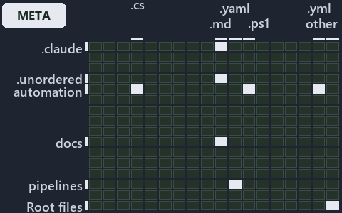

---
catzc:
  immutable:
    with_body_sha: d02faea02166
    repo_status: locked
    path: docs/explanation/.assets/grid/adr-auto-path--two-forms-never-a-third--meta.grid.md
    source: docs/explanation/.assets/adr-auto-path--two-forms-never-a-third--meta.drawio.png
    kind: asset-description
    language: markdown
    filetype: md
    track: docs
    tracktype: documentation
---

# A path has two forms, never a third, and one pair of crossers moves it between them: the world-map minimap

```text
Where the files that cite ADR-AUTO-PATH sit in the repository: tracks down, file languages across.
5 of 342 cells lit, holding 37 files.
```



This is the world-map minimap in the sidebar of the meta diagram of [A path has two forms, never a third, and one pair of crossers moves it
between them][41], which explains [ADR-AUTO-PATH][1]. It lights every cell of the world map that holds a file citing those codes, so it
shows where the decision lives in the repository. Each lit cell has its reason below, naming the code that selects it.

## What the minimap shows

The grid crosses the 18 tracks (rows) with the 19 file languages (columns) of the world map and lights 5 cells, filled in ink. A cell lit
only by passing mentions (citations in body comments, not in a file's header or text) is touched: a lighter ink. Every other cell is idle, a
grey box: it holds files the slide's ADR codes do not select, or no file at all (288 of the 342 cells hold none). The minimap shows where
the slide sits, not how many files a cell holds; the world-map PDFs show the counts.

- .claude × markdown: 2 lit of 90 files
- automation × powershell: 4 lit of 1629 files
- automation × yaml: 2 lit of 112 files
- docs × markdown: 28 lit of 2742 files
- pipelines × pipeline-yaml: 1 lit of 9 files

## Key

A lit row prints its track's name; a lit column prints a short code, the first extension of its file language:

- `.md`: markdown
- `.yaml`: pipeline-yaml
- `.ps1`: powershell
- `.yml`: yaml

## Why each cell is lit

### .claude × markdown (2 lit files)

Placed: the root folder `.claude/` names the track .claude ([ADR-DSGN-TRACK#1][2]); the extension `.md` names the file language markdown
([ADR-DSGN-TRACK#6][3]). Lit ([ADR-DSGN-TRACK#12][4]) by:

- [.claude/plans/plan-layers-vocabulary-rename-contracts.md][5]: selected by [ADR-AUTO-PATH][1]: the file cites it at line 753 (text).
- [.claude/skills/catzc-module/SKILL.md][6]: selected by [ADR-AUTO-PATH][1]: the file cites it at line 27 (text), line 40 (text) and line 40
  (text).

### automation × powershell (4 lit files)

Placed: the root folder `automation/` names the track automation ([ADR-DSGN-TRACK#1][2]); the extension `.ps1` names the file language
powershell ([ADR-DSGN-TRACK#6][3]). Lit ([ADR-DSGN-TRACK#12][4]) by:

- [automation/Catzc.Base.Contracts/tests/Get-Contract.Tests.ps1][7]: selected by [ADR-AUTO-PATH][1]: the file cites it at line 27 (body
  comment) (a passing mention only).
- [automation/Catzc.Base.Contracts/tests/types/ContractAsset.Tests.ps1][8]: selected by [ADR-AUTO-PATH][1]: the file cites it at line 13
  (text).
- [automation/Catzc.Base.Objects/tests/types/ArtifactRef.Tests.ps1][9]: selected by [ADR-AUTO-PATH][1]: the file cites it at line 1 (text).
- [automation/Catzc.Base.Slides/tests/types/SlidesConfig.Tests.ps1][10]: selected by [ADR-AUTO-PATH][1]: the file cites it at line 22
  (text).

### automation × yaml (2 lit files)

Placed: the root folder `automation/` names the track automation ([ADR-DSGN-TRACK#1][2]); the extension `.yml` names the file language yaml
([ADR-DSGN-TRACK#6][3]). Lit ([ADR-DSGN-TRACK#12][4]) by:

- [automation/Catzc.Base.Docs/configs/adrs.yml][11]: selected by [ADR-AUTO-PATH][1]: the file cites it at line 140 (text).
- [automation/Catzc.Base.ModuleSystem/configs/glossary.yml][12]: selected by [ADR-AUTO-PATH][1]: the file cites it at line 37 (text).

### docs × markdown (28 lit files)

Placed: the root folder `docs/` names the track docs ([ADR-DSGN-TRACK#1][2]); the extension `.md` names the file language markdown
([ADR-DSGN-TRACK#6][3]). Lit ([ADR-DSGN-TRACK#12][4]) by:

- [docs/adr/automation/dora-explains.md][13]: selected by [ADR-AUTO-PATH][1]: the file cites it at line 401 (text).
- [docs/adr/automation/path-representation.md][1]: selected by [ADR-AUTO-PATH][1]: the ADR's own file.
- [docs/adr/glossary.md][14]: selected by [ADR-AUTO-PATH][1]: the file cites it at line 752 (text).
- [docs/adr/index.md][15]: selected by [ADR-AUTO-PATH][1]: the file cites it at line 171 (text).
- [docs/references/automation/catzc-base-contracts/Get-Contract.ps1.md][16]: selected by [ADR-AUTO-PATH][1]: the file cites it at line 21
  (text).
- [docs/references/automation/catzc-base-contracts/Publish-ContractRelease.ps1.md][17]: selected by [ADR-AUTO-PATH][1]: the file cites it at
  line 44 (text).
- [docs/references/automation/catzc-base-contracts/private/Get-ContractFileHashes.ps1.md][18]: selected by [ADR-AUTO-PATH][1]: the file
  cites it at line 29 (text).
- [docs/references/automation/catzc-base-contracts/tests/types/ContractAsset.Tests.ps1.md][19]: selected by [ADR-AUTO-PATH][1]: the file
  cites it at line 12 (text).
- [docs/references/automation/catzc-base-contracts/types/ContractAsset.cs.md][20]: selected by [ADR-AUTO-PATH][1]: the file cites it at line
  17 (text) and line 18 (text).
- [docs/references/automation/catzc-base-docs/configs/readme.yml.md][21]: selected by [ADR-AUTO-PATH][1]: the file cites it at line 30
  (text).
- [docs/references/automation/catzc-base-docs/types/DocMapping.cs.md][22]: selected by [ADR-AUTO-PATH][1]: the file cites it at line 13
  (text).
- [docs/references/automation/catzc-base-docs/types/DocPattern.cs.md][23]: selected by [ADR-AUTO-PATH][1]: the file cites it at line 14
  (text).
- [docs/references/automation/catzc-base-modulesystem/Copy-Automation.ps1.md][24]: selected by [ADR-AUTO-PATH][1]: the file cites it at line
  42 (text).
- [docs/references/automation/catzc-base-objects/types/ArtifactRef.cs.md][25]: selected by [ADR-AUTO-PATH][1]: the file cites it at line 17
  (text).
- [docs/references/automation/catzc-base-objects/types/RepoRelativePath.cs.md][26]: selected by [ADR-AUTO-PATH][1]: the file cites it at
  line 11 (text), line 16 (text), line 17 (text), line 21 (text) and line 40 (text).
- [docs/references/automation/catzc-base-repository/ConvertTo-RepoRelativePath.ps1.md][27]: selected by [ADR-AUTO-PATH][1]: the file cites
  it at line 15 (text) and line 23 (text).
- [docs/references/automation/catzc-base-repository/Get-RepositoryFile.ps1.md][28]: selected by [ADR-AUTO-PATH][1]: the file cites it at
  line 14 (text).
- [docs/references/automation/catzc-base-repository/Get-RepositoryFolder.ps1.md][29]: selected by [ADR-AUTO-PATH][1]: the file cites it at
  line 14 (text).
- [docs/references/automation/catzc-base-repository/Resolve-RepoPath.ps1.md][30]: selected by [ADR-AUTO-PATH][1]: the file cites it at line
  15 (text).
- [docs/references/automation/catzc-base-rootconfig/configs/rootconfig.yml.md][31]: selected by [ADR-AUTO-PATH][1]: the file cites it at
  line 28 (text).
- [docs/references/automation/catzc-base-rootconfig/types/RootConfigFile.cs.md][32]: selected by [ADR-AUTO-PATH][1]: the file cites it at
  line 23 (text).
- [docs/references/automation/catzc-tooling-inspiration/configs/inspiration.yml.md][33]: selected by [ADR-AUTO-PATH][1]: the file cites it
  at line 24 (text).
- [docs/references/automation/catzc-tooling-inspiration/private/Resolve-InspirationRoot.ps1.md][34]: selected by [ADR-AUTO-PATH][1]: the
  file cites it at line 15 (text), line 16 (text) and line 19 (text).
- [docs/references/automation/catzc-tooling-inspiration/tests/Resolve-InspirationRoot.Tests.ps1.md][35]: selected by [ADR-AUTO-PATH][1]: the
  file cites it at line 14 (text).
- [docs/references/automation/catzc-tooling-inspiration/tests/types/InspirationConfig.Tests.ps1.md][36]: selected by [ADR-AUTO-PATH][1]: the
  file cites it at line 14 (text).
- [docs/references/automation/catzc-tooling-inspiration/tests/types/InspirationRoot.Tests.ps1.md][37]: selected by [ADR-AUTO-PATH][1]: the
  file cites it at line 13 (text).
- [docs/references/automation/catzc-tooling-inspiration/types/Inspiration.cs.md][38]: selected by [ADR-AUTO-PATH][1]: the file cites it at
  line 17 (text).
- [docs/references/automation/catzc-tooling-inspiration/types/InspirationRoot.cs.md][39]: selected by [ADR-AUTO-PATH][1]: the file cites it
  at line 12 (text), line 14 (text) and line 15 (text).

### pipelines × pipeline-yaml (1 lit file)

Placed: the root folder `pipelines/` names the track pipelines ([ADR-DSGN-TRACK#1][2]); the extension `.yaml` names the file language
pipeline-yaml ([ADR-DSGN-TRACK#6][3]). Lit ([ADR-DSGN-TRACK#12][4]) by:

- [pipelines/ci-automation.yaml][40]: selected by [ADR-AUTO-PATH][1]: a pipeline that cites nothing itself carries its globset's citations,
  which cite it at `automation/Catzc.Base.Contracts/tests/Get-Contract.Tests.ps1` line 27 (body comment),
  `automation/Catzc.Base.Contracts/tests/types/ContractAsset.Tests.ps1` line 13 (text), `automation/Catzc.Base.Docs/configs/adrs.yml` line
  140 (text), `automation/Catzc.Base.ModuleSystem/configs/glossary.yml` line 37 (text),
  `automation/Catzc.Base.Objects/tests/types/ArtifactRef.Tests.ps1` line 1 (text) and
  `automation/Catzc.Base.Slides/tests/types/SlidesConfig.Tests.ps1` line 22 (text).

## Keywords

- [world map][42]
- [track][43]
- [file language][44]
- [cell][45]
- [lit cell][46]
- [.claude][47]: a track
- [automation][47]: a track
- [docs][47]: a track
- [pipelines][47]: a track
- [markdown][48]: a file language
- [pipeline-yaml][48]: a file language
- [powershell][48]: a file language
- [yaml][48]: a file language

Terms the cited ADRs define:

- [published artifact][49], defined by [ADR-AUTO-PATH#10][50]

[1]: ../../../adr/automation/path-representation.md
[2]: ../../../adr/design/tracks.md#rule-adr-dsgn-track1
[3]: ../../../adr/design/tracks.md#rule-adr-dsgn-track6
[4]: ../../../adr/design/tracks.md#rule-adr-dsgn-track12
[5]: ../../../../.claude/plans/plan-layers-vocabulary-rename-contracts.md
[6]: ../../../../.claude/skills/catzc-module/SKILL.md
[7]: ../../../../automation/Catzc.Base.Contracts/tests/Get-Contract.Tests.ps1
[8]: ../../../../automation/Catzc.Base.Contracts/tests/types/ContractAsset.Tests.ps1
[9]: ../../../../automation/Catzc.Base.Objects/tests/types/ArtifactRef.Tests.ps1
[10]: ../../../../automation/Catzc.Base.Slides/tests/types/SlidesConfig.Tests.ps1
[11]: ../../../../automation/Catzc.Base.Docs/configs/adrs.yml
[12]: ../../../../automation/Catzc.Base.ModuleSystem/configs/glossary.yml
[13]: ../../../adr/automation/dora-explains.md
[14]: ../../../adr/glossary.md
[15]: ../../../adr/index.md
[16]: ../../../references/automation/catzc-base-contracts/Get-Contract.ps1.md
[17]: ../../../references/automation/catzc-base-contracts/Publish-ContractRelease.ps1.md
[18]: ../../../references/automation/catzc-base-contracts/private/Get-ContractFileHashes.ps1.md
[19]: ../../../references/automation/catzc-base-contracts/tests/types/ContractAsset.Tests.ps1.md
[20]: ../../../references/automation/catzc-base-contracts/types/ContractAsset.cs.md
[21]: ../../../references/automation/catzc-base-docs/configs/readme.yml.md
[22]: ../../../references/automation/catzc-base-docs/types/DocMapping.cs.md
[23]: ../../../references/automation/catzc-base-docs/types/DocPattern.cs.md
[24]: ../../../references/automation/catzc-base-modulesystem/Copy-Automation.ps1.md
[25]: ../../../references/automation/catzc-base-objects/types/ArtifactRef.cs.md
[26]: ../../../references/automation/catzc-base-objects/types/RepoRelativePath.cs.md
[27]: ../../../references/automation/catzc-base-repository/ConvertTo-RepoRelativePath.ps1.md
[28]: ../../../references/automation/catzc-base-repository/Get-RepositoryFile.ps1.md
[29]: ../../../references/automation/catzc-base-repository/Get-RepositoryFolder.ps1.md
[30]: ../../../references/automation/catzc-base-repository/Resolve-RepoPath.ps1.md
[31]: ../../../references/automation/catzc-base-rootconfig/configs/rootconfig.yml.md
[32]: ../../../references/automation/catzc-base-rootconfig/types/RootConfigFile.cs.md
[33]: ../../../references/automation/catzc-tooling-inspiration/configs/inspiration.yml.md
[34]: ../../../references/automation/catzc-tooling-inspiration/private/Resolve-InspirationRoot.ps1.md
[35]: ../../../references/automation/catzc-tooling-inspiration/tests/Resolve-InspirationRoot.Tests.ps1.md
[36]: ../../../references/automation/catzc-tooling-inspiration/tests/types/InspirationConfig.Tests.ps1.md
[37]: ../../../references/automation/catzc-tooling-inspiration/tests/types/InspirationRoot.Tests.ps1.md
[38]: ../../../references/automation/catzc-tooling-inspiration/types/Inspiration.cs.md
[39]: ../../../references/automation/catzc-tooling-inspiration/types/InspirationRoot.cs.md
[40]: ../../../../pipelines/ci-automation.yaml
[41]: ../../automation/two-forms-never-a-third.md
[42]: ../../../adr/glossary.md#world-map
[43]: ../../../adr/glossary.md#track
[44]: ../../../adr/glossary.md#file-language
[45]: ../../../adr/glossary.md#cell
[46]: ../../../adr/glossary.md#lit-cell
[47]: ../../../../automation/Catzc.Base.Variants/configs/variants.yml
[48]: ../../../../automation/Catzc.Base.Languages/configs/languages.yml
[49]: ../../../adr/glossary.md#published-artifact
[50]: ../../../adr/automation/path-representation.md#rule-adr-auto-path10
