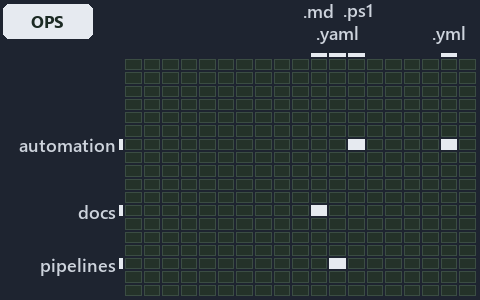

---
catzc:
  immutable:
    with_body_sha: ef0a11f5bfcc
    repo_status: locked
    path: docs/explanation/.assets/grid/adr-az-naming--names-are-derived-never-typed--operations.grid.md
    source: docs/explanation/.assets/adr-az-naming--names-are-derived-never-typed--operations.drawio.png
    kind: asset-description
    language: markdown
    filetype: md
    track: docs
    tracktype: documentation
---

# Nobody types an Azure name: cats derives it, and a bad name stops with an error: the world-map minimap

```text
Where the files that cite ADR-AZ-NAMING sit in the repository: tracks down, file languages across.
4 of 342 cells lit, holding 22 files.
```



This is the world-map minimap in the sidebar of the operations diagram of [Nobody types an Azure name: cats derives it, and a bad name stops
with an error][26], which explains [ADR-AZ-NAMING][1]. It lights every cell of the world map that holds a file citing those codes, so it
shows where the decision lives in the repository. Each lit cell has its reason below, naming the code that selects it.

## What the minimap shows

The grid crosses the 18 tracks (rows) with the 19 file languages (columns) of the world map and lights 4 cells, filled in ink. A cell lit
only by passing mentions (citations in body comments, not in a file's header or text) is touched: a lighter ink. Every other cell is idle, a
grey box: it holds files the slide's ADR codes do not select, or no file at all (288 of the 342 cells hold none). The minimap shows where
the slide sits, not how many files a cell holds; the world-map PDFs show the counts.

- automation × powershell: 2 lit of 1629 files
- automation × yaml: 1 lit of 112 files
- docs × markdown: 18 lit of 2742 files
- pipelines × pipeline-yaml: 1 lit of 9 files

## Key

A lit row prints its track's name; a lit column prints a short code, the first extension of its file language:

- `.md`: markdown
- `.yaml`: pipeline-yaml
- `.ps1`: powershell
- `.yml`: yaml

## Why each cell is lit

### automation × powershell (2 lit files)

Placed: the root folder `automation/` names the track automation ([ADR-DSGN-TRACK#1][2]); the extension `.ps1` names the file language
powershell ([ADR-DSGN-TRACK#6][3]). Lit ([ADR-DSGN-TRACK#12][4]) by:

- [automation/Catzc.Azure.Templates/tests/Build-Bicep.Integrity.Tests.ps1][5]: selected by [ADR-AZ-NAMING][1]: the file cites it at line 46
  (text).
- [automation/Catzc.Base.Docs/Build-AdrIndex.ps1][6]: selected by [ADR-AZ-NAMING][1]: the file cites it at line 39 (body comment) (a passing
  mention only).

### automation × yaml (1 lit file)

Placed: the root folder `automation/` names the track automation ([ADR-DSGN-TRACK#1][2]); the extension `.yml` names the file language yaml
([ADR-DSGN-TRACK#6][3]). Lit ([ADR-DSGN-TRACK#12][4]) by:

- [automation/Catzc.Base.Docs/configs/adrs.yml][7]: selected by [ADR-AZ-NAMING][1]: the file cites it at line 257 (text).

### docs × markdown (18 lit files)

Placed: the root folder `docs/` names the track docs ([ADR-DSGN-TRACK#1][2]); the extension `.md` names the file language markdown
([ADR-DSGN-TRACK#6][3]). Lit ([ADR-DSGN-TRACK#12][4]) by:

- [docs/adr/azure/azure-naming-standard.md][1]: selected by [ADR-AZ-NAMING][1]: the ADR's own file.
- [docs/adr/azure/dora-explains.md][8]: selected by [ADR-AZ-NAMING][1]: the file cites it at line 43 (text).
- [docs/adr/index.md][9]: selected by [ADR-AZ-NAMING][1]: the file cites it at line 31 (text) and line 282 (text).
- [docs/how-to/getting-started/automation/add-a-doc-chapter.md][10]: selected by [ADR-AZ-NAMING][1]: the file cites it at line 67 (text).
- [docs/references/.assets/automation/catzc-azure-templates/bicep-template-is-a-folder.drawio.verify.md][11]: selected by
  [ADR-AZ-NAMING][1]: the file cites it at line 43 (text).
- [docs/references/.assets/automation/catzc-azure/azure-identity-resolves-from-config.drawio.verify.md][12]: selected by [ADR-AZ-NAMING][1]:
  the file cites it at line 54 (text).
- [docs/references/automation/catzc-azure-templates/Get-AzureResourceName.ps1.md][13]: selected by [ADR-AZ-NAMING][1]: the file cites it at
  line 97 (text), line 108 (text) and line 127 (text).
- [docs/references/automation/catzc-azure-templates/Get-AzureResourceTypeSet.ps1.md][14]: selected by [ADR-AZ-NAMING][1]: the file cites it
  at line 29 (text) and line 32 (text).
- [docs/references/automation/catzc-azure-templates/Get-BicepResourceName.ps1.md][15]: selected by [ADR-AZ-NAMING][1]: the file cites it at
  line 76 (text).
- [docs/references/automation/catzc-azure-templates/Get-BicepTemplates.ps1.md][16]: selected by [ADR-AZ-NAMING][1]: the file cites it at
  line 142 (text).
- [docs/references/automation/catzc-azure-templates/bicep-template-is-a-folder.drawio.md][17]: selected by [ADR-AZ-NAMING][1]: the file
  cites it at line 28 (text) and line 94 (text).
- [docs/references/automation/catzc-azure-templates/tests/types/BicepShortName.Tests.ps1.md][18]: selected by [ADR-AZ-NAMING][1]: the file
  cites it at line 14 (text).
- [docs/references/automation/catzc-azure-templates/types/BicepShortName.cs.md][19]: selected by [ADR-AZ-NAMING][1]: the file cites it at
  line 12 (text), line 32 (text) and line 64 (text).
- [docs/references/automation/catzc-azure/configs/azure.yml.md][20]: selected by [ADR-AZ-NAMING][1]: the file cites it at line 32 (text),
  line 77 (text) and line 110 (text).
- [docs/references/automation/catzc-azure/configs/customer.yml.md][21]: selected by [ADR-AZ-NAMING][1]: the file cites it at line 19 (text).
- [docs/references/automation/catzc-azure/types/AzureConfig.cs.md][22]: selected by [ADR-AZ-NAMING][1]: the file cites it at line 28 (text).
- [docs/references/automation/catzc-azure/types/AzureEnvironmentRecord.cs.md][23]: selected by [ADR-AZ-NAMING][1]: the file cites it at line
  12 (text).
- [docs/references/automation/catzc-base-variants/configs/variants.yml.md][24]: selected by [ADR-AZ-NAMING][1]: the file cites it at line 23
  (text).

### pipelines × pipeline-yaml (1 lit file)

Placed: the root folder `pipelines/` names the track pipelines ([ADR-DSGN-TRACK#1][2]); the extension `.yaml` names the file language
pipeline-yaml ([ADR-DSGN-TRACK#6][3]). Lit ([ADR-DSGN-TRACK#12][4]) by:

- [pipelines/ci-automation.yaml][25]: selected by [ADR-AZ-NAMING][1]: a pipeline that cites nothing itself carries its globset's citations,
  which cite it at `automation/Catzc.Azure.Templates/tests/Build-Bicep.Integrity.Tests.ps1` line 46 (text),
  `automation/Catzc.Base.Docs/Build-AdrIndex.ps1` line 39 (body comment) and `automation/Catzc.Base.Docs/configs/adrs.yml` line 257 (text).

## Keywords

- [world map][27]
- [track][28]
- [file language][29]
- [cell][30]
- [lit cell][31]
- [automation][32]: a track
- [docs][32]: a track
- [pipelines][32]: a track
- [markdown][33]: a file language
- [pipeline-yaml][33]: a file language
- [powershell][33]: a file language
- [yaml][33]: a file language

[1]: ../../../adr/azure/azure-naming-standard.md
[2]: ../../../adr/design/tracks.md#rule-adr-dsgn-track1
[3]: ../../../adr/design/tracks.md#rule-adr-dsgn-track6
[4]: ../../../adr/design/tracks.md#rule-adr-dsgn-track12
[5]: ../../../../automation/Catzc.Azure.Templates/tests/Build-Bicep.Integrity.Tests.ps1
[6]: ../../../../automation/Catzc.Base.Docs/Build-AdrIndex.ps1
[7]: ../../../../automation/Catzc.Base.Docs/configs/adrs.yml
[8]: ../../../adr/azure/dora-explains.md
[9]: ../../../adr/index.md
[10]: ../../../how-to/getting-started/automation/add-a-doc-chapter.md
[11]: ../../../references/.assets/automation/catzc-azure-templates/bicep-template-is-a-folder.drawio.verify.md
[12]: ../../../references/.assets/automation/catzc-azure/azure-identity-resolves-from-config.drawio.verify.md
[13]: ../../../references/automation/catzc-azure-templates/Get-AzureResourceName.ps1.md
[14]: ../../../references/automation/catzc-azure-templates/Get-AzureResourceTypeSet.ps1.md
[15]: ../../../references/automation/catzc-azure-templates/Get-BicepResourceName.ps1.md
[16]: ../../../references/automation/catzc-azure-templates/Get-BicepTemplates.ps1.md
[17]: ../../../references/automation/catzc-azure-templates/bicep-template-is-a-folder.drawio.md
[18]: ../../../references/automation/catzc-azure-templates/tests/types/BicepShortName.Tests.ps1.md
[19]: ../../../references/automation/catzc-azure-templates/types/BicepShortName.cs.md
[20]: ../../../references/automation/catzc-azure/configs/azure.yml.md
[21]: ../../../references/automation/catzc-azure/configs/customer.yml.md
[22]: ../../../references/automation/catzc-azure/types/AzureConfig.cs.md
[23]: ../../../references/automation/catzc-azure/types/AzureEnvironmentRecord.cs.md
[24]: ../../../references/automation/catzc-base-variants/configs/variants.yml.md
[25]: ../../../../pipelines/ci-automation.yaml
[26]: ../../azure/names-are-derived-never-typed.md
[27]: ../../../adr/glossary.md#world-map
[28]: ../../../adr/glossary.md#track
[29]: ../../../adr/glossary.md#file-language
[30]: ../../../adr/glossary.md#cell
[31]: ../../../adr/glossary.md#lit-cell
[32]: ../../../../automation/Catzc.Base.Variants/configs/variants.yml
[33]: ../../../../automation/Catzc.Base.Languages/configs/languages.yml
