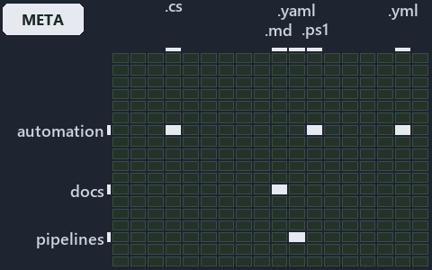

# An Azure name is a pure function of its components, and it is never truncated: the world-map minimap

```text
Where the files that cite ADR-AZ-NAMING sit in the repository: tracks down, file languages across.
5 of 324 cells lit, holding 29 files.
```



This is the world-map minimap in the sidebar of the meta diagram of [An Azure name is a pure function of its components, and it is never
truncated][33], which explains [ADR-AZ-NAMING][1]. It lights every cell of the world map that holds a file citing those codes, so it shows
where the decision lives in the repository. Each lit cell has its reason below, naming the code that selects it.

## What the minimap shows

The grid crosses the 18 tracks (rows) with the 18 file languages (columns) of the world map and lights 5 cells, filled in ink. A cell lit
only by passing mentions (citations in body comments, not in a file's header or text) is touched: a lighter ink. Every other cell is idle, a
grey box: it holds files the slide's ADR codes do not select, or no file at all (271 of the 324 cells hold none). The minimap shows where
the slide sits, not how many files a cell holds; the world-map PDFs show the counts.

- automation × csharp: 3 lit of 286 files
- automation × powershell: 7 lit of 1618 files
- automation × yaml: 1 lit of 112 files
- docs × markdown: 17 lit of 2220 files
- pipelines × pipeline-yaml: 1 lit of 9 files

## Key

A lit row prints its track's name; a lit column prints a short code, the first extension of its file language:

- `.cs`: csharp
- `.md`: markdown
- `.yaml`: pipeline-yaml
- `.ps1`: powershell
- `.yml`: yaml

## Why each cell is lit

### automation × csharp (3 lit files)

Placed: the root folder `automation/` names the track automation ([ADR-DSGN-TRACK#1][2]); the extension `.cs` names the file language csharp
([ADR-DSGN-TRACK#6][3]). Lit ([ADR-DSGN-TRACK#12][4]) by:

- [automation/Catzc.Azure.Templates/types/BicepShortName.cs][5]: selected by [ADR-AZ-NAMING][1]: the file cites it at line 22 (text).
- [automation/Catzc.Azure/types/AzureConfig.cs][6]: selected by [ADR-AZ-NAMING][1]: the file cites it at line 25 (text).
- [automation/Catzc.Azure/types/AzureEnvironmentRecord.cs][7]: selected by [ADR-AZ-NAMING][1]: the file cites it at line 22 (text).

### automation × powershell (7 lit files)

Placed: the root folder `automation/` names the track automation ([ADR-DSGN-TRACK#1][2]); the extension `.ps1` names the file language
powershell ([ADR-DSGN-TRACK#6][3]). Lit ([ADR-DSGN-TRACK#12][4]) by:

- [automation/Catzc.Azure.Templates/Get-AzureResourceName.ps1][8]: selected by [ADR-AZ-NAMING][1]: the file cites it at line 21 (header).
- [automation/Catzc.Azure.Templates/Get-AzureResourceTypeSet.ps1][9]: selected by [ADR-AZ-NAMING][1]: the file cites it at line 20 (header),
  line 37 (header) and line 40 (header).
- [automation/Catzc.Azure.Templates/Get-BicepResourceName.ps1][10]: selected by [ADR-AZ-NAMING][1]: the file cites it at line 21 (header).
- [automation/Catzc.Azure.Templates/Get-BicepTemplates.ps1][11]: selected by [ADR-AZ-NAMING][1]: the file cites it at line 24 (header).
- [automation/Catzc.Azure.Templates/tests/Build-Bicep.Integrity.Tests.ps1][12]: selected by [ADR-AZ-NAMING][1]: the file cites it at line 21
  (header) and line 70 (text).
- [automation/Catzc.Azure.Templates/tests/types/BicepShortName.Tests.ps1][13]: selected by [ADR-AZ-NAMING][1]: the file cites it at line 21
  (header).
- [automation/Catzc.Base.Docs/Build-AdrIndex.ps1][14]: selected by [ADR-AZ-NAMING][1]: the file cites it at line 25 (header) and line 102
  (body comment).

### automation × yaml (1 lit file)

Placed: the root folder `automation/` names the track automation ([ADR-DSGN-TRACK#1][2]); the extension `.yml` names the file language yaml
([ADR-DSGN-TRACK#6][3]). Lit ([ADR-DSGN-TRACK#12][4]) by:

- [automation/Catzc.Base.Docs/configs/adrs.yml][15]: selected by [ADR-AZ-NAMING][1]: the file cites it at line 276 (text).

### docs × markdown (17 lit files)

Placed: the root folder `docs/` names the track docs ([ADR-DSGN-TRACK#1][2]); the extension `.md` names the file language markdown
([ADR-DSGN-TRACK#6][3]). Lit ([ADR-DSGN-TRACK#12][4]) by:

- [docs/adr/azure/azure-naming-standard.md][1]: selected by [ADR-AZ-NAMING][1]: the ADR's own file.
- [docs/adr/azure/dora-explains.md][16]: selected by [ADR-AZ-NAMING][1]: the file cites it at line 74 (text).
- [docs/adr/index.md][17]: selected by [ADR-AZ-NAMING][1]: the file cites it at line 31 (text) and line 282 (text).
- [docs/how-to/getting-started/automation/add-a-doc-chapter.md][18]: selected by [ADR-AZ-NAMING][1]: the file cites it at line 89 (text).
- [docs/references/.assets/automation/catzc-azure-templates/bicep-template-is-a-folder.drawio.verify.md][19]: selected by
  [ADR-AZ-NAMING][1]: the file cites it at line 17 (text) and line 65 (text).
- [docs/references/.assets/automation/catzc-azure/azure-identity-resolves-from-config.drawio.verify.md][20]: selected by [ADR-AZ-NAMING][1]:
  the file cites it at line 19 (text) and line 77 (text).
- [docs/references/automation/catzc-azure-templates/Get-AzureResourceName.ps1.md][21]: selected by [ADR-AZ-NAMING][1]: the file cites it at
  line 17 (text), line 34 (text), line 45 (text) and line 64 (text).
- [docs/references/automation/catzc-azure-templates/Get-BicepResourceName.ps1.md][22]: selected by [ADR-AZ-NAMING][1]: the file cites it at
  line 17 (text) and line 35 (text).
- [docs/references/automation/catzc-azure-templates/Get-BicepTemplates.ps1.md][23]: selected by [ADR-AZ-NAMING][1]: the file cites it at
  line 17 (text) and line 104 (text).
- [docs/references/automation/catzc-azure-templates/bicep-template-is-a-folder.drawio.md][24]: selected by [ADR-AZ-NAMING][1]: the file
  cites it at line 17 (text), line 52 (text) and line 118 (text).
- [docs/references/automation/catzc-azure-templates/tests/types/BicepShortName.Tests.ps1.md][25]: selected by [ADR-AZ-NAMING][1]: the file
  cites it at line 18 (text) and line 34 (text).
- [docs/references/automation/catzc-azure-templates/types/BicepShortName.cs.md][26]: selected by [ADR-AZ-NAMING][1]: the file cites it at
  line 18 (text), line 32 (text), line 52 (text) and line 84 (text).
- [docs/references/automation/catzc-azure/configs/azure.yml.md][27]: selected by [ADR-AZ-NAMING][1]: the file cites it at line 51 (text),
  line 96 (text) and line 129 (text).
- [docs/references/automation/catzc-azure/configs/customer.yml.md][28]: selected by [ADR-AZ-NAMING][1]: the file cites it at line 35 (text).
- [docs/references/automation/catzc-azure/types/AzureConfig.cs.md][29]: selected by [ADR-AZ-NAMING][1]: the file cites it at line 21 (text)
  and line 51 (text).
- [docs/references/automation/catzc-azure/types/AzureEnvironmentRecord.cs.md][30]: selected by [ADR-AZ-NAMING][1]: the file cites it at line
  31 (text).
- [docs/references/automation/catzc-base-variants/configs/variants.yml.md][31]: selected by [ADR-AZ-NAMING][1]: the file cites it at line 42
  (text).

### pipelines × pipeline-yaml (1 lit file)

Placed: the root folder `pipelines/` names the track pipelines ([ADR-DSGN-TRACK#1][2]); the extension `.yaml` names the file language
pipeline-yaml ([ADR-DSGN-TRACK#6][3]). Lit ([ADR-DSGN-TRACK#12][4]) by:

- [pipelines/ci-automation.yaml][32]: selected by [ADR-AZ-NAMING][1]: a pipeline that cites nothing itself carries its globset's citations,
  which cite it at `automation/Catzc.Azure.Templates/Get-AzureResourceName.ps1` line 21 (header),
  `automation/Catzc.Azure.Templates/Get-AzureResourceTypeSet.ps1` line 20 (header),
  `automation/Catzc.Azure.Templates/Get-AzureResourceTypeSet.ps1` line 37 (header),
  `automation/Catzc.Azure.Templates/Get-AzureResourceTypeSet.ps1` line 40 (header),
  `automation/Catzc.Azure.Templates/Get-BicepResourceName.ps1` line 21 (header), `automation/Catzc.Azure.Templates/Get-BicepTemplates.ps1`
  line 24 (header), `automation/Catzc.Azure.Templates/tests/Build-Bicep.Integrity.Tests.ps1` line 21 (header),
  `automation/Catzc.Azure.Templates/tests/Build-Bicep.Integrity.Tests.ps1` line 70 (text),
  `automation/Catzc.Azure.Templates/tests/types/BicepShortName.Tests.ps1` line 21 (header),
  `automation/Catzc.Azure.Templates/types/BicepShortName.cs` line 22 (text), `automation/Catzc.Azure/types/AzureConfig.cs` line 25 (text),
  `automation/Catzc.Azure/types/AzureEnvironmentRecord.cs` line 22 (text), `automation/Catzc.Base.Docs/Build-AdrIndex.ps1` line 25 (header),
  `automation/Catzc.Base.Docs/Build-AdrIndex.ps1` line 102 (body comment) and `automation/Catzc.Base.Docs/configs/adrs.yml` line 276 (text).

## Keywords

- [world map][34]
- [track][35]
- [file language][36]
- [cell][37]
- [lit cell][38]
- [automation][39]: a track
- [docs][39]: a track
- [pipelines][39]: a track
- [csharp][40]: a file language
- [markdown][40]: a file language
- [pipeline-yaml][40]: a file language
- [powershell][40]: a file language
- [yaml][40]: a file language

[1]: ../../../adr/azure/azure-naming-standard.md
[2]: ../../../adr/design/tracks.md#rule-adr-dsgn-track1
[3]: ../../../adr/design/tracks.md#rule-adr-dsgn-track6
[4]: ../../../adr/design/tracks.md#rule-adr-dsgn-track12
[5]: ../../../../automation/Catzc.Azure.Templates/types/BicepShortName.cs
[6]: ../../../../automation/Catzc.Azure/types/AzureConfig.cs
[7]: ../../../../automation/Catzc.Azure/types/AzureEnvironmentRecord.cs
[8]: ../../../../automation/Catzc.Azure.Templates/Get-AzureResourceName.ps1
[9]: ../../../../automation/Catzc.Azure.Templates/Get-AzureResourceTypeSet.ps1
[10]: ../../../../automation/Catzc.Azure.Templates/Get-BicepResourceName.ps1
[11]: ../../../../automation/Catzc.Azure.Templates/Get-BicepTemplates.ps1
[12]: ../../../../automation/Catzc.Azure.Templates/tests/Build-Bicep.Integrity.Tests.ps1
[13]: ../../../../automation/Catzc.Azure.Templates/tests/types/BicepShortName.Tests.ps1
[14]: ../../../../automation/Catzc.Base.Docs/Build-AdrIndex.ps1
[15]: ../../../../automation/Catzc.Base.Docs/configs/adrs.yml
[16]: ../../../adr/azure/dora-explains.md
[17]: ../../../adr/index.md
[18]: ../../../how-to/getting-started/automation/add-a-doc-chapter.md
[19]: ../../../references/.assets/automation/catzc-azure-templates/bicep-template-is-a-folder.drawio.verify.md
[20]: ../../../references/.assets/automation/catzc-azure/azure-identity-resolves-from-config.drawio.verify.md
[21]: ../../../references/automation/catzc-azure-templates/Get-AzureResourceName.ps1.md
[22]: ../../../references/automation/catzc-azure-templates/Get-BicepResourceName.ps1.md
[23]: ../../../references/automation/catzc-azure-templates/Get-BicepTemplates.ps1.md
[24]: ../../../references/automation/catzc-azure-templates/bicep-template-is-a-folder.drawio.md
[25]: ../../../references/automation/catzc-azure-templates/tests/types/BicepShortName.Tests.ps1.md
[26]: ../../../references/automation/catzc-azure-templates/types/BicepShortName.cs.md
[27]: ../../../references/automation/catzc-azure/configs/azure.yml.md
[28]: ../../../references/automation/catzc-azure/configs/customer.yml.md
[29]: ../../../references/automation/catzc-azure/types/AzureConfig.cs.md
[30]: ../../../references/automation/catzc-azure/types/AzureEnvironmentRecord.cs.md
[31]: ../../../references/automation/catzc-base-variants/configs/variants.yml.md
[32]: ../../../../pipelines/ci-automation.yaml
[33]: ../../azure/names-are-pure-and-never-truncated.md
[34]: ../../../adr/glossary.md#world-map
[35]: ../../../adr/glossary.md#track
[36]: ../../../adr/glossary.md#file-language
[37]: ../../../adr/glossary.md#cell
[38]: ../../../adr/glossary.md#lit-cell
[39]: ../../../../automation/Catzc.Base.Variants/configs/variants.yml
[40]: ../../../../automation/Catzc.Base.Languages/configs/languages.yml
