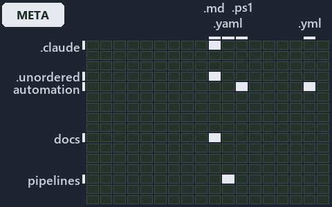

---
catzc:
  immutable:
    with_body_sha: "478b262d4f18"
    repo_status: locked
    path: docs/explanation/.assets/grid/adr-conf-addressing--an-address-is-a-read-only-walk--meta.grid.md
    source: docs/explanation/.assets/adr-conf-addressing--an-address-is-a-read-only-walk--meta.drawio.png
    role: asset-description
    language: markdown
    filetype: md
    track: docs
    tracktype: documentation
---

# A config address is a read-only walk over the one cached config, never a second reader: the world-map minimap

```text
Where the files that cite ADR-CONF-ADDRESSING sit in the repository: tracks down, file languages across.
5 of 342 cells lit, holding 17 files.
```



This is the world-map minimap in the sidebar of the meta diagram of [A config address is a read-only walk over the one cached config, never
a second reader][21], which explains [ADR-CONF-ADDRESSING][1]. It lights every cell of the world map that holds a file citing those codes,
so it shows where the decision lives in the repository. Each lit cell has its reason below, naming the code that selects it.

## What the minimap shows

The grid crosses the 18 tracks (rows) with the 19 file languages (columns) of the world map and lights 5 cells, filled in ink. A cell lit
only by passing mentions (citations in body comments, not in a file's header or text) is touched: a lighter ink. Every other cell is idle, a
grey box: it holds files the slide's ADR codes do not select, or no file at all (288 of the 342 cells hold none). The minimap shows where
the slide sits, not how many files a cell holds; the world-map PDFs show the counts.

- .claude × markdown: 2 lit of 90 files
- automation × powershell: 2 lit of 1629 files
- automation × yaml: 1 lit of 112 files
- docs × markdown: 11 lit of 2742 files
- pipelines × pipeline-yaml: 1 lit of 9 files

## Key

A lit row prints its track's name; a lit column prints a short code, the first extension of its file language:

- `.md`: markdown
- `.yaml`: pipeline-yaml
- `.ps1`: powershell
- `.yml`: yaml

## Why each cell is lit

### .claude × markdown (2 lit files)

Placed: the root folder `.claude/` names the track .claude ([ADR-DSGN-TRACK#1][2]); the extension `.md` names the file language markdown
([ADR-DSGN-TRACK#6][3]). Lit ([ADR-DSGN-TRACK#12][4]) by:

- [.claude/plans/plan-bounded-folder-enumeration.md][5]: selected by [ADR-CONF-ADDRESSING][1]: the file cites it at line 283 (text).
- [.claude/plans/prompt-bounded-folder-enumeration-continue.md][6]: selected by [ADR-CONF-ADDRESSING][1]: the file cites it at line 18
  (text).

### automation × powershell (2 lit files)

Placed: the root folder `automation/` names the track automation ([ADR-DSGN-TRACK#1][2]); the extension `.ps1` names the file language
powershell ([ADR-DSGN-TRACK#6][3]). Lit ([ADR-DSGN-TRACK#12][4]) by:

- [pwsh/Catzc.Base.Config/tests/Get-ConfigValue.Tests.ps1][7]: selected by [ADR-CONF-ADDRESSING][1]: the file cites it at line 37
  (text) and line 66 (text).
- [pwsh/Catzc.Base.Folders/tests/types/FolderWalkConfig.Tests.ps1][8]: selected by [ADR-CONF-ADDRESSING][1]: the file cites it at line
  54 (text).

### automation × yaml (1 lit file)

Placed: the root folder `automation/` names the track automation ([ADR-DSGN-TRACK#1][2]); the extension `.yml` names the file language yaml
([ADR-DSGN-TRACK#6][3]). Lit ([ADR-DSGN-TRACK#12][4]) by:

- [pwsh/Catzc.Base.Docs/configs/adrs.yml][9]: selected by [ADR-CONF-ADDRESSING][1]: the file cites it at line 209 (text).

### docs × markdown (11 lit files)

Placed: the root folder `docs/` names the track docs ([ADR-DSGN-TRACK#1][2]); the extension `.md` names the file language markdown
([ADR-DSGN-TRACK#6][3]). Lit ([ADR-DSGN-TRACK#12][4]) by:

- [docs/adr/configuration/config-value-addressing.md][1]: selected by [ADR-CONF-ADDRESSING][1]: the ADR's own file.
- [docs/adr/configuration/dora-explains.md][10]: selected by [ADR-CONF-ADDRESSING][1]: the file cites it at line 28 (text).
- [docs/adr/index.md][11]: selected by [ADR-CONF-ADDRESSING][1]: the file cites it at line 237 (text).
- [docs/references/.assets/automation/catzc-azure-templates/bicep-template-is-a-folder.drawio.verify.md][12]: selected by
  [ADR-CONF-ADDRESSING][1]: the file cites it at line 45 (text).
- [docs/references/pwsh/catzc-azure-templates/bicep-template-is-a-folder.drawio.md][13]: selected by [ADR-CONF-ADDRESSING][1]: the
  file cites it at line 32 (text) and line 95 (text).
- [docs/references/pwsh/catzc-azure-templates/private/Resolve-BicepParameterAddresses.ps1.md][14]: selected by
  [ADR-CONF-ADDRESSING][1]: the file cites it at line 17 (text) and line 21 (text).
- [docs/references/pwsh/catzc-base-config/Get-ConfigValue.ps1.md][15]: selected by [ADR-CONF-ADDRESSING][1]: the file cites it at line
  14 (text), line 23 (text), line 25 (text) and line 27 (text).
- [docs/references/pwsh/catzc-base-config/private/Resolve-ConfigKeyPath.ps1.md][16]: selected by [ADR-CONF-ADDRESSING][1]: the file
  cites it at line 14 (text), line 20 (text), line 22 (text) and line 26 (text).
- [docs/references/pwsh/catzc-base-languages/New-GoWorkspace.ps1.md][17]: selected by [ADR-CONF-ADDRESSING][1]: the file cites it at
  line 63 (text).
- [docs/references/pwsh/catzc-base-languages/New-PythonProject.ps1.md][18]: selected by [ADR-CONF-ADDRESSING][1]: the file cites it at
  line 56 (text).
- [docs/references/pwsh/catzc-tooling-environment/Write-EnvironmentSet.ps1.md][19]: selected by [ADR-CONF-ADDRESSING][1]: the file
  cites it at line 20 (text).

### pipelines × pipeline-yaml (1 lit file)

Placed: the root folder `pipelines/` names the track pipelines ([ADR-DSGN-TRACK#1][2]); the extension `.yaml` names the file language
pipeline-yaml ([ADR-DSGN-TRACK#6][3]). Lit ([ADR-DSGN-TRACK#12][4]) by:

- [pipelines/ci-automation.yaml][20]: selected by [ADR-CONF-ADDRESSING][1]: a pipeline that cites nothing itself carries its globset's
  citations, which cite it at `pwsh/Catzc.Base.Config/tests/Get-ConfigValue.Tests.ps1` line 37 (text),
  `pwsh/Catzc.Base.Config/tests/Get-ConfigValue.Tests.ps1` line 66 (text), `pwsh/Catzc.Base.Docs/configs/adrs.yml` line 209
  (text) and `pwsh/Catzc.Base.Folders/tests/types/FolderWalkConfig.Tests.ps1` line 54 (text).

## Keywords

- [world map][22]
- [track][23]
- [file language][24]
- [cell][25]
- [lit cell][26]
- [.claude][27]: a track
- [automation][27]: a track
- [docs][27]: a track
- [pipelines][27]: a track
- [markdown][28]: a file language
- [pipeline-yaml][28]: a file language
- [powershell][28]: a file language
- [yaml][28]: a file language

[1]: ../../../adr/configuration/config-value-addressing.md
[2]: ../../../adr/design/tracks.md#rule-adr-dsgn-track1
[3]: ../../../adr/design/tracks.md#rule-adr-dsgn-track6
[4]: ../../../adr/design/tracks.md#rule-adr-dsgn-track12
[5]: ../../../../.claude/plans/plan-bounded-folder-enumeration.md
[6]: ../../../../.claude/plans/prompt-bounded-folder-enumeration-continue.md
[7]: ../../../../pwsh/Catzc.Base.Config/tests/Get-ConfigValue.Tests.ps1
[8]: ../../../../pwsh/Catzc.Base.Folders/tests/types/FolderWalkConfig.Tests.ps1
[9]: ../../../../pwsh/Catzc.Base.Docs/configs/adrs.yml
[10]: ../../../adr/configuration/dora-explains.md
[11]: ../../../adr/index.md
[12]: ../../../references/.assets/automation/catzc-azure-templates/bicep-template-is-a-folder.drawio.verify.md
[13]: ../../../references/pwsh/catzc-azure-templates/bicep-template-is-a-folder.drawio.md
[14]: ../../../references/pwsh/catzc-azure-templates/private/Resolve-BicepParameterAddresses.ps1.md
[15]: ../../../references/pwsh/catzc-base-config/Get-ConfigValue.ps1.md
[16]: ../../../references/pwsh/catzc-base-config/private/Resolve-ConfigKeyPath.ps1.md
[17]: ../../../references/pwsh/catzc-base-languages/New-GoWorkspace.ps1.md
[18]: ../../../references/pwsh/catzc-base-languages/New-PythonProject.ps1.md
[19]: ../../../references/pwsh/catzc-tooling-environment/Write-EnvironmentSet.ps1.md
[20]: ../../../../pipelines/ci-automation.yaml
[21]: ../../configuration/an-address-is-a-read-only-walk.md
[22]: ../../../adr/glossary.md#world-map
[23]: ../../../adr/glossary.md#track
[24]: ../../../adr/glossary.md#file-language
[25]: ../../../adr/glossary.md#cell
[26]: ../../../adr/glossary.md#lit-cell
[27]: ../../../../pwsh/Catzc.Base.Variants/configs/variants.yml
[28]: ../../../../pwsh/Catzc.Base.Languages/configs/languages.yml
