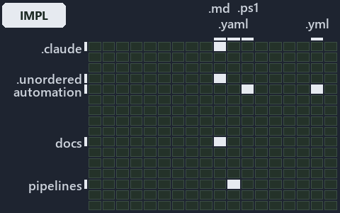

# docs/explanation/.assets/grid/adr-conf-addressing--strip-split-walk-every-wrong-turn-throws--implementation.grid.md

`Grid minimap: adr-conf-addressing--strip-split-walk-every-wrong-turn-throws--implementation`

The grid minimap of the slide `adr-conf-addressing--strip-split-walk-every-wrong-turn-throws--implementation` (implementation lens). The
slide supports [ADR-CONF-ADDRESSING][1]; the highlight of those ADR codes selects what is lit, and each reason below names the code that
selects it.

## What the minimap shows

The grid crosses the 16 tracks (rows) with the 18 file languages (columns) of the world map and lights 6 cells, filled in ink. A cell lit
only by passing mentions (citations in body comments, not in a file's header or text) is touched: a lighter ink. Every other cell is idle, a
grey box: it holds files the slide's ADR codes do not select, or no file at all (237 of the 288 cells hold none). The minimap shows where
the slide sits, not how many files a cell holds; the world-map PDFs show the counts.

- .claude × markdown: 2 lit of 71 files
- .unordered × markdown: 1 lit of 20 files
- automation × powershell: 7 lit of 1579 files
- automation × yaml: 1 lit of 109 files
- docs × markdown: 5 lit of 2165 files
- pipelines × pipeline-yaml: 1 lit of 9 files

## Key

A lit row prints its track's name; a lit column prints a short code, the first extension of its file language:

- `.md`: markdown
- `.yaml`: pipeline-yaml
- `.ps1`: powershell
- `.yml`: yaml

## Why each cell is lit

### .claude × markdown (2 lit files)

Placed: the root folder `.claude/` names the track .claude ([ADR-DSGN-TRACK#1][2]); the extension `.md` names the file language markdown
([ADR-DSGN-TRACK#6][3]). Lit ([ADR-DSGN-TRACK#12][4]) by:

- [.claude/plans/plan-bounded-folder-enumeration.md][5]: selected by [ADR-CONF-ADDRESSING][1]: the file cites it at line 29 (text) and line
  304 (text).
- [.claude/plans/prompt-bounded-folder-enumeration-continue.md][6]: selected by [ADR-CONF-ADDRESSING][1]: the file cites it at line 20
  (text) and line 41 (text).

### .unordered × markdown (1 lit file)

Placed: the root folder `.unordered/` names the track .unordered ([ADR-DSGN-TRACK#1][2]); the extension `.md` names the file language
markdown ([ADR-DSGN-TRACK#6][3]). Lit ([ADR-DSGN-TRACK#12][4]) by:

- [.unordered/15-10-2026/plan-diagram-wave-8.md][7]: selected by [ADR-CONF-ADDRESSING][1]: the file cites it at line 19 (text).

### automation × powershell (7 lit files)

Placed: the root folder `automation/` names the track automation ([ADR-DSGN-TRACK#1][2]); the extension `.ps1` names the file language
powershell ([ADR-DSGN-TRACK#6][3]). Lit ([ADR-DSGN-TRACK#12][4]) by:

- [automation/Catzc.Azure.Templates/private/Resolve-BicepParameterAddresses.ps1][8]: selected by [ADR-CONF-ADDRESSING][1]: the file cites it
  at line 22 (header), line 30 (header) and line 35 (header).
- [automation/Catzc.Base.Config/Get-ConfigValue.ps1][9]: selected by [ADR-CONF-ADDRESSING][1]: the file cites it at line 21 (header), line
  38 (header), line 41 (header) and line 44 (header).
- [automation/Catzc.Base.Config/private/Resolve-ConfigKeyPath.ps1][10]: selected by [ADR-CONF-ADDRESSING][1]: the file cites it at line 20
  (header), line 30 (header), line 32 (header) and line 37 (header).
- [automation/Catzc.Base.Config/tests/Get-ConfigValue.Tests.ps1][11]: selected by [ADR-CONF-ADDRESSING][1]: the file cites it at line 21
  (header), line 62 (text) and line 91 (text).
- [automation/Catzc.Base.Folders/tests/types/FolderWalkConfig.Tests.ps1][12]: selected by [ADR-CONF-ADDRESSING][1]: the file cites it at
  line 21 (header) and line 78 (text).
- [automation/Catzc.Base.Languages/New-GoWorkspace.ps1][13]: selected by [ADR-CONF-ADDRESSING][1]: the file cites it at line 22 (header).
- [automation/Catzc.Base.Languages/New-PythonProject.ps1][14]: selected by [ADR-CONF-ADDRESSING][1]: the file cites it at line 23 (header).

### automation × yaml (1 lit file)

Placed: the root folder `automation/` names the track automation ([ADR-DSGN-TRACK#1][2]); the extension `.yml` names the file language yaml
([ADR-DSGN-TRACK#6][3]). Lit ([ADR-DSGN-TRACK#12][4]) by:

- [automation/Catzc.Base.Docs/configs/adrs.yml][15]: selected by [ADR-CONF-ADDRESSING][1]: the file cites it at line 223 (text).

### docs × markdown (5 lit files)

Placed: the root folder `docs/` names the track docs ([ADR-DSGN-TRACK#1][2]); the extension `.md` names the file language markdown
([ADR-DSGN-TRACK#6][3]). Lit ([ADR-DSGN-TRACK#12][4]) by:

- [docs/adr/configuration/config-value-addressing.md][1]: selected by [ADR-CONF-ADDRESSING][1]: the ADR's own file.
- [docs/adr/configuration/dora-explains.md][16]: selected by [ADR-CONF-ADDRESSING][1]: the file cites it at line 53 (text).
- [docs/adr/index.md][17]: selected by [ADR-CONF-ADDRESSING][1]: the file cites it at line 231 (text).
- [docs/references/automation/catzc-base-languages/New-GoWorkspace.ps1.md][18]: selected by [ADR-CONF-ADDRESSING][1]: the file cites it at
  line 28 (text).
- [docs/references/automation/catzc-base-languages/New-PythonProject.ps1.md][19]: selected by [ADR-CONF-ADDRESSING][1]: the file cites it at
  line 28 (text).

### pipelines × pipeline-yaml (1 lit file)

Placed: the root folder `pipelines/` names the track pipelines ([ADR-DSGN-TRACK#1][2]); the extension `.yaml` names the file language
pipeline-yaml ([ADR-DSGN-TRACK#6][3]). Lit ([ADR-DSGN-TRACK#12][4]) by:

- [pipelines/ci-automation.yaml][20]: selected by [ADR-CONF-ADDRESSING][1]: a pipeline that cites nothing itself carries its globset's
  citations, which cite it at `automation/Catzc.Azure.Templates/private/Resolve-BicepParameterAddresses.ps1` line 22 (header),
  `automation/Catzc.Azure.Templates/private/Resolve-BicepParameterAddresses.ps1` line 30 (header),
  `automation/Catzc.Azure.Templates/private/Resolve-BicepParameterAddresses.ps1` line 35 (header),
  `automation/Catzc.Base.Config/Get-ConfigValue.ps1` line 21 (header), `automation/Catzc.Base.Config/Get-ConfigValue.ps1` line 38 (header),
  `automation/Catzc.Base.Config/Get-ConfigValue.ps1` line 41 (header), `automation/Catzc.Base.Config/Get-ConfigValue.ps1` line 44 (header),
  `automation/Catzc.Base.Config/private/Resolve-ConfigKeyPath.ps1` line 20 (header),
  `automation/Catzc.Base.Config/private/Resolve-ConfigKeyPath.ps1` line 30 (header),
  `automation/Catzc.Base.Config/private/Resolve-ConfigKeyPath.ps1` line 32 (header),
  `automation/Catzc.Base.Config/private/Resolve-ConfigKeyPath.ps1` line 37 (header),
  `automation/Catzc.Base.Config/tests/Get-ConfigValue.Tests.ps1` line 21 (header),
  `automation/Catzc.Base.Config/tests/Get-ConfigValue.Tests.ps1` line 62 (text),
  `automation/Catzc.Base.Config/tests/Get-ConfigValue.Tests.ps1` line 91 (text), `automation/Catzc.Base.Docs/configs/adrs.yml` line 223
  (text), `automation/Catzc.Base.Folders/tests/types/FolderWalkConfig.Tests.ps1` line 21 (header),
  `automation/Catzc.Base.Folders/tests/types/FolderWalkConfig.Tests.ps1` line 78 (text),
  `automation/Catzc.Base.Languages/New-GoWorkspace.ps1` line 22 (header) and `automation/Catzc.Base.Languages/New-PythonProject.ps1` line 23
  (header).

## Keywords

- [world map][21]
- [track][22]
- [file language][23]
- [cell][24]
- [lit cell][25]
- [.claude][26]: a track
- [.unordered][26]: a track
- [automation][26]: a track
- [docs][26]: a track
- [pipelines][26]: a track
- [markdown][27]: a file language
- [pipeline-yaml][27]: a file language
- [powershell][27]: a file language
- [yaml][27]: a file language

[1]: ../../../adr/configuration/config-value-addressing.md
[2]: ../../../adr/design/tracks.md#rule-adr-dsgn-track1
[3]: ../../../adr/design/tracks.md#rule-adr-dsgn-track6
[4]: ../../../adr/design/tracks.md#rule-adr-dsgn-track12
[5]: ../../../../.claude/plans/plan-bounded-folder-enumeration.md
[6]: ../../../../.claude/plans/prompt-bounded-folder-enumeration-continue.md
[7]: ../../../../.unordered/15-10-2026/plan-diagram-wave-8.md
[8]: ../../../../automation/Catzc.Azure.Templates/private/Resolve-BicepParameterAddresses.ps1
[9]: ../../../../automation/Catzc.Base.Config/Get-ConfigValue.ps1
[10]: ../../../../automation/Catzc.Base.Config/private/Resolve-ConfigKeyPath.ps1
[11]: ../../../../automation/Catzc.Base.Config/tests/Get-ConfigValue.Tests.ps1
[12]: ../../../../automation/Catzc.Base.Folders/tests/types/FolderWalkConfig.Tests.ps1
[13]: ../../../../automation/Catzc.Base.Languages/New-GoWorkspace.ps1
[14]: ../../../../automation/Catzc.Base.Languages/New-PythonProject.ps1
[15]: ../../../../automation/Catzc.Base.Docs/configs/adrs.yml
[16]: ../../../adr/configuration/dora-explains.md
[17]: ../../../adr/index.md
[18]: ../../../references/automation/catzc-base-languages/New-GoWorkspace.ps1.md
[19]: ../../../references/automation/catzc-base-languages/New-PythonProject.ps1.md
[20]: ../../../../pipelines/ci-automation.yaml
[21]: ../../../adr/glossary.md#world-map
[22]: ../../../adr/glossary.md#track
[23]: ../../../adr/glossary.md#file-language
[24]: ../../../adr/glossary.md#cell
[25]: ../../../adr/glossary.md#lit-cell
[26]: ../../../../automation/Catzc.Base.Variants/configs/variants.yml
[27]: ../../../../automation/Catzc.Base.Languages/configs/languages.yml
