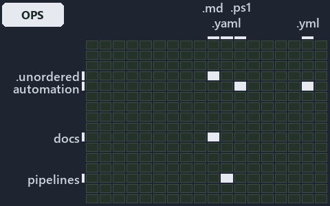

---
catzc:
  immutable:
    with_body_sha: c2f2e3525aab
    repo_status: locked
    path: docs/explanation/.assets/grid/adr-dsgn-life--engineer-merges-pipelines-do-the-rest--operations.grid.md
    source: docs/explanation/.assets/adr-dsgn-life--engineer-merges-pipelines-do-the-rest--operations.drawio.png
    role: asset-description
    language: markdown
    filetype: md
    track: docs
    tracktype: documentation
---

# An engineer runs the tests and merges; pipelines do the rest: the world-map minimap

```text
Where the files that cite ADR-DSGN-LIFE sit in the repository: tracks down, file languages across.
4 of 342 cells lit, holding 10 files.
```



This is the world-map minimap in the sidebar of the operations diagram of [An engineer runs the tests and merges; pipelines do the
rest][14], which explains [ADR-DSGN-LIFE][1]. It lights every cell of the world map that holds a file citing those codes, so it shows where
the decision lives in the repository. Each lit cell has its reason below, naming the code that selects it.

## What the minimap shows

The grid crosses the 18 tracks (rows) with the 19 file languages (columns) of the world map and lights 4 cells, filled in ink. A cell lit
only by passing mentions (citations in body comments, not in a file's header or text) is touched: a lighter ink. Every other cell is idle, a
grey box: it holds files the slide's ADR codes do not select, or no file at all (288 of the 342 cells hold none). The minimap shows where
the slide sits, not how many files a cell holds; the world-map PDFs show the counts.

- .claude × markdown: 2 lit of 90 files
- automation × yaml: 2 lit of 112 files
- docs × markdown: 5 lit of 2742 files
- pipelines × pipeline-yaml: 1 lit of 9 files

## Key

A lit row prints its track's name; a lit column prints a short code, the first extension of its file language:

- `.md`: markdown
- `.yaml`: pipeline-yaml
- `.yml`: yaml

## Why each cell is lit

### .claude × markdown (2 lit files)

Placed: the root folder `.claude/` names the track .claude ([ADR-DSGN-TRACK#1][2]); the extension `.md` names the file language markdown
([ADR-DSGN-TRACK#6][3]). Lit ([ADR-DSGN-TRACK#12][4]) by:

- [.claude/plans/plan-fast-push-followups.md][5]: selected by [ADR-DSGN-LIFE][1]: the file cites it at line 12 (text) and line 37 (text).
- [.claude/plans/value-of-plan.md][6]: selected by [ADR-DSGN-LIFE][1]: the file cites it at line 44 (text).

### automation × yaml (2 lit files)

Placed: the root folder `automation/` names the track automation ([ADR-DSGN-TRACK#1][2]); the extension `.yml` names the file language yaml
([ADR-DSGN-TRACK#6][3]). Lit ([ADR-DSGN-TRACK#12][4]) by:

- [pwsh/Catzc.Base.Docs/configs/adrs.yml][7]: selected by [ADR-DSGN-LIFE][1]: the file cites it at line 78 (text).
- [pwsh/Catzc.Base.ModuleSystem/configs/glossary.yml][8]: selected by [ADR-DSGN-LIFE][1]: the file cites it at line 49 (text).

### docs × markdown (5 lit files)

Placed: the root folder `docs/` names the track docs ([ADR-DSGN-TRACK#1][2]); the extension `.md` names the file language markdown
([ADR-DSGN-TRACK#6][3]). Lit ([ADR-DSGN-TRACK#12][4]) by:

- [docs/adr/design/commit-lifecycle.md][1]: selected by [ADR-DSGN-LIFE][1]: the ADR's own file.
- [docs/adr/design/dora-explains.md][9]: selected by [ADR-DSGN-LIFE][1]: the file cites it at line 82 (text).
- [docs/adr/glossary.md][10]: selected by [ADR-DSGN-LIFE][1]: the file cites it at line 272 (text).
- [docs/adr/index.md][11]: selected by [ADR-DSGN-LIFE][1]: the file cites it at line 112 (text).
- [docs/references/pwsh/catzc-base-git/Push-Dirty.ps1.md][12]: selected by [ADR-DSGN-LIFE][1]: the file cites it at line 14 (text).

### pipelines × pipeline-yaml (1 lit file)

Placed: the root folder `pipelines/` names the track pipelines ([ADR-DSGN-TRACK#1][2]); the extension `.yaml` names the file language
pipeline-yaml ([ADR-DSGN-TRACK#6][3]). Lit ([ADR-DSGN-TRACK#12][4]) by:

- [pipelines/ci-automation.yaml][13]: selected by [ADR-DSGN-LIFE][1]: a pipeline that cites nothing itself carries its globset's citations,
  which cite it at `pwsh/Catzc.Base.Docs/configs/adrs.yml` line 78 (text) and `pwsh/Catzc.Base.ModuleSystem/configs/glossary.yml` line 49
  (text).

## Keywords

- [world map][15]
- [track][16]
- [file language][17]
- [cell][18]
- [lit cell][19]
- [.claude][20]: a track
- [automation][20]: a track
- [docs][20]: a track
- [pipelines][20]: a track
- [markdown][21]: a file language
- [pipeline-yaml][21]: a file language
- [yaml][21]: a file language

Terms the cited ADRs define:

- [occupant][22], defined by [ADR-DSGN-LIFE#5][23]

[1]: ../../../adr/design/commit-lifecycle.md
[2]: ../../../adr/design/tracks.md#rule-adr-dsgn-track1
[3]: ../../../adr/design/tracks.md#rule-adr-dsgn-track6
[4]: ../../../adr/design/tracks.md#rule-adr-dsgn-track12
[5]: ../../../../.claude/plans/plan-fast-push-followups.md
[6]: ../../../../.claude/plans/value-of-plan.md
[7]: ../../../../pwsh/Catzc.Base.Docs/configs/adrs.yml
[8]: ../../../../pwsh/Catzc.Base.ModuleSystem/configs/glossary.yml
[9]: ../../../adr/design/dora-explains.md
[10]: ../../../adr/glossary.md
[11]: ../../../adr/index.md
[12]: ../../../references/pwsh/catzc-base-git/Push-Dirty.ps1.md
[13]: ../../../../pipelines/ci-automation.yaml
[14]: ../../design/engineer-merges-pipelines-do-the-rest.md
[15]: ../../../adr/glossary.md#world-map
[16]: ../../../adr/glossary.md#track
[17]: ../../../adr/glossary.md#file-language
[18]: ../../../adr/glossary.md#cell
[19]: ../../../adr/glossary.md#lit-cell
[20]: ../../../../pwsh/Catzc.Base.Variants/configs/variants.yml
[21]: ../../../../pwsh/Catzc.Base.Languages/configs/languages.yml
[22]: ../../../adr/glossary.md#occupant
[23]: ../../../adr/design/commit-lifecycle.md#rule-adr-dsgn-life5
