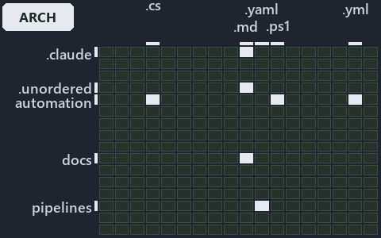

# docs/explanation/.assets/grid/adr-dsgn-life--integrators-depend-on-an-occupant--architecture.grid.md

`Grid minimap: adr-dsgn-life--integrators-depend-on-an-occupant--architecture`

The grid minimap of the slide `adr-dsgn-life--integrators-depend-on-an-occupant--architecture` (architecture lens). The slide supports
[ADR-DSGN-LIFE][1] and [ADR-FLOW-CD][2]; the highlight of those ADR codes selects what is lit, and each reason below names the code that
selects it.

## What the minimap shows

The grid crosses the 16 tracks (rows) with the 18 file languages (columns) of the world map and lights 7 cells, filled in ink. A cell lit
only by passing mentions (citations in body comments, not in a file's header or text) is touched: a lighter ink. Every other cell is idle, a
grey box: it holds files the slide's ADR codes do not select, or no file at all (237 of the 288 cells hold none). The minimap shows where
the slide sits, not how many files a cell holds; the world-map PDFs show the counts.

- .claude × markdown: 1 lit of 71 files
- .unordered × markdown: 6 lit of 20 files
- automation × csharp: 2 lit of 274 files
- automation × powershell: 4 lit of 1579 files
- automation × yaml: 3 lit of 109 files
- docs × markdown: 9 lit of 2165 files
- pipelines × pipeline-yaml: 1 lit of 9 files

## Key

A lit row prints its track's name; a lit column prints a short code, the first extension of its file language:

- `.cs`: csharp
- `.md`: markdown
- `.yaml`: pipeline-yaml
- `.ps1`: powershell
- `.yml`: yaml

## Why each cell is lit

### .claude × markdown (1 lit file)

Placed: the root folder `.claude/` names the track .claude ([ADR-DSGN-TRACK#1][3]); the extension `.md` names the file language markdown
([ADR-DSGN-TRACK#6][4]). Lit ([ADR-DSGN-TRACK#12][5]) by:

- [.claude/CLAUDE.md][6]: selected by [ADR-FLOW-CD][2]: the file cites it at line 50 (text).

### .unordered × markdown (6 lit files)

Placed: the root folder `.unordered/` names the track .unordered ([ADR-DSGN-TRACK#1][3]); the extension `.md` names the file language
markdown ([ADR-DSGN-TRACK#6][4]). Lit ([ADR-DSGN-TRACK#12][5]) by:

- [.unordered/15-10-2026/plan-adr-consistency.md][7]: selected by [ADR-DSGN-LIFE][1]: the file cites it at line 100 (text), line 183 (text)
  and line 268 (text); selected by [ADR-FLOW-CD][2]: the file cites it at line 44 (text), line 99 (text), line 152 (text), line 173 (text),
  line 178 (text), line 183 (text), line 291 (text) and line 291 (text).
- [.unordered/15-10-2026/plan-built-bundle.md][8]: selected by [ADR-FLOW-CD][2]: the file cites it at line 13 (text), line 255 (text) and
  line 277 (text).
- [.unordered/15-10-2026/plan-caf-waf-automation.md][9]: selected by [ADR-FLOW-CD][2]: the file cites it at line 16 (text).
- [.unordered/15-10-2026/plan-concern-axis.md][10]: selected by [ADR-DSGN-LIFE][1]: the file cites it at line 91 (text).
- [.unordered/15-10-2026/plan-diagram-wave-8.md][11]: selected by [ADR-FLOW-CD][2]: the file cites it at line 22 (text), line 23 (text) and
  line 24 (text).
- [.unordered/15-10-2026/plan-explanation-drift.md][12]: selected by [ADR-DSGN-LIFE][1]: the file cites it at line 84 (text), line 86
  (text), line 86 (text), line 97 (text), line 99 (text), line 101 (text) and line 101 (text); selected by [ADR-FLOW-CD][2]: the file cites
  it at line 97 (text).

### automation × csharp (2 lit files)

Placed: the root folder `automation/` names the track automation ([ADR-DSGN-TRACK#1][3]); the extension `.cs` names the file language csharp
([ADR-DSGN-TRACK#6][4]). Lit ([ADR-DSGN-TRACK#12][5]) by:

- [automation/Catzc.Base.Docs/types/AdrsConfig.cs][13]: selected by [ADR-FLOW-CD][2]: the file cites it at line 26 (text).
- [automation/Catzc.Base.Docs/types/GlossaryConcept.cs][14]: selected by [ADR-FLOW-CD][2]: the file cites it at line 23 (text).

### automation × powershell (4 lit files)

Placed: the root folder `automation/` names the track automation ([ADR-DSGN-TRACK#1][3]); the extension `.ps1` names the file language
powershell ([ADR-DSGN-TRACK#6][4]). Lit ([ADR-DSGN-TRACK#12][5]) by:

- [automation/Catzc.Base.Git/Push-Dirty.ps1][15]: selected by [ADR-DSGN-LIFE][1]: the file cites it at line 21 (header) and line 26
  (header).
- [automation/Catzc.Base.Maps/Get-ValueChainHighlight.ps1][16]: selected by [ADR-FLOW-CD][2]: the file cites it at line 22 (header) and line
  41 (header).
- [automation/Catzc.Base.Maps/Get-WorldMapHighlight.ps1][17]: selected by [ADR-FLOW-CD][2]: the file cites it at line 21 (header) and line
  49 (header).
- [automation/Catzc.Base.Maps/tests/Get-WorldMapHighlight.Tests.ps1][18]: selected by [ADR-FLOW-CD][2]: the file cites it at line 20
  (header), line 93 (text) and line 94 (text).

### automation × yaml (3 lit files)

Placed: the root folder `automation/` names the track automation ([ADR-DSGN-TRACK#1][3]); the extension `.yml` names the file language yaml
([ADR-DSGN-TRACK#6][4]). Lit ([ADR-DSGN-TRACK#12][5]) by:

- [automation/Catzc.Base.Docs/configs/adrs.yml][19]: selected by [ADR-DSGN-LIFE][1]: the file cites it at line 96 (text); selected by
  [ADR-FLOW-CD][2]: the file cites it at line 115 (text).
- [automation/Catzc.Base.ModuleSystem/configs/glossary.yml][20]: selected by [ADR-DSGN-LIFE][1]: the file cites it at line 69 (text);
  selected by [ADR-FLOW-CD][2]: the file cites it at line 38 (text).
- [automation/Catzc.Base.QualityGates/configs/glossary.yml][21]: selected by [ADR-FLOW-CD][2]: the file cites it at line 77 (text).

### docs × markdown (9 lit files)

Placed: the root folder `docs/` names the track docs ([ADR-DSGN-TRACK#1][3]); the extension `.md` names the file language markdown
([ADR-DSGN-TRACK#6][4]). Lit ([ADR-DSGN-TRACK#12][5]) by:

- [docs/adr/design/commit-lifecycle.md][1]: selected by [ADR-DSGN-LIFE][1]: the ADR's own file.
- [docs/adr/design/dora-explains.md][22]: selected by [ADR-DSGN-LIFE][1]: the file cites it at line 122 (text).
- [docs/adr/flow/cd-discipline-and-promotion-flow.md][2]: selected by [ADR-FLOW-CD][2]: the ADR's own file.
- [docs/adr/flow/dora-explains.md][23]: selected by [ADR-FLOW-CD][2]: the file cites it at line 43 (text).
- [docs/adr/glossary.md][24]: selected by [ADR-DSGN-LIFE][1]: the file cites it at line 218 (text); selected by [ADR-FLOW-CD][2]: the file
  cites it at line 415 (text) and line 428 (text).
- [docs/adr/index.md][25]: selected by [ADR-DSGN-LIFE][1]: the file cites it at line 110 (text); selected by [ADR-FLOW-CD][2]: the file
  cites it at line 127 (text).
- [docs/references/automation/catzc-base-docs/configs/adrs.yml.md][26]: selected by [ADR-FLOW-CD][2]: the file cites it at line 58 (text).
- [docs/references/automation/catzc-base-docs/types/AdrsConfig.cs.md][27]: selected by [ADR-FLOW-CD][2]: the file cites it at line 50
  (text), line 51 (text), line 79 (text) and line 80 (text).
- [docs/references/automation/catzc-base-docs/types/GlossaryConcept.cs.md][28]: selected by [ADR-FLOW-CD][2]: the file cites it at line 20
  (text) and line 57 (text).

### pipelines × pipeline-yaml (1 lit file)

Placed: the root folder `pipelines/` names the track pipelines ([ADR-DSGN-TRACK#1][3]); the extension `.yaml` names the file language
pipeline-yaml ([ADR-DSGN-TRACK#6][4]). Lit ([ADR-DSGN-TRACK#12][5]) by:

- [pipelines/ci-automation.yaml][29]: selected by [ADR-DSGN-LIFE][1]: a pipeline that cites nothing itself carries its globset's citations,
  which cite it at `automation/Catzc.Base.Docs/configs/adrs.yml` line 96 (text), `automation/Catzc.Base.Git/Push-Dirty.ps1` line 21
  (header), `automation/Catzc.Base.Git/Push-Dirty.ps1` line 26 (header) and `automation/Catzc.Base.ModuleSystem/configs/glossary.yml` line
  69 (text); selected by [ADR-FLOW-CD][2]: a pipeline that cites nothing itself carries its globset's citations, which cite it at
  `automation/Catzc.Base.Docs/configs/adrs.yml` line 115 (text), `automation/Catzc.Base.Docs/types/AdrsConfig.cs` line 26 (text),
  `automation/Catzc.Base.Docs/types/GlossaryConcept.cs` line 23 (text), `automation/Catzc.Base.Maps/Get-ValueChainHighlight.ps1` line 22
  (header), `automation/Catzc.Base.Maps/Get-ValueChainHighlight.ps1` line 41 (header),
  `automation/Catzc.Base.Maps/Get-WorldMapHighlight.ps1` line 21 (header), `automation/Catzc.Base.Maps/Get-WorldMapHighlight.ps1` line 49
  (header), `automation/Catzc.Base.Maps/tests/Get-WorldMapHighlight.Tests.ps1` line 20 (header),
  `automation/Catzc.Base.Maps/tests/Get-WorldMapHighlight.Tests.ps1` line 93 (text),
  `automation/Catzc.Base.Maps/tests/Get-WorldMapHighlight.Tests.ps1` line 94 (text),
  `automation/Catzc.Base.ModuleSystem/configs/glossary.yml` line 38 (text) and `automation/Catzc.Base.QualityGates/configs/glossary.yml`
  line 77 (text).

## Keywords

- [world map][30]
- [track][31]
- [file language][32]
- [cell][33]
- [lit cell][34]
- [.claude][35]: a track
- [.unordered][35]: a track
- [automation][35]: a track
- [docs][35]: a track
- [pipelines][35]: a track
- [csharp][36]: a file language
- [markdown][36]: a file language
- [pipeline-yaml][36]: a file language
- [powershell][36]: a file language
- [yaml][36]: a file language

Terms the cited ADRs define:

- [gate][37], defined by [ADR-FLOW-CD#13][38]
- [occupant][39], defined by [ADR-DSGN-LIFE#5][40]
- [release candidate][41], defined by [ADR-FLOW-CD#14][42]

[1]: ../../../adr/design/commit-lifecycle.md
[2]: ../../../adr/flow/cd-discipline-and-promotion-flow.md
[3]: ../../../adr/design/tracks.md#rule-adr-dsgn-track1
[4]: ../../../adr/design/tracks.md#rule-adr-dsgn-track6
[5]: ../../../adr/design/tracks.md#rule-adr-dsgn-track12
[6]: ../../../../.claude/CLAUDE.md
[7]: ../../../../.unordered/15-10-2026/plan-adr-consistency.md
[8]: ../../../../.unordered/15-10-2026/plan-built-bundle.md
[9]: ../../../../.unordered/15-10-2026/plan-caf-waf-automation.md
[10]: ../../../../.unordered/15-10-2026/plan-concern-axis.md
[11]: ../../../../.unordered/15-10-2026/plan-diagram-wave-8.md
[12]: ../../../../.unordered/15-10-2026/plan-explanation-drift.md
[13]: ../../../../automation/Catzc.Base.Docs/types/AdrsConfig.cs
[14]: ../../../../automation/Catzc.Base.Docs/types/GlossaryConcept.cs
[15]: ../../../../automation/Catzc.Base.Git/Push-Dirty.ps1
[16]: ../../../../automation/Catzc.Base.Maps/Get-ValueChainHighlight.ps1
[17]: ../../../../automation/Catzc.Base.Maps/Get-WorldMapHighlight.ps1
[18]: ../../../../automation/Catzc.Base.Maps/tests/Get-WorldMapHighlight.Tests.ps1
[19]: ../../../../automation/Catzc.Base.Docs/configs/adrs.yml
[20]: ../../../../automation/Catzc.Base.ModuleSystem/configs/glossary.yml
[21]: ../../../../automation/Catzc.Base.QualityGates/configs/glossary.yml
[22]: ../../../adr/design/dora-explains.md
[23]: ../../../adr/flow/dora-explains.md
[24]: ../../../adr/glossary.md
[25]: ../../../adr/index.md
[26]: ../../../references/automation/catzc-base-docs/configs/adrs.yml.md
[27]: ../../../references/automation/catzc-base-docs/types/AdrsConfig.cs.md
[28]: ../../../references/automation/catzc-base-docs/types/GlossaryConcept.cs.md
[29]: ../../../../pipelines/ci-automation.yaml
[30]: ../../../adr/glossary.md#world-map
[31]: ../../../adr/glossary.md#track
[32]: ../../../adr/glossary.md#file-language
[33]: ../../../adr/glossary.md#cell
[34]: ../../../adr/glossary.md#lit-cell
[35]: ../../../../automation/Catzc.Base.Variants/configs/variants.yml
[36]: ../../../../automation/Catzc.Base.Languages/configs/languages.yml
[37]: ../../../adr/glossary.md#gate
[38]: ../../../adr/flow/cd-discipline-and-promotion-flow.md#rule-adr-flow-cd13
[39]: ../../../adr/glossary.md#occupant
[40]: ../../../adr/design/commit-lifecycle.md#rule-adr-dsgn-life5
[41]: ../../../adr/glossary.md#release-candidate
[42]: ../../../adr/flow/cd-discipline-and-promotion-flow.md#rule-adr-flow-cd14
