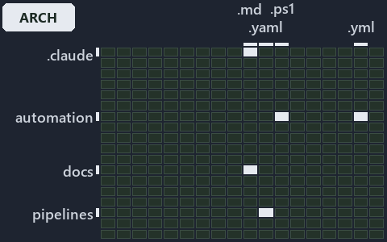

# Clients bridge to one server remote: in through a pull request, out from the verified point: the world-map minimap

```text
Where the files that cite ADR-DSGN-LIFE and ADR-DSGN-REMOTE sit in the repository: tracks down, file languages across.
5 of 324 cells lit, holding 11 files.
```



This is the world-map minimap in the sidebar of the architecture diagram of [Clients bridge to one server remote: in through a pull request,
out from the verified point][15], which explains [ADR-DSGN-LIFE][1] and [ADR-DSGN-REMOTE][2]. It lights every cell of the world map that
holds a file citing those codes, so it shows where the decision lives in the repository. Each lit cell has its reason below, naming the code
that selects it.

## What the minimap shows

The grid crosses the 18 tracks (rows) with the 18 file languages (columns) of the world map and lights 5 cells, filled in ink. A cell lit
only by passing mentions (citations in body comments, not in a file's header or text) is touched: a lighter ink. Every other cell is idle, a
grey box: it holds files the slide's ADR codes do not select, or no file at all (271 of the 324 cells hold none). The minimap shows where
the slide sits, not how many files a cell holds; the world-map PDFs show the counts.

- .claude × markdown: 2 lit of 91 files
- automation × powershell: 1 lit of 1618 files
- automation × yaml: 2 lit of 112 files
- docs × markdown: 5 lit of 2220 files
- pipelines × pipeline-yaml: 1 lit of 9 files

## Key

A lit row prints its track's name; a lit column prints a short code, the first extension of its file language:

- `.md`: markdown
- `.yaml`: pipeline-yaml
- `.ps1`: powershell
- `.yml`: yaml

## Why each cell is lit

### .claude × markdown (2 lit files)

Placed: the root folder `.claude/` names the track .claude ([ADR-DSGN-TRACK#1][3]); the extension `.md` names the file language markdown
([ADR-DSGN-TRACK#6][4]). Lit ([ADR-DSGN-TRACK#12][5]) by:

- [.claude/plans/plan-fast-push-followups.md][6]: selected by [ADR-DSGN-LIFE][1]: the file cites it at line 26 (text) and line 47 (text).
- [.claude/plans/value-of-plan.md][7]: selected by [ADR-DSGN-LIFE][1]: the file cites it at line 22 (text) and line 63 (text).

### automation × powershell (1 lit file)

Placed: the root folder `automation/` names the track automation ([ADR-DSGN-TRACK#1][3]); the extension `.ps1` names the file language
powershell ([ADR-DSGN-TRACK#6][4]). Lit ([ADR-DSGN-TRACK#12][5]) by:

- [automation/Catzc.Base.Git/Push-Dirty.ps1][8]: selected by [ADR-DSGN-LIFE][1]: the file cites it at line 21 (header) and line 26 (header).

### automation × yaml (2 lit files)

Placed: the root folder `automation/` names the track automation ([ADR-DSGN-TRACK#1][3]); the extension `.yml` names the file language yaml
([ADR-DSGN-TRACK#6][4]). Lit ([ADR-DSGN-TRACK#12][5]) by:

- [automation/Catzc.Base.Docs/configs/adrs.yml][9]: selected by [ADR-DSGN-LIFE][1]: the file cites it at line 97 (text); selected by
  [ADR-DSGN-REMOTE][2]: the file cites it at line 98 (text).
- [automation/Catzc.Base.ModuleSystem/configs/glossary.yml][10]: selected by [ADR-DSGN-LIFE][1]: the file cites it at line 68 (text).

### docs × markdown (5 lit files)

Placed: the root folder `docs/` names the track docs ([ADR-DSGN-TRACK#1][3]); the extension `.md` names the file language markdown
([ADR-DSGN-TRACK#6][4]). Lit ([ADR-DSGN-TRACK#12][5]) by:

- [docs/adr/design/commit-lifecycle.md][1]: selected by [ADR-DSGN-LIFE][1]: the ADR's own file.
- [docs/adr/design/dora-explains.md][11]: selected by [ADR-DSGN-LIFE][1]: the file cites it at line 121 (text); selected by
  [ADR-DSGN-REMOTE][2]: the file cites it at line 142 (text).
- [docs/adr/design/server-remote-integration.md][2]: selected by [ADR-DSGN-REMOTE][2]: the ADR's own file.
- [docs/adr/glossary.md][12]: selected by [ADR-DSGN-LIFE][1]: the file cites it at line 272 (text).
- [docs/adr/index.md][13]: selected by [ADR-DSGN-LIFE][1]: the file cites it at line 112 (text); selected by [ADR-DSGN-REMOTE][2]: the file
  cites it at line 113 (text).

### pipelines × pipeline-yaml (1 lit file)

Placed: the root folder `pipelines/` names the track pipelines ([ADR-DSGN-TRACK#1][3]); the extension `.yaml` names the file language
pipeline-yaml ([ADR-DSGN-TRACK#6][4]). Lit ([ADR-DSGN-TRACK#12][5]) by:

- [pipelines/ci-automation.yaml][14]: selected by [ADR-DSGN-LIFE][1]: a pipeline that cites nothing itself carries its globset's citations,
  which cite it at `automation/Catzc.Base.Docs/configs/adrs.yml` line 97 (text), `automation/Catzc.Base.Git/Push-Dirty.ps1` line 21
  (header), `automation/Catzc.Base.Git/Push-Dirty.ps1` line 26 (header) and `automation/Catzc.Base.ModuleSystem/configs/glossary.yml` line
  68 (text); selected by [ADR-DSGN-REMOTE][2]: a pipeline that cites nothing itself carries its globset's citations, which cite it at
  `automation/Catzc.Base.Docs/configs/adrs.yml` line 98 (text).

## Keywords

- [world map][16]
- [track][17]
- [file language][18]
- [cell][19]
- [lit cell][20]
- [.claude][21]: a track
- [automation][21]: a track
- [docs][21]: a track
- [pipelines][21]: a track
- [markdown][22]: a file language
- [pipeline-yaml][22]: a file language
- [powershell][22]: a file language
- [yaml][22]: a file language

Terms the cited ADRs define:

- [occupant][23], defined by [ADR-DSGN-LIFE#5][24]

[1]: ../../../adr/design/commit-lifecycle.md
[2]: ../../../adr/design/server-remote-integration.md
[3]: ../../../adr/design/tracks.md#rule-adr-dsgn-track1
[4]: ../../../adr/design/tracks.md#rule-adr-dsgn-track6
[5]: ../../../adr/design/tracks.md#rule-adr-dsgn-track12
[6]: ../../../../.claude/plans/plan-fast-push-followups.md
[7]: ../../../../.claude/plans/value-of-plan.md
[8]: ../../../../automation/Catzc.Base.Git/Push-Dirty.ps1
[9]: ../../../../automation/Catzc.Base.Docs/configs/adrs.yml
[10]: ../../../../automation/Catzc.Base.ModuleSystem/configs/glossary.yml
[11]: ../../../adr/design/dora-explains.md
[12]: ../../../adr/glossary.md
[13]: ../../../adr/index.md
[14]: ../../../../pipelines/ci-automation.yaml
[15]: ../../design/clients-bridge-to-one-server.md
[16]: ../../../adr/glossary.md#world-map
[17]: ../../../adr/glossary.md#track
[18]: ../../../adr/glossary.md#file-language
[19]: ../../../adr/glossary.md#cell
[20]: ../../../adr/glossary.md#lit-cell
[21]: ../../../../automation/Catzc.Base.Variants/configs/variants.yml
[22]: ../../../../automation/Catzc.Base.Languages/configs/languages.yml
[23]: ../../../adr/glossary.md#occupant
[24]: ../../../adr/design/commit-lifecycle.md#rule-adr-dsgn-life5
