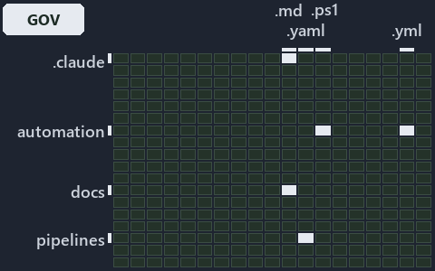

# Only ingress is checked by gates; the source-of-truth and integration rules rest on code review: the world-map minimap

```text
Where the files that cite ADR-DSGN-LIFE, ADR-DSGN-REMOTE and ADR-REPO-VARIANT sit in the repository: tracks down, file languages across.
6 of 324 cells lit, holding 18 files.
```



This is the world-map minimap in the sidebar of the governance diagram of [Only ingress is checked by gates; the source-of-truth and
integration rules rest on code review][22], which explains [ADR-DSGN-LIFE][1], [ADR-DSGN-REMOTE][2] and [ADR-REPO-VARIANT][3]. It lights
every cell of the world map that holds a file citing those codes, so it shows where the decision lives in the repository. Each lit cell has
its reason below, naming the code that selects it.

## What the minimap shows

The grid crosses the 18 tracks (rows) with the 18 file languages (columns) of the world map and lights 6 cells, filled in ink. A cell lit
only by passing mentions (citations in body comments, not in a file's header or text) is touched: a lighter ink. Every other cell is idle, a
grey box: it holds files the slide's ADR codes do not select, or no file at all (271 of the 324 cells hold none). The minimap shows where
the slide sits, not how many files a cell holds; the world-map PDFs show the counts.

- .claude × markdown: 3 lit of 91 files
- automation × csharp: 1 lit of 286 files
- automation × powershell: 2 lit of 1619 files
- automation × yaml: 2 lit of 112 files
- docs × markdown: 9 lit of 2220 files
- pipelines × pipeline-yaml: 1 lit of 9 files

## Key

A lit row prints its track's name; a lit column prints a short code, the first extension of its file language:

- `.cs`: csharp
- `.md`: markdown
- `.yaml`: pipeline-yaml
- `.ps1`: powershell
- `.yml`: yaml

## Why each cell is lit

### .claude × markdown (3 lit files)

Placed: the root folder `.claude/` names the track .claude ([ADR-DSGN-TRACK#1][4]); the extension `.md` names the file language markdown
([ADR-DSGN-TRACK#6][5]). Lit ([ADR-DSGN-TRACK#12][6]) by:

- [.claude/plans/plan-fast-push-followups.md][7]: selected by [ADR-DSGN-LIFE][1]: the file cites it at line 26 (text) and line 47 (text).
- [.claude/plans/plan-module-kinds-tracks.md][8]: selected by [ADR-REPO-VARIANT][3]: the file cites it at line 896 (text) and line 950
  (text).
- [.claude/plans/value-of-plan.md][9]: selected by [ADR-DSGN-LIFE][1]: the file cites it at line 22 (text) and line 63 (text).

### automation × csharp (1 lit file)

Placed: the root folder `automation/` names the track automation ([ADR-DSGN-TRACK#1][4]); the extension `.cs` names the file language csharp
([ADR-DSGN-TRACK#6][5]). Lit ([ADR-DSGN-TRACK#12][6]) by:

- [automation/Catzc.Base.Variants/types/VariantsConfig.cs][10]: selected by [ADR-REPO-VARIANT][3]: the file cites it at line 24 (text).

### automation × powershell (2 lit files)

Placed: the root folder `automation/` names the track automation ([ADR-DSGN-TRACK#1][4]); the extension `.ps1` names the file language
powershell ([ADR-DSGN-TRACK#6][5]). Lit ([ADR-DSGN-TRACK#12][6]) by:

- [automation/Catzc.Base.Git/Push-Dirty.ps1][11]: selected by [ADR-DSGN-LIFE][1]: the file cites it at line 21 (header) and line 26
  (header).
- [automation/Catzc.Base.ModuleSystem/Sync-GeneratedFile.ps1][12]: selected by [ADR-REPO-VARIANT][3]: the file cites it at line 24 (header),
  line 52 (header) and line 125 (text).

### automation × yaml (2 lit files)

Placed: the root folder `automation/` names the track automation ([ADR-DSGN-TRACK#1][4]); the extension `.yml` names the file language yaml
([ADR-DSGN-TRACK#6][5]). Lit ([ADR-DSGN-TRACK#12][6]) by:

- [automation/Catzc.Base.Docs/configs/adrs.yml][13]: selected by [ADR-DSGN-LIFE][1]: the file cites it at line 97 (text); selected by
  [ADR-DSGN-REMOTE][2]: the file cites it at line 98 (text); selected by [ADR-REPO-VARIANT][3]: the file cites it at line 322 (text).
- [automation/Catzc.Base.ModuleSystem/configs/glossary.yml][14]: selected by [ADR-DSGN-LIFE][1]: the file cites it at line 68 (text).

### docs × markdown (9 lit files)

Placed: the root folder `docs/` names the track docs ([ADR-DSGN-TRACK#1][4]); the extension `.md` names the file language markdown
([ADR-DSGN-TRACK#6][5]). Lit ([ADR-DSGN-TRACK#12][6]) by:

- [docs/adr/design/commit-lifecycle.md][1]: selected by [ADR-DSGN-LIFE][1]: the ADR's own file.
- [docs/adr/design/dora-explains.md][15]: selected by [ADR-DSGN-LIFE][1]: the file cites it at line 121 (text); selected by
  [ADR-DSGN-REMOTE][2]: the file cites it at line 142 (text).
- [docs/adr/design/server-remote-integration.md][2]: selected by [ADR-DSGN-REMOTE][2]: the ADR's own file.
- [docs/adr/glossary.md][16]: selected by [ADR-DSGN-LIFE][1]: the file cites it at line 272 (text).
- [docs/adr/index.md][17]: selected by [ADR-DSGN-LIFE][1]: the file cites it at line 112 (text); selected by [ADR-DSGN-REMOTE][2]: the file
  cites it at line 113 (text); selected by [ADR-REPO-VARIANT][3]: the file cites it at line 327 (text).
- [docs/adr/repository/dora-explains.md][18]: selected by [ADR-REPO-VARIANT][3]: the file cites it at line 221 (text).
- [docs/adr/repository/repo-variants.md][3]: selected by [ADR-REPO-VARIANT][3]: the ADR's own file.
- [docs/references/automation/catzc-base-variants/configs/variants.yml.md][19]: selected by [ADR-REPO-VARIANT][3]: the file cites it at line
  30 (text).
- [docs/references/automation/catzc-base-variants/types/VariantsConfig.cs.md][20]: selected by [ADR-REPO-VARIANT][3]: the file cites it at
  line 31 (text).

### pipelines × pipeline-yaml (1 lit file)

Placed: the root folder `pipelines/` names the track pipelines ([ADR-DSGN-TRACK#1][4]); the extension `.yaml` names the file language
pipeline-yaml ([ADR-DSGN-TRACK#6][5]). Lit ([ADR-DSGN-TRACK#12][6]) by:

- [pipelines/ci-automation.yaml][21]: selected by [ADR-DSGN-LIFE][1]: a pipeline that cites nothing itself carries its globset's citations,
  which cite it at `automation/Catzc.Base.Docs/configs/adrs.yml` line 97 (text), `automation/Catzc.Base.Git/Push-Dirty.ps1` line 21
  (header), `automation/Catzc.Base.Git/Push-Dirty.ps1` line 26 (header) and `automation/Catzc.Base.ModuleSystem/configs/glossary.yml` line
  68 (text); selected by [ADR-DSGN-REMOTE][2]: a pipeline that cites nothing itself carries its globset's citations, which cite it at
  `automation/Catzc.Base.Docs/configs/adrs.yml` line 98 (text); selected by [ADR-REPO-VARIANT][3]: a pipeline that cites nothing itself
  carries its globset's citations, which cite it at `automation/Catzc.Base.Docs/configs/adrs.yml` line 322 (text),
  `automation/Catzc.Base.ModuleSystem/Sync-GeneratedFile.ps1` line 24 (header), `automation/Catzc.Base.ModuleSystem/Sync-GeneratedFile.ps1`
  line 52 (header), `automation/Catzc.Base.ModuleSystem/Sync-GeneratedFile.ps1` line 125 (text) and
  `automation/Catzc.Base.Variants/types/VariantsConfig.cs` line 24 (text).

## Keywords

- [world map][23]
- [track][24]
- [file language][25]
- [cell][26]
- [lit cell][27]
- [.claude][28]: a track
- [automation][28]: a track
- [docs][28]: a track
- [pipelines][28]: a track
- [csharp][29]: a file language
- [markdown][29]: a file language
- [pipeline-yaml][29]: a file language
- [powershell][29]: a file language
- [yaml][29]: a file language

Terms the cited ADRs define:

- [occupant][30], defined by [ADR-DSGN-LIFE#5][31]

[1]: ../../../adr/design/commit-lifecycle.md
[2]: ../../../adr/design/server-remote-integration.md
[3]: ../../../adr/repository/repo-variants.md
[4]: ../../../adr/design/tracks.md#rule-adr-dsgn-track1
[5]: ../../../adr/design/tracks.md#rule-adr-dsgn-track6
[6]: ../../../adr/design/tracks.md#rule-adr-dsgn-track12
[7]: ../../../../.claude/plans/plan-fast-push-followups.md
[8]: ../../../../.claude/plans/plan-module-kinds-tracks.md
[9]: ../../../../.claude/plans/value-of-plan.md
[10]: ../../../../automation/Catzc.Base.Variants/types/VariantsConfig.cs
[11]: ../../../../automation/Catzc.Base.Git/Push-Dirty.ps1
[12]: ../../../../automation/Catzc.Base.ModuleSystem/Sync-GeneratedFile.ps1
[13]: ../../../../automation/Catzc.Base.Docs/configs/adrs.yml
[14]: ../../../../automation/Catzc.Base.ModuleSystem/configs/glossary.yml
[15]: ../../../adr/design/dora-explains.md
[16]: ../../../adr/glossary.md
[17]: ../../../adr/index.md
[18]: ../../../adr/repository/dora-explains.md
[19]: ../../../references/automation/catzc-base-variants/configs/variants.yml.md
[20]: ../../../references/automation/catzc-base-variants/types/VariantsConfig.cs.md
[21]: ../../../../pipelines/ci-automation.yaml
[22]: ../../design/ingress-gated-the-rest-by-review.md
[23]: ../../../adr/glossary.md#world-map
[24]: ../../../adr/glossary.md#track
[25]: ../../../adr/glossary.md#file-language
[26]: ../../../adr/glossary.md#cell
[27]: ../../../adr/glossary.md#lit-cell
[28]: ../../../../automation/Catzc.Base.Variants/configs/variants.yml
[29]: ../../../../automation/Catzc.Base.Languages/configs/languages.yml
[30]: ../../../adr/glossary.md#occupant
[31]: ../../../adr/design/commit-lifecycle.md#rule-adr-dsgn-life5
