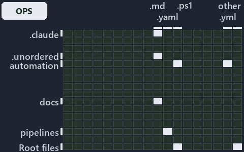

---
catzc:
  immutable:
    with_body_sha: d095d7ab3873
    repo_status: locked
    path: docs/explanation/.assets/grid/adr-dsgn-runmode--one-entry-script-per-mode--operations.grid.md
    source: docs/explanation/.assets/adr-dsgn-runmode--one-entry-script-per-mode--operations.drawio.png
    kind: asset-description
    language: markdown
    filetype: md
    track: docs
    tracktype: documentation
---

# Each run mode has one entry script, and a mixed session throws: the world-map minimap

```text
Where the files that cite ADR-DSGN-RUNMODE sit in the repository: tracks down, file languages across.
6 of 342 cells lit, holding 43 files.
```



This is the world-map minimap in the sidebar of the operations diagram of [Each run mode has one entry script, and a mixed session
throws][48], which explains [ADR-DSGN-RUNMODE][1]. It lights every cell of the world map that holds a file citing those codes, so it shows
where the decision lives in the repository. Each lit cell has its reason below, naming the code that selects it.

## What the minimap shows

The grid crosses the 18 tracks (rows) with the 19 file languages (columns) of the world map and lights 6 cells, filled in ink. A cell lit
only by passing mentions (citations in body comments, not in a file's header or text) is touched: a lighter ink. Every other cell is idle, a
grey box: it holds files the slide's ADR codes do not select, or no file at all (288 of the 342 cells hold none). The minimap shows where
the slide sits, not how many files a cell holds; the world-map PDFs show the counts.

- .claude × markdown: 1 lit of 90 files
- automation × powershell: 3 lit of 1629 files
- automation × yaml: 3 lit of 112 files
- docs × markdown: 34 lit of 2742 files
- pipelines × pipeline-yaml: 1 lit of 9 files
- Root files × powershell: 1 lit of 1 file

## Key

A lit row prints its track's name; a lit column prints a short code, the first extension of its file language:

- `.md`: markdown
- `.yaml`: pipeline-yaml
- `.ps1`: powershell
- `.yml`: yaml

## Why each cell is lit

### .claude × markdown (1 lit file)

Placed: the root folder `.claude/` names the track .claude ([ADR-DSGN-TRACK#1][2]); the extension `.md` names the file language markdown
([ADR-DSGN-TRACK#6][3]). Lit ([ADR-DSGN-TRACK#12][4]) by:

- [.claude/plans/plan-layers-vocabulary-rename-contracts.md][5]: selected by [ADR-DSGN-RUNMODE][1]: the file cites it at line 135 (text),
  line 495 (text), line 557 (text) and line 916 (text).

### automation × powershell (3 lit files)

Placed: the root folder `automation/` names the track automation ([ADR-DSGN-TRACK#1][2]); the extension `.ps1` names the file language
powershell ([ADR-DSGN-TRACK#6][3]). Lit ([ADR-DSGN-TRACK#12][4]) by:

- [automation/.internal/tests/New-FakeRepositoryRoot.Tests.ps1][6]: selected by [ADR-DSGN-RUNMODE][1]: the file cites it at line 1 (text).
- [automation/Catzc.Base.QualityGates/tests/Test-CatzcBuild.Parity.Tests.ps1][7]: selected by [ADR-DSGN-RUNMODE][1]: the file cites it at
  line 1 (text).
- [automation/Catzc.Base.QualityGates/tests/Test-CatzcBuild.ScopeIsolation.Tests.ps1][8]: selected by [ADR-DSGN-RUNMODE][1]: the file cites
  it at line 1 (text).

### automation × yaml (3 lit files)

Placed: the root folder `automation/` names the track automation ([ADR-DSGN-TRACK#1][2]); the extension `.yml` names the file language yaml
([ADR-DSGN-TRACK#6][3]). Lit ([ADR-DSGN-TRACK#12][4]) by:

- [automation/Catzc.Base.Docs/configs/adrs.yml][9]: selected by [ADR-DSGN-RUNMODE][1]: the file cites it at line 80 (text).
- [automation/Catzc.Base.Docs/configs/glossary.yml][10]: selected by [ADR-DSGN-RUNMODE][1]: the file cites it at line 611 (text).
- [automation/Catzc.Base.QualityGates/configs/terminology.yml][11]: selected by [ADR-DSGN-RUNMODE][1]: the file cites it at line 575 (text).

### docs × markdown (34 lit files)

Placed: the root folder `docs/` names the track docs ([ADR-DSGN-TRACK#1][2]); the extension `.md` names the file language markdown
([ADR-DSGN-TRACK#6][3]). Lit ([ADR-DSGN-TRACK#12][4]) by:

- [docs/adr/design/dora-explains.md][12]: selected by [ADR-DSGN-RUNMODE][1]: the file cites it at line 123 (text).
- [docs/adr/design/run-modes.md][1]: selected by [ADR-DSGN-RUNMODE][1]: the ADR's own file.
- [docs/adr/glossary.md][13]: selected by [ADR-DSGN-RUNMODE][1]: the file cites it at line 312 (text).
- [docs/adr/index.md][14]: selected by [ADR-DSGN-RUNMODE][1]: the file cites it at line 114 (text).
- [docs/references/.assets/automation/catzc-base-modulesystem/module-graph-declared-vs-observed.drawio.verify.md][15]: selected by
  [ADR-DSGN-RUNMODE][1]: the file cites it at line 53 (text).
- [docs/references/automation/catzc-base-configextensions/Test-ConfigValidators.ps1.md][16]: selected by [ADR-DSGN-RUNMODE][1]: the file
  cites it at line 19 (text).
- [docs/references/automation/catzc-base-docs/private/Get-CatsModules.ps1.md][17]: selected by [ADR-DSGN-RUNMODE][1]: the file cites it at
  line 18 (text).
- [docs/references/automation/catzc-base-globs/Get-ModuleGlobSet.ps1.md][18]: selected by [ADR-DSGN-RUNMODE][1]: the file cites it at line
  31 (text).
- [docs/references/automation/catzc-base-modulesystem/Copy-Automation.ps1.md][19]: selected by [ADR-DSGN-RUNMODE][1]: the file cites it at
  line 38 (text).
- [docs/references/automation/catzc-base-modulesystem/Get-AutomationFunctions.ps1.md][20]: selected by [ADR-DSGN-RUNMODE][1]: the file cites
  it at line 19 (text).
- [docs/references/automation/catzc-base-modulesystem/Get-FunctionDependency.ps1.md][21]: selected by [ADR-DSGN-RUNMODE][1]: the file cites
  it at line 18 (text).
- [docs/references/automation/catzc-base-modulesystem/Get-InternalAssetDependency.ps1.md][22]: selected by [ADR-DSGN-RUNMODE][1]: the file
  cites it at line 36 (text).
- [docs/references/automation/catzc-base-modulesystem/New-Importer.ps1.md][23]: selected by [ADR-DSGN-RUNMODE][1]: the file cites it at line
  23 (text).
- [docs/references/automation/catzc-base-modulesystem/Sync-GeneratedFile.ps1.md][24]: selected by [ADR-DSGN-RUNMODE][1]: the file cites it
  at line 26 (text).
- [docs/references/automation/catzc-base-modulesystem/Test-FunctionDependency.ps1.md][25]: selected by [ADR-DSGN-RUNMODE][1]: the file cites
  it at line 26 (text).
- [docs/references/automation/catzc-base-modulesystem/module-graph-declared-vs-observed.drawio.md][26]: selected by [ADR-DSGN-RUNMODE][1]:
  the file cites it at line 105 (text).
- [docs/references/automation/catzc-base-qualitygates/Test-BuildArtifact.ps1.md][27]: selected by [ADR-DSGN-RUNMODE][1]: the file cites it
  at line 34 (text).
- [docs/references/automation/catzc-base-qualitygates/Test-CatzcBuild.ps1.md][28]: selected by [ADR-DSGN-RUNMODE][1]: the file cites it at
  line 15 (text).
- [docs/references/automation/catzc-base-qualitygates/tests/Test-CatzcBuild.Parity.Tests.ps1.md][29]: selected by [ADR-DSGN-RUNMODE][1]: the
  file cites it at line 11 (text).
- [docs/references/automation/catzc-base-qualitygates/tests/Test-CatzcBuild.ScopeIsolation.Tests.ps1.md][30]: selected by
  [ADR-DSGN-RUNMODE][1]: the file cites it at line 8 (text) and line 11 (text).
- [docs/references/automation/catzc-base-repository/Assert-SourceTree.ps1.md][31]: selected by [ADR-DSGN-RUNMODE][1]: the file cites it at
  line 16 (text).
- [docs/references/automation/catzc-base-repository/Get-CatzcModuleRoot.ps1.md][32]: selected by [ADR-DSGN-RUNMODE][1]: the file cites it at
  line 16 (text).
- [docs/references/automation/catzc-base-repository/Get-CatzcRunMode.ps1.md][33]: selected by [ADR-DSGN-RUNMODE][1]: the file cites it at
  line 14 (text).
- [docs/references/automation/catzc-base-rootconfig/Build-RootConfig.ps1.md][34]: selected by [ADR-DSGN-RUNMODE][1]: the file cites it at
  line 28 (text).
- [docs/references/automation/catzc-base-typessystem/Build-BashTimeoutHook.ps1.md][35]: selected by [ADR-DSGN-RUNMODE][1]: the file cites it
  at line 22 (text).
- [docs/references/automation/catzc-base-typessystem/Clear-ModuleTypeCache.ps1.md][36]: selected by [ADR-DSGN-RUNMODE][1]: the file cites it
  at line 34 (text).
- [docs/references/automation/catzc-base-typessystem/Get-CSharpTypeDependency.ps1.md][37]: selected by [ADR-DSGN-RUNMODE][1]: the file cites
  it at line 31 (text).
- [docs/references/automation/catzc-base-typessystem/Invoke-BuildForVSCode.ps1.md][38]: selected by [ADR-DSGN-RUNMODE][1]: the file cites it
  at line 27 (text).
- [docs/references/automation/catzc-base-vendor/Install-VendorModule.ps1.md][39]: selected by [ADR-DSGN-RUNMODE][1]: the file cites it at
  line 19 (text).
- [docs/references/automation/catzc-base-vendor/Remove-VendorModules.ps1.md][40]: selected by [ADR-DSGN-RUNMODE][1]: the file cites it at
  line 25 (text).
- [docs/references/automation/internal/Catzc.Internal.Builder.psm1.md][41]: selected by [ADR-DSGN-RUNMODE][1]: the file cites it at line 15
  (text).
- [docs/references/automation/internal/Catzc.Internal.Importer.psm1.md][42]: selected by [ADR-DSGN-RUNMODE][1]: the file cites it at line
  193 (text).
- [docs/references/automation/internal/Catzc.Internal.TestKit.psm1.md][43]: selected by [ADR-DSGN-RUNMODE][1]: the file cites it at line 58
  (text).
- [docs/references/automation/internal/assets/Import-Catzc.ps1.md][44]: selected by [ADR-DSGN-RUNMODE][1]: the file cites it at line 14
  (text).

### pipelines × pipeline-yaml (1 lit file)

Placed: the root folder `pipelines/` names the track pipelines ([ADR-DSGN-TRACK#1][2]); the extension `.yaml` names the file language
pipeline-yaml ([ADR-DSGN-TRACK#6][3]). Lit ([ADR-DSGN-TRACK#12][4]) by:

- [pipelines/ci-automation.yaml][45]: selected by [ADR-DSGN-RUNMODE][1]: a pipeline that cites nothing itself carries its globset's
  citations, which cite it at `automation/.internal/tests/New-FakeRepositoryRoot.Tests.ps1` line 1 (text),
  `automation/Catzc.Base.Docs/configs/adrs.yml` line 80 (text), `automation/Catzc.Base.Docs/configs/glossary.yml` line 611 (text),
  `automation/Catzc.Base.QualityGates/configs/terminology.yml` line 575 (text),
  `automation/Catzc.Base.QualityGates/tests/Test-CatzcBuild.Parity.Tests.ps1` line 1 (text) and
  `automation/Catzc.Base.QualityGates/tests/Test-CatzcBuild.ScopeIsolation.Tests.ps1` line 1 (text).

### Root files × powershell (1 lit file)

Placed: each file sits directly in the repository root, so it is a root file ([ADR-DSGN-TRACK#7][46]); the extension `.ps1` names the file
language powershell ([ADR-DSGN-TRACK#6][3]). Lit ([ADR-DSGN-TRACK#12][4]) by:

- [importer.ps1][47]: selected by [ADR-DSGN-RUNMODE][1]: a root file carries the citations of its owner module's files (files.yml), which
  cite it at `automation/.internal/tests/New-FakeRepositoryRoot.Tests.ps1` line 1 (text).

## Keywords

- [world map][49]
- [track][50]
- [file language][51]
- [cell][52]
- [lit cell][53]
- [root file][54]
- [.claude][55]: a track
- [automation][55]: a track
- [docs][55]: a track
- [pipelines][55]: a track
- [markdown][56]: a file language
- [pipeline-yaml][56]: a file language
- [powershell][56]: a file language
- [yaml][56]: a file language

Terms the cited ADRs define:

- [run mode][57], defined by [ADR-DSGN-RUNMODE#1][58]

[1]: ../../../adr/design/run-modes.md
[2]: ../../../adr/design/tracks.md#rule-adr-dsgn-track1
[3]: ../../../adr/design/tracks.md#rule-adr-dsgn-track6
[4]: ../../../adr/design/tracks.md#rule-adr-dsgn-track12
[5]: ../../../../.claude/plans/plan-layers-vocabulary-rename-contracts.md
[6]: ../../../../automation/.internal/tests/New-FakeRepositoryRoot.Tests.ps1
[7]: ../../../../automation/Catzc.Base.QualityGates/tests/Test-CatzcBuild.Parity.Tests.ps1
[8]: ../../../../automation/Catzc.Base.QualityGates/tests/Test-CatzcBuild.ScopeIsolation.Tests.ps1
[9]: ../../../../automation/Catzc.Base.Docs/configs/adrs.yml
[10]: ../../../../automation/Catzc.Base.Docs/configs/glossary.yml
[11]: ../../../../automation/Catzc.Base.QualityGates/configs/terminology.yml
[12]: ../../../adr/design/dora-explains.md
[13]: ../../../adr/glossary.md
[14]: ../../../adr/index.md
[15]: ../../../references/.assets/automation/catzc-base-modulesystem/module-graph-declared-vs-observed.drawio.verify.md
[16]: ../../../references/automation/catzc-base-configextensions/Test-ConfigValidators.ps1.md
[17]: ../../../references/automation/catzc-base-docs/private/Get-CatsModules.ps1.md
[18]: ../../../references/automation/catzc-base-globs/Get-ModuleGlobSet.ps1.md
[19]: ../../../references/automation/catzc-base-modulesystem/Copy-Automation.ps1.md
[20]: ../../../references/automation/catzc-base-modulesystem/Get-AutomationFunctions.ps1.md
[21]: ../../../references/automation/catzc-base-modulesystem/Get-FunctionDependency.ps1.md
[22]: ../../../references/automation/catzc-base-modulesystem/Get-InternalAssetDependency.ps1.md
[23]: ../../../references/automation/catzc-base-modulesystem/New-Importer.ps1.md
[24]: ../../../references/automation/catzc-base-modulesystem/Sync-GeneratedFile.ps1.md
[25]: ../../../references/automation/catzc-base-modulesystem/Test-FunctionDependency.ps1.md
[26]: ../../../references/automation/catzc-base-modulesystem/module-graph-declared-vs-observed.drawio.md
[27]: ../../../references/automation/catzc-base-qualitygates/Test-BuildArtifact.ps1.md
[28]: ../../../references/automation/catzc-base-qualitygates/Test-CatzcBuild.ps1.md
[29]: ../../../references/automation/catzc-base-qualitygates/tests/Test-CatzcBuild.Parity.Tests.ps1.md
[30]: ../../../references/automation/catzc-base-qualitygates/tests/Test-CatzcBuild.ScopeIsolation.Tests.ps1.md
[31]: ../../../references/automation/catzc-base-repository/Assert-SourceTree.ps1.md
[32]: ../../../references/automation/catzc-base-repository/Get-CatzcModuleRoot.ps1.md
[33]: ../../../references/automation/catzc-base-repository/Get-CatzcRunMode.ps1.md
[34]: ../../../references/automation/catzc-base-rootconfig/Build-RootConfig.ps1.md
[35]: ../../../references/automation/catzc-base-typessystem/Build-BashTimeoutHook.ps1.md
[36]: ../../../references/automation/catzc-base-typessystem/Clear-ModuleTypeCache.ps1.md
[37]: ../../../references/automation/catzc-base-typessystem/Get-CSharpTypeDependency.ps1.md
[38]: ../../../references/automation/catzc-base-typessystem/Invoke-BuildForVSCode.ps1.md
[39]: ../../../references/automation/catzc-base-vendor/Install-VendorModule.ps1.md
[40]: ../../../references/automation/catzc-base-vendor/Remove-VendorModules.ps1.md
[41]: ../../../references/automation/internal/Catzc.Internal.Builder.psm1.md
[42]: ../../../references/automation/internal/Catzc.Internal.Importer.psm1.md
[43]: ../../../references/automation/internal/Catzc.Internal.TestKit.psm1.md
[44]: ../../../references/automation/internal/assets/Import-Catzc.ps1.md
[45]: ../../../../pipelines/ci-automation.yaml
[46]: ../../../adr/design/tracks.md#rule-adr-dsgn-track7
[47]: ../../../../importer.ps1
[48]: ../../design/one-entry-script-per-mode.md
[49]: ../../../adr/glossary.md#world-map
[50]: ../../../adr/glossary.md#track
[51]: ../../../adr/glossary.md#file-language
[52]: ../../../adr/glossary.md#cell
[53]: ../../../adr/glossary.md#lit-cell
[54]: ../../../adr/glossary.md#root-file
[55]: ../../../../automation/Catzc.Base.Variants/configs/variants.yml
[56]: ../../../../automation/Catzc.Base.Languages/configs/languages.yml
[57]: ../../../adr/glossary.md#run-mode
[58]: ../../../adr/design/run-modes.md#rule-adr-dsgn-runmode1
