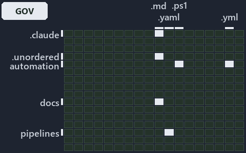

# Three gates guard the CLI and az, but nothing checks that cats stays thin: the world-map minimap

```text
Where the files that cite ADR-AZ-CLI and ADR-DSGN-THINPLAT sit in the repository: tracks down, file languages across.
5 of 324 cells lit, holding 21 files.
```



This is the world-map minimap in the sidebar of the governance diagram of [Three gates guard the CLI and az, but nothing checks that cats
stays thin][25], which explains [ADR-AZ-CLI][1] and [ADR-DSGN-THINPLAT][2]. It lights every cell of the world map that holds a file citing
those codes, so it shows where the decision lives in the repository. Each lit cell has its reason below, naming the code that selects it.

## What the minimap shows

The grid crosses the 18 tracks (rows) with the 18 file languages (columns) of the world map and lights 5 cells, filled in ink. A cell lit
only by passing mentions (citations in body comments, not in a file's header or text) is touched: a lighter ink. Every other cell is idle, a
grey box: it holds files the slide's ADR codes do not select, or no file at all (271 of the 324 cells hold none). The minimap shows where
the slide sits, not how many files a cell holds; the world-map PDFs show the counts.

- .claude × markdown: 2 lit of 91 files
- automation × powershell: 8 lit of 1619 files
- automation × yaml: 3 lit of 112 files
- docs × markdown: 7 lit of 2220 files
- pipelines × pipeline-yaml: 1 lit of 9 files

## Key

A lit row prints its track's name; a lit column prints a short code, the first extension of its file language:

- `.md`: markdown
- `.yaml`: pipeline-yaml
- `.ps1`: powershell
- `.yml`: yaml

## Why each cell is lit

### .claude × markdown (2 lit files)

Placed: the root folder `.claude/` names the track .claude ([ADR-DSGN-TRACK#1][3]); the extension `.md` names the file language markdown
([ADR-DSGN-TRACK#6][4]). Lit ([ADR-DSGN-TRACK#12][5]) by:

- [.claude/plans/plan-adr-link-cleanup-prose-to-pages.md][6]: selected by [ADR-AZ-CLI][1]: the file cites it at line 185 (text).
- [.claude/plans/plan-file-meta-head-policy.md][7]: selected by [ADR-AZ-CLI][1]: the file cites it at line 111 (text).

### automation × powershell (8 lit files)

Placed: the root folder `automation/` names the track automation ([ADR-DSGN-TRACK#1][3]); the extension `.ps1` names the file language
powershell ([ADR-DSGN-TRACK#6][4]). Lit ([ADR-DSGN-TRACK#12][5]) by:

- [automation/Catzc.Azure.Cli/Assert-AzCliBicep.ps1][8]: selected by [ADR-AZ-CLI][1]: the file cites it at line 22 (header) and line 32
  (header).
- [automation/Catzc.Azure.Cli/Assert-AzCliCanAccess.ps1][9]: selected by [ADR-AZ-CLI][1]: the file cites it at line 21 (header) and line 36
  (header).
- [automation/Catzc.Azure.Cli/Assert-AzCliSubscriptionAccessible.ps1][10]: selected by [ADR-AZ-CLI][1]: the file cites it at line 22
  (header) and line 35 (header).
- [automation/Catzc.Azure.Cli/Get-AzCliSubscriptionAccessState.ps1][11]: selected by [ADR-AZ-CLI][1]: the file cites it at line 21 (header)
  and line 41 (header).
- [automation/Catzc.Azure.Cli/Install-AzCliBicep.ps1][12]: selected by [ADR-AZ-CLI][1]: the file cites it at line 20 (header) and line 30
  (header).
- [automation/Catzc.Azure.Cli/Test-AzCliBicep.ps1][13]: selected by [ADR-AZ-CLI][1]: the file cites it at line 22 (header) and line 35
  (header).
- [automation/Catzc.Azure.Cli/Test-AzCliCanAccess.ps1][14]: selected by [ADR-AZ-CLI][1]: the file cites it at line 21 (header) and line 35
  (header).
- [automation/Catzc.Azure.Cli/Test-AzCliSubscriptionAccessible.ps1][15]: selected by [ADR-AZ-CLI][1]: the file cites it at line 21 (header)
  and line 33 (header).

### automation × yaml (3 lit files)

Placed: the root folder `automation/` names the track automation ([ADR-DSGN-TRACK#1][3]); the extension `.yml` names the file language yaml
([ADR-DSGN-TRACK#6][4]). Lit ([ADR-DSGN-TRACK#12][5]) by:

- [automation/Catzc.Base.Docs/configs/adrs.yml][16]: selected by [ADR-AZ-CLI][1]: the file cites it at line 277 (text); selected by
  [ADR-DSGN-THINPLAT][2]: the file cites it at line 94 (text).
- [automation/Catzc.Base.QualityGates/configs/analyzer-adr-map.yml][17]: selected by [ADR-AZ-CLI][1]: the file cites it at line 26 (text).
- [automation/Catzc.Base.QualityGates/configs/terminology.yml][18]: selected by [ADR-AZ-CLI][1]: the file cites it at line 584 (text);
  selected by [ADR-DSGN-THINPLAT][2]: the file cites it at line 676 (text).

### docs × markdown (7 lit files)

Placed: the root folder `docs/` names the track docs ([ADR-DSGN-TRACK#1][3]); the extension `.md` names the file language markdown
([ADR-DSGN-TRACK#6][4]). Lit ([ADR-DSGN-TRACK#12][5]) by:

- [docs/adr/azure/dora-explains.md][19]: selected by [ADR-AZ-CLI][1]: the file cites it at line 125 (text).
- [docs/adr/azure/prefer-az-cli.md][1]: selected by [ADR-AZ-CLI][1]: the ADR's own file.
- [docs/adr/design/dora-explains.md][20]: selected by [ADR-DSGN-THINPLAT][2]: the file cites it at line 66 (text).
- [docs/adr/design/thin-platforms.md][2]: selected by [ADR-DSGN-THINPLAT][2]: the ADR's own file.
- [docs/adr/index.md][21]: selected by [ADR-AZ-CLI][1]: the file cites it at line 283 (text); selected by [ADR-DSGN-THINPLAT][2]: the file
  cites it at line 109 (text).
- [docs/references/.assets/automation/catzc-azure-cli/az-cli-test-assert-share-one-state.drawio.verify.md][22]: selected by [ADR-AZ-CLI][1]:
  the file cites it at line 16 (text) and line 79 (text).
- [docs/references/automation/catzc-azure-cli/az-cli-test-assert-share-one-state.drawio.md][23]: selected by [ADR-AZ-CLI][1]: the file cites
  it at line 16 (text) and line 122 (text).

### pipelines × pipeline-yaml (1 lit file)

Placed: the root folder `pipelines/` names the track pipelines ([ADR-DSGN-TRACK#1][3]); the extension `.yaml` names the file language
pipeline-yaml ([ADR-DSGN-TRACK#6][4]). Lit ([ADR-DSGN-TRACK#12][5]) by:

- [pipelines/ci-automation.yaml][24]: selected by [ADR-AZ-CLI][1]: a pipeline that cites nothing itself carries its globset's citations,
  which cite it at `automation/Catzc.Azure.Cli/Assert-AzCliBicep.ps1` line 22 (header), `automation/Catzc.Azure.Cli/Assert-AzCliBicep.ps1`
  line 32 (header), `automation/Catzc.Azure.Cli/Assert-AzCliCanAccess.ps1` line 21 (header),
  `automation/Catzc.Azure.Cli/Assert-AzCliCanAccess.ps1` line 36 (header),
  `automation/Catzc.Azure.Cli/Assert-AzCliSubscriptionAccessible.ps1` line 22 (header),
  `automation/Catzc.Azure.Cli/Assert-AzCliSubscriptionAccessible.ps1` line 35 (header),
  `automation/Catzc.Azure.Cli/Get-AzCliSubscriptionAccessState.ps1` line 21 (header),
  `automation/Catzc.Azure.Cli/Get-AzCliSubscriptionAccessState.ps1` line 41 (header), `automation/Catzc.Azure.Cli/Install-AzCliBicep.ps1`
  line 20 (header), `automation/Catzc.Azure.Cli/Install-AzCliBicep.ps1` line 30 (header), `automation/Catzc.Azure.Cli/Test-AzCliBicep.ps1`
  line 22 (header), `automation/Catzc.Azure.Cli/Test-AzCliBicep.ps1` line 35 (header), `automation/Catzc.Azure.Cli/Test-AzCliCanAccess.ps1`
  line 21 (header), `automation/Catzc.Azure.Cli/Test-AzCliCanAccess.ps1` line 35 (header),
  `automation/Catzc.Azure.Cli/Test-AzCliSubscriptionAccessible.ps1` line 21 (header),
  `automation/Catzc.Azure.Cli/Test-AzCliSubscriptionAccessible.ps1` line 33 (header), `automation/Catzc.Base.Docs/configs/adrs.yml` line 277
  (text), `automation/Catzc.Base.QualityGates/configs/analyzer-adr-map.yml` line 26 (text) and
  `automation/Catzc.Base.QualityGates/configs/terminology.yml` line 584 (text); selected by [ADR-DSGN-THINPLAT][2]: a pipeline that cites
  nothing itself carries its globset's citations, which cite it at `automation/Catzc.Base.Docs/configs/adrs.yml` line 94 (text) and
  `automation/Catzc.Base.QualityGates/configs/terminology.yml` line 676 (text).

## Keywords

- [world map][26]
- [track][27]
- [file language][28]
- [cell][29]
- [lit cell][30]
- [.claude][31]: a track
- [automation][31]: a track
- [docs][31]: a track
- [pipelines][31]: a track
- [markdown][32]: a file language
- [pipeline-yaml][32]: a file language
- [powershell][32]: a file language
- [yaml][32]: a file language

[1]: ../../../adr/azure/prefer-az-cli.md
[2]: ../../../adr/design/thin-platforms.md
[3]: ../../../adr/design/tracks.md#rule-adr-dsgn-track1
[4]: ../../../adr/design/tracks.md#rule-adr-dsgn-track6
[5]: ../../../adr/design/tracks.md#rule-adr-dsgn-track12
[6]: ../../../../.claude/plans/plan-adr-link-cleanup-prose-to-pages.md
[7]: ../../../../.claude/plans/plan-file-meta-head-policy.md
[8]: ../../../../automation/Catzc.Azure.Cli/Assert-AzCliBicep.ps1
[9]: ../../../../automation/Catzc.Azure.Cli/Assert-AzCliCanAccess.ps1
[10]: ../../../../automation/Catzc.Azure.Cli/Assert-AzCliSubscriptionAccessible.ps1
[11]: ../../../../automation/Catzc.Azure.Cli/Get-AzCliSubscriptionAccessState.ps1
[12]: ../../../../automation/Catzc.Azure.Cli/Install-AzCliBicep.ps1
[13]: ../../../../automation/Catzc.Azure.Cli/Test-AzCliBicep.ps1
[14]: ../../../../automation/Catzc.Azure.Cli/Test-AzCliCanAccess.ps1
[15]: ../../../../automation/Catzc.Azure.Cli/Test-AzCliSubscriptionAccessible.ps1
[16]: ../../../../automation/Catzc.Base.Docs/configs/adrs.yml
[17]: ../../../../automation/Catzc.Base.QualityGates/configs/analyzer-adr-map.yml
[18]: ../../../../automation/Catzc.Base.QualityGates/configs/terminology.yml
[19]: ../../../adr/azure/dora-explains.md
[20]: ../../../adr/design/dora-explains.md
[21]: ../../../adr/index.md
[22]: ../../../references/.assets/automation/catzc-azure-cli/az-cli-test-assert-share-one-state.drawio.verify.md
[23]: ../../../references/automation/catzc-azure-cli/az-cli-test-assert-share-one-state.drawio.md
[24]: ../../../../pipelines/ci-automation.yaml
[25]: ../../design/what-keeps-the-platform-thin.md
[26]: ../../../adr/glossary.md#world-map
[27]: ../../../adr/glossary.md#track
[28]: ../../../adr/glossary.md#file-language
[29]: ../../../adr/glossary.md#cell
[30]: ../../../adr/glossary.md#lit-cell
[31]: ../../../../automation/Catzc.Base.Variants/configs/variants.yml
[32]: ../../../../automation/Catzc.Base.Languages/configs/languages.yml
