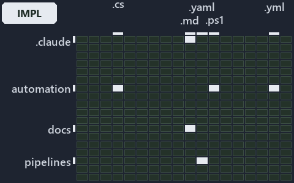

---
catzc:
  immutable:
    with_body_sha: "884e7962b0dd"
    repo_status: locked
    path: docs/explanation/.assets/grid/adr-dsgn-track--globs-yml-pipeline-field-is-the-binding--implementation.grid.md
    source: docs/explanation/.assets/adr-dsgn-track--globs-yml-pipeline-field-is-the-binding--implementation.drawio.png
    role: asset-description
    language: markdown
    filetype: md
    track: docs
    tracktype: documentation
---

# One field in globs.yml, pipeline:, binds a set to its pipeline file: the world-map minimap

```text
Where the files that cite ADR-DSGN-TRACK sit in the repository: tracks down, file languages across.
6 of 342 cells lit, holding 109 files.
```



This is the world-map minimap in the sidebar of the implementation diagram of [One field in globs.yml, pipeline:, binds a set to its
pipeline file][113], which explains [ADR-DSGN-TRACK][1]. It lights every cell of the world map that holds a file citing those codes, so it
shows where the decision lives in the repository. Each lit cell has its reason below, naming the code that selects it.

## What the minimap shows

The grid crosses the 18 tracks (rows) with the 19 file languages (columns) of the world map and lights 6 cells, filled in ink. A cell lit
only by passing mentions (citations in body comments, not in a file's header or text) is touched: a lighter ink. Every other cell is idle, a
grey box: it holds files the slide's ADR codes do not select, or no file at all (288 of the 342 cells hold none). The minimap shows where
the slide sits, not how many files a cell holds; the world-map PDFs show the counts.

- .claude × markdown: 14 lit of 90 files
- automation × csharp: 7 lit of 289 files
- automation × powershell: 22 lit of 1629 files
- automation × yaml: 6 lit of 112 files
- docs × markdown: 59 lit of 2742 files
- pipelines × pipeline-yaml: 1 lit of 9 files

## Key

A lit row prints its track's name; a lit column prints a short code, the first extension of its file language:

- `.cs`: csharp
- `.md`: markdown
- `.yaml`: pipeline-yaml
- `.ps1`: powershell
- `.yml`: yaml

## Why each cell is lit

### .claude × markdown (14 lit files)

Placed: the root folder `.claude/` names the track .claude ([ADR-DSGN-TRACK#1][2]); the extension `.md` names the file language markdown
([ADR-DSGN-TRACK#6][3]). Lit ([ADR-DSGN-TRACK#12][4]) by:

- [.claude/CLAUDE.md][5]: selected by [ADR-DSGN-TRACK][1]: the file cites it at line 27 (text).
- [.claude/plans/decisions-2026-10-16.md][6]: selected by [ADR-DSGN-TRACK][1]: the file cites it at line 19 (text), line 26 (text), line 45
  (text), line 53 (text), line 116 (text), line 117 (text), line 121 (text), line 121 (text), line 123 (text), line 129 (text), line 131
  (text) and line 176 (text).
- [.claude/plans/decisions-2026-10-18.md][7]: selected by [ADR-DSGN-TRACK][1]: the file cites it at line 16 (text), line 33 (text) and line
  33 (text).
- [.claude/plans/plan-file-head-immutable-edges-classes.md][8]: selected by [ADR-DSGN-TRACK][1]: the file cites it at line 51 (text).
- [.claude/plans/plan-layers-vocabulary-rename-contracts.md][9]: selected by [ADR-DSGN-TRACK][1]: the file cites it at line 79 (text), line
  80 (text), line 193 (text), line 437 (text), line 478 (text), line 503 (text), line 583 (text), line 785 (text), line 812 (text), line 916
  (text) and line 921 (text).
- [.claude/plans/plan-module-kinds-tracks.md][10]: selected by [ADR-DSGN-TRACK][1]: the file cites it at line 42 (text), line 46 (text),
  line 72 (text), line 78 (text), line 119 (text), line 120 (text), line 141 (text), line 142 (text), line 163 (text), line 183 (text), line
  231 (text), line 344 (text), line 353 (text), line 501 (text), line 515 (text), line 546 (text), line 551 (text), line 597 (text), line
  613 (text), line 613 (text), line 639 (text), line 641 (text), line 643 (text), line 653 (text), line 661 (text), line 662 (text), line
  672 (text), line 691 (text), line 801 (text), line 813 (text), line 818 (text), line 820 (text), line 849 (text), line 856 (text), line
  878 (text), line 917 (text), line 936 (text), line 945 (text), line 986 (text) and line 1041 (text).
- [.claude/plans/plan-plans-body-sha-landing-zone.md][11]: selected by [ADR-DSGN-TRACK][1]: the file cites it at line 30 (text), line 85
  (text) and line 211 (text).
- [.claude/plans/prompt-k8s-kinds-1-prepare.md][12]: selected by [ADR-DSGN-TRACK][1]: the file cites it at line 17 (text), line 28 (text)
  and line 53 (text).
- [.claude/plans/prompt-k8s-kinds-2-implement.md][13]: selected by [ADR-DSGN-TRACK][1]: the file cites it at line 34 (text).
- [.claude/plans/prompt-module-model-1-prepare.md][14]: selected by [ADR-DSGN-TRACK][1]: the file cites it at line 17 (text), line 29
  (text), line 30 (text), line 69 (text) and line 78 (text).
- [.claude/plans/prompt-module-model-2-implement.md][15]: selected by [ADR-DSGN-TRACK][1]: the file cites it at line 9 (text), line 27
  (text) and line 39 (text).
- [.claude/plans/questionnaire-fundamental-2-2026-10-16.md][16]: selected by [ADR-DSGN-TRACK][1]: the file cites it at line 28 (text).
- [.claude/plans/task-file-head-leftovers.md][17]: selected by [ADR-DSGN-TRACK][1]: the file cites it at line 27 (text) and line 70 (text).
- [.claude/plans/task-import-landing-zone.md][18]: selected by [ADR-DSGN-TRACK][1]: the file cites it at line 35 (text) and line 42 (text).

### automation × csharp (7 lit files)

Placed: the root folder `automation/` names the track automation ([ADR-DSGN-TRACK#1][2]); the extension `.cs` names the file language csharp
([ADR-DSGN-TRACK#6][3]). Lit ([ADR-DSGN-TRACK#12][4]) by:

- [pwsh/Catzc.Base.Docs/types/AdrsConfig.cs][19]: selected by [ADR-DSGN-TRACK][1]: the file cites it at line 15 (body comment) (a passing
  mention only).
- [pwsh/Catzc.Base.Maps/types/ValueChainCell.cs][20]: selected by [ADR-DSGN-TRACK][1]: the file cites it at line 9 (body comment) and line
  12 (body comment) (a passing mention only).
- [pwsh/Catzc.Base.Variants/types/ModulePlace.cs][21]: selected by [ADR-DSGN-TRACK][1]: the file cites it at line 6 (body comment) (a
  passing mention only).
- [pwsh/Catzc.Base.Variants/types/ModuleTypeEntry.cs][22]: selected by [ADR-DSGN-TRACK][1]: the file cites it at line 5 (body comment) (a
  passing mention only).
- [pwsh/Catzc.Base.Variants/types/ModuleTypesConfig.cs][23]: selected by [ADR-DSGN-TRACK][1]: the file cites it at line 10 (body comment) (a
  passing mention only).
- [pwsh/Catzc.Base.Variants/types/PathModule.cs][24]: selected by [ADR-DSGN-TRACK][1]: the file cites it at line 3 (body comment) (a passing
  mention only).
- [pwsh/Catzc.Base.Variants/types/VariantsConfig.cs][25]: selected by [ADR-DSGN-TRACK][1]: the file cites it at line 268 (text).

### automation × powershell (22 lit files)

Placed: the root folder `automation/` names the track automation ([ADR-DSGN-TRACK#1][2]); the extension `.ps1` names the file language
powershell ([ADR-DSGN-TRACK#6][3]). Lit ([ADR-DSGN-TRACK#12][4]) by:

- [pwsh/Catzc.Base.Docs/tests/types/AdrsConfig.Tests.ps1][26]: selected by [ADR-DSGN-TRACK][1]: the file cites it at line 108 (text) and
  line 108 (body comment).
- [pwsh/Catzc.Base.Git/tests/Import-RepositoryWithHistory.Tests.ps1][27]: selected by [ADR-DSGN-TRACK][1]: the file cites it at line 1
  (text).
- [pwsh/Catzc.Base.Globs/tests/types/GlobsConfig.Tests.ps1][28]: selected by [ADR-DSGN-TRACK][1]: the file cites it at line 41 (text).
- [pwsh/Catzc.Base.Languages/tests/Get-FileLanguage.Tests.ps1][29]: selected by [ADR-DSGN-TRACK][1]: the file cites it at line 111 (text),
  line 123 (text) and line 161 (text).
- [pwsh/Catzc.Base.Languages/tests/Get-PathFileType.Tests.ps1][30]: selected by [ADR-DSGN-TRACK][1]: the file cites it at line 1 (text).
- [pwsh/Catzc.Base.Maps/Test-ValueChainMap.ps1][31]: selected by [ADR-DSGN-TRACK][1]: the file cites it at line 15 (text), line 16 (text),
  line 26 (text), line 29 (text) and line 46 (text).
- [pwsh/Catzc.Base.Maps/Test-WorldMap.ps1][32]: selected by [ADR-DSGN-TRACK][1]: the file cites it at line 26 (text), line 45 (text), line
  62 (text), line 66 (text) and line 67 (text).
- [pwsh/Catzc.Base.Maps/tests/Get-ValueChainHighlight.Tests.ps1][33]: selected by [ADR-DSGN-TRACK][1]: the file cites it at line 17 (text),
  line 23 (text) and line 42 (text).
- [pwsh/Catzc.Base.Maps/tests/Get-ValueChainMap.Tests.ps1][34]: selected by [ADR-DSGN-TRACK][1]: the file cites it at line 17 (text), line
  36 (text) and line 36 (body comment).
- [pwsh/Catzc.Base.Maps/tests/Get-WorldMap.Tests.ps1][35]: selected by [ADR-DSGN-TRACK][1]: the file cites it at line 89 (text).
- [pwsh/Catzc.Base.Maps/tests/Get-WorldMapHighlight.Tests.ps1][36]: selected by [ADR-DSGN-TRACK][1]: the file cites it at line 74 (text).
- [pwsh/Catzc.Base.Maps/tests/Test-ValueChainMap.Tests.ps1][37]: selected by [ADR-DSGN-TRACK][1]: the file cites it at line 49 (text), line
  49 (body comment), line 53 (text), line 54 (text), line 55 (text), line 56 (text), line 60 (text), line 63 (text), line 80 (text), line 80
  (body comment) and line 80 (body comment).
- [pwsh/Catzc.Base.Maps/tests/Test-WorldMap.Tests.ps1][38]: selected by [ADR-DSGN-TRACK][1]: the file cites it at line 57 (text), line 61
  (text), line 64 (text), line 68 (text), line 69 (text), line 73 (text), line 82 (text), line 83 (text), line 87 (text), line 91 (text),
  line 92 (text), line 111 (text), line 111 (body comment) and line 111 (body comment).
- [pwsh/Catzc.Base.Maps/tests/types/ValueChainHighlight.Tests.ps1][39]: selected by [ADR-DSGN-TRACK][1]: the file cites it at line 15
  (text), line 22 (text), line 28 (text), line 45 (text) and line 45 (body comment).
- [pwsh/Catzc.Base.Maps/tests/types/ValueChainMap.Tests.ps1][40]: selected by [ADR-DSGN-TRACK][1]: the file cites it at line 17 (text), line
  26 (text), line 31 (text) and line 39 (text).
- [pwsh/Catzc.Base.Maps/tests/types/WorldMapHighlight.Tests.ps1][41]: selected by [ADR-DSGN-TRACK][1]: the file cites it at line 69 (text),
  line 113 (text) and line 127 (text).
- [pwsh/Catzc.Base.QualityGates/tests/Get-FileTypeFileMetaFact.Tests.ps1][42]: selected by [ADR-DSGN-TRACK][1]: the file cites it at line 1
  (text).
- [pwsh/Catzc.Base.QualityGates/tests/Get-ModuleTypeFileMetaFact.Tests.ps1][43]: selected by [ADR-DSGN-TRACK][1]: the file cites it at line
  1 (text).
- [pwsh/Catzc.Base.QualityGates/tests/Get-TrackFileMetaFact.Tests.ps1][44]: selected by [ADR-DSGN-TRACK][1]: the file cites it at line 1
  (text).
- [pwsh/Catzc.Base.Variants/tests/Get-PathModule.Tests.ps1][45]: selected by [ADR-DSGN-TRACK][1]: the file cites it at line 1 (text) and
  line 52 (text).
- [pwsh/Catzc.Base.Variants/tests/Get-Track.Tests.ps1][46]: selected by [ADR-DSGN-TRACK][1]: the file cites it at line 71 (text).
- [pwsh/Catzc.Base.Variants/tests/types/ModuleTypesConfig.Tests.ps1][47]: selected by [ADR-DSGN-TRACK][1]: the file cites it at line 1
  (text).

### automation × yaml (6 lit files)

Placed: the root folder `automation/` names the track automation ([ADR-DSGN-TRACK#1][2]); the extension `.yml` names the file language yaml
([ADR-DSGN-TRACK#6][3]). Lit ([ADR-DSGN-TRACK#12][4]) by:

- [pwsh/Catzc.Base.Docs/configs/adrs.yml][48]: selected by [ADR-DSGN-TRACK][1]: the file cites it at line 74 (text).
- [pwsh/Catzc.Base.Languages/configs/glossary.yml][49]: selected by [ADR-DSGN-TRACK][1]: the file cites it at line 5 (text).
- [pwsh/Catzc.Base.ModuleSystem/configs/glossary.yml][50]: selected by [ADR-DSGN-TRACK][1]: the file cites it at line 5 (text), line 62
  (text), line 70 (text), line 79 (text), line 88 (text), line 94 (text), line 190 (text), line 200 (text), line 211 (text), line 234
  (text), line 247 (text), line 261 (text), line 276 (text), line 289 (text), line 301 (text), line 314 (text), line 316 (text) and line 328
  (text).
- [pwsh/Catzc.Base.QualityGates/configs/source-conventions.yml][51]: selected by [ADR-DSGN-TRACK][1]: the file cites it at line 7 (text).
- [pwsh/Catzc.Base.QualityGates/configs/terminology.yml][52]: selected by [ADR-DSGN-TRACK][1]: the file cites it at line 297 (text) and line
  300 (text).
- [pwsh/Catzc.Base.Variants/configs/track-types.yml][53]: selected by [ADR-DSGN-TRACK][1]: the file cites it at line 42 (text).

### docs × markdown (59 lit files)

Placed: the root folder `docs/` names the track docs ([ADR-DSGN-TRACK#1][2]); the extension `.md` names the file language markdown
([ADR-DSGN-TRACK#6][3]). Lit ([ADR-DSGN-TRACK#12][4]) by:

- [docs/adr/design/dora-explains.md][54]: selected by [ADR-DSGN-TRACK][1]: the file cites it at line 11 (text).
- [docs/adr/design/tracks.md][1]: selected by [ADR-DSGN-TRACK][1]: the ADR's own file.
- [docs/adr/glossary.md][55]: selected by [ADR-DSGN-TRACK][1]: the file cites it at line 134 (text), line 161 (text), line 178 (text), line
  210 (text), line 221 (text), line 233 (text), line 290 (text), line 300 (text), line 323 (text), line 329 (text), line 331 (text), line
  346 (text), line 386 (text), line 400 (text), line 409 (text), line 423 (text), line 436 (text), line 470 (text) and line 482 (text).
- [docs/adr/index.md][56]: selected by [ADR-DSGN-TRACK][1]: the file cites it at line 108 (text).
- [docs/how-to/pwsh/manual-test-plan/repository-conventions.md][57]: selected by [ADR-DSGN-TRACK][1]: the file cites it at line 17 (text),
  line 23 (text), line 23 (text), line 26 (text), line 26 (text), line 28 (text), line 28 (text), line 28 (text), line 29 (text), line 30
  (text) and line 32 (text).
- [docs/how-to/automation/sort-an-import.md][58]: selected by [ADR-DSGN-TRACK][1]: the file cites it at line 4 (text).
- [docs/references/pwsh/catzc-base-docs/configs/adrs.yml.md][59]: selected by [ADR-DSGN-TRACK][1]: the file cites it at line 21 (text) and
  line 22 (text).
- [docs/references/pwsh/catzc-base-docs/types/AdrDomain.cs.md][60]: selected by [ADR-DSGN-TRACK][1]: the file cites it at line 16 (text) and
  line 17 (text).
- [docs/references/pwsh/catzc-base-docs/types/AdrRuleSet.cs.md][61]: selected by [ADR-DSGN-TRACK][1]: the file cites it at line 18 (text).
- [docs/references/pwsh/catzc-base-docs/types/AdrsConfig.cs.md][62]: selected by [ADR-DSGN-TRACK][1]: the file cites it at line 32 (text),
  line 35 (text) and line 47 (text).
- [docs/references/pwsh/catzc-base-git/Import-RepositoryWithHistory.ps1.md][63]: selected by [ADR-DSGN-TRACK][1]: the file cites it at line
  14 (text).
- [docs/references/pwsh/catzc-base-globs/configs/globs.yml.md][64]: selected by [ADR-DSGN-TRACK][1]: the file cites it at line 105 (text).
- [docs/references/pwsh/catzc-base-languages/Get-FileLanguage.ps1.md][65]: selected by [ADR-DSGN-TRACK][1]: the file cites it at line 15
  (text).
- [docs/references/pwsh/catzc-base-languages/Get-PathFileType.ps1.md][66]: selected by [ADR-DSGN-TRACK][1]: the file cites it at line 17
  (text).
- [docs/references/pwsh/catzc-base-languages/configs/languages.yml.md][67]: selected by [ADR-DSGN-TRACK][1]: the file cites it at line 12
  (text).
- [docs/references/pwsh/catzc-base-languages/tests/Get-FileLanguage.Tests.ps1.md][68]: selected by [ADR-DSGN-TRACK][1]: the file cites it at
  line 13 (text).
- [docs/references/pwsh/catzc-base-languages/types/FileLanguage.cs.md][69]: selected by [ADR-DSGN-TRACK][1]: the file cites it at line 12
  (text).
- [docs/references/pwsh/catzc-base-languages/types/LanguagesConfig.cs.md][70]: selected by [ADR-DSGN-TRACK][1]: the file cites it at line 12
  (text).
- [docs/references/pwsh/catzc-base-maps.md][71]: selected by [ADR-DSGN-TRACK][1]: the file cites it at line 66 (text), line 68 (text) and
  line 80 (text).
- [docs/references/pwsh/catzc-base-maps/Export-WorldMapPdf.ps1.md][72]: selected by [ADR-DSGN-TRACK][1]: the file cites it at line 20
  (text), line 21 (text), line 23 (text) and line 60 (text).
- [docs/references/pwsh/catzc-base-maps/Get-ValueChainHighlight.ps1.md][73]: selected by [ADR-DSGN-TRACK][1]: the file cites it at line 16
  (text), line 17 (text) and line 43 (text).
- [docs/references/pwsh/catzc-base-maps/Get-ValueChainMap.ps1.md][74]: selected by [ADR-DSGN-TRACK][1]: the file cites it at line 14 (text),
  line 16 (text) and line 17 (text).
- [docs/references/pwsh/catzc-base-maps/Get-WorldMap.ps1.md][75]: selected by [ADR-DSGN-TRACK][1]: the file cites it at line 15 (text), line
  16 (text) and line 26 (text).
- [docs/references/pwsh/catzc-base-maps/Get-WorldMapHighlight.ps1.md][76]: selected by [ADR-DSGN-TRACK][1]: the file cites it at line 20
  (text) and line 60 (text).
- [docs/references/pwsh/catzc-base-maps/Test-ValueChainMap.ps1.md][77]: selected by [ADR-DSGN-TRACK][1]: the file cites it at line 20
  (text), line 22 (text), line 25 (text) and line 28 (text).
- [docs/references/pwsh/catzc-base-maps/Test-WorldMap.ps1.md][78]: selected by [ADR-DSGN-TRACK][1]: the file cites it at line 18 (text),
  line 21 (text), line 25 (text), line 28 (text) and line 29 (text).
- [docs/references/pwsh/catzc-base-maps/configs/maps.yml.md][79]: selected by [ADR-DSGN-TRACK][1]: the file cites it at line 36 (text), line
  42 (text), line 44 (text) and line 49 (text).
- [docs/references/pwsh/catzc-base-maps/private/Resolve-MapLabelTerm.ps1.md][80]: selected by [ADR-DSGN-TRACK][1]: the file cites it at line
  17 (text) and line 18 (text).
- [docs/references/pwsh/catzc-base-maps/tests/Get-ValueChainHighlight.Tests.ps1.md][81]: selected by [ADR-DSGN-TRACK][1]: the file cites it
  at line 12 (text) and line 13 (text).
- [docs/references/pwsh/catzc-base-maps/tests/Get-ValueChainMap.Tests.ps1.md][82]: selected by [ADR-DSGN-TRACK][1]: the file cites it at
  line 12 (text).
- [docs/references/pwsh/catzc-base-maps/tests/Get-WorldMap.Tests.ps1.md][83]: selected by [ADR-DSGN-TRACK][1]: the file cites it at line 12
  (text).
- [docs/references/pwsh/catzc-base-maps/tests/Test-ValueChainMap.Tests.ps1.md][84]: selected by [ADR-DSGN-TRACK][1]: the file cites it at
  line 12 (text), line 13 (text) and line 14 (text).
- [docs/references/pwsh/catzc-base-maps/tests/Test-WorldMap.Tests.ps1.md][85]: selected by [ADR-DSGN-TRACK][1]: the file cites it at line 12
  (text) and line 13 (text).
- [docs/references/pwsh/catzc-base-maps/tests/types/ValueChainHighlight.Tests.ps1.md][86]: selected by [ADR-DSGN-TRACK][1]: the file cites
  it at line 12 (text) and line 13 (text).
- [docs/references/pwsh/catzc-base-maps/tests/types/ValueChainMap.Tests.ps1.md][87]: selected by [ADR-DSGN-TRACK][1]: the file cites it at
  line 12 (text).
- [docs/references/pwsh/catzc-base-maps/types/MapCell.cs.md][88]: selected by [ADR-DSGN-TRACK][1]: the file cites it at line 12 (text), line
  13 (text) and line 14 (text).
- [docs/references/pwsh/catzc-base-maps/types/MapsLabels.cs.md][89]: selected by [ADR-DSGN-TRACK][1]: the file cites it at line 15 (text),
  line 16 (text) and line 20 (text).
- [docs/references/pwsh/catzc-base-maps/types/ValueChainCell.cs.md][90]: selected by [ADR-DSGN-TRACK][1]: the file cites it at line 12
  (text) and line 13 (text).
- [docs/references/pwsh/catzc-base-maps/types/ValueChainHighlight.cs.md][91]: selected by [ADR-DSGN-TRACK][1]: the file cites it at line 12
  (text) and line 13 (text).
- [docs/references/pwsh/catzc-base-maps/types/ValueChainMap.cs.md][92]: selected by [ADR-DSGN-TRACK][1]: the file cites it at line 12
  (text), line 13 (text) and line 15 (text).
- [docs/references/pwsh/catzc-base-maps/types/ValueChainReason.cs.md][93]: selected by [ADR-DSGN-TRACK][1]: the file cites it at line 12
  (text) and line 14 (text).
- [docs/references/pwsh/catzc-base-maps/types/WorldMap.cs.md][94]: selected by [ADR-DSGN-TRACK][1]: the file cites it at line 13 (text) and
  line 14 (text).
- [docs/references/pwsh/catzc-base-maps/types/WorldMapBuilder.cs.md][95]: selected by [ADR-DSGN-TRACK][1]: the file cites it at line 18
  (text), line 19 (text), line 22 (text) and line 65 (text).
- [docs/references/pwsh/catzc-base-maps/types/WorldMapGridLayout.cs.md][96]: selected by [ADR-DSGN-TRACK][1]: the file cites it at line 13
  (text) and line 14 (text).
- [docs/references/pwsh/catzc-base-maps/types/WorldMapHighlight.cs.md][97]: selected by [ADR-DSGN-TRACK][1]: the file cites it at line 12
  (text).
- [docs/references/pwsh/catzc-base-maps/types/WorldMapPdf.cs.md][98]: selected by [ADR-DSGN-TRACK][1]: the file cites it at line 14 (text),
  line 15 (text) and line 16 (text).
- [docs/references/pwsh/catzc-base-qualitygates/private/Get-ContentExemptPath.ps1.md][99]: selected by [ADR-DSGN-TRACK][1]: the file cites
  it at line 19 (text).
- [docs/references/pwsh/catzc-base-qualitygates/private/Get-FileTypeFileMetaFact.ps1.md][100]: selected by [ADR-DSGN-TRACK][1]: the file
  cites it at line 14 (text).
- [docs/references/pwsh/catzc-base-qualitygates/private/Get-LanguageTestFolders.ps1.md][101]: selected by [ADR-DSGN-TRACK][1]: the file
  cites it at line 15 (text).
- [docs/references/pwsh/catzc-base-qualitygates/private/Get-ModuleTypeFileMetaFact.ps1.md][102]: selected by [ADR-DSGN-TRACK][1]: the file
  cites it at line 14 (text).
- [docs/references/pwsh/catzc-base-qualitygates/private/Get-TrackFileMetaFact.ps1.md][103]: selected by [ADR-DSGN-TRACK][1]: the file cites
  it at line 15 (text).
- [docs/references/pwsh/catzc-base-variants/Get-PathModule.ps1.md][104]: selected by [ADR-DSGN-TRACK][1]: the file cites it at line 15
  (text).
- [docs/references/pwsh/catzc-base-variants/Get-Track.ps1.md][105]: selected by [ADR-DSGN-TRACK][1]: the file cites it at line 14 (text),
  line 16 (text) and line 19 (text).
- [docs/references/pwsh/catzc-base-variants/configs/variants.yml.md][106]: selected by [ADR-DSGN-TRACK][1]: the file cites it at line 75
  (text), line 78 (text) and line 80 (text).
- [docs/references/pwsh/catzc-base-variants/types/VariantTrack.cs.md][107]: selected by [ADR-DSGN-TRACK][1]: the file cites it at line 11
  (text) and line 13 (text).
- [docs/references/pwsh/catzc-base-variants/types/VariantsConfig.cs.md][108]: selected by [ADR-DSGN-TRACK][1]: the file cites it at line 32
  (text), line 35 (text) and line 37 (text).
- [docs/references/pwsh/claude-drawio/minimaps/highlights.ps1.md][109]: selected by [ADR-DSGN-TRACK][1]: the file cites it at line 51
  (text).
- [docs/references/note-file-kind.md][110]: selected by [ADR-DSGN-TRACK][1]: the file cites it at line 20 (text), line 34 (text) and line 37
  (text).
- [docs/references/pipelines/ci-automation.yaml.md][111]: selected by [ADR-DSGN-TRACK][1]: the file cites it at line 13 (text).

### pipelines × pipeline-yaml (1 lit file)

Placed: the root folder `pipelines/` names the track pipelines ([ADR-DSGN-TRACK#1][2]); the extension `.yaml` names the file language
pipeline-yaml ([ADR-DSGN-TRACK#6][3]). Lit ([ADR-DSGN-TRACK#12][4]) by:

- [pipelines/ci-automation.yaml][112]: selected by [ADR-DSGN-TRACK][1]: a pipeline that cites nothing itself carries its globset's
  citations, which cite it at `pwsh/Catzc.Base.Docs/configs/adrs.yml` line 74 (text),
  `pwsh/Catzc.Base.Docs/tests/types/AdrsConfig.Tests.ps1` line 108 (text), `pwsh/Catzc.Base.Docs/tests/types/AdrsConfig.Tests.ps1` line 108
  (body comment), `pwsh/Catzc.Base.Docs/types/AdrsConfig.cs` line 15 (body comment),
  `pwsh/Catzc.Base.Git/tests/Import-RepositoryWithHistory.Tests.ps1` line 1 (text),
  `pwsh/Catzc.Base.Globs/tests/types/GlobsConfig.Tests.ps1` line 41 (text), `pwsh/Catzc.Base.Languages/configs/glossary.yml` line 5 (text),
  `pwsh/Catzc.Base.Languages/tests/Get-FileLanguage.Tests.ps1` line 111 (text), `pwsh/Catzc.Base.Languages/tests/Get-FileLanguage.Tests.ps1`
  line 123 (text), `pwsh/Catzc.Base.Languages/tests/Get-FileLanguage.Tests.ps1` line 161 (text),
  `pwsh/Catzc.Base.Languages/tests/Get-PathFileType.Tests.ps1` line 1 (text), `pwsh/Catzc.Base.Maps/Test-ValueChainMap.ps1` line 15 (text),
  `pwsh/Catzc.Base.Maps/Test-ValueChainMap.ps1` line 16 (text), `pwsh/Catzc.Base.Maps/Test-ValueChainMap.ps1` line 26 (text),
  `pwsh/Catzc.Base.Maps/Test-ValueChainMap.ps1` line 29 (text), `pwsh/Catzc.Base.Maps/Test-ValueChainMap.ps1` line 46 (text),
  `pwsh/Catzc.Base.Maps/Test-WorldMap.ps1` line 26 (text), `pwsh/Catzc.Base.Maps/Test-WorldMap.ps1` line 45 (text),
  `pwsh/Catzc.Base.Maps/Test-WorldMap.ps1` line 62 (text), `pwsh/Catzc.Base.Maps/Test-WorldMap.ps1` line 66 (text),
  `pwsh/Catzc.Base.Maps/Test-WorldMap.ps1` line 67 (text), `pwsh/Catzc.Base.Maps/tests/Get-ValueChainHighlight.Tests.ps1` line 17 (text),
  `pwsh/Catzc.Base.Maps/tests/Get-ValueChainHighlight.Tests.ps1` line 23 (text),
  `pwsh/Catzc.Base.Maps/tests/Get-ValueChainHighlight.Tests.ps1` line 42 (text), `pwsh/Catzc.Base.Maps/tests/Get-ValueChainMap.Tests.ps1`
  line 17 (text), `pwsh/Catzc.Base.Maps/tests/Get-ValueChainMap.Tests.ps1` line 36 (text),
  `pwsh/Catzc.Base.Maps/tests/Get-ValueChainMap.Tests.ps1` line 36 (body comment), `pwsh/Catzc.Base.Maps/tests/Get-WorldMap.Tests.ps1` line
  89 (text), `pwsh/Catzc.Base.Maps/tests/Get-WorldMapHighlight.Tests.ps1` line 74 (text),
  `pwsh/Catzc.Base.Maps/tests/Test-ValueChainMap.Tests.ps1` line 49 (text), `pwsh/Catzc.Base.Maps/tests/Test-ValueChainMap.Tests.ps1` line
  49 (body comment), `pwsh/Catzc.Base.Maps/tests/Test-ValueChainMap.Tests.ps1` line 53 (text),
  `pwsh/Catzc.Base.Maps/tests/Test-ValueChainMap.Tests.ps1` line 54 (text), `pwsh/Catzc.Base.Maps/tests/Test-ValueChainMap.Tests.ps1` line
  55 (text), `pwsh/Catzc.Base.Maps/tests/Test-ValueChainMap.Tests.ps1` line 56 (text),
  `pwsh/Catzc.Base.Maps/tests/Test-ValueChainMap.Tests.ps1` line 60 (text), `pwsh/Catzc.Base.Maps/tests/Test-ValueChainMap.Tests.ps1` line
  63 (text), `pwsh/Catzc.Base.Maps/tests/Test-ValueChainMap.Tests.ps1` line 80 (text),
  `pwsh/Catzc.Base.Maps/tests/Test-ValueChainMap.Tests.ps1` line 80 (body comment),
  `pwsh/Catzc.Base.Maps/tests/Test-ValueChainMap.Tests.ps1` line 80 (body comment), `pwsh/Catzc.Base.Maps/tests/Test-WorldMap.Tests.ps1`
  line 57 (text), `pwsh/Catzc.Base.Maps/tests/Test-WorldMap.Tests.ps1` line 61 (text), `pwsh/Catzc.Base.Maps/tests/Test-WorldMap.Tests.ps1`
  line 64 (text), `pwsh/Catzc.Base.Maps/tests/Test-WorldMap.Tests.ps1` line 68 (text), `pwsh/Catzc.Base.Maps/tests/Test-WorldMap.Tests.ps1`
  line 69 (text), `pwsh/Catzc.Base.Maps/tests/Test-WorldMap.Tests.ps1` line 73 (text), `pwsh/Catzc.Base.Maps/tests/Test-WorldMap.Tests.ps1`
  line 82 (text), `pwsh/Catzc.Base.Maps/tests/Test-WorldMap.Tests.ps1` line 83 (text), `pwsh/Catzc.Base.Maps/tests/Test-WorldMap.Tests.ps1`
  line 87 (text), `pwsh/Catzc.Base.Maps/tests/Test-WorldMap.Tests.ps1` line 91 (text), `pwsh/Catzc.Base.Maps/tests/Test-WorldMap.Tests.ps1`
  line 92 (text), `pwsh/Catzc.Base.Maps/tests/Test-WorldMap.Tests.ps1` line 111 (text), `pwsh/Catzc.Base.Maps/tests/Test-WorldMap.Tests.ps1`
  line 111 (body comment), `pwsh/Catzc.Base.Maps/tests/Test-WorldMap.Tests.ps1` line 111 (body comment),
  `pwsh/Catzc.Base.Maps/tests/types/ValueChainHighlight.Tests.ps1` line 15 (text),
  `pwsh/Catzc.Base.Maps/tests/types/ValueChainHighlight.Tests.ps1` line 22 (text),
  `pwsh/Catzc.Base.Maps/tests/types/ValueChainHighlight.Tests.ps1` line 28 (text),
  `pwsh/Catzc.Base.Maps/tests/types/ValueChainHighlight.Tests.ps1` line 45 (text),
  `pwsh/Catzc.Base.Maps/tests/types/ValueChainHighlight.Tests.ps1` line 45 (body comment),
  `pwsh/Catzc.Base.Maps/tests/types/ValueChainMap.Tests.ps1` line 17 (text), `pwsh/Catzc.Base.Maps/tests/types/ValueChainMap.Tests.ps1` line
  26 (text), `pwsh/Catzc.Base.Maps/tests/types/ValueChainMap.Tests.ps1` line 31 (text),
  `pwsh/Catzc.Base.Maps/tests/types/ValueChainMap.Tests.ps1` line 39 (text), `pwsh/Catzc.Base.Maps/tests/types/WorldMapHighlight.Tests.ps1`
  line 69 (text), `pwsh/Catzc.Base.Maps/tests/types/WorldMapHighlight.Tests.ps1` line 113 (text),
  `pwsh/Catzc.Base.Maps/tests/types/WorldMapHighlight.Tests.ps1` line 127 (text), `pwsh/Catzc.Base.Maps/types/ValueChainCell.cs` line 9
  (body comment), `pwsh/Catzc.Base.Maps/types/ValueChainCell.cs` line 12 (body comment), `pwsh/Catzc.Base.ModuleSystem/configs/glossary.yml`
  line 5 (text), `pwsh/Catzc.Base.ModuleSystem/configs/glossary.yml` line 62 (text), `pwsh/Catzc.Base.ModuleSystem/configs/glossary.yml`
  line 70 (text), `pwsh/Catzc.Base.ModuleSystem/configs/glossary.yml` line 79 (text), `pwsh/Catzc.Base.ModuleSystem/configs/glossary.yml`
  line 88 (text), `pwsh/Catzc.Base.ModuleSystem/configs/glossary.yml` line 94 (text), `pwsh/Catzc.Base.ModuleSystem/configs/glossary.yml`
  line 190 (text), `pwsh/Catzc.Base.ModuleSystem/configs/glossary.yml` line 200 (text), `pwsh/Catzc.Base.ModuleSystem/configs/glossary.yml`
  line 211 (text), `pwsh/Catzc.Base.ModuleSystem/configs/glossary.yml` line 234 (text), `pwsh/Catzc.Base.ModuleSystem/configs/glossary.yml`
  line 247 (text), `pwsh/Catzc.Base.ModuleSystem/configs/glossary.yml` line 261 (text), `pwsh/Catzc.Base.ModuleSystem/configs/glossary.yml`
  line 276 (text), `pwsh/Catzc.Base.ModuleSystem/configs/glossary.yml` line 289 (text), `pwsh/Catzc.Base.ModuleSystem/configs/glossary.yml`
  line 301 (text), `pwsh/Catzc.Base.ModuleSystem/configs/glossary.yml` line 314 (text), `pwsh/Catzc.Base.ModuleSystem/configs/glossary.yml`
  line 316 (text), `pwsh/Catzc.Base.ModuleSystem/configs/glossary.yml` line 328 (text),
  `pwsh/Catzc.Base.QualityGates/configs/source-conventions.yml` line 7 (text), `pwsh/Catzc.Base.QualityGates/configs/terminology.yml` line
  297 (text), `pwsh/Catzc.Base.QualityGates/configs/terminology.yml` line 300 (text),
  `pwsh/Catzc.Base.QualityGates/tests/Get-FileTypeFileMetaFact.Tests.ps1` line 1 (text),
  `pwsh/Catzc.Base.QualityGates/tests/Get-ModuleTypeFileMetaFact.Tests.ps1` line 1 (text),
  `pwsh/Catzc.Base.QualityGates/tests/Get-TrackFileMetaFact.Tests.ps1` line 1 (text), `pwsh/Catzc.Base.Variants/configs/track-types.yml`
  line 42 (text), `pwsh/Catzc.Base.Variants/tests/Get-PathModule.Tests.ps1` line 1 (text),
  `pwsh/Catzc.Base.Variants/tests/Get-PathModule.Tests.ps1` line 52 (text), `pwsh/Catzc.Base.Variants/tests/Get-Track.Tests.ps1` line 71
  (text), `pwsh/Catzc.Base.Variants/tests/types/ModuleTypesConfig.Tests.ps1` line 1 (text), `pwsh/Catzc.Base.Variants/types/ModulePlace.cs`
  line 6 (body comment), `pwsh/Catzc.Base.Variants/types/ModuleTypeEntry.cs` line 5 (body comment),
  `pwsh/Catzc.Base.Variants/types/ModuleTypesConfig.cs` line 10 (body comment), `pwsh/Catzc.Base.Variants/types/PathModule.cs` line 3 (body
  comment) and `pwsh/Catzc.Base.Variants/types/VariantsConfig.cs` line 268 (text).

## Keywords

- [world map][114]
- [track][115]
- [file language][116]
- [cell][117]
- [lit cell][118]
- [.claude][119]: a track
- [automation][119]: a track
- [docs][119]: a track
- [pipelines][119]: a track
- [csharp][120]: a file language
- [markdown][120]: a file language
- [pipeline-yaml][120]: a file language
- [powershell][120]: a file language
- [yaml][120]: a file language

Terms the cited ADRs define:

- [cell][117], defined by [ADR-DSGN-TRACK#10][121]
- [deployable-unit][122], defined by [ADR-DSGN-TRACK#5][123]
- [file language][116], defined by [ADR-DSGN-TRACK#6][3]
- [import][124], defined by [ADR-DSGN-TRACK#17][125]
- [landing address][126], defined by [ADR-DSGN-TRACK#17][125]
- [lit cell][118], defined by [ADR-DSGN-TRACK#12][4]
- [place][127], defined by [ADR-DSGN-TRACK#1][2]
- [root file][128], defined by [ADR-DSGN-TRACK#7][129]
- [sorting][130], defined by [ADR-DSGN-TRACK#17][125]
- [stack violation][131], defined by [ADR-DSGN-TRACK#11][132]
- [track][115], defined by [ADR-DSGN-TRACK#1][2]
- [unlisted file][133], defined by [ADR-DSGN-TRACK#8][134]
- [unordered track][135], defined by [ADR-DSGN-TRACK#17][125]
- [value-chain concern][136], defined by [ADR-DSGN-TRACK#15][137]
- [value-chain map][138], defined by [ADR-DSGN-TRACK#16][139]
- [value-chain stack][140], defined by [ADR-DSGN-TRACK#14][141]
- [verification track][142], defined by [ADR-DSGN-TRACK#2][143]
- [world map][114], defined by [ADR-DSGN-TRACK#9][144]

[1]: ../../../adr/design/tracks.md
[2]: ../../../adr/design/tracks.md#rule-adr-dsgn-track1
[3]: ../../../adr/design/tracks.md#rule-adr-dsgn-track6
[4]: ../../../adr/design/tracks.md#rule-adr-dsgn-track12
[5]: ../../../../.claude/CLAUDE.md
[6]: ../../../../.claude/plans/decisions-2026-10-16.md
[7]: ../../../../.claude/plans/decisions-2026-10-18.md
[8]: ../../../../.claude/plans/plan-file-head-immutable-edges-classes.md
[9]: ../../../../.claude/plans/plan-layers-vocabulary-rename-contracts.md
[10]: ../../../../.claude/plans/plan-module-kinds-tracks.md
[11]: ../../../../.claude/plans/plan-plans-body-sha-landing-zone.md
[12]: ../../../../.claude/plans/prompt-k8s-kinds-1-prepare.md
[13]: ../../../../.claude/plans/prompt-k8s-kinds-2-implement.md
[14]: ../../../../.claude/plans/prompt-module-model-1-prepare.md
[15]: ../../../../.claude/plans/prompt-module-model-2-implement.md
[16]: ../../../../.claude/plans/questionnaire-fundamental-2-2026-10-16.md
[17]: ../../../../.claude/plans/task-file-head-leftovers.md
[18]: ../../../../.claude/plans/task-import-landing-zone.md
[19]: ../../../../pwsh/Catzc.Base.Docs/types/AdrsConfig.cs
[20]: ../../../../pwsh/Catzc.Base.Maps/types/ValueChainCell.cs
[21]: ../../../../pwsh/Catzc.Base.Variants/types/ModulePlace.cs
[22]: ../../../../pwsh/Catzc.Base.Variants/types/ModuleTypeEntry.cs
[23]: ../../../../pwsh/Catzc.Base.Variants/types/ModuleTypesConfig.cs
[24]: ../../../../pwsh/Catzc.Base.Variants/types/PathModule.cs
[25]: ../../../../pwsh/Catzc.Base.Variants/types/VariantsConfig.cs
[26]: ../../../../pwsh/Catzc.Base.Docs/tests/types/AdrsConfig.Tests.ps1
[27]: ../../../../pwsh/Catzc.Base.Git/tests/Import-RepositoryWithHistory.Tests.ps1
[28]: ../../../../pwsh/Catzc.Base.Globs/tests/types/GlobsConfig.Tests.ps1
[29]: ../../../../pwsh/Catzc.Base.Languages/tests/Get-FileLanguage.Tests.ps1
[30]: ../../../../pwsh/Catzc.Base.Languages/tests/Get-PathFileType.Tests.ps1
[31]: ../../../../pwsh/Catzc.Base.Maps/Test-ValueChainMap.ps1
[32]: ../../../../pwsh/Catzc.Base.Maps/Test-WorldMap.ps1
[33]: ../../../../pwsh/Catzc.Base.Maps/tests/Get-ValueChainHighlight.Tests.ps1
[34]: ../../../../pwsh/Catzc.Base.Maps/tests/Get-ValueChainMap.Tests.ps1
[35]: ../../../../pwsh/Catzc.Base.Maps/tests/Get-WorldMap.Tests.ps1
[36]: ../../../../pwsh/Catzc.Base.Maps/tests/Get-WorldMapHighlight.Tests.ps1
[37]: ../../../../pwsh/Catzc.Base.Maps/tests/Test-ValueChainMap.Tests.ps1
[38]: ../../../../pwsh/Catzc.Base.Maps/tests/Test-WorldMap.Tests.ps1
[39]: ../../../../pwsh/Catzc.Base.Maps/tests/types/ValueChainHighlight.Tests.ps1
[40]: ../../../../pwsh/Catzc.Base.Maps/tests/types/ValueChainMap.Tests.ps1
[41]: ../../../../pwsh/Catzc.Base.Maps/tests/types/WorldMapHighlight.Tests.ps1
[42]: ../../../../pwsh/Catzc.Base.QualityGates/tests/Get-FileTypeFileMetaFact.Tests.ps1
[43]: ../../../../pwsh/Catzc.Base.QualityGates/tests/Get-ModuleTypeFileMetaFact.Tests.ps1
[44]: ../../../../pwsh/Catzc.Base.QualityGates/tests/Get-TrackFileMetaFact.Tests.ps1
[45]: ../../../../pwsh/Catzc.Base.Variants/tests/Get-PathModule.Tests.ps1
[46]: ../../../../pwsh/Catzc.Base.Variants/tests/Get-Track.Tests.ps1
[47]: ../../../../pwsh/Catzc.Base.Variants/tests/types/ModuleTypesConfig.Tests.ps1
[48]: ../../../../pwsh/Catzc.Base.Docs/configs/adrs.yml
[49]: ../../../../pwsh/Catzc.Base.Languages/configs/glossary.yml
[50]: ../../../../pwsh/Catzc.Base.ModuleSystem/configs/glossary.yml
[51]: ../../../../pwsh/Catzc.Base.QualityGates/configs/source-conventions.yml
[52]: ../../../../pwsh/Catzc.Base.QualityGates/configs/terminology.yml
[53]: ../../../../pwsh/Catzc.Base.Variants/configs/track-types.yml
[54]: ../../../adr/design/dora-explains.md
[55]: ../../../adr/glossary.md
[56]: ../../../adr/index.md
[57]: ../../../how-to/pwsh/manual-test-plan/repository-conventions.md
[58]: ../../../how-to/automation/sort-an-import.md
[59]: ../../../references/pwsh/catzc-base-docs/configs/adrs.yml.md
[60]: ../../../references/pwsh/catzc-base-docs/types/AdrDomain.cs.md
[61]: ../../../references/pwsh/catzc-base-docs/types/AdrRuleSet.cs.md
[62]: ../../../references/pwsh/catzc-base-docs/types/AdrsConfig.cs.md
[63]: ../../../references/pwsh/catzc-base-git/Import-RepositoryWithHistory.ps1.md
[64]: ../../../references/pwsh/catzc-base-globs/configs/globs.yml.md
[65]: ../../../references/pwsh/catzc-base-languages/Get-FileLanguage.ps1.md
[66]: ../../../references/pwsh/catzc-base-languages/Get-PathFileType.ps1.md
[67]: ../../../references/pwsh/catzc-base-languages/configs/languages.yml.md
[68]: ../../../references/pwsh/catzc-base-languages/tests/Get-FileLanguage.Tests.ps1.md
[69]: ../../../references/pwsh/catzc-base-languages/types/FileLanguage.cs.md
[70]: ../../../references/pwsh/catzc-base-languages/types/LanguagesConfig.cs.md
[71]: ../../../references/pwsh/catzc-base-maps.md
[72]: ../../../references/pwsh/catzc-base-maps/Export-WorldMapPdf.ps1.md
[73]: ../../../references/pwsh/catzc-base-maps/Get-ValueChainHighlight.ps1.md
[74]: ../../../references/pwsh/catzc-base-maps/Get-ValueChainMap.ps1.md
[75]: ../../../references/pwsh/catzc-base-maps/Get-WorldMap.ps1.md
[76]: ../../../references/pwsh/catzc-base-maps/Get-WorldMapHighlight.ps1.md
[77]: ../../../references/pwsh/catzc-base-maps/Test-ValueChainMap.ps1.md
[78]: ../../../references/pwsh/catzc-base-maps/Test-WorldMap.ps1.md
[79]: ../../../references/pwsh/catzc-base-maps/configs/maps.yml.md
[80]: ../../../references/pwsh/catzc-base-maps/private/Resolve-MapLabelTerm.ps1.md
[81]: ../../../references/pwsh/catzc-base-maps/tests/Get-ValueChainHighlight.Tests.ps1.md
[82]: ../../../references/pwsh/catzc-base-maps/tests/Get-ValueChainMap.Tests.ps1.md
[83]: ../../../references/pwsh/catzc-base-maps/tests/Get-WorldMap.Tests.ps1.md
[84]: ../../../references/pwsh/catzc-base-maps/tests/Test-ValueChainMap.Tests.ps1.md
[85]: ../../../references/pwsh/catzc-base-maps/tests/Test-WorldMap.Tests.ps1.md
[86]: ../../../references/pwsh/catzc-base-maps/tests/types/ValueChainHighlight.Tests.ps1.md
[87]: ../../../references/pwsh/catzc-base-maps/tests/types/ValueChainMap.Tests.ps1.md
[88]: ../../../references/pwsh/catzc-base-maps/types/MapCell.cs.md
[89]: ../../../references/pwsh/catzc-base-maps/types/MapsLabels.cs.md
[90]: ../../../references/pwsh/catzc-base-maps/types/ValueChainCell.cs.md
[91]: ../../../references/pwsh/catzc-base-maps/types/ValueChainHighlight.cs.md
[92]: ../../../references/pwsh/catzc-base-maps/types/ValueChainMap.cs.md
[93]: ../../../references/pwsh/catzc-base-maps/types/ValueChainReason.cs.md
[94]: ../../../references/pwsh/catzc-base-maps/types/WorldMap.cs.md
[95]: ../../../references/pwsh/catzc-base-maps/types/WorldMapBuilder.cs.md
[96]: ../../../references/pwsh/catzc-base-maps/types/WorldMapGridLayout.cs.md
[97]: ../../../references/pwsh/catzc-base-maps/types/WorldMapHighlight.cs.md
[98]: ../../../references/pwsh/catzc-base-maps/types/WorldMapPdf.cs.md
[99]: ../../../references/pwsh/catzc-base-qualitygates/private/Get-ContentExemptPath.ps1.md
[100]: ../../../references/pwsh/catzc-base-qualitygates/private/Get-FileTypeFileMetaFact.ps1.md
[101]: ../../../references/pwsh/catzc-base-qualitygates/private/Get-LanguageTestFolders.ps1.md
[102]: ../../../references/pwsh/catzc-base-qualitygates/private/Get-ModuleTypeFileMetaFact.ps1.md
[103]: ../../../references/pwsh/catzc-base-qualitygates/private/Get-TrackFileMetaFact.ps1.md
[104]: ../../../references/pwsh/catzc-base-variants/Get-PathModule.ps1.md
[105]: ../../../references/pwsh/catzc-base-variants/Get-Track.ps1.md
[106]: ../../../references/pwsh/catzc-base-variants/configs/variants.yml.md
[107]: ../../../references/pwsh/catzc-base-variants/types/VariantTrack.cs.md
[108]: ../../../references/pwsh/catzc-base-variants/types/VariantsConfig.cs.md
[109]: ../../../references/pwsh/claude-drawio/minimaps/highlights.ps1.md
[110]: ../../../references/note-file-kind.md
[111]: ../../../references/pipelines/ci-automation.yaml.md
[112]: ../../../../pipelines/ci-automation.yaml
[113]: ../../design/globs-yml-pipeline-field-is-the-binding.md
[114]: ../../../adr/glossary.md#world-map
[115]: ../../../adr/glossary.md#track
[116]: ../../../adr/glossary.md#file-language
[117]: ../../../adr/glossary.md#cell
[118]: ../../../adr/glossary.md#lit-cell
[119]: ../../../../pwsh/Catzc.Base.Variants/configs/variants.yml
[120]: ../../../../pwsh/Catzc.Base.Languages/configs/languages.yml
[121]: ../../../adr/design/tracks.md#rule-adr-dsgn-track10
[122]: ../../../adr/glossary.md#deployable-unit
[123]: ../../../adr/design/tracks.md#rule-adr-dsgn-track5
[124]: ../../../adr/glossary.md#import
[125]: ../../../adr/design/tracks.md#rule-adr-dsgn-track17
[126]: ../../../adr/glossary.md#landing-address
[127]: ../../../adr/glossary.md#place
[128]: ../../../adr/glossary.md#root-file
[129]: ../../../adr/design/tracks.md#rule-adr-dsgn-track7
[130]: ../../../adr/glossary.md#sorting
[131]: ../../../adr/glossary.md#stack-violation
[132]: ../../../adr/design/tracks.md#rule-adr-dsgn-track11
[133]: ../../../adr/glossary.md#unlisted-file
[134]: ../../../adr/design/tracks.md#rule-adr-dsgn-track8
[135]: ../../../adr/glossary.md#unordered-track
[136]: ../../../adr/glossary.md#value-chain-concern
[137]: ../../../adr/design/tracks.md#rule-adr-dsgn-track15
[138]: ../../../adr/glossary.md#value-chain-map
[139]: ../../../adr/design/tracks.md#rule-adr-dsgn-track16
[140]: ../../../adr/glossary.md#value-chain-stack
[141]: ../../../adr/design/tracks.md#rule-adr-dsgn-track14
[142]: ../../../adr/glossary.md#verification-track
[143]: ../../../adr/design/tracks.md#rule-adr-dsgn-track2
[144]: ../../../adr/design/tracks.md#rule-adr-dsgn-track9
