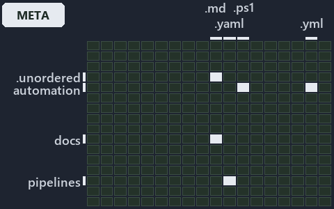

# docs/explanation/.assets/grid/adr-flow-cd-detect--one-boolean-answer-from-one-function--meta.grid.md

`Grid minimap: adr-flow-cd-detect--one-boolean-answer-from-one-function--meta`

The grid minimap of the slide `adr-flow-cd-detect--one-boolean-answer-from-one-function--meta` (meta lens). The slide supports
[ADR-FLOW-CD-DETECT][1]; the highlight of those ADR codes selects what is lit, and each reason below names the code that selects it.

## What the minimap shows

The grid crosses the 16 tracks (rows) with the 18 file languages (columns) of the world map and lights 5 cells, filled in ink. A cell lit
only by passing mentions (citations in body comments, not in a file's header or text) is touched: a lighter ink. Every other cell is idle, a
grey box: it holds files the slide's ADR codes do not select, or no file at all (237 of the 288 cells hold none). The minimap shows where
the slide sits, not how many files a cell holds; the world-map PDFs show the counts.

- .unordered × markdown: 2 lit of 20 files
- automation × powershell: 3 lit of 1579 files
- automation × yaml: 2 lit of 109 files
- docs × markdown: 5 lit of 2165 files
- pipelines × pipeline-yaml: 1 lit of 9 files

## Key

A lit row prints its track's name; a lit column prints a short code, the first extension of its file language:

- `.md`: markdown
- `.yaml`: pipeline-yaml
- `.ps1`: powershell
- `.yml`: yaml

## Why each cell is lit

### .unordered × markdown (2 lit files)

Placed: the root folder `.unordered/` names the track .unordered ([ADR-DSGN-TRACK#1][2]); the extension `.md` names the file language
markdown ([ADR-DSGN-TRACK#6][3]). Lit ([ADR-DSGN-TRACK#12][4]) by:

- [.unordered/15-10-2026/plan-adr-pwsh-followups.md][5]: selected by [ADR-FLOW-CD-DETECT][1]: the file cites it at line 111 (text).
- [.unordered/15-10-2026/plan-concern-axis.md][6]: selected by [ADR-FLOW-CD-DETECT][1]: the file cites it at line 96 (text).

### automation × powershell (3 lit files)

Placed: the root folder `automation/` names the track automation ([ADR-DSGN-TRACK#1][2]); the extension `.ps1` names the file language
powershell ([ADR-DSGN-TRACK#6][3]). Lit ([ADR-DSGN-TRACK#12][4]) by:

- [automation/Catzc.Azure.Templates/Get-BicepDeploymentName.ps1][7]: selected by [ADR-FLOW-CD-DETECT][1]: the file cites it at line 21
  (header).
- [automation/Catzc.Base.Globs/Get-GlobSetChangeRange.ps1][8]: selected by [ADR-FLOW-CD-DETECT][1]: the file cites it at line 20 (header)
  and line 26 (header).
- [automation/Catzc.Base.Globs/tests/Get-GlobSetChangeRange.Tests.ps1][9]: selected by [ADR-FLOW-CD-DETECT][1]: the file cites it at line 20
  (header).

### automation × yaml (2 lit files)

Placed: the root folder `automation/` names the track automation ([ADR-DSGN-TRACK#1][2]); the extension `.yml` names the file language yaml
([ADR-DSGN-TRACK#6][3]). Lit ([ADR-DSGN-TRACK#12][4]) by:

- [automation/Catzc.Base.Docs/configs/adrs.yml][10]: selected by [ADR-FLOW-CD-DETECT][1]: the file cites it at line 117 (text).
- [automation/Catzc.Base.QualityGates/configs/analyzer-adr-map.yml][11]: selected by [ADR-FLOW-CD-DETECT][1]: the file cites it at line 30
  (text).

### docs × markdown (5 lit files)

Placed: the root folder `docs/` names the track docs ([ADR-DSGN-TRACK#1][2]); the extension `.md` names the file language markdown
([ADR-DSGN-TRACK#6][3]). Lit ([ADR-DSGN-TRACK#12][4]) by:

- [docs/adr/flow/dora-explains.md][12]: selected by [ADR-FLOW-CD-DETECT][1]: the file cites it at line 81 (text).
- [docs/adr/flow/pipeline-detection.md][1]: selected by [ADR-FLOW-CD-DETECT][1]: the ADR's own file.
- [docs/adr/index.md][13]: selected by [ADR-FLOW-CD-DETECT][1]: the file cites it at line 129 (text).
- [docs/references/automation/catzc-azure-templates/Get-BicepDeploymentName.ps1.md][14]: selected by [ADR-FLOW-CD-DETECT][1]: the file cites
  it at line 17 (text) and line 33 (text).
- [docs/references/automation/catzc-base-globs/tests/Get-GlobSetChangeRange.Tests.ps1.md][15]: selected by [ADR-FLOW-CD-DETECT][1]: the file
  cites it at line 27 (text).

### pipelines × pipeline-yaml (1 lit file)

Placed: the root folder `pipelines/` names the track pipelines ([ADR-DSGN-TRACK#1][2]); the extension `.yaml` names the file language
pipeline-yaml ([ADR-DSGN-TRACK#6][3]). Lit ([ADR-DSGN-TRACK#12][4]) by:

- [pipelines/ci-automation.yaml][16]: selected by [ADR-FLOW-CD-DETECT][1]: a pipeline that cites nothing itself carries its globset's
  citations, which cite it at `automation/Catzc.Azure.Templates/Get-BicepDeploymentName.ps1` line 21 (header),
  `automation/Catzc.Base.Docs/configs/adrs.yml` line 117 (text), `automation/Catzc.Base.Globs/Get-GlobSetChangeRange.ps1` line 20 (header),
  `automation/Catzc.Base.Globs/Get-GlobSetChangeRange.ps1` line 26 (header),
  `automation/Catzc.Base.Globs/tests/Get-GlobSetChangeRange.Tests.ps1` line 20 (header) and
  `automation/Catzc.Base.QualityGates/configs/analyzer-adr-map.yml` line 30 (text).

## Keywords

- [world map][17]
- [track][18]
- [file language][19]
- [cell][20]
- [lit cell][21]
- [.unordered][22]: a track
- [automation][22]: a track
- [docs][22]: a track
- [pipelines][22]: a track
- [markdown][23]: a file language
- [pipeline-yaml][23]: a file language
- [powershell][23]: a file language
- [yaml][23]: a file language

[1]: ../../../adr/flow/pipeline-detection.md
[2]: ../../../adr/design/tracks.md#rule-adr-dsgn-track1
[3]: ../../../adr/design/tracks.md#rule-adr-dsgn-track6
[4]: ../../../adr/design/tracks.md#rule-adr-dsgn-track12
[5]: ../../../../.unordered/15-10-2026/plan-adr-pwsh-followups.md
[6]: ../../../../.unordered/15-10-2026/plan-concern-axis.md
[7]: ../../../../automation/Catzc.Azure.Templates/Get-BicepDeploymentName.ps1
[8]: ../../../../automation/Catzc.Base.Globs/Get-GlobSetChangeRange.ps1
[9]: ../../../../automation/Catzc.Base.Globs/tests/Get-GlobSetChangeRange.Tests.ps1
[10]: ../../../../automation/Catzc.Base.Docs/configs/adrs.yml
[11]: ../../../../automation/Catzc.Base.QualityGates/configs/analyzer-adr-map.yml
[12]: ../../../adr/flow/dora-explains.md
[13]: ../../../adr/index.md
[14]: ../../../references/automation/catzc-azure-templates/Get-BicepDeploymentName.ps1.md
[15]: ../../../references/automation/catzc-base-globs/tests/Get-GlobSetChangeRange.Tests.ps1.md
[16]: ../../../../pipelines/ci-automation.yaml
[17]: ../../../adr/glossary.md#world-map
[18]: ../../../adr/glossary.md#track
[19]: ../../../adr/glossary.md#file-language
[20]: ../../../adr/glossary.md#cell
[21]: ../../../adr/glossary.md#lit-cell
[22]: ../../../../automation/Catzc.Base.Variants/configs/variants.yml
[23]: ../../../../automation/Catzc.Base.Languages/configs/languages.yml
