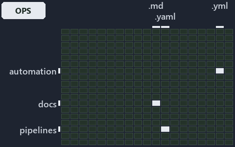

---
catzc:
  immutable:
    with_body_sha: "4f56d739ece2"
    repo_status: locked
    path: docs/explanation/.assets/grid/adr-flow-cd-detect--the-analyzer-names-the-raw-read--operations.grid.md
    source: docs/explanation/.assets/adr-flow-cd-detect--the-analyzer-names-the-raw-read--operations.drawio.png
    kind: asset-description
    language: markdown
    filetype: md
    track: docs
    tracktype: documentation
---

# A raw read fails Test-ScriptAnalyzer with one Error line, and CI step 2e asserts the seam: the world-map minimap

```text
Where the files that cite ADR-FLOW-CD-DETECT sit in the repository: tracks down, file languages across.
4 of 324 cells lit, holding 13 files.
```



This is the world-map minimap in the sidebar of the operations diagram of [A raw read fails Test-ScriptAnalyzer with one Error line, and CI
step 2e asserts the seam][17], which explains [ADR-FLOW-CD-DETECT][1]. It lights every cell of the world map that holds a file citing those
codes, so it shows where the decision lives in the repository. Each lit cell has its reason below, naming the code that selects it.

## What the minimap shows

The grid crosses the 18 tracks (rows) with the 18 file languages (columns) of the world map and lights 4 cells, filled in ink. A cell lit
only by passing mentions (citations in body comments, not in a file's header or text) is touched: a lighter ink. Every other cell is idle, a
grey box: it holds files the slide's ADR codes do not select, or no file at all (271 of the 324 cells hold none). The minimap shows where
the slide sits, not how many files a cell holds; the world-map PDFs show the counts.

- automation × powershell: 3 lit of 1619 files
- automation × yaml: 2 lit of 112 files
- docs × markdown: 7 lit of 2220 files
- pipelines × pipeline-yaml: 1 lit of 9 files

## Key

A lit row prints its track's name; a lit column prints a short code, the first extension of its file language:

- `.md`: markdown
- `.yaml`: pipeline-yaml
- `.ps1`: powershell
- `.yml`: yaml

## Why each cell is lit

### automation × powershell (3 lit files)

Placed: the root folder `automation/` names the track automation ([ADR-DSGN-TRACK#1][2]); the extension `.ps1` names the file language
powershell ([ADR-DSGN-TRACK#6][3]). Lit ([ADR-DSGN-TRACK#12][4]) by:

- [automation/Catzc.Azure.Templates/Get-BicepDeploymentName.ps1][5]: selected by [ADR-FLOW-CD-DETECT][1]: the file cites it at line 21
  (header).
- [automation/Catzc.Base.Globs/Get-GlobSetChangeRange.ps1][6]: selected by [ADR-FLOW-CD-DETECT][1]: the file cites it at line 20 (header)
  and line 26 (header).
- [automation/Catzc.Base.Globs/tests/Get-GlobSetChangeRange.Tests.ps1][7]: selected by [ADR-FLOW-CD-DETECT][1]: the file cites it at line 20
  (header).

### automation × yaml (2 lit files)

Placed: the root folder `automation/` names the track automation ([ADR-DSGN-TRACK#1][2]); the extension `.yml` names the file language yaml
([ADR-DSGN-TRACK#6][3]). Lit ([ADR-DSGN-TRACK#12][4]) by:

- [automation/Catzc.Base.Docs/configs/adrs.yml][8]: selected by [ADR-FLOW-CD-DETECT][1]: the file cites it at line 118 (text).
- [automation/Catzc.Base.QualityGates/configs/analyzer-adr-map.yml][9]: selected by [ADR-FLOW-CD-DETECT][1]: the file cites it at line 30
  (text).

### docs × markdown (7 lit files)

Placed: the root folder `docs/` names the track docs ([ADR-DSGN-TRACK#1][2]); the extension `.md` names the file language markdown
([ADR-DSGN-TRACK#6][3]). Lit ([ADR-DSGN-TRACK#12][4]) by:

- [docs/adr/flow/dora-explains.md][10]: selected by [ADR-FLOW-CD-DETECT][1]: the file cites it at line 80 (text).
- [docs/adr/flow/pipeline-detection.md][1]: selected by [ADR-FLOW-CD-DETECT][1]: the ADR's own file.
- [docs/adr/index.md][11]: selected by [ADR-FLOW-CD-DETECT][1]: the file cites it at line 131 (text).
- [docs/references/.assets/automation/catzc-base-globs/protected-module-skip-by-hash.drawio.verify.md][12]: selected by
  [ADR-FLOW-CD-DETECT][1]: the file cites it at line 15 (text) and line 75 (text).
- [docs/references/automation/catzc-azure-templates/Get-BicepDeploymentName.ps1.md][13]: selected by [ADR-FLOW-CD-DETECT][1]: the file cites
  it at line 17 (text) and line 33 (text).
- [docs/references/automation/catzc-base-globs/protected-module-skip-by-hash.drawio.md][14]: selected by [ADR-FLOW-CD-DETECT][1]: the file
  cites it at line 15 (text), line 48 (text) and line 131 (text).
- [docs/references/automation/catzc-base-globs/tests/Get-GlobSetChangeRange.Tests.ps1.md][15]: selected by [ADR-FLOW-CD-DETECT][1]: the file
  cites it at line 27 (text).

### pipelines × pipeline-yaml (1 lit file)

Placed: the root folder `pipelines/` names the track pipelines ([ADR-DSGN-TRACK#1][2]); the extension `.yaml` names the file language
pipeline-yaml ([ADR-DSGN-TRACK#6][3]). Lit ([ADR-DSGN-TRACK#12][4]) by:

- [pipelines/ci-automation.yaml][16]: selected by [ADR-FLOW-CD-DETECT][1]: a pipeline that cites nothing itself carries its globset's
  citations, which cite it at `automation/Catzc.Azure.Templates/Get-BicepDeploymentName.ps1` line 21 (header),
  `automation/Catzc.Base.Docs/configs/adrs.yml` line 118 (text), `automation/Catzc.Base.Globs/Get-GlobSetChangeRange.ps1` line 20 (header),
  `automation/Catzc.Base.Globs/Get-GlobSetChangeRange.ps1` line 26 (header),
  `automation/Catzc.Base.Globs/tests/Get-GlobSetChangeRange.Tests.ps1` line 20 (header) and
  `automation/Catzc.Base.QualityGates/configs/analyzer-adr-map.yml` line 30 (text).

## Keywords

- [world map][18]
- [track][19]
- [file language][20]
- [cell][21]
- [lit cell][22]
- [automation][23]: a track
- [docs][23]: a track
- [pipelines][23]: a track
- [markdown][24]: a file language
- [pipeline-yaml][24]: a file language
- [powershell][24]: a file language
- [yaml][24]: a file language

[1]: ../../../adr/flow/pipeline-detection.md
[2]: ../../../adr/design/tracks.md#rule-adr-dsgn-track1
[3]: ../../../adr/design/tracks.md#rule-adr-dsgn-track6
[4]: ../../../adr/design/tracks.md#rule-adr-dsgn-track12
[5]: ../../../../automation/Catzc.Azure.Templates/Get-BicepDeploymentName.ps1
[6]: ../../../../automation/Catzc.Base.Globs/Get-GlobSetChangeRange.ps1
[7]: ../../../../automation/Catzc.Base.Globs/tests/Get-GlobSetChangeRange.Tests.ps1
[8]: ../../../../automation/Catzc.Base.Docs/configs/adrs.yml
[9]: ../../../../automation/Catzc.Base.QualityGates/configs/analyzer-adr-map.yml
[10]: ../../../adr/flow/dora-explains.md
[11]: ../../../adr/index.md
[12]: ../../../references/.assets/automation/catzc-base-globs/protected-module-skip-by-hash.drawio.verify.md
[13]: ../../../references/automation/catzc-azure-templates/Get-BicepDeploymentName.ps1.md
[14]: ../../../references/automation/catzc-base-globs/protected-module-skip-by-hash.drawio.md
[15]: ../../../references/automation/catzc-base-globs/tests/Get-GlobSetChangeRange.Tests.ps1.md
[16]: ../../../../pipelines/ci-automation.yaml
[17]: ../../flow/the-analyzer-names-the-raw-read.md
[18]: ../../../adr/glossary.md#world-map
[19]: ../../../adr/glossary.md#track
[20]: ../../../adr/glossary.md#file-language
[21]: ../../../adr/glossary.md#cell
[22]: ../../../adr/glossary.md#lit-cell
[23]: ../../../../automation/Catzc.Base.Variants/configs/variants.yml
[24]: ../../../../automation/Catzc.Base.Languages/configs/languages.yml
