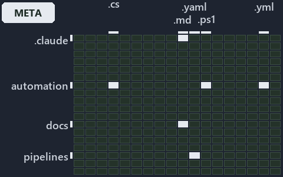

# docs/explanation/.assets/grid/adr-prin-onelive--a-sibling-is-an-idea-never-a-reference--meta.grid.md

`Grid minimap: adr-prin-onelive--a-sibling-is-an-idea-never-a-reference--meta`

The grid minimap of the slide `adr-prin-onelive--a-sibling-is-an-idea-never-a-reference--meta` (meta lens). The slide supports
[ADR-AUTO-GO][1] and [ADR-PRIN-ONELIVE][2]; the highlight of those ADR codes selects what is lit, and each reason below names the code that
selects it.

## What the minimap shows

The grid crosses the 18 tracks (rows) with the 18 file languages (columns) of the world map and lights 6 cells, filled in ink. A cell lit
only by passing mentions (citations in body comments, not in a file's header or text) is touched: a lighter ink. Every other cell is idle, a
grey box: it holds files the slide's ADR codes do not select, or no file at all (271 of the 324 cells hold none). The minimap shows where
the slide sits, not how many files a cell holds; the world-map PDFs show the counts.

- .claude × markdown: 17 lit of 91 files
- automation × csharp: 5 lit of 286 files
- automation × powershell: 20 lit of 1616 files
- automation × yaml: 6 lit of 112 files
- docs × markdown: 24 lit of 2218 files
- pipelines × pipeline-yaml: 1 lit of 9 files

## Key

A lit row prints its track's name; a lit column prints a short code, the first extension of its file language:

- `.cs`: csharp
- `.md`: markdown
- `.yaml`: pipeline-yaml
- `.ps1`: powershell
- `.yml`: yaml

## Why each cell is lit

### .claude × markdown (17 lit files)

Placed: the root folder `.claude/` names the track .claude ([ADR-DSGN-TRACK#1][3]); the extension `.md` names the file language markdown
([ADR-DSGN-TRACK#6][4]). Lit ([ADR-DSGN-TRACK#12][5]) by:

- [.claude/CLAUDE.md][6]: selected by [ADR-AUTO-GO][1]: the file cites it at line 56 (text); selected by [ADR-PRIN-ONELIVE][2]: the file
  cites it at line 58 (text) and line 140 (text).
- [.claude/plans/decisions-2026-10-16.md][7]: selected by [ADR-AUTO-GO][1]: the file cites it at line 77 (text); selected by
  [ADR-PRIN-ONELIVE][2]: the file cites it at line 30 (text), line 146 (text) and line 192 (text).
- [.claude/plans/plan-adr-link-cleanup-prose-to-pages.md][8]: selected by [ADR-PRIN-ONELIVE][2]: the file cites it at line 127 (text) and
  line 349 (text).
- [.claude/plans/plan-assert-wait.md][9]: selected by [ADR-PRIN-ONELIVE][2]: the file cites it at line 97 (text), line 102 (text), line 106
  (text) and line 168 (text).
- [.claude/plans/plan-bounded-folder-enumeration.md][10]: selected by [ADR-PRIN-ONELIVE][2]: the file cites it at line 188 (text), line 230
  (text) and line 370 (text).
- [.claude/plans/plan-config-defaults.md][11]: selected by [ADR-PRIN-ONELIVE][2]: the file cites it at line 88 (text) and line 160 (text).
- [.claude/plans/plan-file-head-immutable-edges-classes.md][12]: selected by [ADR-PRIN-ONELIVE][2]: the file cites it at line 168 (text),
  line 300 (text) and line 409 (text).
- [.claude/plans/plan-file-meta-head-policy.md][13]: selected by [ADR-PRIN-ONELIVE][2]: the file cites it at line 68 (text).
- [.claude/plans/plan-layers-vocabulary-rename-contracts.md][14]: selected by [ADR-AUTO-GO][1]: the file cites it at line 428 (text) and
  line 762 (text); selected by [ADR-PRIN-ONELIVE][2]: the file cites it at line 133 (text), line 258 (text) and line 710 (text).
- [.claude/plans/plan-materialization-of-knowledge.md][15]: selected by [ADR-PRIN-ONELIVE][2]: the file cites it at line 45 (text) and line
  131 (text).
- [.claude/plans/plan-module-kinds-tracks.md][16]: selected by [ADR-AUTO-GO][1]: the file cites it at line 321 (text) and line 467 (text);
  selected by [ADR-PRIN-ONELIVE][2]: the file cites it at line 242 (text), line 283 (text), line 423 (text), line 551 (text), line 590
  (text), line 692 (text) and line 1058 (text).
- [.claude/plans/prompt-automation-layers-continue.md][17]: selected by [ADR-PRIN-ONELIVE][2]: the file cites it at line 76 (text).
- [.claude/plans/prompt-config-defaults-continue.md][18]: selected by [ADR-PRIN-ONELIVE][2]: the file cites it at line 76 (text).
- [.claude/plans/prompt-k8s-kinds-1-prepare.md][19]: selected by [ADR-PRIN-ONELIVE][2]: the file cites it at line 40 (text).
- [.claude/plans/prompt-module-model-1-prepare.md][20]: selected by [ADR-PRIN-ONELIVE][2]: the file cites it at line 41 (text).
- [.claude/plans/questionnaire-2026-10-16.md][21]: selected by [ADR-AUTO-GO][1]: the file cites it at line 173 (text); selected by
  [ADR-PRIN-ONELIVE][2]: the file cites it at line 523 (text) and line 622 (text).
- [.claude/plans/task-adr-auto-material.md][22]: selected by [ADR-PRIN-ONELIVE][2]: the file cites it at line 42 (text).

### automation × csharp (5 lit files)

Placed: the root folder `automation/` names the track automation ([ADR-DSGN-TRACK#1][3]); the extension `.cs` names the file language csharp
([ADR-DSGN-TRACK#6][4]). Lit ([ADR-DSGN-TRACK#12][5]) by:

- [automation/Catzc.Base.Docs/types/CheckModes.cs][23]: selected by [ADR-PRIN-ONELIVE][2]: the file cites it at line 22 (text).
- [automation/Catzc.Base.QualityGates/types/CommentBlockKind.cs][24]: selected by [ADR-PRIN-ONELIVE][2]: the file cites it at line 19
  (text).
- [automation/Catzc.Base.QualityGates/types/CommentEngine.cs][25]: selected by [ADR-PRIN-ONELIVE][2]: the file cites it at line 21 (text).
- [automation/Catzc.Base.QualityGates/types/CommentPageMap.cs][26]: selected by [ADR-PRIN-ONELIVE][2]: the file cites it at line 21 (text).
- [automation/Catzc.Base.QualityGates/types/CommentsConfig.cs][27]: selected by [ADR-PRIN-ONELIVE][2]: the file cites it at line 24 (text).

### automation × powershell (20 lit files)

Placed: the root folder `automation/` names the track automation ([ADR-DSGN-TRACK#1][3]); the extension `.ps1` names the file language
powershell ([ADR-DSGN-TRACK#6][4]). Lit ([ADR-DSGN-TRACK#12][5]) by:

- [automation/Catzc.Base.Docs/tests/types/CheckModes.Tests.ps1][28]: selected by [ADR-PRIN-ONELIVE][2]: the file cites it at line 22
  (header) and line 26 (text).
- [automation/Catzc.Base.Files/Get-InputStamp.ps1][29]: selected by [ADR-PRIN-ONELIVE][2]: the file cites it at line 20 (header).
- [automation/Catzc.Base.Files/Write-FileIfChanged.ps1][30]: selected by [ADR-PRIN-ONELIVE][2]: the file cites it at line 23 (header) and
  line 43 (header).
- [automation/Catzc.Base.Globs/Get-ModuleGlobSet.ps1][31]: selected by [ADR-AUTO-GO][1]: the file cites it at line 22 (header) and line 39
  (header).
- [automation/Catzc.Base.Globs/tests/Get-ModuleGlobSet.Tests.ps1][32]: selected by [ADR-AUTO-GO][1]: the file cites it at line 21 (header)
  and line 73 (text).
- [automation/Catzc.Base.Languages/Invoke-GoTest.ps1][33]: selected by [ADR-AUTO-GO][1]: the file cites it at line 23 (header).
- [automation/Catzc.Base.Languages/Test-GeneratedFileCurrent.ps1][34]: selected by [ADR-PRIN-ONELIVE][2]: the file cites it at line 21
  (header).
- [automation/Catzc.Base.Languages/private/Get-EngineContract.ps1][35]: selected by [ADR-AUTO-GO][1]: the file cites it at line 23 (header)
  and line 31 (header).
- [automation/Catzc.Base.QualityGates/Build-CommentView.ps1][36]: selected by [ADR-PRIN-ONELIVE][2]: the file cites it at line 21 (header)
  and line 29 (header).
- [automation/Catzc.Base.QualityGates/Export-Comments.ps1][37]: selected by [ADR-PRIN-ONELIVE][2]: the file cites it at line 21 (header) and
  line 28 (header).
- [automation/Catzc.Base.QualityGates/Test-Comments.ps1][38]: selected by [ADR-PRIN-ONELIVE][2]: the file cites it at line 23 (header) and
  line 29 (header).
- [automation/Catzc.Base.QualityGates/private/Get-LanguageTestExecutable.ps1][39]: selected by [ADR-AUTO-GO][1]: the file cites it at line
  23 (header) and line 32 (header).
- [automation/Catzc.Base.QualityGates/private/Get-LanguageTestFolders.ps1][40]: selected by [ADR-AUTO-GO][1]: the file cites it at line 23
  (header) and line 36 (header).
- [automation/Catzc.Base.QualityGates/private/Get-LanguageTestOutcomes.ps1][41]: selected by [ADR-AUTO-GO][1]: the file cites it at line 23
  (header) and line 144 (text).
- [automation/Catzc.Base.QualityGates/private/Invoke-Gofmt.ps1][42]: selected by [ADR-AUTO-GO][1]: the file cites it at line 21 (header) and
  line 30 (header).
- [automation/Catzc.Base.QualityGates/tests/Build-CommentView.Tests.ps1][43]: selected by [ADR-PRIN-ONELIVE][2]: the file cites it at line
  21 (header).
- [automation/Catzc.Base.QualityGates/tests/Export-Comments.Tests.ps1][44]: selected by [ADR-PRIN-ONELIVE][2]: the file cites it at line 23
  (header).
- [automation/Catzc.Base.QualityGates/tests/Test-Comments.Tests.ps1][45]: selected by [ADR-PRIN-ONELIVE][2]: the file cites it at line 20
  (header).
- [automation/Catzc.Base.QualityGates/tests/types/CommentEngine.Tests.ps1][46]: selected by [ADR-PRIN-ONELIVE][2]: the file cites it at line
  21 (header).
- [automation/Catzc.Base.RootConfig/private/Invoke-RootConfigGenerator.ps1][47]: selected by [ADR-AUTO-GO][1]: the file cites it at line 21
  (header).

### automation × yaml (6 lit files)

Placed: the root folder `automation/` names the track automation ([ADR-DSGN-TRACK#1][3]); the extension `.yml` names the file language yaml
([ADR-DSGN-TRACK#6][4]). Lit ([ADR-DSGN-TRACK#12][5]) by:

- [automation/Catzc.Base.Docs/configs/adrs.yml][48]: selected by [ADR-AUTO-GO][1]: the file cites it at line 167 (text); selected by
  [ADR-PRIN-ONELIVE][2]: the file cites it at line 53 (text).
- [automation/Catzc.Base.Docs/configs/agents.yml][49]: selected by [ADR-PRIN-ONELIVE][2]: the file cites it at line 79 (body comment) and
  line 85 (text).
- [automation/Catzc.Base.Docs/configs/capabilities.yml][50]: selected by [ADR-PRIN-ONELIVE][2]: the file cites it at line 106 (text) and
  line 111 (text).
- [automation/Catzc.Base.Git/configs/gitignore.yml][51]: selected by [ADR-AUTO-GO][1]: the file cites it at line 120 (text).
- [automation/Catzc.Base.Languages/configs/glossary.yml][52]: selected by [ADR-AUTO-GO][1]: the file cites it at line 35 (text).
- [automation/Catzc.Base.QualityGates/configs/terminology.yml][53]: selected by [ADR-PRIN-ONELIVE][2]: the file cites it at line 574 (text).

### docs × markdown (24 lit files)

Placed: the root folder `docs/` names the track docs ([ADR-DSGN-TRACK#1][3]); the extension `.md` names the file language markdown
([ADR-DSGN-TRACK#6][4]). Lit ([ADR-DSGN-TRACK#12][5]) by:

- [docs/adr/automation/dora-explains.md][54]: selected by [ADR-AUTO-GO][1]: the file cites it at line 614 (text).
- [docs/adr/automation/go/go-test-artifacts.md][1]: selected by [ADR-AUTO-GO][1]: the ADR's own file.
- [docs/adr/glossary.md][55]: selected by [ADR-AUTO-GO][1]: the file cites it at line 667 (text).
- [docs/adr/index.md][56]: selected by [ADR-AUTO-GO][1]: the file cites it at line 179 (text); selected by [ADR-PRIN-ONELIVE][2]: the file
  cites it at line 72 (text).
- [docs/adr/principles/dora-explains.md][57]: selected by [ADR-PRIN-ONELIVE][2]: the file cites it at line 115 (text).
- [docs/adr/principles/one-living-version.md][2]: selected by [ADR-PRIN-ONELIVE][2]: the ADR's own file.
- [docs/how-to/getting-started/automation/go/index.md][58]: selected by [ADR-AUTO-GO][1]: the file cites it at line 21 (text).
- [docs/references/.assets/automation/catzc-tooling-provisioning/tools-yml-install-dispatch.drawio.verify.md][59]: selected by
  [ADR-PRIN-ONELIVE][2]: the file cites it at line 90 (text).
- [docs/references/agent-contracts.md][60]: selected by [ADR-PRIN-ONELIVE][2]: the file cites it at line 42 (text).
- [docs/references/automation/catzc-base-docs/tests/types/CheckModes.Tests.ps1.md][61]: selected by [ADR-PRIN-ONELIVE][2]: the file cites it
  at line 18 (text) and line 28 (text).
- [docs/references/automation/catzc-base-docs/types/CheckModes.cs.md][62]: selected by [ADR-PRIN-ONELIVE][2]: the file cites it at line 18
  (text) and line 33 (text).
- [docs/references/automation/catzc-base-globs/Get-ModuleGlobSet.ps1.md][63]: selected by [ADR-AUTO-GO][1]: the file cites it at line 18
  (text) and line 59 (text).
- [docs/references/automation/catzc-base-languages/Invoke-GoTest.ps1.md][64]: selected by [ADR-AUTO-GO][1]: the file cites it at line 18
  (text) and line 44 (text).
- [docs/references/automation/catzc-base-qualitygates/configs/comments.yml.md][65]: selected by [ADR-PRIN-ONELIVE][2]: the file cites it at
  line 19 (text) and line 38 (text).
- [docs/references/automation/catzc-base-qualitygates/tests/Build-CommentView.Tests.ps1.md][66]: selected by [ADR-PRIN-ONELIVE][2]: the file
  cites it at line 17 (text) and line 34 (text).
- [docs/references/automation/catzc-base-qualitygates/tests/Export-Comments.Tests.ps1.md][67]: selected by [ADR-PRIN-ONELIVE][2]: the file
  cites it at line 18 (text) and line 34 (text).
- [docs/references/automation/catzc-base-qualitygates/tests/Test-Comments.Tests.ps1.md][68]: selected by [ADR-PRIN-ONELIVE][2]: the file
  cites it at line 17 (text) and line 31 (text).
- [docs/references/automation/catzc-base-qualitygates/types/CommentPageMap.cs.md][69]: selected by [ADR-PRIN-ONELIVE][2]: the file cites it
  at line 18 (text) and line 34 (text).
- [docs/references/automation/catzc-base-qualitygates/types/CommentsConfig.cs.md][70]: selected by [ADR-PRIN-ONELIVE][2]: the file cites it
  at line 20 (text) and line 38 (text).
- [docs/references/automation/catzc-base-rootconfig/private/Invoke-RootConfigGenerator.ps1.md][71]: selected by [ADR-AUTO-GO][1]: the file
  cites it at line 17 (text) and line 65 (text).
- [docs/references/automation/catzc-base-vscode/configs/vscode-settings.yml.md][72]: selected by [ADR-AUTO-GO][1]: the file cites it at line
  17 (text) and line 204 (text).
- [docs/references/automation/internal/Catzc.Internal.Importer.psm1.md][73]: selected by [ADR-PRIN-ONELIVE][2]: the file cites it at line 37
  (text).
- [docs/references/automation/internal/Catzc.Internal.Loader.psm1.md][74]: selected by [ADR-PRIN-ONELIVE][2]: the file cites it at line 32
  (text).
- [docs/references/automation/internal/Catzc.Internal.Vendor.psm1.md][75]: selected by [ADR-PRIN-ONELIVE][2]: the file cites it at line 38
  (text).

### pipelines × pipeline-yaml (1 lit file)

Placed: the root folder `pipelines/` names the track pipelines ([ADR-DSGN-TRACK#1][3]); the extension `.yaml` names the file language
pipeline-yaml ([ADR-DSGN-TRACK#6][4]). Lit ([ADR-DSGN-TRACK#12][5]) by:

- [pipelines/ci-automation.yaml][76]: selected by [ADR-AUTO-GO][1]: a pipeline that cites nothing itself carries its globset's citations,
  which cite it at `automation/Catzc.Base.Docs/configs/adrs.yml` line 167 (text), `automation/Catzc.Base.Git/configs/gitignore.yml` line 120
  (text), `automation/Catzc.Base.Globs/Get-ModuleGlobSet.ps1` line 22 (header), `automation/Catzc.Base.Globs/Get-ModuleGlobSet.ps1` line 39
  (header), `automation/Catzc.Base.Globs/tests/Get-ModuleGlobSet.Tests.ps1` line 21 (header),
  `automation/Catzc.Base.Globs/tests/Get-ModuleGlobSet.Tests.ps1` line 73 (text), `automation/Catzc.Base.Languages/Invoke-GoTest.ps1` line
  23 (header), `automation/Catzc.Base.Languages/configs/glossary.yml` line 35 (text),
  `automation/Catzc.Base.Languages/private/Get-EngineContract.ps1` line 23 (header),
  `automation/Catzc.Base.Languages/private/Get-EngineContract.ps1` line 31 (header),
  `automation/Catzc.Base.QualityGates/private/Get-LanguageTestExecutable.ps1` line 23 (header),
  `automation/Catzc.Base.QualityGates/private/Get-LanguageTestExecutable.ps1` line 32 (header),
  `automation/Catzc.Base.QualityGates/private/Get-LanguageTestFolders.ps1` line 23 (header),
  `automation/Catzc.Base.QualityGates/private/Get-LanguageTestFolders.ps1` line 36 (header),
  `automation/Catzc.Base.QualityGates/private/Get-LanguageTestOutcomes.ps1` line 23 (header),
  `automation/Catzc.Base.QualityGates/private/Get-LanguageTestOutcomes.ps1` line 144 (text),
  `automation/Catzc.Base.QualityGates/private/Invoke-Gofmt.ps1` line 21 (header),
  `automation/Catzc.Base.QualityGates/private/Invoke-Gofmt.ps1` line 30 (header) and
  `automation/Catzc.Base.RootConfig/private/Invoke-RootConfigGenerator.ps1` line 21 (header); selected by [ADR-PRIN-ONELIVE][2]: a pipeline
  that cites nothing itself carries its globset's citations, which cite it at `automation/Catzc.Base.Docs/configs/adrs.yml` line 53 (text),
  `automation/Catzc.Base.Docs/configs/agents.yml` line 79 (body comment), `automation/Catzc.Base.Docs/configs/agents.yml` line 85 (text),
  `automation/Catzc.Base.Docs/configs/capabilities.yml` line 106 (text), `automation/Catzc.Base.Docs/configs/capabilities.yml` line 111
  (text), `automation/Catzc.Base.Docs/tests/types/CheckModes.Tests.ps1` line 22 (header),
  `automation/Catzc.Base.Docs/tests/types/CheckModes.Tests.ps1` line 26 (text), `automation/Catzc.Base.Docs/types/CheckModes.cs` line 22
  (text), `automation/Catzc.Base.Files/Get-InputStamp.ps1` line 20 (header), `automation/Catzc.Base.Files/Write-FileIfChanged.ps1` line 23
  (header), `automation/Catzc.Base.Files/Write-FileIfChanged.ps1` line 43 (header),
  `automation/Catzc.Base.Languages/Test-GeneratedFileCurrent.ps1` line 21 (header),
  `automation/Catzc.Base.QualityGates/Build-CommentView.ps1` line 21 (header), `automation/Catzc.Base.QualityGates/Build-CommentView.ps1`
  line 29 (header), `automation/Catzc.Base.QualityGates/Export-Comments.ps1` line 21 (header),
  `automation/Catzc.Base.QualityGates/Export-Comments.ps1` line 28 (header), `automation/Catzc.Base.QualityGates/Test-Comments.ps1` line 23
  (header), `automation/Catzc.Base.QualityGates/Test-Comments.ps1` line 29 (header),
  `automation/Catzc.Base.QualityGates/configs/terminology.yml` line 574 (text),
  `automation/Catzc.Base.QualityGates/tests/Build-CommentView.Tests.ps1` line 21 (header),
  `automation/Catzc.Base.QualityGates/tests/Export-Comments.Tests.ps1` line 23 (header),
  `automation/Catzc.Base.QualityGates/tests/Test-Comments.Tests.ps1` line 20 (header),
  `automation/Catzc.Base.QualityGates/tests/types/CommentEngine.Tests.ps1` line 21 (header),
  `automation/Catzc.Base.QualityGates/types/CommentBlockKind.cs` line 19 (text), `automation/Catzc.Base.QualityGates/types/CommentEngine.cs`
  line 21 (text), `automation/Catzc.Base.QualityGates/types/CommentPageMap.cs` line 21 (text) and
  `automation/Catzc.Base.QualityGates/types/CommentsConfig.cs` line 24 (text).

## Keywords

- [world map][77]
- [track][78]
- [file language][79]
- [cell][80]
- [lit cell][81]
- [.claude][82]: a track
- [automation][82]: a track
- [docs][82]: a track
- [pipelines][82]: a track
- [csharp][83]: a file language
- [markdown][83]: a file language
- [pipeline-yaml][83]: a file language
- [powershell][83]: a file language
- [yaml][83]: a file language

Terms the cited ADRs define:

- [go test module][84], defined by [ADR-AUTO-GO#2][85]

[1]: ../../../adr/automation/go/go-test-artifacts.md
[2]: ../../../adr/principles/one-living-version.md
[3]: ../../../adr/design/tracks.md#rule-adr-dsgn-track1
[4]: ../../../adr/design/tracks.md#rule-adr-dsgn-track6
[5]: ../../../adr/design/tracks.md#rule-adr-dsgn-track12
[6]: ../../../../.claude/CLAUDE.md
[7]: ../../../../.claude/plans/decisions-2026-10-16.md
[8]: ../../../../.claude/plans/plan-adr-link-cleanup-prose-to-pages.md
[9]: ../../../../.claude/plans/plan-assert-wait.md
[10]: ../../../../.claude/plans/plan-bounded-folder-enumeration.md
[11]: ../../../../.claude/plans/plan-config-defaults.md
[12]: ../../../../.claude/plans/plan-file-head-immutable-edges-classes.md
[13]: ../../../../.claude/plans/plan-file-meta-head-policy.md
[14]: ../../../../.claude/plans/plan-layers-vocabulary-rename-contracts.md
[15]: ../../../../.claude/plans/plan-materialization-of-knowledge.md
[16]: ../../../../.claude/plans/plan-module-kinds-tracks.md
[17]: ../../../../.claude/plans/prompt-automation-layers-continue.md
[18]: ../../../../.claude/plans/prompt-config-defaults-continue.md
[19]: ../../../../.claude/plans/prompt-k8s-kinds-1-prepare.md
[20]: ../../../../.claude/plans/prompt-module-model-1-prepare.md
[21]: ../../../../.claude/plans/questionnaire-2026-10-16.md
[22]: ../../../../.claude/plans/task-adr-auto-material.md
[23]: ../../../../automation/Catzc.Base.Docs/types/CheckModes.cs
[24]: ../../../../automation/Catzc.Base.QualityGates/types/CommentBlockKind.cs
[25]: ../../../../automation/Catzc.Base.QualityGates/types/CommentEngine.cs
[26]: ../../../../automation/Catzc.Base.QualityGates/types/CommentPageMap.cs
[27]: ../../../../automation/Catzc.Base.QualityGates/types/CommentsConfig.cs
[28]: ../../../../automation/Catzc.Base.Docs/tests/types/CheckModes.Tests.ps1
[29]: ../../../../automation/Catzc.Base.Files/Get-InputStamp.ps1
[30]: ../../../../automation/Catzc.Base.Files/Write-FileIfChanged.ps1
[31]: ../../../../automation/Catzc.Base.Globs/Get-ModuleGlobSet.ps1
[32]: ../../../../automation/Catzc.Base.Globs/tests/Get-ModuleGlobSet.Tests.ps1
[33]: ../../../../automation/Catzc.Base.Languages/Invoke-GoTest.ps1
[34]: ../../../../automation/Catzc.Base.Languages/Test-GeneratedFileCurrent.ps1
[35]: ../../../../automation/Catzc.Base.Languages/private/Get-EngineContract.ps1
[36]: ../../../../automation/Catzc.Base.QualityGates/Build-CommentView.ps1
[37]: ../../../../automation/Catzc.Base.QualityGates/Export-Comments.ps1
[38]: ../../../../automation/Catzc.Base.QualityGates/Test-Comments.ps1
[39]: ../../../../automation/Catzc.Base.QualityGates/private/Get-LanguageTestExecutable.ps1
[40]: ../../../../automation/Catzc.Base.QualityGates/private/Get-LanguageTestFolders.ps1
[41]: ../../../../automation/Catzc.Base.QualityGates/private/Get-LanguageTestOutcomes.ps1
[42]: ../../../../automation/Catzc.Base.QualityGates/private/Invoke-Gofmt.ps1
[43]: ../../../../automation/Catzc.Base.QualityGates/tests/Build-CommentView.Tests.ps1
[44]: ../../../../automation/Catzc.Base.QualityGates/tests/Export-Comments.Tests.ps1
[45]: ../../../../automation/Catzc.Base.QualityGates/tests/Test-Comments.Tests.ps1
[46]: ../../../../automation/Catzc.Base.QualityGates/tests/types/CommentEngine.Tests.ps1
[47]: ../../../../automation/Catzc.Base.RootConfig/private/Invoke-RootConfigGenerator.ps1
[48]: ../../../../automation/Catzc.Base.Docs/configs/adrs.yml
[49]: ../../../../automation/Catzc.Base.Docs/configs/agents.yml
[50]: ../../../../automation/Catzc.Base.Docs/configs/capabilities.yml
[51]: ../../../../automation/Catzc.Base.Git/configs/gitignore.yml
[52]: ../../../../automation/Catzc.Base.Languages/configs/glossary.yml
[53]: ../../../../automation/Catzc.Base.QualityGates/configs/terminology.yml
[54]: ../../../adr/automation/dora-explains.md
[55]: ../../../adr/glossary.md
[56]: ../../../adr/index.md
[57]: ../../../adr/principles/dora-explains.md
[58]: ../../../how-to/getting-started/automation/go/index.md
[59]: ../../../references/.assets/automation/catzc-tooling-provisioning/tools-yml-install-dispatch.drawio.verify.md
[60]: ../../../references/agent-contracts.md
[61]: ../../../references/automation/catzc-base-docs/tests/types/CheckModes.Tests.ps1.md
[62]: ../../../references/automation/catzc-base-docs/types/CheckModes.cs.md
[63]: ../../../references/automation/catzc-base-globs/Get-ModuleGlobSet.ps1.md
[64]: ../../../references/automation/catzc-base-languages/Invoke-GoTest.ps1.md
[65]: ../../../references/automation/catzc-base-qualitygates/configs/comments.yml.md
[66]: ../../../references/automation/catzc-base-qualitygates/tests/Build-CommentView.Tests.ps1.md
[67]: ../../../references/automation/catzc-base-qualitygates/tests/Export-Comments.Tests.ps1.md
[68]: ../../../references/automation/catzc-base-qualitygates/tests/Test-Comments.Tests.ps1.md
[69]: ../../../references/automation/catzc-base-qualitygates/types/CommentPageMap.cs.md
[70]: ../../../references/automation/catzc-base-qualitygates/types/CommentsConfig.cs.md
[71]: ../../../references/automation/catzc-base-rootconfig/private/Invoke-RootConfigGenerator.ps1.md
[72]: ../../../references/automation/catzc-base-vscode/configs/vscode-settings.yml.md
[73]: ../../../references/automation/internal/Catzc.Internal.Importer.psm1.md
[74]: ../../../references/automation/internal/Catzc.Internal.Loader.psm1.md
[75]: ../../../references/automation/internal/Catzc.Internal.Vendor.psm1.md
[76]: ../../../../pipelines/ci-automation.yaml
[77]: ../../../adr/glossary.md#world-map
[78]: ../../../adr/glossary.md#track
[79]: ../../../adr/glossary.md#file-language
[80]: ../../../adr/glossary.md#cell
[81]: ../../../adr/glossary.md#lit-cell
[82]: ../../../../automation/Catzc.Base.Variants/configs/variants.yml
[83]: ../../../../automation/Catzc.Base.Languages/configs/languages.yml
[84]: ../../../adr/glossary.md#go-test-module
[85]: ../../../adr/automation/go/go-test-artifacts.md#rule-adr-auto-go2
