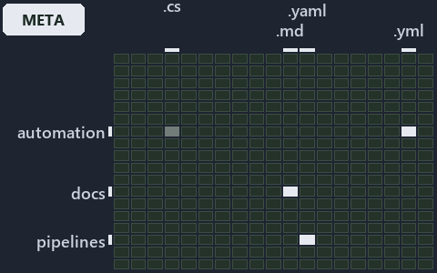

---
catzc:
  immutable:
    with_body_sha: "614365a71e9a"
    repo_status: locked
    path: docs/explanation/.assets/grid/adr-repo-rootcfg--one-source-one-writer-one-boolean--meta.grid.md
    source: docs/explanation/.assets/adr-repo-rootcfg--one-source-one-writer-one-boolean--meta.drawio.png
    role: asset-description
    language: markdown
    filetype: md
    track: docs
    tracktype: documentation
---

# Every managed root file has one source of truth, one writer, and one boolean that decides git membership: the world-map minimap

```text
Where the files that cite ADR-REPO-ROOTCFG sit in the repository: tracks down, file languages across.
4 of 342 cells lit, holding 40 files.
```



This is the world-map minimap in the sidebar of the meta diagram of [Every managed root file has one source of truth, one writer, and one
boolean that decides git membership][44], which explains [ADR-REPO-ROOTCFG][1]. It lights every cell of the world map that holds a file
citing those codes, so it shows where the decision lives in the repository. Each lit cell has its reason below, naming the code that selects
it.

## What the minimap shows

The grid crosses the 18 tracks (rows) with the 19 file languages (columns) of the world map and lights 4 cells, filled in ink. A cell lit
only by passing mentions (citations in body comments, not in a file's header or text) is touched: a lighter ink. Every other cell is idle, a
grey box: it holds files the slide's ADR codes do not select, or no file at all (288 of the 342 cells hold none). The minimap shows where
the slide sits, not how many files a cell holds; the world-map PDFs show the counts.

- automation × csharp: 1 lit of 289 files, touched
- automation × yaml: 2 lit of 112 files
- docs × markdown: 36 lit of 2742 files
- pipelines × pipeline-yaml: 1 lit of 9 files

## Key

A lit row prints its track's name; a lit column prints a short code, the first extension of its file language:

- `.cs`: csharp
- `.md`: markdown
- `.yaml`: pipeline-yaml
- `.yml`: yaml

## Why each cell is lit

### automation × csharp (1 lit file, touched)

Placed: the root folder `automation/` names the track automation ([ADR-DSGN-TRACK#1][2]); the extension `.cs` names the file language csharp
([ADR-DSGN-TRACK#6][3]). Lit ([ADR-DSGN-TRACK#12][4]) by:

- [pwsh/Catzc.Base.VSCode/types/VscodeTasksConfig.cs][5]: selected by [ADR-REPO-ROOTCFG][1]: the file cites it at line 8 (body
  comment) (a passing mention only).

### automation × yaml (2 lit files)

Placed: the root folder `automation/` names the track automation ([ADR-DSGN-TRACK#1][2]); the extension `.yml` names the file language yaml
([ADR-DSGN-TRACK#6][3]). Lit ([ADR-DSGN-TRACK#12][4]) by:

- [pwsh/Catzc.Base.Docs/configs/adrs.yml][6]: selected by [ADR-REPO-ROOTCFG][1]: the file cites it at line 301 (text).
- [pwsh/Catzc.Base.QualityGates/configs/terminology.yml][7]: selected by [ADR-REPO-ROOTCFG][1]: the file cites it at line 603 (text).

### docs × markdown (36 lit files)

Placed: the root folder `docs/` names the track docs ([ADR-DSGN-TRACK#1][2]); the extension `.md` names the file language markdown
([ADR-DSGN-TRACK#6][3]). Lit ([ADR-DSGN-TRACK#12][4]) by:

- [docs/adr/index.md][8]: selected by [ADR-REPO-ROOTCFG][1]: the file cites it at line 325 (text).
- [docs/adr/repository/dora-explains.md][9]: selected by [ADR-REPO-ROOTCFG][1]: the file cites it at line 131 (text).
- [docs/adr/repository/generated-root-configs.md][1]: selected by [ADR-REPO-ROOTCFG][1]: the ADR's own file.
- [docs/references/pwsh/catzc-base-files/Set-FileLink.ps1.md][10]: selected by [ADR-REPO-ROOTCFG][1]: the file cites it at line 24
  (text).
- [docs/references/pwsh/catzc-base-git/New-GitIgnore.ps1.md][11]: selected by [ADR-REPO-ROOTCFG][1]: the file cites it at line 24
  (text).
- [docs/references/pwsh/catzc-base-git/configs/gitignore.yml.md][12]: selected by [ADR-REPO-ROOTCFG][1]: the file cites it at line 13
  (text).
- [docs/references/pwsh/catzc-base-git/types/GitIgnoreConfig.cs.md][13]: selected by [ADR-REPO-ROOTCFG][1]: the file cites it at line
  16 (text).
- [docs/references/pwsh/catzc-base-languages.md][14]: selected by [ADR-REPO-ROOTCFG][1]: the file cites it at line 8 (text).
- [docs/references/pwsh/catzc-base-languages/New-GoWorkspace.ps1.md][15]: selected by [ADR-REPO-ROOTCFG][1]: the file cites it at line
  32 (text).
- [docs/references/pwsh/catzc-base-languages/types/GoWorkspaceFile.cs.md][16]: selected by [ADR-REPO-ROOTCFG][1]: the file cites it at
  line 14 (text).
- [docs/references/pwsh/catzc-base-languages/types/PythonWorkspaceFile.cs.md][17]: selected by [ADR-REPO-ROOTCFG][1]: the file cites
  it at line 14 (text).
- [docs/references/pwsh/catzc-base-qualitygates/private/Get-ContentExemptPath.ps1.md][18]: selected by [ADR-REPO-ROOTCFG][1]: the file
  cites it at line 21 (text).
- [docs/references/pwsh/catzc-base-rootconfig.md][19]: selected by [ADR-REPO-ROOTCFG][1]: the file cites it at line 41 (text) and line
  50 (text).
- [docs/references/pwsh/catzc-base-rootconfig/Build-RootConfig.ps1.md][20]: selected by [ADR-REPO-ROOTCFG][1]: the file cites it at
  line 26 (text).
- [docs/references/pwsh/catzc-base-rootconfig/New-GitAttributes.ps1.md][21]: selected by [ADR-REPO-ROOTCFG][1]: the file cites it at
  line 23 (text).
- [docs/references/pwsh/catzc-base-rootconfig/Test-RootAnalyzerSettings.ps1.md][22]: selected by [ADR-REPO-ROOTCFG][1]: the file cites
  it at line 15 (text).
- [docs/references/pwsh/catzc-base-rootconfig/Test-RootConfigFiles.ps1.md][23]: selected by [ADR-REPO-ROOTCFG][1]: the file cites it
  at line 15 (text).
- [docs/references/pwsh/catzc-base-rootconfig/configs/rootconfig.yml.md][24]: selected by [ADR-REPO-ROOTCFG][1]: the file cites it at
  line 30 (text).
- [docs/references/pwsh/catzc-base-rootconfig/private/Get-RootConfigRenderedFile.ps1.md][25]: selected by [ADR-REPO-ROOTCFG][1]: the
  file cites it at line 22 (text).
- [docs/references/pwsh/catzc-base-rootconfig/private/Get-RootConfigTargets.ps1.md][26]: selected by [ADR-REPO-ROOTCFG][1]: the file
  cites it at line 16 (text).
- [docs/references/pwsh/catzc-base-rootconfig/tests/Test-RootConfigIntegrity.Tests.ps1.md][27]: selected by [ADR-REPO-ROOTCFG][1]: the
  file cites it at line 22 (text).
- [docs/references/pwsh/catzc-base-rootconfig/types/RootConfigFiles.cs.md][28]: selected by [ADR-REPO-ROOTCFG][1]: the file cites it
  at line 16 (text).
- [docs/references/pwsh/catzc-base-vscode/New-VSCodeExtensions.ps1.md][29]: selected by [ADR-REPO-ROOTCFG][1]: the file cites it at
  line 22 (text).
- [docs/references/pwsh/catzc-base-vscode/New-VSCodeLaunch.ps1.md][30]: selected by [ADR-REPO-ROOTCFG][1]: the file cites it at line
  20 (text).
- [docs/references/pwsh/catzc-base-vscode/New-VSCodePipelineSchema.ps1.md][31]: selected by [ADR-REPO-ROOTCFG][1]: the file cites it
  at line 25 (text).
- [docs/references/pwsh/catzc-base-vscode/New-VSCodeSettings.ps1.md][32]: selected by [ADR-REPO-ROOTCFG][1]: the file cites it at line
  26 (text).
- [docs/references/pwsh/catzc-base-vscode/New-VSCodeTasks.ps1.md][33]: selected by [ADR-REPO-ROOTCFG][1]: the file cites it at line 20
  (text).
- [docs/references/pwsh/catzc-base-vscode/configs/vscode-extensions.yml.md][34]: selected by [ADR-REPO-ROOTCFG][1]: the file cites it
  at line 16 (text).
- [docs/references/pwsh/catzc-base-vscode/configs/vscode-launch.yml.md][35]: selected by [ADR-REPO-ROOTCFG][1]: the file cites it at
  line 13 (text).
- [docs/references/pwsh/catzc-base-vscode/configs/vscode-pipeline-schema.yml.md][36]: selected by [ADR-REPO-ROOTCFG][1]: the file
  cites it at line 15 (text).
- [docs/references/pwsh/catzc-base-vscode/configs/vscode-settings.yml.md][37]: selected by [ADR-REPO-ROOTCFG][1]: the file cites it at
  line 13 (text).
- [docs/references/pwsh/catzc-base-vscode/types/VscodeExtensionsConfig.cs.md][38]: selected by [ADR-REPO-ROOTCFG][1]: the file cites
  it at line 13 (text).
- [docs/references/pwsh/catzc-base-vscode/types/VscodeLaunchConfig.cs.md][39]: selected by [ADR-REPO-ROOTCFG][1]: the file cites it at
  line 12 (text).
- [docs/references/pwsh/catzc-base-vscode/types/VscodePipelineSchemaConfig.cs.md][40]: selected by [ADR-REPO-ROOTCFG][1]: the file
  cites it at line 13 (text).
- [docs/references/pwsh/catzc-base-vscode/types/VscodeSettingsConfig.cs.md][41]: selected by [ADR-REPO-ROOTCFG][1]: the file cites it
  at line 13 (text).
- [docs/references/pwsh/internal/Catzc.Internal.Importer.psm1.md][42]: selected by [ADR-REPO-ROOTCFG][1]: the file cites it at line
  398 (text).

### pipelines × pipeline-yaml (1 lit file)

Placed: the root folder `pipelines/` names the track pipelines ([ADR-DSGN-TRACK#1][2]); the extension `.yaml` names the file language
pipeline-yaml ([ADR-DSGN-TRACK#6][3]). Lit ([ADR-DSGN-TRACK#12][4]) by:

- [pipelines/ci-automation.yaml][43]: selected by [ADR-REPO-ROOTCFG][1]: a pipeline that cites nothing itself carries its globset's
  citations, which cite it at `pwsh/Catzc.Base.Docs/configs/adrs.yml` line 301 (text),
  `pwsh/Catzc.Base.QualityGates/configs/terminology.yml` line 603 (text) and `pwsh/Catzc.Base.VSCode/types/VscodeTasksConfig.cs`
  line 8 (body comment).

## Keywords

- [world map][45]
- [track][46]
- [file language][47]
- [cell][48]
- [lit cell][49]
- [automation][50]: a track
- [docs][50]: a track
- [pipelines][50]: a track
- [csharp][51]: a file language
- [markdown][51]: a file language
- [pipeline-yaml][51]: a file language
- [yaml][51]: a file language

[1]: ../../../adr/repository/generated-root-configs.md
[2]: ../../../adr/design/tracks.md#rule-adr-dsgn-track1
[3]: ../../../adr/design/tracks.md#rule-adr-dsgn-track6
[4]: ../../../adr/design/tracks.md#rule-adr-dsgn-track12
[5]: ../../../../pwsh/Catzc.Base.VSCode/types/VscodeTasksConfig.cs
[6]: ../../../../pwsh/Catzc.Base.Docs/configs/adrs.yml
[7]: ../../../../pwsh/Catzc.Base.QualityGates/configs/terminology.yml
[8]: ../../../adr/index.md
[9]: ../../../adr/repository/dora-explains.md
[10]: ../../../references/pwsh/catzc-base-files/Set-FileLink.ps1.md
[11]: ../../../references/pwsh/catzc-base-git/New-GitIgnore.ps1.md
[12]: ../../../references/pwsh/catzc-base-git/configs/gitignore.yml.md
[13]: ../../../references/pwsh/catzc-base-git/types/GitIgnoreConfig.cs.md
[14]: ../../../references/pwsh/catzc-base-languages.md
[15]: ../../../references/pwsh/catzc-base-languages/New-GoWorkspace.ps1.md
[16]: ../../../references/pwsh/catzc-base-languages/types/GoWorkspaceFile.cs.md
[17]: ../../../references/pwsh/catzc-base-languages/types/PythonWorkspaceFile.cs.md
[18]: ../../../references/pwsh/catzc-base-qualitygates/private/Get-ContentExemptPath.ps1.md
[19]: ../../../references/pwsh/catzc-base-rootconfig.md
[20]: ../../../references/pwsh/catzc-base-rootconfig/Build-RootConfig.ps1.md
[21]: ../../../references/pwsh/catzc-base-rootconfig/New-GitAttributes.ps1.md
[22]: ../../../references/pwsh/catzc-base-rootconfig/Test-RootAnalyzerSettings.ps1.md
[23]: ../../../references/pwsh/catzc-base-rootconfig/Test-RootConfigFiles.ps1.md
[24]: ../../../references/pwsh/catzc-base-rootconfig/configs/rootconfig.yml.md
[25]: ../../../references/pwsh/catzc-base-rootconfig/private/Get-RootConfigRenderedFile.ps1.md
[26]: ../../../references/pwsh/catzc-base-rootconfig/private/Get-RootConfigTargets.ps1.md
[27]: ../../../references/pwsh/catzc-base-rootconfig/tests/Test-RootConfigIntegrity.Tests.ps1.md
[28]: ../../../references/pwsh/catzc-base-rootconfig/types/RootConfigFiles.cs.md
[29]: ../../../references/pwsh/catzc-base-vscode/New-VSCodeExtensions.ps1.md
[30]: ../../../references/pwsh/catzc-base-vscode/New-VSCodeLaunch.ps1.md
[31]: ../../../references/pwsh/catzc-base-vscode/New-VSCodePipelineSchema.ps1.md
[32]: ../../../references/pwsh/catzc-base-vscode/New-VSCodeSettings.ps1.md
[33]: ../../../references/pwsh/catzc-base-vscode/New-VSCodeTasks.ps1.md
[34]: ../../../references/pwsh/catzc-base-vscode/configs/vscode-extensions.yml.md
[35]: ../../../references/pwsh/catzc-base-vscode/configs/vscode-launch.yml.md
[36]: ../../../references/pwsh/catzc-base-vscode/configs/vscode-pipeline-schema.yml.md
[37]: ../../../references/pwsh/catzc-base-vscode/configs/vscode-settings.yml.md
[38]: ../../../references/pwsh/catzc-base-vscode/types/VscodeExtensionsConfig.cs.md
[39]: ../../../references/pwsh/catzc-base-vscode/types/VscodeLaunchConfig.cs.md
[40]: ../../../references/pwsh/catzc-base-vscode/types/VscodePipelineSchemaConfig.cs.md
[41]: ../../../references/pwsh/catzc-base-vscode/types/VscodeSettingsConfig.cs.md
[42]: ../../../references/pwsh/internal/Catzc.Internal.Importer.psm1.md
[43]: ../../../../pipelines/ci-automation.yaml
[44]: ../../repository/one-source-one-writer-one-boolean.md
[45]: ../../../adr/glossary.md#world-map
[46]: ../../../adr/glossary.md#track
[47]: ../../../adr/glossary.md#file-language
[48]: ../../../adr/glossary.md#cell
[49]: ../../../adr/glossary.md#lit-cell
[50]: ../../../../pwsh/Catzc.Base.Variants/configs/variants.yml
[51]: ../../../../pwsh/Catzc.Base.Languages/configs/languages.yml
