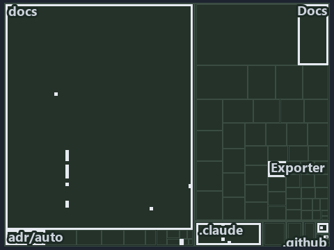

# One engine builds the bundle, and every code root is a copy of its output: the tree minimap

```text
Which files cite ADR-AUTO-BUNDLE: every file of the world map is a tile, grouped by top-level folder.
25 files lit in 8 groups.
```



This is the tree minimap in the sidebar of the architecture diagram of [One engine builds the bundle, and every code root is a copy of its
output][26], which explains [ADR-AUTO-BUNDLE][1]. It lights every file that cites those codes, grouped by folder, so it shows which files
carry the decision. Each lit group has its reason below, naming the code that selects it.

## What the minimap shows

The tree draws every file of the world map as a tile, grouped by top-level folder (under `automation/` by module, under `docs/adr/` by ADR
domain), and lights 25 files in 8 groups, filled in ink. A lit ADR file has a white rim; a file lit only by passing mentions is a lighter
ink. Every other tile is idle, a grey box: a file the slide's ADR codes do not select.

- docs (docs/ outside docs/adr/): 13 lit files
- .claude: 3 lit files
- Docs (automation/Catzc.Base.Docs): 2 lit files
- adr/* (the files directly in docs/adr/): 2 lit files
- adr/auto (docs/adr/automation): 2 lit files
- .github: 1 lit file
- Exporter (automation/Catzc.Base.Exporter): 1 lit file
- pipelines: 1 lit file

## Why each group is lit

### docs (docs/ outside docs/adr/, 13 lit files)

The group holds the files of docs/ outside docs/adr/; each sits in its world-map cell and is lit by:

- [docs/references/automation/catzc-base-contracts/Publish-ContractRelease.ps1.md][2], in the cell docs × markdown: selected by
  [ADR-AUTO-BUNDLE][1]: the file cites it at line 20 (text).
- [docs/references/automation/catzc-base-exporter/Assert-CatzcBundle.ps1.md][3], in the cell docs × markdown: selected by
  [ADR-AUTO-BUNDLE][1]: the file cites it at line 14 (text).
- [docs/references/automation/catzc-base-exporter/Build-Modules.ps1.md][4], in the cell docs × markdown: selected by [ADR-AUTO-BUNDLE][1]:
  the file cites it at line 14 (text).
- [docs/references/automation/catzc-base-exporter/Export-Catzc.ps1.md][5], in the cell docs × markdown: selected by [ADR-AUTO-BUNDLE][1]:
  the file cites it at line 14 (text).
- [docs/references/automation/catzc-base-exporter/Install-Catzc.ps1.md][6], in the cell docs × markdown: selected by [ADR-AUTO-BUNDLE][1]:
  the file cites it at line 15 (text).
- [docs/references/automation/catzc-base-exporter/Resolve-CatzcBuildVersion.ps1.md][7], in the cell docs × markdown: selected by
  [ADR-AUTO-BUNDLE][1]: the file cites it at line 14 (text).
- [docs/references/automation/catzc-base-exporter/configs/exporter.yml.md][8], in the cell docs × markdown: selected by
  [ADR-AUTO-BUNDLE][1]: the file cites it at line 17 (text).
- [docs/references/automation/catzc-base-exporter/private/Assert-BundleFootprint.ps1.md][9], in the cell docs × markdown: selected by
  [ADR-AUTO-BUNDLE][1]: the file cites it at line 15 (text).
- [docs/references/automation/catzc-base-exporter/private/New-CatzcNuGetPackage.ps1.md][10], in the cell docs × markdown: selected by
  [ADR-AUTO-BUNDLE][1]: the file cites it at line 14 (text).
- [docs/references/automation/catzc-base-exporter/types/ExporterBundle.cs.md][11], in the cell docs × markdown: selected by
  [ADR-AUTO-BUNDLE][1]: the file cites it at line 13 (text).
- [docs/references/automation/catzc-base-exporter/types/ExporterConfig.cs.md][12], in the cell docs × markdown: selected by
  [ADR-AUTO-BUNDLE][1]: the file cites it at line 12 (text).
- [docs/references/automation/internal/Catzc.Internal.Builder.psm1.md][13], in the cell docs × markdown: selected by [ADR-AUTO-BUNDLE][1]:
  the file cites it at line 14 (text).
- [docs/references/automation/internal/assets/Import-Catzc.ps1.md][14], in the cell docs × markdown: selected by [ADR-AUTO-BUNDLE][1]: the
  file cites it at line 15 (text).

### .claude (3 lit files)

The group holds the files of .claude; each sits in its world-map cell and is lit by:

- [.claude/plans/plan-layers-vocabulary-rename-contracts.md][15], in the cell .claude × markdown: selected by [ADR-AUTO-BUNDLE][1]: the file
  cites it at line 495 (text), line 557 (text) and line 918 (text).
- [.claude/plans/plan-module-kinds-tracks.md][16], in the cell .claude × markdown: selected by [ADR-AUTO-BUNDLE][1]: the file cites it at
  line 336 (text).
- [.claude/plans/prompt-module-model-1-prepare.md][17], in the cell .claude × markdown: selected by [ADR-AUTO-BUNDLE][1]: the file cites it
  at line 19 (text).

### Docs (automation/Catzc.Base.Docs, 2 lit files)

The group holds the files of automation/Catzc.Base.Docs; each sits in its world-map cell and is lit by:

- [automation/Catzc.Base.Docs/configs/adrs.yml][18], in the cell automation × yaml: selected by [ADR-AUTO-BUNDLE][1]: the file cites it at
  line 142 (text).
- [automation/Catzc.Base.Docs/configs/glossary.yml][19], in the cell automation × yaml: selected by [ADR-AUTO-BUNDLE][1]: the file cites it
  at line 501 (text).

### adr/* (the files directly in docs/adr/, 2 lit files)

The group holds the files of the files directly in docs/adr/; each sits in its world-map cell and is lit by:

- [docs/adr/glossary.md][20], in the cell docs × markdown: selected by [ADR-AUTO-BUNDLE][1]: the file cites it at line 595 (text).
- [docs/adr/index.md][21], in the cell docs × markdown: selected by [ADR-AUTO-BUNDLE][1]: the file cites it at line 173 (text).

### adr/auto (docs/adr/automation, 2 lit files)

The group holds the files of docs/adr/automation; each sits in its world-map cell and is lit by:

- [docs/adr/automation/dora-explains.md][22], in the cell docs × markdown: selected by [ADR-AUTO-BUNDLE][1]: the file cites it at line 437
  (text).
- [docs/adr/automation/platform-bundle.md][1], in the cell docs × markdown: selected by [ADR-AUTO-BUNDLE][1]: the ADR's own file.

### .github (1 lit file)

The group holds the files of .github; each sits in its world-map cell and is lit by:

- [.github/workflows/ci-automation.yml][23], in the cell github-workflows × yaml: selected by [ADR-AUTO-BUNDLE][1]: the file cites it at
  line 48 (body comment) (a passing mention only).

### Exporter (automation/Catzc.Base.Exporter, 1 lit file)

The group holds the files of automation/Catzc.Base.Exporter; each sits in its world-map cell and is lit by:

- [automation/Catzc.Base.Exporter/Build-Modules.ps1][24], in the cell automation × powershell: selected by [ADR-AUTO-BUNDLE][1]: the file
  cites it at line 2 (text).

### pipelines (1 lit file)

The group holds the files of pipelines; each sits in its world-map cell and is lit by:

- [pipelines/ci-automation.yaml][25], in the cell pipelines × pipeline-yaml: selected by [ADR-AUTO-BUNDLE][1]: a pipeline that cites nothing
  itself carries its globset's citations, which cite it at `automation/Catzc.Base.Docs/configs/adrs.yml` line 142 (text),
  `automation/Catzc.Base.Docs/configs/glossary.yml` line 501 (text) and `automation/Catzc.Base.Exporter/Build-Modules.ps1` line 2 (text).

## Keywords

- [world map][27]
- [track][28]
- [file language][29]
- [cell][30]
- [lit cell][31]
- [.claude][32]: a track
- [automation][32]: a track
- [docs][32]: a track
- [github-workflows][32]: a track
- [pipelines][32]: a track
- [markdown][33]: a file language
- [pipeline-yaml][33]: a file language
- [powershell][33]: a file language
- [yaml][33]: a file language

Terms the cited ADRs define:

- [bundle][34], defined by [ADR-AUTO-BUNDLE#1][35]

[1]: ../../../adr/automation/platform-bundle.md
[2]: ../../../references/automation/catzc-base-contracts/Publish-ContractRelease.ps1.md
[3]: ../../../references/automation/catzc-base-exporter/Assert-CatzcBundle.ps1.md
[4]: ../../../references/automation/catzc-base-exporter/Build-Modules.ps1.md
[5]: ../../../references/automation/catzc-base-exporter/Export-Catzc.ps1.md
[6]: ../../../references/automation/catzc-base-exporter/Install-Catzc.ps1.md
[7]: ../../../references/automation/catzc-base-exporter/Resolve-CatzcBuildVersion.ps1.md
[8]: ../../../references/automation/catzc-base-exporter/configs/exporter.yml.md
[9]: ../../../references/automation/catzc-base-exporter/private/Assert-BundleFootprint.ps1.md
[10]: ../../../references/automation/catzc-base-exporter/private/New-CatzcNuGetPackage.ps1.md
[11]: ../../../references/automation/catzc-base-exporter/types/ExporterBundle.cs.md
[12]: ../../../references/automation/catzc-base-exporter/types/ExporterConfig.cs.md
[13]: ../../../references/automation/internal/Catzc.Internal.Builder.psm1.md
[14]: ../../../references/automation/internal/assets/Import-Catzc.ps1.md
[15]: ../../../../.claude/plans/plan-layers-vocabulary-rename-contracts.md
[16]: ../../../../.claude/plans/plan-module-kinds-tracks.md
[17]: ../../../../.claude/plans/prompt-module-model-1-prepare.md
[18]: ../../../../automation/Catzc.Base.Docs/configs/adrs.yml
[19]: ../../../../automation/Catzc.Base.Docs/configs/glossary.yml
[20]: ../../../adr/glossary.md
[21]: ../../../adr/index.md
[22]: ../../../adr/automation/dora-explains.md
[23]: ../../../../.github/workflows/ci-automation.yml
[24]: ../../../../automation/Catzc.Base.Exporter/Build-Modules.ps1
[25]: ../../../../pipelines/ci-automation.yaml
[26]: ../../automation/every-code-root-is-a-copy.md
[27]: ../../../adr/glossary.md#world-map
[28]: ../../../adr/glossary.md#track
[29]: ../../../adr/glossary.md#file-language
[30]: ../../../adr/glossary.md#cell
[31]: ../../../adr/glossary.md#lit-cell
[32]: ../../../../automation/Catzc.Base.Variants/configs/variants.yml
[33]: ../../../../automation/Catzc.Base.Languages/configs/languages.yml
[34]: ../../../adr/glossary.md#bundle
[35]: ../../../adr/automation/platform-bundle.md#rule-adr-auto-bundle1
