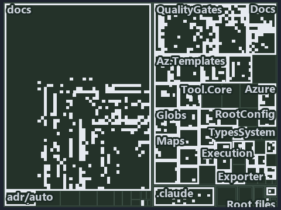

---
catzc:
  immutable:
    with_body_sha: eb97eccfeacf
    repo_status: locked
    path: docs/explanation/.assets/tree/adr-auto-depm--two-gates-check-the-layer-pins--governance.tree.md
    source: docs/explanation/.assets/adr-auto-depm--two-gates-check-the-layer-pins--governance.drawio.png
    kind: asset-description
    language: markdown
    filetype: md
    track: docs
    tracktype: documentation
---

# Two gates check the layer pins, and one rule is left to review: the tree minimap

```text
Which files cite ADR-AUTO-DEPM and ADR-AUTO-TEST: every file of the world map is a tile, grouped by top-level folder.
459 files lit in 24 groups.
```



This is the tree minimap in the sidebar of the governance diagram of [Two gates check the layer pins, and one rule is left to review][460],
which explains [ADR-AUTO-DEPM][1] and [ADR-AUTO-TEST][2]. It lights every file that cites those codes, grouped by folder, so it shows which
files carry the decision. Each lit group has its reason below, naming the code that selects it.

## What the minimap shows

The tree draws every file of the world map as a tile, grouped by top-level folder (under `automation/` by module, under `docs/adr/` by ADR
domain), and lights 459 files in 24 groups, filled in ink. A lit ADR file has a white rim; a file lit only by passing mentions is a lighter
ink. Every other tile is idle, a grey box: a file the slide's ADR codes do not select.

- docs (docs/ outside docs/adr/): 367 lit files
- QualityGates (automation/Catzc.Base.QualityGates): 35 lit files
- .claude: 14 lit files
- Docs (automation/Catzc.Base.Docs): 12 lit files
- Globs (automation/Catzc.Base.Globs): 4 lit files
- adr/auto (docs/adr/automation): 3 lit files
- Az.Templates (automation/Catzc.Azure.Templates): 2 lit files
- Maps (automation/Catzc.Base.Maps): 2 lit files
- ModuleSystem (automation/Catzc.Base.ModuleSystem): 2 lit files
- Reports (automation/Catzc.Base.Reports): 2 lit files
- Tool.Core (automation/Catzc.Tooling.Core): 2 lit files
- adr/* (the files directly in docs/adr/): 2 lit files
- Root files: 1 lit file
- .internal (automation/.internal): 1 lit file
- .scriptanalyzer (automation/.scriptanalyzer): 1 lit file
- Az.DevOps (automation/Catzc.Azure.DevOps): 1 lit file
- Contracts (automation/Catzc.Base.Contracts): 1 lit file
- Engines (automation/Catzc.Base.Engines): 1 lit file
- Environment (automation/Catzc.Base.Environment): 1 lit file
- Execution (automation/Catzc.Base.Execution): 1 lit file
- Modules (automation/Catzc.Base.Modules): 1 lit file
- RootConfig (automation/Catzc.Base.RootConfig): 1 lit file
- Tool.KeyHandler (automation/Catzc.Tooling.KeyHandler): 1 lit file
- pipelines: 1 lit file

## Why each group is lit

### docs (docs/ outside docs/adr/, 367 lit files)

The group holds the files of docs/ outside docs/adr/; each sits in its world-map cell and is lit by:

- [docs/how-to/automation/manual-test-plan.md][3], in the cell docs × markdown: selected by [ADR-AUTO-TEST][2]: the file cites it at line 54
  (text) and line 60 (text).
- [docs/how-to/automation/manual-test-plan/azure.md][4], in the cell docs × markdown: selected by [ADR-AUTO-TEST][2]: the file cites it at
  line 15 (text) and line 67 (text).
- [docs/how-to/automation/manual-test-plan/test-harness.md][5], in the cell docs × markdown: selected by [ADR-AUTO-TEST][2]: the file cites
  it at line 15 (text).
- [docs/how-to/getting-started/automation/run-tests-and-checks.md][6], in the cell docs × markdown: selected by [ADR-AUTO-TEST][2]: the file
  cites it at line 31 (text).
- [docs/references/.assets/automation/catzc-base-execution/invoke-executable-two-paths-one-bounded.drawio.verify.md][7], in the cell docs ×
  markdown: selected by [ADR-AUTO-TEST][2]: the file cites it at line 44 (text).
- [docs/references/.assets/automation/catzc-base-modulesystem/module-graph-declared-vs-observed.drawio.verify.md][8], in the cell docs ×
  markdown: selected by [ADR-AUTO-DEPM][1]: the file cites it at line 47 (text), line 54 (text), line 54 (text), line 71 (text) and line 73
  (text); selected by [ADR-AUTO-TEST][2]: the file cites it at line 53 (text).
- [docs/references/.assets/automation/catzc-base-qualitygates/test-automation-one-run-pipeline.drawio.verify.md][9], in the cell docs ×
  markdown: selected by [ADR-AUTO-TEST][2]: the file cites it at line 18 (text), line 20 (text), line 49 (text) and line 62 (text).
- [docs/references/automation/catzc-azure-devops-buildvalidation/tests/types/BuildValidationConfig.Tests.ps1.md][10], in the cell docs ×
  markdown: selected by [ADR-AUTO-TEST][2]: the file cites it at line 24 (text).
- [docs/references/automation/catzc-azure-devops/Test-Pipelines.ps1.md][11], in the cell docs × markdown: selected by [ADR-AUTO-TEST][2]:
  the file cites it at line 16 (text).
- [docs/references/automation/catzc-azure-devops/configs/identity-tokens.yml.md][12], in the cell docs × markdown: selected by
  [ADR-AUTO-TEST][2]: the file cites it at line 12 (text).
- [docs/references/automation/catzc-azure-devops/tests/Get-AdoYamlFiles.Tests.ps1.md][13], in the cell docs × markdown: selected by
  [ADR-AUTO-TEST][2]: the file cites it at line 24 (text).
- [docs/references/automation/catzc-azure-templates/Get-BicepTemplatesOutputRoot.ps1.md][14], in the cell docs × markdown: selected by
  [ADR-AUTO-TEST][2]: the file cites it at line 18 (text).
- [docs/references/automation/catzc-azure-templates/tests/Assert-BicepTemplate.Tests.ps1.md][15], in the cell docs × markdown: selected by
  [ADR-AUTO-TEST][2]: the file cites it at line 26 (text).
- [docs/references/automation/catzc-azure-templates/tests/Build-Bicep.Integrity.Tests.ps1.md][16], in the cell docs × markdown: selected by
  [ADR-AUTO-TEST][2]: the file cites it at line 18 (text), line 20 (text) and line 23 (text).
- [docs/references/automation/catzc-azure-templates/tests/Build-Bicep.L2.Tests.ps1.md][17], in the cell docs × markdown: selected by
  [ADR-AUTO-TEST][2]: the file cites it at line 28 (text) and line 36 (text).
- [docs/references/automation/catzc-azure-templates/tests/Build-Bicep.SampleCustomer.Tests.ps1.md][18], in the cell docs × markdown:
  selected by [ADR-AUTO-TEST][2]: the file cites it at line 15 (text), line 15 (text), line 27 (text) and line 39 (text).
- [docs/references/automation/catzc-azure-templates/tests/Build-Bicep.SampleIndexed.Tests.ps1.md][19], in the cell docs × markdown: selected
  by [ADR-AUTO-TEST][2]: the file cites it at line 15 (text), line 15 (text) and line 35 (text).
- [docs/references/automation/catzc-azure-templates/tests/Build-Bicep.SampleSubscription.Tests.ps1.md][20], in the cell docs × markdown:
  selected by [ADR-AUTO-TEST][2]: the file cites it at line 13 (text), line 13 (text), line 25 (text) and line 37 (text).
- [docs/references/automation/catzc-azure-templates/tests/Build-Bicep.SampleWithModule.Tests.ps1.md][21], in the cell docs × markdown:
  selected by [ADR-AUTO-TEST][2]: the file cites it at line 15 (text), line 15 (text), line 27 (text) and line 39 (text).
- [docs/references/automation/catzc-azure-templates/tests/Build-Bicep.SampleWithPrepost.Tests.ps1.md][22], in the cell docs × markdown:
  selected by [ADR-AUTO-TEST][2]: the file cites it at line 21 (text) and line 30 (text).
- [docs/references/automation/catzc-azure-templates/tests/Build-Bicep.Tests.ps1.md][23], in the cell docs × markdown: selected by
  [ADR-AUTO-TEST][2]: the file cites it at line 15 (text), line 15 (text), line 25 (text) and line 35 (text).
- [docs/references/automation/catzc-azure-templates/tests/Deploy-Bicep.SampleSubscription.Tests.ps1.md][24], in the cell docs × markdown:
  selected by [ADR-AUTO-TEST][2]: the file cites it at line 22 (text), line 40 (text) and line 49 (text).
- [docs/references/automation/catzc-azure-templates/tests/Deploy-Bicep.Tests.ps1.md][25], in the cell docs × markdown: selected by
  [ADR-AUTO-TEST][2]: the file cites it at line 57 (text), line 57 (text) and line 67 (text).
- [docs/references/automation/catzc-azure-templates/tests/Get-BicepDeploymentContext.Tests.ps1.md][26], in the cell docs × markdown:
  selected by [ADR-AUTO-TEST][2]: the file cites it at line 15 (text), line 15 (text), line 26 (text) and line 56 (text).
- [docs/references/automation/catzc-azure-templates/tests/Get-BicepParameterModel.Shipped.Tests.ps1.md][27], in the cell docs × markdown:
  selected by [ADR-AUTO-TEST][2]: the file cites it at line 19 (text), line 22 (text), line 25 (text), line 30 (text) and line 39 (text).
- [docs/references/automation/catzc-azure-templates/tests/Get-BicepParameterModel.Tests.ps1.md][28], in the cell docs × markdown: selected
  by [ADR-AUTO-TEST][2]: the file cites it at line 13 (text).
- [docs/references/automation/catzc-azure-templates/tests/Get-BicepParameterViolations.Tests.ps1.md][29], in the cell docs × markdown:
  selected by [ADR-AUTO-TEST][2]: the file cites it at line 13 (text).
- [docs/references/automation/catzc-azure-templates/tests/Get-BicepResourceGroupName.Tests.ps1.md][30], in the cell docs × markdown:
  selected by [ADR-AUTO-TEST][2]: the file cites it at line 13 (text) and line 13 (text).
- [docs/references/automation/catzc-azure-templates/tests/Get-BicepResourceName.Tests.ps1.md][31], in the cell docs × markdown: selected by
  [ADR-AUTO-TEST][2]: the file cites it at line 17 (text) and line 17 (text).
- [docs/references/automation/catzc-azure-templates/tests/Get-BicepTemplate.Tests.ps1.md][32], in the cell docs × markdown: selected by
  [ADR-AUTO-TEST][2]: the file cites it at line 13 (text) and line 13 (text).
- [docs/references/automation/catzc-azure-templates/tests/Get-BicepTemplateConfiguration.Tests.ps1.md][33], in the cell docs × markdown:
  selected by [ADR-AUTO-TEST][2]: the file cites it at line 15 (text) and line 15 (text).
- [docs/references/automation/catzc-azure-templates/tests/Get-BicepTemplateCustomers.Tests.ps1.md][34], in the cell docs × markdown:
  selected by [ADR-AUTO-TEST][2]: the file cites it at line 13 (text), line 13 (text), line 23 (text) and line 23 (text).
- [docs/references/automation/catzc-azure-templates/tests/Get-BicepTemplateNames.Tests.ps1.md][35], in the cell docs × markdown: selected by
  [ADR-AUTO-TEST][2]: the file cites it at line 13 (text) and line 13 (text).
- [docs/references/automation/catzc-azure-templates/tests/Get-BicepTemplateSlots.Tests.ps1.md][36], in the cell docs × markdown: selected by
  [ADR-AUTO-TEST][2]: the file cites it at line 13 (text), line 13 (text), line 32 (text) and line 32 (text).
- [docs/references/automation/catzc-azure-templates/tests/Get-BicepTemplates.Tests.ps1.md][37], in the cell docs × markdown: selected by
  [ADR-AUTO-TEST][2]: the file cites it at line 17 (text) and line 17 (text).
- [docs/references/automation/catzc-azure-templates/tests/Get-BicepTrackTagNameSet.Tests.ps1.md][38], in the cell docs × markdown: selected
  by [ADR-AUTO-TEST][2]: the file cites it at line 13 (text) and line 13 (text).
- [docs/references/automation/catzc-azure-templates/tests/Resolve-BicepParameterAddresses.Tests.ps1.md][39], in the cell docs × markdown:
  selected by [ADR-AUTO-TEST][2]: the file cites it at line 12 (text).
- [docs/references/automation/catzc-azure-templates/tests/Set-BicepTemplateConfiguration.Tests.ps1.md][40], in the cell docs × markdown:
  selected by [ADR-AUTO-TEST][2]: the file cites it at line 57 (text).
- [docs/references/automation/catzc-azure-templates/tests/types/BicepShortName.Tests.ps1.md][41], in the cell docs × markdown: selected by
  [ADR-AUTO-TEST][2]: the file cites it at line 16 (text).
- [docs/references/automation/catzc-azure/Test-AzureNetworkPlan.ps1.md][42], in the cell docs × markdown: selected by [ADR-AUTO-TEST][2]:
  the file cites it at line 14 (text).
- [docs/references/automation/catzc-azure/configs/identity-tokens.yml.md][43], in the cell docs × markdown: selected by [ADR-AUTO-TEST][2]:
  the file cites it at line 13 (text).
- [docs/references/automation/catzc-azure/tests/Get-AzureBicepMinVersion.Tests.ps1.md][44], in the cell docs × markdown: selected by
  [ADR-AUTO-TEST][2]: the file cites it at line 13 (text) and line 13 (text).
- [docs/references/automation/catzc-azure/tests/Get-AzureCustomer.Tests.ps1.md][45], in the cell docs × markdown: selected by
  [ADR-AUTO-TEST][2]: the file cites it at line 13 (text).
- [docs/references/automation/catzc-azure/tests/Get-AzureCustomers.Tests.ps1.md][46], in the cell docs × markdown: selected by
  [ADR-AUTO-TEST][2]: the file cites it at line 13 (text) and line 13 (text).
- [docs/references/automation/catzc-azure/tests/Get-AzureEnvironment.Tests.ps1.md][47], in the cell docs × markdown: selected by
  [ADR-AUTO-TEST][2]: the file cites it at line 13 (text) and line 13 (text).
- [docs/references/automation/catzc-azure/tests/Get-AzureSubscription.Tests.ps1.md][48], in the cell docs × markdown: selected by
  [ADR-AUTO-TEST][2]: the file cites it at line 13 (text) and line 13 (text).
- [docs/references/automation/catzc-azure/tests/Get-AzureSubscriptionEnvironment.Tests.ps1.md][49], in the cell docs × markdown: selected by
  [ADR-AUTO-TEST][2]: the file cites it at line 13 (text) and line 13 (text).
- [docs/references/automation/catzc-azure/tests/Test-AzureNetworkPlan.Tests.ps1.md][50], in the cell docs × markdown: selected by
  [ADR-AUTO-TEST][2]: the file cites it at line 14 (text).
- [docs/references/automation/catzc-azure/tests/types/AzureConfig.Tests.ps1.md][51], in the cell docs × markdown: selected by
  [ADR-AUTO-TEST][2]: the file cites it at line 15 (text) and line 16 (text).
- [docs/references/automation/catzc-azure/tests/types/NetworkConfig.Tests.ps1.md][52], in the cell docs × markdown: selected by
  [ADR-AUTO-TEST][2]: the file cites it at line 14 (text) and line 15 (text).
- [docs/references/automation/catzc-base-config/tests/Config-Conventions.Tests.ps1.md][53], in the cell docs × markdown: selected by
  [ADR-AUTO-TEST][2]: the file cites it at line 22 (text).
- [docs/references/automation/catzc-base-config/tests/Get-Config.Tests.ps1.md][54], in the cell docs × markdown: selected by
  [ADR-AUTO-TEST][2]: the file cites it at line 12 (text), line 23 (text), line 26 (text) and line 44 (text).
- [docs/references/automation/catzc-base-config/tests/Get-ConfigValue.Tests.ps1.md][55], in the cell docs × markdown: selected by
  [ADR-AUTO-TEST][2]: the file cites it at line 22 (text).
- [docs/references/automation/catzc-base-configextensions/Test-ConfigValidators.ps1.md][56], in the cell docs × markdown: selected by
  [ADR-AUTO-TEST][2]: the file cites it at line 14 (text).
- [docs/references/automation/catzc-base-configextensions/tests/Invoke-ConfigValidator.Tests.ps1.md][57], in the cell docs × markdown:
  selected by [ADR-AUTO-TEST][2]: the file cites it at line 12 (text).
- [docs/references/automation/catzc-base-configextensions/tests/Test-ConfigValidators.Tests.ps1.md][58], in the cell docs × markdown:
  selected by [ADR-AUTO-TEST][2]: the file cites it at line 13 (text).
- [docs/references/automation/catzc-base-contracts/Test-Contracts.ps1.md][59], in the cell docs × markdown: selected by [ADR-AUTO-TEST][2]:
  the file cites it at line 16 (text).
- [docs/references/automation/catzc-base-contracts/tests/Build-ContractReference.Tests.ps1.md][60], in the cell docs × markdown: selected by
  [ADR-AUTO-TEST][2]: the file cites it at line 14 (text).
- [docs/references/automation/catzc-base-contracts/tests/ConvertTo-ContractNoteMarkdown.Tests.ps1.md][61], in the cell docs × markdown:
  selected by [ADR-AUTO-TEST][2]: the file cites it at line 15 (text).
- [docs/references/automation/catzc-base-contracts/tests/Get-ContractAssetNote.Tests.ps1.md][62], in the cell docs × markdown: selected by
  [ADR-AUTO-TEST][2]: the file cites it at line 14 (text).
- [docs/references/automation/catzc-base-contracts/tests/Get-ContractFreezeFindings.Tests.ps1.md][63], in the cell docs × markdown: selected
  by [ADR-AUTO-TEST][2]: the file cites it at line 13 (text).
- [docs/references/automation/catzc-base-contracts/tests/Publish-ContractRelease.Tests.ps1.md][64], in the cell docs × markdown: selected by
  [ADR-AUTO-TEST][2]: the file cites it at line 14 (text).
- [docs/references/automation/catzc-base-contracts/tests/Test-Contracts.Tests.ps1.md][65], in the cell docs × markdown: selected by
  [ADR-AUTO-TEST][2]: the file cites it at line 15 (text) and line 17 (text).
- [docs/references/automation/catzc-base-docs.md][66], in the cell docs × markdown: selected by [ADR-AUTO-TEST][2]: the file cites it at
  line 32 (text).
- [docs/references/automation/catzc-base-docs/Test-AdrEngineNeutrality.ps1.md][67], in the cell docs × markdown: selected by
  [ADR-AUTO-TEST][2]: the file cites it at line 14 (text).
- [docs/references/automation/catzc-base-docs/Test-AdrRegistry.ps1.md][68], in the cell docs × markdown: selected by [ADR-AUTO-TEST][2]: the
  file cites it at line 14 (text).
- [docs/references/automation/catzc-base-docs/Test-AgentDefinitions.ps1.md][69], in the cell docs × markdown: selected by
  [ADR-AUTO-TEST][2]: the file cites it at line 14 (text).
- [docs/references/automation/catzc-base-docs/Test-GeneratedReadmes.ps1.md][70], in the cell docs × markdown: selected by
  [ADR-AUTO-TEST][2]: the file cites it at line 14 (text).
- [docs/references/automation/catzc-base-docs/Test-Glossary.ps1.md][71], in the cell docs × markdown: selected by [ADR-AUTO-TEST][2]: the
  file cites it at line 25 (text).
- [docs/references/automation/catzc-base-docs/configs/adr-checks.yml.md][72], in the cell docs × markdown: selected by [ADR-AUTO-TEST][2]:
  the file cites it at line 16 (text).
- [docs/references/automation/catzc-base-docs/private/Get-GlossaryRuleStatements.ps1.md][73], in the cell docs × markdown: selected by
  [ADR-AUTO-TEST][2]: the file cites it at line 29 (text).
- [docs/references/automation/catzc-base-docs/tests/Build-Glossary.Tests.ps1.md][74], in the cell docs × markdown: selected by
  [ADR-AUTO-TEST][2]: the file cites it at line 14 (text).
- [docs/references/automation/catzc-base-docs/tests/ConvertTo-AdrDomainDiagram.Tests.ps1.md][75], in the cell docs × markdown: selected by
  [ADR-AUTO-TEST][2]: the file cites it at line 12 (text).
- [docs/references/automation/catzc-base-docs/tests/Get-AdrCitationGraphViolations.Tests.ps1.md][76], in the cell docs × markdown: selected
  by [ADR-AUTO-TEST][2]: the file cites it at line 13 (text).
- [docs/references/automation/catzc-base-docs/tests/Get-AdrCitationMap.Tests.ps1.md][77], in the cell docs × markdown: selected by
  [ADR-AUTO-TEST][2]: the file cites it at line 14 (text).
- [docs/references/automation/catzc-base-docs/tests/Get-AdrDomainEdges.Tests.ps1.md][78], in the cell docs × markdown: selected by
  [ADR-AUTO-TEST][2]: the file cites it at line 13 (text).
- [docs/references/automation/catzc-base-docs/tests/Get-AdrDoraCoverageViolations.Tests.ps1.md][79], in the cell docs × markdown: selected
  by [ADR-AUTO-TEST][2]: the file cites it at line 13 (text).
- [docs/references/automation/catzc-base-docs/tests/Get-AdrFileIndex.Tests.ps1.md][80], in the cell docs × markdown: selected by
  [ADR-AUTO-TEST][2]: the file cites it at line 13 (text).
- [docs/references/automation/catzc-base-docs/tests/Get-AdrRuleSet.Tests.ps1.md][81], in the cell docs × markdown: selected by
  [ADR-AUTO-TEST][2]: the file cites it at line 13 (text) and line 22 (text).
- [docs/references/automation/catzc-base-docs/tests/Get-AdrRuleSummaryLines.Tests.ps1.md][82], in the cell docs × markdown: selected by
  [ADR-AUTO-TEST][2]: the file cites it at line 12 (text).
- [docs/references/automation/catzc-base-docs/tests/Get-AgentFrontMatter.Tests.ps1.md][83], in the cell docs × markdown: selected by
  [ADR-AUTO-TEST][2]: the file cites it at line 12 (text).
- [docs/references/automation/catzc-base-docs/tests/Get-CatsRuleEnforcers.Tests.ps1.md][84], in the cell docs × markdown: selected by
  [ADR-AUTO-TEST][2]: the file cites it at line 14 (text).
- [docs/references/automation/catzc-base-docs/tests/Get-ClaudeMdAgentNames.Tests.ps1.md][85], in the cell docs × markdown: selected by
  [ADR-AUTO-TEST][2]: the file cites it at line 12 (text).
- [docs/references/automation/catzc-base-docs/tests/Get-Glossary.Tests.ps1.md][86], in the cell docs × markdown: selected by
  [ADR-AUTO-TEST][2]: the file cites it at line 16 (text).
- [docs/references/automation/catzc-base-docs/tests/Get-GlossaryAnchorViolations.Tests.ps1.md][87], in the cell docs × markdown: selected by
  [ADR-AUTO-TEST][2]: the file cites it at line 16 (text).
- [docs/references/automation/catzc-base-docs/tests/Get-GlossaryDefinitionViolations.Tests.ps1.md][88], in the cell docs × markdown:
  selected by [ADR-AUTO-TEST][2]: the file cites it at line 15 (text).
- [docs/references/automation/catzc-base-docs/tests/Get-GlossaryEnforcementViolations.Tests.ps1.md][89], in the cell docs × markdown:
  selected by [ADR-AUTO-TEST][2]: the file cites it at line 16 (text).
- [docs/references/automation/catzc-base-docs/tests/Get-GlossaryFormViolations.Tests.ps1.md][90], in the cell docs × markdown: selected by
  [ADR-AUTO-TEST][2]: the file cites it at line 15 (text).
- [docs/references/automation/catzc-base-docs/tests/Get-GlossaryPhrasingViolations.Tests.ps1.md][91], in the cell docs × markdown: selected
  by [ADR-AUTO-TEST][2]: the file cites it at line 16 (text).
- [docs/references/automation/catzc-base-docs/tests/Get-GlossaryRuleStatements.Tests.ps1.md][92], in the cell docs × markdown: selected by
  [ADR-AUTO-TEST][2]: the file cites it at line 14 (text).
- [docs/references/automation/catzc-base-docs/tests/Get-GlossarySourceViolations.Tests.ps1.md][93], in the cell docs × markdown: selected by
  [ADR-AUTO-TEST][2]: the file cites it at line 15 (text).
- [docs/references/automation/catzc-base-docs/tests/Get-GlossarySources.Tests.ps1.md][94], in the cell docs × markdown: selected by
  [ADR-AUTO-TEST][2]: the file cites it at line 16 (text).
- [docs/references/automation/catzc-base-docs/tests/Resolve-AdrLinkTarget.Tests.ps1.md][95], in the cell docs × markdown: selected by
  [ADR-AUTO-TEST][2]: the file cites it at line 13 (text).
- [docs/references/automation/catzc-base-docs/tests/Test-AdrEngineNeutrality.Tests.ps1.md][96], in the cell docs × markdown: selected by
  [ADR-AUTO-TEST][2]: the file cites it at line 8 (text) and line 13 (text).
- [docs/references/automation/catzc-base-docs/tests/Test-AdrRegistry.Tests.ps1.md][97], in the cell docs × markdown: selected by
  [ADR-AUTO-TEST][2]: the file cites it at line 8 (text) and line 13 (text).
- [docs/references/automation/catzc-base-docs/tests/Test-AgentDefinitions.Tests.ps1.md][98], in the cell docs × markdown: selected by
  [ADR-AUTO-TEST][2]: the file cites it at line 13 (text).
- [docs/references/automation/catzc-base-docs/tests/Test-GeneratedReadmes.Tests.ps1.md][99], in the cell docs × markdown: selected by
  [ADR-AUTO-TEST][2]: the file cites it at line 13 (text).
- [docs/references/automation/catzc-base-docs/tests/Test-Glossary.Tests.ps1.md][100], in the cell docs × markdown: selected by
  [ADR-AUTO-TEST][2]: the file cites it at line 25 (text) and line 26 (text).
- [docs/references/automation/catzc-base-docs/tests/Update-AdrCitation.Tests.ps1.md][101], in the cell docs × markdown: selected by
  [ADR-AUTO-TEST][2]: the file cites it at line 13 (text).
- [docs/references/automation/catzc-base-docs/tests/types/AdrChecksConfig.Tests.ps1.md][102], in the cell docs × markdown: selected by
  [ADR-AUTO-TEST][2]: the file cites it at line 12 (text).
- [docs/references/automation/catzc-base-docs/tests/types/AdrDomainEdge.Tests.ps1.md][103], in the cell docs × markdown: selected by
  [ADR-AUTO-TEST][2]: the file cites it at line 12 (text).
- [docs/references/automation/catzc-base-docs/tests/types/AgentEntry.Tests.ps1.md][104], in the cell docs × markdown: selected by
  [ADR-AUTO-TEST][2]: the file cites it at line 13 (text).
- [docs/references/automation/catzc-base-docs/tests/types/AgentsConfig.Tests.ps1.md][105], in the cell docs × markdown: selected by
  [ADR-AUTO-TEST][2]: the file cites it at line 13 (text).
- [docs/references/automation/catzc-base-docs/tests/types/CheckModes.Tests.ps1.md][106], in the cell docs × markdown: selected by
  [ADR-AUTO-TEST][2]: the file cites it at line 13 (text).
- [docs/references/automation/catzc-base-docs/tests/types/GlossaryConfig.Tests.ps1.md][107], in the cell docs × markdown: selected by
  [ADR-AUTO-TEST][2]: the file cites it at line 15 (text).
- [docs/references/automation/catzc-base-docs/tests/types/GlossaryEntry.Tests.ps1.md][108], in the cell docs × markdown: selected by
  [ADR-AUTO-TEST][2]: the file cites it at line 13 (text).
- [docs/references/automation/catzc-base-docs/types/AdrChecksConfig.cs.md][109], in the cell docs × markdown: selected by
  [ADR-AUTO-TEST][2]: the file cites it at line 23 (text).
- [docs/references/automation/catzc-base-docs/types/CheckMode.cs.md][110], in the cell docs × markdown: selected by [ADR-AUTO-TEST][2]: the
  file cites it at line 15 (text).
- [docs/references/automation/catzc-base-docs/types/GlossaryConcept.cs.md][111], in the cell docs × markdown: selected by
  [ADR-AUTO-TEST][2]: the file cites it at line 33 (text).
- [docs/references/automation/catzc-base-execution/Invoke-Executable.ps1.md][112], in the cell docs × markdown: selected by
  [ADR-AUTO-TEST][2]: the file cites it at line 136 (text).
- [docs/references/automation/catzc-base-execution/invoke-executable-two-paths-one-bounded.drawio.md][113], in the cell docs × markdown:
  selected by [ADR-AUTO-TEST][2]: the file cites it at line 95 (text).
- [docs/references/automation/catzc-base-execution/tests/Find-Executable.Tests.ps1.md][114], in the cell docs × markdown: selected by
  [ADR-AUTO-TEST][2]: the file cites it at line 14 (text).
- [docs/references/automation/catzc-base-execution/tests/Get-ExecutableVersion.Tests.ps1.md][115], in the cell docs × markdown: selected by
  [ADR-AUTO-TEST][2]: the file cites it at line 13 (text).
- [docs/references/automation/catzc-base-execution/tests/Resolve-EngineExecutable.Tests.ps1.md][116], in the cell docs × markdown: selected
  by [ADR-AUTO-TEST][2]: the file cites it at line 13 (text).
- [docs/references/automation/catzc-base-execution/tests/Resolve-ToolExecutable.Tests.ps1.md][117], in the cell docs × markdown: selected by
  [ADR-AUTO-TEST][2]: the file cites it at line 14 (text).
- [docs/references/automation/catzc-base-execution/tests/types/CliRunner.Tests.ps1.md][118], in the cell docs × markdown: selected by
  [ADR-AUTO-TEST][2]: the file cites it at line 13 (text).
- [docs/references/automation/catzc-base-execution/tests/types/ExecutableProbe.Tests.ps1.md][119], in the cell docs × markdown: selected by
  [ADR-AUTO-TEST][2]: the file cites it at line 12 (text).
- [docs/references/automation/catzc-base-execution/tests/types/ToolConfig.Tests.ps1.md][120], in the cell docs × markdown: selected by
  [ADR-AUTO-TEST][2]: the file cites it at line 13 (text).
- [docs/references/automation/catzc-base-execution/tests/types/ToolsConfig.Tests.ps1.md][121], in the cell docs × markdown: selected by
  [ADR-AUTO-TEST][2]: the file cites it at line 12 (text), line 21 (text) and line 23 (text).
- [docs/references/automation/catzc-base-exporter/tests/Assert-CatzcBundle.Tests.ps1.md][122], in the cell docs × markdown: selected by
  [ADR-AUTO-TEST][2]: the file cites it at line 14 (text).
- [docs/references/automation/catzc-base-exporter/tests/Install-Catzc.Tests.ps1.md][123], in the cell docs × markdown: selected by
  [ADR-AUTO-TEST][2]: the file cites it at line 12 (text).
- [docs/references/automation/catzc-base-exporter/tests/New-CatzcNuGetPackage.Tests.ps1.md][124], in the cell docs × markdown: selected by
  [ADR-AUTO-TEST][2]: the file cites it at line 14 (text) and line 16 (text).
- [docs/references/automation/catzc-base-files/tests/Get-GitChangedPath.Tests.ps1.md][125], in the cell docs × markdown: selected by
  [ADR-AUTO-TEST][2]: the file cites it at line 12 (text).
- [docs/references/automation/catzc-base-globs.md][126], in the cell docs × markdown: selected by [ADR-AUTO-TEST][2]: the file cites it at
  line 42 (text).
- [docs/references/automation/catzc-base-globs/Test-AdoPipelineTriggerGlob.ps1.md][127], in the cell docs × markdown: selected by
  [ADR-AUTO-TEST][2]: the file cites it at line 21 (text).
- [docs/references/automation/catzc-base-globs/Test-GitHubWorkflowTriggerGlob.ps1.md][128], in the cell docs × markdown: selected by
  [ADR-AUTO-TEST][2]: the file cites it at line 21 (text).
- [docs/references/automation/catzc-base-globs/Test-GlobSetIndependence.ps1.md][129], in the cell docs × markdown: selected by
  [ADR-AUTO-TEST][2]: the file cites it at line 23 (text).
- [docs/references/automation/catzc-base-globs/Test-GlobSetTriggerCoverage.ps1.md][130], in the cell docs × markdown: selected by
  [ADR-AUTO-TEST][2]: the file cites it at line 14 (text).
- [docs/references/automation/catzc-base-globs/tests/Get-ChangedGlobSet.Tests.ps1.md][131], in the cell docs × markdown: selected by
  [ADR-AUTO-TEST][2]: the file cites it at line 22 (text).
- [docs/references/automation/catzc-base-globs/tests/Get-GlobSet.Tests.ps1.md][132], in the cell docs × markdown: selected by
  [ADR-AUTO-TEST][2]: the file cites it at line 13 (text).
- [docs/references/automation/catzc-base-globs/tests/Get-ModuleGlobSet.Tests.ps1.md][133], in the cell docs × markdown: selected by
  [ADR-AUTO-TEST][2]: the file cites it at line 23 (text).
- [docs/references/automation/catzc-base-globs/tests/GlobSetTrigger-Coverage.Tests.ps1.md][134], in the cell docs × markdown: selected by
  [ADR-AUTO-TEST][2]: the file cites it at line 13 (text).
- [docs/references/automation/catzc-base-globs/tests/Test-AdoPipelineTriggerGlob.Tests.ps1.md][135], in the cell docs × markdown: selected
  by [ADR-AUTO-TEST][2]: the file cites it at line 12 (text).
- [docs/references/automation/catzc-base-globs/tests/Test-GitHubWorkflowTriggerGlob.Tests.ps1.md][136], in the cell docs × markdown:
  selected by [ADR-AUTO-TEST][2]: the file cites it at line 12 (text) and line 14 (text).
- [docs/references/automation/catzc-base-globs/tests/Test-GlobSetAffected.Tests.ps1.md][137], in the cell docs × markdown: selected by
  [ADR-AUTO-TEST][2]: the file cites it at line 22 (text).
- [docs/references/automation/catzc-base-globs/tests/Test-GlobSetIndependence.Tests.ps1.md][138], in the cell docs × markdown: selected by
  [ADR-AUTO-TEST][2]: the file cites it at line 12 (text) and line 15 (text).
- [docs/references/automation/catzc-base-globs/tests/Test-GlobSetTriggerCoverage.Tests.ps1.md][139], in the cell docs × markdown: selected
  by [ADR-AUTO-TEST][2]: the file cites it at line 12 (text).
- [docs/references/automation/catzc-base-globs/tests/types/GlobsConfig.Tests.ps1.md][140], in the cell docs × markdown: selected by
  [ADR-AUTO-TEST][2]: the file cites it at line 35 (text).
- [docs/references/automation/catzc-base-languages.md][141], in the cell docs × markdown: selected by [ADR-AUTO-TEST][2]: the file cites it
  at line 37 (text).
- [docs/references/automation/catzc-base-languages/tests/ConvertFrom-BatsJunit.Tests.ps1.md][142], in the cell docs × markdown: selected by
  [ADR-AUTO-TEST][2]: the file cites it at line 13 (text).
- [docs/references/automation/catzc-base-languages/tests/ConvertFrom-PytestJunit.Tests.ps1.md][143], in the cell docs × markdown: selected
  by [ADR-AUTO-TEST][2]: the file cites it at line 12 (text).
- [docs/references/automation/catzc-base-languages/tests/Get-EngineContract.Tests.ps1.md][144], in the cell docs × markdown: selected by
  [ADR-AUTO-TEST][2]: the file cites it at line 13 (text).
- [docs/references/automation/catzc-base-languages/tests/Invoke-BashTest.Tests.ps1.md][145], in the cell docs × markdown: selected by
  [ADR-AUTO-TEST][2]: the file cites it at line 11 (text).
- [docs/references/automation/catzc-base-languages/tests/Invoke-GoTest.Tests.ps1.md][146], in the cell docs × markdown: selected by
  [ADR-AUTO-TEST][2]: the file cites it at line 11 (text).
- [docs/references/automation/catzc-base-languages/tests/Invoke-PythonTest.Tests.ps1.md][147], in the cell docs × markdown: selected by
  [ADR-AUTO-TEST][2]: the file cites it at line 11 (text).
- [docs/references/automation/catzc-base-languages/tests/New-GoWorkspace.Tests.ps1.md][148], in the cell docs × markdown: selected by
  [ADR-AUTO-TEST][2]: the file cites it at line 11 (text).
- [docs/references/automation/catzc-base-languages/tests/New-PythonProject.Tests.ps1.md][149], in the cell docs × markdown: selected by
  [ADR-AUTO-TEST][2]: the file cites it at line 13 (text).
- [docs/references/automation/catzc-base-languages/types/BashTestResult.cs.md][150], in the cell docs × markdown: selected by
  [ADR-AUTO-TEST][2]: the file cites it at line 18 (text).
- [docs/references/automation/catzc-base-languages/types/GoTestResult.cs.md][151], in the cell docs × markdown: selected by
  [ADR-AUTO-TEST][2]: the file cites it at line 18 (text).
- [docs/references/automation/catzc-base-languages/types/PythonTestResult.cs.md][152], in the cell docs × markdown: selected by
  [ADR-AUTO-TEST][2]: the file cites it at line 19 (text).
- [docs/references/automation/catzc-base-maps/Get-ValueChainHighlight.ps1.md][153], in the cell docs × markdown: selected by
  [ADR-AUTO-TEST][2]: the file cites it at line 43 (text).
- [docs/references/automation/catzc-base-maps/Test-ValueChainMap.ps1.md][154], in the cell docs × markdown: selected by [ADR-AUTO-TEST][2]:
  the file cites it at line 14 (text).
- [docs/references/automation/catzc-base-maps/Test-WorldMap.ps1.md][155], in the cell docs × markdown: selected by [ADR-AUTO-TEST][2]: the
  file cites it at line 14 (text).
- [docs/references/automation/catzc-base-maps/tests/Get-ValueChainHighlight.Tests.ps1.md][156], in the cell docs × markdown: selected by
  [ADR-AUTO-TEST][2]: the file cites it at line 14 (text).
- [docs/references/automation/catzc-base-maps/tests/Get-ValueChainMap.Tests.ps1.md][157], in the cell docs × markdown: selected by
  [ADR-AUTO-TEST][2]: the file cites it at line 13 (text).
- [docs/references/automation/catzc-base-maps/tests/Test-ValueChainMap.Tests.ps1.md][158], in the cell docs × markdown: selected by
  [ADR-AUTO-TEST][2]: the file cites it at line 15 (text) and line 17 (text).
- [docs/references/automation/catzc-base-maps/tests/Test-WorldMap.Tests.ps1.md][159], in the cell docs × markdown: selected by
  [ADR-AUTO-TEST][2]: the file cites it at line 15 (text) and line 17 (text).
- [docs/references/automation/catzc-base-maps/tests/types/ValueChainHighlight.Tests.ps1.md][160], in the cell docs × markdown: selected by
  [ADR-AUTO-TEST][2]: the file cites it at line 14 (text).
- [docs/references/automation/catzc-base-maps/tests/types/ValueChainMap.Tests.ps1.md][161], in the cell docs × markdown: selected by
  [ADR-AUTO-TEST][2]: the file cites it at line 13 (text).
- [docs/references/automation/catzc-base-modulesystem.md][162], in the cell docs × markdown: selected by [ADR-AUTO-TEST][2]: the file cites
  it at line 34 (text).
- [docs/references/automation/catzc-base-modulesystem/Get-FunctionDependency.ps1.md][163], in the cell docs × markdown: selected by
  [ADR-AUTO-TEST][2]: the file cites it at line 58 (text).
- [docs/references/automation/catzc-base-modulesystem/Test-CheckedInBinaries.ps1.md][164], in the cell docs × markdown: selected by
  [ADR-AUTO-TEST][2]: the file cites it at line 14 (text).
- [docs/references/automation/catzc-base-modulesystem/Test-FolderConventions.ps1.md][165], in the cell docs × markdown: selected by
  [ADR-AUTO-TEST][2]: the file cites it at line 14 (text).
- [docs/references/automation/catzc-base-modulesystem/Test-FunctionDependency.ps1.md][166], in the cell docs × markdown: selected by
  [ADR-AUTO-TEST][2]: the file cites it at line 21 (text).
- [docs/references/automation/catzc-base-modulesystem/Test-InternalAssetDependency.ps1.md][167], in the cell docs × markdown: selected by
  [ADR-AUTO-TEST][2]: the file cites it at line 14 (text).
- [docs/references/automation/catzc-base-modulesystem/Test-ModuleCycles.ps1.md][168], in the cell docs × markdown: selected by
  [ADR-AUTO-TEST][2]: the file cites it at line 14 (text).
- [docs/references/automation/catzc-base-modulesystem/Test-ModuleDependency.ps1.md][169], in the cell docs × markdown: selected by
  [ADR-AUTO-TEST][2]: the file cites it at line 16 (text).
- [docs/references/automation/catzc-base-modulesystem/configs/artifacts.yml.md][170], in the cell docs × markdown: selected by
  [ADR-AUTO-TEST][2]: the file cites it at line 14 (text).
- [docs/references/automation/catzc-base-modulesystem/module-graph-declared-vs-observed.drawio.md][171], in the cell docs × markdown:
  selected by [ADR-AUTO-DEPM][1]: the file cites it at line 110 (text) and line 114 (text); selected by [ADR-AUTO-TEST][2]: the file cites
  it at line 39 (text), line 41 (text) and line 104 (text).
- [docs/references/automation/catzc-base-modulesystem/private/Get-UncoveredInternalAssetDependency.ps1.md][172], in the cell docs ×
  markdown: selected by [ADR-AUTO-TEST][2]: the file cites it at line 19 (text).
- [docs/references/automation/catzc-base-modulesystem/tests/Get-InternalAssetDependency.Integrity.Tests.ps1.md][173], in the cell docs ×
  markdown: selected by [ADR-AUTO-TEST][2]: the file cites it at line 13 (text).
- [docs/references/automation/catzc-base-modulesystem/tests/Get-InternalAssetDependency.Tests.ps1.md][174], in the cell docs × markdown:
  selected by [ADR-AUTO-TEST][2]: the file cites it at line 15 (text).
- [docs/references/automation/catzc-base-modulesystem/tests/Get-UncoveredInternalAssetDependency.Tests.ps1.md][175], in the cell docs ×
  markdown: selected by [ADR-AUTO-TEST][2]: the file cites it at line 17 (text).
- [docs/references/automation/catzc-base-modulesystem/tests/Test-CheckedInBinaries.Tests.ps1.md][176], in the cell docs × markdown: selected
  by [ADR-AUTO-TEST][2]: the file cites it at line 13 (text) and line 22 (text).
- [docs/references/automation/catzc-base-modulesystem/tests/Test-FolderConventions.Tests.ps1.md][177], in the cell docs × markdown: selected
  by [ADR-AUTO-TEST][2]: the file cites it at line 13 (text).
- [docs/references/automation/catzc-base-modulesystem/tests/Test-FunctionDependency.Tests.ps1.md][178], in the cell docs × markdown:
  selected by [ADR-AUTO-TEST][2]: the file cites it at line 13 (text).
- [docs/references/automation/catzc-base-modulesystem/tests/Test-InternalAssetDependency.Tests.ps1.md][179], in the cell docs × markdown:
  selected by [ADR-AUTO-TEST][2]: the file cites it at line 13 (text).
- [docs/references/automation/catzc-base-modulesystem/tests/Test-ModuleCycles.Tests.ps1.md][180], in the cell docs × markdown: selected by
  [ADR-AUTO-TEST][2]: the file cites it at line 12 (text).
- [docs/references/automation/catzc-base-modulesystem/tests/Test-ModuleDependency.Tests.ps1.md][181], in the cell docs × markdown: selected
  by [ADR-AUTO-TEST][2]: the file cites it at line 14 (text).
- [docs/references/automation/catzc-base-modulesystem/types/ArtifactsConfig.cs.md][182], in the cell docs × markdown: selected by
  [ADR-AUTO-TEST][2]: the file cites it at line 13 (text).
- [docs/references/automation/catzc-base-modulesystem/types/DependenciesConfig.cs.md][183], in the cell docs × markdown: selected by
  [ADR-AUTO-DEPM][1]: the file cites it at line 12 (text).
- [docs/references/automation/catzc-base-modulesystem/types/DependencyGraph.cs.md][184], in the cell docs × markdown: selected by
  [ADR-AUTO-DEPM][1]: the file cites it at line 15 (text).
- [docs/references/automation/catzc-base-modulesystem/types/ModuleGroup.cs.md][185], in the cell docs × markdown: selected by
  [ADR-AUTO-DEPM][1]: the file cites it at line 13 (text).
- [docs/references/automation/catzc-base-objects/tests/types/ConsoleText.Tests.ps1.md][186], in the cell docs × markdown: selected by
  [ADR-AUTO-TEST][2]: the file cites it at line 14 (text).
- [docs/references/automation/catzc-base-objects/tests/types/DictionaryRecord.Tests.ps1.md][187], in the cell docs × markdown: selected by
  [ADR-AUTO-TEST][2]: the file cites it at line 15 (text).
- [docs/references/automation/catzc-base-overlay/tests/Overlay.Fixture.ps1.md][188], in the cell docs × markdown: selected by
  [ADR-AUTO-TEST][2]: the file cites it at line 13 (text).
- [docs/references/automation/catzc-base-qualitygates/Get-TestTargetSkipReason.ps1.md][189], in the cell docs × markdown: selected by
  [ADR-AUTO-TEST][2]: the file cites it at line 15 (text) and line 17 (text).
- [docs/references/automation/catzc-base-qualitygates/Invoke-TestFile.ps1.md][190], in the cell docs × markdown: selected by
  [ADR-AUTO-TEST][2]: the file cites it at line 21 (text), line 30 (text), line 34 (text), line 39 (text) and line 40 (text).
- [docs/references/automation/catzc-base-qualitygates/Test-AnalyzerAdrMap.ps1.md][191], in the cell docs × markdown: selected by
  [ADR-AUTO-TEST][2]: the file cites it at line 14 (text).
- [docs/references/automation/catzc-base-qualitygates/Test-Automation.ps1.md][192], in the cell docs × markdown: selected by
  [ADR-AUTO-TEST][2]: the file cites it at line 20 (text), line 32 (text), line 33 (text), line 96 (text), line 110 (text), line 214 (text)
  and line 224 (text).
- [docs/references/automation/catzc-base-qualitygates/Test-BuildArtifact.ps1.md][193], in the cell docs × markdown: selected by
  [ADR-AUTO-TEST][2]: the file cites it at line 15 (text) and line 16 (text).
- [docs/references/automation/catzc-base-qualitygates/Test-CatzcBuild.ps1.md][194], in the cell docs × markdown: selected by
  [ADR-AUTO-TEST][2]: the file cites it at line 14 (text), line 22 (text) and line 47 (text).
- [docs/references/automation/catzc-base-qualitygates/Test-Change.ps1.md][195], in the cell docs × markdown: selected by [ADR-AUTO-TEST][2]:
  the file cites it at line 15 (text).
- [docs/references/automation/catzc-base-qualitygates/Test-Comments.ps1.md][196], in the cell docs × markdown: selected by
  [ADR-AUTO-TEST][2]: the file cites it at line 14 (text).
- [docs/references/automation/catzc-base-qualitygates/Test-ConfigIdentityHygiene.ps1.md][197], in the cell docs × markdown: selected by
  [ADR-AUTO-TEST][2]: the file cites it at line 26 (text).
- [docs/references/automation/catzc-base-qualitygates/Test-FileMeta.ps1.md][198], in the cell docs × markdown: selected by
  [ADR-AUTO-TEST][2]: the file cites it at line 16 (text).
- [docs/references/automation/catzc-base-qualitygates/Test-FileMetaProcessors.ps1.md][199], in the cell docs × markdown: selected by
  [ADR-AUTO-TEST][2]: the file cites it at line 17 (text).
- [docs/references/automation/catzc-base-qualitygates/Test-Formatting.ps1.md][200], in the cell docs × markdown: selected by
  [ADR-AUTO-TEST][2]: the file cites it at line 14 (text).
- [docs/references/automation/catzc-base-qualitygates/Test-GeneratedFiles.ps1.md][201], in the cell docs × markdown: selected by
  [ADR-AUTO-TEST][2]: the file cites it at line 14 (text).
- [docs/references/automation/catzc-base-qualitygates/Test-Links.ps1.md][202], in the cell docs × markdown: selected by [ADR-AUTO-TEST][2]:
  the file cites it at line 24 (text).
- [docs/references/automation/catzc-base-qualitygates/Test-LogicTestIdentity.ps1.md][203], in the cell docs × markdown: selected by
  [ADR-AUTO-TEST][2]: the file cites it at line 21 (text) and line 28 (text).
- [docs/references/automation/catzc-base-qualitygates/Test-ManagedGuids.ps1.md][204], in the cell docs × markdown: selected by
  [ADR-AUTO-TEST][2]: the file cites it at line 14 (text).
- [docs/references/automation/catzc-base-qualitygates/Test-ManualTestPlan.ps1.md][205], in the cell docs × markdown: selected by
  [ADR-AUTO-TEST][2]: the file cites it at line 14 (text) and line 18 (text).
- [docs/references/automation/catzc-base-qualitygates/Test-MarkdownTitle.ps1.md][206], in the cell docs × markdown: selected by
  [ADR-AUTO-TEST][2]: the file cites it at line 18 (text).
- [docs/references/automation/catzc-base-qualitygates/Test-Markdownlint.ps1.md][207], in the cell docs × markdown: selected by
  [ADR-AUTO-TEST][2]: the file cites it at line 20 (text).
- [docs/references/automation/catzc-base-qualitygates/Test-ParameterConsistency.ps1.md][208], in the cell docs × markdown: selected by
  [ADR-AUTO-TEST][2]: the file cites it at line 16 (text).
- [docs/references/automation/catzc-base-qualitygates/Test-Plans.ps1.md][209], in the cell docs × markdown: selected by [ADR-AUTO-TEST][2]:
  the file cites it at line 30 (text).
- [docs/references/automation/catzc-base-qualitygates/Test-ScriptAnalyzer.ps1.md][210], in the cell docs × markdown: selected by
  [ADR-AUTO-TEST][2]: the file cites it at line 24 (text).
- [docs/references/automation/catzc-base-qualitygates/Test-ShippedConfigs.ps1.md][211], in the cell docs × markdown: selected by
  [ADR-AUTO-TEST][2]: the file cites it at line 14 (text).
- [docs/references/automation/catzc-base-qualitygates/Test-SourceConventions.ps1.md][212], in the cell docs × markdown: selected by
  [ADR-AUTO-TEST][2]: the file cites it at line 14 (text) and line 39 (text).
- [docs/references/automation/catzc-base-qualitygates/Test-Spelling.ps1.md][213], in the cell docs × markdown: selected by
  [ADR-AUTO-TEST][2]: the file cites it at line 17 (text).
- [docs/references/automation/catzc-base-qualitygates/Test-Terminology.ps1.md][214], in the cell docs × markdown: selected by
  [ADR-AUTO-TEST][2]: the file cites it at line 27 (text).
- [docs/references/automation/catzc-base-qualitygates/Test-TestTitles.ps1.md][215], in the cell docs × markdown: selected by
  [ADR-AUTO-TEST][2]: the file cites it at line 14 (text) and line 18 (text).
- [docs/references/automation/catzc-base-qualitygates/configs/generated-files.yml.md][216], in the cell docs × markdown: selected by
  [ADR-AUTO-TEST][2]: the file cites it at line 11 (text).
- [docs/references/automation/catzc-base-qualitygates/configs/source-conventions.yml.md][217], in the cell docs × markdown: selected by
  [ADR-AUTO-TEST][2]: the file cites it at line 42 (text).
- [docs/references/automation/catzc-base-qualitygates/configs/terminology.yml.md][218], in the cell docs × markdown: selected by
  [ADR-AUTO-TEST][2]: the file cites it at line 42 (text).
- [docs/references/automation/catzc-base-qualitygates/configs/test-policy.yml.md][219], in the cell docs × markdown: selected by
  [ADR-AUTO-TEST][2]: the file cites it at line 11 (text).
- [docs/references/automation/catzc-base-qualitygates/private/Assert-TestTagGate.ps1.md][220], in the cell docs × markdown: selected by
  [ADR-AUTO-TEST][2]: the file cites it at line 15 (text).
- [docs/references/automation/catzc-base-qualitygates/private/Enter-SystemTestLock.ps1.md][221], in the cell docs × markdown: selected by
  [ADR-AUTO-TEST][2]: the file cites it at line 15 (text) and line 19 (text).
- [docs/references/automation/catzc-base-qualitygates/private/Enter-TestRunLocation.ps1.md][222], in the cell docs × markdown: selected by
  [ADR-AUTO-TEST][2]: the file cites it at line 14 (text).
- [docs/references/automation/catzc-base-qualitygates/private/Get-GeneratedFileGenerator.ps1.md][223], in the cell docs × markdown: selected
  by [ADR-AUTO-TEST][2]: the file cites it at line 15 (text).
- [docs/references/automation/catzc-base-qualitygates/private/Get-LanguageTestOutcomes.ps1.md][224], in the cell docs × markdown: selected
  by [ADR-AUTO-TEST][2]: the file cites it at line 20 (text).
- [docs/references/automation/catzc-base-qualitygates/private/Get-LiveIdentityTokens.ps1.md][225], in the cell docs × markdown: selected by
  [ADR-AUTO-TEST][2]: the file cites it at line 30 (text).
- [docs/references/automation/catzc-base-qualitygates/private/Get-LogicTestIdentityFinding.ps1.md][226], in the cell docs × markdown:
  selected by [ADR-AUTO-TEST][2]: the file cites it at line 19 (text).
- [docs/references/automation/catzc-base-qualitygates/private/Get-NeutralCodeFinding.ps1.md][227], in the cell docs × markdown: selected by
  [ADR-AUTO-TEST][2]: the file cites it at line 14 (text).
- [docs/references/automation/catzc-base-qualitygates/private/Get-TestOptOutExclusion.ps1.md][228], in the cell docs × markdown: selected by
  [ADR-AUTO-TEST][2]: the file cites it at line 15 (text).
- [docs/references/automation/catzc-base-qualitygates/private/Get-TestRunLocationEntry.ps1.md][229], in the cell docs × markdown: selected
  by [ADR-AUTO-TEST][2]: the file cites it at line 14 (text).
- [docs/references/automation/catzc-base-qualitygates/private/Invoke-BuildArtifactProbe.ps1.md][230], in the cell docs × markdown: selected
  by [ADR-AUTO-TEST][2]: the file cites it at line 15 (text).
- [docs/references/automation/catzc-base-qualitygates/private/Invoke-TestAutomationWorkers.ps1.md][231], in the cell docs × markdown:
  selected by [ADR-AUTO-TEST][2]: the file cites it at line 16 (text).
- [docs/references/automation/catzc-base-qualitygates/private/Invoke-TestRun.ps1.md][232], in the cell docs × markdown: selected by
  [ADR-AUTO-TEST][2]: the file cites it at line 14 (text), line 23 (text), line 222 (text) and line 302 (text).
- [docs/references/automation/catzc-base-qualitygates/private/New-PesterRunConfiguration.ps1.md][233], in the cell docs × markdown: selected
  by [ADR-AUTO-TEST][2]: the file cites it at line 18 (text).
- [docs/references/automation/catzc-base-qualitygates/private/New-TestAutomationShardScript.ps1.md][234], in the cell docs × markdown:
  selected by [ADR-AUTO-TEST][2]: the file cites it at line 18 (text), line 62 (text) and line 121 (text).
- [docs/references/automation/catzc-base-qualitygates/private/Resolve-TestRunMaxLevel.ps1.md][235], in the cell docs × markdown: selected by
  [ADR-AUTO-TEST][2]: the file cites it at line 15 (text) and line 24 (text).
- [docs/references/automation/catzc-base-qualitygates/private/Resolve-TestSuite.ps1.md][236], in the cell docs × markdown: selected by
  [ADR-AUTO-TEST][2]: the file cites it at line 15 (text).
- [docs/references/automation/catzc-base-qualitygates/private/Select-TestRunFiles.ps1.md][237], in the cell docs × markdown: selected by
  [ADR-AUTO-TEST][2]: the file cites it at line 23 (text).
- [docs/references/automation/catzc-base-qualitygates/private/Split-TestAutomationFiles.ps1.md][238], in the cell docs × markdown: selected
  by [ADR-AUTO-TEST][2]: the file cites it at line 26 (text) and line 30 (text).
- [docs/references/automation/catzc-base-qualitygates/private/Test-TestRunOverBudget.ps1.md][239], in the cell docs × markdown: selected by
  [ADR-AUTO-TEST][2]: the file cites it at line 15 (text).
- [docs/references/automation/catzc-base-qualitygates/private/Write-TestAutomationHeader.ps1.md][240], in the cell docs × markdown: selected
  by [ADR-AUTO-TEST][2]: the file cites it at line 37 (text).
- [docs/references/automation/catzc-base-qualitygates/private/Write-TestAutomationReport.ps1.md][241], in the cell docs × markdown: selected
  by [ADR-AUTO-TEST][2]: the file cites it at line 52 (text).
- [docs/references/automation/catzc-base-qualitygates/private/Write-TestOptOutExclusion.ps1.md][242], in the cell docs × markdown: selected
  by [ADR-AUTO-TEST][2]: the file cites it at line 18 (text).
- [docs/references/automation/catzc-base-qualitygates/test-automation-one-run-pipeline.drawio.md][243], in the cell docs × markdown:
  selected by [ADR-AUTO-TEST][2]: the file cites it at line 21 (text), line 25 (text), line 28 (text), line 96 (text) and line 101 (text).
- [docs/references/automation/catzc-base-qualitygates/tests/Build-EnglishDictionary.Tests.ps1.md][244], in the cell docs × markdown:
  selected by [ADR-AUTO-TEST][2]: the file cites it at line 12 (text).
- [docs/references/automation/catzc-base-qualitygates/tests/ConvertTo-PesterRunTarget.Tests.ps1.md][245], in the cell docs × markdown:
  selected by [ADR-AUTO-TEST][2]: the file cites it at line 13 (text).
- [docs/references/automation/catzc-base-qualitygates/tests/Enter-SystemTestLock.Tests.ps1.md][246], in the cell docs × markdown: selected
  by [ADR-AUTO-TEST][2]: the file cites it at line 8 (text).
- [docs/references/automation/catzc-base-qualitygates/tests/Format-Code.Tests.ps1.md][247], in the cell docs × markdown: selected by
  [ADR-AUTO-TEST][2]: the file cites it at line 11 (text), line 13 (text) and line 60 (text).
- [docs/references/automation/catzc-base-qualitygates/tests/Format-Links.Tests.ps1.md][248], in the cell docs × markdown: selected by
  [ADR-AUTO-TEST][2]: the file cites it at line 14 (text).
- [docs/references/automation/catzc-base-qualitygates/tests/Format-Types.Tests.ps1.md][249], in the cell docs × markdown: selected by
  [ADR-AUTO-TEST][2]: the file cites it at line 12 (text) and line 14 (text).
- [docs/references/automation/catzc-base-qualitygates/tests/Get-AnalyzerAdrCoverage.Tests.ps1.md][250], in the cell docs × markdown:
  selected by [ADR-AUTO-TEST][2]: the file cites it at line 13 (text).
- [docs/references/automation/catzc-base-qualitygates/tests/Get-BashTestCases.Tests.ps1.md][251], in the cell docs × markdown: selected by
  [ADR-AUTO-TEST][2]: the file cites it at line 13 (text).
- [docs/references/automation/catzc-base-qualitygates/tests/Get-ChangeCheckPlan.Tests.ps1.md][252], in the cell docs × markdown: selected by
  [ADR-AUTO-TEST][2]: the file cites it at line 12 (text).
- [docs/references/automation/catzc-base-qualitygates/tests/Get-ChangeTestFile.Tests.ps1.md][253], in the cell docs × markdown: selected by
  [ADR-AUTO-TEST][2]: the file cites it at line 12 (text).
- [docs/references/automation/catzc-base-qualitygates/tests/Get-EngineSetFinding.Tests.ps1.md][254], in the cell docs × markdown: selected
  by [ADR-AUTO-TEST][2]: the file cites it at line 12 (text).
- [docs/references/automation/catzc-base-qualitygates/tests/Get-FixtureIdentityTokens.Tests.ps1.md][255], in the cell docs × markdown:
  selected by [ADR-AUTO-TEST][2]: the file cites it at line 14 (text).
- [docs/references/automation/catzc-base-qualitygates/tests/Get-FormatEngineStamp.Tests.ps1.md][256], in the cell docs × markdown: selected
  by [ADR-AUTO-TEST][2]: the file cites it at line 12 (text).
- [docs/references/automation/catzc-base-qualitygates/tests/Get-FormatScope.Tests.ps1.md][257], in the cell docs × markdown: selected by
  [ADR-AUTO-TEST][2]: the file cites it at line 12 (text).
- [docs/references/automation/catzc-base-qualitygates/tests/Get-GoTestCases.Tests.ps1.md][258], in the cell docs × markdown: selected by
  [ADR-AUTO-TEST][2]: the file cites it at line 15 (text).
- [docs/references/automation/catzc-base-qualitygates/tests/Get-LanguageTestExecutable.Tests.ps1.md][259], in the cell docs × markdown:
  selected by [ADR-AUTO-TEST][2]: the file cites it at line 13 (text).
- [docs/references/automation/catzc-base-qualitygates/tests/Get-LanguageTestFolders.Tests.ps1.md][260], in the cell docs × markdown:
  selected by [ADR-AUTO-TEST][2]: the file cites it at line 14 (text).
- [docs/references/automation/catzc-base-qualitygates/tests/Get-LanguageTestOutcomes.Tests.ps1.md][261], in the cell docs × markdown:
  selected by [ADR-AUTO-TEST][2]: the file cites it at line 13 (text).
- [docs/references/automation/catzc-base-qualitygates/tests/Get-LiveIdentityTokens.Tests.ps1.md][262], in the cell docs × markdown: selected
  by [ADR-AUTO-TEST][2]: the file cites it at line 14 (text).
- [docs/references/automation/catzc-base-qualitygates/tests/Get-NeutralCodeFinding.Tests.ps1.md][263], in the cell docs × markdown: selected
  by [ADR-AUTO-TEST][2]: the file cites it at line 13 (text).
- [docs/references/automation/catzc-base-qualitygates/tests/Get-ParameterTypeConflict.Tests.ps1.md][264], in the cell docs × markdown:
  selected by [ADR-AUTO-TEST][2]: the file cites it at line 12 (text).
- [docs/references/automation/catzc-base-qualitygates/tests/Get-PythonCheckScope.Tests.ps1.md][265], in the cell docs × markdown: selected
  by [ADR-AUTO-TEST][2]: the file cites it at line 13 (text).
- [docs/references/automation/catzc-base-qualitygates/tests/Get-PythonTestCases.Tests.ps1.md][266], in the cell docs × markdown: selected by
  [ADR-AUTO-TEST][2]: the file cites it at line 13 (text).
- [docs/references/automation/catzc-base-qualitygates/tests/Get-RepositoryGuids.Tests.ps1.md][267], in the cell docs × markdown: selected by
  [ADR-AUTO-TEST][2]: the file cites it at line 21 (text).
- [docs/references/automation/catzc-base-qualitygates/tests/Get-TestAutomationTestPaths.Tests.ps1.md][268], in the cell docs × markdown:
  selected by [ADR-AUTO-TEST][2]: the file cites it at line 13 (text).
- [docs/references/automation/catzc-base-qualitygates/tests/Get-TestFileModule.Tests.ps1.md][269], in the cell docs × markdown: selected by
  [ADR-AUTO-TEST][2]: the file cites it at line 12 (text).
- [docs/references/automation/catzc-base-qualitygates/tests/Get-TestRunContext.Tests.ps1.md][270], in the cell docs × markdown: selected by
  [ADR-AUTO-TEST][2]: the file cites it at line 12 (text).
- [docs/references/automation/catzc-base-qualitygates/tests/Get-TestRunFile.Tests.ps1.md][271], in the cell docs × markdown: selected by
  [ADR-AUTO-TEST][2]: the file cites it at line 12 (text).
- [docs/references/automation/catzc-base-qualitygates/tests/Get-TestTagViolations.Tests.ps1.md][272], in the cell docs × markdown: selected
  by [ADR-AUTO-TEST][2]: the file cites it at line 13 (text).
- [docs/references/automation/catzc-base-qualitygates/tests/Invoke-BicepFormat.Tests.ps1.md][273], in the cell docs × markdown: selected by
  [ADR-AUTO-TEST][2]: the file cites it at line 11 (text) and line 13 (text).
- [docs/references/automation/catzc-base-qualitygates/tests/Invoke-DotnetFormat.Tests.ps1.md][274], in the cell docs × markdown: selected by
  [ADR-AUTO-TEST][2]: the file cites it at line 11 (text) and line 13 (text).
- [docs/references/automation/catzc-base-qualitygates/tests/Invoke-Gofmt.Tests.ps1.md][275], in the cell docs × markdown: selected by
  [ADR-AUTO-TEST][2]: the file cites it at line 11 (text) and line 13 (text).
- [docs/references/automation/catzc-base-qualitygates/tests/Invoke-ImprintStep.Tests.ps1.md][276], in the cell docs × markdown: selected by
  [ADR-AUTO-TEST][2]: the file cites it at line 12 (text).
- [docs/references/automation/catzc-base-qualitygates/tests/Invoke-Prettier.Tests.ps1.md][277], in the cell docs × markdown: selected by
  [ADR-AUTO-TEST][2]: the file cites it at line 11 (text) and line 13 (text).
- [docs/references/automation/catzc-base-qualitygates/tests/Invoke-PythonWorkspaceTool.Tests.ps1.md][278], in the cell docs × markdown:
  selected by [ADR-AUTO-TEST][2]: the file cites it at line 12 (text).
- [docs/references/automation/catzc-base-qualitygates/tests/Invoke-RuffFormat.Tests.ps1.md][279], in the cell docs × markdown: selected by
  [ADR-AUTO-TEST][2]: the file cites it at line 11 (text) and line 13 (text).
- [docs/references/automation/catzc-base-qualitygates/tests/Invoke-TestFile.Tests.ps1.md][280], in the cell docs × markdown: selected by
  [ADR-AUTO-TEST][2]: the file cites it at line 21 (text), line 27 (text), line 36 (text) and line 41 (text).
- [docs/references/automation/catzc-base-qualitygates/tests/Language.Bridge.ps1.md][281], in the cell docs × markdown: selected by
  [ADR-AUTO-TEST][2]: the file cites it at line 18 (text), line 23 (text) and line 25 (text).
- [docs/references/automation/catzc-base-qualitygates/tests/ManualTestPlan-Coverage.Tests.ps1.md][282], in the cell docs × markdown:
  selected by [ADR-AUTO-TEST][2]: the file cites it at line 12 (text) and line 14 (text).
- [docs/references/automation/catzc-base-qualitygates/tests/Measure-QualityGates.Tests.ps1.md][283], in the cell docs × markdown: selected
  by [ADR-AUTO-TEST][2]: the file cites it at line 13 (text).
- [docs/references/automation/catzc-base-qualitygates/tests/New-TestAutomationShardScript.Tests.ps1.md][284], in the cell docs × markdown:
  selected by [ADR-AUTO-TEST][2]: the file cites it at line 13 (text).
- [docs/references/automation/catzc-base-qualitygates/tests/New-TestRunFinalManifest.Tests.ps1.md][285], in the cell docs × markdown:
  selected by [ADR-AUTO-TEST][2]: the file cites it at line 21 (text).
- [docs/references/automation/catzc-base-qualitygates/tests/Save-TestDurationHistory.Tests.ps1.md][286], in the cell docs × markdown:
  selected by [ADR-AUTO-TEST][2]: the file cites it at line 12 (text).
- [docs/references/automation/catzc-base-qualitygates/tests/Select-TestShardAssignment.Tests.ps1.md][287], in the cell docs × markdown:
  selected by [ADR-AUTO-TEST][2]: the file cites it at line 12 (text).
- [docs/references/automation/catzc-base-qualitygates/tests/Split-CachedFile.Tests.ps1.md][288], in the cell docs × markdown: selected by
  [ADR-AUTO-TEST][2]: the file cites it at line 13 (text).
- [docs/references/automation/catzc-base-qualitygates/tests/Test-AnalyzerAdrMap.Tests.ps1.md][289], in the cell docs × markdown: selected by
  [ADR-AUTO-TEST][2]: the file cites it at line 12 (text).
- [docs/references/automation/catzc-base-qualitygates/tests/Test-Automation.Tests.ps1.md][290], in the cell docs × markdown: selected by
  [ADR-AUTO-TEST][2]: the file cites it at line 12 (text).
- [docs/references/automation/catzc-base-qualitygates/tests/Test-BuildArtifact.Tests.ps1.md][291], in the cell docs × markdown: selected by
  [ADR-AUTO-TEST][2]: the file cites it at line 12 (text).
- [docs/references/automation/catzc-base-qualitygates/tests/Test-Change.Tests.ps1.md][292], in the cell docs × markdown: selected by
  [ADR-AUTO-TEST][2]: the file cites it at line 14 (text).
- [docs/references/automation/catzc-base-qualitygates/tests/Test-ConfigIdentityHygiene.Tests.ps1.md][293], in the cell docs × markdown:
  selected by [ADR-AUTO-TEST][2]: the file cites it at line 13 (text) and line 14 (text).
- [docs/references/automation/catzc-base-qualitygates/tests/Test-FileMetaProcessors.Tests.ps1.md][294], in the cell docs × markdown:
  selected by [ADR-AUTO-TEST][2]: the file cites it at line 12 (text).
- [docs/references/automation/catzc-base-qualitygates/tests/Test-Formatting.Tests.ps1.md][295], in the cell docs × markdown: selected by
  [ADR-AUTO-TEST][2]: the file cites it at line 11 (text), line 13 (text) and line 24 (text).
- [docs/references/automation/catzc-base-qualitygates/tests/Test-GeneratedFiles.Tests.ps1.md][296], in the cell docs × markdown: selected by
  [ADR-AUTO-TEST][2]: the file cites it at line 12 (text).
- [docs/references/automation/catzc-base-qualitygates/tests/Test-Links.Tests.ps1.md][297], in the cell docs × markdown: selected by
  [ADR-AUTO-TEST][2]: the file cites it at line 13 (text) and line 15 (text).
- [docs/references/automation/catzc-base-qualitygates/tests/Test-Links.Untracked.Tests.ps1.md][298], in the cell docs × markdown: selected
  by [ADR-AUTO-TEST][2]: the file cites it at line 14 (text).
- [docs/references/automation/catzc-base-qualitygates/tests/Test-LogicTestIdentity.Tests.ps1.md][299], in the cell docs × markdown: selected
  by [ADR-AUTO-TEST][2]: the file cites it at line 13 (text), line 16 (text) and line 17 (text).
- [docs/references/automation/catzc-base-qualitygates/tests/Test-ManagedGuids.Tests.ps1.md][300], in the cell docs × markdown: selected by
  [ADR-AUTO-TEST][2]: the file cites it at line 12 (text).
- [docs/references/automation/catzc-base-qualitygates/tests/Test-ManualTestPlan.Tests.ps1.md][301], in the cell docs × markdown: selected by
  [ADR-AUTO-TEST][2]: the file cites it at line 13 (text).
- [docs/references/automation/catzc-base-qualitygates/tests/Test-Markdownlint.Tests.ps1.md][302], in the cell docs × markdown: selected by
  [ADR-AUTO-TEST][2]: the file cites it at line 13 (text) and line 15 (text).
- [docs/references/automation/catzc-base-qualitygates/tests/Test-ParameterConsistency.Tests.ps1.md][303], in the cell docs × markdown:
  selected by [ADR-AUTO-TEST][2]: the file cites it at line 11 (text) and line 14 (text).
- [docs/references/automation/catzc-base-qualitygates/tests/Test-PythonLint.Tests.ps1.md][304], in the cell docs × markdown: selected by
  [ADR-AUTO-TEST][2]: the file cites it at line 11 (text), line 13 (text) and line 23 (text).
- [docs/references/automation/catzc-base-qualitygates/tests/Test-ShellScripts.Tests.ps1.md][305], in the cell docs × markdown: selected by
  [ADR-AUTO-TEST][2]: the file cites it at line 11 (text), line 14 (text) and line 23 (text).
- [docs/references/automation/catzc-base-qualitygates/tests/Test-ShippedConfigs.Tests.ps1.md][306], in the cell docs × markdown: selected by
  [ADR-AUTO-TEST][2]: the file cites it at line 12 (text).
- [docs/references/automation/catzc-base-qualitygates/tests/Test-SourceConventions.Tests.ps1.md][307], in the cell docs × markdown: selected
  by [ADR-AUTO-TEST][2]: the file cites it at line 13 (text).
- [docs/references/automation/catzc-base-qualitygates/tests/Test-Spelling.Tests.ps1.md][308], in the cell docs × markdown: selected by
  [ADR-AUTO-TEST][2]: the file cites it at line 24 (text) and line 26 (text).
- [docs/references/automation/catzc-base-qualitygates/tests/Test-TestTitles.Tests.ps1.md][309], in the cell docs × markdown: selected by
  [ADR-AUTO-TEST][2]: the file cites it at line 13 (text).
- [docs/references/automation/catzc-base-qualitygates/tests/TestTitle-TemplateTokens.Tests.ps1.md][310], in the cell docs × markdown:
  selected by [ADR-AUTO-TEST][2]: the file cites it at line 12 (text) and line 16 (text).
- [docs/references/automation/catzc-base-qualitygates/tests/Write-TestRunFailures.Tests.ps1.md][311], in the cell docs × markdown: selected
  by [ADR-AUTO-TEST][2]: the file cites it at line 13 (text).
- [docs/references/automation/catzc-base-qualitygates/tests/types/EngineSetCheck.Tests.ps1.md][312], in the cell docs × markdown: selected
  by [ADR-AUTO-TEST][2]: the file cites it at line 13 (text).
- [docs/references/automation/catzc-base-qualitygates/tests/types/SpellingOracle.Tests.ps1.md][313], in the cell docs × markdown: selected
  by [ADR-AUTO-TEST][2]: the file cites it at line 21 (text).
- [docs/references/automation/catzc-base-qualitygates/types/IdentityTokenRule.cs.md][314], in the cell docs × markdown: selected by
  [ADR-AUTO-TEST][2]: the file cites it at line 13 (text).
- [docs/references/automation/catzc-base-qualitygates/types/SourceConventionsConfig.cs.md][315], in the cell docs × markdown: selected by
  [ADR-AUTO-TEST][2]: the file cites it at line 18 (text).
- [docs/references/automation/catzc-base-qualitygates/types/TestPolicyConfig.cs.md][316], in the cell docs × markdown: selected by
  [ADR-AUTO-TEST][2]: the file cites it at line 12 (text).
- [docs/references/automation/catzc-base-reports/Write-QualityGateReport.ps1.md][317], in the cell docs × markdown: selected by
  [ADR-AUTO-TEST][2]: the file cites it at line 14 (text).
- [docs/references/automation/catzc-base-reports/configs/reports.yml.md][318], in the cell docs × markdown: selected by [ADR-AUTO-TEST][2]:
  the file cites it at line 12 (text).
- [docs/references/automation/catzc-base-reports/tests/Write-QualityGateReport.Tests.ps1.md][319], in the cell docs × markdown: selected by
  [ADR-AUTO-TEST][2]: the file cites it at line 13 (text) and line 14 (text).
- [docs/references/automation/catzc-base-reports/types/ReportsConfig.cs.md][320], in the cell docs × markdown: selected by
  [ADR-AUTO-TEST][2]: the file cites it at line 14 (text).
- [docs/references/automation/catzc-base-repository/tests/Get-RepositoryFile.Tests.ps1.md][321], in the cell docs × markdown: selected by
  [ADR-AUTO-TEST][2]: the file cites it at line 12 (text).
- [docs/references/automation/catzc-base-repository/tests/Get-RepositoryFolder.Tests.ps1.md][322], in the cell docs × markdown: selected by
  [ADR-AUTO-TEST][2]: the file cites it at line 12 (text).
- [docs/references/automation/catzc-base-repository/tests/types/ParsedScripts.Tests.ps1.md][323], in the cell docs × markdown: selected by
  [ADR-AUTO-TEST][2]: the file cites it at line 12 (text).
- [docs/references/automation/catzc-base-repository/tests/types/SyntaxSearch.Tests.ps1.md][324], in the cell docs × markdown: selected by
  [ADR-AUTO-TEST][2]: the file cites it at line 12 (text).
- [docs/references/automation/catzc-base-rootconfig.md][325], in the cell docs × markdown: selected by [ADR-AUTO-TEST][2]: the file cites it
  at line 48 (text).
- [docs/references/automation/catzc-base-rootconfig/Test-RootAnalyzerSettings.ps1.md][326], in the cell docs × markdown: selected by
  [ADR-AUTO-TEST][2]: the file cites it at line 14 (text).
- [docs/references/automation/catzc-base-rootconfig/Test-RootConfigFiles.ps1.md][327], in the cell docs × markdown: selected by
  [ADR-AUTO-TEST][2]: the file cites it at line 14 (text).
- [docs/references/automation/catzc-base-rootconfig/tests/Build-RootConfig.Tests.ps1.md][328], in the cell docs × markdown: selected by
  [ADR-AUTO-TEST][2]: the file cites it at line 45 (text) and line 56 (text).
- [docs/references/automation/catzc-base-rootconfig/tests/Get-RootConfigRenderedFile.Tests.ps1.md][329], in the cell docs × markdown:
  selected by [ADR-AUTO-TEST][2]: the file cites it at line 13 (text).
- [docs/references/automation/catzc-base-rootconfig/tests/Test-RootAnalyzerSettings.Tests.ps1.md][330], in the cell docs × markdown:
  selected by [ADR-AUTO-TEST][2]: the file cites it at line 12 (text).
- [docs/references/automation/catzc-base-rootconfig/tests/Test-RootConfigFiles.Tests.ps1.md][331], in the cell docs × markdown: selected by
  [ADR-AUTO-TEST][2]: the file cites it at line 13 (text).
- [docs/references/automation/catzc-base-rootconfig/tests/Test-RootConfigIntegrity.Tests.ps1.md][332], in the cell docs × markdown: selected
  by [ADR-AUTO-TEST][2]: the file cites it at line 12 (text).
- [docs/references/automation/catzc-base-timeouts/types/TestTiers.cs.md][333], in the cell docs × markdown: selected by [ADR-AUTO-TEST][2]:
  the file cites it at line 12 (text) and line 13 (text).
- [docs/references/automation/catzc-base-typessystem/Test-ShippedTypes.ps1.md][334], in the cell docs × markdown: selected by
  [ADR-AUTO-TEST][2]: the file cites it at line 14 (text).
- [docs/references/automation/catzc-base-typessystem/tests/Assert-LoadedTypesCurrent.Tests.ps1.md][335], in the cell docs × markdown:
  selected by [ADR-AUTO-TEST][2]: the file cites it at line 12 (text) and line 13 (text).
- [docs/references/automation/catzc-base-typessystem/tests/Test-ConsoleReadyType.Tests.ps1.md][336], in the cell docs × markdown: selected
  by [ADR-AUTO-TEST][2]: the file cites it at line 13 (text).
- [docs/references/automation/catzc-base-typessystem/tests/Test-LoadedTypesCurrent.Tests.ps1.md][337], in the cell docs × markdown: selected
  by [ADR-AUTO-TEST][2]: the file cites it at line 12 (text) and line 14 (text).
- [docs/references/automation/catzc-base-typessystem/tests/Test-ShippedTypes.Tests.ps1.md][338], in the cell docs × markdown: selected by
  [ADR-AUTO-TEST][2]: the file cites it at line 13 (text).
- [docs/references/automation/catzc-tooling-core/Remove-SystemInstallation.ps1.md][339], in the cell docs × markdown: selected by
  [ADR-AUTO-TEST][2]: the file cites it at line 19 (text).
- [docs/references/automation/catzc-tooling-core/tests/Assert-Tool.Tests.ps1.md][340], in the cell docs × markdown: selected by
  [ADR-AUTO-TEST][2]: the file cites it at line 13 (text).
- [docs/references/automation/catzc-tooling-core/tests/Assert-ToolVersion.Tests.ps1.md][341], in the cell docs × markdown: selected by
  [ADR-AUTO-TEST][2]: the file cites it at line 15 (text).
- [docs/references/automation/catzc-tooling-core/tests/Get-ToolConfig.Tests.ps1.md][342], in the cell docs × markdown: selected by
  [ADR-AUTO-TEST][2]: the file cites it at line 21 (text).
- [docs/references/automation/catzc-tooling-core/tests/Get-ToolInstallOrder.Tests.ps1.md][343], in the cell docs × markdown: selected by
  [ADR-AUTO-TEST][2]: the file cites it at line 15 (text) and line 26 (text).
- [docs/references/automation/catzc-tooling-core/tests/Remove-LinuxToolInstall.Tests.ps1.md][344], in the cell docs × markdown: selected by
  [ADR-AUTO-TEST][2]: the file cites it at line 12 (text).
- [docs/references/automation/catzc-tooling-core/tests/Remove-MacToolInstall.Tests.ps1.md][345], in the cell docs × markdown: selected by
  [ADR-AUTO-TEST][2]: the file cites it at line 12 (text).
- [docs/references/automation/catzc-tooling-core/tests/Remove-SystemInstallation.Tests.ps1.md][346], in the cell docs × markdown: selected
  by [ADR-AUTO-TEST][2]: the file cites it at line 8 (text).
- [docs/references/automation/catzc-tooling-core/tests/Test-ExpectedPackageManager.Tests.ps1.md][347], in the cell docs × markdown: selected
  by [ADR-AUTO-TEST][2]: the file cites it at line 11 (text) and line 20 (text).
- [docs/references/automation/catzc-tooling-core/tests/Write-ToolProbeReport.Tests.ps1.md][348], in the cell docs × markdown: selected by
  [ADR-AUTO-TEST][2]: the file cites it at line 12 (text).
- [docs/references/automation/catzc-tooling-inspiration/tests/Get-Inspiration.Tests.ps1.md][349], in the cell docs × markdown: selected by
  [ADR-AUTO-TEST][2]: the file cites it at line 12 (text).
- [docs/references/automation/catzc-tooling-inspiration/tests/Resolve-InspirationRoot.Tests.ps1.md][350], in the cell docs × markdown:
  selected by [ADR-AUTO-TEST][2]: the file cites it at line 12 (text).
- [docs/references/automation/catzc-tooling-inspiration/tests/types/InspirationConfig.Tests.ps1.md][351], in the cell docs × markdown:
  selected by [ADR-AUTO-TEST][2]: the file cites it at line 12 (text).
- [docs/references/automation/catzc-tooling-inspiration/tests/types/InspirationRoot.Tests.ps1.md][352], in the cell docs × markdown:
  selected by [ADR-AUTO-TEST][2]: the file cites it at line 12 (text).
- [docs/references/automation/catzc-tooling-keyhandler/private/Select-SupportedKeyHandler.ps1.md][353], in the cell docs × markdown:
  selected by [ADR-AUTO-TEST][2]: the file cites it at line 15 (text).
- [docs/references/automation/catzc-tooling-keyhandler/tests/Import-PSReadLineKeyHandlerSet.Tests.ps1.md][354], in the cell docs × markdown:
  selected by [ADR-AUTO-TEST][2]: the file cites it at line 15 (text).
- [docs/references/automation/catzc-tooling-keyhandler/tests/Select-SupportedKeyHandler.Tests.ps1.md][355], in the cell docs × markdown:
  selected by [ADR-AUTO-TEST][2]: the file cites it at line 8 (text) and line 13 (text).
- [docs/references/automation/catzc-tooling-provisioning/Uninstall-Chocolatey.ps1.md][356], in the cell docs × markdown: selected by
  [ADR-AUTO-TEST][2]: the file cites it at line 38 (text).
- [docs/references/automation/catzc-tooling-provisioning/tests/Get-PackageTreePlan.Tests.ps1.md][357], in the cell docs × markdown: selected
  by [ADR-AUTO-TEST][2]: the file cites it at line 12 (text).
- [docs/references/automation/catzc-tooling-provisioning/tests/Get-ToolsStatus.Tests.ps1.md][358], in the cell docs × markdown: selected by
  [ADR-AUTO-TEST][2]: the file cites it at line 14 (text).
- [docs/references/automation/catzc-tooling-provisioning/tests/Get-ZshInstallLayout.Tests.ps1.md][359], in the cell docs × markdown:
  selected by [ADR-AUTO-TEST][2]: the file cites it at line 12 (text) and line 13 (text).
- [docs/references/automation/catzc-tooling-provisioning/tests/Install-Zsh.Tests.ps1.md][360], in the cell docs × markdown: selected by
  [ADR-AUTO-TEST][2]: the file cites it at line 13 (text) and line 14 (text).
- [docs/references/automation/catzc-tooling-provisioning/tests/Uninstall-Chocolatey.Tests.ps1.md][361], in the cell docs × markdown:
  selected by [ADR-AUTO-TEST][2]: the file cites it at line 14 (text).
- [docs/references/automation/catzc-tooling-provisioning/tests/Uninstall-Zsh.Tests.ps1.md][362], in the cell docs × markdown: selected by
  [ADR-AUTO-TEST][2]: the file cites it at line 12 (text) and line 13 (text).
- [docs/references/automation/catzc-tooling-python/tests/Install-PipTool.Tests.ps1.md][363], in the cell docs × markdown: selected by
  [ADR-AUTO-TEST][2]: the file cites it at line 11 (text).
- [docs/references/automation/catzc-tooling-toolchain/tests/Install-BicepStandalone.Tests.ps1.md][364], in the cell docs × markdown:
  selected by [ADR-AUTO-TEST][2]: the file cites it at line 12 (text).
- [docs/references/automation/catzc-tooling-toolchain/tests/Update-BatsVendor.Tests.ps1.md][365], in the cell docs × markdown: selected by
  [ADR-AUTO-TEST][2]: the file cites it at line 13 (text).
- [docs/references/automation/internal/tests/Import-AllModules.Tests.ps1.md][366], in the cell docs × markdown: selected by
  [ADR-AUTO-TEST][2]: the file cites it at line 82 (text).
- [docs/references/automation/internal/tests/New-BuiltCatzcRoot.Tests.ps1.md][367], in the cell docs × markdown: selected by
  [ADR-AUTO-TEST][2]: the file cites it at line 8 (text).
- [docs/references/automation/internal/tests/Test-FolderConventions.Tests.ps1.md][368], in the cell docs × markdown: selected by
  [ADR-AUTO-TEST][2]: the file cites it at line 12 (text).
- [docs/references/pipelines/ci-infrastructure.yaml.md][369], in the cell docs × markdown: selected by [ADR-AUTO-TEST][2]: the file cites it
  at line 22 (text).

### QualityGates (automation/Catzc.Base.QualityGates, 35 lit files)

The group holds the files of automation/Catzc.Base.QualityGates; each sits in its world-map cell and is lit by:

- [automation/Catzc.Base.QualityGates/configs/analyzer-adr-map.yml][370], in the cell automation × yaml: selected by [ADR-AUTO-TEST][2]: the
  file cites it at line 15 (text).
- [automation/Catzc.Base.QualityGates/configs/glossary.yml][371], in the cell automation × yaml: selected by [ADR-AUTO-TEST][2]: the file
  cites it at line 5 (text), line 21 (text), line 30 (text), line 40 (text), line 67 (text), line 82 (text), line 105 (text), line 117
  (text), line 127 (text), line 137 (text), line 152 (text) and line 166 (text).
- [automation/Catzc.Base.QualityGates/private/Resolve-TestSuite.ps1][372], in the cell automation × powershell: selected by
  [ADR-AUTO-TEST][2]: the file cites it at line 11 (text).
- [automation/Catzc.Base.QualityGates/tests/Assert-TestTagGate.Tests.ps1][373], in the cell automation × powershell: selected by
  [ADR-AUTO-TEST][2]: the file cites it at line 1 (text).
- [automation/Catzc.Base.QualityGates/tests/Enter-SystemTestLock.Tests.ps1][374], in the cell automation × powershell: selected by
  [ADR-AUTO-TEST][2]: the file cites it at line 4 (text).
- [automation/Catzc.Base.QualityGates/tests/Format-FileMeta.Tests.ps1][375], in the cell automation × powershell: selected by
  [ADR-AUTO-TEST][2]: the file cites it at line 95 (text).
- [automation/Catzc.Base.QualityGates/tests/Format-MarkdownTitle.Tests.ps1][376], in the cell automation × powershell: selected by
  [ADR-AUTO-TEST][2]: the file cites it at line 51 (text).
- [automation/Catzc.Base.QualityGates/tests/Get-AnalyzerAdrCoverage.Tests.ps1][377], in the cell automation × powershell: selected by
  [ADR-AUTO-TEST][2]: the file cites it at line 1 (text).
- [automation/Catzc.Base.QualityGates/tests/Get-NeutralCodeFinding.Tests.ps1][378], in the cell automation × powershell: selected by
  [ADR-AUTO-TEST][2]: the file cites it at line 13 (text), line 25 (text), line 37 (text), line 49 (text), line 62 (text), line 72 (text)
  and line 85 (text).
- [automation/Catzc.Base.QualityGates/tests/Get-TestBlockTag.Tests.ps1][379], in the cell automation × powershell: selected by
  [ADR-AUTO-TEST][2]: the file cites it at line 21 (body comment) (a passing mention only).
- [automation/Catzc.Base.QualityGates/tests/Get-TestExcludeTag.Tests.ps1][380], in the cell automation × powershell: selected by
  [ADR-AUTO-TEST][2]: the file cites it at line 19 (text).
- [automation/Catzc.Base.QualityGates/tests/Get-TestOptOutExclusion.Tests.ps1][381], in the cell automation × powershell: selected by
  [ADR-AUTO-TEST][2]: the file cites it at line 1 (text).
- [automation/Catzc.Base.QualityGates/tests/Get-TestRuleTags.Tests.ps1][382], in the cell automation × powershell: selected by
  [ADR-AUTO-TEST][2]: the file cites it at line 1 (text).
- [automation/Catzc.Base.QualityGates/tests/Get-TestTagViolations.Tests.ps1][383], in the cell automation × powershell: selected by
  [ADR-AUTO-TEST][2]: the file cites it at line 2 (text), line 2 (body comment) and line 100 (text).
- [automation/Catzc.Base.QualityGates/tests/Get-TestTargetSkipReason.Tests.ps1][384], in the cell automation × powershell: selected by
  [ADR-AUTO-TEST][2]: the file cites it at line 1 (text).
- [automation/Catzc.Base.QualityGates/tests/Invoke-TestRun.Tests.ps1][385], in the cell automation × powershell: selected by
  [ADR-AUTO-TEST][2]: the file cites it at line 156 (text), line 181 (text), line 254 (text), line 269 (text), line 269 (body comment) and
  line 309 (text).
- [automation/Catzc.Base.QualityGates/tests/Resolve-TestSuite.Tests.ps1][386], in the cell automation × powershell: selected by
  [ADR-AUTO-TEST][2]: the file cites it at line 2 (text) and line 13 (text).
- [automation/Catzc.Base.QualityGates/tests/Select-RuleTaggedFiles.Tests.ps1][387], in the cell automation × powershell: selected by
  [ADR-AUTO-TEST][2]: the file cites it at line 1 (text).
- [automation/Catzc.Base.QualityGates/tests/Split-TestAutomationFiles.Tests.ps1][388], in the cell automation × powershell: selected by
  [ADR-AUTO-TEST][2]: the file cites it at line 16 (text).
- [automation/Catzc.Base.QualityGates/tests/Test-Automation.Tests.ps1][389], in the cell automation × powershell: selected by
  [ADR-AUTO-TEST][2]: the file cites it at line 13 (body comment) (a passing mention only).
- [automation/Catzc.Base.QualityGates/tests/Test-BuildArtifact.Tests.ps1][390], in the cell automation × powershell: selected by
  [ADR-AUTO-TEST][2]: the file cites it at line 52 (text), line 61 (text) and line 76 (text).
- [automation/Catzc.Base.QualityGates/tests/Test-CatzcBuild.Tests.ps1][391], in the cell automation × powershell: selected by
  [ADR-AUTO-TEST][2]: the file cites it at line 1 (text).
- [automation/Catzc.Base.QualityGates/tests/Test-ConfigIdentityHygiene.Tests.ps1][392], in the cell automation × powershell: selected by
  [ADR-AUTO-TEST][2]: the file cites it at line 48 (text), line 52 (text) and line 70 (text).
- [automation/Catzc.Base.QualityGates/tests/Test-Formatting.Tests.ps1][393], in the cell automation × powershell: selected by
  [ADR-AUTO-TEST][2]: the file cites it at line 25 (text) and line 32 (text).
- [automation/Catzc.Base.QualityGates/tests/Test-GeneratedFiles.Tests.ps1][394], in the cell automation × powershell: selected by
  [ADR-AUTO-TEST][2]: the file cites it at line 20 (text), line 26 (text), line 40 (text), line 64 (text) and line 77 (text).
- [automation/Catzc.Base.QualityGates/tests/Test-Links.Tests.ps1][395], in the cell automation × powershell: selected by [ADR-AUTO-TEST][2]:
  the file cites it at line 19 (body comment), line 24 (body comment) and line 37 (body comment) (a passing mention only).
- [automation/Catzc.Base.QualityGates/tests/Test-LogicTestIdentity.Tests.ps1][396], in the cell automation × powershell: selected by
  [ADR-AUTO-TEST][2]: the file cites it at line 36 (text), line 40 (text) and line 45 (text).
- [automation/Catzc.Base.QualityGates/tests/Test-Markdownlint.Tests.ps1][397], in the cell automation × powershell: selected by
  [ADR-AUTO-TEST][2]: the file cites it at line 19 (text), line 29 (text) and line 39 (text).
- [automation/Catzc.Base.QualityGates/tests/Test-Plans.Tests.ps1][398], in the cell automation × powershell: selected by [ADR-AUTO-TEST][2]:
  the file cites it at line 1 (text).
- [automation/Catzc.Base.QualityGates/tests/Test-PythonLint.Tests.ps1][399], in the cell automation × powershell: selected by
  [ADR-AUTO-TEST][2]: the file cites it at line 26 (text).
- [automation/Catzc.Base.QualityGates/tests/Test-ScriptAnalyzer.Tests.ps1][400], in the cell automation × powershell: selected by
  [ADR-AUTO-TEST][2]: the file cites it at line 32 (text), line 41 (text) and line 53 (text).
- [automation/Catzc.Base.QualityGates/tests/Test-SourceConventions.Tests.ps1][401], in the cell automation × powershell: selected by
  [ADR-AUTO-TEST][2]: the file cites it at line 88 (body comment) and line 99 (body comment) (a passing mention only).
- [automation/Catzc.Base.QualityGates/tests/Test-Spelling.Tests.ps1][402], in the cell automation × powershell: selected by
  [ADR-AUTO-TEST][2]: the file cites it at line 20 (text), line 29 (text), line 43 (text) and line 53 (text).
- [automation/Catzc.Base.QualityGates/tests/Test-TestRunOverBudget.Tests.ps1][403], in the cell automation × powershell: selected by
  [ADR-AUTO-TEST][2]: the file cites it at line 1 (text).
- [automation/Catzc.Base.QualityGates/tests/Write-TestAutomationRuleCoverage.Tests.ps1][404], in the cell automation × powershell: selected
  by [ADR-AUTO-TEST][2]: the file cites it at line 1 (text).

### .claude (14 lit files)

The group holds the files of .claude; each sits in its world-map cell and is lit by:

- [.claude/CLAUDE.md][405], in the cell .claude × markdown: selected by [ADR-AUTO-TEST][2]: the file cites it at line 54 (text).
- [.claude/agents/test-optimization.md][406], in the cell .claude × markdown: selected by [ADR-AUTO-TEST][2]: the file cites it at line 5
  (text).
- [.claude/plans/decisions-2026-10-16.md][407], in the cell .claude × markdown: selected by [ADR-AUTO-TEST][2]: the file cites it at line 80
  (text) and line 83 (text).
- [.claude/plans/plan-adr-link-cleanup-prose-to-pages.md][408], in the cell .claude × markdown: selected by [ADR-AUTO-DEPM][1]: the file
  cites it at line 157 (text); selected by [ADR-AUTO-TEST][2]: the file cites it at line 156 (text).
- [.claude/plans/plan-assert-wait.md][409], in the cell .claude × markdown: selected by [ADR-AUTO-DEPM][1]: the file cites it at line 62
  (text); selected by [ADR-AUTO-TEST][2]: the file cites it at line 53 (text).
- [.claude/plans/plan-bounded-folder-enumeration.md][410], in the cell .claude × markdown: selected by [ADR-AUTO-TEST][2]: the file cites it
  at line 143 (text).
- [.claude/plans/plan-layers-vocabulary-rename-contracts.md][411], in the cell .claude × markdown: selected by [ADR-AUTO-TEST][2]: the file
  cites it at line 506 (text).
- [.claude/plans/plan-module-kinds-tracks.md][412], in the cell .claude × markdown: selected by [ADR-AUTO-DEPM][1]: the file cites it at
  line 207 (text), line 290 (text), line 294 (text), line 357 (text), line 363 (text), line 367 (text), line 386 (text), line 542 (text) and
  line 579 (text).
- [.claude/plans/prompt-k8s-kinds-2-implement.md][413], in the cell .claude × markdown: selected by [ADR-AUTO-DEPM][1]: the file cites it at
  line 17 (text); selected by [ADR-AUTO-TEST][2]: the file cites it at line 17 (text).
- [.claude/plans/prompt-module-model-1-prepare.md][414], in the cell .claude × markdown: selected by [ADR-AUTO-DEPM][1]: the file cites it
  at line 18 (text).
- [.claude/plans/prompt-module-model-2-implement.md][415], in the cell .claude × markdown: selected by [ADR-AUTO-TEST][2]: the file cites it
  at line 15 (text).
- [.claude/plans/task-import-landing-zone.md][416], in the cell .claude × markdown: selected by [ADR-AUTO-TEST][2]: the file cites it at
  line 61 (text).
- [.claude/skills/catzc-module/SKILL.md][417], in the cell .claude × markdown: selected by [ADR-AUTO-TEST][2]: the file cites it at line 28
  (text) and line 41 (text).
- [.claude/skills/test-speed/SKILL.md][418], in the cell .claude × markdown: selected by [ADR-AUTO-TEST][2]: the file cites it at line 4
  (text), line 26 (text), line 38 (text), line 39 (text), line 40 (text), line 42 (text) and line 45 (text).

### Docs (automation/Catzc.Base.Docs, 12 lit files)

The group holds the files of automation/Catzc.Base.Docs; each sits in its world-map cell and is lit by:

- [automation/Catzc.Base.Docs/configs/adrs.yml][419], in the cell automation × yaml: selected by [ADR-AUTO-DEPM][1]: the file cites it at
  line 138 (text); selected by [ADR-AUTO-TEST][2]: the file cites it at line 125 (text).
- [automation/Catzc.Base.Docs/configs/agents.yml][420], in the cell automation × yaml: selected by [ADR-AUTO-TEST][2]: the file cites it at
  line 76 (body comment), line 97 (text), line 97 (body comment) and line 97 (body comment).
- [automation/Catzc.Base.Docs/configs/capabilities.yml][421], in the cell automation × yaml: selected by [ADR-AUTO-TEST][2]: the file cites
  it at line 9 (text), line 14 (body comment), line 19 (text), line 19 (body comment), line 19 (body comment) and line 24 (body comment).
- [automation/Catzc.Base.Docs/tests/Get-AdrCitationGraphViolations.Tests.ps1][422], in the cell automation × powershell: selected by
  [ADR-AUTO-TEST][2]: the file cites it at line 1 (text).
- [automation/Catzc.Base.Docs/tests/Get-AdrDoraCoverageViolations.Tests.ps1][423], in the cell automation × powershell: selected by
  [ADR-AUTO-TEST][2]: the file cites it at line 1 (text).
- [automation/Catzc.Base.Docs/tests/Test-AdrEngineNeutrality.Tests.ps1][424], in the cell automation × powershell: selected by
  [ADR-AUTO-TEST][2]: the file cites it at line 1 (text) and line 124 (text).
- [automation/Catzc.Base.Docs/tests/Test-AdrRegistry.Tests.ps1][425], in the cell automation × powershell: selected by [ADR-AUTO-TEST][2]:
  the file cites it at line 1 (text) and line 134 (text).
- [automation/Catzc.Base.Docs/tests/Test-AgentDefinitions.Tests.ps1][426], in the cell automation × powershell: selected by
  [ADR-AUTO-TEST][2]: the file cites it at line 53 (text), line 181 (text) and line 190 (text).
- [automation/Catzc.Base.Docs/tests/Test-Glossary.Tests.ps1][427], in the cell automation × powershell: selected by [ADR-AUTO-TEST][2]: the
  file cites it at line 43 (body comment) and line 85 (text).
- [automation/Catzc.Base.Docs/tests/assets/glossary/gadget/glossary.yml][428], in the cell automation × yaml: selected by
  [ADR-AUTO-TEST][2]: the file cites it at line 1 (header) and line 6 (text).
- [automation/Catzc.Base.Docs/tests/assets/glossary/widget/glossary.yml][429], in the cell automation × yaml: selected by
  [ADR-AUTO-TEST][2]: the file cites it at line 1 (header), line 8 (text) and line 16 (text).
- [automation/Catzc.Base.Docs/tests/types/CapabilitiesConfig.Tests.ps1][430], in the cell automation × powershell: selected by
  [ADR-AUTO-TEST][2]: the file cites it at line 1 (header).

### Globs (automation/Catzc.Base.Globs, 4 lit files)

The group holds the files of automation/Catzc.Base.Globs; each sits in its world-map cell and is lit by:

- [automation/Catzc.Base.Globs/tests/Test-AdoPipelineTriggerGlob.Tests.ps1][431], in the cell automation × powershell: selected by
  [ADR-AUTO-TEST][2]: the file cites it at line 15 (text), line 26 (text) and line 38 (text).
- [automation/Catzc.Base.Globs/tests/Test-GitHubWorkflowTriggerGlob.Tests.ps1][432], in the cell automation × powershell: selected by
  [ADR-AUTO-TEST][2]: the file cites it at line 14 (text), line 21 (text) and line 32 (text).
- [automation/Catzc.Base.Globs/tests/Test-GlobSetIndependence.Tests.ps1][433], in the cell automation × powershell: selected by
  [ADR-AUTO-TEST][2]: the file cites it at line 24 (text), line 32 (text) and line 45 (text).
- [automation/Catzc.Base.Globs/tests/types/GlobsConfig.Tests.ps1][434], in the cell automation × powershell: selected by [ADR-AUTO-TEST][2]:
  the file cites it at line 41 (body comment) (a passing mention only).

### adr/auto (docs/adr/automation, 3 lit files)

The group holds the files of docs/adr/automation; each sits in its world-map cell and is lit by:

- [docs/adr/automation/controlling-module-dependencies.md][1], in the cell docs × markdown: selected by [ADR-AUTO-DEPM][1]: the ADR's own
  file.
- [docs/adr/automation/dora-explains.md][435], in the cell docs × markdown: selected by [ADR-AUTO-DEPM][1]: the file cites it at line 365
  (text); selected by [ADR-AUTO-TEST][2]: the file cites it at line 140 (text).
- [docs/adr/automation/test-automation.md][2], in the cell docs × markdown: selected by [ADR-AUTO-TEST][2]: the ADR's own file.

### Az.Templates (automation/Catzc.Azure.Templates, 2 lit files)

The group holds the files of automation/Catzc.Azure.Templates; each sits in its world-map cell and is lit by:

- [automation/Catzc.Azure.Templates/tests/Get-BicepParameterModel.Shipped.Tests.ps1][436], in the cell automation × powershell: selected by
  [ADR-AUTO-TEST][2]: the file cites it at line 5 (body comment) (a passing mention only).
- [automation/Catzc.Azure.Templates/tests/assets/Get-AzureResourceName.Content.yml][437], in the cell automation × yaml: selected by
  [ADR-AUTO-TEST][2]: the file cites it at line 7 (header).

### Maps (automation/Catzc.Base.Maps, 2 lit files)

The group holds the files of automation/Catzc.Base.Maps; each sits in its world-map cell and is lit by:

- [automation/Catzc.Base.Maps/tests/Test-ValueChainMap.Tests.ps1][438], in the cell automation × powershell: selected by [ADR-AUTO-TEST][2]:
  the file cites it at line 37 (text), line 66 (text), line 72 (text) and line 80 (body comment).
- [automation/Catzc.Base.Maps/tests/Test-WorldMap.Tests.ps1][439], in the cell automation × powershell: selected by [ADR-AUTO-TEST][2]: the
  file cites it at line 45 (text), line 96 (text), line 103 (text) and line 111 (body comment).

### ModuleSystem (automation/Catzc.Base.ModuleSystem, 2 lit files)

The group holds the files of automation/Catzc.Base.ModuleSystem; each sits in its world-map cell and is lit by:

- [automation/Catzc.Base.ModuleSystem/tests/Test-FunctionDependency.Tests.ps1][440], in the cell automation × powershell: selected by
  [ADR-AUTO-TEST][2]: the file cites it at line 27 (text), line 33 (text) and line 43 (text).
- [automation/Catzc.Base.ModuleSystem/tests/Test-ModuleDependency.Tests.ps1][441], in the cell automation × powershell: selected by
  [ADR-AUTO-TEST][2]: the file cites it at line 16 (text) and line 28 (text).

### Reports (automation/Catzc.Base.Reports, 2 lit files)

The group holds the files of automation/Catzc.Base.Reports; each sits in its world-map cell and is lit by:

- [automation/Catzc.Base.Reports/tests/Write-QualityGateReport.Tests.ps1][442], in the cell automation × powershell: selected by
  [ADR-AUTO-TEST][2]: the file cites it at line 10 (text), line 20 (text), line 28 (text) and line 38 (text).
- [automation/Catzc.Base.Reports/tests/types/ReportsConfig.Tests.ps1][443], in the cell automation × powershell: selected by
  [ADR-AUTO-TEST][2]: the file cites it at line 2 (text), line 10 (text) and line 17 (text).

### Tool.Core (automation/Catzc.Tooling.Core, 2 lit files)

The group holds the files of automation/Catzc.Tooling.Core; each sits in its world-map cell and is lit by:

- [automation/Catzc.Tooling.Core/tests/Remove-SystemInstallation.Tests.ps1][444], in the cell automation × powershell: selected by
  [ADR-AUTO-TEST][2]: the file cites it at line 1 (text).
- [automation/Catzc.Tooling.Core/tests/Test-ToolLocationManaged.Tests.ps1][445], in the cell automation × powershell: selected by
  [ADR-AUTO-TEST][2]: the file cites it at line 74 (body comment) (a passing mention only).

### adr/* (the files directly in docs/adr/, 2 lit files)

The group holds the files of the files directly in docs/adr/; each sits in its world-map cell and is lit by:

- [docs/adr/glossary.md][446], in the cell docs × markdown: selected by [ADR-AUTO-TEST][2]: the file cites it at line 534 (text), line 584
  (text), line 606 (text), line 729 (text), line 785 (text), line 803 (text), line 815 (text), line 829 (text), line 851 (text), line 865
  (text), line 876 (text) and line 896 (text).
- [docs/adr/index.md][447], in the cell docs × markdown: selected by [ADR-AUTO-DEPM][1]: the file cites it at line 169 (text); selected by
  [ADR-AUTO-TEST][2]: the file cites it at line 156 (text).

### Root files (1 lit file)

The group holds the files of Root files; each sits in its world-map cell and is lit by:

- [importer.ps1][448], in the cell Root files × powershell: selected by [ADR-AUTO-TEST][2]: a root file carries the citations of its owner
  module's files (files.yml), which cite it at `automation/.internal/tests/New-BuiltCatzcRoot.Tests.ps1` line 1 (text) and
  `automation/.internal/tests/New-BuiltCatzcRoot.Tests.ps1` line 77 (text).

### .internal (automation/.internal, 1 lit file)

The group holds the files of automation/.internal; each sits in its world-map cell and is lit by:

- [automation/.internal/tests/New-BuiltCatzcRoot.Tests.ps1][449], in the cell automation × powershell: selected by [ADR-AUTO-TEST][2]: the
  file cites it at line 1 (text) and line 77 (text).

### .scriptanalyzer (automation/.scriptanalyzer, 1 lit file)

The group holds the files of automation/.scriptanalyzer; each sits in its world-map cell and is lit by:

- [automation/.scriptanalyzer/tests/AnnounceStateChange.Tests.ps1][450], in the cell automation × powershell: selected by
  [ADR-AUTO-TEST][2]: the file cites it at line 147 (text).

### Az.DevOps (automation/Catzc.Azure.DevOps, 1 lit file)

The group holds the files of automation/Catzc.Azure.DevOps; each sits in its world-map cell and is lit by:

- [automation/Catzc.Azure.DevOps/tests/Test-Pipelines.Tests.ps1][451], in the cell automation × powershell: selected by [ADR-AUTO-TEST][2]:
  the file cites it at line 42 (text) and line 51 (text).

### Contracts (automation/Catzc.Base.Contracts, 1 lit file)

The group holds the files of automation/Catzc.Base.Contracts; each sits in its world-map cell and is lit by:

- [automation/Catzc.Base.Contracts/tests/Test-Contracts.Tests.ps1][452], in the cell automation × powershell: selected by
  [ADR-AUTO-TEST][2]: the file cites it at line 26 (text), line 46 (body comment), line 70 (text) and line 197 (body comment).

### Engines (automation/Catzc.Base.Engines, 1 lit file)

The group holds the files of automation/Catzc.Base.Engines; each sits in its world-map cell and is lit by:

- [automation/Catzc.Base.Engines/tests/assets/engine-cases/engine-start.yml][453], in the cell automation × yaml: selected by
  [ADR-AUTO-TEST][2]: the file cites it at line 5 (header).

### Environment (automation/Catzc.Base.Environment, 1 lit file)

The group holds the files of automation/Catzc.Base.Environment; each sits in its world-map cell and is lit by:

- [automation/Catzc.Base.Environment/tests/Set-PermanentEnvironmentVariable.Tests.ps1][454], in the cell automation × powershell: selected
  by [ADR-AUTO-TEST][2]: the file cites it at line 1 (text).

### Execution (automation/Catzc.Base.Execution, 1 lit file)

The group holds the files of automation/Catzc.Base.Execution; each sits in its world-map cell and is lit by:

- [automation/Catzc.Base.Execution/tests/Invoke-Executable.Tests.ps1][455], in the cell automation × powershell: selected by
  [ADR-AUTO-TEST][2]: the file cites it at line 79 (text) and line 79 (body comment).

### Modules (automation/Catzc.Base.Modules, 1 lit file)

The group holds the files of automation/Catzc.Base.Modules; each sits in its world-map cell and is lit by:

- [automation/Catzc.Base.Modules/tests/Get-CatzcModule.Tests.ps1][456], in the cell automation × powershell: selected by [ADR-AUTO-TEST][2]:
  the file cites it at line 1 (header).

### RootConfig (automation/Catzc.Base.RootConfig, 1 lit file)

The group holds the files of automation/Catzc.Base.RootConfig; each sits in its world-map cell and is lit by:

- [automation/Catzc.Base.RootConfig/assets/root/.markdownlint.yml][457], in the cell automation × yaml: selected by [ADR-AUTO-TEST][2]: the
  file cites it at line 120 (body comment) (a passing mention only).

### Tool.KeyHandler (automation/Catzc.Tooling.KeyHandler, 1 lit file)

The group holds the files of automation/Catzc.Tooling.KeyHandler; each sits in its world-map cell and is lit by:

- [automation/Catzc.Tooling.KeyHandler/tests/Select-SupportedKeyHandler.Tests.ps1][458], in the cell automation × powershell: selected by
  [ADR-AUTO-TEST][2]: the file cites it at line 1 (text).

### pipelines (1 lit file)

The group holds the files of pipelines; each sits in its world-map cell and is lit by:

- [pipelines/ci-automation.yaml][459], in the cell pipelines × pipeline-yaml: selected by [ADR-AUTO-DEPM][1]: a pipeline that cites nothing
  itself carries its globset's citations, which cite it at `automation/Catzc.Base.Docs/configs/adrs.yml` line 138 (text); selected by
  [ADR-AUTO-TEST][2]: a pipeline that cites nothing itself carries its globset's citations, which cite it at
  `automation/.internal/tests/New-BuiltCatzcRoot.Tests.ps1` line 1 (text), `automation/.internal/tests/New-BuiltCatzcRoot.Tests.ps1` line 77
  (text), `automation/.scriptanalyzer/tests/AnnounceStateChange.Tests.ps1` line 147 (text),
  `automation/Catzc.Azure.DevOps/tests/Test-Pipelines.Tests.ps1` line 42 (text),
  `automation/Catzc.Azure.DevOps/tests/Test-Pipelines.Tests.ps1` line 51 (text),
  `automation/Catzc.Azure.Templates/tests/Get-BicepParameterModel.Shipped.Tests.ps1` line 5 (body comment),
  `automation/Catzc.Azure.Templates/tests/assets/Get-AzureResourceName.Content.yml` line 7 (header),
  `automation/Catzc.Base.Contracts/tests/Test-Contracts.Tests.ps1` line 26 (text),
  `automation/Catzc.Base.Contracts/tests/Test-Contracts.Tests.ps1` line 46 (body comment),
  `automation/Catzc.Base.Contracts/tests/Test-Contracts.Tests.ps1` line 70 (text),
  `automation/Catzc.Base.Contracts/tests/Test-Contracts.Tests.ps1` line 197 (body comment), `automation/Catzc.Base.Docs/configs/adrs.yml`
  line 125 (text), `automation/Catzc.Base.Docs/configs/agents.yml` line 76 (body comment), `automation/Catzc.Base.Docs/configs/agents.yml`
  line 97 (text), `automation/Catzc.Base.Docs/configs/agents.yml` line 97 (body comment), `automation/Catzc.Base.Docs/configs/agents.yml`
  line 97 (body comment), `automation/Catzc.Base.Docs/configs/capabilities.yml` line 9 (text),
  `automation/Catzc.Base.Docs/configs/capabilities.yml` line 14 (body comment), `automation/Catzc.Base.Docs/configs/capabilities.yml` line
  19 (text), `automation/Catzc.Base.Docs/configs/capabilities.yml` line 19 (body comment),
  `automation/Catzc.Base.Docs/configs/capabilities.yml` line 19 (body comment), `automation/Catzc.Base.Docs/configs/capabilities.yml` line
  24 (body comment), `automation/Catzc.Base.Docs/tests/Get-AdrCitationGraphViolations.Tests.ps1` line 1 (text),
  `automation/Catzc.Base.Docs/tests/Get-AdrDoraCoverageViolations.Tests.ps1` line 1 (text),
  `automation/Catzc.Base.Docs/tests/Test-AdrEngineNeutrality.Tests.ps1` line 1 (text),
  `automation/Catzc.Base.Docs/tests/Test-AdrEngineNeutrality.Tests.ps1` line 124 (text),
  `automation/Catzc.Base.Docs/tests/Test-AdrRegistry.Tests.ps1` line 1 (text), `automation/Catzc.Base.Docs/tests/Test-AdrRegistry.Tests.ps1`
  line 134 (text), `automation/Catzc.Base.Docs/tests/Test-AgentDefinitions.Tests.ps1` line 53 (text),
  `automation/Catzc.Base.Docs/tests/Test-AgentDefinitions.Tests.ps1` line 181 (text),
  `automation/Catzc.Base.Docs/tests/Test-AgentDefinitions.Tests.ps1` line 190 (text),
  `automation/Catzc.Base.Docs/tests/Test-Glossary.Tests.ps1` line 43 (body comment),
  `automation/Catzc.Base.Docs/tests/Test-Glossary.Tests.ps1` line 85 (text),
  `automation/Catzc.Base.Docs/tests/assets/glossary/gadget/glossary.yml` line 1 (header),
  `automation/Catzc.Base.Docs/tests/assets/glossary/gadget/glossary.yml` line 6 (text),
  `automation/Catzc.Base.Docs/tests/assets/glossary/widget/glossary.yml` line 1 (header),
  `automation/Catzc.Base.Docs/tests/assets/glossary/widget/glossary.yml` line 8 (text),
  `automation/Catzc.Base.Docs/tests/assets/glossary/widget/glossary.yml` line 16 (text),
  `automation/Catzc.Base.Docs/tests/types/CapabilitiesConfig.Tests.ps1` line 1 (header),
  `automation/Catzc.Base.Engines/tests/assets/engine-cases/engine-start.yml` line 5 (header),
  `automation/Catzc.Base.Environment/tests/Set-PermanentEnvironmentVariable.Tests.ps1` line 1 (text),
  `automation/Catzc.Base.Execution/tests/Invoke-Executable.Tests.ps1` line 79 (text),
  `automation/Catzc.Base.Execution/tests/Invoke-Executable.Tests.ps1` line 79 (body comment),
  `automation/Catzc.Base.Globs/tests/Test-AdoPipelineTriggerGlob.Tests.ps1` line 15 (text),
  `automation/Catzc.Base.Globs/tests/Test-AdoPipelineTriggerGlob.Tests.ps1` line 26 (text),
  `automation/Catzc.Base.Globs/tests/Test-AdoPipelineTriggerGlob.Tests.ps1` line 38 (text),
  `automation/Catzc.Base.Globs/tests/Test-GitHubWorkflowTriggerGlob.Tests.ps1` line 14 (text),
  `automation/Catzc.Base.Globs/tests/Test-GitHubWorkflowTriggerGlob.Tests.ps1` line 21 (text),
  `automation/Catzc.Base.Globs/tests/Test-GitHubWorkflowTriggerGlob.Tests.ps1` line 32 (text),
  `automation/Catzc.Base.Globs/tests/Test-GlobSetIndependence.Tests.ps1` line 24 (text),
  `automation/Catzc.Base.Globs/tests/Test-GlobSetIndependence.Tests.ps1` line 32 (text),
  `automation/Catzc.Base.Globs/tests/Test-GlobSetIndependence.Tests.ps1` line 45 (text),
  `automation/Catzc.Base.Globs/tests/types/GlobsConfig.Tests.ps1` line 41 (body comment),
  `automation/Catzc.Base.Maps/tests/Test-ValueChainMap.Tests.ps1` line 37 (text),
  `automation/Catzc.Base.Maps/tests/Test-ValueChainMap.Tests.ps1` line 66 (text),
  `automation/Catzc.Base.Maps/tests/Test-ValueChainMap.Tests.ps1` line 72 (text),
  `automation/Catzc.Base.Maps/tests/Test-ValueChainMap.Tests.ps1` line 80 (body comment),
  `automation/Catzc.Base.Maps/tests/Test-WorldMap.Tests.ps1` line 45 (text), `automation/Catzc.Base.Maps/tests/Test-WorldMap.Tests.ps1` line
  96 (text), `automation/Catzc.Base.Maps/tests/Test-WorldMap.Tests.ps1` line 103 (text),
  `automation/Catzc.Base.Maps/tests/Test-WorldMap.Tests.ps1` line 111 (body comment),
  `automation/Catzc.Base.ModuleSystem/tests/Test-FunctionDependency.Tests.ps1` line 27 (text),
  `automation/Catzc.Base.ModuleSystem/tests/Test-FunctionDependency.Tests.ps1` line 33 (text),
  `automation/Catzc.Base.ModuleSystem/tests/Test-FunctionDependency.Tests.ps1` line 43 (text),
  `automation/Catzc.Base.ModuleSystem/tests/Test-ModuleDependency.Tests.ps1` line 16 (text),
  `automation/Catzc.Base.ModuleSystem/tests/Test-ModuleDependency.Tests.ps1` line 28 (text),
  `automation/Catzc.Base.Modules/tests/Get-CatzcModule.Tests.ps1` line 1 (header),
  `automation/Catzc.Base.QualityGates/configs/analyzer-adr-map.yml` line 15 (text),
  `automation/Catzc.Base.QualityGates/configs/glossary.yml` line 5 (text), `automation/Catzc.Base.QualityGates/configs/glossary.yml` line 21
  (text), `automation/Catzc.Base.QualityGates/configs/glossary.yml` line 30 (text),
  `automation/Catzc.Base.QualityGates/configs/glossary.yml` line 40 (text), `automation/Catzc.Base.QualityGates/configs/glossary.yml` line
  67 (text), `automation/Catzc.Base.QualityGates/configs/glossary.yml` line 82 (text),
  `automation/Catzc.Base.QualityGates/configs/glossary.yml` line 105 (text), `automation/Catzc.Base.QualityGates/configs/glossary.yml` line
  117 (text), `automation/Catzc.Base.QualityGates/configs/glossary.yml` line 127 (text),
  `automation/Catzc.Base.QualityGates/configs/glossary.yml` line 137 (text), `automation/Catzc.Base.QualityGates/configs/glossary.yml` line
  152 (text), `automation/Catzc.Base.QualityGates/configs/glossary.yml` line 166 (text),
  `automation/Catzc.Base.QualityGates/private/Resolve-TestSuite.ps1` line 11 (text),
  `automation/Catzc.Base.QualityGates/tests/Assert-TestTagGate.Tests.ps1` line 1 (text),
  `automation/Catzc.Base.QualityGates/tests/Enter-SystemTestLock.Tests.ps1` line 4 (text),
  `automation/Catzc.Base.QualityGates/tests/Format-FileMeta.Tests.ps1` line 95 (text),
  `automation/Catzc.Base.QualityGates/tests/Format-MarkdownTitle.Tests.ps1` line 51 (text),
  `automation/Catzc.Base.QualityGates/tests/Get-AnalyzerAdrCoverage.Tests.ps1` line 1 (text),
  `automation/Catzc.Base.QualityGates/tests/Get-NeutralCodeFinding.Tests.ps1` line 13 (text),
  `automation/Catzc.Base.QualityGates/tests/Get-NeutralCodeFinding.Tests.ps1` line 25 (text),
  `automation/Catzc.Base.QualityGates/tests/Get-NeutralCodeFinding.Tests.ps1` line 37 (text),
  `automation/Catzc.Base.QualityGates/tests/Get-NeutralCodeFinding.Tests.ps1` line 49 (text),
  `automation/Catzc.Base.QualityGates/tests/Get-NeutralCodeFinding.Tests.ps1` line 62 (text),
  `automation/Catzc.Base.QualityGates/tests/Get-NeutralCodeFinding.Tests.ps1` line 72 (text),
  `automation/Catzc.Base.QualityGates/tests/Get-NeutralCodeFinding.Tests.ps1` line 85 (text),
  `automation/Catzc.Base.QualityGates/tests/Get-TestBlockTag.Tests.ps1` line 21 (body comment),
  `automation/Catzc.Base.QualityGates/tests/Get-TestExcludeTag.Tests.ps1` line 19 (text),
  `automation/Catzc.Base.QualityGates/tests/Get-TestOptOutExclusion.Tests.ps1` line 1 (text),
  `automation/Catzc.Base.QualityGates/tests/Get-TestRuleTags.Tests.ps1` line 1 (text),
  `automation/Catzc.Base.QualityGates/tests/Get-TestTagViolations.Tests.ps1` line 2 (text),
  `automation/Catzc.Base.QualityGates/tests/Get-TestTagViolations.Tests.ps1` line 2 (body comment),
  `automation/Catzc.Base.QualityGates/tests/Get-TestTagViolations.Tests.ps1` line 100 (text),
  `automation/Catzc.Base.QualityGates/tests/Get-TestTargetSkipReason.Tests.ps1` line 1 (text),
  `automation/Catzc.Base.QualityGates/tests/Invoke-TestRun.Tests.ps1` line 156 (text),
  `automation/Catzc.Base.QualityGates/tests/Invoke-TestRun.Tests.ps1` line 181 (text),
  `automation/Catzc.Base.QualityGates/tests/Invoke-TestRun.Tests.ps1` line 254 (text),
  `automation/Catzc.Base.QualityGates/tests/Invoke-TestRun.Tests.ps1` line 269 (text),
  `automation/Catzc.Base.QualityGates/tests/Invoke-TestRun.Tests.ps1` line 269 (body comment),
  `automation/Catzc.Base.QualityGates/tests/Invoke-TestRun.Tests.ps1` line 309 (text),
  `automation/Catzc.Base.QualityGates/tests/Resolve-TestSuite.Tests.ps1` line 2 (text),
  `automation/Catzc.Base.QualityGates/tests/Resolve-TestSuite.Tests.ps1` line 13 (text),
  `automation/Catzc.Base.QualityGates/tests/Select-RuleTaggedFiles.Tests.ps1` line 1 (text),
  `automation/Catzc.Base.QualityGates/tests/Split-TestAutomationFiles.Tests.ps1` line 16 (text),
  `automation/Catzc.Base.QualityGates/tests/Test-Automation.Tests.ps1` line 13 (body comment),
  `automation/Catzc.Base.QualityGates/tests/Test-BuildArtifact.Tests.ps1` line 52 (text),
  `automation/Catzc.Base.QualityGates/tests/Test-BuildArtifact.Tests.ps1` line 61 (text),
  `automation/Catzc.Base.QualityGates/tests/Test-BuildArtifact.Tests.ps1` line 76 (text),
  `automation/Catzc.Base.QualityGates/tests/Test-CatzcBuild.Tests.ps1` line 1 (text),
  `automation/Catzc.Base.QualityGates/tests/Test-ConfigIdentityHygiene.Tests.ps1` line 48 (text),
  `automation/Catzc.Base.QualityGates/tests/Test-ConfigIdentityHygiene.Tests.ps1` line 52 (text),
  `automation/Catzc.Base.QualityGates/tests/Test-ConfigIdentityHygiene.Tests.ps1` line 70 (text),
  `automation/Catzc.Base.QualityGates/tests/Test-Formatting.Tests.ps1` line 25 (text),
  `automation/Catzc.Base.QualityGates/tests/Test-Formatting.Tests.ps1` line 32 (text),
  `automation/Catzc.Base.QualityGates/tests/Test-GeneratedFiles.Tests.ps1` line 20 (text),
  `automation/Catzc.Base.QualityGates/tests/Test-GeneratedFiles.Tests.ps1` line 26 (text),
  `automation/Catzc.Base.QualityGates/tests/Test-GeneratedFiles.Tests.ps1` line 40 (text),
  `automation/Catzc.Base.QualityGates/tests/Test-GeneratedFiles.Tests.ps1` line 64 (text),
  `automation/Catzc.Base.QualityGates/tests/Test-GeneratedFiles.Tests.ps1` line 77 (text),
  `automation/Catzc.Base.QualityGates/tests/Test-Links.Tests.ps1` line 19 (body comment),
  `automation/Catzc.Base.QualityGates/tests/Test-Links.Tests.ps1` line 24 (body comment),
  `automation/Catzc.Base.QualityGates/tests/Test-Links.Tests.ps1` line 37 (body comment),
  `automation/Catzc.Base.QualityGates/tests/Test-LogicTestIdentity.Tests.ps1` line 36 (text),
  `automation/Catzc.Base.QualityGates/tests/Test-LogicTestIdentity.Tests.ps1` line 40 (text),
  `automation/Catzc.Base.QualityGates/tests/Test-LogicTestIdentity.Tests.ps1` line 45 (text),
  `automation/Catzc.Base.QualityGates/tests/Test-Markdownlint.Tests.ps1` line 19 (text),
  `automation/Catzc.Base.QualityGates/tests/Test-Markdownlint.Tests.ps1` line 29 (text),
  `automation/Catzc.Base.QualityGates/tests/Test-Markdownlint.Tests.ps1` line 39 (text),
  `automation/Catzc.Base.QualityGates/tests/Test-Plans.Tests.ps1` line 1 (text),
  `automation/Catzc.Base.QualityGates/tests/Test-PythonLint.Tests.ps1` line 26 (text),
  `automation/Catzc.Base.QualityGates/tests/Test-ScriptAnalyzer.Tests.ps1` line 32 (text),
  `automation/Catzc.Base.QualityGates/tests/Test-ScriptAnalyzer.Tests.ps1` line 41 (text),
  `automation/Catzc.Base.QualityGates/tests/Test-ScriptAnalyzer.Tests.ps1` line 53 (text),
  `automation/Catzc.Base.QualityGates/tests/Test-SourceConventions.Tests.ps1` line 88 (body comment),
  `automation/Catzc.Base.QualityGates/tests/Test-SourceConventions.Tests.ps1` line 99 (body comment),
  `automation/Catzc.Base.QualityGates/tests/Test-Spelling.Tests.ps1` line 20 (text),
  `automation/Catzc.Base.QualityGates/tests/Test-Spelling.Tests.ps1` line 29 (text),
  `automation/Catzc.Base.QualityGates/tests/Test-Spelling.Tests.ps1` line 43 (text),
  `automation/Catzc.Base.QualityGates/tests/Test-Spelling.Tests.ps1` line 53 (text),
  `automation/Catzc.Base.QualityGates/tests/Test-TestRunOverBudget.Tests.ps1` line 1 (text),
  `automation/Catzc.Base.QualityGates/tests/Write-TestAutomationRuleCoverage.Tests.ps1` line 1 (text),
  `automation/Catzc.Base.Reports/tests/Write-QualityGateReport.Tests.ps1` line 10 (text),
  `automation/Catzc.Base.Reports/tests/Write-QualityGateReport.Tests.ps1` line 20 (text),
  `automation/Catzc.Base.Reports/tests/Write-QualityGateReport.Tests.ps1` line 28 (text),
  `automation/Catzc.Base.Reports/tests/Write-QualityGateReport.Tests.ps1` line 38 (text),
  `automation/Catzc.Base.Reports/tests/types/ReportsConfig.Tests.ps1` line 2 (text),
  `automation/Catzc.Base.Reports/tests/types/ReportsConfig.Tests.ps1` line 10 (text),
  `automation/Catzc.Base.Reports/tests/types/ReportsConfig.Tests.ps1` line 17 (text),
  `automation/Catzc.Base.RootConfig/assets/root/.markdownlint.yml` line 120 (body comment),
  `automation/Catzc.Tooling.Core/tests/Remove-SystemInstallation.Tests.ps1` line 1 (text),
  `automation/Catzc.Tooling.Core/tests/Test-ToolLocationManaged.Tests.ps1` line 74 (body comment) and
  `automation/Catzc.Tooling.KeyHandler/tests/Select-SupportedKeyHandler.Tests.ps1` line 1 (text).

## Keywords

- [world map][461]
- [track][462]
- [file language][463]
- [cell][464]
- [lit cell][465]
- [root file][466]
- [.claude][467]: a track
- [automation][467]: a track
- [docs][467]: a track
- [pipelines][467]: a track
- [markdown][468]: a file language
- [pipeline-yaml][468]: a file language
- [powershell][468]: a file language
- [yaml][468]: a file language

Terms the cited ADRs define:

- [all tests][469], defined by [ADR-AUTO-TEST#36][470]
- [build verification test][471], defined by [ADR-AUTO-TEST#24][472]
- [category][473], defined by [ADR-AUTO-TEST#1][474]
- [phase][475], defined by [ADR-AUTO-TEST#26][476]
- [quality gate][477], defined by [ADR-AUTO-TEST#35][478]
- [test][479], defined by [ADR-AUTO-TEST#42][480]
- [test file][481], defined by [ADR-AUTO-TEST#43][482]
- [test run][483], defined by [ADR-AUTO-TEST#34][484]
- [test suite][485], defined by [ADR-AUTO-TEST#37][486]
- [testing in production][487], defined by [ADR-AUTO-TEST#41][488]
- [tier][489], defined by [ADR-AUTO-TEST#13][490]
- [vertical test][491], defined by [ADR-AUTO-TEST#38][492]

[1]: ../../../adr/automation/controlling-module-dependencies.md
[2]: ../../../adr/automation/test-automation.md
[3]: ../../../how-to/automation/manual-test-plan.md
[4]: ../../../how-to/automation/manual-test-plan/azure.md
[5]: ../../../how-to/automation/manual-test-plan/test-harness.md
[6]: ../../../how-to/getting-started/automation/run-tests-and-checks.md
[7]: ../../../references/.assets/automation/catzc-base-execution/invoke-executable-two-paths-one-bounded.drawio.verify.md
[8]: ../../../references/.assets/automation/catzc-base-modulesystem/module-graph-declared-vs-observed.drawio.verify.md
[9]: ../../../references/.assets/automation/catzc-base-qualitygates/test-automation-one-run-pipeline.drawio.verify.md
[10]: ../../../references/automation/catzc-azure-devops-buildvalidation/tests/types/BuildValidationConfig.Tests.ps1.md
[11]: ../../../references/automation/catzc-azure-devops/Test-Pipelines.ps1.md
[12]: ../../../references/automation/catzc-azure-devops/configs/identity-tokens.yml.md
[13]: ../../../references/automation/catzc-azure-devops/tests/Get-AdoYamlFiles.Tests.ps1.md
[14]: ../../../references/automation/catzc-azure-templates/Get-BicepTemplatesOutputRoot.ps1.md
[15]: ../../../references/automation/catzc-azure-templates/tests/Assert-BicepTemplate.Tests.ps1.md
[16]: ../../../references/automation/catzc-azure-templates/tests/Build-Bicep.Integrity.Tests.ps1.md
[17]: ../../../references/automation/catzc-azure-templates/tests/Build-Bicep.L2.Tests.ps1.md
[18]: ../../../references/automation/catzc-azure-templates/tests/Build-Bicep.SampleCustomer.Tests.ps1.md
[19]: ../../../references/automation/catzc-azure-templates/tests/Build-Bicep.SampleIndexed.Tests.ps1.md
[20]: ../../../references/automation/catzc-azure-templates/tests/Build-Bicep.SampleSubscription.Tests.ps1.md
[21]: ../../../references/automation/catzc-azure-templates/tests/Build-Bicep.SampleWithModule.Tests.ps1.md
[22]: ../../../references/automation/catzc-azure-templates/tests/Build-Bicep.SampleWithPrepost.Tests.ps1.md
[23]: ../../../references/automation/catzc-azure-templates/tests/Build-Bicep.Tests.ps1.md
[24]: ../../../references/automation/catzc-azure-templates/tests/Deploy-Bicep.SampleSubscription.Tests.ps1.md
[25]: ../../../references/automation/catzc-azure-templates/tests/Deploy-Bicep.Tests.ps1.md
[26]: ../../../references/automation/catzc-azure-templates/tests/Get-BicepDeploymentContext.Tests.ps1.md
[27]: ../../../references/automation/catzc-azure-templates/tests/Get-BicepParameterModel.Shipped.Tests.ps1.md
[28]: ../../../references/automation/catzc-azure-templates/tests/Get-BicepParameterModel.Tests.ps1.md
[29]: ../../../references/automation/catzc-azure-templates/tests/Get-BicepParameterViolations.Tests.ps1.md
[30]: ../../../references/automation/catzc-azure-templates/tests/Get-BicepResourceGroupName.Tests.ps1.md
[31]: ../../../references/automation/catzc-azure-templates/tests/Get-BicepResourceName.Tests.ps1.md
[32]: ../../../references/automation/catzc-azure-templates/tests/Get-BicepTemplate.Tests.ps1.md
[33]: ../../../references/automation/catzc-azure-templates/tests/Get-BicepTemplateConfiguration.Tests.ps1.md
[34]: ../../../references/automation/catzc-azure-templates/tests/Get-BicepTemplateCustomers.Tests.ps1.md
[35]: ../../../references/automation/catzc-azure-templates/tests/Get-BicepTemplateNames.Tests.ps1.md
[36]: ../../../references/automation/catzc-azure-templates/tests/Get-BicepTemplateSlots.Tests.ps1.md
[37]: ../../../references/automation/catzc-azure-templates/tests/Get-BicepTemplates.Tests.ps1.md
[38]: ../../../references/automation/catzc-azure-templates/tests/Get-BicepTrackTagNameSet.Tests.ps1.md
[39]: ../../../references/automation/catzc-azure-templates/tests/Resolve-BicepParameterAddresses.Tests.ps1.md
[40]: ../../../references/automation/catzc-azure-templates/tests/Set-BicepTemplateConfiguration.Tests.ps1.md
[41]: ../../../references/automation/catzc-azure-templates/tests/types/BicepShortName.Tests.ps1.md
[42]: ../../../references/automation/catzc-azure/Test-AzureNetworkPlan.ps1.md
[43]: ../../../references/automation/catzc-azure/configs/identity-tokens.yml.md
[44]: ../../../references/automation/catzc-azure/tests/Get-AzureBicepMinVersion.Tests.ps1.md
[45]: ../../../references/automation/catzc-azure/tests/Get-AzureCustomer.Tests.ps1.md
[46]: ../../../references/automation/catzc-azure/tests/Get-AzureCustomers.Tests.ps1.md
[47]: ../../../references/automation/catzc-azure/tests/Get-AzureEnvironment.Tests.ps1.md
[48]: ../../../references/automation/catzc-azure/tests/Get-AzureSubscription.Tests.ps1.md
[49]: ../../../references/automation/catzc-azure/tests/Get-AzureSubscriptionEnvironment.Tests.ps1.md
[50]: ../../../references/automation/catzc-azure/tests/Test-AzureNetworkPlan.Tests.ps1.md
[51]: ../../../references/automation/catzc-azure/tests/types/AzureConfig.Tests.ps1.md
[52]: ../../../references/automation/catzc-azure/tests/types/NetworkConfig.Tests.ps1.md
[53]: ../../../references/automation/catzc-base-config/tests/Config-Conventions.Tests.ps1.md
[54]: ../../../references/automation/catzc-base-config/tests/Get-Config.Tests.ps1.md
[55]: ../../../references/automation/catzc-base-config/tests/Get-ConfigValue.Tests.ps1.md
[56]: ../../../references/automation/catzc-base-configextensions/Test-ConfigValidators.ps1.md
[57]: ../../../references/automation/catzc-base-configextensions/tests/Invoke-ConfigValidator.Tests.ps1.md
[58]: ../../../references/automation/catzc-base-configextensions/tests/Test-ConfigValidators.Tests.ps1.md
[59]: ../../../references/automation/catzc-base-contracts/Test-Contracts.ps1.md
[60]: ../../../references/automation/catzc-base-contracts/tests/Build-ContractReference.Tests.ps1.md
[61]: ../../../references/automation/catzc-base-contracts/tests/ConvertTo-ContractNoteMarkdown.Tests.ps1.md
[62]: ../../../references/automation/catzc-base-contracts/tests/Get-ContractAssetNote.Tests.ps1.md
[63]: ../../../references/automation/catzc-base-contracts/tests/Get-ContractFreezeFindings.Tests.ps1.md
[64]: ../../../references/automation/catzc-base-contracts/tests/Publish-ContractRelease.Tests.ps1.md
[65]: ../../../references/automation/catzc-base-contracts/tests/Test-Contracts.Tests.ps1.md
[66]: ../../../references/automation/catzc-base-docs.md
[67]: ../../../references/automation/catzc-base-docs/Test-AdrEngineNeutrality.ps1.md
[68]: ../../../references/automation/catzc-base-docs/Test-AdrRegistry.ps1.md
[69]: ../../../references/automation/catzc-base-docs/Test-AgentDefinitions.ps1.md
[70]: ../../../references/automation/catzc-base-docs/Test-GeneratedReadmes.ps1.md
[71]: ../../../references/automation/catzc-base-docs/Test-Glossary.ps1.md
[72]: ../../../references/automation/catzc-base-docs/configs/adr-checks.yml.md
[73]: ../../../references/automation/catzc-base-docs/private/Get-GlossaryRuleStatements.ps1.md
[74]: ../../../references/automation/catzc-base-docs/tests/Build-Glossary.Tests.ps1.md
[75]: ../../../references/automation/catzc-base-docs/tests/ConvertTo-AdrDomainDiagram.Tests.ps1.md
[76]: ../../../references/automation/catzc-base-docs/tests/Get-AdrCitationGraphViolations.Tests.ps1.md
[77]: ../../../references/automation/catzc-base-docs/tests/Get-AdrCitationMap.Tests.ps1.md
[78]: ../../../references/automation/catzc-base-docs/tests/Get-AdrDomainEdges.Tests.ps1.md
[79]: ../../../references/automation/catzc-base-docs/tests/Get-AdrDoraCoverageViolations.Tests.ps1.md
[80]: ../../../references/automation/catzc-base-docs/tests/Get-AdrFileIndex.Tests.ps1.md
[81]: ../../../references/automation/catzc-base-docs/tests/Get-AdrRuleSet.Tests.ps1.md
[82]: ../../../references/automation/catzc-base-docs/tests/Get-AdrRuleSummaryLines.Tests.ps1.md
[83]: ../../../references/automation/catzc-base-docs/tests/Get-AgentFrontMatter.Tests.ps1.md
[84]: ../../../references/automation/catzc-base-docs/tests/Get-CatsRuleEnforcers.Tests.ps1.md
[85]: ../../../references/automation/catzc-base-docs/tests/Get-ClaudeMdAgentNames.Tests.ps1.md
[86]: ../../../references/automation/catzc-base-docs/tests/Get-Glossary.Tests.ps1.md
[87]: ../../../references/automation/catzc-base-docs/tests/Get-GlossaryAnchorViolations.Tests.ps1.md
[88]: ../../../references/automation/catzc-base-docs/tests/Get-GlossaryDefinitionViolations.Tests.ps1.md
[89]: ../../../references/automation/catzc-base-docs/tests/Get-GlossaryEnforcementViolations.Tests.ps1.md
[90]: ../../../references/automation/catzc-base-docs/tests/Get-GlossaryFormViolations.Tests.ps1.md
[91]: ../../../references/automation/catzc-base-docs/tests/Get-GlossaryPhrasingViolations.Tests.ps1.md
[92]: ../../../references/automation/catzc-base-docs/tests/Get-GlossaryRuleStatements.Tests.ps1.md
[93]: ../../../references/automation/catzc-base-docs/tests/Get-GlossarySourceViolations.Tests.ps1.md
[94]: ../../../references/automation/catzc-base-docs/tests/Get-GlossarySources.Tests.ps1.md
[95]: ../../../references/automation/catzc-base-docs/tests/Resolve-AdrLinkTarget.Tests.ps1.md
[96]: ../../../references/automation/catzc-base-docs/tests/Test-AdrEngineNeutrality.Tests.ps1.md
[97]: ../../../references/automation/catzc-base-docs/tests/Test-AdrRegistry.Tests.ps1.md
[98]: ../../../references/automation/catzc-base-docs/tests/Test-AgentDefinitions.Tests.ps1.md
[99]: ../../../references/automation/catzc-base-docs/tests/Test-GeneratedReadmes.Tests.ps1.md
[100]: ../../../references/automation/catzc-base-docs/tests/Test-Glossary.Tests.ps1.md
[101]: ../../../references/automation/catzc-base-docs/tests/Update-AdrCitation.Tests.ps1.md
[102]: ../../../references/automation/catzc-base-docs/tests/types/AdrChecksConfig.Tests.ps1.md
[103]: ../../../references/automation/catzc-base-docs/tests/types/AdrDomainEdge.Tests.ps1.md
[104]: ../../../references/automation/catzc-base-docs/tests/types/AgentEntry.Tests.ps1.md
[105]: ../../../references/automation/catzc-base-docs/tests/types/AgentsConfig.Tests.ps1.md
[106]: ../../../references/automation/catzc-base-docs/tests/types/CheckModes.Tests.ps1.md
[107]: ../../../references/automation/catzc-base-docs/tests/types/GlossaryConfig.Tests.ps1.md
[108]: ../../../references/automation/catzc-base-docs/tests/types/GlossaryEntry.Tests.ps1.md
[109]: ../../../references/automation/catzc-base-docs/types/AdrChecksConfig.cs.md
[110]: ../../../references/automation/catzc-base-docs/types/CheckMode.cs.md
[111]: ../../../references/automation/catzc-base-docs/types/GlossaryConcept.cs.md
[112]: ../../../references/automation/catzc-base-execution/Invoke-Executable.ps1.md
[113]: ../../../references/automation/catzc-base-execution/invoke-executable-two-paths-one-bounded.drawio.md
[114]: ../../../references/automation/catzc-base-execution/tests/Find-Executable.Tests.ps1.md
[115]: ../../../references/automation/catzc-base-execution/tests/Get-ExecutableVersion.Tests.ps1.md
[116]: ../../../references/automation/catzc-base-execution/tests/Resolve-EngineExecutable.Tests.ps1.md
[117]: ../../../references/automation/catzc-base-execution/tests/Resolve-ToolExecutable.Tests.ps1.md
[118]: ../../../references/automation/catzc-base-execution/tests/types/CliRunner.Tests.ps1.md
[119]: ../../../references/automation/catzc-base-execution/tests/types/ExecutableProbe.Tests.ps1.md
[120]: ../../../references/automation/catzc-base-execution/tests/types/ToolConfig.Tests.ps1.md
[121]: ../../../references/automation/catzc-base-execution/tests/types/ToolsConfig.Tests.ps1.md
[122]: ../../../references/automation/catzc-base-exporter/tests/Assert-CatzcBundle.Tests.ps1.md
[123]: ../../../references/automation/catzc-base-exporter/tests/Install-Catzc.Tests.ps1.md
[124]: ../../../references/automation/catzc-base-exporter/tests/New-CatzcNuGetPackage.Tests.ps1.md
[125]: ../../../references/automation/catzc-base-files/tests/Get-GitChangedPath.Tests.ps1.md
[126]: ../../../references/automation/catzc-base-globs.md
[127]: ../../../references/automation/catzc-base-globs/Test-AdoPipelineTriggerGlob.ps1.md
[128]: ../../../references/automation/catzc-base-globs/Test-GitHubWorkflowTriggerGlob.ps1.md
[129]: ../../../references/automation/catzc-base-globs/Test-GlobSetIndependence.ps1.md
[130]: ../../../references/automation/catzc-base-globs/Test-GlobSetTriggerCoverage.ps1.md
[131]: ../../../references/automation/catzc-base-globs/tests/Get-ChangedGlobSet.Tests.ps1.md
[132]: ../../../references/automation/catzc-base-globs/tests/Get-GlobSet.Tests.ps1.md
[133]: ../../../references/automation/catzc-base-globs/tests/Get-ModuleGlobSet.Tests.ps1.md
[134]: ../../../references/automation/catzc-base-globs/tests/GlobSetTrigger-Coverage.Tests.ps1.md
[135]: ../../../references/automation/catzc-base-globs/tests/Test-AdoPipelineTriggerGlob.Tests.ps1.md
[136]: ../../../references/automation/catzc-base-globs/tests/Test-GitHubWorkflowTriggerGlob.Tests.ps1.md
[137]: ../../../references/automation/catzc-base-globs/tests/Test-GlobSetAffected.Tests.ps1.md
[138]: ../../../references/automation/catzc-base-globs/tests/Test-GlobSetIndependence.Tests.ps1.md
[139]: ../../../references/automation/catzc-base-globs/tests/Test-GlobSetTriggerCoverage.Tests.ps1.md
[140]: ../../../references/automation/catzc-base-globs/tests/types/GlobsConfig.Tests.ps1.md
[141]: ../../../references/automation/catzc-base-languages.md
[142]: ../../../references/automation/catzc-base-languages/tests/ConvertFrom-BatsJunit.Tests.ps1.md
[143]: ../../../references/automation/catzc-base-languages/tests/ConvertFrom-PytestJunit.Tests.ps1.md
[144]: ../../../references/automation/catzc-base-languages/tests/Get-EngineContract.Tests.ps1.md
[145]: ../../../references/automation/catzc-base-languages/tests/Invoke-BashTest.Tests.ps1.md
[146]: ../../../references/automation/catzc-base-languages/tests/Invoke-GoTest.Tests.ps1.md
[147]: ../../../references/automation/catzc-base-languages/tests/Invoke-PythonTest.Tests.ps1.md
[148]: ../../../references/automation/catzc-base-languages/tests/New-GoWorkspace.Tests.ps1.md
[149]: ../../../references/automation/catzc-base-languages/tests/New-PythonProject.Tests.ps1.md
[150]: ../../../references/automation/catzc-base-languages/types/BashTestResult.cs.md
[151]: ../../../references/automation/catzc-base-languages/types/GoTestResult.cs.md
[152]: ../../../references/automation/catzc-base-languages/types/PythonTestResult.cs.md
[153]: ../../../references/automation/catzc-base-maps/Get-ValueChainHighlight.ps1.md
[154]: ../../../references/automation/catzc-base-maps/Test-ValueChainMap.ps1.md
[155]: ../../../references/automation/catzc-base-maps/Test-WorldMap.ps1.md
[156]: ../../../references/automation/catzc-base-maps/tests/Get-ValueChainHighlight.Tests.ps1.md
[157]: ../../../references/automation/catzc-base-maps/tests/Get-ValueChainMap.Tests.ps1.md
[158]: ../../../references/automation/catzc-base-maps/tests/Test-ValueChainMap.Tests.ps1.md
[159]: ../../../references/automation/catzc-base-maps/tests/Test-WorldMap.Tests.ps1.md
[160]: ../../../references/automation/catzc-base-maps/tests/types/ValueChainHighlight.Tests.ps1.md
[161]: ../../../references/automation/catzc-base-maps/tests/types/ValueChainMap.Tests.ps1.md
[162]: ../../../references/automation/catzc-base-modulesystem.md
[163]: ../../../references/automation/catzc-base-modulesystem/Get-FunctionDependency.ps1.md
[164]: ../../../references/automation/catzc-base-modulesystem/Test-CheckedInBinaries.ps1.md
[165]: ../../../references/automation/catzc-base-modulesystem/Test-FolderConventions.ps1.md
[166]: ../../../references/automation/catzc-base-modulesystem/Test-FunctionDependency.ps1.md
[167]: ../../../references/automation/catzc-base-modulesystem/Test-InternalAssetDependency.ps1.md
[168]: ../../../references/automation/catzc-base-modulesystem/Test-ModuleCycles.ps1.md
[169]: ../../../references/automation/catzc-base-modulesystem/Test-ModuleDependency.ps1.md
[170]: ../../../references/automation/catzc-base-modulesystem/configs/artifacts.yml.md
[171]: ../../../references/automation/catzc-base-modulesystem/module-graph-declared-vs-observed.drawio.md
[172]: ../../../references/automation/catzc-base-modulesystem/private/Get-UncoveredInternalAssetDependency.ps1.md
[173]: ../../../references/automation/catzc-base-modulesystem/tests/Get-InternalAssetDependency.Integrity.Tests.ps1.md
[174]: ../../../references/automation/catzc-base-modulesystem/tests/Get-InternalAssetDependency.Tests.ps1.md
[175]: ../../../references/automation/catzc-base-modulesystem/tests/Get-UncoveredInternalAssetDependency.Tests.ps1.md
[176]: ../../../references/automation/catzc-base-modulesystem/tests/Test-CheckedInBinaries.Tests.ps1.md
[177]: ../../../references/automation/catzc-base-modulesystem/tests/Test-FolderConventions.Tests.ps1.md
[178]: ../../../references/automation/catzc-base-modulesystem/tests/Test-FunctionDependency.Tests.ps1.md
[179]: ../../../references/automation/catzc-base-modulesystem/tests/Test-InternalAssetDependency.Tests.ps1.md
[180]: ../../../references/automation/catzc-base-modulesystem/tests/Test-ModuleCycles.Tests.ps1.md
[181]: ../../../references/automation/catzc-base-modulesystem/tests/Test-ModuleDependency.Tests.ps1.md
[182]: ../../../references/automation/catzc-base-modulesystem/types/ArtifactsConfig.cs.md
[183]: ../../../references/automation/catzc-base-modulesystem/types/DependenciesConfig.cs.md
[184]: ../../../references/automation/catzc-base-modulesystem/types/DependencyGraph.cs.md
[185]: ../../../references/automation/catzc-base-modulesystem/types/ModuleGroup.cs.md
[186]: ../../../references/automation/catzc-base-objects/tests/types/ConsoleText.Tests.ps1.md
[187]: ../../../references/automation/catzc-base-objects/tests/types/DictionaryRecord.Tests.ps1.md
[188]: ../../../references/automation/catzc-base-overlay/tests/Overlay.Fixture.ps1.md
[189]: ../../../references/automation/catzc-base-qualitygates/Get-TestTargetSkipReason.ps1.md
[190]: ../../../references/automation/catzc-base-qualitygates/Invoke-TestFile.ps1.md
[191]: ../../../references/automation/catzc-base-qualitygates/Test-AnalyzerAdrMap.ps1.md
[192]: ../../../references/automation/catzc-base-qualitygates/Test-Automation.ps1.md
[193]: ../../../references/automation/catzc-base-qualitygates/Test-BuildArtifact.ps1.md
[194]: ../../../references/automation/catzc-base-qualitygates/Test-CatzcBuild.ps1.md
[195]: ../../../references/automation/catzc-base-qualitygates/Test-Change.ps1.md
[196]: ../../../references/automation/catzc-base-qualitygates/Test-Comments.ps1.md
[197]: ../../../references/automation/catzc-base-qualitygates/Test-ConfigIdentityHygiene.ps1.md
[198]: ../../../references/automation/catzc-base-qualitygates/Test-FileMeta.ps1.md
[199]: ../../../references/automation/catzc-base-qualitygates/Test-FileMetaProcessors.ps1.md
[200]: ../../../references/automation/catzc-base-qualitygates/Test-Formatting.ps1.md
[201]: ../../../references/automation/catzc-base-qualitygates/Test-GeneratedFiles.ps1.md
[202]: ../../../references/automation/catzc-base-qualitygates/Test-Links.ps1.md
[203]: ../../../references/automation/catzc-base-qualitygates/Test-LogicTestIdentity.ps1.md
[204]: ../../../references/automation/catzc-base-qualitygates/Test-ManagedGuids.ps1.md
[205]: ../../../references/automation/catzc-base-qualitygates/Test-ManualTestPlan.ps1.md
[206]: ../../../references/automation/catzc-base-qualitygates/Test-MarkdownTitle.ps1.md
[207]: ../../../references/automation/catzc-base-qualitygates/Test-Markdownlint.ps1.md
[208]: ../../../references/automation/catzc-base-qualitygates/Test-ParameterConsistency.ps1.md
[209]: ../../../references/automation/catzc-base-qualitygates/Test-Plans.ps1.md
[210]: ../../../references/automation/catzc-base-qualitygates/Test-ScriptAnalyzer.ps1.md
[211]: ../../../references/automation/catzc-base-qualitygates/Test-ShippedConfigs.ps1.md
[212]: ../../../references/automation/catzc-base-qualitygates/Test-SourceConventions.ps1.md
[213]: ../../../references/automation/catzc-base-qualitygates/Test-Spelling.ps1.md
[214]: ../../../references/automation/catzc-base-qualitygates/Test-Terminology.ps1.md
[215]: ../../../references/automation/catzc-base-qualitygates/Test-TestTitles.ps1.md
[216]: ../../../references/automation/catzc-base-qualitygates/configs/generated-files.yml.md
[217]: ../../../references/automation/catzc-base-qualitygates/configs/source-conventions.yml.md
[218]: ../../../references/automation/catzc-base-qualitygates/configs/terminology.yml.md
[219]: ../../../references/automation/catzc-base-qualitygates/configs/test-policy.yml.md
[220]: ../../../references/automation/catzc-base-qualitygates/private/Assert-TestTagGate.ps1.md
[221]: ../../../references/automation/catzc-base-qualitygates/private/Enter-SystemTestLock.ps1.md
[222]: ../../../references/automation/catzc-base-qualitygates/private/Enter-TestRunLocation.ps1.md
[223]: ../../../references/automation/catzc-base-qualitygates/private/Get-GeneratedFileGenerator.ps1.md
[224]: ../../../references/automation/catzc-base-qualitygates/private/Get-LanguageTestOutcomes.ps1.md
[225]: ../../../references/automation/catzc-base-qualitygates/private/Get-LiveIdentityTokens.ps1.md
[226]: ../../../references/automation/catzc-base-qualitygates/private/Get-LogicTestIdentityFinding.ps1.md
[227]: ../../../references/automation/catzc-base-qualitygates/private/Get-NeutralCodeFinding.ps1.md
[228]: ../../../references/automation/catzc-base-qualitygates/private/Get-TestOptOutExclusion.ps1.md
[229]: ../../../references/automation/catzc-base-qualitygates/private/Get-TestRunLocationEntry.ps1.md
[230]: ../../../references/automation/catzc-base-qualitygates/private/Invoke-BuildArtifactProbe.ps1.md
[231]: ../../../references/automation/catzc-base-qualitygates/private/Invoke-TestAutomationWorkers.ps1.md
[232]: ../../../references/automation/catzc-base-qualitygates/private/Invoke-TestRun.ps1.md
[233]: ../../../references/automation/catzc-base-qualitygates/private/New-PesterRunConfiguration.ps1.md
[234]: ../../../references/automation/catzc-base-qualitygates/private/New-TestAutomationShardScript.ps1.md
[235]: ../../../references/automation/catzc-base-qualitygates/private/Resolve-TestRunMaxLevel.ps1.md
[236]: ../../../references/automation/catzc-base-qualitygates/private/Resolve-TestSuite.ps1.md
[237]: ../../../references/automation/catzc-base-qualitygates/private/Select-TestRunFiles.ps1.md
[238]: ../../../references/automation/catzc-base-qualitygates/private/Split-TestAutomationFiles.ps1.md
[239]: ../../../references/automation/catzc-base-qualitygates/private/Test-TestRunOverBudget.ps1.md
[240]: ../../../references/automation/catzc-base-qualitygates/private/Write-TestAutomationHeader.ps1.md
[241]: ../../../references/automation/catzc-base-qualitygates/private/Write-TestAutomationReport.ps1.md
[242]: ../../../references/automation/catzc-base-qualitygates/private/Write-TestOptOutExclusion.ps1.md
[243]: ../../../references/automation/catzc-base-qualitygates/test-automation-one-run-pipeline.drawio.md
[244]: ../../../references/automation/catzc-base-qualitygates/tests/Build-EnglishDictionary.Tests.ps1.md
[245]: ../../../references/automation/catzc-base-qualitygates/tests/ConvertTo-PesterRunTarget.Tests.ps1.md
[246]: ../../../references/automation/catzc-base-qualitygates/tests/Enter-SystemTestLock.Tests.ps1.md
[247]: ../../../references/automation/catzc-base-qualitygates/tests/Format-Code.Tests.ps1.md
[248]: ../../../references/automation/catzc-base-qualitygates/tests/Format-Links.Tests.ps1.md
[249]: ../../../references/automation/catzc-base-qualitygates/tests/Format-Types.Tests.ps1.md
[250]: ../../../references/automation/catzc-base-qualitygates/tests/Get-AnalyzerAdrCoverage.Tests.ps1.md
[251]: ../../../references/automation/catzc-base-qualitygates/tests/Get-BashTestCases.Tests.ps1.md
[252]: ../../../references/automation/catzc-base-qualitygates/tests/Get-ChangeCheckPlan.Tests.ps1.md
[253]: ../../../references/automation/catzc-base-qualitygates/tests/Get-ChangeTestFile.Tests.ps1.md
[254]: ../../../references/automation/catzc-base-qualitygates/tests/Get-EngineSetFinding.Tests.ps1.md
[255]: ../../../references/automation/catzc-base-qualitygates/tests/Get-FixtureIdentityTokens.Tests.ps1.md
[256]: ../../../references/automation/catzc-base-qualitygates/tests/Get-FormatEngineStamp.Tests.ps1.md
[257]: ../../../references/automation/catzc-base-qualitygates/tests/Get-FormatScope.Tests.ps1.md
[258]: ../../../references/automation/catzc-base-qualitygates/tests/Get-GoTestCases.Tests.ps1.md
[259]: ../../../references/automation/catzc-base-qualitygates/tests/Get-LanguageTestExecutable.Tests.ps1.md
[260]: ../../../references/automation/catzc-base-qualitygates/tests/Get-LanguageTestFolders.Tests.ps1.md
[261]: ../../../references/automation/catzc-base-qualitygates/tests/Get-LanguageTestOutcomes.Tests.ps1.md
[262]: ../../../references/automation/catzc-base-qualitygates/tests/Get-LiveIdentityTokens.Tests.ps1.md
[263]: ../../../references/automation/catzc-base-qualitygates/tests/Get-NeutralCodeFinding.Tests.ps1.md
[264]: ../../../references/automation/catzc-base-qualitygates/tests/Get-ParameterTypeConflict.Tests.ps1.md
[265]: ../../../references/automation/catzc-base-qualitygates/tests/Get-PythonCheckScope.Tests.ps1.md
[266]: ../../../references/automation/catzc-base-qualitygates/tests/Get-PythonTestCases.Tests.ps1.md
[267]: ../../../references/automation/catzc-base-qualitygates/tests/Get-RepositoryGuids.Tests.ps1.md
[268]: ../../../references/automation/catzc-base-qualitygates/tests/Get-TestAutomationTestPaths.Tests.ps1.md
[269]: ../../../references/automation/catzc-base-qualitygates/tests/Get-TestFileModule.Tests.ps1.md
[270]: ../../../references/automation/catzc-base-qualitygates/tests/Get-TestRunContext.Tests.ps1.md
[271]: ../../../references/automation/catzc-base-qualitygates/tests/Get-TestRunFile.Tests.ps1.md
[272]: ../../../references/automation/catzc-base-qualitygates/tests/Get-TestTagViolations.Tests.ps1.md
[273]: ../../../references/automation/catzc-base-qualitygates/tests/Invoke-BicepFormat.Tests.ps1.md
[274]: ../../../references/automation/catzc-base-qualitygates/tests/Invoke-DotnetFormat.Tests.ps1.md
[275]: ../../../references/automation/catzc-base-qualitygates/tests/Invoke-Gofmt.Tests.ps1.md
[276]: ../../../references/automation/catzc-base-qualitygates/tests/Invoke-ImprintStep.Tests.ps1.md
[277]: ../../../references/automation/catzc-base-qualitygates/tests/Invoke-Prettier.Tests.ps1.md
[278]: ../../../references/automation/catzc-base-qualitygates/tests/Invoke-PythonWorkspaceTool.Tests.ps1.md
[279]: ../../../references/automation/catzc-base-qualitygates/tests/Invoke-RuffFormat.Tests.ps1.md
[280]: ../../../references/automation/catzc-base-qualitygates/tests/Invoke-TestFile.Tests.ps1.md
[281]: ../../../references/automation/catzc-base-qualitygates/tests/Language.Bridge.ps1.md
[282]: ../../../references/automation/catzc-base-qualitygates/tests/ManualTestPlan-Coverage.Tests.ps1.md
[283]: ../../../references/automation/catzc-base-qualitygates/tests/Measure-QualityGates.Tests.ps1.md
[284]: ../../../references/automation/catzc-base-qualitygates/tests/New-TestAutomationShardScript.Tests.ps1.md
[285]: ../../../references/automation/catzc-base-qualitygates/tests/New-TestRunFinalManifest.Tests.ps1.md
[286]: ../../../references/automation/catzc-base-qualitygates/tests/Save-TestDurationHistory.Tests.ps1.md
[287]: ../../../references/automation/catzc-base-qualitygates/tests/Select-TestShardAssignment.Tests.ps1.md
[288]: ../../../references/automation/catzc-base-qualitygates/tests/Split-CachedFile.Tests.ps1.md
[289]: ../../../references/automation/catzc-base-qualitygates/tests/Test-AnalyzerAdrMap.Tests.ps1.md
[290]: ../../../references/automation/catzc-base-qualitygates/tests/Test-Automation.Tests.ps1.md
[291]: ../../../references/automation/catzc-base-qualitygates/tests/Test-BuildArtifact.Tests.ps1.md
[292]: ../../../references/automation/catzc-base-qualitygates/tests/Test-Change.Tests.ps1.md
[293]: ../../../references/automation/catzc-base-qualitygates/tests/Test-ConfigIdentityHygiene.Tests.ps1.md
[294]: ../../../references/automation/catzc-base-qualitygates/tests/Test-FileMetaProcessors.Tests.ps1.md
[295]: ../../../references/automation/catzc-base-qualitygates/tests/Test-Formatting.Tests.ps1.md
[296]: ../../../references/automation/catzc-base-qualitygates/tests/Test-GeneratedFiles.Tests.ps1.md
[297]: ../../../references/automation/catzc-base-qualitygates/tests/Test-Links.Tests.ps1.md
[298]: ../../../references/automation/catzc-base-qualitygates/tests/Test-Links.Untracked.Tests.ps1.md
[299]: ../../../references/automation/catzc-base-qualitygates/tests/Test-LogicTestIdentity.Tests.ps1.md
[300]: ../../../references/automation/catzc-base-qualitygates/tests/Test-ManagedGuids.Tests.ps1.md
[301]: ../../../references/automation/catzc-base-qualitygates/tests/Test-ManualTestPlan.Tests.ps1.md
[302]: ../../../references/automation/catzc-base-qualitygates/tests/Test-Markdownlint.Tests.ps1.md
[303]: ../../../references/automation/catzc-base-qualitygates/tests/Test-ParameterConsistency.Tests.ps1.md
[304]: ../../../references/automation/catzc-base-qualitygates/tests/Test-PythonLint.Tests.ps1.md
[305]: ../../../references/automation/catzc-base-qualitygates/tests/Test-ShellScripts.Tests.ps1.md
[306]: ../../../references/automation/catzc-base-qualitygates/tests/Test-ShippedConfigs.Tests.ps1.md
[307]: ../../../references/automation/catzc-base-qualitygates/tests/Test-SourceConventions.Tests.ps1.md
[308]: ../../../references/automation/catzc-base-qualitygates/tests/Test-Spelling.Tests.ps1.md
[309]: ../../../references/automation/catzc-base-qualitygates/tests/Test-TestTitles.Tests.ps1.md
[310]: ../../../references/automation/catzc-base-qualitygates/tests/TestTitle-TemplateTokens.Tests.ps1.md
[311]: ../../../references/automation/catzc-base-qualitygates/tests/Write-TestRunFailures.Tests.ps1.md
[312]: ../../../references/automation/catzc-base-qualitygates/tests/types/EngineSetCheck.Tests.ps1.md
[313]: ../../../references/automation/catzc-base-qualitygates/tests/types/SpellingOracle.Tests.ps1.md
[314]: ../../../references/automation/catzc-base-qualitygates/types/IdentityTokenRule.cs.md
[315]: ../../../references/automation/catzc-base-qualitygates/types/SourceConventionsConfig.cs.md
[316]: ../../../references/automation/catzc-base-qualitygates/types/TestPolicyConfig.cs.md
[317]: ../../../references/automation/catzc-base-reports/Write-QualityGateReport.ps1.md
[318]: ../../../references/automation/catzc-base-reports/configs/reports.yml.md
[319]: ../../../references/automation/catzc-base-reports/tests/Write-QualityGateReport.Tests.ps1.md
[320]: ../../../references/automation/catzc-base-reports/types/ReportsConfig.cs.md
[321]: ../../../references/automation/catzc-base-repository/tests/Get-RepositoryFile.Tests.ps1.md
[322]: ../../../references/automation/catzc-base-repository/tests/Get-RepositoryFolder.Tests.ps1.md
[323]: ../../../references/automation/catzc-base-repository/tests/types/ParsedScripts.Tests.ps1.md
[324]: ../../../references/automation/catzc-base-repository/tests/types/SyntaxSearch.Tests.ps1.md
[325]: ../../../references/automation/catzc-base-rootconfig.md
[326]: ../../../references/automation/catzc-base-rootconfig/Test-RootAnalyzerSettings.ps1.md
[327]: ../../../references/automation/catzc-base-rootconfig/Test-RootConfigFiles.ps1.md
[328]: ../../../references/automation/catzc-base-rootconfig/tests/Build-RootConfig.Tests.ps1.md
[329]: ../../../references/automation/catzc-base-rootconfig/tests/Get-RootConfigRenderedFile.Tests.ps1.md
[330]: ../../../references/automation/catzc-base-rootconfig/tests/Test-RootAnalyzerSettings.Tests.ps1.md
[331]: ../../../references/automation/catzc-base-rootconfig/tests/Test-RootConfigFiles.Tests.ps1.md
[332]: ../../../references/automation/catzc-base-rootconfig/tests/Test-RootConfigIntegrity.Tests.ps1.md
[333]: ../../../references/automation/catzc-base-timeouts/types/TestTiers.cs.md
[334]: ../../../references/automation/catzc-base-typessystem/Test-ShippedTypes.ps1.md
[335]: ../../../references/automation/catzc-base-typessystem/tests/Assert-LoadedTypesCurrent.Tests.ps1.md
[336]: ../../../references/automation/catzc-base-typessystem/tests/Test-ConsoleReadyType.Tests.ps1.md
[337]: ../../../references/automation/catzc-base-typessystem/tests/Test-LoadedTypesCurrent.Tests.ps1.md
[338]: ../../../references/automation/catzc-base-typessystem/tests/Test-ShippedTypes.Tests.ps1.md
[339]: ../../../references/automation/catzc-tooling-core/Remove-SystemInstallation.ps1.md
[340]: ../../../references/automation/catzc-tooling-core/tests/Assert-Tool.Tests.ps1.md
[341]: ../../../references/automation/catzc-tooling-core/tests/Assert-ToolVersion.Tests.ps1.md
[342]: ../../../references/automation/catzc-tooling-core/tests/Get-ToolConfig.Tests.ps1.md
[343]: ../../../references/automation/catzc-tooling-core/tests/Get-ToolInstallOrder.Tests.ps1.md
[344]: ../../../references/automation/catzc-tooling-core/tests/Remove-LinuxToolInstall.Tests.ps1.md
[345]: ../../../references/automation/catzc-tooling-core/tests/Remove-MacToolInstall.Tests.ps1.md
[346]: ../../../references/automation/catzc-tooling-core/tests/Remove-SystemInstallation.Tests.ps1.md
[347]: ../../../references/automation/catzc-tooling-core/tests/Test-ExpectedPackageManager.Tests.ps1.md
[348]: ../../../references/automation/catzc-tooling-core/tests/Write-ToolProbeReport.Tests.ps1.md
[349]: ../../../references/automation/catzc-tooling-inspiration/tests/Get-Inspiration.Tests.ps1.md
[350]: ../../../references/automation/catzc-tooling-inspiration/tests/Resolve-InspirationRoot.Tests.ps1.md
[351]: ../../../references/automation/catzc-tooling-inspiration/tests/types/InspirationConfig.Tests.ps1.md
[352]: ../../../references/automation/catzc-tooling-inspiration/tests/types/InspirationRoot.Tests.ps1.md
[353]: ../../../references/automation/catzc-tooling-keyhandler/private/Select-SupportedKeyHandler.ps1.md
[354]: ../../../references/automation/catzc-tooling-keyhandler/tests/Import-PSReadLineKeyHandlerSet.Tests.ps1.md
[355]: ../../../references/automation/catzc-tooling-keyhandler/tests/Select-SupportedKeyHandler.Tests.ps1.md
[356]: ../../../references/automation/catzc-tooling-provisioning/Uninstall-Chocolatey.ps1.md
[357]: ../../../references/automation/catzc-tooling-provisioning/tests/Get-PackageTreePlan.Tests.ps1.md
[358]: ../../../references/automation/catzc-tooling-provisioning/tests/Get-ToolsStatus.Tests.ps1.md
[359]: ../../../references/automation/catzc-tooling-provisioning/tests/Get-ZshInstallLayout.Tests.ps1.md
[360]: ../../../references/automation/catzc-tooling-provisioning/tests/Install-Zsh.Tests.ps1.md
[361]: ../../../references/automation/catzc-tooling-provisioning/tests/Uninstall-Chocolatey.Tests.ps1.md
[362]: ../../../references/automation/catzc-tooling-provisioning/tests/Uninstall-Zsh.Tests.ps1.md
[363]: ../../../references/automation/catzc-tooling-python/tests/Install-PipTool.Tests.ps1.md
[364]: ../../../references/automation/catzc-tooling-toolchain/tests/Install-BicepStandalone.Tests.ps1.md
[365]: ../../../references/automation/catzc-tooling-toolchain/tests/Update-BatsVendor.Tests.ps1.md
[366]: ../../../references/automation/internal/tests/Import-AllModules.Tests.ps1.md
[367]: ../../../references/automation/internal/tests/New-BuiltCatzcRoot.Tests.ps1.md
[368]: ../../../references/automation/internal/tests/Test-FolderConventions.Tests.ps1.md
[369]: ../../../references/pipelines/ci-infrastructure.yaml.md
[370]: ../../../../automation/Catzc.Base.QualityGates/configs/analyzer-adr-map.yml
[371]: ../../../../automation/Catzc.Base.QualityGates/configs/glossary.yml
[372]: ../../../../automation/Catzc.Base.QualityGates/private/Resolve-TestSuite.ps1
[373]: ../../../../automation/Catzc.Base.QualityGates/tests/Assert-TestTagGate.Tests.ps1
[374]: ../../../../automation/Catzc.Base.QualityGates/tests/Enter-SystemTestLock.Tests.ps1
[375]: ../../../../automation/Catzc.Base.QualityGates/tests/Format-FileMeta.Tests.ps1
[376]: ../../../../automation/Catzc.Base.QualityGates/tests/Format-MarkdownTitle.Tests.ps1
[377]: ../../../../automation/Catzc.Base.QualityGates/tests/Get-AnalyzerAdrCoverage.Tests.ps1
[378]: ../../../../automation/Catzc.Base.QualityGates/tests/Get-NeutralCodeFinding.Tests.ps1
[379]: ../../../../automation/Catzc.Base.QualityGates/tests/Get-TestBlockTag.Tests.ps1
[380]: ../../../../automation/Catzc.Base.QualityGates/tests/Get-TestExcludeTag.Tests.ps1
[381]: ../../../../automation/Catzc.Base.QualityGates/tests/Get-TestOptOutExclusion.Tests.ps1
[382]: ../../../../automation/Catzc.Base.QualityGates/tests/Get-TestRuleTags.Tests.ps1
[383]: ../../../../automation/Catzc.Base.QualityGates/tests/Get-TestTagViolations.Tests.ps1
[384]: ../../../../automation/Catzc.Base.QualityGates/tests/Get-TestTargetSkipReason.Tests.ps1
[385]: ../../../../automation/Catzc.Base.QualityGates/tests/Invoke-TestRun.Tests.ps1
[386]: ../../../../automation/Catzc.Base.QualityGates/tests/Resolve-TestSuite.Tests.ps1
[387]: ../../../../automation/Catzc.Base.QualityGates/tests/Select-RuleTaggedFiles.Tests.ps1
[388]: ../../../../automation/Catzc.Base.QualityGates/tests/Split-TestAutomationFiles.Tests.ps1
[389]: ../../../../automation/Catzc.Base.QualityGates/tests/Test-Automation.Tests.ps1
[390]: ../../../../automation/Catzc.Base.QualityGates/tests/Test-BuildArtifact.Tests.ps1
[391]: ../../../../automation/Catzc.Base.QualityGates/tests/Test-CatzcBuild.Tests.ps1
[392]: ../../../../automation/Catzc.Base.QualityGates/tests/Test-ConfigIdentityHygiene.Tests.ps1
[393]: ../../../../automation/Catzc.Base.QualityGates/tests/Test-Formatting.Tests.ps1
[394]: ../../../../automation/Catzc.Base.QualityGates/tests/Test-GeneratedFiles.Tests.ps1
[395]: ../../../../automation/Catzc.Base.QualityGates/tests/Test-Links.Tests.ps1
[396]: ../../../../automation/Catzc.Base.QualityGates/tests/Test-LogicTestIdentity.Tests.ps1
[397]: ../../../../automation/Catzc.Base.QualityGates/tests/Test-Markdownlint.Tests.ps1
[398]: ../../../../automation/Catzc.Base.QualityGates/tests/Test-Plans.Tests.ps1
[399]: ../../../../automation/Catzc.Base.QualityGates/tests/Test-PythonLint.Tests.ps1
[400]: ../../../../automation/Catzc.Base.QualityGates/tests/Test-ScriptAnalyzer.Tests.ps1
[401]: ../../../../automation/Catzc.Base.QualityGates/tests/Test-SourceConventions.Tests.ps1
[402]: ../../../../automation/Catzc.Base.QualityGates/tests/Test-Spelling.Tests.ps1
[403]: ../../../../automation/Catzc.Base.QualityGates/tests/Test-TestRunOverBudget.Tests.ps1
[404]: ../../../../automation/Catzc.Base.QualityGates/tests/Write-TestAutomationRuleCoverage.Tests.ps1
[405]: ../../../../.claude/CLAUDE.md
[406]: ../../../../.claude/agents/test-optimization.md
[407]: ../../../../.claude/plans/decisions-2026-10-16.md
[408]: ../../../../.claude/plans/plan-adr-link-cleanup-prose-to-pages.md
[409]: ../../../../.claude/plans/plan-assert-wait.md
[410]: ../../../../.claude/plans/plan-bounded-folder-enumeration.md
[411]: ../../../../.claude/plans/plan-layers-vocabulary-rename-contracts.md
[412]: ../../../../.claude/plans/plan-module-kinds-tracks.md
[413]: ../../../../.claude/plans/prompt-k8s-kinds-2-implement.md
[414]: ../../../../.claude/plans/prompt-module-model-1-prepare.md
[415]: ../../../../.claude/plans/prompt-module-model-2-implement.md
[416]: ../../../../.claude/plans/task-import-landing-zone.md
[417]: ../../../../.claude/skills/catzc-module/SKILL.md
[418]: ../../../../.claude/skills/test-speed/SKILL.md
[419]: ../../../../automation/Catzc.Base.Docs/configs/adrs.yml
[420]: ../../../../automation/Catzc.Base.Docs/configs/agents.yml
[421]: ../../../../automation/Catzc.Base.Docs/configs/capabilities.yml
[422]: ../../../../automation/Catzc.Base.Docs/tests/Get-AdrCitationGraphViolations.Tests.ps1
[423]: ../../../../automation/Catzc.Base.Docs/tests/Get-AdrDoraCoverageViolations.Tests.ps1
[424]: ../../../../automation/Catzc.Base.Docs/tests/Test-AdrEngineNeutrality.Tests.ps1
[425]: ../../../../automation/Catzc.Base.Docs/tests/Test-AdrRegistry.Tests.ps1
[426]: ../../../../automation/Catzc.Base.Docs/tests/Test-AgentDefinitions.Tests.ps1
[427]: ../../../../automation/Catzc.Base.Docs/tests/Test-Glossary.Tests.ps1
[428]: ../../../../automation/Catzc.Base.Docs/tests/assets/glossary/gadget/glossary.yml
[429]: ../../../../automation/Catzc.Base.Docs/tests/assets/glossary/widget/glossary.yml
[430]: ../../../../automation/Catzc.Base.Docs/tests/types/CapabilitiesConfig.Tests.ps1
[431]: ../../../../automation/Catzc.Base.Globs/tests/Test-AdoPipelineTriggerGlob.Tests.ps1
[432]: ../../../../automation/Catzc.Base.Globs/tests/Test-GitHubWorkflowTriggerGlob.Tests.ps1
[433]: ../../../../automation/Catzc.Base.Globs/tests/Test-GlobSetIndependence.Tests.ps1
[434]: ../../../../automation/Catzc.Base.Globs/tests/types/GlobsConfig.Tests.ps1
[435]: ../../../adr/automation/dora-explains.md
[436]: ../../../../automation/Catzc.Azure.Templates/tests/Get-BicepParameterModel.Shipped.Tests.ps1
[437]: ../../../../automation/Catzc.Azure.Templates/tests/assets/Get-AzureResourceName.Content.yml
[438]: ../../../../automation/Catzc.Base.Maps/tests/Test-ValueChainMap.Tests.ps1
[439]: ../../../../automation/Catzc.Base.Maps/tests/Test-WorldMap.Tests.ps1
[440]: ../../../../automation/Catzc.Base.ModuleSystem/tests/Test-FunctionDependency.Tests.ps1
[441]: ../../../../automation/Catzc.Base.ModuleSystem/tests/Test-ModuleDependency.Tests.ps1
[442]: ../../../../automation/Catzc.Base.Reports/tests/Write-QualityGateReport.Tests.ps1
[443]: ../../../../automation/Catzc.Base.Reports/tests/types/ReportsConfig.Tests.ps1
[444]: ../../../../automation/Catzc.Tooling.Core/tests/Remove-SystemInstallation.Tests.ps1
[445]: ../../../../automation/Catzc.Tooling.Core/tests/Test-ToolLocationManaged.Tests.ps1
[446]: ../../../adr/glossary.md
[447]: ../../../adr/index.md
[448]: ../../../../importer.ps1
[449]: ../../../../automation/.internal/tests/New-BuiltCatzcRoot.Tests.ps1
[450]: ../../../../automation/.scriptanalyzer/tests/AnnounceStateChange.Tests.ps1
[451]: ../../../../automation/Catzc.Azure.DevOps/tests/Test-Pipelines.Tests.ps1
[452]: ../../../../automation/Catzc.Base.Contracts/tests/Test-Contracts.Tests.ps1
[453]: ../../../../automation/Catzc.Base.Engines/tests/assets/engine-cases/engine-start.yml
[454]: ../../../../automation/Catzc.Base.Environment/tests/Set-PermanentEnvironmentVariable.Tests.ps1
[455]: ../../../../automation/Catzc.Base.Execution/tests/Invoke-Executable.Tests.ps1
[456]: ../../../../automation/Catzc.Base.Modules/tests/Get-CatzcModule.Tests.ps1
[457]: ../../../../automation/Catzc.Base.RootConfig/assets/root/.markdownlint.yml
[458]: ../../../../automation/Catzc.Tooling.KeyHandler/tests/Select-SupportedKeyHandler.Tests.ps1
[459]: ../../../../pipelines/ci-automation.yaml
[460]: ../../automation/two-gates-check-the-layer-pins.md
[461]: ../../../adr/glossary.md#world-map
[462]: ../../../adr/glossary.md#track
[463]: ../../../adr/glossary.md#file-language
[464]: ../../../adr/glossary.md#cell
[465]: ../../../adr/glossary.md#lit-cell
[466]: ../../../adr/glossary.md#root-file
[467]: ../../../../automation/Catzc.Base.Variants/configs/variants.yml
[468]: ../../../../automation/Catzc.Base.Languages/configs/languages.yml
[469]: ../../../adr/glossary.md#all-tests
[470]: ../../../adr/automation/test-automation.md#rule-adr-auto-test36
[471]: ../../../adr/glossary.md#build-verification-test
[472]: ../../../adr/automation/test-automation.md#rule-adr-auto-test24
[473]: ../../../adr/glossary.md#category
[474]: ../../../adr/automation/test-automation.md#rule-adr-auto-test1
[475]: ../../../adr/glossary.md#phase
[476]: ../../../adr/automation/test-automation.md#rule-adr-auto-test26
[477]: ../../../adr/glossary.md#quality-gate
[478]: ../../../adr/automation/test-automation.md#rule-adr-auto-test35
[479]: ../../../adr/glossary.md#test
[480]: ../../../adr/automation/test-automation.md#rule-adr-auto-test42
[481]: ../../../adr/glossary.md#test-file
[482]: ../../../adr/automation/test-automation.md#rule-adr-auto-test43
[483]: ../../../adr/glossary.md#test-run
[484]: ../../../adr/automation/test-automation.md#rule-adr-auto-test34
[485]: ../../../adr/glossary.md#test-suite
[486]: ../../../adr/automation/test-automation.md#rule-adr-auto-test37
[487]: ../../../adr/glossary.md#testing-in-production
[488]: ../../../adr/automation/test-automation.md#rule-adr-auto-test41
[489]: ../../../adr/glossary.md#tier
[490]: ../../../adr/automation/test-automation.md#rule-adr-auto-test13
[491]: ../../../adr/glossary.md#vertical-test
[492]: ../../../adr/automation/test-automation.md#rule-adr-auto-test38
