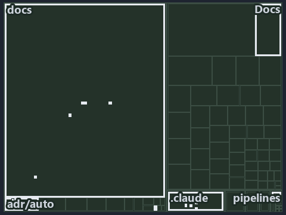

---
catzc:
  immutable:
    with_body_sha: "0b572822fc82"
    repo_status: locked
    path: docs/explanation/.assets/tree/adr-auto-depm--undeclared-edge-fails-with-one-line--operations.tree.md
    source: docs/explanation/.assets/adr-auto-depm--undeclared-edge-fails-with-one-line--operations.drawio.png
    role: asset-description
    language: markdown
    filetype: md
    track: docs
    tracktype: documentation
---

# An undeclared module edge fails the gate with one line per issue: the tree minimap

```text
Which files cite ADR-AUTO-DEPM: every file of the world map is a tile, grouped by top-level folder.
15 files lit in 6 groups.
```



This is the tree minimap in the sidebar of the operations diagram of [An undeclared module edge fails the gate with one line per issue][16],
which explains [ADR-AUTO-DEPM][1]. It lights every file that cites those codes, grouped by folder, so it shows which files carry the
decision. Each lit group has its reason below, naming the code that selects it.

## What the minimap shows

The tree draws every file of the world map as a tile, grouped by top-level folder (under `automation/` by module, under `docs/adr/` by ADR
domain), and lights 15 files in 6 groups, filled in ink. A lit ADR file has a white rim; a file lit only by passing mentions is a lighter
ink. Every other tile is idle, a grey box: a file the slide's ADR codes do not select.

- .claude: 5 lit files
- docs (docs/ outside docs/adr/): 5 lit files
- adr/auto (docs/adr/automation): 2 lit files
- Docs (pwsh/Catzc.Base.Docs): 1 lit file
- adr/* (the files directly in docs/adr/): 1 lit file
- pipelines: 1 lit file

## Why each group is lit

### .claude (5 lit files)

The group holds the files of .claude; each sits in its world-map cell and is lit by:

- [.claude/plans/plan-adr-link-cleanup-prose-to-pages.md][2], in the cell .claude × markdown: selected by [ADR-AUTO-DEPM][1]: the file cites
  it at line 157 (text).
- [.claude/plans/plan-assert-wait.md][3], in the cell .claude × markdown: selected by [ADR-AUTO-DEPM][1]: the file cites it at line 62
  (text).
- [.claude/plans/plan-module-kinds-tracks.md][4], in the cell .claude × markdown: selected by [ADR-AUTO-DEPM][1]: the file cites it at line
  207 (text), line 290 (text), line 294 (text), line 357 (text), line 363 (text), line 367 (text), line 386 (text), line 542 (text) and line
  579 (text).
- [.claude/plans/prompt-k8s-kinds-2-implement.md][5], in the cell .claude × markdown: selected by [ADR-AUTO-DEPM][1]: the file cites it at
  line 17 (text).
- [.claude/plans/prompt-module-model-1-prepare.md][6], in the cell .claude × markdown: selected by [ADR-AUTO-DEPM][1]: the file cites it at
  line 18 (text).

### docs (docs/ outside docs/adr/, 5 lit files)

The group holds the files of docs/ outside docs/adr/; each sits in its world-map cell and is lit by:

- [docs/references/.assets/automation/catzc-base-modulesystem/module-graph-declared-vs-observed.drawio.verify.md][7], in the cell docs ×
  markdown: selected by [ADR-AUTO-DEPM][1]: the file cites it at line 47 (text), line 54 (text), line 54 (text), line 71 (text) and line 73
  (text).
- [docs/references/pwsh/catzc-base-modulesystem/module-graph-declared-vs-observed.drawio.md][8], in the cell docs × markdown: selected
  by [ADR-AUTO-DEPM][1]: the file cites it at line 110 (text) and line 114 (text).
- [docs/references/pwsh/catzc-base-modulesystem/types/DependenciesConfig.cs.md][9], in the cell docs × markdown: selected by
  [ADR-AUTO-DEPM][1]: the file cites it at line 12 (text).
- [docs/references/pwsh/catzc-base-modulesystem/types/DependencyGraph.cs.md][10], in the cell docs × markdown: selected by
  [ADR-AUTO-DEPM][1]: the file cites it at line 15 (text).
- [docs/references/pwsh/catzc-base-modulesystem/types/ModuleGroup.cs.md][11], in the cell docs × markdown: selected by
  [ADR-AUTO-DEPM][1]: the file cites it at line 13 (text).

### adr/auto (docs/adr/automation, 2 lit files)

The group holds the files of docs/adr/automation; each sits in its world-map cell and is lit by:

- [docs/adr/automation/controlling-module-dependencies.md][1], in the cell docs × markdown: selected by [ADR-AUTO-DEPM][1]: the ADR's own
  file.
- [docs/adr/automation/dora-explains.md][12], in the cell docs × markdown: selected by [ADR-AUTO-DEPM][1]: the file cites it at line 365
  (text).

### Docs (pwsh/Catzc.Base.Docs, 1 lit file)

The group holds the files of pwsh/Catzc.Base.Docs; each sits in its world-map cell and is lit by:

- [pwsh/Catzc.Base.Docs/configs/adrs.yml][13], in the cell automation × yaml: selected by [ADR-AUTO-DEPM][1]: the file cites it at
  line 138 (text).

### adr/* (the files directly in docs/adr/, 1 lit file)

The group holds the files of the files directly in docs/adr/; each sits in its world-map cell and is lit by:

- [docs/adr/index.md][14], in the cell docs × markdown: selected by [ADR-AUTO-DEPM][1]: the file cites it at line 169 (text).

### pipelines (1 lit file)

The group holds the files of pipelines; each sits in its world-map cell and is lit by:

- [pipelines/ci-automation.yaml][15], in the cell pipelines × pipeline-yaml: selected by [ADR-AUTO-DEPM][1]: a pipeline that cites nothing
  itself carries its globset's citations, which cite it at `pwsh/Catzc.Base.Docs/configs/adrs.yml` line 138 (text).

## Keywords

- [world map][17]
- [track][18]
- [file language][19]
- [cell][20]
- [lit cell][21]
- [.claude][22]: a track
- [automation][22]: a track
- [docs][22]: a track
- [pipelines][22]: a track
- [markdown][23]: a file language
- [pipeline-yaml][23]: a file language
- [yaml][23]: a file language

[1]: ../../../adr/automation/controlling-module-dependencies.md
[2]: ../../../../.claude/plans/plan-adr-link-cleanup-prose-to-pages.md
[3]: ../../../../.claude/plans/plan-assert-wait.md
[4]: ../../../../.claude/plans/plan-module-kinds-tracks.md
[5]: ../../../../.claude/plans/prompt-k8s-kinds-2-implement.md
[6]: ../../../../.claude/plans/prompt-module-model-1-prepare.md
[7]: ../../../references/.assets/automation/catzc-base-modulesystem/module-graph-declared-vs-observed.drawio.verify.md
[8]: ../../../references/pwsh/catzc-base-modulesystem/module-graph-declared-vs-observed.drawio.md
[9]: ../../../references/pwsh/catzc-base-modulesystem/types/DependenciesConfig.cs.md
[10]: ../../../references/pwsh/catzc-base-modulesystem/types/DependencyGraph.cs.md
[11]: ../../../references/pwsh/catzc-base-modulesystem/types/ModuleGroup.cs.md
[12]: ../../../adr/automation/dora-explains.md
[13]: ../../../../pwsh/Catzc.Base.Docs/configs/adrs.yml
[14]: ../../../adr/index.md
[15]: ../../../../pipelines/ci-automation.yaml
[16]: ../../automation/undeclared-edge-fails-with-one-line.md
[17]: ../../../adr/glossary.md#world-map
[18]: ../../../adr/glossary.md#track
[19]: ../../../adr/glossary.md#file-language
[20]: ../../../adr/glossary.md#cell
[21]: ../../../adr/glossary.md#lit-cell
[22]: ../../../../pwsh/Catzc.Base.Variants/configs/variants.yml
[23]: ../../../../pwsh/Catzc.Base.Languages/configs/languages.yml
