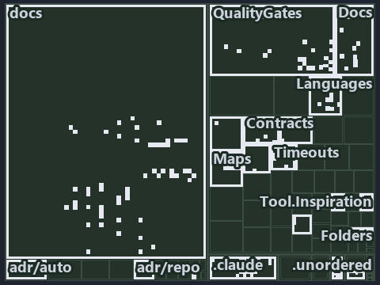

---
catzc:
  immutable:
    with_body_sha: "3d4099c8b1d1"
    repo_status: locked
    path: docs/explanation/.assets/tree/adr-auto-failfast--resolve-one-limit-in-code-order--implementation.tree.md
    source: docs/explanation/.assets/adr-auto-failfast--resolve-one-limit-in-code-order--implementation.drawio.png
    role: asset-description
    language: markdown
    filetype: md
    track: docs
    tracktype: documentation
---

# Get-TimeoutSeconds resolves the environment, the config entry, then the exemption ceiling, in that order: the tree minimap

```text
Which files cite ADR-AUTO-DEFAULT and ADR-AUTO-FAILFAST: every file of the world map is a tile, grouped by top-level folder.
144 files lit in 16 groups.
```



This is the tree minimap in the sidebar of the implementation diagram of [Get-TimeoutSeconds resolves the environment, the config entry,
then the exemption ceiling, in that order][145], which explains [ADR-AUTO-DEFAULT][1] and [ADR-AUTO-FAILFAST][2]. It lights every file that
cites those codes, grouped by folder, so it shows which files carry the decision. Each lit group has its reason below, naming the code that
selects it.

## What the minimap shows

The tree draws every file of the world map as a tile, grouped by top-level folder (under `automation/` by module, under `docs/adr/` by ADR
domain), and lights 144 files in 16 groups, filled in ink. A lit ADR file has a white rim; a file lit only by passing mentions is a lighter
ink. Every other tile is idle, a grey box: a file the slide's ADR codes do not select.

- docs (docs/ outside docs/adr/): 75 lit files
- .claude: 26 lit files
- QualityGates (pwsh/Catzc.Base.QualityGates): 11 lit files
- Contracts (pwsh/Catzc.Base.Contracts): 5 lit files
- Docs (pwsh/Catzc.Base.Docs): 5 lit files
- Slides (pwsh/Catzc.Base.Slides): 4 lit files
- Folders (pwsh/Catzc.Base.Folders): 3 lit files
- Languages (pwsh/Catzc.Base.Languages): 3 lit files
- Variants (pwsh/Catzc.Base.Variants): 3 lit files
- adr/auto (docs/adr/automation): 3 lit files
- Config (pwsh/Catzc.Base.Config): 1 lit file
- Reports (pwsh/Catzc.Base.Reports): 1 lit file
- Timeouts (pwsh/Catzc.Base.Timeouts): 1 lit file
- VSCode (pwsh/Catzc.Base.VSCode): 1 lit file
- adr/* (the files directly in docs/adr/): 1 lit file
- pipelines: 1 lit file

## Why each group is lit

### docs (docs/ outside docs/adr/, 75 lit files)

The group holds the files of docs/ outside docs/adr/; each sits in its world-map cell and is lit by:

- [docs/how-to/pwsh/manual-test-plan/repository-conventions.md][3], in the cell docs × markdown: selected by [ADR-AUTO-DEFAULT][1]: the file
  cites it at line 34 (text).
- [docs/references/.assets/automation/catzc-azure-cli/az-cli-test-assert-share-one-state.drawio.verify.md][4], in the cell docs × markdown:
  selected by [ADR-AUTO-FAILFAST][2]: the file cites it at line 63 (text).
- [docs/references/.assets/automation/catzc-azure/azure-identity-resolves-from-config.drawio.verify.md][5], in the cell docs × markdown:
  selected by [ADR-AUTO-DEFAULT][1]: the file cites it at line 54 (text).
- [docs/references/.assets/automation/catzc-base-execution/invoke-executable-two-paths-one-bounded.drawio.verify.md][6], in the cell docs ×
  markdown: selected by [ADR-AUTO-FAILFAST][2]: the file cites it at line 45 (text), line 58 (text), line 61 (text), line 62 (text) and line
  62 (text).
- [docs/references/pwsh/catzc-azure-cli/Assert-AzCliSubscriptionAccessible.ps1.md][7], in the cell docs × markdown: selected by
  [ADR-AUTO-FAILFAST][2]: the file cites it at line 22 (text).
- [docs/references/pwsh/catzc-azure-cli/az-cli-test-assert-share-one-state.drawio.md][8], in the cell docs × markdown: selected by
  [ADR-AUTO-FAILFAST][2]: the file cites it at line 102 (text).
- [docs/references/pwsh/catzc-azure/types/AzureConfig.cs.md][9], in the cell docs × markdown: selected by [ADR-AUTO-DEFAULT][1]: the file
  cites it at line 24 (text).
- [docs/references/pwsh/catzc-base-contracts/configs/contracts.yml.md][10], in the cell docs × markdown: selected by [ADR-AUTO-DEFAULT][1]:
  the file cites it at line 15 (text).
- [docs/references/pwsh/catzc-base-contracts/tests/types/ContractsConfig.Tests.ps1.md][11], in the cell docs × markdown: selected by
  [ADR-AUTO-DEFAULT][1]: the file cites it at line 12 (text).
- [docs/references/pwsh/catzc-base-contracts/types/ContractsConfig.cs.md][12], in the cell docs × markdown: selected by
  [ADR-AUTO-DEFAULT][1]: the file cites it at line 13 (text).
- [docs/references/pwsh/catzc-base-docs/Test-Glossary.ps1.md][13], in the cell docs × markdown: selected by [ADR-AUTO-FAILFAST][2]: the file
  cites it at line 27 (text).
- [docs/references/pwsh/catzc-base-docs/configs/adr-checks.yml.md][14], in the cell docs × markdown: selected by [ADR-AUTO-DEFAULT][1]: the
  file cites it at line 13 (text).
- [docs/references/pwsh/catzc-base-docs/private/Import-AdrCitationMapFile.ps1.md][15], in the cell docs × markdown: selected by
  [ADR-AUTO-FAILFAST][2]: the file cites it at line 15 (text).
- [docs/references/pwsh/catzc-base-docs/tests/Test-Glossary.Tests.ps1.md][16], in the cell docs × markdown: selected by
  [ADR-AUTO-FAILFAST][2]: the file cites it at line 13 (text).
- [docs/references/pwsh/catzc-base-docs/types/AdrChecksConfig.cs.md][17], in the cell docs × markdown: selected by [ADR-AUTO-DEFAULT][1]:
  the file cites it at line 12 (text).
- [docs/references/pwsh/catzc-base-docs/types/AdrsConfig.cs.md][18], in the cell docs × markdown: selected by [ADR-AUTO-DEFAULT][1]: the
  file cites it at line 37 (text).
- [docs/references/pwsh/catzc-base-docs/types/CheckMode.cs.md][19], in the cell docs × markdown: selected by [ADR-AUTO-DEFAULT][1]: the file
  cites it at line 19 (text).
- [docs/references/pwsh/catzc-base-docs/types/CheckModes.cs.md][20], in the cell docs × markdown: selected by [ADR-AUTO-DEFAULT][1]: the
  file cites it at line 15 (text).
- [docs/references/pwsh/catzc-base-engines/types/ExecutionEngine.cs.md][21], in the cell docs × markdown: selected by
  [ADR-AUTO-FAILFAST][2]: the file cites it at line 37 (text).
- [docs/references/pwsh/catzc-base-execution/invoke-executable-two-paths-one-bounded.drawio.md][22], in the cell docs × markdown: selected
  by [ADR-AUTO-FAILFAST][2]: the file cites it at line 32 (text) and line 100 (text).
- [docs/references/pwsh/catzc-base-folders/tests/types/FolderWalkConfig.Tests.ps1.md][23], in the cell docs × markdown: selected by
  [ADR-AUTO-DEFAULT][1]: the file cites it at line 12 (text).
- [docs/references/pwsh/catzc-base-git/Import-RepositoryWithHistory.ps1.md][24], in the cell docs × markdown: selected by
  [ADR-AUTO-DEFAULT][1]: the file cites it at line 19 (text); selected by [ADR-AUTO-FAILFAST][2]: the file cites it at line 22 (text).
- [docs/references/pwsh/catzc-base-globs/Test-GlobSetAffected.ps1.md][25], in the cell docs × markdown: selected by [ADR-AUTO-FAILFAST][2]:
  the file cites it at line 25 (text).
- [docs/references/pwsh/catzc-base-languages.md][26], in the cell docs × markdown: selected by [ADR-AUTO-DEFAULT][1]: the file cites it at
  line 49 (text).
- [docs/references/pwsh/catzc-base-languages/configs/file-carriers.yml.md][27], in the cell docs × markdown: selected by
  [ADR-AUTO-DEFAULT][1]: the file cites it at line 14 (text).
- [docs/references/pwsh/catzc-base-languages/configs/go.yml.md][28], in the cell docs × markdown: selected by [ADR-AUTO-DEFAULT][1]: the
  file cites it at line 16 (text).
- [docs/references/pwsh/catzc-base-languages/configs/languages.yml.md][29], in the cell docs × markdown: selected by [ADR-AUTO-DEFAULT][1]:
  the file cites it at line 41 (text).
- [docs/references/pwsh/catzc-base-languages/configs/python.yml.md][30], in the cell docs × markdown: selected by [ADR-AUTO-DEFAULT][1]: the
  file cites it at line 18 (text).
- [docs/references/pwsh/catzc-base-languages/types/FileCarrier.cs.md][31], in the cell docs × markdown: selected by [ADR-AUTO-DEFAULT][1]:
  the file cites it at line 13 (text).
- [docs/references/pwsh/catzc-base-languages/types/FileCarriersConfig.cs.md][32], in the cell docs × markdown: selected by
  [ADR-AUTO-DEFAULT][1]: the file cites it at line 14 (text).
- [docs/references/pwsh/catzc-base-languages/types/GoConfig.cs.md][33], in the cell docs × markdown: selected by [ADR-AUTO-DEFAULT][1]: the
  file cites it at line 13 (text).
- [docs/references/pwsh/catzc-base-languages/types/LanguagesConfig.cs.md][34], in the cell docs × markdown: selected by
  [ADR-AUTO-DEFAULT][1]: the file cites it at line 26 (text).
- [docs/references/pwsh/catzc-base-maps/configs/maps.yml.md][35], in the cell docs × markdown: selected by [ADR-AUTO-DEFAULT][1]: the file
  cites it at line 15 (text).
- [docs/references/pwsh/catzc-base-maps/types/MapsConfig.cs.md][36], in the cell docs × markdown: selected by [ADR-AUTO-DEFAULT][1]: the
  file cites it at line 19 (text).
- [docs/references/pwsh/catzc-base-maps/types/MapsHighlight.cs.md][37], in the cell docs × markdown: selected by [ADR-AUTO-DEFAULT][1]: the
  file cites it at line 17 (text).
- [docs/references/pwsh/catzc-base-maps/types/MapsLabels.cs.md][38], in the cell docs × markdown: selected by [ADR-AUTO-DEFAULT][1]: the
  file cites it at line 25 (text).
- [docs/references/pwsh/catzc-base-maps/types/MapsLimits.cs.md][39], in the cell docs × markdown: selected by [ADR-AUTO-DEFAULT][1]: the
  file cites it at line 15 (text).
- [docs/references/pwsh/catzc-base-maps/types/MapsPalette.cs.md][40], in the cell docs × markdown: selected by [ADR-AUTO-DEFAULT][1]: the
  file cites it at line 15 (text).
- [docs/references/pwsh/catzc-base-qualitygates/configs/comments.yml.md][41], in the cell docs × markdown: selected by
  [ADR-AUTO-DEFAULT][1]: the file cites it at line 17 (text).
- [docs/references/pwsh/catzc-base-qualitygates/configs/file-meta.yml.md][42], in the cell docs × markdown: selected by
  [ADR-AUTO-DEFAULT][1]: the file cites it at line 13 (text).
- [docs/references/pwsh/catzc-base-qualitygates/configs/links.yml.md][43], in the cell docs × markdown: selected by [ADR-AUTO-DEFAULT][1]:
  the file cites it at line 15 (text).
- [docs/references/pwsh/catzc-base-qualitygates/configs/parameter-consistency.yml.md][44], in the cell docs × markdown: selected by
  [ADR-AUTO-DEFAULT][1]: the file cites it at line 18 (text).
- [docs/references/pwsh/catzc-base-qualitygates/configs/source-conventions.yml.md][45], in the cell docs × markdown: selected by
  [ADR-AUTO-DEFAULT][1]: the file cites it at line 17 (text).
- [docs/references/pwsh/catzc-base-qualitygates/configs/test-policy.yml.md][46], in the cell docs × markdown: selected by
  [ADR-AUTO-DEFAULT][1]: the file cites it at line 15 (text).
- [docs/references/pwsh/catzc-base-qualitygates/private/Get-LinkLineLimit.ps1.md][47], in the cell docs × markdown: selected by
  [ADR-AUTO-DEFAULT][1]: the file cites it at line 16 (text).
- [docs/references/pwsh/catzc-base-qualitygates/private/Test-TestRunOverBudget.ps1.md][48], in the cell docs × markdown: selected by
  [ADR-AUTO-FAILFAST][2]: the file cites it at line 16 (text).
- [docs/references/pwsh/catzc-base-qualitygates/private/Write-TestAutomationVerdict.ps1.md][49], in the cell docs × markdown: selected by
  [ADR-AUTO-FAILFAST][2]: the file cites it at line 25 (text).
- [docs/references/pwsh/catzc-base-qualitygates/tests/types/CommentsConfig.Tests.ps1.md][50], in the cell docs × markdown: selected by
  [ADR-AUTO-DEFAULT][1]: the file cites it at line 12 (text).
- [docs/references/pwsh/catzc-base-qualitygates/tests/types/FileMetaConfig.Tests.ps1.md][51], in the cell docs × markdown: selected by
  [ADR-AUTO-DEFAULT][1]: the file cites it at line 12 (text).
- [docs/references/pwsh/catzc-base-qualitygates/tests/types/LinksConfig.Tests.ps1.md][52], in the cell docs × markdown: selected by
  [ADR-AUTO-DEFAULT][1]: the file cites it at line 12 (text).
- [docs/references/pwsh/catzc-base-qualitygates/tests/types/SourceCheck.Tests.ps1.md][53], in the cell docs × markdown: selected by
  [ADR-AUTO-DEFAULT][1]: the file cites it at line 12 (text).
- [docs/references/pwsh/catzc-base-qualitygates/tests/types/SourceConventionsConfig.Tests.ps1.md][54], in the cell docs × markdown: selected
  by [ADR-AUTO-DEFAULT][1]: the file cites it at line 12 (text).
- [docs/references/pwsh/catzc-base-qualitygates/types/CommentsConfig.cs.md][55], in the cell docs × markdown: selected by
  [ADR-AUTO-DEFAULT][1]: the file cites it at line 13 (text).
- [docs/references/pwsh/catzc-base-qualitygates/types/EngineSetCheck.cs.md][56], in the cell docs × markdown: selected by
  [ADR-AUTO-DEFAULT][1]: the file cites it at line 22 (text).
- [docs/references/pwsh/catzc-base-qualitygates/types/FileMetaKind.cs.md][57], in the cell docs × markdown: selected by
  [ADR-AUTO-DEFAULT][1]: the file cites it at line 13 (text).
- [docs/references/pwsh/catzc-base-qualitygates/types/GeneratedWriter.cs.md][58], in the cell docs × markdown: selected by
  [ADR-AUTO-DEFAULT][1]: the file cites it at line 11 (text).
- [docs/references/pwsh/catzc-base-qualitygates/types/LinksConfig.cs.md][59], in the cell docs × markdown: selected by
  [ADR-AUTO-DEFAULT][1]: the file cites it at line 15 (text).
- [docs/references/pwsh/catzc-base-qualitygates/types/ParameterConsistencyConfig.cs.md][60], in the cell docs × markdown: selected by
  [ADR-AUTO-DEFAULT][1]: the file cites it at line 13 (text).
- [docs/references/pwsh/catzc-base-qualitygates/types/SourceCheck.cs.md][61], in the cell docs × markdown: selected by
  [ADR-AUTO-DEFAULT][1]: the file cites it at line 13 (text).
- [docs/references/pwsh/catzc-base-qualitygates/types/SourceConventionsConfig.cs.md][62], in the cell docs × markdown: selected by
  [ADR-AUTO-DEFAULT][1]: the file cites it at line 13 (text).
- [docs/references/pwsh/catzc-base-qualitygates/types/TestPolicyConfig.cs.md][63], in the cell docs × markdown: selected by
  [ADR-AUTO-DEFAULT][1]: the file cites it at line 13 (text).
- [docs/references/pwsh/catzc-base-timeouts/Assert-Wait.ps1.md][64], in the cell docs × markdown: selected by [ADR-AUTO-FAILFAST][2]: the
  file cites it at line 23 (text) and line 24 (text).
- [docs/references/pwsh/catzc-base-timeouts/Get-TestTimeLimits.ps1.md][65], in the cell docs × markdown: selected by [ADR-AUTO-FAILFAST][2]:
  the file cites it at line 16 (text).
- [docs/references/pwsh/catzc-base-timeouts/types/BashSafeguard.cs.md][66], in the cell docs × markdown: selected by [ADR-AUTO-FAILFAST][2]:
  the file cites it at line 12 (text).
- [docs/references/pwsh/catzc-base-timeouts/types/TimeoutExemptionsConfig.cs.md][67], in the cell docs × markdown: selected by
  [ADR-AUTO-DEFAULT][1]: the file cites it at line 19 (text).
- [docs/references/pwsh/catzc-base-timeouts/types/TimeoutsConfig.cs.md][68], in the cell docs × markdown: selected by [ADR-AUTO-DEFAULT][1]:
  the file cites it at line 22 (text).
- [docs/references/pwsh/catzc-base-typessystem.md][69], in the cell docs × markdown: selected by [ADR-AUTO-FAILFAST][2]: the file cites it
  at line 64 (text).
- [docs/references/pwsh/catzc-base-typessystem/Assert-LoadedTypesCurrent.ps1.md][70], in the cell docs × markdown: selected by
  [ADR-AUTO-FAILFAST][2]: the file cites it at line 15 (text).
- [docs/references/pwsh/catzc-base-typessystem/Build-BashTimeoutHook.ps1.md][71], in the cell docs × markdown: selected by
  [ADR-AUTO-FAILFAST][2]: the file cites it at line 15 (text).
- [docs/references/pwsh/catzc-base-variants/private/Get-Variant.ps1.md][72], in the cell docs × markdown: selected by [ADR-AUTO-DEFAULT][1]:
  the file cites it at line 18 (text).
- [docs/references/pwsh/catzc-tooling-inspiration/Get-Inspiration.ps1.md][73], in the cell docs × markdown: selected by
  [ADR-AUTO-DEFAULT][1]: the file cites it at line 15 (text).
- [docs/references/pwsh/catzc-tooling-inspiration/configs/inspiration.yml.md][74], in the cell docs × markdown: selected by
  [ADR-AUTO-DEFAULT][1]: the file cites it at line 15 (text).
- [docs/references/pwsh/catzc-tooling-inspiration/tests/types/InspirationConfig.Tests.ps1.md][75], in the cell docs × markdown: selected by
  [ADR-AUTO-DEFAULT][1]: the file cites it at line 13 (text).
- [docs/references/pwsh/catzc-tooling-inspiration/types/InspirationConfig.cs.md][76], in the cell docs × markdown: selected by
  [ADR-AUTO-DEFAULT][1]: the file cites it at line 18 (text).
- [docs/references/pwsh/claude-hooks/Assert-BashTimeout/Program.cs.md][77], in the cell docs × markdown: selected by [ADR-AUTO-FAILFAST][2]:
  the file cites it at line 12 (text).

### .claude (26 lit files)

The group holds the files of .claude; each sits in its world-map cell and is lit by:

- [.claude/CLAUDE.md][78], in the cell .claude × markdown: selected by [ADR-AUTO-DEFAULT][1]: the file cites it at line 51 (text); selected
  by [ADR-AUTO-FAILFAST][2]: the file cites it at line 118 (text).
- [.claude/plans/decisions-2026-10-16.md][79], in the cell .claude × markdown: selected by [ADR-AUTO-DEFAULT][1]: the file cites it at line
  19 (text), line 30 (text), line 31 (text) and line 124 (text); selected by [ADR-AUTO-FAILFAST][2]: the file cites it at line 39 (text),
  line 39 (text), line 161 (text) and line 168 (text).
- [.claude/plans/decisions-2026-10-18.md][80], in the cell .claude × markdown: selected by [ADR-AUTO-DEFAULT][1]: the file cites it at line
  18 (text).
- [.claude/plans/plan-adr-link-cleanup-prose-to-pages.md][81], in the cell .claude × markdown: selected by [ADR-AUTO-DEFAULT][1]: the file
  cites it at line 157 (text) and line 446 (text).
- [.claude/plans/plan-assert-wait.md][82], in the cell .claude × markdown: selected by [ADR-AUTO-DEFAULT][1]: the file cites it at line 69
  (text) and line 70 (text); selected by [ADR-AUTO-FAILFAST][2]: the file cites it at line 24 (text), line 38 (text), line 46 (text), line
  91 (text), line 93 (text), line 94 (text), line 133 (text) and line 140 (text).
- [.claude/plans/plan-bounded-folder-enumeration.md][83], in the cell .claude × markdown: selected by [ADR-AUTO-DEFAULT][1]: the file cites
  it at line 128 (text), line 143 (text), line 161 (text), line 169 (text), line 189 (text), line 201 (text), line 305 (text) and line 323
  (text); selected by [ADR-AUTO-FAILFAST][2]: the file cites it at line 33 (text), line 281 (text) and line 282 (text).
- [.claude/plans/plan-config-defaults.md][84], in the cell .claude × markdown: selected by [ADR-AUTO-DEFAULT][1]: the file cites it at line
  25 (text), line 71 (text), line 135 (text), line 191 (text) and line 257 (text); selected by [ADR-AUTO-FAILFAST][2]: the file cites it at
  line 35 (text) and line 259 (text).
- [.claude/plans/plan-file-head-immutable-edges-classes.md][85], in the cell .claude × markdown: selected by [ADR-AUTO-DEFAULT][1]: the file
  cites it at line 226 (text) and line 340 (text).
- [.claude/plans/plan-layers-vocabulary-rename-contracts.md][86], in the cell .claude × markdown: selected by [ADR-AUTO-DEFAULT][1]: the
  file cites it at line 494 (text), line 531 (text), line 533 (text), line 673 (text) and line 765 (text).
- [.claude/plans/plan-lazy-types-load.md][87], in the cell .claude × markdown: selected by [ADR-AUTO-DEFAULT][1]: the file cites it at line
  67 (text); selected by [ADR-AUTO-FAILFAST][2]: the file cites it at line 90 (text).
- [.claude/plans/plan-master.md][88], in the cell .claude × markdown: selected by [ADR-AUTO-FAILFAST][2]: the file cites it at line 84
  (text).
- [.claude/plans/plan-materialization-of-knowledge.md][89], in the cell .claude × markdown: selected by [ADR-AUTO-DEFAULT][1]: the file
  cites it at line 24 (text).
- [.claude/plans/plan-module-kinds-tracks.md][90], in the cell .claude × markdown: selected by [ADR-AUTO-DEFAULT][1]: the file cites it at
  line 250 (text), line 314 (text) and line 357 (text).
- [.claude/plans/plan-out-artifacts.md][91], in the cell .claude × markdown: selected by [ADR-AUTO-DEFAULT][1]: the file cites it at line
  132 (text).
- [.claude/plans/plan-plans-body-sha-landing-zone.md][92], in the cell .claude × markdown: selected by [ADR-AUTO-DEFAULT][1]: the file cites
  it at line 221 (text).
- [.claude/plans/prompt-bounded-folder-enumeration-continue.md][93], in the cell .claude × markdown: selected by [ADR-AUTO-FAILFAST][2]: the
  file cites it at line 17 (text).
- [.claude/plans/prompt-config-defaults-continue.md][94], in the cell .claude × markdown: selected by [ADR-AUTO-DEFAULT][1]: the file cites
  it at line 14 (text).
- [.claude/plans/prompt-k8s-kinds-1-prepare.md][95], in the cell .claude × markdown: selected by [ADR-AUTO-DEFAULT][1]: the file cites it at
  line 20 (text).
- [.claude/plans/prompt-module-model-1-prepare.md][96], in the cell .claude × markdown: selected by [ADR-AUTO-DEFAULT][1]: the file cites it
  at line 21 (text) and line 36 (text).
- [.claude/plans/questionnaire-2026-10-16.md][97], in the cell .claude × markdown: selected by [ADR-AUTO-FAILFAST][2]: the file cites it at
  line 121 (text).
- [.claude/plans/task-assert-wait.md][98], in the cell .claude × markdown: selected by [ADR-AUTO-FAILFAST][2]: the file cites it at line 53
  (text).
- [.claude/plans/task-config-defaults-postures.md][99], in the cell .claude × markdown: selected by [ADR-AUTO-DEFAULT][1]: the file cites it
  at line 37 (text); selected by [ADR-AUTO-FAILFAST][2]: the file cites it at line 24 (text).
- [.claude/plans/task-config-defaults-variants.md][100], in the cell .claude × markdown: selected by [ADR-AUTO-DEFAULT][1]: the file cites
  it at line 14 (text).
- [.claude/plans/task-import-landing-zone.md][101], in the cell .claude × markdown: selected by [ADR-AUTO-DEFAULT][1]: the file cites it at
  line 21 (text) and line 42 (text); selected by [ADR-AUTO-FAILFAST][2]: the file cites it at line 42 (text).
- [.claude/plans/task-lazy-types-load.md][102], in the cell .claude × markdown: selected by [ADR-AUTO-DEFAULT][1]: the file cites it at line
  22 (text).
- [.claude/skills/catzc-module/SKILL.md][103], in the cell .claude × markdown: selected by [ADR-AUTO-DEFAULT][1]: the file cites it at line
  26 (text) and line 39 (text).

### QualityGates (pwsh/Catzc.Base.QualityGates, 11 lit files)

The group holds the files of pwsh/Catzc.Base.QualityGates; each sits in its world-map cell and is lit by:

- [pwsh/Catzc.Base.QualityGates/configs/terminology.yml][104], in the cell automation × yaml: selected by [ADR-AUTO-FAILFAST][2]: the file
  cites it at line 583 (text).
- [pwsh/Catzc.Base.QualityGates/tests/Get-AdrCodesFileMetaFact.Tests.ps1][105], in the cell automation × powershell: selected by
  [ADR-AUTO-DEFAULT][1]: the file cites it at line 171 (text).
- [pwsh/Catzc.Base.QualityGates/tests/types/CommentsConfig.Tests.ps1][106], in the cell automation × powershell: selected by
  [ADR-AUTO-DEFAULT][1]: the file cites it at line 2 (text), line 98 (text) and line 102 (text).
- [pwsh/Catzc.Base.QualityGates/tests/types/EngineSetCheck.Tests.ps1][107], in the cell automation × powershell: selected by
  [ADR-AUTO-DEFAULT][1]: the file cites it at line 6 (text).
- [pwsh/Catzc.Base.QualityGates/tests/types/FileHeadPolicy.Tests.ps1][108], in the cell automation × powershell: selected by
  [ADR-AUTO-DEFAULT][1]: the file cites it at line 2 (text).
- [pwsh/Catzc.Base.QualityGates/tests/types/FileMetaConfig.Tests.ps1][109], in the cell automation × powershell: selected by
  [ADR-AUTO-DEFAULT][1]: the file cites it at line 16 (text) and line 66 (text).
- [pwsh/Catzc.Base.QualityGates/tests/types/LinksConfig.Tests.ps1][110], in the cell automation × powershell: selected by
  [ADR-AUTO-DEFAULT][1]: the file cites it at line 2 (text).
- [pwsh/Catzc.Base.QualityGates/tests/types/PlansConfig.Tests.ps1][111], in the cell automation × powershell: selected by
  [ADR-AUTO-DEFAULT][1]: the file cites it at line 1 (text).
- [pwsh/Catzc.Base.QualityGates/tests/types/SourceCheck.Tests.ps1][112], in the cell automation × powershell: selected by
  [ADR-AUTO-DEFAULT][1]: the file cites it at line 2 (text).
- [pwsh/Catzc.Base.QualityGates/tests/types/SourceConventionsConfig.Tests.ps1][113], in the cell automation × powershell: selected by
  [ADR-AUTO-DEFAULT][1]: the file cites it at line 3 (text) and line 27 (text).
- [pwsh/Catzc.Base.QualityGates/types/PlansConfig.cs][114], in the cell automation × csharp: selected by [ADR-AUTO-DEFAULT][1]: the file
  cites it at line 1 (header).

### Contracts (pwsh/Catzc.Base.Contracts, 5 lit files)

The group holds the files of pwsh/Catzc.Base.Contracts; each sits in its world-map cell and is lit by:

- [pwsh/Catzc.Base.Contracts/tests/Get-Contract.Tests.ps1][115], in the cell automation × powershell: selected by [ADR-AUTO-DEFAULT][1]: the
  file cites it at line 93 (text), line 261 (text) and line 277 (text).
- [pwsh/Catzc.Base.Contracts/tests/types/ContractCommand.Tests.ps1][116], in the cell automation × powershell: selected by
  [ADR-AUTO-DEFAULT][1]: the file cites it at line 28 (text).
- [pwsh/Catzc.Base.Contracts/tests/types/ContractsConfig.Tests.ps1][117], in the cell automation × powershell: selected by
  [ADR-AUTO-DEFAULT][1]: the file cites it at line 2 (text) and line 26 (text).
- [pwsh/Catzc.Base.Contracts/types/ContractCommand.cs][118], in the cell automation × csharp: selected by [ADR-AUTO-DEFAULT][1]: the file
  cites it at line 8 (body comment) (a passing mention only).
- [pwsh/Catzc.Base.Contracts/types/ContractParameter.cs][119], in the cell automation × csharp: selected by [ADR-AUTO-DEFAULT][1]: the file
  cites it at line 9 (body comment) (a passing mention only).

### Docs (pwsh/Catzc.Base.Docs, 5 lit files)

The group holds the files of pwsh/Catzc.Base.Docs; each sits in its world-map cell and is lit by:

- [pwsh/Catzc.Base.Docs/configs/adrs.yml][120], in the cell automation × yaml: selected by [ADR-AUTO-DEFAULT][1]: the file cites it at line
  131 (text); selected by [ADR-AUTO-FAILFAST][2]: the file cites it at line 132 (text).
- [pwsh/Catzc.Base.Docs/configs/agents.yml][121], in the cell automation × yaml: selected by [ADR-AUTO-FAILFAST][2]: the file cites it at
  line 55 (body comment) and line 76 (text).
- [pwsh/Catzc.Base.Docs/configs/capabilities.yml][122], in the cell automation × yaml: selected by [ADR-AUTO-DEFAULT][1]: the file cites it
  at line 14 (body comment) (a passing mention only); selected by [ADR-AUTO-FAILFAST][2]: the file cites it at line 4 (text).
- [pwsh/Catzc.Base.Docs/tests/types/AdrChecksConfig.Tests.ps1][123], in the cell automation × powershell: selected by [ADR-AUTO-DEFAULT][1]:
  the file cites it at line 2 (text).
- [pwsh/Catzc.Base.Docs/tests/types/CheckModes.Tests.ps1][124], in the cell automation × powershell: selected by [ADR-AUTO-DEFAULT][1]: the
  file cites it at line 2 (text).

### Slides (pwsh/Catzc.Base.Slides, 4 lit files)

The group holds the files of pwsh/Catzc.Base.Slides; each sits in its world-map cell and is lit by:

- [pwsh/Catzc.Base.Slides/tests/Build-SlideDeck.Tests.ps1][125], in the cell automation × powershell: selected by [ADR-AUTO-FAILFAST][2]:
  the file cites it at line 145 (text) and line 153 (text).
- [pwsh/Catzc.Base.Slides/tests/Test-Slides.Tests.ps1][126], in the cell automation × powershell: selected by [ADR-AUTO-FAILFAST][2]: the
  file cites it at line 44 (text).
- [pwsh/Catzc.Base.Slides/tests/types/SlidesConfig.Tests.ps1][127], in the cell automation × powershell: selected by [ADR-AUTO-DEFAULT][1]:
  the file cites it at line 2 (text) and line 32 (text).
- [pwsh/Catzc.Base.Slides/tests/types/SlidesKit.Tests.ps1][128], in the cell automation × powershell: selected by [ADR-AUTO-DEFAULT][1]: the
  file cites it at line 19 (text).

### Folders (pwsh/Catzc.Base.Folders, 3 lit files)

The group holds the files of pwsh/Catzc.Base.Folders; each sits in its world-map cell and is lit by:

- [pwsh/Catzc.Base.Folders/tests/Get-ChildPath.Tests.ps1][129], in the cell automation × powershell: selected by [ADR-AUTO-DEFAULT][1]: the
  file cites it at line 63 (text) and line 69 (text); selected by [ADR-AUTO-FAILFAST][2]: the file cites it at line 47 (text).
- [pwsh/Catzc.Base.Folders/tests/types/FolderWalkConfig.Tests.ps1][130], in the cell automation × powershell: selected by
  [ADR-AUTO-DEFAULT][1]: the file cites it at line 2 (text), line 9 (text) and line 50 (text).
- [pwsh/Catzc.Base.Folders/tests/types/FolderWalker.Tests.ps1][131], in the cell automation × powershell: selected by [ADR-AUTO-DEFAULT][1]:
  the file cites it at line 23 (text); selected by [ADR-AUTO-FAILFAST][2]: the file cites it at line 64 (text).

### Languages (pwsh/Catzc.Base.Languages, 3 lit files)

The group holds the files of pwsh/Catzc.Base.Languages; each sits in its world-map cell and is lit by:

- [pwsh/Catzc.Base.Languages/tests/types/FileCarriersConfig.Tests.ps1][132], in the cell automation × powershell: selected by
  [ADR-AUTO-DEFAULT][1]: the file cites it at line 31 (text).
- [pwsh/Catzc.Base.Languages/tests/types/LanguagesConfig.Tests.ps1][133], in the cell automation × powershell: selected by
  [ADR-AUTO-DEFAULT][1]: the file cites it at line 155 (text).
- [pwsh/Catzc.Base.Languages/types/LayoutRow.cs][134], in the cell automation × csharp: selected by [ADR-AUTO-DEFAULT][1]: the file cites it
  at line 6 (body comment) (a passing mention only).

### Variants (pwsh/Catzc.Base.Variants, 3 lit files)

The group holds the files of pwsh/Catzc.Base.Variants; each sits in its world-map cell and is lit by:

- [pwsh/Catzc.Base.Variants/tests/Get-Track.Tests.ps1][135], in the cell automation × powershell: selected by [ADR-AUTO-DEFAULT][1]: the
  file cites it at line 65 (text).
- [pwsh/Catzc.Base.Variants/tests/types/VariantsConfig.Tests.ps1][136], in the cell automation × powershell: selected by
  [ADR-AUTO-DEFAULT][1]: the file cites it at line 31 (text), line 41 (text) and line 50 (text).
- [pwsh/Catzc.Base.Variants/types/VariantsConfig.cs][137], in the cell automation × csharp: selected by [ADR-AUTO-DEFAULT][1]: the file
  cites it at line 20 (body comment) (a passing mention only).

### adr/auto (docs/adr/automation, 3 lit files)

The group holds the files of docs/adr/automation; each sits in its world-map cell and is lit by:

- [docs/adr/automation/dora-explains.md][138], in the cell docs × markdown: selected by [ADR-AUTO-DEFAULT][1]: the file cites it at line 243
  (text); selected by [ADR-AUTO-FAILFAST][2]: the file cites it at line 260 (text).
- [docs/adr/automation/fail-fast-with-asserts.md][2], in the cell docs × markdown: selected by [ADR-AUTO-FAILFAST][2]: the ADR's own file.
- [docs/adr/automation/sensible-defaults.md][1], in the cell docs × markdown: selected by [ADR-AUTO-DEFAULT][1]: the ADR's own file.

### Config (pwsh/Catzc.Base.Config, 1 lit file)

The group holds the files of pwsh/Catzc.Base.Config; each sits in its world-map cell and is lit by:

- [pwsh/Catzc.Base.Config/tests/Get-Config.Tests.ps1][139], in the cell automation × powershell: selected by [ADR-AUTO-DEFAULT][1]: the file
  cites it at line 174 (text).

### Reports (pwsh/Catzc.Base.Reports, 1 lit file)

The group holds the files of pwsh/Catzc.Base.Reports; each sits in its world-map cell and is lit by:

- [pwsh/Catzc.Base.Reports/tests/types/OutputFormatsConfig.Tests.ps1][140], in the cell automation × powershell: selected by
  [ADR-AUTO-DEFAULT][1]: the file cites it at line 43 (text) and line 65 (text).

### Timeouts (pwsh/Catzc.Base.Timeouts, 1 lit file)

The group holds the files of pwsh/Catzc.Base.Timeouts; each sits in its world-map cell and is lit by:

- [pwsh/Catzc.Base.Timeouts/tests/types/TimeoutsConfig.Tests.ps1][141], in the cell automation × powershell: selected by
  [ADR-AUTO-DEFAULT][1]: the file cites it at line 153 (text).

### VSCode (pwsh/Catzc.Base.VSCode, 1 lit file)

The group holds the files of pwsh/Catzc.Base.VSCode; each sits in its world-map cell and is lit by:

- [pwsh/Catzc.Base.VSCode/types/VscodeOwnExtension.cs][142], in the cell automation × csharp: selected by [ADR-AUTO-DEFAULT][1]: the file
  cites it at line 9 (body comment) (a passing mention only).

### adr/* (the files directly in docs/adr/, 1 lit file)

The group holds the files of the files directly in docs/adr/; each sits in its world-map cell and is lit by:

- [docs/adr/index.md][143], in the cell docs × markdown: selected by [ADR-AUTO-DEFAULT][1]: the file cites it at line 162 (text); selected
  by [ADR-AUTO-FAILFAST][2]: the file cites it at line 163 (text).

### pipelines (1 lit file)

The group holds the files of pipelines; each sits in its world-map cell and is lit by:

- [pipelines/ci-automation.yaml][144], in the cell pipelines × pipeline-yaml: selected by [ADR-AUTO-DEFAULT][1]: a pipeline that cites
  nothing itself carries its globset's citations, which cite it at `pwsh/Catzc.Base.Config/tests/Get-Config.Tests.ps1` line 174 (text),
  `pwsh/Catzc.Base.Contracts/tests/Get-Contract.Tests.ps1` line 93 (text), `pwsh/Catzc.Base.Contracts/tests/Get-Contract.Tests.ps1` line 261
  (text), `pwsh/Catzc.Base.Contracts/tests/Get-Contract.Tests.ps1` line 277 (text),
  `pwsh/Catzc.Base.Contracts/tests/types/ContractCommand.Tests.ps1` line 28 (text),
  `pwsh/Catzc.Base.Contracts/tests/types/ContractsConfig.Tests.ps1` line 2 (text),
  `pwsh/Catzc.Base.Contracts/tests/types/ContractsConfig.Tests.ps1` line 26 (text), `pwsh/Catzc.Base.Contracts/types/ContractCommand.cs`
  line 8 (body comment), `pwsh/Catzc.Base.Contracts/types/ContractParameter.cs` line 9 (body comment),
  `pwsh/Catzc.Base.Docs/configs/adrs.yml` line 131 (text), `pwsh/Catzc.Base.Docs/configs/capabilities.yml` line 14 (body comment),
  `pwsh/Catzc.Base.Docs/tests/types/AdrChecksConfig.Tests.ps1` line 2 (text), `pwsh/Catzc.Base.Docs/tests/types/CheckModes.Tests.ps1` line 2
  (text), `pwsh/Catzc.Base.Folders/tests/Get-ChildPath.Tests.ps1` line 63 (text), `pwsh/Catzc.Base.Folders/tests/Get-ChildPath.Tests.ps1`
  line 69 (text), `pwsh/Catzc.Base.Folders/tests/types/FolderWalkConfig.Tests.ps1` line 2 (text),
  `pwsh/Catzc.Base.Folders/tests/types/FolderWalkConfig.Tests.ps1` line 9 (text),
  `pwsh/Catzc.Base.Folders/tests/types/FolderWalkConfig.Tests.ps1` line 50 (text),
  `pwsh/Catzc.Base.Folders/tests/types/FolderWalker.Tests.ps1` line 23 (text),
  `pwsh/Catzc.Base.Languages/tests/types/FileCarriersConfig.Tests.ps1` line 31 (text),
  `pwsh/Catzc.Base.Languages/tests/types/LanguagesConfig.Tests.ps1` line 155 (text), `pwsh/Catzc.Base.Languages/types/LayoutRow.cs` line 6
  (body comment), `pwsh/Catzc.Base.QualityGates/tests/Get-AdrCodesFileMetaFact.Tests.ps1` line 171 (text),
  `pwsh/Catzc.Base.QualityGates/tests/types/CommentsConfig.Tests.ps1` line 2 (text),
  `pwsh/Catzc.Base.QualityGates/tests/types/CommentsConfig.Tests.ps1` line 98 (text),
  `pwsh/Catzc.Base.QualityGates/tests/types/CommentsConfig.Tests.ps1` line 102 (text),
  `pwsh/Catzc.Base.QualityGates/tests/types/EngineSetCheck.Tests.ps1` line 6 (text),
  `pwsh/Catzc.Base.QualityGates/tests/types/FileHeadPolicy.Tests.ps1` line 2 (text),
  `pwsh/Catzc.Base.QualityGates/tests/types/FileMetaConfig.Tests.ps1` line 16 (text),
  `pwsh/Catzc.Base.QualityGates/tests/types/FileMetaConfig.Tests.ps1` line 66 (text),
  `pwsh/Catzc.Base.QualityGates/tests/types/LinksConfig.Tests.ps1` line 2 (text),
  `pwsh/Catzc.Base.QualityGates/tests/types/PlansConfig.Tests.ps1` line 1 (text),
  `pwsh/Catzc.Base.QualityGates/tests/types/SourceCheck.Tests.ps1` line 2 (text),
  `pwsh/Catzc.Base.QualityGates/tests/types/SourceConventionsConfig.Tests.ps1` line 3 (text),
  `pwsh/Catzc.Base.QualityGates/tests/types/SourceConventionsConfig.Tests.ps1` line 27 (text),
  `pwsh/Catzc.Base.QualityGates/types/PlansConfig.cs` line 1 (header), `pwsh/Catzc.Base.Reports/tests/types/OutputFormatsConfig.Tests.ps1`
  line 43 (text), `pwsh/Catzc.Base.Reports/tests/types/OutputFormatsConfig.Tests.ps1` line 65 (text),
  `pwsh/Catzc.Base.Slides/tests/types/SlidesConfig.Tests.ps1` line 2 (text), `pwsh/Catzc.Base.Slides/tests/types/SlidesConfig.Tests.ps1`
  line 32 (text), `pwsh/Catzc.Base.Slides/tests/types/SlidesKit.Tests.ps1` line 19 (text),
  `pwsh/Catzc.Base.Timeouts/tests/types/TimeoutsConfig.Tests.ps1` line 153 (text), `pwsh/Catzc.Base.VSCode/types/VscodeOwnExtension.cs` line
  9 (body comment), `pwsh/Catzc.Base.Variants/tests/Get-Track.Tests.ps1` line 65 (text),
  `pwsh/Catzc.Base.Variants/tests/types/VariantsConfig.Tests.ps1` line 31 (text),
  `pwsh/Catzc.Base.Variants/tests/types/VariantsConfig.Tests.ps1` line 41 (text),
  `pwsh/Catzc.Base.Variants/tests/types/VariantsConfig.Tests.ps1` line 50 (text) and `pwsh/Catzc.Base.Variants/types/VariantsConfig.cs` line
  20 (body comment); selected by [ADR-AUTO-FAILFAST][2]: a pipeline that cites nothing itself carries its globset's citations, which cite it
  at `pwsh/Catzc.Base.Docs/configs/adrs.yml` line 132 (text), `pwsh/Catzc.Base.Docs/configs/agents.yml` line 55 (body comment),
  `pwsh/Catzc.Base.Docs/configs/agents.yml` line 76 (text), `pwsh/Catzc.Base.Docs/configs/capabilities.yml` line 4 (text),
  `pwsh/Catzc.Base.Folders/tests/Get-ChildPath.Tests.ps1` line 47 (text), `pwsh/Catzc.Base.Folders/tests/types/FolderWalker.Tests.ps1` line
  64 (text), `pwsh/Catzc.Base.QualityGates/configs/terminology.yml` line 583 (text),
  `pwsh/Catzc.Base.Slides/tests/Build-SlideDeck.Tests.ps1` line 145 (text), `pwsh/Catzc.Base.Slides/tests/Build-SlideDeck.Tests.ps1` line
  153 (text) and `pwsh/Catzc.Base.Slides/tests/Test-Slides.Tests.ps1` line 44 (text).

## Keywords

- [world map][146]
- [track][147]
- [file language][148]
- [cell][149]
- [lit cell][150]
- [.claude][151]: a track
- [automation][151]: a track
- [docs][151]: a track
- [pipelines][151]: a track
- [csharp][152]: a file language
- [markdown][152]: a file language
- [pipeline-yaml][152]: a file language
- [powershell][152]: a file language
- [yaml][152]: a file language

[1]: ../../../adr/automation/sensible-defaults.md
[2]: ../../../adr/automation/fail-fast-with-asserts.md
[3]: ../../../how-to/pwsh/manual-test-plan/repository-conventions.md
[4]: ../../../references/.assets/automation/catzc-azure-cli/az-cli-test-assert-share-one-state.drawio.verify.md
[5]: ../../../references/.assets/automation/catzc-azure/azure-identity-resolves-from-config.drawio.verify.md
[6]: ../../../references/.assets/automation/catzc-base-execution/invoke-executable-two-paths-one-bounded.drawio.verify.md
[7]: ../../../references/pwsh/catzc-azure-cli/Assert-AzCliSubscriptionAccessible.ps1.md
[8]: ../../../references/pwsh/catzc-azure-cli/az-cli-test-assert-share-one-state.drawio.md
[9]: ../../../references/pwsh/catzc-azure/types/AzureConfig.cs.md
[10]: ../../../references/pwsh/catzc-base-contracts/configs/contracts.yml.md
[11]: ../../../references/pwsh/catzc-base-contracts/tests/types/ContractsConfig.Tests.ps1.md
[12]: ../../../references/pwsh/catzc-base-contracts/types/ContractsConfig.cs.md
[13]: ../../../references/pwsh/catzc-base-docs/Test-Glossary.ps1.md
[14]: ../../../references/pwsh/catzc-base-docs/configs/adr-checks.yml.md
[15]: ../../../references/pwsh/catzc-base-docs/private/Import-AdrCitationMapFile.ps1.md
[16]: ../../../references/pwsh/catzc-base-docs/tests/Test-Glossary.Tests.ps1.md
[17]: ../../../references/pwsh/catzc-base-docs/types/AdrChecksConfig.cs.md
[18]: ../../../references/pwsh/catzc-base-docs/types/AdrsConfig.cs.md
[19]: ../../../references/pwsh/catzc-base-docs/types/CheckMode.cs.md
[20]: ../../../references/pwsh/catzc-base-docs/types/CheckModes.cs.md
[21]: ../../../references/pwsh/catzc-base-engines/types/ExecutionEngine.cs.md
[22]: ../../../references/pwsh/catzc-base-execution/invoke-executable-two-paths-one-bounded.drawio.md
[23]: ../../../references/pwsh/catzc-base-folders/tests/types/FolderWalkConfig.Tests.ps1.md
[24]: ../../../references/pwsh/catzc-base-git/Import-RepositoryWithHistory.ps1.md
[25]: ../../../references/pwsh/catzc-base-globs/Test-GlobSetAffected.ps1.md
[26]: ../../../references/pwsh/catzc-base-languages.md
[27]: ../../../references/pwsh/catzc-base-languages/configs/file-carriers.yml.md
[28]: ../../../references/pwsh/catzc-base-languages/configs/go.yml.md
[29]: ../../../references/pwsh/catzc-base-languages/configs/languages.yml.md
[30]: ../../../references/pwsh/catzc-base-languages/configs/python.yml.md
[31]: ../../../references/pwsh/catzc-base-languages/types/FileCarrier.cs.md
[32]: ../../../references/pwsh/catzc-base-languages/types/FileCarriersConfig.cs.md
[33]: ../../../references/pwsh/catzc-base-languages/types/GoConfig.cs.md
[34]: ../../../references/pwsh/catzc-base-languages/types/LanguagesConfig.cs.md
[35]: ../../../references/pwsh/catzc-base-maps/configs/maps.yml.md
[36]: ../../../references/pwsh/catzc-base-maps/types/MapsConfig.cs.md
[37]: ../../../references/pwsh/catzc-base-maps/types/MapsHighlight.cs.md
[38]: ../../../references/pwsh/catzc-base-maps/types/MapsLabels.cs.md
[39]: ../../../references/pwsh/catzc-base-maps/types/MapsLimits.cs.md
[40]: ../../../references/pwsh/catzc-base-maps/types/MapsPalette.cs.md
[41]: ../../../references/pwsh/catzc-base-qualitygates/configs/comments.yml.md
[42]: ../../../references/pwsh/catzc-base-qualitygates/configs/file-meta.yml.md
[43]: ../../../references/pwsh/catzc-base-qualitygates/configs/links.yml.md
[44]: ../../../references/pwsh/catzc-base-qualitygates/configs/parameter-consistency.yml.md
[45]: ../../../references/pwsh/catzc-base-qualitygates/configs/source-conventions.yml.md
[46]: ../../../references/pwsh/catzc-base-qualitygates/configs/test-policy.yml.md
[47]: ../../../references/pwsh/catzc-base-qualitygates/private/Get-LinkLineLimit.ps1.md
[48]: ../../../references/pwsh/catzc-base-qualitygates/private/Test-TestRunOverBudget.ps1.md
[49]: ../../../references/pwsh/catzc-base-qualitygates/private/Write-TestAutomationVerdict.ps1.md
[50]: ../../../references/pwsh/catzc-base-qualitygates/tests/types/CommentsConfig.Tests.ps1.md
[51]: ../../../references/pwsh/catzc-base-qualitygates/tests/types/FileMetaConfig.Tests.ps1.md
[52]: ../../../references/pwsh/catzc-base-qualitygates/tests/types/LinksConfig.Tests.ps1.md
[53]: ../../../references/pwsh/catzc-base-qualitygates/tests/types/SourceCheck.Tests.ps1.md
[54]: ../../../references/pwsh/catzc-base-qualitygates/tests/types/SourceConventionsConfig.Tests.ps1.md
[55]: ../../../references/pwsh/catzc-base-qualitygates/types/CommentsConfig.cs.md
[56]: ../../../references/pwsh/catzc-base-qualitygates/types/EngineSetCheck.cs.md
[57]: ../../../references/pwsh/catzc-base-qualitygates/types/FileMetaKind.cs.md
[58]: ../../../references/pwsh/catzc-base-qualitygates/types/GeneratedWriter.cs.md
[59]: ../../../references/pwsh/catzc-base-qualitygates/types/LinksConfig.cs.md
[60]: ../../../references/pwsh/catzc-base-qualitygates/types/ParameterConsistencyConfig.cs.md
[61]: ../../../references/pwsh/catzc-base-qualitygates/types/SourceCheck.cs.md
[62]: ../../../references/pwsh/catzc-base-qualitygates/types/SourceConventionsConfig.cs.md
[63]: ../../../references/pwsh/catzc-base-qualitygates/types/TestPolicyConfig.cs.md
[64]: ../../../references/pwsh/catzc-base-timeouts/Assert-Wait.ps1.md
[65]: ../../../references/pwsh/catzc-base-timeouts/Get-TestTimeLimits.ps1.md
[66]: ../../../references/pwsh/catzc-base-timeouts/types/BashSafeguard.cs.md
[67]: ../../../references/pwsh/catzc-base-timeouts/types/TimeoutExemptionsConfig.cs.md
[68]: ../../../references/pwsh/catzc-base-timeouts/types/TimeoutsConfig.cs.md
[69]: ../../../references/pwsh/catzc-base-typessystem.md
[70]: ../../../references/pwsh/catzc-base-typessystem/Assert-LoadedTypesCurrent.ps1.md
[71]: ../../../references/pwsh/catzc-base-typessystem/Build-BashTimeoutHook.ps1.md
[72]: ../../../references/pwsh/catzc-base-variants/private/Get-Variant.ps1.md
[73]: ../../../references/pwsh/catzc-tooling-inspiration/Get-Inspiration.ps1.md
[74]: ../../../references/pwsh/catzc-tooling-inspiration/configs/inspiration.yml.md
[75]: ../../../references/pwsh/catzc-tooling-inspiration/tests/types/InspirationConfig.Tests.ps1.md
[76]: ../../../references/pwsh/catzc-tooling-inspiration/types/InspirationConfig.cs.md
[77]: ../../../references/pwsh/claude-hooks/Assert-BashTimeout/Program.cs.md
[78]: ../../../../.claude/CLAUDE.md
[79]: ../../../../.claude/plans/decisions-2026-10-16.md
[80]: ../../../../.claude/plans/decisions-2026-10-18.md
[81]: ../../../../.claude/plans/plan-adr-link-cleanup-prose-to-pages.md
[82]: ../../../../.claude/plans/plan-assert-wait.md
[83]: ../../../../.claude/plans/plan-bounded-folder-enumeration.md
[84]: ../../../../.claude/plans/plan-config-defaults.md
[85]: ../../../../.claude/plans/plan-file-head-immutable-edges-classes.md
[86]: ../../../../.claude/plans/plan-layers-vocabulary-rename-contracts.md
[87]: ../../../../.claude/plans/plan-lazy-types-load.md
[88]: ../../../../.claude/plans/plan-master.md
[89]: ../../../../.claude/plans/plan-materialization-of-knowledge.md
[90]: ../../../../.claude/plans/plan-module-kinds-tracks.md
[91]: ../../../../.claude/plans/plan-out-artifacts.md
[92]: ../../../../.claude/plans/plan-plans-body-sha-landing-zone.md
[93]: ../../../../.claude/plans/prompt-bounded-folder-enumeration-continue.md
[94]: ../../../../.claude/plans/prompt-config-defaults-continue.md
[95]: ../../../../.claude/plans/prompt-k8s-kinds-1-prepare.md
[96]: ../../../../.claude/plans/prompt-module-model-1-prepare.md
[97]: ../../../../.claude/plans/questionnaire-2026-10-16.md
[98]: ../../../../.claude/plans/task-assert-wait.md
[99]: ../../../../.claude/plans/task-config-defaults-postures.md
[100]: ../../../../.claude/plans/task-config-defaults-variants.md
[101]: ../../../../.claude/plans/task-import-landing-zone.md
[102]: ../../../../.claude/plans/task-lazy-types-load.md
[103]: ../../../../.claude/skills/catzc-module/SKILL.md
[104]: ../../../../pwsh/Catzc.Base.QualityGates/configs/terminology.yml
[105]: ../../../../pwsh/Catzc.Base.QualityGates/tests/Get-AdrCodesFileMetaFact.Tests.ps1
[106]: ../../../../pwsh/Catzc.Base.QualityGates/tests/types/CommentsConfig.Tests.ps1
[107]: ../../../../pwsh/Catzc.Base.QualityGates/tests/types/EngineSetCheck.Tests.ps1
[108]: ../../../../pwsh/Catzc.Base.QualityGates/tests/types/FileHeadPolicy.Tests.ps1
[109]: ../../../../pwsh/Catzc.Base.QualityGates/tests/types/FileMetaConfig.Tests.ps1
[110]: ../../../../pwsh/Catzc.Base.QualityGates/tests/types/LinksConfig.Tests.ps1
[111]: ../../../../pwsh/Catzc.Base.QualityGates/tests/types/PlansConfig.Tests.ps1
[112]: ../../../../pwsh/Catzc.Base.QualityGates/tests/types/SourceCheck.Tests.ps1
[113]: ../../../../pwsh/Catzc.Base.QualityGates/tests/types/SourceConventionsConfig.Tests.ps1
[114]: ../../../../pwsh/Catzc.Base.QualityGates/types/PlansConfig.cs
[115]: ../../../../pwsh/Catzc.Base.Contracts/tests/Get-Contract.Tests.ps1
[116]: ../../../../pwsh/Catzc.Base.Contracts/tests/types/ContractCommand.Tests.ps1
[117]: ../../../../pwsh/Catzc.Base.Contracts/tests/types/ContractsConfig.Tests.ps1
[118]: ../../../../pwsh/Catzc.Base.Contracts/types/ContractCommand.cs
[119]: ../../../../pwsh/Catzc.Base.Contracts/types/ContractParameter.cs
[120]: ../../../../pwsh/Catzc.Base.Docs/configs/adrs.yml
[121]: ../../../../pwsh/Catzc.Base.Docs/configs/agents.yml
[122]: ../../../../pwsh/Catzc.Base.Docs/configs/capabilities.yml
[123]: ../../../../pwsh/Catzc.Base.Docs/tests/types/AdrChecksConfig.Tests.ps1
[124]: ../../../../pwsh/Catzc.Base.Docs/tests/types/CheckModes.Tests.ps1
[125]: ../../../../pwsh/Catzc.Base.Slides/tests/Build-SlideDeck.Tests.ps1
[126]: ../../../../pwsh/Catzc.Base.Slides/tests/Test-Slides.Tests.ps1
[127]: ../../../../pwsh/Catzc.Base.Slides/tests/types/SlidesConfig.Tests.ps1
[128]: ../../../../pwsh/Catzc.Base.Slides/tests/types/SlidesKit.Tests.ps1
[129]: ../../../../pwsh/Catzc.Base.Folders/tests/Get-ChildPath.Tests.ps1
[130]: ../../../../pwsh/Catzc.Base.Folders/tests/types/FolderWalkConfig.Tests.ps1
[131]: ../../../../pwsh/Catzc.Base.Folders/tests/types/FolderWalker.Tests.ps1
[132]: ../../../../pwsh/Catzc.Base.Languages/tests/types/FileCarriersConfig.Tests.ps1
[133]: ../../../../pwsh/Catzc.Base.Languages/tests/types/LanguagesConfig.Tests.ps1
[134]: ../../../../pwsh/Catzc.Base.Languages/types/LayoutRow.cs
[135]: ../../../../pwsh/Catzc.Base.Variants/tests/Get-Track.Tests.ps1
[136]: ../../../../pwsh/Catzc.Base.Variants/tests/types/VariantsConfig.Tests.ps1
[137]: ../../../../pwsh/Catzc.Base.Variants/types/VariantsConfig.cs
[138]: ../../../adr/automation/dora-explains.md
[139]: ../../../../pwsh/Catzc.Base.Config/tests/Get-Config.Tests.ps1
[140]: ../../../../pwsh/Catzc.Base.Reports/tests/types/OutputFormatsConfig.Tests.ps1
[141]: ../../../../pwsh/Catzc.Base.Timeouts/tests/types/TimeoutsConfig.Tests.ps1
[142]: ../../../../pwsh/Catzc.Base.VSCode/types/VscodeOwnExtension.cs
[143]: ../../../adr/index.md
[144]: ../../../../pipelines/ci-automation.yaml
[145]: ../../automation/resolve-one-limit-in-code-order.md
[146]: ../../../adr/glossary.md#world-map
[147]: ../../../adr/glossary.md#track
[148]: ../../../adr/glossary.md#file-language
[149]: ../../../adr/glossary.md#cell
[150]: ../../../adr/glossary.md#lit-cell
[151]: ../../../../pwsh/Catzc.Base.Variants/configs/variants.yml
[152]: ../../../../pwsh/Catzc.Base.Languages/configs/languages.yml
