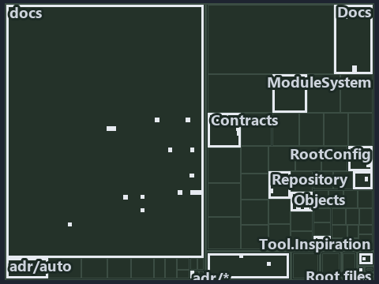

---
catzc:
  immutable:
    with_body_sha: "1b9cdd557a1f"
    repo_status: locked
    path: docs/explanation/.assets/tree/adr-auto-path--two-crossers-and-three-anchors--architecture.tree.md
    source: docs/explanation/.assets/adr-auto-path--two-crossers-and-three-anchors--architecture.drawio.png
    role: asset-description
    language: markdown
    filetype: md
    track: docs
    tracktype: documentation
---

# Two crossers anchor on two roots, and a published artifact anchors on its artifact root: the tree minimap

```text
Which files cite ADR-AUTO-PATH: every file of the world map is a tile, grouped by top-level folder.
37 files lit in 10 groups.
```



This is the tree minimap in the sidebar of the architecture diagram of [Two crossers anchor on two roots, and a published artifact anchors
on its artifact root][38], which explains [ADR-AUTO-PATH][1]. It lights every file that cites those codes, grouped by folder, so it shows
which files carry the decision. Each lit group has its reason below, naming the code that selects it.

## What the minimap shows

The tree draws every file of the world map as a tile, grouped by top-level folder (under `automation/` by module, under `docs/adr/` by ADR
domain), and lights 37 files in 10 groups, filled in ink. A lit ADR file has a white rim; a file lit only by passing mentions is a lighter
ink. Every other tile is idle, a grey box: a file the slide's ADR codes do not select.

- docs (docs/ outside docs/adr/): 24 lit files
- .claude: 2 lit files
- Contracts (automation/Catzc.Base.Contracts): 2 lit files
- adr/* (the files directly in docs/adr/): 2 lit files
- adr/auto (docs/adr/automation): 2 lit files
- Docs (automation/Catzc.Base.Docs): 1 lit file
- ModuleSystem (automation/Catzc.Base.ModuleSystem): 1 lit file
- Objects (automation/Catzc.Base.Objects): 1 lit file
- Slides (automation/Catzc.Base.Slides): 1 lit file
- pipelines: 1 lit file

## Why each group is lit

### docs (docs/ outside docs/adr/, 24 lit files)

The group holds the files of docs/ outside docs/adr/; each sits in its world-map cell and is lit by:

- [docs/references/automation/catzc-base-contracts/Get-Contract.ps1.md][2], in the cell docs × markdown: selected by [ADR-AUTO-PATH][1]: the
  file cites it at line 21 (text).
- [docs/references/automation/catzc-base-contracts/Publish-ContractRelease.ps1.md][3], in the cell docs × markdown: selected by
  [ADR-AUTO-PATH][1]: the file cites it at line 44 (text).
- [docs/references/automation/catzc-base-contracts/private/Get-ContractFileHashes.ps1.md][4], in the cell docs × markdown: selected by
  [ADR-AUTO-PATH][1]: the file cites it at line 29 (text).
- [docs/references/automation/catzc-base-contracts/tests/types/ContractAsset.Tests.ps1.md][5], in the cell docs × markdown: selected by
  [ADR-AUTO-PATH][1]: the file cites it at line 12 (text).
- [docs/references/automation/catzc-base-contracts/types/ContractAsset.cs.md][6], in the cell docs × markdown: selected by
  [ADR-AUTO-PATH][1]: the file cites it at line 17 (text) and line 18 (text).
- [docs/references/automation/catzc-base-docs/configs/readme.yml.md][7], in the cell docs × markdown: selected by [ADR-AUTO-PATH][1]: the
  file cites it at line 30 (text).
- [docs/references/automation/catzc-base-docs/types/DocMapping.cs.md][8], in the cell docs × markdown: selected by [ADR-AUTO-PATH][1]: the
  file cites it at line 13 (text).
- [docs/references/automation/catzc-base-docs/types/DocPattern.cs.md][9], in the cell docs × markdown: selected by [ADR-AUTO-PATH][1]: the
  file cites it at line 14 (text).
- [docs/references/automation/catzc-base-modulesystem/Copy-Automation.ps1.md][10], in the cell docs × markdown: selected by
  [ADR-AUTO-PATH][1]: the file cites it at line 42 (text).
- [docs/references/automation/catzc-base-objects/types/ArtifactRef.cs.md][11], in the cell docs × markdown: selected by [ADR-AUTO-PATH][1]:
  the file cites it at line 17 (text).
- [docs/references/automation/catzc-base-objects/types/RepoRelativePath.cs.md][12], in the cell docs × markdown: selected by
  [ADR-AUTO-PATH][1]: the file cites it at line 11 (text), line 16 (text), line 17 (text), line 21 (text) and line 40 (text).
- [docs/references/automation/catzc-base-repository/ConvertTo-RepoRelativePath.ps1.md][13], in the cell docs × markdown: selected by
  [ADR-AUTO-PATH][1]: the file cites it at line 15 (text) and line 23 (text).
- [docs/references/automation/catzc-base-repository/Get-RepositoryFile.ps1.md][14], in the cell docs × markdown: selected by
  [ADR-AUTO-PATH][1]: the file cites it at line 14 (text).
- [docs/references/automation/catzc-base-repository/Get-RepositoryFolder.ps1.md][15], in the cell docs × markdown: selected by
  [ADR-AUTO-PATH][1]: the file cites it at line 14 (text).
- [docs/references/automation/catzc-base-repository/Resolve-RepoPath.ps1.md][16], in the cell docs × markdown: selected by
  [ADR-AUTO-PATH][1]: the file cites it at line 15 (text).
- [docs/references/automation/catzc-base-rootconfig/configs/rootconfig.yml.md][17], in the cell docs × markdown: selected by
  [ADR-AUTO-PATH][1]: the file cites it at line 28 (text).
- [docs/references/automation/catzc-base-rootconfig/types/RootConfigFile.cs.md][18], in the cell docs × markdown: selected by
  [ADR-AUTO-PATH][1]: the file cites it at line 23 (text).
- [docs/references/automation/catzc-tooling-inspiration/configs/inspiration.yml.md][19], in the cell docs × markdown: selected by
  [ADR-AUTO-PATH][1]: the file cites it at line 24 (text).
- [docs/references/automation/catzc-tooling-inspiration/private/Resolve-InspirationRoot.ps1.md][20], in the cell docs × markdown: selected
  by [ADR-AUTO-PATH][1]: the file cites it at line 15 (text), line 16 (text) and line 19 (text).
- [docs/references/automation/catzc-tooling-inspiration/tests/Resolve-InspirationRoot.Tests.ps1.md][21], in the cell docs × markdown:
  selected by [ADR-AUTO-PATH][1]: the file cites it at line 14 (text).
- [docs/references/automation/catzc-tooling-inspiration/tests/types/InspirationConfig.Tests.ps1.md][22], in the cell docs × markdown:
  selected by [ADR-AUTO-PATH][1]: the file cites it at line 14 (text).
- [docs/references/automation/catzc-tooling-inspiration/tests/types/InspirationRoot.Tests.ps1.md][23], in the cell docs × markdown: selected
  by [ADR-AUTO-PATH][1]: the file cites it at line 13 (text).
- [docs/references/automation/catzc-tooling-inspiration/types/Inspiration.cs.md][24], in the cell docs × markdown: selected by
  [ADR-AUTO-PATH][1]: the file cites it at line 17 (text).
- [docs/references/automation/catzc-tooling-inspiration/types/InspirationRoot.cs.md][25], in the cell docs × markdown: selected by
  [ADR-AUTO-PATH][1]: the file cites it at line 12 (text), line 14 (text) and line 15 (text).

### .claude (2 lit files)

The group holds the files of .claude; each sits in its world-map cell and is lit by:

- [.claude/plans/plan-layers-vocabulary-rename-contracts.md][26], in the cell .claude × markdown: selected by [ADR-AUTO-PATH][1]: the file
  cites it at line 753 (text).
- [.claude/skills/catzc-module/SKILL.md][27], in the cell .claude × markdown: selected by [ADR-AUTO-PATH][1]: the file cites it at line 27
  (text), line 40 (text) and line 40 (text).

### Contracts (automation/Catzc.Base.Contracts, 2 lit files)

The group holds the files of automation/Catzc.Base.Contracts; each sits in its world-map cell and is lit by:

- [automation/Catzc.Base.Contracts/tests/Get-Contract.Tests.ps1][28], in the cell automation × powershell: selected by [ADR-AUTO-PATH][1]:
  the file cites it at line 27 (body comment) (a passing mention only).
- [automation/Catzc.Base.Contracts/tests/types/ContractAsset.Tests.ps1][29], in the cell automation × powershell: selected by
  [ADR-AUTO-PATH][1]: the file cites it at line 13 (text).

### adr/* (the files directly in docs/adr/, 2 lit files)

The group holds the files of the files directly in docs/adr/; each sits in its world-map cell and is lit by:

- [docs/adr/glossary.md][30], in the cell docs × markdown: selected by [ADR-AUTO-PATH][1]: the file cites it at line 752 (text).
- [docs/adr/index.md][31], in the cell docs × markdown: selected by [ADR-AUTO-PATH][1]: the file cites it at line 171 (text).

### adr/auto (docs/adr/automation, 2 lit files)

The group holds the files of docs/adr/automation; each sits in its world-map cell and is lit by:

- [docs/adr/automation/dora-explains.md][32], in the cell docs × markdown: selected by [ADR-AUTO-PATH][1]: the file cites it at line 401
  (text).
- [docs/adr/automation/path-representation.md][1], in the cell docs × markdown: selected by [ADR-AUTO-PATH][1]: the ADR's own file.

### Docs (automation/Catzc.Base.Docs, 1 lit file)

The group holds the files of automation/Catzc.Base.Docs; each sits in its world-map cell and is lit by:

- [automation/Catzc.Base.Docs/configs/adrs.yml][33], in the cell automation × yaml: selected by [ADR-AUTO-PATH][1]: the file cites it at
  line 140 (text).

### ModuleSystem (automation/Catzc.Base.ModuleSystem, 1 lit file)

The group holds the files of automation/Catzc.Base.ModuleSystem; each sits in its world-map cell and is lit by:

- [automation/Catzc.Base.ModuleSystem/configs/glossary.yml][34], in the cell automation × yaml: selected by [ADR-AUTO-PATH][1]: the file
  cites it at line 37 (text).

### Objects (automation/Catzc.Base.Objects, 1 lit file)

The group holds the files of automation/Catzc.Base.Objects; each sits in its world-map cell and is lit by:

- [automation/Catzc.Base.Objects/tests/types/ArtifactRef.Tests.ps1][35], in the cell automation × powershell: selected by
  [ADR-AUTO-PATH][1]: the file cites it at line 1 (text).

### Slides (automation/Catzc.Base.Slides, 1 lit file)

The group holds the files of automation/Catzc.Base.Slides; each sits in its world-map cell and is lit by:

- [automation/Catzc.Base.Slides/tests/types/SlidesConfig.Tests.ps1][36], in the cell automation × powershell: selected by
  [ADR-AUTO-PATH][1]: the file cites it at line 22 (text).

### pipelines (1 lit file)

The group holds the files of pipelines; each sits in its world-map cell and is lit by:

- [pipelines/ci-automation.yaml][37], in the cell pipelines × pipeline-yaml: selected by [ADR-AUTO-PATH][1]: a pipeline that cites nothing
  itself carries its globset's citations, which cite it at `automation/Catzc.Base.Contracts/tests/Get-Contract.Tests.ps1` line 27 (body
  comment), `automation/Catzc.Base.Contracts/tests/types/ContractAsset.Tests.ps1` line 13 (text),
  `automation/Catzc.Base.Docs/configs/adrs.yml` line 140 (text), `automation/Catzc.Base.ModuleSystem/configs/glossary.yml` line 37 (text),
  `automation/Catzc.Base.Objects/tests/types/ArtifactRef.Tests.ps1` line 1 (text) and
  `automation/Catzc.Base.Slides/tests/types/SlidesConfig.Tests.ps1` line 22 (text).

## Keywords

- [world map][39]
- [track][40]
- [file language][41]
- [cell][42]
- [lit cell][43]
- [.claude][44]: a track
- [automation][44]: a track
- [docs][44]: a track
- [pipelines][44]: a track
- [markdown][45]: a file language
- [pipeline-yaml][45]: a file language
- [powershell][45]: a file language
- [yaml][45]: a file language

Terms the cited ADRs define:

- [published artifact][46], defined by [ADR-AUTO-PATH#10][47]

[1]: ../../../adr/automation/path-representation.md
[2]: ../../../references/automation/catzc-base-contracts/Get-Contract.ps1.md
[3]: ../../../references/automation/catzc-base-contracts/Publish-ContractRelease.ps1.md
[4]: ../../../references/automation/catzc-base-contracts/private/Get-ContractFileHashes.ps1.md
[5]: ../../../references/automation/catzc-base-contracts/tests/types/ContractAsset.Tests.ps1.md
[6]: ../../../references/automation/catzc-base-contracts/types/ContractAsset.cs.md
[7]: ../../../references/automation/catzc-base-docs/configs/readme.yml.md
[8]: ../../../references/automation/catzc-base-docs/types/DocMapping.cs.md
[9]: ../../../references/automation/catzc-base-docs/types/DocPattern.cs.md
[10]: ../../../references/automation/catzc-base-modulesystem/Copy-Automation.ps1.md
[11]: ../../../references/automation/catzc-base-objects/types/ArtifactRef.cs.md
[12]: ../../../references/automation/catzc-base-objects/types/RepoRelativePath.cs.md
[13]: ../../../references/automation/catzc-base-repository/ConvertTo-RepoRelativePath.ps1.md
[14]: ../../../references/automation/catzc-base-repository/Get-RepositoryFile.ps1.md
[15]: ../../../references/automation/catzc-base-repository/Get-RepositoryFolder.ps1.md
[16]: ../../../references/automation/catzc-base-repository/Resolve-RepoPath.ps1.md
[17]: ../../../references/automation/catzc-base-rootconfig/configs/rootconfig.yml.md
[18]: ../../../references/automation/catzc-base-rootconfig/types/RootConfigFile.cs.md
[19]: ../../../references/automation/catzc-tooling-inspiration/configs/inspiration.yml.md
[20]: ../../../references/automation/catzc-tooling-inspiration/private/Resolve-InspirationRoot.ps1.md
[21]: ../../../references/automation/catzc-tooling-inspiration/tests/Resolve-InspirationRoot.Tests.ps1.md
[22]: ../../../references/automation/catzc-tooling-inspiration/tests/types/InspirationConfig.Tests.ps1.md
[23]: ../../../references/automation/catzc-tooling-inspiration/tests/types/InspirationRoot.Tests.ps1.md
[24]: ../../../references/automation/catzc-tooling-inspiration/types/Inspiration.cs.md
[25]: ../../../references/automation/catzc-tooling-inspiration/types/InspirationRoot.cs.md
[26]: ../../../../.claude/plans/plan-layers-vocabulary-rename-contracts.md
[27]: ../../../../.claude/skills/catzc-module/SKILL.md
[28]: ../../../../automation/Catzc.Base.Contracts/tests/Get-Contract.Tests.ps1
[29]: ../../../../automation/Catzc.Base.Contracts/tests/types/ContractAsset.Tests.ps1
[30]: ../../../adr/glossary.md
[31]: ../../../adr/index.md
[32]: ../../../adr/automation/dora-explains.md
[33]: ../../../../automation/Catzc.Base.Docs/configs/adrs.yml
[34]: ../../../../automation/Catzc.Base.ModuleSystem/configs/glossary.yml
[35]: ../../../../automation/Catzc.Base.Objects/tests/types/ArtifactRef.Tests.ps1
[36]: ../../../../automation/Catzc.Base.Slides/tests/types/SlidesConfig.Tests.ps1
[37]: ../../../../pipelines/ci-automation.yaml
[38]: ../../automation/two-crossers-and-three-anchors.md
[39]: ../../../adr/glossary.md#world-map
[40]: ../../../adr/glossary.md#track
[41]: ../../../adr/glossary.md#file-language
[42]: ../../../adr/glossary.md#cell
[43]: ../../../adr/glossary.md#lit-cell
[44]: ../../../../automation/Catzc.Base.Variants/configs/variants.yml
[45]: ../../../../automation/Catzc.Base.Languages/configs/languages.yml
[46]: ../../../adr/glossary.md#published-artifact
[47]: ../../../adr/automation/path-representation.md#rule-adr-auto-path10
