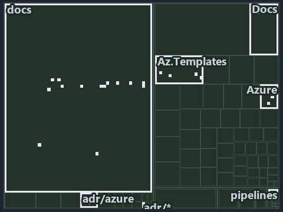

# An Azure name is a pure function of its components, and it is never truncated: the tree minimap

```text
Which files cite ADR-AZ-NAMING: every file of the world map is a tile, grouped by top-level folder.
29 files lit in 7 groups.
```



This is the tree minimap in the sidebar of the meta diagram of [An Azure name is a pure function of its components, and it is never
truncated][30], which explains [ADR-AZ-NAMING][1]. It lights every file that cites those codes, grouped by folder, so it shows which files
carry the decision. Each lit group has its reason below, naming the code that selects it.

## What the minimap shows

The tree draws every file of the world map as a tile, grouped by top-level folder (under `automation/` by module, under `docs/adr/` by ADR
domain), and lights 29 files in 7 groups, filled in ink. A lit ADR file has a white rim; a file lit only by passing mentions is a lighter
ink. Every other tile is idle, a grey box: a file the slide's ADR codes do not select.

- docs (docs/ outside docs/adr/): 14 lit files
- Az.Templates (automation/Catzc.Azure.Templates): 7 lit files
- Azure (automation/Catzc.Azure): 2 lit files
- Docs (automation/Catzc.Base.Docs): 2 lit files
- adr/azure (docs/adr/azure): 2 lit files
- adr/* (the files directly in docs/adr/): 1 lit file
- pipelines: 1 lit file

## Why each group is lit

### docs (docs/ outside docs/adr/, 14 lit files)

The group holds the files of docs/ outside docs/adr/; each sits in its world-map cell and is lit by:

- [docs/how-to/getting-started/automation/add-a-doc-chapter.md][2], in the cell docs × markdown: selected by [ADR-AZ-NAMING][1]: the file
  cites it at line 89 (text).
- [docs/references/.assets/automation/catzc-azure-templates/bicep-template-is-a-folder.drawio.verify.md][3], in the cell docs × markdown:
  selected by [ADR-AZ-NAMING][1]: the file cites it at line 17 (text) and line 65 (text).
- [docs/references/.assets/automation/catzc-azure/azure-identity-resolves-from-config.drawio.verify.md][4], in the cell docs × markdown:
  selected by [ADR-AZ-NAMING][1]: the file cites it at line 19 (text) and line 77 (text).
- [docs/references/automation/catzc-azure-templates/Get-AzureResourceName.ps1.md][5], in the cell docs × markdown: selected by
  [ADR-AZ-NAMING][1]: the file cites it at line 17 (text), line 34 (text), line 45 (text) and line 64 (text).
- [docs/references/automation/catzc-azure-templates/Get-BicepResourceName.ps1.md][6], in the cell docs × markdown: selected by
  [ADR-AZ-NAMING][1]: the file cites it at line 17 (text) and line 35 (text).
- [docs/references/automation/catzc-azure-templates/Get-BicepTemplates.ps1.md][7], in the cell docs × markdown: selected by
  [ADR-AZ-NAMING][1]: the file cites it at line 17 (text) and line 104 (text).
- [docs/references/automation/catzc-azure-templates/bicep-template-is-a-folder.drawio.md][8], in the cell docs × markdown: selected by
  [ADR-AZ-NAMING][1]: the file cites it at line 17 (text), line 52 (text) and line 118 (text).
- [docs/references/automation/catzc-azure-templates/tests/types/BicepShortName.Tests.ps1.md][9], in the cell docs × markdown: selected by
  [ADR-AZ-NAMING][1]: the file cites it at line 18 (text) and line 34 (text).
- [docs/references/automation/catzc-azure-templates/types/BicepShortName.cs.md][10], in the cell docs × markdown: selected by
  [ADR-AZ-NAMING][1]: the file cites it at line 18 (text), line 32 (text), line 52 (text) and line 84 (text).
- [docs/references/automation/catzc-azure/configs/azure.yml.md][11], in the cell docs × markdown: selected by [ADR-AZ-NAMING][1]: the file
  cites it at line 51 (text), line 96 (text) and line 129 (text).
- [docs/references/automation/catzc-azure/configs/customer.yml.md][12], in the cell docs × markdown: selected by [ADR-AZ-NAMING][1]: the
  file cites it at line 35 (text).
- [docs/references/automation/catzc-azure/types/AzureConfig.cs.md][13], in the cell docs × markdown: selected by [ADR-AZ-NAMING][1]: the
  file cites it at line 21 (text) and line 51 (text).
- [docs/references/automation/catzc-azure/types/AzureEnvironmentRecord.cs.md][14], in the cell docs × markdown: selected by
  [ADR-AZ-NAMING][1]: the file cites it at line 31 (text).
- [docs/references/automation/catzc-base-variants/configs/variants.yml.md][15], in the cell docs × markdown: selected by [ADR-AZ-NAMING][1]:
  the file cites it at line 42 (text).

### Az.Templates (automation/Catzc.Azure.Templates, 7 lit files)

The group holds the files of automation/Catzc.Azure.Templates; each sits in its world-map cell and is lit by:

- [automation/Catzc.Azure.Templates/Get-AzureResourceName.ps1][16], in the cell automation × powershell: selected by [ADR-AZ-NAMING][1]: the
  file cites it at line 21 (header).
- [automation/Catzc.Azure.Templates/Get-AzureResourceTypeSet.ps1][17], in the cell automation × powershell: selected by [ADR-AZ-NAMING][1]:
  the file cites it at line 20 (header), line 37 (header) and line 40 (header).
- [automation/Catzc.Azure.Templates/Get-BicepResourceName.ps1][18], in the cell automation × powershell: selected by [ADR-AZ-NAMING][1]: the
  file cites it at line 21 (header).
- [automation/Catzc.Azure.Templates/Get-BicepTemplates.ps1][19], in the cell automation × powershell: selected by [ADR-AZ-NAMING][1]: the
  file cites it at line 24 (header).
- [automation/Catzc.Azure.Templates/tests/Build-Bicep.Integrity.Tests.ps1][20], in the cell automation × powershell: selected by
  [ADR-AZ-NAMING][1]: the file cites it at line 21 (header) and line 70 (text).
- [automation/Catzc.Azure.Templates/tests/types/BicepShortName.Tests.ps1][21], in the cell automation × powershell: selected by
  [ADR-AZ-NAMING][1]: the file cites it at line 21 (header).
- [automation/Catzc.Azure.Templates/types/BicepShortName.cs][22], in the cell automation × csharp: selected by [ADR-AZ-NAMING][1]: the file
  cites it at line 22 (text).

### Azure (automation/Catzc.Azure, 2 lit files)

The group holds the files of automation/Catzc.Azure; each sits in its world-map cell and is lit by:

- [automation/Catzc.Azure/types/AzureConfig.cs][23], in the cell automation × csharp: selected by [ADR-AZ-NAMING][1]: the file cites it at
  line 25 (text).
- [automation/Catzc.Azure/types/AzureEnvironmentRecord.cs][24], in the cell automation × csharp: selected by [ADR-AZ-NAMING][1]: the file
  cites it at line 22 (text).

### Docs (automation/Catzc.Base.Docs, 2 lit files)

The group holds the files of automation/Catzc.Base.Docs; each sits in its world-map cell and is lit by:

- [automation/Catzc.Base.Docs/Build-AdrIndex.ps1][25], in the cell automation × powershell: selected by [ADR-AZ-NAMING][1]: the file cites
  it at line 25 (header) and line 102 (body comment).
- [automation/Catzc.Base.Docs/configs/adrs.yml][26], in the cell automation × yaml: selected by [ADR-AZ-NAMING][1]: the file cites it at
  line 276 (text).

### adr/azure (docs/adr/azure, 2 lit files)

The group holds the files of docs/adr/azure; each sits in its world-map cell and is lit by:

- [docs/adr/azure/azure-naming-standard.md][1], in the cell docs × markdown: selected by [ADR-AZ-NAMING][1]: the ADR's own file.
- [docs/adr/azure/dora-explains.md][27], in the cell docs × markdown: selected by [ADR-AZ-NAMING][1]: the file cites it at line 74 (text).

### adr/* (the files directly in docs/adr/, 1 lit file)

The group holds the files of the files directly in docs/adr/; each sits in its world-map cell and is lit by:

- [docs/adr/index.md][28], in the cell docs × markdown: selected by [ADR-AZ-NAMING][1]: the file cites it at line 31 (text) and line 282
  (text).

### pipelines (1 lit file)

The group holds the files of pipelines; each sits in its world-map cell and is lit by:

- [pipelines/ci-automation.yaml][29], in the cell pipelines × pipeline-yaml: selected by [ADR-AZ-NAMING][1]: a pipeline that cites nothing
  itself carries its globset's citations, which cite it at `automation/Catzc.Azure.Templates/Get-AzureResourceName.ps1` line 21 (header),
  `automation/Catzc.Azure.Templates/Get-AzureResourceTypeSet.ps1` line 20 (header),
  `automation/Catzc.Azure.Templates/Get-AzureResourceTypeSet.ps1` line 37 (header),
  `automation/Catzc.Azure.Templates/Get-AzureResourceTypeSet.ps1` line 40 (header),
  `automation/Catzc.Azure.Templates/Get-BicepResourceName.ps1` line 21 (header), `automation/Catzc.Azure.Templates/Get-BicepTemplates.ps1`
  line 24 (header), `automation/Catzc.Azure.Templates/tests/Build-Bicep.Integrity.Tests.ps1` line 21 (header),
  `automation/Catzc.Azure.Templates/tests/Build-Bicep.Integrity.Tests.ps1` line 70 (text),
  `automation/Catzc.Azure.Templates/tests/types/BicepShortName.Tests.ps1` line 21 (header),
  `automation/Catzc.Azure.Templates/types/BicepShortName.cs` line 22 (text), `automation/Catzc.Azure/types/AzureConfig.cs` line 25 (text),
  `automation/Catzc.Azure/types/AzureEnvironmentRecord.cs` line 22 (text), `automation/Catzc.Base.Docs/Build-AdrIndex.ps1` line 25 (header),
  `automation/Catzc.Base.Docs/Build-AdrIndex.ps1` line 102 (body comment) and `automation/Catzc.Base.Docs/configs/adrs.yml` line 276 (text).

## Keywords

- [world map][31]
- [track][32]
- [file language][33]
- [cell][34]
- [lit cell][35]
- [automation][36]: a track
- [docs][36]: a track
- [pipelines][36]: a track
- [csharp][37]: a file language
- [markdown][37]: a file language
- [pipeline-yaml][37]: a file language
- [powershell][37]: a file language
- [yaml][37]: a file language

[1]: ../../../adr/azure/azure-naming-standard.md
[2]: ../../../how-to/getting-started/automation/add-a-doc-chapter.md
[3]: ../../../references/.assets/automation/catzc-azure-templates/bicep-template-is-a-folder.drawio.verify.md
[4]: ../../../references/.assets/automation/catzc-azure/azure-identity-resolves-from-config.drawio.verify.md
[5]: ../../../references/automation/catzc-azure-templates/Get-AzureResourceName.ps1.md
[6]: ../../../references/automation/catzc-azure-templates/Get-BicepResourceName.ps1.md
[7]: ../../../references/automation/catzc-azure-templates/Get-BicepTemplates.ps1.md
[8]: ../../../references/automation/catzc-azure-templates/bicep-template-is-a-folder.drawio.md
[9]: ../../../references/automation/catzc-azure-templates/tests/types/BicepShortName.Tests.ps1.md
[10]: ../../../references/automation/catzc-azure-templates/types/BicepShortName.cs.md
[11]: ../../../references/automation/catzc-azure/configs/azure.yml.md
[12]: ../../../references/automation/catzc-azure/configs/customer.yml.md
[13]: ../../../references/automation/catzc-azure/types/AzureConfig.cs.md
[14]: ../../../references/automation/catzc-azure/types/AzureEnvironmentRecord.cs.md
[15]: ../../../references/automation/catzc-base-variants/configs/variants.yml.md
[16]: ../../../../automation/Catzc.Azure.Templates/Get-AzureResourceName.ps1
[17]: ../../../../automation/Catzc.Azure.Templates/Get-AzureResourceTypeSet.ps1
[18]: ../../../../automation/Catzc.Azure.Templates/Get-BicepResourceName.ps1
[19]: ../../../../automation/Catzc.Azure.Templates/Get-BicepTemplates.ps1
[20]: ../../../../automation/Catzc.Azure.Templates/tests/Build-Bicep.Integrity.Tests.ps1
[21]: ../../../../automation/Catzc.Azure.Templates/tests/types/BicepShortName.Tests.ps1
[22]: ../../../../automation/Catzc.Azure.Templates/types/BicepShortName.cs
[23]: ../../../../automation/Catzc.Azure/types/AzureConfig.cs
[24]: ../../../../automation/Catzc.Azure/types/AzureEnvironmentRecord.cs
[25]: ../../../../automation/Catzc.Base.Docs/Build-AdrIndex.ps1
[26]: ../../../../automation/Catzc.Base.Docs/configs/adrs.yml
[27]: ../../../adr/azure/dora-explains.md
[28]: ../../../adr/index.md
[29]: ../../../../pipelines/ci-automation.yaml
[30]: ../../azure/names-are-pure-and-never-truncated.md
[31]: ../../../adr/glossary.md#world-map
[32]: ../../../adr/glossary.md#track
[33]: ../../../adr/glossary.md#file-language
[34]: ../../../adr/glossary.md#cell
[35]: ../../../adr/glossary.md#lit-cell
[36]: ../../../../automation/Catzc.Base.Variants/configs/variants.yml
[37]: ../../../../automation/Catzc.Base.Languages/configs/languages.yml
