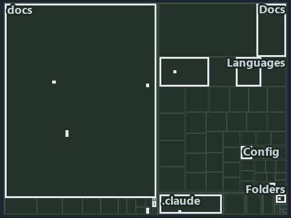

# Strip, split, read once, walk one segment at a time; every wrong turn throws: the tree minimap

```text
Which files cite ADR-CONF-ADDRESSING: every file of the world map is a tile, grouped by top-level folder.
18 files lit in 10 groups.
```



This is the tree minimap in the sidebar of the implementation diagram of [Strip, split, read once, walk one segment at a time; every wrong
turn throws][19], which explains [ADR-CONF-ADDRESSING][1]. It lights every file that cites those codes, grouped by folder, so it shows which
files carry the decision. Each lit group has its reason below, naming the code that selects it.

## What the minimap shows

The tree draws every file of the world map as a tile, grouped by top-level folder (under `automation/` by module, under `docs/adr/` by ADR
domain), and lights 18 files in 10 groups, filled in ink. A lit ADR file has a white rim; a file lit only by passing mentions is a lighter
ink. Every other tile is idle, a grey box: a file the slide's ADR codes do not select.

- docs (docs/ outside docs/adr/): 4 lit files
- Config (automation/Catzc.Base.Config): 3 lit files
- .claude: 2 lit files
- Languages (automation/Catzc.Base.Languages): 2 lit files
- adr/conf (docs/adr/configuration): 2 lit files
- Az.Templates (automation/Catzc.Azure.Templates): 1 lit file
- Docs (automation/Catzc.Base.Docs): 1 lit file
- Folders (automation/Catzc.Base.Folders): 1 lit file
- adr/* (the files directly in docs/adr/): 1 lit file
- pipelines: 1 lit file

## Why each group is lit

### docs (docs/ outside docs/adr/, 4 lit files)

The group holds the files of docs/ outside docs/adr/; each sits in its world-map cell and is lit by:

- [docs/references/.assets/automation/catzc-azure-templates/bicep-template-is-a-folder.drawio.verify.md][2], in the cell docs × markdown:
  selected by [ADR-CONF-ADDRESSING][1]: the file cites it at line 18 (text) and line 67 (text).
- [docs/references/automation/catzc-azure-templates/bicep-template-is-a-folder.drawio.md][3], in the cell docs × markdown: selected by
  [ADR-CONF-ADDRESSING][1]: the file cites it at line 18 (text), line 56 (text) and line 119 (text).
- [docs/references/automation/catzc-base-languages/New-GoWorkspace.ps1.md][4], in the cell docs × markdown: selected by
  [ADR-CONF-ADDRESSING][1]: the file cites it at line 28 (text).
- [docs/references/automation/catzc-base-languages/New-PythonProject.ps1.md][5], in the cell docs × markdown: selected by
  [ADR-CONF-ADDRESSING][1]: the file cites it at line 28 (text).

### Config (automation/Catzc.Base.Config, 3 lit files)

The group holds the files of automation/Catzc.Base.Config; each sits in its world-map cell and is lit by:

- [automation/Catzc.Base.Config/Get-ConfigValue.ps1][6], in the cell automation × powershell: selected by [ADR-CONF-ADDRESSING][1]: the file
  cites it at line 21 (header), line 38 (header), line 41 (header) and line 44 (header).
- [automation/Catzc.Base.Config/private/Resolve-ConfigKeyPath.ps1][7], in the cell automation × powershell: selected by
  [ADR-CONF-ADDRESSING][1]: the file cites it at line 20 (header), line 30 (header), line 32 (header) and line 37 (header).
- [automation/Catzc.Base.Config/tests/Get-ConfigValue.Tests.ps1][8], in the cell automation × powershell: selected by
  [ADR-CONF-ADDRESSING][1]: the file cites it at line 21 (header), line 62 (text) and line 91 (text).

### .claude (2 lit files)

The group holds the files of .claude; each sits in its world-map cell and is lit by:

- [.claude/plans/plan-bounded-folder-enumeration.md][9], in the cell .claude × markdown: selected by [ADR-CONF-ADDRESSING][1]: the file
  cites it at line 28 (text) and line 305 (text).
- [.claude/plans/prompt-bounded-folder-enumeration-continue.md][10], in the cell .claude × markdown: selected by [ADR-CONF-ADDRESSING][1]:
  the file cites it at line 19 (text) and line 40 (text).

### Languages (automation/Catzc.Base.Languages, 2 lit files)

The group holds the files of automation/Catzc.Base.Languages; each sits in its world-map cell and is lit by:

- [automation/Catzc.Base.Languages/New-GoWorkspace.ps1][11], in the cell automation × powershell: selected by [ADR-CONF-ADDRESSING][1]: the
  file cites it at line 22 (header).
- [automation/Catzc.Base.Languages/New-PythonProject.ps1][12], in the cell automation × powershell: selected by [ADR-CONF-ADDRESSING][1]:
  the file cites it at line 23 (header).

### adr/conf (docs/adr/configuration, 2 lit files)

The group holds the files of docs/adr/configuration; each sits in its world-map cell and is lit by:

- [docs/adr/configuration/config-value-addressing.md][1], in the cell docs × markdown: selected by [ADR-CONF-ADDRESSING][1]: the ADR's own
  file.
- [docs/adr/configuration/dora-explains.md][13], in the cell docs × markdown: selected by [ADR-CONF-ADDRESSING][1]: the file cites it at
  line 52 (text).

### Az.Templates (automation/Catzc.Azure.Templates, 1 lit file)

The group holds the files of automation/Catzc.Azure.Templates; each sits in its world-map cell and is lit by:

- [automation/Catzc.Azure.Templates/private/Resolve-BicepParameterAddresses.ps1][14], in the cell automation × powershell: selected by
  [ADR-CONF-ADDRESSING][1]: the file cites it at line 22 (header), line 30 (header) and line 35 (header).

### Docs (automation/Catzc.Base.Docs, 1 lit file)

The group holds the files of automation/Catzc.Base.Docs; each sits in its world-map cell and is lit by:

- [automation/Catzc.Base.Docs/configs/adrs.yml][15], in the cell automation × yaml: selected by [ADR-CONF-ADDRESSING][1]: the file cites it
  at line 228 (text).

### Folders (automation/Catzc.Base.Folders, 1 lit file)

The group holds the files of automation/Catzc.Base.Folders; each sits in its world-map cell and is lit by:

- [automation/Catzc.Base.Folders/tests/types/FolderWalkConfig.Tests.ps1][16], in the cell automation × powershell: selected by
  [ADR-CONF-ADDRESSING][1]: the file cites it at line 21 (header) and line 78 (text).

### adr/* (the files directly in docs/adr/, 1 lit file)

The group holds the files of the files directly in docs/adr/; each sits in its world-map cell and is lit by:

- [docs/adr/index.md][17], in the cell docs × markdown: selected by [ADR-CONF-ADDRESSING][1]: the file cites it at line 237 (text).

### pipelines (1 lit file)

The group holds the files of pipelines; each sits in its world-map cell and is lit by:

- [pipelines/ci-automation.yaml][18], in the cell pipelines × pipeline-yaml: selected by [ADR-CONF-ADDRESSING][1]: a pipeline that cites
  nothing itself carries its globset's citations, which cite it at
  `automation/Catzc.Azure.Templates/private/Resolve-BicepParameterAddresses.ps1` line 22 (header),
  `automation/Catzc.Azure.Templates/private/Resolve-BicepParameterAddresses.ps1` line 30 (header),
  `automation/Catzc.Azure.Templates/private/Resolve-BicepParameterAddresses.ps1` line 35 (header),
  `automation/Catzc.Base.Config/Get-ConfigValue.ps1` line 21 (header), `automation/Catzc.Base.Config/Get-ConfigValue.ps1` line 38 (header),
  `automation/Catzc.Base.Config/Get-ConfigValue.ps1` line 41 (header), `automation/Catzc.Base.Config/Get-ConfigValue.ps1` line 44 (header),
  `automation/Catzc.Base.Config/private/Resolve-ConfigKeyPath.ps1` line 20 (header),
  `automation/Catzc.Base.Config/private/Resolve-ConfigKeyPath.ps1` line 30 (header),
  `automation/Catzc.Base.Config/private/Resolve-ConfigKeyPath.ps1` line 32 (header),
  `automation/Catzc.Base.Config/private/Resolve-ConfigKeyPath.ps1` line 37 (header),
  `automation/Catzc.Base.Config/tests/Get-ConfigValue.Tests.ps1` line 21 (header),
  `automation/Catzc.Base.Config/tests/Get-ConfigValue.Tests.ps1` line 62 (text),
  `automation/Catzc.Base.Config/tests/Get-ConfigValue.Tests.ps1` line 91 (text), `automation/Catzc.Base.Docs/configs/adrs.yml` line 228
  (text), `automation/Catzc.Base.Folders/tests/types/FolderWalkConfig.Tests.ps1` line 21 (header),
  `automation/Catzc.Base.Folders/tests/types/FolderWalkConfig.Tests.ps1` line 78 (text),
  `automation/Catzc.Base.Languages/New-GoWorkspace.ps1` line 22 (header) and `automation/Catzc.Base.Languages/New-PythonProject.ps1` line 23
  (header).

## Keywords

- [world map][20]
- [track][21]
- [file language][22]
- [cell][23]
- [lit cell][24]
- [.claude][25]: a track
- [automation][25]: a track
- [docs][25]: a track
- [pipelines][25]: a track
- [markdown][26]: a file language
- [pipeline-yaml][26]: a file language
- [powershell][26]: a file language
- [yaml][26]: a file language

[1]: ../../../adr/configuration/config-value-addressing.md
[2]: ../../../references/.assets/automation/catzc-azure-templates/bicep-template-is-a-folder.drawio.verify.md
[3]: ../../../references/automation/catzc-azure-templates/bicep-template-is-a-folder.drawio.md
[4]: ../../../references/automation/catzc-base-languages/New-GoWorkspace.ps1.md
[5]: ../../../references/automation/catzc-base-languages/New-PythonProject.ps1.md
[6]: ../../../../automation/Catzc.Base.Config/Get-ConfigValue.ps1
[7]: ../../../../automation/Catzc.Base.Config/private/Resolve-ConfigKeyPath.ps1
[8]: ../../../../automation/Catzc.Base.Config/tests/Get-ConfigValue.Tests.ps1
[9]: ../../../../.claude/plans/plan-bounded-folder-enumeration.md
[10]: ../../../../.claude/plans/prompt-bounded-folder-enumeration-continue.md
[11]: ../../../../automation/Catzc.Base.Languages/New-GoWorkspace.ps1
[12]: ../../../../automation/Catzc.Base.Languages/New-PythonProject.ps1
[13]: ../../../adr/configuration/dora-explains.md
[14]: ../../../../automation/Catzc.Azure.Templates/private/Resolve-BicepParameterAddresses.ps1
[15]: ../../../../automation/Catzc.Base.Docs/configs/adrs.yml
[16]: ../../../../automation/Catzc.Base.Folders/tests/types/FolderWalkConfig.Tests.ps1
[17]: ../../../adr/index.md
[18]: ../../../../pipelines/ci-automation.yaml
[19]: ../../configuration/strip-split-walk-every-wrong-turn-throws.md
[20]: ../../../adr/glossary.md#world-map
[21]: ../../../adr/glossary.md#track
[22]: ../../../adr/glossary.md#file-language
[23]: ../../../adr/glossary.md#cell
[24]: ../../../adr/glossary.md#lit-cell
[25]: ../../../../automation/Catzc.Base.Variants/configs/variants.yml
[26]: ../../../../automation/Catzc.Base.Languages/configs/languages.yml
