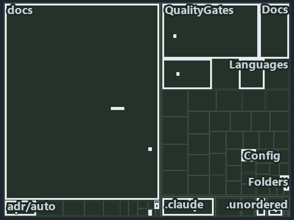

# docs/explanation/.assets/tree/adr-conf-addressing--type-an-address-get-the-value--operations.tree.md

`Tree minimap: adr-conf-addressing--type-an-address-get-the-value--operations`

The tree minimap of the slide `adr-conf-addressing--type-an-address-get-the-value--operations` (operations lens). The slide supports
[ADR-AUTO-ENVVAR][1] and [ADR-CONF-ADDRESSING][2]; the highlight of those ADR codes selects what is lit, and each reason below names the
code that selects it.

## What the minimap shows

The tree draws every file of the world map as a tile, grouped by top-level folder (under `automation/` by module, under `docs/adr/` by ADR
domain), and lights 27 files in 14 groups, filled in ink. A lit ADR file has a white rim; a file lit only by passing mentions is a lighter
ink. Every other tile is idle, a grey box: a file the slide's ADR codes do not select.

- docs (docs/ outside docs/adr/): 5 lit files
- Languages (automation/Catzc.Base.Languages): 4 lit files
- .claude: 3 lit files
- Config (automation/Catzc.Base.Config): 3 lit files
- adr/auto (docs/adr/automation): 2 lit files
- adr/conf (docs/adr/configuration): 2 lit files
- .unordered: 1 lit file
- Az.Templates (automation/Catzc.Azure.Templates): 1 lit file
- Docs (automation/Catzc.Base.Docs): 1 lit file
- Folders (automation/Catzc.Base.Folders): 1 lit file
- QualityGates (automation/Catzc.Base.QualityGates): 1 lit file
- Tool.Environment (automation/Catzc.Tooling.Environment): 1 lit file
- adr/* (the files directly in docs/adr/): 1 lit file
- pipelines: 1 lit file

## Why each group is lit

### docs (docs/ outside docs/adr/, 5 lit files)

The group holds the files of docs/ outside docs/adr/; each sits in its world-map cell and is lit by:

- [docs/references/automation/catzc-base-languages/Invoke-GoTest.ps1.md][3], in the cell docs × markdown: selected by [ADR-AUTO-ENVVAR][1]:
  the file cites it at line 17 (text) and line 41 (text).
- [docs/references/automation/catzc-base-languages/Invoke-PythonTest.ps1.md][4], in the cell docs × markdown: selected by
  [ADR-AUTO-ENVVAR][1]: the file cites it at line 17 (text) and line 50 (text).
- [docs/references/automation/catzc-base-languages/New-GoWorkspace.ps1.md][5], in the cell docs × markdown: selected by
  [ADR-CONF-ADDRESSING][2]: the file cites it at line 28 (text).
- [docs/references/automation/catzc-base-languages/New-PythonProject.ps1.md][6], in the cell docs × markdown: selected by
  [ADR-CONF-ADDRESSING][2]: the file cites it at line 28 (text).
- [docs/references/automation/catzc-tooling-environment.md][7], in the cell docs × markdown: selected by [ADR-AUTO-ENVVAR][1]: the file
  cites it at line 16 (text), line 28 (text), line 54 (text), line 55 (text) and line 55 (text).

### Languages (automation/Catzc.Base.Languages, 4 lit files)

The group holds the files of automation/Catzc.Base.Languages; each sits in its world-map cell and is lit by:

- [automation/Catzc.Base.Languages/Invoke-GoTest.ps1][8], in the cell automation × powershell: selected by [ADR-AUTO-ENVVAR][1]: the file
  cites it at line 22 (header).
- [automation/Catzc.Base.Languages/Invoke-PythonTest.ps1][9], in the cell automation × powershell: selected by [ADR-AUTO-ENVVAR][1]: the
  file cites it at line 22 (header).
- [automation/Catzc.Base.Languages/New-GoWorkspace.ps1][10], in the cell automation × powershell: selected by [ADR-CONF-ADDRESSING][2]: the
  file cites it at line 22 (header).
- [automation/Catzc.Base.Languages/New-PythonProject.ps1][11], in the cell automation × powershell: selected by [ADR-CONF-ADDRESSING][2]:
  the file cites it at line 23 (header).

### .claude (3 lit files)

The group holds the files of .claude; each sits in its world-map cell and is lit by:

- [.claude/plans/plan-bounded-folder-enumeration.md][12], in the cell .claude × markdown: selected by [ADR-CONF-ADDRESSING][2]: the file
  cites it at line 29 (text) and line 304 (text).
- [.claude/plans/plan-layers-vocabulary-rename-contracts.md][13], in the cell .claude × markdown: selected by [ADR-AUTO-ENVVAR][1]: the file
  cites it at line 504 (text), line 526 (text) and line 734 (text).
- [.claude/plans/prompt-bounded-folder-enumeration-continue.md][14], in the cell .claude × markdown: selected by [ADR-CONF-ADDRESSING][2]:
  the file cites it at line 20 (text) and line 41 (text).

### Config (automation/Catzc.Base.Config, 3 lit files)

The group holds the files of automation/Catzc.Base.Config; each sits in its world-map cell and is lit by:

- [automation/Catzc.Base.Config/Get-ConfigValue.ps1][15], in the cell automation × powershell: selected by [ADR-AUTO-ENVVAR][1]: the file
  cites it at line 20 (header) and line 46 (header); selected by [ADR-CONF-ADDRESSING][2]: the file cites it at line 21 (header), line 38
  (header), line 41 (header) and line 44 (header).
- [automation/Catzc.Base.Config/private/Resolve-ConfigKeyPath.ps1][16], in the cell automation × powershell: selected by
  [ADR-CONF-ADDRESSING][2]: the file cites it at line 20 (header), line 30 (header), line 32 (header) and line 37 (header).
- [automation/Catzc.Base.Config/tests/Get-ConfigValue.Tests.ps1][17], in the cell automation × powershell: selected by
  [ADR-CONF-ADDRESSING][2]: the file cites it at line 21 (header), line 62 (text) and line 91 (text).

### adr/auto (docs/adr/automation, 2 lit files)

The group holds the files of docs/adr/automation; each sits in its world-map cell and is lit by:

- [docs/adr/automation/dora-explains.md][18], in the cell docs × markdown: selected by [ADR-AUTO-ENVVAR][1]: the file cites it at line 433
  (text).
- [docs/adr/automation/environment-variables.md][1], in the cell docs × markdown: selected by [ADR-AUTO-ENVVAR][1]: the ADR's own file.

### adr/conf (docs/adr/configuration, 2 lit files)

The group holds the files of docs/adr/configuration; each sits in its world-map cell and is lit by:

- [docs/adr/configuration/config-value-addressing.md][2], in the cell docs × markdown: selected by [ADR-CONF-ADDRESSING][2]: the ADR's own
  file.
- [docs/adr/configuration/dora-explains.md][19], in the cell docs × markdown: selected by [ADR-CONF-ADDRESSING][2]: the file cites it at
  line 53 (text).

### .unordered (1 lit file)

The group holds the files of .unordered; each sits in its world-map cell and is lit by:

- [.unordered/15-10-2026/plan-diagram-wave-8.md][20], in the cell .unordered × markdown: selected by [ADR-CONF-ADDRESSING][2]: the file
  cites it at line 19 (text).

### Az.Templates (automation/Catzc.Azure.Templates, 1 lit file)

The group holds the files of automation/Catzc.Azure.Templates; each sits in its world-map cell and is lit by:

- [automation/Catzc.Azure.Templates/private/Resolve-BicepParameterAddresses.ps1][21], in the cell automation × powershell: selected by
  [ADR-CONF-ADDRESSING][2]: the file cites it at line 22 (header), line 30 (header) and line 35 (header).

### Docs (automation/Catzc.Base.Docs, 1 lit file)

The group holds the files of automation/Catzc.Base.Docs; each sits in its world-map cell and is lit by:

- [automation/Catzc.Base.Docs/configs/adrs.yml][22], in the cell automation × yaml: selected by [ADR-AUTO-ENVVAR][1]: the file cites it at
  line 155 (text); selected by [ADR-CONF-ADDRESSING][2]: the file cites it at line 223 (text).

### Folders (automation/Catzc.Base.Folders, 1 lit file)

The group holds the files of automation/Catzc.Base.Folders; each sits in its world-map cell and is lit by:

- [automation/Catzc.Base.Folders/tests/types/FolderWalkConfig.Tests.ps1][23], in the cell automation × powershell: selected by
  [ADR-CONF-ADDRESSING][2]: the file cites it at line 21 (header) and line 78 (text).

### QualityGates (automation/Catzc.Base.QualityGates, 1 lit file)

The group holds the files of automation/Catzc.Base.QualityGates; each sits in its world-map cell and is lit by:

- [automation/Catzc.Base.QualityGates/configs/terminology.yml][24], in the cell automation × yaml: selected by [ADR-AUTO-ENVVAR][1]: the
  file cites it at line 605 (text).

### Tool.Environment (automation/Catzc.Tooling.Environment, 1 lit file)

The group holds the files of automation/Catzc.Tooling.Environment; each sits in its world-map cell and is lit by:

- [automation/Catzc.Tooling.Environment/Write-EnvironmentSet.ps1][25], in the cell automation × powershell: selected by
  [ADR-AUTO-ENVVAR][1]: the file cites it at line 21 (header) and line 52 (header).

### adr/* (the files directly in docs/adr/, 1 lit file)

The group holds the files of the files directly in docs/adr/; each sits in its world-map cell and is lit by:

- [docs/adr/index.md][26], in the cell docs × markdown: selected by [ADR-AUTO-ENVVAR][1]: the file cites it at line 166 (text); selected by
  [ADR-CONF-ADDRESSING][2]: the file cites it at line 231 (text).

### pipelines (1 lit file)

The group holds the files of pipelines; each sits in its world-map cell and is lit by:

- [pipelines/ci-automation.yaml][27], in the cell pipelines × pipeline-yaml: selected by [ADR-AUTO-ENVVAR][1]: a pipeline that cites nothing
  itself carries its globset's citations, which cite it at `automation/Catzc.Base.Config/Get-ConfigValue.ps1` line 20 (header),
  `automation/Catzc.Base.Config/Get-ConfigValue.ps1` line 46 (header), `automation/Catzc.Base.Docs/configs/adrs.yml` line 155 (text),
  `automation/Catzc.Base.Languages/Invoke-GoTest.ps1` line 22 (header), `automation/Catzc.Base.Languages/Invoke-PythonTest.ps1` line 22
  (header), `automation/Catzc.Base.QualityGates/configs/terminology.yml` line 605 (text),
  `automation/Catzc.Tooling.Environment/Write-EnvironmentSet.ps1` line 21 (header) and
  `automation/Catzc.Tooling.Environment/Write-EnvironmentSet.ps1` line 52 (header); selected by [ADR-CONF-ADDRESSING][2]: a pipeline that
  cites nothing itself carries its globset's citations, which cite it at
  `automation/Catzc.Azure.Templates/private/Resolve-BicepParameterAddresses.ps1` line 22 (header),
  `automation/Catzc.Azure.Templates/private/Resolve-BicepParameterAddresses.ps1` line 30 (header),
  `automation/Catzc.Azure.Templates/private/Resolve-BicepParameterAddresses.ps1` line 35 (header),
  `automation/Catzc.Base.Config/Get-ConfigValue.ps1` line 21 (header), `automation/Catzc.Base.Config/Get-ConfigValue.ps1` line 38 (header),
  `automation/Catzc.Base.Config/Get-ConfigValue.ps1` line 41 (header), `automation/Catzc.Base.Config/Get-ConfigValue.ps1` line 44 (header),
  `automation/Catzc.Base.Config/private/Resolve-ConfigKeyPath.ps1` line 20 (header),
  `automation/Catzc.Base.Config/private/Resolve-ConfigKeyPath.ps1` line 30 (header),
  `automation/Catzc.Base.Config/private/Resolve-ConfigKeyPath.ps1` line 32 (header),
  `automation/Catzc.Base.Config/private/Resolve-ConfigKeyPath.ps1` line 37 (header),
  `automation/Catzc.Base.Config/tests/Get-ConfigValue.Tests.ps1` line 21 (header),
  `automation/Catzc.Base.Config/tests/Get-ConfigValue.Tests.ps1` line 62 (text),
  `automation/Catzc.Base.Config/tests/Get-ConfigValue.Tests.ps1` line 91 (text), `automation/Catzc.Base.Docs/configs/adrs.yml` line 223
  (text), `automation/Catzc.Base.Folders/tests/types/FolderWalkConfig.Tests.ps1` line 21 (header),
  `automation/Catzc.Base.Folders/tests/types/FolderWalkConfig.Tests.ps1` line 78 (text),
  `automation/Catzc.Base.Languages/New-GoWorkspace.ps1` line 22 (header) and `automation/Catzc.Base.Languages/New-PythonProject.ps1` line 23
  (header).

## Keywords

- [world map][28]
- [track][29]
- [file language][30]
- [cell][31]
- [lit cell][32]
- [.claude][33]: a track
- [.unordered][33]: a track
- [automation][33]: a track
- [docs][33]: a track
- [pipelines][33]: a track
- [markdown][34]: a file language
- [pipeline-yaml][34]: a file language
- [powershell][34]: a file language
- [yaml][34]: a file language

[1]: ../../../adr/automation/environment-variables.md
[2]: ../../../adr/configuration/config-value-addressing.md
[3]: ../../../references/automation/catzc-base-languages/Invoke-GoTest.ps1.md
[4]: ../../../references/automation/catzc-base-languages/Invoke-PythonTest.ps1.md
[5]: ../../../references/automation/catzc-base-languages/New-GoWorkspace.ps1.md
[6]: ../../../references/automation/catzc-base-languages/New-PythonProject.ps1.md
[7]: ../../../references/automation/catzc-tooling-environment.md
[8]: ../../../../automation/Catzc.Base.Languages/Invoke-GoTest.ps1
[9]: ../../../../automation/Catzc.Base.Languages/Invoke-PythonTest.ps1
[10]: ../../../../automation/Catzc.Base.Languages/New-GoWorkspace.ps1
[11]: ../../../../automation/Catzc.Base.Languages/New-PythonProject.ps1
[12]: ../../../../.claude/plans/plan-bounded-folder-enumeration.md
[13]: ../../../../.claude/plans/plan-layers-vocabulary-rename-contracts.md
[14]: ../../../../.claude/plans/prompt-bounded-folder-enumeration-continue.md
[15]: ../../../../automation/Catzc.Base.Config/Get-ConfigValue.ps1
[16]: ../../../../automation/Catzc.Base.Config/private/Resolve-ConfigKeyPath.ps1
[17]: ../../../../automation/Catzc.Base.Config/tests/Get-ConfigValue.Tests.ps1
[18]: ../../../adr/automation/dora-explains.md
[19]: ../../../adr/configuration/dora-explains.md
[20]: ../../../../.unordered/15-10-2026/plan-diagram-wave-8.md
[21]: ../../../../automation/Catzc.Azure.Templates/private/Resolve-BicepParameterAddresses.ps1
[22]: ../../../../automation/Catzc.Base.Docs/configs/adrs.yml
[23]: ../../../../automation/Catzc.Base.Folders/tests/types/FolderWalkConfig.Tests.ps1
[24]: ../../../../automation/Catzc.Base.QualityGates/configs/terminology.yml
[25]: ../../../../automation/Catzc.Tooling.Environment/Write-EnvironmentSet.ps1
[26]: ../../../adr/index.md
[27]: ../../../../pipelines/ci-automation.yaml
[28]: ../../../adr/glossary.md#world-map
[29]: ../../../adr/glossary.md#track
[30]: ../../../adr/glossary.md#file-language
[31]: ../../../adr/glossary.md#cell
[32]: ../../../adr/glossary.md#lit-cell
[33]: ../../../../automation/Catzc.Base.Variants/configs/variants.yml
[34]: ../../../../automation/Catzc.Base.Languages/configs/languages.yml
