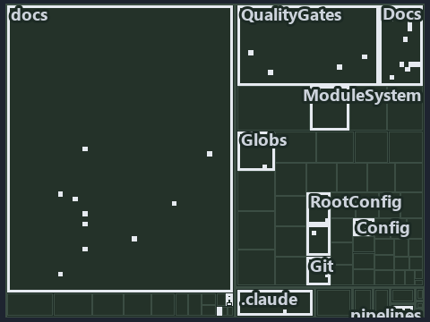

---
catzc:
  immutable:
    with_body_sha: "0bd06a2ca9c1"
    repo_status: locked
    path: docs/explanation/.assets/tree/adr-conf-loading--one-reader-one-cache-per-session--meta.tree.md
    source: docs/explanation/.assets/adr-conf-loading--one-reader-one-cache-per-session--meta.drawio.png
    role: asset-description
    language: markdown
    filetype: md
    track: docs
    tracktype: documentation
---

# Every config read goes through one reader and one session cache: the tree minimap

```text
Which files cite ADR-CONF-LOADING: every file of the world map is a tile, grouped by top-level folder.
35 files lit in 8 groups.
```



This is the tree minimap in the sidebar of the meta diagram of [Every config read goes through one reader and one session cache][36], which
explains [ADR-CONF-LOADING][1]. It lights every file that cites those codes, grouped by folder, so it shows which files carry the decision.
Each lit group has its reason below, naming the code that selects it.

## What the minimap shows

The tree draws every file of the world map as a tile, grouped by top-level folder (under `automation/` by module, under `docs/adr/` by ADR
domain), and lights 35 files in 8 groups, filled in ink. A lit ADR file has a white rim; a file lit only by passing mentions is a lighter
ink. Every other tile is idle, a grey box: a file the slide's ADR codes do not select.

- docs (docs/ outside docs/adr/): 21 lit files
- .claude: 4 lit files
- Docs (pwsh/Catzc.Base.Docs): 4 lit files
- adr/conf (docs/adr/configuration): 2 lit files
- Globs (pwsh/Catzc.Base.Globs): 1 lit file
- QualityGates (pwsh/Catzc.Base.QualityGates): 1 lit file
- adr/* (the files directly in docs/adr/): 1 lit file
- pipelines: 1 lit file

## Why each group is lit

### docs (docs/ outside docs/adr/, 21 lit files)

The group holds the files of docs/ outside docs/adr/; each sits in its world-map cell and is lit by:

- [docs/how-to/pwsh/manual-test-plan/configs.md][2], in the cell docs × markdown: selected by [ADR-CONF-LOADING][1]: the file cites it
  at line 44 (text) and line 63 (text).
- [docs/how-to/getting-started/pwsh/add-a-module.md][3], in the cell docs × markdown: selected by [ADR-CONF-LOADING][1]: the file
  cites it at line 72 (text).
- [docs/references/.assets/automation/catzc-tooling-core/invoke-tool-asserts-locked-version.drawio.verify.md][4], in the cell docs ×
  markdown: selected by [ADR-CONF-LOADING][1]: the file cites it at line 45 (text).
- [docs/references/pwsh/catzc-base-config/Get-ConfigValue.ps1.md][5], in the cell docs × markdown: selected by [ADR-CONF-LOADING][1]:
  the file cites it at line 16 (text) and line 20 (text).
- [docs/references/pwsh/catzc-base-config/tests/Get-ConfigValue.Tests.ps1.md][6], in the cell docs × markdown: selected by
  [ADR-CONF-LOADING][1]: the file cites it at line 12 (text).
- [docs/references/pwsh/catzc-base-docs/Build-Readme.ps1.md][7], in the cell docs × markdown: selected by [ADR-CONF-LOADING][1]: the
  file cites it at line 26 (text).
- [docs/references/pwsh/catzc-base-docs/private/Get-CatsRuleEnforcers.ps1.md][8], in the cell docs × markdown: selected by
  [ADR-CONF-LOADING][1]: the file cites it at line 21 (text).
- [docs/references/pwsh/catzc-base-docs/private/Get-GlossarySources.ps1.md][9], in the cell docs × markdown: selected by
  [ADR-CONF-LOADING][1]: the file cites it at line 18 (text).
- [docs/references/pwsh/catzc-base-docs/types/AdrChecksConfig.cs.md][10], in the cell docs × markdown: selected by
  [ADR-CONF-LOADING][1]: the file cites it at line 16 (text).
- [docs/references/pwsh/catzc-base-docs/types/AdrsConfig.cs.md][11], in the cell docs × markdown: selected by [ADR-CONF-LOADING][1]:
  the file cites it at line 15 (text).
- [docs/references/pwsh/catzc-base-docs/types/AgentsConfig.cs.md][12], in the cell docs × markdown: selected by [ADR-CONF-LOADING][1]:
  the file cites it at line 16 (text).
- [docs/references/pwsh/catzc-base-docs/types/DocsConfig.cs.md][13], in the cell docs × markdown: selected by [ADR-CONF-LOADING][1]:
  the file cites it at line 16 (text).
- [docs/references/pwsh/catzc-base-execution/Resolve-ToolExecutable.ps1.md][14], in the cell docs × markdown: selected by
  [ADR-CONF-LOADING][1]: the file cites it at line 18 (text).
- [docs/references/pwsh/catzc-base-git/private/Get-AutoControlledGlobs.ps1.md][15], in the cell docs × markdown: selected by
  [ADR-CONF-LOADING][1]: the file cites it at line 19 (text).
- [docs/references/pwsh/catzc-base-git/types/GitIgnoreConfig.cs.md][16], in the cell docs × markdown: selected by
  [ADR-CONF-LOADING][1]: the file cites it at line 15 (text).
- [docs/references/pwsh/catzc-base-modulesystem/Copy-Automation.ps1.md][17], in the cell docs × markdown: selected by
  [ADR-CONF-LOADING][1]: the file cites it at line 40 (text).
- [docs/references/pwsh/catzc-base-qualitygates/Test-ShippedConfigs.ps1.md][18], in the cell docs × markdown: selected by
  [ADR-CONF-LOADING][1]: the file cites it at line 15 (text).
- [docs/references/pwsh/catzc-base-qualitygates/private/Get-LiveIdentityTokens.ps1.md][19], in the cell docs × markdown: selected by
  [ADR-CONF-LOADING][1]: the file cites it at line 20 (text).
- [docs/references/pwsh/catzc-base-qualitygates/types/FileMetaConfig.cs.md][20], in the cell docs × markdown: selected by
  [ADR-CONF-LOADING][1]: the file cites it at line 13 (text).
- [docs/references/pwsh/catzc-base-rootconfig/types/RootConfigFiles.cs.md][21], in the cell docs × markdown: selected by
  [ADR-CONF-LOADING][1]: the file cites it at line 15 (text).
- [docs/references/pwsh/catzc-tooling-core/invoke-tool-asserts-locked-version.drawio.md][22], in the cell docs × markdown: selected by
  [ADR-CONF-LOADING][1]: the file cites it at line 26 (text) and line 93 (text).

### .claude (4 lit files)

The group holds the files of .claude; each sits in its world-map cell and is lit by:

- [.claude/plans/decisions-2026-10-16.md][23], in the cell .claude × markdown: selected by [ADR-CONF-LOADING][1]: the file cites it at line
  32 (text).
- [.claude/plans/plan-bounded-folder-enumeration.md][24], in the cell .claude × markdown: selected by [ADR-CONF-LOADING][1]: the file cites
  it at line 198 (text).
- [.claude/plans/plan-config-defaults.md][25], in the cell .claude × markdown: selected by [ADR-CONF-LOADING][1]: the file cites it at line
  72 (text), line 169 (text) and line 258 (text).
- [.claude/plans/prompt-config-defaults-continue.md][26], in the cell .claude × markdown: selected by [ADR-CONF-LOADING][1]: the file cites
  it at line 15 (text) and line 36 (text).

### Docs (pwsh/Catzc.Base.Docs, 4 lit files)

The group holds the files of pwsh/Catzc.Base.Docs; each sits in its world-map cell and is lit by:

- [pwsh/Catzc.Base.Docs/configs/adrs.yml][27], in the cell automation × yaml: selected by [ADR-CONF-LOADING][1]: the file cites it at
  line 208 (text).
- [pwsh/Catzc.Base.Docs/tests/Get-AdrRuleSet.Tests.ps1][28], in the cell automation × powershell: selected by [ADR-CONF-LOADING][1]:
  the file cites it at line 38 (text).
- [pwsh/Catzc.Base.Docs/types/CapabilitiesConfig.cs][29], in the cell automation × csharp: selected by [ADR-CONF-LOADING][1]: the file
  cites it at line 7 (body comment) (a passing mention only).
- [pwsh/Catzc.Base.Docs/types/CapabilityEntry.cs][30], in the cell automation × csharp: selected by [ADR-CONF-LOADING][1]: the file
  cites it at line 8 (body comment) (a passing mention only).

### adr/conf (docs/adr/configuration, 2 lit files)

The group holds the files of docs/adr/configuration; each sits in its world-map cell and is lit by:

- [docs/adr/configuration/dora-explains.md][31], in the cell docs × markdown: selected by [ADR-CONF-LOADING][1]: the file cites it at line
  11 (text).
- [docs/adr/configuration/module-config-loading.md][1], in the cell docs × markdown: selected by [ADR-CONF-LOADING][1]: the ADR's own file.

### Globs (pwsh/Catzc.Base.Globs, 1 lit file)

The group holds the files of pwsh/Catzc.Base.Globs; each sits in its world-map cell and is lit by:

- [pwsh/Catzc.Base.Globs/types/FileKindsConfig.cs][32], in the cell automation × csharp: selected by [ADR-CONF-LOADING][1]: the file
  cites it at line 10 (body comment) (a passing mention only).

### QualityGates (pwsh/Catzc.Base.QualityGates, 1 lit file)

The group holds the files of pwsh/Catzc.Base.QualityGates; each sits in its world-map cell and is lit by:

- [pwsh/Catzc.Base.QualityGates/tests/types/CommentsConfig.Tests.ps1][33], in the cell automation × powershell: selected by
  [ADR-CONF-LOADING][1]: the file cites it at line 132 (text).

### adr/* (the files directly in docs/adr/, 1 lit file)

The group holds the files of the files directly in docs/adr/; each sits in its world-map cell and is lit by:

- [docs/adr/index.md][34], in the cell docs × markdown: selected by [ADR-CONF-LOADING][1]: the file cites it at line 236 (text).

### pipelines (1 lit file)

The group holds the files of pipelines; each sits in its world-map cell and is lit by:

- [pipelines/ci-automation.yaml][35], in the cell pipelines × pipeline-yaml: selected by [ADR-CONF-LOADING][1]: a pipeline that cites
  nothing itself carries its globset's citations, which cite it at `pwsh/Catzc.Base.Docs/configs/adrs.yml` line 208 (text),
  `pwsh/Catzc.Base.Docs/tests/Get-AdrRuleSet.Tests.ps1` line 38 (text), `pwsh/Catzc.Base.Docs/types/CapabilitiesConfig.cs` line
  7 (body comment), `pwsh/Catzc.Base.Docs/types/CapabilityEntry.cs` line 8 (body comment),
  `pwsh/Catzc.Base.Globs/types/FileKindsConfig.cs` line 10 (body comment) and
  `pwsh/Catzc.Base.QualityGates/tests/types/CommentsConfig.Tests.ps1` line 132 (text).

## Keywords

- [world map][37]
- [track][38]
- [file language][39]
- [cell][40]
- [lit cell][41]
- [.claude][42]: a track
- [automation][42]: a track
- [docs][42]: a track
- [pipelines][42]: a track
- [csharp][43]: a file language
- [markdown][43]: a file language
- [pipeline-yaml][43]: a file language
- [powershell][43]: a file language
- [yaml][43]: a file language

[1]: ../../../adr/configuration/module-config-loading.md
[2]: ../../../how-to/pwsh/manual-test-plan/configs.md
[3]: ../../../how-to/getting-started/pwsh/add-a-module.md
[4]: ../../../references/.assets/automation/catzc-tooling-core/invoke-tool-asserts-locked-version.drawio.verify.md
[5]: ../../../references/pwsh/catzc-base-config/Get-ConfigValue.ps1.md
[6]: ../../../references/pwsh/catzc-base-config/tests/Get-ConfigValue.Tests.ps1.md
[7]: ../../../references/pwsh/catzc-base-docs/Build-Readme.ps1.md
[8]: ../../../references/pwsh/catzc-base-docs/private/Get-CatsRuleEnforcers.ps1.md
[9]: ../../../references/pwsh/catzc-base-docs/private/Get-GlossarySources.ps1.md
[10]: ../../../references/pwsh/catzc-base-docs/types/AdrChecksConfig.cs.md
[11]: ../../../references/pwsh/catzc-base-docs/types/AdrsConfig.cs.md
[12]: ../../../references/pwsh/catzc-base-docs/types/AgentsConfig.cs.md
[13]: ../../../references/pwsh/catzc-base-docs/types/DocsConfig.cs.md
[14]: ../../../references/pwsh/catzc-base-execution/Resolve-ToolExecutable.ps1.md
[15]: ../../../references/pwsh/catzc-base-git/private/Get-AutoControlledGlobs.ps1.md
[16]: ../../../references/pwsh/catzc-base-git/types/GitIgnoreConfig.cs.md
[17]: ../../../references/pwsh/catzc-base-modulesystem/Copy-Automation.ps1.md
[18]: ../../../references/pwsh/catzc-base-qualitygates/Test-ShippedConfigs.ps1.md
[19]: ../../../references/pwsh/catzc-base-qualitygates/private/Get-LiveIdentityTokens.ps1.md
[20]: ../../../references/pwsh/catzc-base-qualitygates/types/FileMetaConfig.cs.md
[21]: ../../../references/pwsh/catzc-base-rootconfig/types/RootConfigFiles.cs.md
[22]: ../../../references/pwsh/catzc-tooling-core/invoke-tool-asserts-locked-version.drawio.md
[23]: ../../../../.claude/plans/decisions-2026-10-16.md
[24]: ../../../../.claude/plans/plan-bounded-folder-enumeration.md
[25]: ../../../../.claude/plans/plan-config-defaults.md
[26]: ../../../../.claude/plans/prompt-config-defaults-continue.md
[27]: ../../../../pwsh/Catzc.Base.Docs/configs/adrs.yml
[28]: ../../../../pwsh/Catzc.Base.Docs/tests/Get-AdrRuleSet.Tests.ps1
[29]: ../../../../pwsh/Catzc.Base.Docs/types/CapabilitiesConfig.cs
[30]: ../../../../pwsh/Catzc.Base.Docs/types/CapabilityEntry.cs
[31]: ../../../adr/configuration/dora-explains.md
[32]: ../../../../pwsh/Catzc.Base.Globs/types/FileKindsConfig.cs
[33]: ../../../../pwsh/Catzc.Base.QualityGates/tests/types/CommentsConfig.Tests.ps1
[34]: ../../../adr/index.md
[35]: ../../../../pipelines/ci-automation.yaml
[36]: ../../configuration/one-reader-one-cache-per-session.md
[37]: ../../../adr/glossary.md#world-map
[38]: ../../../adr/glossary.md#track
[39]: ../../../adr/glossary.md#file-language
[40]: ../../../adr/glossary.md#cell
[41]: ../../../adr/glossary.md#lit-cell
[42]: ../../../../pwsh/Catzc.Base.Variants/configs/variants.yml
[43]: ../../../../pwsh/Catzc.Base.Languages/configs/languages.yml
