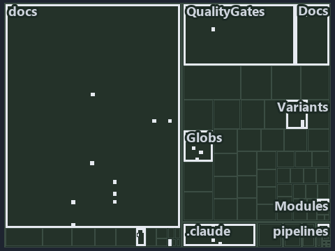

---
catzc:
  immutable:
    with_body_sha: "6a61daddb06e"
    repo_status: locked
    path: docs/explanation/.assets/tree/adr-dsgn-aspect--get-aspect-feeds-globs-and-maps--implementation.tree.md
    source: docs/explanation/.assets/adr-dsgn-aspect--get-aspect-feeds-globs-and-maps--implementation.drawio.png
    kind: asset-description
    language: markdown
    filetype: md
    track: docs
    tracktype: documentation
---

# Get-Aspect feeds Globs, which compiles the aspects into sets, and Maps, which only classifies live: the tree minimap

```text
Which files cite ADR-DSGN-ASPECT: every file of the world map is a tile, grouped by top-level folder.
26 files lit in 10 groups.
```



This is the tree minimap in the sidebar of the implementation diagram of [Get-Aspect feeds Globs, which compiles the aspects into sets, and
Maps, which only classifies live][27], which explains [ADR-DSGN-ASPECT][1]. It lights every file that cites those codes, grouped by folder,
so it shows which files carry the decision. Each lit group has its reason below, naming the code that selects it.

## What the minimap shows

The tree draws every file of the world map as a tile, grouped by top-level folder (under `automation/` by module, under `docs/adr/` by ADR
domain), and lights 26 files in 10 groups, filled in ink. A lit ADR file has a white rim; a file lit only by passing mentions is a lighter
ink. Every other tile is idle, a grey box: a file the slide's ADR codes do not select.

- docs (docs/ outside docs/adr/): 9 lit files
- Globs (automation/Catzc.Base.Globs): 4 lit files
- .claude: 3 lit files
- Modules (automation/Catzc.Base.Modules): 2 lit files
- Variants (automation/Catzc.Base.Variants): 2 lit files
- adr/dsgn (docs/adr/design): 2 lit files
- Docs (automation/Catzc.Base.Docs): 1 lit file
- QualityGates (automation/Catzc.Base.QualityGates): 1 lit file
- adr/* (the files directly in docs/adr/): 1 lit file
- pipelines: 1 lit file

## Why each group is lit

### docs (docs/ outside docs/adr/, 9 lit files)

The group holds the files of docs/ outside docs/adr/; each sits in its world-map cell and is lit by:

- [docs/references/.assets/automation/catzc-base-globs/protected-module-skip-by-hash.drawio.verify.md][2], in the cell docs × markdown:
  selected by [ADR-DSGN-ASPECT][1]: the file cites it at line 75 (text).
- [docs/references/automation/catzc-base-globs/Get-ModuleGlobSet.ps1.md][3], in the cell docs × markdown: selected by [ADR-DSGN-ASPECT][1]:
  the file cites it at line 46 (text).
- [docs/references/automation/catzc-base-globs/protected-module-skip-by-hash.drawio.md][4], in the cell docs × markdown: selected by
  [ADR-DSGN-ASPECT][1]: the file cites it at line 131 (text).
- [docs/references/automation/catzc-base-globs/tests/types/Aspect.Tests.ps1.md][5], in the cell docs × markdown: selected by
  [ADR-DSGN-ASPECT][1]: the file cites it at line 27 (text).
- [docs/references/automation/catzc-base-globs/types/Aspect.cs.md][6], in the cell docs × markdown: selected by [ADR-DSGN-ASPECT][1]: the
  file cites it at line 17 (text), line 31 (text), line 44 (text) and line 72 (text).
- [docs/references/automation/catzc-base-qualitygates/private/Get-ModuleProtectionIdentity.ps1.md][7], in the cell docs × markdown: selected
  by [ADR-DSGN-ASPECT][1]: the file cites it at line 40 (text).
- [docs/references/automation/catzc-base-variants/configs/variants.yml.md][8], in the cell docs × markdown: selected by
  [ADR-DSGN-ASPECT][1]: the file cites it at line 80 (text).
- [docs/references/automation/catzc-base-variants/types/VariantAspect.cs.md][9], in the cell docs × markdown: selected by
  [ADR-DSGN-ASPECT][1]: the file cites it at line 31 (text).
- [docs/references/automation/catzc-base-variants/types/VariantsConfig.cs.md][10], in the cell docs × markdown: selected by
  [ADR-DSGN-ASPECT][1]: the file cites it at line 48 (text).

### Globs (automation/Catzc.Base.Globs, 4 lit files)

The group holds the files of automation/Catzc.Base.Globs; each sits in its world-map cell and is lit by:

- [automation/Catzc.Base.Globs/Get-ModuleGlobSet.ps1][11], in the cell automation × powershell: selected by [ADR-DSGN-ASPECT][1]: the file
  cites it at line 24 (header) and line 35 (header).
- [automation/Catzc.Base.Globs/tests/Get-ModuleGlobSet.Tests.ps1][12], in the cell automation × powershell: selected by
  [ADR-DSGN-ASPECT][1]: the file cites it at line 24 (header) and line 61 (text).
- [automation/Catzc.Base.Globs/tests/types/Aspect.Tests.ps1][13], in the cell automation × powershell: selected by [ADR-DSGN-ASPECT][1]: the
  file cites it at line 20 (header).
- [automation/Catzc.Base.Globs/types/Aspect.cs][14], in the cell automation × csharp: selected by [ADR-DSGN-ASPECT][1]: the file cites it at
  line 21 (text).

### .claude (3 lit files)

The group holds the files of .claude; each sits in its world-map cell and is lit by:

- [.claude/plans/plan-layers-vocabulary-rename-contracts.md][15], in the cell .claude × markdown: selected by [ADR-DSGN-ASPECT][1]: the file
  cites it at line 945 (text).
- [.claude/plans/plan-module-kinds-tracks.md][16], in the cell .claude × markdown: selected by [ADR-DSGN-ASPECT][1]: the file cites it at
  line 35 (text), line 229 (text), line 253 (text), line 285 (text), line 292 (text), line 378 (text), line 753 (text) and line 942 (text).
- [.claude/plans/prompt-module-model-1-prepare.md][17], in the cell .claude × markdown: selected by [ADR-DSGN-ASPECT][1]: the file cites it
  at line 38 (text).

### Modules (automation/Catzc.Base.Modules, 2 lit files)

The group holds the files of automation/Catzc.Base.Modules; each sits in its world-map cell and is lit by:

- [automation/Catzc.Base.Modules/Get-Aspect.ps1][18], in the cell automation × powershell: selected by [ADR-DSGN-ASPECT][1]: the file cites
  it at line 21 (header) and line 26 (header).
- [automation/Catzc.Base.Modules/tests/Get-Aspect.Tests.ps1][19], in the cell automation × powershell: selected by [ADR-DSGN-ASPECT][1]: the
  file cites it at line 20 (header).

### Variants (automation/Catzc.Base.Variants, 2 lit files)

The group holds the files of automation/Catzc.Base.Variants; each sits in its world-map cell and is lit by:

- [automation/Catzc.Base.Variants/types/VariantAspect.cs][20], in the cell automation × csharp: selected by [ADR-DSGN-ASPECT][1]: the file
  cites it at line 21 (text).
- [automation/Catzc.Base.Variants/types/VariantsConfig.cs][21], in the cell automation × csharp: selected by [ADR-DSGN-ASPECT][1]: the file
  cites it at line 22 (text).

### adr/dsgn (docs/adr/design, 2 lit files)

The group holds the files of docs/adr/design; each sits in its world-map cell and is lit by:

- [docs/adr/design/dora-explains.md][22], in the cell docs × markdown: selected by [ADR-DSGN-ASPECT][1]: the file cites it at line 210
  (text).
- [docs/adr/design/module-aspects.md][1], in the cell docs × markdown: selected by [ADR-DSGN-ASPECT][1]: the ADR's own file.

### Docs (automation/Catzc.Base.Docs, 1 lit file)

The group holds the files of automation/Catzc.Base.Docs; each sits in its world-map cell and is lit by:

- [automation/Catzc.Base.Docs/configs/adrs.yml][23], in the cell automation × yaml: selected by [ADR-DSGN-ASPECT][1]: the file cites it at
  line 102 (text).

### QualityGates (automation/Catzc.Base.QualityGates, 1 lit file)

The group holds the files of automation/Catzc.Base.QualityGates; each sits in its world-map cell and is lit by:

- [automation/Catzc.Base.QualityGates/private/Get-ModuleProtectionIdentity.ps1][24], in the cell automation × powershell: selected by
  [ADR-DSGN-ASPECT][1]: the file cites it at line 22 (header).

### adr/* (the files directly in docs/adr/, 1 lit file)

The group holds the files of the files directly in docs/adr/; each sits in its world-map cell and is lit by:

- [docs/adr/index.md][25], in the cell docs × markdown: selected by [ADR-DSGN-ASPECT][1]: the file cites it at line 117 (text).

### pipelines (1 lit file)

The group holds the files of pipelines; each sits in its world-map cell and is lit by:

- [pipelines/ci-automation.yaml][26], in the cell pipelines × pipeline-yaml: selected by [ADR-DSGN-ASPECT][1]: a pipeline that cites nothing
  itself carries its globset's citations, which cite it at `automation/Catzc.Base.Docs/configs/adrs.yml` line 102 (text),
  `automation/Catzc.Base.Globs/Get-ModuleGlobSet.ps1` line 24 (header), `automation/Catzc.Base.Globs/Get-ModuleGlobSet.ps1` line 35
  (header), `automation/Catzc.Base.Globs/tests/Get-ModuleGlobSet.Tests.ps1` line 24 (header),
  `automation/Catzc.Base.Globs/tests/Get-ModuleGlobSet.Tests.ps1` line 61 (text), `automation/Catzc.Base.Globs/tests/types/Aspect.Tests.ps1`
  line 20 (header), `automation/Catzc.Base.Globs/types/Aspect.cs` line 21 (text), `automation/Catzc.Base.Modules/Get-Aspect.ps1` line 21
  (header), `automation/Catzc.Base.Modules/Get-Aspect.ps1` line 26 (header), `automation/Catzc.Base.Modules/tests/Get-Aspect.Tests.ps1` line
  20 (header), `automation/Catzc.Base.QualityGates/private/Get-ModuleProtectionIdentity.ps1` line 22 (header),
  `automation/Catzc.Base.Variants/types/VariantAspect.cs` line 21 (text) and `automation/Catzc.Base.Variants/types/VariantsConfig.cs` line
  22 (text).

## Keywords

- [world map][28]
- [track][29]
- [file language][30]
- [cell][31]
- [lit cell][32]
- [.claude][33]: a track
- [automation][33]: a track
- [docs][33]: a track
- [pipelines][33]: a track
- [csharp][34]: a file language
- [markdown][34]: a file language
- [pipeline-yaml][34]: a file language
- [powershell][34]: a file language
- [yaml][34]: a file language

[1]: ../../../adr/design/module-aspects.md
[2]: ../../../references/.assets/automation/catzc-base-globs/protected-module-skip-by-hash.drawio.verify.md
[3]: ../../../references/automation/catzc-base-globs/Get-ModuleGlobSet.ps1.md
[4]: ../../../references/automation/catzc-base-globs/protected-module-skip-by-hash.drawio.md
[5]: ../../../references/automation/catzc-base-globs/tests/types/Aspect.Tests.ps1.md
[6]: ../../../references/automation/catzc-base-globs/types/Aspect.cs.md
[7]: ../../../references/automation/catzc-base-qualitygates/private/Get-ModuleProtectionIdentity.ps1.md
[8]: ../../../references/automation/catzc-base-variants/configs/variants.yml.md
[9]: ../../../references/automation/catzc-base-variants/types/VariantAspect.cs.md
[10]: ../../../references/automation/catzc-base-variants/types/VariantsConfig.cs.md
[11]: ../../../../automation/Catzc.Base.Globs/Get-ModuleGlobSet.ps1
[12]: ../../../../automation/Catzc.Base.Globs/tests/Get-ModuleGlobSet.Tests.ps1
[13]: ../../../../automation/Catzc.Base.Globs/tests/types/Aspect.Tests.ps1
[14]: ../../../../automation/Catzc.Base.Globs/types/Aspect.cs
[15]: ../../../../.claude/plans/plan-layers-vocabulary-rename-contracts.md
[16]: ../../../../.claude/plans/plan-module-kinds-tracks.md
[17]: ../../../../.claude/plans/prompt-module-model-1-prepare.md
[18]: ../../../../automation/Catzc.Base.Modules/Get-Aspect.ps1
[19]: ../../../../automation/Catzc.Base.Modules/tests/Get-Aspect.Tests.ps1
[20]: ../../../../automation/Catzc.Base.Variants/types/VariantAspect.cs
[21]: ../../../../automation/Catzc.Base.Variants/types/VariantsConfig.cs
[22]: ../../../adr/design/dora-explains.md
[23]: ../../../../automation/Catzc.Base.Docs/configs/adrs.yml
[24]: ../../../../automation/Catzc.Base.QualityGates/private/Get-ModuleProtectionIdentity.ps1
[25]: ../../../adr/index.md
[26]: ../../../../pipelines/ci-automation.yaml
[27]: ../../design/get-aspect-feeds-globs-and-maps.md
[28]: ../../../adr/glossary.md#world-map
[29]: ../../../adr/glossary.md#track
[30]: ../../../adr/glossary.md#file-language
[31]: ../../../adr/glossary.md#cell
[32]: ../../../adr/glossary.md#lit-cell
[33]: ../../../../automation/Catzc.Base.Variants/configs/variants.yml
[34]: ../../../../automation/Catzc.Base.Languages/configs/languages.yml
