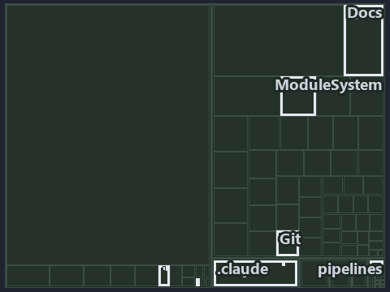

---
catzc:
  immutable:
    with_body_sha: "1d3a2e31779b"
    repo_status: locked
    path: docs/explanation/.assets/tree/adr-dsgn-life--engineer-merges-pipelines-do-the-rest--operations.tree.md
    source: docs/explanation/.assets/adr-dsgn-life--engineer-merges-pipelines-do-the-rest--operations.drawio.png
    kind: asset-description
    language: markdown
    filetype: md
    track: docs
    tracktype: documentation
---

# An engineer runs the tests and merges; pipelines do the rest: the tree minimap

```text
Which files cite ADR-DSGN-LIFE: every file of the world map is a tile, grouped by top-level folder.
10 files lit in 7 groups.
```



This is the tree minimap in the sidebar of the operations diagram of [An engineer runs the tests and merges; pipelines do the rest][11],
which explains [ADR-DSGN-LIFE][1]. It lights every file that cites those codes, grouped by folder, so it shows which files carry the
decision. Each lit group has its reason below, naming the code that selects it.

## What the minimap shows

The tree draws every file of the world map as a tile, grouped by top-level folder (under `automation/` by module, under `docs/adr/` by ADR
domain), and lights 10 files in 7 groups, filled in ink. A lit ADR file has a white rim; a file lit only by passing mentions is a lighter
ink. Every other tile is idle, a grey box: a file the slide's ADR codes do not select.

- .claude: 2 lit files
- adr/* (the files directly in docs/adr/): 2 lit files
- adr/dsgn (docs/adr/design): 2 lit files
- Docs (automation/Catzc.Base.Docs): 1 lit file
- ModuleSystem (automation/Catzc.Base.ModuleSystem): 1 lit file
- docs (docs/ outside docs/adr/): 1 lit file
- pipelines: 1 lit file

## Why each group is lit

### .claude (2 lit files)

The group holds the files of .claude; each sits in its world-map cell and is lit by:

- [.claude/plans/plan-fast-push-followups.md][2], in the cell .claude × markdown: selected by [ADR-DSGN-LIFE][1]: the file cites it at line
  12 (text) and line 37 (text).
- [.claude/plans/value-of-plan.md][3], in the cell .claude × markdown: selected by [ADR-DSGN-LIFE][1]: the file cites it at line 44 (text).

### adr/* (the files directly in docs/adr/, 2 lit files)

The group holds the files of the files directly in docs/adr/; each sits in its world-map cell and is lit by:

- [docs/adr/glossary.md][4], in the cell docs × markdown: selected by [ADR-DSGN-LIFE][1]: the file cites it at line 272 (text).
- [docs/adr/index.md][5], in the cell docs × markdown: selected by [ADR-DSGN-LIFE][1]: the file cites it at line 112 (text).

### adr/dsgn (docs/adr/design, 2 lit files)

The group holds the files of docs/adr/design; each sits in its world-map cell and is lit by:

- [docs/adr/design/commit-lifecycle.md][1], in the cell docs × markdown: selected by [ADR-DSGN-LIFE][1]: the ADR's own file.
- [docs/adr/design/dora-explains.md][6], in the cell docs × markdown: selected by [ADR-DSGN-LIFE][1]: the file cites it at line 82 (text).

### Docs (automation/Catzc.Base.Docs, 1 lit file)

The group holds the files of automation/Catzc.Base.Docs; each sits in its world-map cell and is lit by:

- [automation/Catzc.Base.Docs/configs/adrs.yml][7], in the cell automation × yaml: selected by [ADR-DSGN-LIFE][1]: the file cites it at line
  78 (text).

### ModuleSystem (automation/Catzc.Base.ModuleSystem, 1 lit file)

The group holds the files of automation/Catzc.Base.ModuleSystem; each sits in its world-map cell and is lit by:

- [automation/Catzc.Base.ModuleSystem/configs/glossary.yml][8], in the cell automation × yaml: selected by [ADR-DSGN-LIFE][1]: the file
  cites it at line 49 (text).

### docs (docs/ outside docs/adr/, 1 lit file)

The group holds the files of docs/ outside docs/adr/; each sits in its world-map cell and is lit by:

- [docs/references/automation/catzc-base-git/Push-Dirty.ps1.md][9], in the cell docs × markdown: selected by [ADR-DSGN-LIFE][1]: the file
  cites it at line 14 (text).

### pipelines (1 lit file)

The group holds the files of pipelines; each sits in its world-map cell and is lit by:

- [pipelines/ci-automation.yaml][10], in the cell pipelines × pipeline-yaml: selected by [ADR-DSGN-LIFE][1]: a pipeline that cites nothing
  itself carries its globset's citations, which cite it at `automation/Catzc.Base.Docs/configs/adrs.yml` line 78 (text) and
  `automation/Catzc.Base.ModuleSystem/configs/glossary.yml` line 49 (text).

## Keywords

- [world map][12]
- [track][13]
- [file language][14]
- [cell][15]
- [lit cell][16]
- [.claude][17]: a track
- [automation][17]: a track
- [docs][17]: a track
- [pipelines][17]: a track
- [markdown][18]: a file language
- [pipeline-yaml][18]: a file language
- [yaml][18]: a file language

Terms the cited ADRs define:

- [occupant][19], defined by [ADR-DSGN-LIFE#5][20]

[1]: ../../../adr/design/commit-lifecycle.md
[2]: ../../../../.claude/plans/plan-fast-push-followups.md
[3]: ../../../../.claude/plans/value-of-plan.md
[4]: ../../../adr/glossary.md
[5]: ../../../adr/index.md
[6]: ../../../adr/design/dora-explains.md
[7]: ../../../../automation/Catzc.Base.Docs/configs/adrs.yml
[8]: ../../../../automation/Catzc.Base.ModuleSystem/configs/glossary.yml
[9]: ../../../references/automation/catzc-base-git/Push-Dirty.ps1.md
[10]: ../../../../pipelines/ci-automation.yaml
[11]: ../../design/engineer-merges-pipelines-do-the-rest.md
[12]: ../../../adr/glossary.md#world-map
[13]: ../../../adr/glossary.md#track
[14]: ../../../adr/glossary.md#file-language
[15]: ../../../adr/glossary.md#cell
[16]: ../../../adr/glossary.md#lit-cell
[17]: ../../../../automation/Catzc.Base.Variants/configs/variants.yml
[18]: ../../../../automation/Catzc.Base.Languages/configs/languages.yml
[19]: ../../../adr/glossary.md#occupant
[20]: ../../../adr/design/commit-lifecycle.md#rule-adr-dsgn-life5
