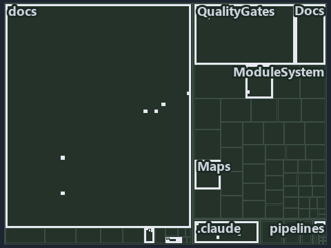

# Upstream integrators depend on the main-UAT occupant, never on the tip of main: the tree minimap

```text
Which files cite ADR-DSGN-LIFE and ADR-FLOW-CD: every file of the world map is a tile, grouped by top-level folder.
20 files lit in 10 groups.
```



This is the tree minimap in the sidebar of the architecture diagram of [Upstream integrators depend on the main-UAT occupant, never on the
tip of main][21], which explains [ADR-DSGN-LIFE][1] and [ADR-FLOW-CD][2]. It lights every file that cites those codes, grouped by folder, so
it shows which files carry the decision. Each lit group has its reason below, naming the code that selects it.

## What the minimap shows

The tree draws every file of the world map as a tile, grouped by top-level folder (under `automation/` by module, under `docs/adr/` by ADR
domain), and lights 20 files in 10 groups, filled in ink. A lit ADR file has a white rim; a file lit only by passing mentions is a lighter
ink. Every other tile is idle, a grey box: a file the slide's ADR codes do not select.

- docs (docs/ outside docs/adr/): 6 lit files
- .claude: 3 lit files
- adr/* (the files directly in docs/adr/): 2 lit files
- adr/dsgn (docs/adr/design): 2 lit files
- adr/flow (docs/adr/flow): 2 lit files
- Docs (automation/Catzc.Base.Docs): 1 lit file
- Maps (automation/Catzc.Base.Maps): 1 lit file
- ModuleSystem (automation/Catzc.Base.ModuleSystem): 1 lit file
- QualityGates (automation/Catzc.Base.QualityGates): 1 lit file
- pipelines: 1 lit file

## Why each group is lit

### docs (docs/ outside docs/adr/, 6 lit files)

The group holds the files of docs/ outside docs/adr/; each sits in its world-map cell and is lit by:

- [docs/references/automation/catzc-base-docs/configs/adrs.yml.md][3], in the cell docs × markdown: selected by [ADR-FLOW-CD][2]: the file
  cites it at line 40 (text).
- [docs/references/automation/catzc-base-docs/types/AdrsConfig.cs.md][4], in the cell docs × markdown: selected by [ADR-FLOW-CD][2]: the
  file cites it at line 28 (text), line 29 (text), line 57 (text) and line 58 (text).
- [docs/references/automation/catzc-base-docs/types/GlossaryConcept.cs.md][5], in the cell docs × markdown: selected by [ADR-FLOW-CD][2]:
  the file cites it at line 34 (text).
- [docs/references/automation/catzc-base-git/Push-Dirty.ps1.md][6], in the cell docs × markdown: selected by [ADR-DSGN-LIFE][1]: the file
  cites it at line 14 (text).
- [docs/references/automation/catzc-base-maps/Get-ValueChainHighlight.ps1.md][7], in the cell docs × markdown: selected by [ADR-FLOW-CD][2]:
  the file cites it at line 37 (text).
- [docs/references/automation/catzc-base-maps/Get-WorldMapHighlight.ps1.md][8], in the cell docs × markdown: selected by [ADR-FLOW-CD][2]:
  the file cites it at line 54 (text).

### .claude (3 lit files)

The group holds the files of .claude; each sits in its world-map cell and is lit by:

- [.claude/CLAUDE.md][9], in the cell .claude × markdown: selected by [ADR-FLOW-CD][2]: the file cites it at line 55 (text).
- [.claude/plans/plan-fast-push-followups.md][10], in the cell .claude × markdown: selected by [ADR-DSGN-LIFE][1]: the file cites it at line
  12 (text) and line 37 (text).
- [.claude/plans/value-of-plan.md][11], in the cell .claude × markdown: selected by [ADR-DSGN-LIFE][1]: the file cites it at line 44 (text).

### adr/* (the files directly in docs/adr/, 2 lit files)

The group holds the files of the files directly in docs/adr/; each sits in its world-map cell and is lit by:

- [docs/adr/glossary.md][12], in the cell docs × markdown: selected by [ADR-DSGN-LIFE][1]: the file cites it at line 272 (text); selected by
  [ADR-FLOW-CD][2]: the file cites it at line 497 (text) and line 510 (text).
- [docs/adr/index.md][13], in the cell docs × markdown: selected by [ADR-DSGN-LIFE][1]: the file cites it at line 112 (text); selected by
  [ADR-FLOW-CD][2]: the file cites it at line 129 (text).

### adr/dsgn (docs/adr/design, 2 lit files)

The group holds the files of docs/adr/design; each sits in its world-map cell and is lit by:

- [docs/adr/design/commit-lifecycle.md][1], in the cell docs × markdown: selected by [ADR-DSGN-LIFE][1]: the ADR's own file.
- [docs/adr/design/dora-explains.md][14], in the cell docs × markdown: selected by [ADR-DSGN-LIFE][1]: the file cites it at line 82 (text).

### adr/flow (docs/adr/flow, 2 lit files)

The group holds the files of docs/adr/flow; each sits in its world-map cell and is lit by:

- [docs/adr/flow/cd-discipline-and-promotion-flow.md][2], in the cell docs × markdown: selected by [ADR-FLOW-CD][2]: the ADR's own file.
- [docs/adr/flow/dora-explains.md][15], in the cell docs × markdown: selected by [ADR-FLOW-CD][2]: the file cites it at line 11 (text).

### Docs (automation/Catzc.Base.Docs, 1 lit file)

The group holds the files of automation/Catzc.Base.Docs; each sits in its world-map cell and is lit by:

- [automation/Catzc.Base.Docs/configs/adrs.yml][16], in the cell automation × yaml: selected by [ADR-DSGN-LIFE][1]: the file cites it at
  line 78 (text); selected by [ADR-FLOW-CD][2]: the file cites it at line 97 (text).

### Maps (automation/Catzc.Base.Maps, 1 lit file)

The group holds the files of automation/Catzc.Base.Maps; each sits in its world-map cell and is lit by:

- [automation/Catzc.Base.Maps/tests/Get-WorldMapHighlight.Tests.ps1][17], in the cell automation × powershell: selected by [ADR-FLOW-CD][2]:
  the file cites it at line 70 (text) and line 71 (text).

### ModuleSystem (automation/Catzc.Base.ModuleSystem, 1 lit file)

The group holds the files of automation/Catzc.Base.ModuleSystem; each sits in its world-map cell and is lit by:

- [automation/Catzc.Base.ModuleSystem/configs/glossary.yml][18], in the cell automation × yaml: selected by [ADR-DSGN-LIFE][1]: the file
  cites it at line 49 (text); selected by [ADR-FLOW-CD][2]: the file cites it at line 18 (text).

### QualityGates (automation/Catzc.Base.QualityGates, 1 lit file)

The group holds the files of automation/Catzc.Base.QualityGates; each sits in its world-map cell and is lit by:

- [automation/Catzc.Base.QualityGates/configs/glossary.yml][19], in the cell automation × yaml: selected by [ADR-FLOW-CD][2]: the file cites
  it at line 58 (text).

### pipelines (1 lit file)

The group holds the files of pipelines; each sits in its world-map cell and is lit by:

- [pipelines/ci-automation.yaml][20], in the cell pipelines × pipeline-yaml: selected by [ADR-DSGN-LIFE][1]: a pipeline that cites nothing
  itself carries its globset's citations, which cite it at `automation/Catzc.Base.Docs/configs/adrs.yml` line 78 (text) and
  `automation/Catzc.Base.ModuleSystem/configs/glossary.yml` line 49 (text); selected by [ADR-FLOW-CD][2]: a pipeline that cites nothing
  itself carries its globset's citations, which cite it at `automation/Catzc.Base.Docs/configs/adrs.yml` line 97 (text),
  `automation/Catzc.Base.Maps/tests/Get-WorldMapHighlight.Tests.ps1` line 70 (text),
  `automation/Catzc.Base.Maps/tests/Get-WorldMapHighlight.Tests.ps1` line 71 (text),
  `automation/Catzc.Base.ModuleSystem/configs/glossary.yml` line 18 (text) and `automation/Catzc.Base.QualityGates/configs/glossary.yml`
  line 58 (text).

## Keywords

- [world map][22]
- [track][23]
- [file language][24]
- [cell][25]
- [lit cell][26]
- [.claude][27]: a track
- [automation][27]: a track
- [docs][27]: a track
- [pipelines][27]: a track
- [markdown][28]: a file language
- [pipeline-yaml][28]: a file language
- [powershell][28]: a file language
- [yaml][28]: a file language

Terms the cited ADRs define:

- [gate][29], defined by [ADR-FLOW-CD#13][30]
- [occupant][31], defined by [ADR-DSGN-LIFE#5][32]
- [release candidate][33], defined by [ADR-FLOW-CD#14][34]

[1]: ../../../adr/design/commit-lifecycle.md
[2]: ../../../adr/flow/cd-discipline-and-promotion-flow.md
[3]: ../../../references/automation/catzc-base-docs/configs/adrs.yml.md
[4]: ../../../references/automation/catzc-base-docs/types/AdrsConfig.cs.md
[5]: ../../../references/automation/catzc-base-docs/types/GlossaryConcept.cs.md
[6]: ../../../references/automation/catzc-base-git/Push-Dirty.ps1.md
[7]: ../../../references/automation/catzc-base-maps/Get-ValueChainHighlight.ps1.md
[8]: ../../../references/automation/catzc-base-maps/Get-WorldMapHighlight.ps1.md
[9]: ../../../../.claude/CLAUDE.md
[10]: ../../../../.claude/plans/plan-fast-push-followups.md
[11]: ../../../../.claude/plans/value-of-plan.md
[12]: ../../../adr/glossary.md
[13]: ../../../adr/index.md
[14]: ../../../adr/design/dora-explains.md
[15]: ../../../adr/flow/dora-explains.md
[16]: ../../../../automation/Catzc.Base.Docs/configs/adrs.yml
[17]: ../../../../automation/Catzc.Base.Maps/tests/Get-WorldMapHighlight.Tests.ps1
[18]: ../../../../automation/Catzc.Base.ModuleSystem/configs/glossary.yml
[19]: ../../../../automation/Catzc.Base.QualityGates/configs/glossary.yml
[20]: ../../../../pipelines/ci-automation.yaml
[21]: ../../design/integrators-depend-on-an-occupant.md
[22]: ../../../adr/glossary.md#world-map
[23]: ../../../adr/glossary.md#track
[24]: ../../../adr/glossary.md#file-language
[25]: ../../../adr/glossary.md#cell
[26]: ../../../adr/glossary.md#lit-cell
[27]: ../../../../automation/Catzc.Base.Variants/configs/variants.yml
[28]: ../../../../automation/Catzc.Base.Languages/configs/languages.yml
[29]: ../../../adr/glossary.md#gate
[30]: ../../../adr/flow/cd-discipline-and-promotion-flow.md#rule-adr-flow-cd13
[31]: ../../../adr/glossary.md#occupant
[32]: ../../../adr/design/commit-lifecycle.md#rule-adr-dsgn-life5
[33]: ../../../adr/glossary.md#release-candidate
[34]: ../../../adr/flow/cd-discipline-and-promotion-flow.md#rule-adr-flow-cd14
