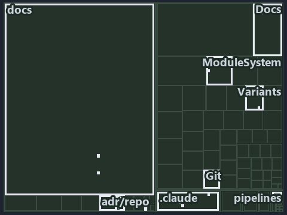

---
catzc:
  immutable:
    with_body_sha: de1e1915b678
    repo_status: locked
    path: docs/explanation/.assets/tree/adr-dsgn-remote--ingress-gated-the-rest-by-review--governance.tree.md
    source: docs/explanation/.assets/adr-dsgn-remote--ingress-gated-the-rest-by-review--governance.drawio.png
    kind: asset-description
    language: markdown
    filetype: md
    track: docs
    tracktype: documentation
---

# Only ingress is checked by gates; the source-of-truth and integration rules rest on code review: the tree minimap

```text
Which files cite ADR-DSGN-LIFE, ADR-DSGN-REMOTE and ADR-REPO-VARIANT: every file of the world map is a tile, grouped by top-level folder.
18 files lit in 10 groups.
```



This is the tree minimap in the sidebar of the governance diagram of [Only ingress is checked by gates; the source-of-truth and integration
rules rest on code review][19], which explains [ADR-DSGN-LIFE][1], [ADR-DSGN-REMOTE][2] and [ADR-REPO-VARIANT][3]. It lights every file that
cites those codes, grouped by folder, so it shows which files carry the decision. Each lit group has its reason below, naming the code that
selects it.

## What the minimap shows

The tree draws every file of the world map as a tile, grouped by top-level folder (under `automation/` by module, under `docs/adr/` by ADR
domain), and lights 18 files in 10 groups, filled in ink. A lit ADR file has a white rim; a file lit only by passing mentions is a lighter
ink. Every other tile is idle, a grey box: a file the slide's ADR codes do not select.

- .claude: 3 lit files
- adr/dsgn (docs/adr/design): 3 lit files
- ModuleSystem (automation/Catzc.Base.ModuleSystem): 2 lit files
- adr/* (the files directly in docs/adr/): 2 lit files
- adr/repo (docs/adr/repository): 2 lit files
- docs (docs/ outside docs/adr/): 2 lit files
- Docs (automation/Catzc.Base.Docs): 1 lit file
- Git (automation/Catzc.Base.Git): 1 lit file
- Variants (automation/Catzc.Base.Variants): 1 lit file
- pipelines: 1 lit file

## Why each group is lit

### .claude (3 lit files)

The group holds the files of .claude; each sits in its world-map cell and is lit by:

- [.claude/plans/plan-fast-push-followups.md][4], in the cell .claude × markdown: selected by [ADR-DSGN-LIFE][1]: the file cites it at line
  26 (text) and line 47 (text).
- [.claude/plans/plan-module-kinds-tracks.md][5], in the cell .claude × markdown: selected by [ADR-REPO-VARIANT][3]: the file cites it at
  line 896 (text) and line 950 (text).
- [.claude/plans/value-of-plan.md][6], in the cell .claude × markdown: selected by [ADR-DSGN-LIFE][1]: the file cites it at line 22 (text)
  and line 63 (text).

### adr/dsgn (docs/adr/design, 3 lit files)

The group holds the files of docs/adr/design; each sits in its world-map cell and is lit by:

- [docs/adr/design/commit-lifecycle.md][1], in the cell docs × markdown: selected by [ADR-DSGN-LIFE][1]: the ADR's own file.
- [docs/adr/design/dora-explains.md][7], in the cell docs × markdown: selected by [ADR-DSGN-LIFE][1]: the file cites it at line 121 (text);
  selected by [ADR-DSGN-REMOTE][2]: the file cites it at line 142 (text).
- [docs/adr/design/server-remote-integration.md][2], in the cell docs × markdown: selected by [ADR-DSGN-REMOTE][2]: the ADR's own file.

### ModuleSystem (automation/Catzc.Base.ModuleSystem, 2 lit files)

The group holds the files of automation/Catzc.Base.ModuleSystem; each sits in its world-map cell and is lit by:

- [automation/Catzc.Base.ModuleSystem/Sync-GeneratedFile.ps1][8], in the cell automation × powershell: selected by [ADR-REPO-VARIANT][3]:
  the file cites it at line 24 (header), line 52 (header) and line 125 (text).
- [automation/Catzc.Base.ModuleSystem/configs/glossary.yml][9], in the cell automation × yaml: selected by [ADR-DSGN-LIFE][1]: the file
  cites it at line 68 (text).

### adr/* (the files directly in docs/adr/, 2 lit files)

The group holds the files of the files directly in docs/adr/; each sits in its world-map cell and is lit by:

- [docs/adr/glossary.md][10], in the cell docs × markdown: selected by [ADR-DSGN-LIFE][1]: the file cites it at line 272 (text).
- [docs/adr/index.md][11], in the cell docs × markdown: selected by [ADR-DSGN-LIFE][1]: the file cites it at line 112 (text); selected by
  [ADR-DSGN-REMOTE][2]: the file cites it at line 113 (text); selected by [ADR-REPO-VARIANT][3]: the file cites it at line 327 (text).

### adr/repo (docs/adr/repository, 2 lit files)

The group holds the files of docs/adr/repository; each sits in its world-map cell and is lit by:

- [docs/adr/repository/dora-explains.md][12], in the cell docs × markdown: selected by [ADR-REPO-VARIANT][3]: the file cites it at line 221
  (text).
- [docs/adr/repository/repo-variants.md][3], in the cell docs × markdown: selected by [ADR-REPO-VARIANT][3]: the ADR's own file.

### docs (docs/ outside docs/adr/, 2 lit files)

The group holds the files of docs/ outside docs/adr/; each sits in its world-map cell and is lit by:

- [docs/references/automation/catzc-base-variants/configs/variants.yml.md][13], in the cell docs × markdown: selected by
  [ADR-REPO-VARIANT][3]: the file cites it at line 30 (text).
- [docs/references/automation/catzc-base-variants/types/VariantsConfig.cs.md][14], in the cell docs × markdown: selected by
  [ADR-REPO-VARIANT][3]: the file cites it at line 31 (text).

### Docs (automation/Catzc.Base.Docs, 1 lit file)

The group holds the files of automation/Catzc.Base.Docs; each sits in its world-map cell and is lit by:

- [automation/Catzc.Base.Docs/configs/adrs.yml][15], in the cell automation × yaml: selected by [ADR-DSGN-LIFE][1]: the file cites it at
  line 97 (text); selected by [ADR-DSGN-REMOTE][2]: the file cites it at line 98 (text); selected by [ADR-REPO-VARIANT][3]: the file cites
  it at line 322 (text).

### Git (automation/Catzc.Base.Git, 1 lit file)

The group holds the files of automation/Catzc.Base.Git; each sits in its world-map cell and is lit by:

- [automation/Catzc.Base.Git/Push-Dirty.ps1][16], in the cell automation × powershell: selected by [ADR-DSGN-LIFE][1]: the file cites it at
  line 21 (header) and line 26 (header).

### Variants (automation/Catzc.Base.Variants, 1 lit file)

The group holds the files of automation/Catzc.Base.Variants; each sits in its world-map cell and is lit by:

- [automation/Catzc.Base.Variants/types/VariantsConfig.cs][17], in the cell automation × csharp: selected by [ADR-REPO-VARIANT][3]: the file
  cites it at line 24 (text).

### pipelines (1 lit file)

The group holds the files of pipelines; each sits in its world-map cell and is lit by:

- [pipelines/ci-automation.yaml][18], in the cell pipelines × pipeline-yaml: selected by [ADR-DSGN-LIFE][1]: a pipeline that cites nothing
  itself carries its globset's citations, which cite it at `automation/Catzc.Base.Docs/configs/adrs.yml` line 97 (text),
  `automation/Catzc.Base.Git/Push-Dirty.ps1` line 21 (header), `automation/Catzc.Base.Git/Push-Dirty.ps1` line 26 (header) and
  `automation/Catzc.Base.ModuleSystem/configs/glossary.yml` line 68 (text); selected by [ADR-DSGN-REMOTE][2]: a pipeline that cites nothing
  itself carries its globset's citations, which cite it at `automation/Catzc.Base.Docs/configs/adrs.yml` line 98 (text); selected by
  [ADR-REPO-VARIANT][3]: a pipeline that cites nothing itself carries its globset's citations, which cite it at
  `automation/Catzc.Base.Docs/configs/adrs.yml` line 322 (text), `automation/Catzc.Base.ModuleSystem/Sync-GeneratedFile.ps1` line 24
  (header), `automation/Catzc.Base.ModuleSystem/Sync-GeneratedFile.ps1` line 52 (header),
  `automation/Catzc.Base.ModuleSystem/Sync-GeneratedFile.ps1` line 125 (text) and `automation/Catzc.Base.Variants/types/VariantsConfig.cs`
  line 24 (text).

## Keywords

- [world map][20]
- [track][21]
- [file language][22]
- [cell][23]
- [lit cell][24]
- [.claude][25]: a track
- [automation][25]: a track
- [docs][25]: a track
- [pipelines][25]: a track
- [csharp][26]: a file language
- [markdown][26]: a file language
- [pipeline-yaml][26]: a file language
- [powershell][26]: a file language
- [yaml][26]: a file language

Terms the cited ADRs define:

- [occupant][27], defined by [ADR-DSGN-LIFE#5][28]

[1]: ../../../adr/design/commit-lifecycle.md
[2]: ../../../adr/design/server-remote-integration.md
[3]: ../../../adr/repository/repo-variants.md
[4]: ../../../../.claude/plans/plan-fast-push-followups.md
[5]: ../../../../.claude/plans/plan-module-kinds-tracks.md
[6]: ../../../../.claude/plans/value-of-plan.md
[7]: ../../../adr/design/dora-explains.md
[8]: ../../../../automation/Catzc.Base.ModuleSystem/Sync-GeneratedFile.ps1
[9]: ../../../../automation/Catzc.Base.ModuleSystem/configs/glossary.yml
[10]: ../../../adr/glossary.md
[11]: ../../../adr/index.md
[12]: ../../../adr/repository/dora-explains.md
[13]: ../../../references/automation/catzc-base-variants/configs/variants.yml.md
[14]: ../../../references/automation/catzc-base-variants/types/VariantsConfig.cs.md
[15]: ../../../../automation/Catzc.Base.Docs/configs/adrs.yml
[16]: ../../../../automation/Catzc.Base.Git/Push-Dirty.ps1
[17]: ../../../../automation/Catzc.Base.Variants/types/VariantsConfig.cs
[18]: ../../../../pipelines/ci-automation.yaml
[19]: ../../design/ingress-gated-the-rest-by-review.md
[20]: ../../../adr/glossary.md#world-map
[21]: ../../../adr/glossary.md#track
[22]: ../../../adr/glossary.md#file-language
[23]: ../../../adr/glossary.md#cell
[24]: ../../../adr/glossary.md#lit-cell
[25]: ../../../../automation/Catzc.Base.Variants/configs/variants.yml
[26]: ../../../../automation/Catzc.Base.Languages/configs/languages.yml
[27]: ../../../adr/glossary.md#occupant
[28]: ../../../adr/design/commit-lifecycle.md#rule-adr-dsgn-life5
