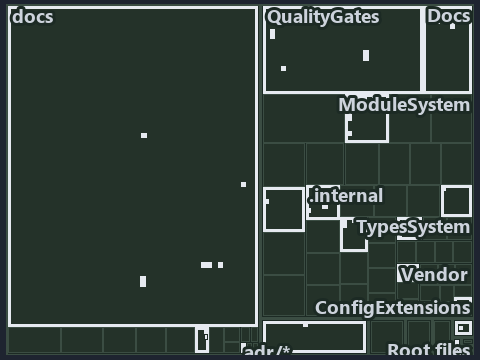

# Each run mode has one entry script, and a mixed session throws: the tree minimap

```text
Which files cite ADR-DSGN-RUNMODE: every file of the world map is a tile, grouped by top-level folder.
45 files lit in 16 groups.
```



This is the tree minimap in the sidebar of the operations diagram of [Each run mode has one entry script, and a mixed session throws][46],
which explains [ADR-DSGN-RUNMODE][1]. It lights every file that cites those codes, grouped by folder, so it shows which files carry the
decision. Each lit group has its reason below, naming the code that selects it.

## What the minimap shows

The tree draws every file of the world map as a tile, grouped by top-level folder (under `automation/` by module, under `docs/adr/` by ADR
domain), and lights 45 files in 16 groups, filled in ink. A lit ADR file has a white rim; a file lit only by passing mentions is a lighter
ink. Every other tile is idle, a grey box: a file the slide's ADR codes do not select.

- ModuleSystem (automation/Catzc.Base.ModuleSystem): 7 lit files
- docs (docs/ outside docs/adr/): 7 lit files
- QualityGates (automation/Catzc.Base.QualityGates): 5 lit files
- TypesSystem (automation/Catzc.Base.TypesSystem): 4 lit files
- Root files: 3 lit files
- Docs (automation/Catzc.Base.Docs): 3 lit files
- Repository (automation/Catzc.Base.Repository): 3 lit files
- .internal (automation/.internal): 2 lit files
- Vendor (automation/Catzc.Base.Vendor): 2 lit files
- adr/* (the files directly in docs/adr/): 2 lit files
- adr/dsgn (docs/adr/design): 2 lit files
- .claude: 1 lit file
- ConfigExtensions (automation/Catzc.Base.ConfigExtensions): 1 lit file
- Globs (automation/Catzc.Base.Globs): 1 lit file
- RootConfig (automation/Catzc.Base.RootConfig): 1 lit file
- pipelines: 1 lit file

## Why each group is lit

### ModuleSystem (automation/Catzc.Base.ModuleSystem, 7 lit files)

The group holds the files of automation/Catzc.Base.ModuleSystem; each sits in its world-map cell and is lit by:

- [automation/Catzc.Base.ModuleSystem/Copy-Automation.ps1][2], in the cell automation × powershell: selected by [ADR-DSGN-RUNMODE][1]: the
  file cites it at line 24 (header) and line 52 (header).
- [automation/Catzc.Base.ModuleSystem/Get-AutomationFunctions.ps1][3], in the cell automation × powershell: selected by
  [ADR-DSGN-RUNMODE][1]: the file cites it at line 20 (header) and line 32 (header).
- [automation/Catzc.Base.ModuleSystem/Get-FunctionDependency.ps1][4], in the cell automation × powershell: selected by
  [ADR-DSGN-RUNMODE][1]: the file cites it at line 23 (header) and line 34 (header).
- [automation/Catzc.Base.ModuleSystem/Get-InternalAssetDependency.ps1][5], in the cell automation × powershell: selected by
  [ADR-DSGN-RUNMODE][1]: the file cites it at line 22 (header) and line 49 (header).
- [automation/Catzc.Base.ModuleSystem/New-Importer.ps1][6], in the cell automation × powershell: selected by [ADR-DSGN-RUNMODE][1]: the file
  cites it at line 23 (header) and line 39 (header).
- [automation/Catzc.Base.ModuleSystem/Sync-GeneratedFile.ps1][7], in the cell automation × powershell: selected by [ADR-DSGN-RUNMODE][1]:
  the file cites it at line 23 (header) and line 40 (header).
- [automation/Catzc.Base.ModuleSystem/Test-FunctionDependency.ps1][8], in the cell automation × powershell: selected by
  [ADR-DSGN-RUNMODE][1]: the file cites it at line 23 (header) and line 44 (header).

### docs (docs/ outside docs/adr/, 7 lit files)

The group holds the files of docs/ outside docs/adr/; each sits in its world-map cell and is lit by:

- [docs/references/.assets/automation/catzc-base-modulesystem/module-graph-declared-vs-observed.drawio.verify.md][9], in the cell docs ×
  markdown: selected by [ADR-DSGN-RUNMODE][1]: the file cites it at line 74 (text).
- [docs/references/automation/catzc-base-modulesystem/module-graph-declared-vs-observed.drawio.md][10], in the cell docs × markdown:
  selected by [ADR-DSGN-RUNMODE][1]: the file cites it at line 128 (text).
- [docs/references/automation/catzc-base-qualitygates/tests/Test-CatzcBuild.Parity.Tests.ps1.md][11], in the cell docs × markdown: selected
  by [ADR-DSGN-RUNMODE][1]: the file cites it at line 17 (text) and line 30 (text).
- [docs/references/automation/catzc-base-qualitygates/tests/Test-CatzcBuild.ScopeIsolation.Tests.ps1.md][12], in the cell docs × markdown:
  selected by [ADR-DSGN-RUNMODE][1]: the file cites it at line 17 (text), line 27 (text) and line 30 (text).
- [docs/references/automation/internal/Catzc.Internal.Builder.psm1.md][13], in the cell docs × markdown: selected by [ADR-DSGN-RUNMODE][1]:
  the file cites it at line 35 (text).
- [docs/references/automation/internal/Catzc.Internal.Importer.psm1.md][14], in the cell docs × markdown: selected by [ADR-DSGN-RUNMODE][1]:
  the file cites it at line 18 (text) and line 214 (text).
- [docs/references/automation/internal/Catzc.Internal.TestKit.psm1.md][15], in the cell docs × markdown: selected by [ADR-DSGN-RUNMODE][1]:
  the file cites it at line 17 (text) and line 77 (text).

### QualityGates (automation/Catzc.Base.QualityGates, 5 lit files)

The group holds the files of automation/Catzc.Base.QualityGates; each sits in its world-map cell and is lit by:

- [automation/Catzc.Base.QualityGates/Test-BuildArtifact.ps1][16], in the cell automation × powershell: selected by [ADR-DSGN-RUNMODE][1]:
  the file cites it at line 22 (header) and line 46 (header).
- [automation/Catzc.Base.QualityGates/Test-CatzcBuild.ps1][17], in the cell automation × powershell: selected by [ADR-DSGN-RUNMODE][1]: the
  file cites it at line 23 (header) and line 29 (header).
- [automation/Catzc.Base.QualityGates/configs/terminology.yml][18], in the cell automation × yaml: selected by [ADR-DSGN-RUNMODE][1]: the
  file cites it at line 594 (text).
- [automation/Catzc.Base.QualityGates/tests/Test-CatzcBuild.Parity.Tests.ps1][19], in the cell automation × powershell: selected by
  [ADR-DSGN-RUNMODE][1]: the file cites it at line 20 (header) and line 24 (text).
- [automation/Catzc.Base.QualityGates/tests/Test-CatzcBuild.ScopeIsolation.Tests.ps1][20], in the cell automation × powershell: selected by
  [ADR-DSGN-RUNMODE][1]: the file cites it at line 20 (header) and line 24 (text).

### TypesSystem (automation/Catzc.Base.TypesSystem, 4 lit files)

The group holds the files of automation/Catzc.Base.TypesSystem; each sits in its world-map cell and is lit by:

- [automation/Catzc.Base.TypesSystem/Build-BashTimeoutHook.ps1][21], in the cell automation × powershell: selected by [ADR-DSGN-RUNMODE][1]:
  the file cites it at line 23 (header) and line 37 (header).
- [automation/Catzc.Base.TypesSystem/Clear-ModuleTypeCache.ps1][22], in the cell automation × powershell: selected by [ADR-DSGN-RUNMODE][1]:
  the file cites it at line 22 (header) and line 51 (header).
- [automation/Catzc.Base.TypesSystem/Get-CSharpTypeDependency.ps1][23], in the cell automation × powershell: selected by
  [ADR-DSGN-RUNMODE][1]: the file cites it at line 21 (header) and line 45 (header).
- [automation/Catzc.Base.TypesSystem/Invoke-BuildForVSCode.ps1][24], in the cell automation × powershell: selected by [ADR-DSGN-RUNMODE][1]:
  the file cites it at line 22 (header) and line 44 (header).

### Root files (3 lit files)

The group holds the files of Root files; each sits in its world-map cell and is lit by:

- [.gitattributes][25], in the cell Root files × Unlisted files: selected by [ADR-DSGN-RUNMODE][1]: a root file carries the citations of its
  owner module's files (files.yml), which cite it at `automation/Catzc.Base.Repository/Assert-SourceTree.ps1` line 21 (header),
  `automation/Catzc.Base.Repository/Assert-SourceTree.ps1` line 28 (header), `automation/Catzc.Base.Repository/Get-CatzcModuleRoot.ps1` line
  22 (header), `automation/Catzc.Base.Repository/Get-CatzcModuleRoot.ps1` line 31 (header),
  `automation/Catzc.Base.Repository/Get-CatzcRunMode.ps1` line 20 (header) and `automation/Catzc.Base.Repository/Get-CatzcRunMode.ps1` line
  25 (header).
- [.gitignore][26], in the cell Root files × Unlisted files: selected by [ADR-DSGN-RUNMODE][1]: a root file carries the citations of its
  owner module's files (files.yml), which cite it at `automation/Catzc.Base.Repository/Assert-SourceTree.ps1` line 21 (header),
  `automation/Catzc.Base.Repository/Assert-SourceTree.ps1` line 28 (header), `automation/Catzc.Base.Repository/Get-CatzcModuleRoot.ps1` line
  22 (header), `automation/Catzc.Base.Repository/Get-CatzcModuleRoot.ps1` line 31 (header),
  `automation/Catzc.Base.Repository/Get-CatzcRunMode.ps1` line 20 (header) and `automation/Catzc.Base.Repository/Get-CatzcRunMode.ps1` line
  25 (header).
- [importer.ps1][27], in the cell Root files × powershell: selected by [ADR-DSGN-RUNMODE][1]: a root file carries the citations of its owner
  module's files (files.yml), which cite it at `automation/.internal/assets/Import-Catzc.ps1` line 19 (header),
  `automation/.internal/tests/New-FakeRepositoryRoot.Tests.ps1` line 18 (header) and
  `automation/.internal/tests/New-FakeRepositoryRoot.Tests.ps1` line 22 (text).

### Docs (automation/Catzc.Base.Docs, 3 lit files)

The group holds the files of automation/Catzc.Base.Docs; each sits in its world-map cell and is lit by:

- [automation/Catzc.Base.Docs/configs/adrs.yml][28], in the cell automation × yaml: selected by [ADR-DSGN-RUNMODE][1]: the file cites it at
  line 99 (text).
- [automation/Catzc.Base.Docs/configs/glossary.yml][29], in the cell automation × yaml: selected by [ADR-DSGN-RUNMODE][1]: the file cites it
  at line 630 (text).
- [automation/Catzc.Base.Docs/private/Get-CatsModules.ps1][30], in the cell automation × powershell: selected by [ADR-DSGN-RUNMODE][1]: the
  file cites it at line 22 (header) and line 33 (header).

### Repository (automation/Catzc.Base.Repository, 3 lit files)

The group holds the files of automation/Catzc.Base.Repository; each sits in its world-map cell and is lit by:

- [automation/Catzc.Base.Repository/Assert-SourceTree.ps1][31], in the cell automation × powershell: selected by [ADR-DSGN-RUNMODE][1]: the
  file cites it at line 21 (header) and line 28 (header).
- [automation/Catzc.Base.Repository/Get-CatzcModuleRoot.ps1][32], in the cell automation × powershell: selected by [ADR-DSGN-RUNMODE][1]:
  the file cites it at line 22 (header) and line 31 (header).
- [automation/Catzc.Base.Repository/Get-CatzcRunMode.ps1][33], in the cell automation × powershell: selected by [ADR-DSGN-RUNMODE][1]: the
  file cites it at line 20 (header) and line 25 (header).

### .internal (automation/.internal, 2 lit files)

The group holds the files of automation/.internal; each sits in its world-map cell and is lit by:

- [automation/.internal/assets/Import-Catzc.ps1][34], in the cell automation × powershell: selected by [ADR-DSGN-RUNMODE][1]: the file cites
  it at line 19 (header).
- [automation/.internal/tests/New-FakeRepositoryRoot.Tests.ps1][35], in the cell automation × powershell: selected by [ADR-DSGN-RUNMODE][1]:
  the file cites it at line 18 (header) and line 22 (text).

### Vendor (automation/Catzc.Base.Vendor, 2 lit files)

The group holds the files of automation/Catzc.Base.Vendor; each sits in its world-map cell and is lit by:

- [automation/Catzc.Base.Vendor/Install-VendorModule.ps1][36], in the cell automation × powershell: selected by [ADR-DSGN-RUNMODE][1]: the
  file cites it at line 21 (header) and line 32 (header).
- [automation/Catzc.Base.Vendor/Remove-VendorModules.ps1][37], in the cell automation × powershell: selected by [ADR-DSGN-RUNMODE][1]: the
  file cites it at line 20 (header) and line 37 (header).

### adr/* (the files directly in docs/adr/, 2 lit files)

The group holds the files of the files directly in docs/adr/; each sits in its world-map cell and is lit by:

- [docs/adr/glossary.md][38], in the cell docs × markdown: selected by [ADR-DSGN-RUNMODE][1]: the file cites it at line 312 (text).
- [docs/adr/index.md][39], in the cell docs × markdown: selected by [ADR-DSGN-RUNMODE][1]: the file cites it at line 114 (text).

### adr/dsgn (docs/adr/design, 2 lit files)

The group holds the files of docs/adr/design; each sits in its world-map cell and is lit by:

- [docs/adr/design/dora-explains.md][40], in the cell docs × markdown: selected by [ADR-DSGN-RUNMODE][1]: the file cites it at line 162
  (text).
- [docs/adr/design/run-modes.md][1], in the cell docs × markdown: selected by [ADR-DSGN-RUNMODE][1]: the ADR's own file.

### .claude (1 lit file)

The group holds the files of .claude; each sits in its world-map cell and is lit by:

- [.claude/plans/plan-layers-vocabulary-rename-contracts.md][41], in the cell .claude × markdown: selected by [ADR-DSGN-RUNMODE][1]: the
  file cites it at line 31 (text), line 164 (text), line 524 (text), line 586 (text) and line 945 (text).

### ConfigExtensions (automation/Catzc.Base.ConfigExtensions, 1 lit file)

The group holds the files of automation/Catzc.Base.ConfigExtensions; each sits in its world-map cell and is lit by:

- [automation/Catzc.Base.ConfigExtensions/Test-ConfigValidators.ps1][42], in the cell automation × powershell: selected by
  [ADR-DSGN-RUNMODE][1]: the file cites it at line 22 (header) and line 33 (header).

### Globs (automation/Catzc.Base.Globs, 1 lit file)

The group holds the files of automation/Catzc.Base.Globs; each sits in its world-map cell and is lit by:

- [automation/Catzc.Base.Globs/Get-ModuleGlobSet.ps1][43], in the cell automation × powershell: selected by [ADR-DSGN-RUNMODE][1]: the file
  cites it at line 25 (header) and line 54 (header).

### RootConfig (automation/Catzc.Base.RootConfig, 1 lit file)

The group holds the files of automation/Catzc.Base.RootConfig; each sits in its world-map cell and is lit by:

- [automation/Catzc.Base.RootConfig/Build-RootConfig.ps1][44], in the cell automation × powershell: selected by [ADR-DSGN-RUNMODE][1]: the
  file cites it at line 23 (header) and line 48 (header).

### pipelines (1 lit file)

The group holds the files of pipelines; each sits in its world-map cell and is lit by:

- [pipelines/ci-automation.yaml][45], in the cell pipelines × pipeline-yaml: selected by [ADR-DSGN-RUNMODE][1]: a pipeline that cites
  nothing itself carries its globset's citations, which cite it at `automation/.internal/assets/Import-Catzc.ps1` line 19 (header),
  `automation/.internal/tests/New-FakeRepositoryRoot.Tests.ps1` line 18 (header),
  `automation/.internal/tests/New-FakeRepositoryRoot.Tests.ps1` line 22 (text),
  `automation/Catzc.Base.ConfigExtensions/Test-ConfigValidators.ps1` line 22 (header),
  `automation/Catzc.Base.ConfigExtensions/Test-ConfigValidators.ps1` line 33 (header), `automation/Catzc.Base.Docs/configs/adrs.yml` line 99
  (text), `automation/Catzc.Base.Docs/configs/glossary.yml` line 630 (text), `automation/Catzc.Base.Docs/private/Get-CatsModules.ps1` line
  22 (header), `automation/Catzc.Base.Docs/private/Get-CatsModules.ps1` line 33 (header),
  `automation/Catzc.Base.Globs/Get-ModuleGlobSet.ps1` line 25 (header), `automation/Catzc.Base.Globs/Get-ModuleGlobSet.ps1` line 54
  (header), `automation/Catzc.Base.ModuleSystem/Copy-Automation.ps1` line 24 (header),
  `automation/Catzc.Base.ModuleSystem/Copy-Automation.ps1` line 52 (header),
  `automation/Catzc.Base.ModuleSystem/Get-AutomationFunctions.ps1` line 20 (header),
  `automation/Catzc.Base.ModuleSystem/Get-AutomationFunctions.ps1` line 32 (header),
  `automation/Catzc.Base.ModuleSystem/Get-FunctionDependency.ps1` line 23 (header),
  `automation/Catzc.Base.ModuleSystem/Get-FunctionDependency.ps1` line 34 (header),
  `automation/Catzc.Base.ModuleSystem/Get-InternalAssetDependency.ps1` line 22 (header),
  `automation/Catzc.Base.ModuleSystem/Get-InternalAssetDependency.ps1` line 49 (header),
  `automation/Catzc.Base.ModuleSystem/New-Importer.ps1` line 23 (header), `automation/Catzc.Base.ModuleSystem/New-Importer.ps1` line 39
  (header), `automation/Catzc.Base.ModuleSystem/Sync-GeneratedFile.ps1` line 23 (header),
  `automation/Catzc.Base.ModuleSystem/Sync-GeneratedFile.ps1` line 40 (header),
  `automation/Catzc.Base.ModuleSystem/Test-FunctionDependency.ps1` line 23 (header),
  `automation/Catzc.Base.ModuleSystem/Test-FunctionDependency.ps1` line 44 (header),
  `automation/Catzc.Base.QualityGates/Test-BuildArtifact.ps1` line 22 (header), `automation/Catzc.Base.QualityGates/Test-BuildArtifact.ps1`
  line 46 (header), `automation/Catzc.Base.QualityGates/Test-CatzcBuild.ps1` line 23 (header),
  `automation/Catzc.Base.QualityGates/Test-CatzcBuild.ps1` line 29 (header), `automation/Catzc.Base.QualityGates/configs/terminology.yml`
  line 594 (text), `automation/Catzc.Base.QualityGates/tests/Test-CatzcBuild.Parity.Tests.ps1` line 20 (header),
  `automation/Catzc.Base.QualityGates/tests/Test-CatzcBuild.Parity.Tests.ps1` line 24 (text),
  `automation/Catzc.Base.QualityGates/tests/Test-CatzcBuild.ScopeIsolation.Tests.ps1` line 20 (header),
  `automation/Catzc.Base.QualityGates/tests/Test-CatzcBuild.ScopeIsolation.Tests.ps1` line 24 (text),
  `automation/Catzc.Base.Repository/Assert-SourceTree.ps1` line 21 (header), `automation/Catzc.Base.Repository/Assert-SourceTree.ps1` line
  28 (header), `automation/Catzc.Base.Repository/Get-CatzcModuleRoot.ps1` line 22 (header),
  `automation/Catzc.Base.Repository/Get-CatzcModuleRoot.ps1` line 31 (header), `automation/Catzc.Base.Repository/Get-CatzcRunMode.ps1` line
  20 (header), `automation/Catzc.Base.Repository/Get-CatzcRunMode.ps1` line 25 (header),
  `automation/Catzc.Base.RootConfig/Build-RootConfig.ps1` line 23 (header), `automation/Catzc.Base.RootConfig/Build-RootConfig.ps1` line 48
  (header), `automation/Catzc.Base.TypesSystem/Build-BashTimeoutHook.ps1` line 23 (header),
  `automation/Catzc.Base.TypesSystem/Build-BashTimeoutHook.ps1` line 37 (header),
  `automation/Catzc.Base.TypesSystem/Clear-ModuleTypeCache.ps1` line 22 (header),
  `automation/Catzc.Base.TypesSystem/Clear-ModuleTypeCache.ps1` line 51 (header),
  `automation/Catzc.Base.TypesSystem/Get-CSharpTypeDependency.ps1` line 21 (header),
  `automation/Catzc.Base.TypesSystem/Get-CSharpTypeDependency.ps1` line 45 (header),
  `automation/Catzc.Base.TypesSystem/Invoke-BuildForVSCode.ps1` line 22 (header),
  `automation/Catzc.Base.TypesSystem/Invoke-BuildForVSCode.ps1` line 44 (header), `automation/Catzc.Base.Vendor/Install-VendorModule.ps1`
  line 21 (header), `automation/Catzc.Base.Vendor/Install-VendorModule.ps1` line 32 (header),
  `automation/Catzc.Base.Vendor/Remove-VendorModules.ps1` line 20 (header) and `automation/Catzc.Base.Vendor/Remove-VendorModules.ps1` line
  37 (header).

## Keywords

- [world map][47]
- [track][48]
- [file language][49]
- [cell][50]
- [lit cell][51]
- [root file][52]
- [unlisted file][53]
- [.claude][54]: a track
- [automation][54]: a track
- [docs][54]: a track
- [pipelines][54]: a track
- [markdown][55]: a file language
- [pipeline-yaml][55]: a file language
- [powershell][55]: a file language
- [yaml][55]: a file language

Terms the cited ADRs define:

- [run mode][56], defined by [ADR-DSGN-RUNMODE#1][57]

[1]: ../../../adr/design/run-modes.md
[2]: ../../../../automation/Catzc.Base.ModuleSystem/Copy-Automation.ps1
[3]: ../../../../automation/Catzc.Base.ModuleSystem/Get-AutomationFunctions.ps1
[4]: ../../../../automation/Catzc.Base.ModuleSystem/Get-FunctionDependency.ps1
[5]: ../../../../automation/Catzc.Base.ModuleSystem/Get-InternalAssetDependency.ps1
[6]: ../../../../automation/Catzc.Base.ModuleSystem/New-Importer.ps1
[7]: ../../../../automation/Catzc.Base.ModuleSystem/Sync-GeneratedFile.ps1
[8]: ../../../../automation/Catzc.Base.ModuleSystem/Test-FunctionDependency.ps1
[9]: ../../../references/.assets/automation/catzc-base-modulesystem/module-graph-declared-vs-observed.drawio.verify.md
[10]: ../../../references/automation/catzc-base-modulesystem/module-graph-declared-vs-observed.drawio.md
[11]: ../../../references/automation/catzc-base-qualitygates/tests/Test-CatzcBuild.Parity.Tests.ps1.md
[12]: ../../../references/automation/catzc-base-qualitygates/tests/Test-CatzcBuild.ScopeIsolation.Tests.ps1.md
[13]: ../../../references/automation/internal/Catzc.Internal.Builder.psm1.md
[14]: ../../../references/automation/internal/Catzc.Internal.Importer.psm1.md
[15]: ../../../references/automation/internal/Catzc.Internal.TestKit.psm1.md
[16]: ../../../../automation/Catzc.Base.QualityGates/Test-BuildArtifact.ps1
[17]: ../../../../automation/Catzc.Base.QualityGates/Test-CatzcBuild.ps1
[18]: ../../../../automation/Catzc.Base.QualityGates/configs/terminology.yml
[19]: ../../../../automation/Catzc.Base.QualityGates/tests/Test-CatzcBuild.Parity.Tests.ps1
[20]: ../../../../automation/Catzc.Base.QualityGates/tests/Test-CatzcBuild.ScopeIsolation.Tests.ps1
[21]: ../../../../automation/Catzc.Base.TypesSystem/Build-BashTimeoutHook.ps1
[22]: ../../../../automation/Catzc.Base.TypesSystem/Clear-ModuleTypeCache.ps1
[23]: ../../../../automation/Catzc.Base.TypesSystem/Get-CSharpTypeDependency.ps1
[24]: ../../../../automation/Catzc.Base.TypesSystem/Invoke-BuildForVSCode.ps1
[25]: ../../../../.gitattributes
[26]: ../../../../.gitignore
[27]: ../../../../importer.ps1
[28]: ../../../../automation/Catzc.Base.Docs/configs/adrs.yml
[29]: ../../../../automation/Catzc.Base.Docs/configs/glossary.yml
[30]: ../../../../automation/Catzc.Base.Docs/private/Get-CatsModules.ps1
[31]: ../../../../automation/Catzc.Base.Repository/Assert-SourceTree.ps1
[32]: ../../../../automation/Catzc.Base.Repository/Get-CatzcModuleRoot.ps1
[33]: ../../../../automation/Catzc.Base.Repository/Get-CatzcRunMode.ps1
[34]: ../../../../automation/.internal/assets/Import-Catzc.ps1
[35]: ../../../../automation/.internal/tests/New-FakeRepositoryRoot.Tests.ps1
[36]: ../../../../automation/Catzc.Base.Vendor/Install-VendorModule.ps1
[37]: ../../../../automation/Catzc.Base.Vendor/Remove-VendorModules.ps1
[38]: ../../../adr/glossary.md
[39]: ../../../adr/index.md
[40]: ../../../adr/design/dora-explains.md
[41]: ../../../../.claude/plans/plan-layers-vocabulary-rename-contracts.md
[42]: ../../../../automation/Catzc.Base.ConfigExtensions/Test-ConfigValidators.ps1
[43]: ../../../../automation/Catzc.Base.Globs/Get-ModuleGlobSet.ps1
[44]: ../../../../automation/Catzc.Base.RootConfig/Build-RootConfig.ps1
[45]: ../../../../pipelines/ci-automation.yaml
[46]: ../../design/one-entry-script-per-mode.md
[47]: ../../../adr/glossary.md#world-map
[48]: ../../../adr/glossary.md#track
[49]: ../../../adr/glossary.md#file-language
[50]: ../../../adr/glossary.md#cell
[51]: ../../../adr/glossary.md#lit-cell
[52]: ../../../adr/glossary.md#root-file
[53]: ../../../adr/glossary.md#unlisted-file
[54]: ../../../../automation/Catzc.Base.Variants/configs/variants.yml
[55]: ../../../../automation/Catzc.Base.Languages/configs/languages.yml
[56]: ../../../adr/glossary.md#run-mode
[57]: ../../../adr/design/run-modes.md#rule-adr-dsgn-runmode1
