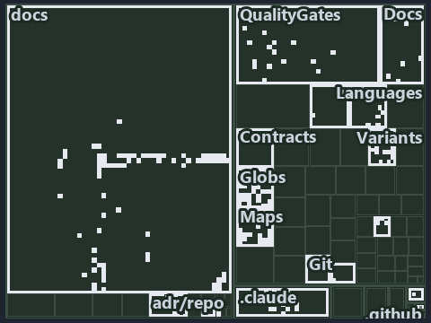

---
catzc:
  immutable:
    with_body_sha: "99bc1d76a394"
    repo_status: locked
    path: docs/explanation/.assets/tree/adr-dsgn-track--unit-to-pipeline-rule-is-review-only--governance.tree.md
    source: docs/explanation/.assets/adr-dsgn-track--unit-to-pipeline-rule-is-review-only--governance.drawio.png
    kind: asset-description
    language: markdown
    filetype: md
    track: docs
    tracktype: documentation
---

# Tracks and deployable-units have a gate in code, but one unit to one pipeline is held by review alone: the tree minimap

```text
Which files cite ADR-DSGN-TRACK, ADR-FLOW-CD-GLOBS and ADR-REPO-FOLDERS: every file of the world map is a tile, grouped by top-level folder.
221 files lit in 19 groups.
```



This is the tree minimap in the sidebar of the governance diagram of [Tracks and deployable-units have a gate in code, but one unit to one
pipeline is held by review alone][222], which explains [ADR-DSGN-TRACK][1], [ADR-FLOW-CD-GLOBS][2] and [ADR-REPO-FOLDERS][3]. It lights
every file that cites those codes, grouped by folder, so it shows which files carry the decision. Each lit group has its reason below,
naming the code that selects it.

## What the minimap shows

The tree draws every file of the world map as a tile, grouped by top-level folder (under `automation/` by module, under `docs/adr/` by ADR
domain), and lights 221 files in 19 groups, filled in ink. A lit ADR file has a white rim; a file lit only by passing mentions is a lighter
ink. Every other tile is idle, a grey box: a file the slide's ADR codes do not select.

- docs (docs/ outside docs/adr/): 75 lit files
- Globs (automation/Catzc.Base.Globs): 37 lit files
- Maps (automation/Catzc.Base.Maps): 28 lit files
- QualityGates (automation/Catzc.Base.QualityGates): 16 lit files
- .claude: 14 lit files
- Variants (automation/Catzc.Base.Variants): 12 lit files
- Languages (automation/Catzc.Base.Languages): 10 lit files
- Docs (automation/Catzc.Base.Docs): 9 lit files
- Az.DevOps.BuildValidation (automation/Catzc.Azure.DevOps.BuildValidation): 4 lit files
- Git (automation/Catzc.Base.Git): 2 lit files
- ModuleSystem (automation/Catzc.Base.ModuleSystem): 2 lit files
- adr/* (the files directly in docs/adr/): 2 lit files
- adr/dsgn (docs/adr/design): 2 lit files
- adr/flow (docs/adr/flow): 2 lit files
- adr/repo (docs/adr/repository): 2 lit files
- .github: 1 lit file
- Contracts (automation/Catzc.Base.Contracts): 1 lit file
- Exporter (automation/Catzc.Base.Exporter): 1 lit file
- pipelines: 1 lit file

## Why each group is lit

### docs (docs/ outside docs/adr/, 75 lit files)

The group holds the files of docs/ outside docs/adr/; each sits in its world-map cell and is lit by:

- [docs/how-to/automation/manual-test-plan/pipelines-and-globs.md][4], in the cell docs × markdown: selected by [ADR-FLOW-CD-GLOBS][2]: the
  file cites it at line 15 (text) and line 35 (text).
- [docs/how-to/automation/manual-test-plan/repository-conventions.md][5], in the cell docs × markdown: selected by [ADR-DSGN-TRACK][1]: the
  file cites it at line 16 (text), line 39 (text), line 45 (text), line 45 (text), line 48 (text), line 48 (text), line 50 (text), line 50
  (text), line 50 (text), line 51 (text), line 52 (text) and line 54 (text).
- [docs/how-to/automation/sort-an-import.md][6], in the cell docs × markdown: selected by [ADR-DSGN-TRACK][1]: the file cites it at line 15
  (text) and line 23 (text).
- [docs/references/.assets/automation/catzc-base-globs/protected-module-skip-by-hash.drawio.verify.md][7], in the cell docs × markdown:
  selected by [ADR-FLOW-CD-GLOBS][2]: the file cites it at line 16 (text) and line 75 (text).
- [docs/references/automation/catzc-azure-devops-buildvalidation/Register-AdoBuildValidation.ps1.md][8], in the cell docs × markdown:
  selected by [ADR-FLOW-CD-GLOBS][2]: the file cites it at line 29 (text).
- [docs/references/automation/catzc-azure-devops-buildvalidation/configs/build-validation.yml.md][9], in the cell docs × markdown: selected
  by [ADR-FLOW-CD-GLOBS][2]: the file cites it at line 35 (text).
- [docs/references/automation/catzc-base-docs/configs/adrs.yml.md][10], in the cell docs × markdown: selected by [ADR-DSGN-TRACK][1]: the
  file cites it at line 17 (text), line 40 (text) and line 41 (text).
- [docs/references/automation/catzc-base-docs/types/AdrDomain.cs.md][11], in the cell docs × markdown: selected by [ADR-DSGN-TRACK][1]: the
  file cites it at line 18 (text), line 36 (text) and line 37 (text).
- [docs/references/automation/catzc-base-docs/types/AdrRuleSet.cs.md][12], in the cell docs × markdown: selected by [ADR-DSGN-TRACK][1]: the
  file cites it at line 18 (text) and line 38 (text).
- [docs/references/automation/catzc-base-docs/types/AdrsConfig.cs.md][13], in the cell docs × markdown: selected by [ADR-DSGN-TRACK][1]: the
  file cites it at line 21 (text), line 55 (text), line 58 (text) and line 70 (text).
- [docs/references/automation/catzc-base-globs.md][14], in the cell docs × markdown: selected by [ADR-FLOW-CD-GLOBS][2]: the file cites it
  at line 50 (text).
- [docs/references/automation/catzc-base-globs/Get-ModuleGlobSet.ps1.md][15], in the cell docs × markdown: selected by
  [ADR-FLOW-CD-GLOBS][2]: the file cites it at line 20 (text), line 35 (text), line 38 (text) and line 86 (text).
- [docs/references/automation/catzc-base-globs/Test-GlobSetIndependence.ps1.md][16], in the cell docs × markdown: selected by
  [ADR-FLOW-CD-GLOBS][2]: the file cites it at line 17 (text), line 31 (text) and line 41 (text).
- [docs/references/automation/catzc-base-globs/configs/globs.yml.md][17], in the cell docs × markdown: selected by [ADR-DSGN-TRACK][1]: the
  file cites it at line 17 (text) and line 126 (text); selected by [ADR-FLOW-CD-GLOBS][2]: the file cites it at line 18 (text), line 33
  (text), line 38 (text), line 46 (text), line 48 (text), line 62 (text), line 92 (text) and line 106 (text).
- [docs/references/automation/catzc-base-globs/protected-module-skip-by-hash.drawio.md][18], in the cell docs × markdown: selected by
  [ADR-FLOW-CD-GLOBS][2]: the file cites it at line 16 (text), line 55 (text) and line 130 (text).
- [docs/references/automation/catzc-base-globs/tests/Get-ChangedFile.Tests.ps1.md][19], in the cell docs × markdown: selected by
  [ADR-FLOW-CD-GLOBS][2]: the file cites it at line 17 (text) and line 32 (text).
- [docs/references/automation/catzc-base-globs/tests/Get-ChangedGlobSet.Tests.ps1.md][20], in the cell docs × markdown: selected by
  [ADR-FLOW-CD-GLOBS][2]: the file cites it at line 18 (text) and line 32 (text).
- [docs/references/automation/catzc-base-globs/tests/Get-GlobSetFile.Tests.ps1.md][21], in the cell docs × markdown: selected by
  [ADR-FLOW-CD-GLOBS][2]: the file cites it at line 17 (text), line 31 (text) and line 32 (text).
- [docs/references/automation/catzc-base-globs/tests/Get-GlobSetHash.Tests.ps1.md][22], in the cell docs × markdown: selected by
  [ADR-FLOW-CD-GLOBS][2]: the file cites it at line 17 (text) and line 32 (text).
- [docs/references/automation/catzc-base-globs/tests/Get-GlobSetMember.Tests.ps1.md][23], in the cell docs × markdown: selected by
  [ADR-FLOW-CD-GLOBS][2]: the file cites it at line 17 (text) and line 31 (text).
- [docs/references/automation/catzc-base-globs/tests/Get-GlobSetTrigger.Tests.ps1.md][24], in the cell docs × markdown: selected by
  [ADR-FLOW-CD-GLOBS][2]: the file cites it at line 17 (text) and line 31 (text).
- [docs/references/automation/catzc-base-globs/tests/Get-PipelineTrigger.Tests.ps1.md][25], in the cell docs × markdown: selected by
  [ADR-FLOW-CD-GLOBS][2]: the file cites it at line 17 (text) and line 31 (text).
- [docs/references/automation/catzc-base-globs/tests/Get-TrackedFile.Tests.ps1.md][26], in the cell docs × markdown: selected by
  [ADR-FLOW-CD-GLOBS][2]: the file cites it at line 17 (text) and line 30 (text).
- [docs/references/automation/catzc-base-globs/tests/GlobSet-Independence.Tests.ps1.md][27], in the cell docs × markdown: selected by
  [ADR-FLOW-CD-GLOBS][2]: the file cites it at line 17 (text) and line 31 (text).
- [docs/references/automation/catzc-base-globs/tests/GlobSetTrigger-Coverage.Tests.ps1.md][28], in the cell docs × markdown: selected by
  [ADR-FLOW-CD-GLOBS][2]: the file cites it at line 18 (text) and line 32 (text).
- [docs/references/automation/catzc-base-globs/tests/PipelineTrigger-Integrity.Tests.ps1.md][29], in the cell docs × markdown: selected by
  [ADR-FLOW-CD-GLOBS][2]: the file cites it at line 17 (text) and line 32 (text).
- [docs/references/automation/catzc-base-globs/tests/Test-GlobSetIndependence.Tests.ps1.md][30], in the cell docs × markdown: selected by
  [ADR-FLOW-CD-GLOBS][2]: the file cites it at line 18 (text) and line 33 (text).
- [docs/references/automation/catzc-base-globs/tests/types/GlobPattern.Tests.ps1.md][31], in the cell docs × markdown: selected by
  [ADR-FLOW-CD-GLOBS][2]: the file cites it at line 17 (text), line 30 (text) and line 32 (text).
- [docs/references/automation/catzc-base-globs/tests/types/GlobSet.Tests.ps1.md][32], in the cell docs × markdown: selected by
  [ADR-FLOW-CD-GLOBS][2]: the file cites it at line 17 (text), line 31 (text) and line 33 (text).
- [docs/references/automation/catzc-base-globs/tests/types/GlobsConfig.Tests.ps1.md][33], in the cell docs × markdown: selected by
  [ADR-FLOW-CD-GLOBS][2]: the file cites it at line 18 (text), line 34 (text), line 36 (text) and line 45 (text).
- [docs/references/automation/catzc-base-globs/types/Aspect.cs.md][34], in the cell docs × markdown: selected by [ADR-FLOW-CD-GLOBS][2]: the
  file cites it at line 18 (text) and line 39 (text).
- [docs/references/automation/catzc-base-globs/types/DurableHash.cs.md][35], in the cell docs × markdown: selected by
  [ADR-FLOW-CD-GLOBS][2]: the file cites it at line 17 (text), line 30 (text) and line 36 (text).
- [docs/references/automation/catzc-base-globs/types/GlobPattern.cs.md][36], in the cell docs × markdown: selected by
  [ADR-FLOW-CD-GLOBS][2]: the file cites it at line 17 (text), line 36 (text), line 37 (text) and line 38 (text).
- [docs/references/automation/catzc-base-globs/types/GlobSet.cs.md][37], in the cell docs × markdown: selected by [ADR-FLOW-CD-GLOBS][2]:
  the file cites it at line 17 (text), line 32 (text), line 34 (text), line 35 (text), line 41 (text), line 44 (text), line 46 (text), line
  49 (text), line 57 (text), line 66 (text), line 84 (text), line 101 (text), line 111 (text), line 135 (text) and line 143 (text).
- [docs/references/automation/catzc-base-globs/types/GlobsConfig.cs.md][38], in the cell docs × markdown: selected by
  [ADR-FLOW-CD-GLOBS][2]: the file cites it at line 17 (text), line 32 (text), line 36 (text), line 39 (text) and line 58 (text).
- [docs/references/automation/catzc-base-languages.md][39], in the cell docs × markdown: selected by [ADR-REPO-FOLDERS][3]: the file cites
  it at line 78 (text) and line 108 (text).
- [docs/references/automation/catzc-base-languages/configs/languages.yml.md][40], in the cell docs × markdown: selected by
  [ADR-DSGN-TRACK][1]: the file cites it at line 18 (text) and line 35 (text).
- [docs/references/automation/catzc-base-languages/tests/Get-FileLanguage.Tests.ps1.md][41], in the cell docs × markdown: selected by
  [ADR-DSGN-TRACK][1]: the file cites it at line 17 (text) and line 32 (text).
- [docs/references/automation/catzc-base-languages/types/BashConfig.cs.md][42], in the cell docs × markdown: selected by
  [ADR-REPO-FOLDERS][3]: the file cites it at line 18 (text) and line 42 (text).
- [docs/references/automation/catzc-base-languages/types/FileLanguage.cs.md][43], in the cell docs × markdown: selected by
  [ADR-DSGN-TRACK][1]: the file cites it at line 18 (text) and line 32 (text).
- [docs/references/automation/catzc-base-languages/types/GoConfig.cs.md][44], in the cell docs × markdown: selected by
  [ADR-REPO-FOLDERS][3]: the file cites it at line 19 (text) and line 46 (text).
- [docs/references/automation/catzc-base-languages/types/LanguagesConfig.cs.md][45], in the cell docs × markdown: selected by
  [ADR-DSGN-TRACK][1]: the file cites it at line 19 (text) and line 35 (text).
- [docs/references/automation/catzc-base-languages/types/PythonConfig.cs.md][46], in the cell docs × markdown: selected by
  [ADR-REPO-FOLDERS][3]: the file cites it at line 18 (text) and line 45 (text).
- [docs/references/automation/catzc-base-maps.md][47], in the cell docs × markdown: selected by [ADR-DSGN-TRACK][1]: the file cites it at
  line 15 (text), line 96 (text), line 98 (text) and line 110 (text).
- [docs/references/automation/catzc-base-maps/configs/maps.yml.md][48], in the cell docs × markdown: selected by [ADR-DSGN-TRACK][1]: the
  file cites it at line 18 (text), line 57 (text), line 63 (text), line 65 (text) and line 70 (text).
- [docs/references/automation/catzc-base-maps/tests/Get-ValueChainHighlight.Tests.ps1.md][49], in the cell docs × markdown: selected by
  [ADR-DSGN-TRACK][1]: the file cites it at line 18 (text), line 32 (text) and line 33 (text).
- [docs/references/automation/catzc-base-maps/tests/Get-ValueChainMap.Tests.ps1.md][50], in the cell docs × markdown: selected by
  [ADR-DSGN-TRACK][1]: the file cites it at line 18 (text) and line 32 (text).
- [docs/references/automation/catzc-base-maps/tests/Get-WorldMap.Tests.ps1.md][51], in the cell docs × markdown: selected by
  [ADR-DSGN-TRACK][1]: the file cites it at line 17 (text) and line 31 (text).
- [docs/references/automation/catzc-base-maps/tests/Test-ValueChainMap.Tests.ps1.md][52], in the cell docs × markdown: selected by
  [ADR-DSGN-TRACK][1]: the file cites it at line 18 (text), line 32 (text), line 33 (text) and line 34 (text).
- [docs/references/automation/catzc-base-maps/tests/Test-WorldMap.Tests.ps1.md][53], in the cell docs × markdown: selected by
  [ADR-DSGN-TRACK][1]: the file cites it at line 18 (text), line 32 (text) and line 33 (text).
- [docs/references/automation/catzc-base-maps/tests/types/ValueChainHighlight.Tests.ps1.md][54], in the cell docs × markdown: selected by
  [ADR-DSGN-TRACK][1]: the file cites it at line 18 (text), line 32 (text) and line 33 (text).
- [docs/references/automation/catzc-base-maps/tests/types/ValueChainMap.Tests.ps1.md][55], in the cell docs × markdown: selected by
  [ADR-DSGN-TRACK][1]: the file cites it at line 18 (text) and line 32 (text).
- [docs/references/automation/catzc-base-maps/types/MapCell.cs.md][56], in the cell docs × markdown: selected by [ADR-DSGN-TRACK][1]: the
  file cites it at line 18 (text), line 32 (text), line 33 (text) and line 34 (text).
- [docs/references/automation/catzc-base-maps/types/MapsLabels.cs.md][57], in the cell docs × markdown: selected by [ADR-DSGN-TRACK][1]: the
  file cites it at line 19 (text), line 36 (text), line 37 (text) and line 41 (text).
- [docs/references/automation/catzc-base-maps/types/ValueChainCell.cs.md][58], in the cell docs × markdown: selected by [ADR-DSGN-TRACK][1]:
  the file cites it at line 18 (text), line 32 (text) and line 33 (text).
- [docs/references/automation/catzc-base-maps/types/ValueChainHighlight.cs.md][59], in the cell docs × markdown: selected by
  [ADR-DSGN-TRACK][1]: the file cites it at line 17 (text), line 32 (text) and line 33 (text).
- [docs/references/automation/catzc-base-maps/types/ValueChainMap.cs.md][60], in the cell docs × markdown: selected by [ADR-DSGN-TRACK][1]:
  the file cites it at line 17 (text), line 32 (text), line 33 (text) and line 35 (text).
- [docs/references/automation/catzc-base-maps/types/ValueChainReason.cs.md][61], in the cell docs × markdown: selected by
  [ADR-DSGN-TRACK][1]: the file cites it at line 18 (text), line 32 (text) and line 34 (text).
- [docs/references/automation/catzc-base-maps/types/WorldMap.cs.md][62], in the cell docs × markdown: selected by [ADR-DSGN-TRACK][1]: the
  file cites it at line 17 (text), line 33 (text) and line 34 (text).
- [docs/references/automation/catzc-base-maps/types/WorldMapBuilder.cs.md][63], in the cell docs × markdown: selected by
  [ADR-DSGN-TRACK][1]: the file cites it at line 18 (text), line 39 (text), line 40 (text), line 43 (text) and line 86 (text).
- [docs/references/automation/catzc-base-maps/types/WorldMapGridLayout.cs.md][64], in the cell docs × markdown: selected by
  [ADR-DSGN-TRACK][1]: the file cites it at line 18 (text), line 33 (text) and line 34 (text).
- [docs/references/automation/catzc-base-maps/types/WorldMapHighlight.cs.md][65], in the cell docs × markdown: selected by
  [ADR-DSGN-TRACK][1]: the file cites it at line 17 (text) and line 32 (text).
- [docs/references/automation/catzc-base-maps/types/WorldMapPdf.cs.md][66], in the cell docs × markdown: selected by [ADR-DSGN-TRACK][1]:
  the file cites it at line 17 (text), line 33 (text), line 34 (text) and line 35 (text).
- [docs/references/automation/catzc-base-modulesystem/Test-FolderConventions.ps1.md][67], in the cell docs × markdown: selected by
  [ADR-REPO-FOLDERS][3]: the file cites it at line 17 (text) and line 40 (text).
- [docs/references/automation/catzc-base-qualitygates/private/Get-ModuleProtectionIdentity.ps1.md][68], in the cell docs × markdown:
  selected by [ADR-FLOW-CD-GLOBS][2]: the file cites it at line 17 (text) and line 70 (text).
- [docs/references/automation/catzc-base-variants/configs/variants.yml.md][69], in the cell docs × markdown: selected by
  [ADR-DSGN-TRACK][1]: the file cites it at line 17 (text), line 94 (text), line 97 (text) and line 99 (text).
- [docs/references/automation/catzc-base-variants/types/VariantTrack.cs.md][70], in the cell docs × markdown: selected by
  [ADR-DSGN-TRACK][1]: the file cites it at line 18 (text), line 31 (text) and line 33 (text).
- [docs/references/automation/catzc-base-variants/types/VariantsConfig.cs.md][71], in the cell docs × markdown: selected by
  [ADR-DSGN-TRACK][1]: the file cites it at line 18 (text), line 52 (text), line 55 (text) and line 57 (text).
- [docs/references/note-file-kind.md][72], in the cell docs × markdown: selected by [ADR-DSGN-TRACK][1]: the file cites it at line 15
  (text), line 37 (text), line 51 (text) and line 54 (text).
- [docs/references/pipelines/cd-apex.yaml.md][73], in the cell docs × markdown: selected by [ADR-FLOW-CD-GLOBS][2]: the file cites it at
  line 47 (text).
- [docs/references/pipelines/cd-flux.yaml.md][74], in the cell docs × markdown: selected by [ADR-FLOW-CD-GLOBS][2]: the file cites it at
  line 46 (text).
- [docs/references/pipelines/cd-nova.yaml.md][75], in the cell docs × markdown: selected by [ADR-FLOW-CD-GLOBS][2]: the file cites it at
  line 46 (text).
- [docs/references/pipelines/cd-shared.yaml.md][76], in the cell docs × markdown: selected by [ADR-FLOW-CD-GLOBS][2]: the file cites it at
  line 41 (text).
- [docs/references/pipelines/ci-automation.yaml.md][77], in the cell docs × markdown: selected by [ADR-DSGN-TRACK][1]: the file cites it at
  line 17 (text) and line 32 (text); selected by [ADR-FLOW-CD-GLOBS][2]: the file cites it at line 31 (text).
- [docs/references/pipelines/ci-infrastructure.yaml.md][78], in the cell docs × markdown: selected by [ADR-FLOW-CD-GLOBS][2]: the file cites
  it at line 33 (text).

### Globs (automation/Catzc.Base.Globs, 37 lit files)

The group holds the files of automation/Catzc.Base.Globs; each sits in its world-map cell and is lit by:

- [automation/Catzc.Base.Globs/Get-ChangedGlobSet.ps1][79], in the cell automation × powershell: selected by [ADR-FLOW-CD-GLOBS][2]: the
  file cites it at line 20 (header) and line 26 (header).
- [automation/Catzc.Base.Globs/Get-GlobSet.ps1][80], in the cell automation × powershell: selected by [ADR-FLOW-CD-GLOBS][2]: the file cites
  it at line 20 (header) and line 25 (header).
- [automation/Catzc.Base.Globs/Get-GlobSetFile.ps1][81], in the cell automation × powershell: selected by [ADR-FLOW-CD-GLOBS][2]: the file
  cites it at line 20 (header), line 25 (header) and line 28 (header).
- [automation/Catzc.Base.Globs/Get-GlobSetHash.ps1][82], in the cell automation × powershell: selected by [ADR-FLOW-CD-GLOBS][2]: the file
  cites it at line 20 (header) and line 28 (header).
- [automation/Catzc.Base.Globs/Get-GlobSetTrigger.ps1][83], in the cell automation × powershell: selected by [ADR-FLOW-CD-GLOBS][2]: the
  file cites it at line 20 (header) and line 25 (header).
- [automation/Catzc.Base.Globs/Get-MarkerBlastRadius.ps1][84], in the cell automation × powershell: selected by [ADR-FLOW-CD-GLOBS][2]: the
  file cites it at line 21 (header) and line 27 (header).
- [automation/Catzc.Base.Globs/Get-ModuleGlobSet.ps1][85], in the cell automation × powershell: selected by [ADR-FLOW-CD-GLOBS][2]: the file
  cites it at line 26 (header).
- [automation/Catzc.Base.Globs/Get-TrackedFile.ps1][86], in the cell automation × powershell: selected by [ADR-FLOW-CD-GLOBS][2]: the file
  cites it at line 21 (header) and line 26 (header).
- [automation/Catzc.Base.Globs/Test-AdoPipelineTriggerGlob.ps1][87], in the cell automation × powershell: selected by
  [ADR-FLOW-CD-GLOBS][2]: the file cites it at line 22 (header).
- [automation/Catzc.Base.Globs/Test-GitHubWorkflowTriggerGlob.ps1][88], in the cell automation × powershell: selected by
  [ADR-FLOW-CD-GLOBS][2]: the file cites it at line 22 (header).
- [automation/Catzc.Base.Globs/Test-GlobSetAffected.ps1][89], in the cell automation × powershell: selected by [ADR-FLOW-CD-GLOBS][2]: the
  file cites it at line 22 (header) and line 33 (header).
- [automation/Catzc.Base.Globs/Test-GlobSetIndependence.ps1][90], in the cell automation × powershell: selected by [ADR-FLOW-CD-GLOBS][2]:
  the file cites it at line 23 (header), line 36 (header) and line 95 (text).
- [automation/Catzc.Base.Globs/Test-GlobSetTriggerCoverage.ps1][91], in the cell automation × powershell: selected by
  [ADR-FLOW-CD-GLOBS][2]: the file cites it at line 22 (header) and line 28 (header).
- [automation/Catzc.Base.Globs/private/Get-ChangedFile.ps1][92], in the cell automation × powershell: selected by [ADR-FLOW-CD-GLOBS][2]:
  the file cites it at line 21 (header) and line 28 (header).
- [automation/Catzc.Base.Globs/private/Get-GlobSetMember.ps1][93], in the cell automation × powershell: selected by [ADR-FLOW-CD-GLOBS][2]:
  the file cites it at line 21 (header) and line 26 (header).
- [automation/Catzc.Base.Globs/private/Get-PipelineTrigger.ps1][94], in the cell automation × powershell: selected by
  [ADR-FLOW-CD-GLOBS][2]: the file cites it at line 21 (header) and line 27 (header).
- [automation/Catzc.Base.Globs/private/Test-GlobListEqual.ps1][95], in the cell automation × powershell: selected by [ADR-FLOW-CD-GLOBS][2]:
  the file cites it at line 21 (header) and line 31 (header).
- [automation/Catzc.Base.Globs/tests/Get-ChangedFile.Tests.ps1][96], in the cell automation × powershell: selected by
  [ADR-FLOW-CD-GLOBS][2]: the file cites it at line 20 (header).
- [automation/Catzc.Base.Globs/tests/Get-ChangedGlobSet.Tests.ps1][97], in the cell automation × powershell: selected by
  [ADR-FLOW-CD-GLOBS][2]: the file cites it at line 21 (header).
- [automation/Catzc.Base.Globs/tests/Get-GlobSetFile.Tests.ps1][98], in the cell automation × powershell: selected by
  [ADR-FLOW-CD-GLOBS][2]: the file cites it at line 20 (header).
- [automation/Catzc.Base.Globs/tests/Get-GlobSetHash.Tests.ps1][99], in the cell automation × powershell: selected by
  [ADR-FLOW-CD-GLOBS][2]: the file cites it at line 20 (header).
- [automation/Catzc.Base.Globs/tests/Get-GlobSetMember.Tests.ps1][100], in the cell automation × powershell: selected by
  [ADR-FLOW-CD-GLOBS][2]: the file cites it at line 20 (header).
- [automation/Catzc.Base.Globs/tests/Get-GlobSetTrigger.Tests.ps1][101], in the cell automation × powershell: selected by
  [ADR-FLOW-CD-GLOBS][2]: the file cites it at line 20 (header).
- [automation/Catzc.Base.Globs/tests/Get-PipelineTrigger.Tests.ps1][102], in the cell automation × powershell: selected by
  [ADR-FLOW-CD-GLOBS][2]: the file cites it at line 20 (header).
- [automation/Catzc.Base.Globs/tests/Get-TrackedFile.Tests.ps1][103], in the cell automation × powershell: selected by
  [ADR-FLOW-CD-GLOBS][2]: the file cites it at line 20 (header).
- [automation/Catzc.Base.Globs/tests/GlobSet-Independence.Tests.ps1][104], in the cell automation × powershell: selected by
  [ADR-FLOW-CD-GLOBS][2]: the file cites it at line 20 (header), line 25 (text) and line 27 (text).
- [automation/Catzc.Base.Globs/tests/GlobSetTrigger-Coverage.Tests.ps1][105], in the cell automation × powershell: selected by
  [ADR-FLOW-CD-GLOBS][2]: the file cites it at line 21 (header).
- [automation/Catzc.Base.Globs/tests/PipelineTrigger-Integrity.Tests.ps1][106], in the cell automation × powershell: selected by
  [ADR-FLOW-CD-GLOBS][2]: the file cites it at line 20 (header).
- [automation/Catzc.Base.Globs/tests/Test-GlobSetIndependence.Tests.ps1][107], in the cell automation × powershell: selected by
  [ADR-FLOW-CD-GLOBS][2]: the file cites it at line 21 (header).
- [automation/Catzc.Base.Globs/tests/types/GlobPattern.Tests.ps1][108], in the cell automation × powershell: selected by
  [ADR-FLOW-CD-GLOBS][2]: the file cites it at line 20 (header) and line 81 (text).
- [automation/Catzc.Base.Globs/tests/types/GlobSet.Tests.ps1][109], in the cell automation × powershell: selected by [ADR-FLOW-CD-GLOBS][2]:
  the file cites it at line 20 (header) and line 32 (text).
- [automation/Catzc.Base.Globs/tests/types/GlobsConfig.Tests.ps1][110], in the cell automation × powershell: selected by
  [ADR-DSGN-TRACK][1]: the file cites it at line 21 (header) and line 66 (text); selected by [ADR-FLOW-CD-GLOBS][2]: the file cites it at
  line 22 (header), line 78 (text), line 91 (text), line 102 (text) and line 114 (text).
- [automation/Catzc.Base.Globs/types/Aspect.cs][111], in the cell automation × csharp: selected by [ADR-FLOW-CD-GLOBS][2]: the file cites it
  at line 22 (text).
- [automation/Catzc.Base.Globs/types/DurableHash.cs][112], in the cell automation × csharp: selected by [ADR-FLOW-CD-GLOBS][2]: the file
  cites it at line 20 (text).
- [automation/Catzc.Base.Globs/types/GlobPattern.cs][113], in the cell automation × csharp: selected by [ADR-FLOW-CD-GLOBS][2]: the file
  cites it at line 21 (text), line 47 (text), line 51 (text), line 55 (text), line 67 (text), line 71 (text) and line 80 (text).
- [automation/Catzc.Base.Globs/types/GlobSet.cs][114], in the cell automation × csharp: selected by [ADR-FLOW-CD-GLOBS][2]: the file cites
  it at line 21 (text) and line 79 (text).
- [automation/Catzc.Base.Globs/types/GlobsConfig.cs][115], in the cell automation × csharp: selected by [ADR-FLOW-CD-GLOBS][2]: the file
  cites it at line 21 (text), line 98 (text), line 161 (text), line 165 (text) and line 179 (text).

### Maps (automation/Catzc.Base.Maps, 28 lit files)

The group holds the files of automation/Catzc.Base.Maps; each sits in its world-map cell and is lit by:

- [automation/Catzc.Base.Maps/Export-WorldMapPdf.ps1][116], in the cell automation × powershell: selected by [ADR-DSGN-TRACK][1]: the file
  cites it at line 20 (header), line 30 (header), line 31 (header), line 33 (header) and line 49 (header).
- [automation/Catzc.Base.Maps/Get-ValueChainHighlight.ps1][117], in the cell automation × powershell: selected by [ADR-DSGN-TRACK][1]: the
  file cites it at line 21 (header), line 30 (header), line 31 (header) and line 42 (header).
- [automation/Catzc.Base.Maps/Get-ValueChainMap.ps1][118], in the cell automation × powershell: selected by [ADR-DSGN-TRACK][1]: the file
  cites it at line 20 (header), line 27 (header), line 29 (header) and line 31 (header).
- [automation/Catzc.Base.Maps/Get-WorldMap.ps1][119], in the cell automation × powershell: selected by [ADR-DSGN-TRACK][1]: the file cites
  it at line 23 (header), line 30 (header), line 31 (header) and line 43 (header).
- [automation/Catzc.Base.Maps/Get-WorldMapHighlight.ps1][120], in the cell automation × powershell: selected by [ADR-DSGN-TRACK][1]: the
  file cites it at line 20 (header), line 33 (header) and line 50 (header).
- [automation/Catzc.Base.Maps/Test-ValueChainMap.ps1][121], in the cell automation × powershell: selected by [ADR-DSGN-TRACK][1]: the file
  cites it at line 23 (header), line 37 (header), line 39 (header), line 42 (header), line 46 (header), line 77 (text), line 78 (text), line
  88 (text), line 91 (text) and line 108 (text).
- [automation/Catzc.Base.Maps/Test-WorldMap.ps1][122], in the cell automation × powershell: selected by [ADR-DSGN-TRACK][1]: the file cites
  it at line 22 (header), line 34 (header), line 37 (header), line 41 (header), line 46 (header), line 47 (header), line 90 (text), line 109
  (text), line 126 (text), line 130 (text) and line 131 (text).
- [automation/Catzc.Base.Maps/private/Resolve-MapLabelTerm.ps1][123], in the cell automation × powershell: selected by [ADR-DSGN-TRACK][1]:
  the file cites it at line 21 (header), line 29 (header) and line 30 (header).
- [automation/Catzc.Base.Maps/tests/Get-ValueChainHighlight.Tests.ps1][124], in the cell automation × powershell: selected by
  [ADR-DSGN-TRACK][1]: the file cites it at line 21 (header), line 42 (text), line 48 (text) and line 67 (text).
- [automation/Catzc.Base.Maps/tests/Get-ValueChainMap.Tests.ps1][125], in the cell automation × powershell: selected by [ADR-DSGN-TRACK][1]:
  the file cites it at line 21 (header), line 42 (text), line 61 (text) and line 61 (body comment).
- [automation/Catzc.Base.Maps/tests/Get-WorldMap.Tests.ps1][126], in the cell automation × powershell: selected by [ADR-DSGN-TRACK][1]: the
  file cites it at line 20 (header) and line 112 (text).
- [automation/Catzc.Base.Maps/tests/Get-WorldMapHighlight.Tests.ps1][127], in the cell automation × powershell: selected by
  [ADR-DSGN-TRACK][1]: the file cites it at line 19 (header) and line 97 (text).
- [automation/Catzc.Base.Maps/tests/Test-ValueChainMap.Tests.ps1][128], in the cell automation × powershell: selected by
  [ADR-DSGN-TRACK][1]: the file cites it at line 21 (header), line 73 (text), line 73 (body comment), line 77 (text), line 78 (text), line
  79 (text), line 80 (text), line 84 (text), line 87 (text), line 104 (text), line 104 (body comment) and line 104 (body comment).
- [automation/Catzc.Base.Maps/tests/Test-WorldMap.Tests.ps1][129], in the cell automation × powershell: selected by [ADR-DSGN-TRACK][1]: the
  file cites it at line 21 (header), line 81 (text), line 85 (text), line 88 (text), line 92 (text), line 93 (text), line 97 (text), line
  106 (text), line 107 (text), line 111 (text), line 115 (text), line 116 (text), line 135 (text), line 135 (body comment) and line 135
  (body comment).
- [automation/Catzc.Base.Maps/tests/types/ValueChainHighlight.Tests.ps1][130], in the cell automation × powershell: selected by
  [ADR-DSGN-TRACK][1]: the file cites it at line 21 (header), line 40 (text), line 47 (text), line 53 (text), line 70 (text) and line 70
  (body comment).
- [automation/Catzc.Base.Maps/tests/types/ValueChainMap.Tests.ps1][131], in the cell automation × powershell: selected by
  [ADR-DSGN-TRACK][1]: the file cites it at line 21 (header), line 42 (text), line 51 (text), line 56 (text) and line 64 (text).
- [automation/Catzc.Base.Maps/tests/types/WorldMapHighlight.Tests.ps1][132], in the cell automation × powershell: selected by
  [ADR-DSGN-TRACK][1]: the file cites it at line 19 (header), line 91 (text), line 135 (text) and line 149 (text).
- [automation/Catzc.Base.Maps/types/MapCell.cs][133], in the cell automation × csharp: selected by [ADR-DSGN-TRACK][1]: the file cites it at
  line 21 (text).
- [automation/Catzc.Base.Maps/types/MapsLabels.cs][134], in the cell automation × csharp: selected by [ADR-DSGN-TRACK][1]: the file cites it
  at line 22 (text).
- [automation/Catzc.Base.Maps/types/ValueChainCell.cs][135], in the cell automation × csharp: selected by [ADR-DSGN-TRACK][1]: the file
  cites it at line 21 (text), line 33 (body comment) and line 36 (body comment).
- [automation/Catzc.Base.Maps/types/ValueChainHighlight.cs][136], in the cell automation × csharp: selected by [ADR-DSGN-TRACK][1]: the file
  cites it at line 21 (text).
- [automation/Catzc.Base.Maps/types/ValueChainMap.cs][137], in the cell automation × csharp: selected by [ADR-DSGN-TRACK][1]: the file cites
  it at line 21 (text).
- [automation/Catzc.Base.Maps/types/ValueChainReason.cs][138], in the cell automation × csharp: selected by [ADR-DSGN-TRACK][1]: the file
  cites it at line 21 (text).
- [automation/Catzc.Base.Maps/types/WorldMap.cs][139], in the cell automation × csharp: selected by [ADR-DSGN-TRACK][1]: the file cites it
  at line 20 (text).
- [automation/Catzc.Base.Maps/types/WorldMapBuilder.cs][140], in the cell automation × csharp: selected by [ADR-DSGN-TRACK][1]: the file
  cites it at line 22 (text).
- [automation/Catzc.Base.Maps/types/WorldMapGridLayout.cs][141], in the cell automation × csharp: selected by [ADR-DSGN-TRACK][1]: the file
  cites it at line 21 (text).
- [automation/Catzc.Base.Maps/types/WorldMapHighlight.cs][142], in the cell automation × csharp: selected by [ADR-DSGN-TRACK][1]: the file
  cites it at line 21 (text).
- [automation/Catzc.Base.Maps/types/WorldMapPdf.cs][143], in the cell automation × csharp: selected by [ADR-DSGN-TRACK][1]: the file cites
  it at line 21 (text).

### QualityGates (automation/Catzc.Base.QualityGates, 16 lit files)

The group holds the files of automation/Catzc.Base.QualityGates; each sits in its world-map cell and is lit by:

- [automation/Catzc.Base.QualityGates/Test-Automation.ps1][144], in the cell automation × powershell: selected by [ADR-FLOW-CD-GLOBS][2]:
  the file cites it at line 23 (header) and line 102 (header).
- [automation/Catzc.Base.QualityGates/Test-Plans.ps1][145], in the cell automation × powershell: selected by [ADR-REPO-FOLDERS][3]: the file
  cites it at line 22 (header), line 30 (header) and line 102 (text).
- [automation/Catzc.Base.QualityGates/configs/source-conventions.yml][146], in the cell automation × yaml: selected by [ADR-DSGN-TRACK][1]:
  the file cites it at line 26 (text).
- [automation/Catzc.Base.QualityGates/configs/terminology.yml][147], in the cell automation × yaml: selected by [ADR-DSGN-TRACK][1]: the
  file cites it at line 316 (text) and line 319 (text); selected by [ADR-FLOW-CD-GLOBS][2]: the file cites it at line 1235 (text).
- [automation/Catzc.Base.QualityGates/private/Get-ContentExemptPath.ps1][148], in the cell automation × powershell: selected by
  [ADR-DSGN-TRACK][1]: the file cites it at line 21 (header) and line 34 (header).
- [automation/Catzc.Base.QualityGates/private/Get-FileTypeFileMetaFact.ps1][149], in the cell automation × powershell: selected by
  [ADR-DSGN-TRACK][1]: the file cites it at line 22 (header) and line 26 (header).
- [automation/Catzc.Base.QualityGates/private/Get-GuidScanFiles.ps1][150], in the cell automation × powershell: selected by
  [ADR-FLOW-CD-GLOBS][2]: the file cites it at line 22 (header) and line 28 (header).
- [automation/Catzc.Base.QualityGates/private/Get-LanguageTestFolders.ps1][151], in the cell automation × powershell: selected by
  [ADR-DSGN-TRACK][1]: the file cites it at line 25 (header) and line 32 (header).
- [automation/Catzc.Base.QualityGates/private/Get-ModuleProtectionIdentity.ps1][152], in the cell automation × powershell: selected by
  [ADR-FLOW-CD-GLOBS][2]: the file cites it at line 23 (header).
- [automation/Catzc.Base.QualityGates/private/Get-ModuleTypeFileMetaFact.ps1][153], in the cell automation × powershell: selected by
  [ADR-DSGN-TRACK][1]: the file cites it at line 22 (header) and line 26 (header).
- [automation/Catzc.Base.QualityGates/private/Get-TrackFileMetaFact.ps1][154], in the cell automation × powershell: selected by
  [ADR-DSGN-TRACK][1]: the file cites it at line 22 (header) and line 27 (header).
- [automation/Catzc.Base.QualityGates/private/Resolve-TestSuite.ps1][155], in the cell automation × powershell: selected by
  [ADR-FLOW-CD-GLOBS][2]: the file cites it at line 22 (header) and line 31 (header).
- [automation/Catzc.Base.QualityGates/tests/Get-FileTypeFileMetaFact.Tests.ps1][156], in the cell automation × powershell: selected by
  [ADR-DSGN-TRACK][1]: the file cites it at line 19 (header) and line 23 (text).
- [automation/Catzc.Base.QualityGates/tests/Get-ModuleTypeFileMetaFact.Tests.ps1][157], in the cell automation × powershell: selected by
  [ADR-DSGN-TRACK][1]: the file cites it at line 19 (header) and line 23 (text).
- [automation/Catzc.Base.QualityGates/tests/Get-TrackFileMetaFact.Tests.ps1][158], in the cell automation × powershell: selected by
  [ADR-DSGN-TRACK][1]: the file cites it at line 19 (header) and line 23 (text).
- [automation/Catzc.Base.QualityGates/tests/Test-Plans.Tests.ps1][159], in the cell automation × powershell: selected by
  [ADR-REPO-FOLDERS][3]: the file cites it at line 20 (header), line 71 (body comment), line 113 (body comment) and line 117 (body comment).

### .claude (14 lit files)

The group holds the files of .claude; each sits in its world-map cell and is lit by:

- [.claude/plans/decisions-2026-10-16.md][160], in the cell .claude × markdown: selected by [ADR-DSGN-TRACK][1]: the file cites it at line
  28 (text), line 51 (text), line 58 (text), line 77 (text), line 85 (text), line 148 (text), line 149 (text), line 153 (text), line 153
  (text), line 155 (text), line 161 (text), line 163 (text) and line 208 (text); selected by [ADR-REPO-FOLDERS][3]: the file cites it at
  line 54 (text), line 225 (text) and line 225 (text).
- [.claude/plans/decisions-2026-10-18.md][161], in the cell .claude × markdown: selected by [ADR-DSGN-TRACK][1]: the file cites it at line
  25 (text), line 38 (text), line 55 (text) and line 55 (text).
- [.claude/plans/plan-file-head-immutable-edges-classes.md][162], in the cell .claude × markdown: selected by [ADR-DSGN-TRACK][1]: the file
  cites it at line 32 (text) and line 74 (text).
- [.claude/plans/plan-layers-vocabulary-rename-contracts.md][163], in the cell .claude × markdown: selected by [ADR-DSGN-TRACK][1]: the file
  cites it at line 32 (text), line 108 (text), line 109 (text), line 222 (text), line 466 (text), line 507 (text), line 532 (text), line 612
  (text), line 814 (text), line 841 (text), line 945 (text) and line 950 (text); selected by [ADR-REPO-FOLDERS][3]: the file cites it at
  line 946 (text).
- [.claude/plans/plan-master.md][164], in the cell .claude × markdown: selected by [ADR-REPO-FOLDERS][3]: the file cites it at line 24
  (text), line 41 (text) and line 59 (text).
- [.claude/plans/plan-module-kinds-tracks.md][165], in the cell .claude × markdown: selected by [ADR-DSGN-TRACK][1]: the file cites it at
  line 36 (text), line 71 (text), line 75 (text), line 101 (text), line 107 (text), line 140 (text), line 160 (text), line 161 (text), line
  182 (text), line 202 (text), line 250 (text), line 363 (text), line 372 (text), line 520 (text), line 534 (text), line 565 (text), line
  570 (text), line 616 (text), line 632 (text), line 632 (text), line 658 (text), line 660 (text), line 662 (text), line 672 (text), line
  680 (text), line 681 (text), line 691 (text), line 710 (text), line 820 (text), line 832 (text), line 837 (text), line 839 (text), line
  868 (text), line 875 (text), line 897 (text), line 936 (text), line 955 (text), line 964 (text), line 1005 (text) and line 1060 (text).
- [.claude/plans/plan-plans-body-sha-landing-zone.md][166], in the cell .claude × markdown: selected by [ADR-DSGN-TRACK][1]: the file cites
  it at line 24 (text), line 54 (text) and line 214 (text); selected by [ADR-REPO-FOLDERS][3]: the file cites it at line 26 (text), line 82
  (text) and line 135 (text).
- [.claude/plans/prompt-k8s-kinds-1-prepare.md][167], in the cell .claude × markdown: selected by [ADR-DSGN-TRACK][1]: the file cites it at
  line 37 (text), line 48 (text) and line 73 (text).
- [.claude/plans/prompt-k8s-kinds-2-implement.md][168], in the cell .claude × markdown: selected by [ADR-DSGN-TRACK][1]: the file cites it
  at line 54 (text).
- [.claude/plans/prompt-module-model-1-prepare.md][169], in the cell .claude × markdown: selected by [ADR-DSGN-TRACK][1]: the file cites it
  at line 37 (text), line 49 (text), line 50 (text), line 89 (text) and line 98 (text).
- [.claude/plans/prompt-module-model-2-implement.md][170], in the cell .claude × markdown: selected by [ADR-DSGN-TRACK][1]: the file cites
  it at line 26 (text), line 44 (text) and line 56 (text).
- [.claude/plans/questionnaire-fundamental-2-2026-10-16.md][171], in the cell .claude × markdown: selected by [ADR-DSGN-TRACK][1]: the file
  cites it at line 45 (text); selected by [ADR-REPO-FOLDERS][3]: the file cites it at line 96 (text) and line 107 (text).
- [.claude/plans/task-file-head-leftovers.md][172], in the cell .claude × markdown: selected by [ADR-DSGN-TRACK][1]: the file cites it at
  line 31 (text), line 44 (text) and line 87 (text).
- [.claude/plans/task-import-landing-zone.md][173], in the cell .claude × markdown: selected by [ADR-DSGN-TRACK][1]: the file cites it at
  line 33 (text), line 54 (text) and line 61 (text).

### Variants (automation/Catzc.Base.Variants, 12 lit files)

The group holds the files of automation/Catzc.Base.Variants; each sits in its world-map cell and is lit by:

- [automation/Catzc.Base.Variants/Get-PathModule.ps1][174], in the cell automation × powershell: selected by [ADR-DSGN-TRACK][1]: the file
  cites it at line 20 (header) and line 25 (header).
- [automation/Catzc.Base.Variants/Get-Track.ps1][175], in the cell automation × powershell: selected by [ADR-DSGN-TRACK][1]: the file cites
  it at line 20 (header), line 24 (header), line 27 (header) and line 31 (header).
- [automation/Catzc.Base.Variants/configs/track-types.yml][176], in the cell automation × yaml: selected by [ADR-DSGN-TRACK][1]: the file
  cites it at line 59 (text).
- [automation/Catzc.Base.Variants/tests/Get-PathModule.Tests.ps1][177], in the cell automation × powershell: selected by
  [ADR-DSGN-TRACK][1]: the file cites it at line 19 (header), line 23 (text) and line 74 (text).
- [automation/Catzc.Base.Variants/tests/Get-Track.Tests.ps1][178], in the cell automation × powershell: selected by [ADR-DSGN-TRACK][1]: the
  file cites it at line 19 (header) and line 98 (text).
- [automation/Catzc.Base.Variants/tests/types/ModuleTypesConfig.Tests.ps1][179], in the cell automation × powershell: selected by
  [ADR-DSGN-TRACK][1]: the file cites it at line 19 (header) and line 23 (text).
- [automation/Catzc.Base.Variants/types/ModulePlace.cs][180], in the cell automation × csharp: selected by [ADR-DSGN-TRACK][1]: the file
  cites it at line 20 (text).
- [automation/Catzc.Base.Variants/types/ModuleTypeEntry.cs][181], in the cell automation × csharp: selected by [ADR-DSGN-TRACK][1]: the file
  cites it at line 19 (text).
- [automation/Catzc.Base.Variants/types/ModuleTypesConfig.cs][182], in the cell automation × csharp: selected by [ADR-DSGN-TRACK][1]: the
  file cites it at line 21 (text).
- [automation/Catzc.Base.Variants/types/PathModule.cs][183], in the cell automation × csharp: selected by [ADR-DSGN-TRACK][1]: the file
  cites it at line 19 (text).
- [automation/Catzc.Base.Variants/types/VariantTrack.cs][184], in the cell automation × csharp: selected by [ADR-DSGN-TRACK][1]: the file
  cites it at line 21 (text).
- [automation/Catzc.Base.Variants/types/VariantsConfig.cs][185], in the cell automation × csharp: selected by [ADR-DSGN-TRACK][1]: the file
  cites it at line 23 (text) and line 266 (text).

### Languages (automation/Catzc.Base.Languages, 10 lit files)

The group holds the files of automation/Catzc.Base.Languages; each sits in its world-map cell and is lit by:

- [automation/Catzc.Base.Languages/Get-FileLanguage.ps1][186], in the cell automation × powershell: selected by [ADR-DSGN-TRACK][1]: the
  file cites it at line 20 (header) and line 25 (header).
- [automation/Catzc.Base.Languages/Get-PathFileType.ps1][187], in the cell automation × powershell: selected by [ADR-DSGN-TRACK][1]: the
  file cites it at line 20 (header) and line 27 (header).
- [automation/Catzc.Base.Languages/configs/glossary.yml][188], in the cell automation × yaml: selected by [ADR-DSGN-TRACK][1]: the file
  cites it at line 24 (text).
- [automation/Catzc.Base.Languages/tests/Get-FileLanguage.Tests.ps1][189], in the cell automation × powershell: selected by
  [ADR-DSGN-TRACK][1]: the file cites it at line 20 (header), line 134 (text), line 146 (text) and line 184 (text).
- [automation/Catzc.Base.Languages/tests/Get-PathFileType.Tests.ps1][190], in the cell automation × powershell: selected by
  [ADR-DSGN-TRACK][1]: the file cites it at line 19 (header) and line 23 (text).
- [automation/Catzc.Base.Languages/types/BashConfig.cs][191], in the cell automation × csharp: selected by [ADR-REPO-FOLDERS][3]: the file
  cites it at line 22 (text).
- [automation/Catzc.Base.Languages/types/FileLanguage.cs][192], in the cell automation × csharp: selected by [ADR-DSGN-TRACK][1]: the file
  cites it at line 22 (text).
- [automation/Catzc.Base.Languages/types/GoConfig.cs][193], in the cell automation × csharp: selected by [ADR-REPO-FOLDERS][3]: the file
  cites it at line 23 (text).
- [automation/Catzc.Base.Languages/types/LanguagesConfig.cs][194], in the cell automation × csharp: selected by [ADR-DSGN-TRACK][1]: the
  file cites it at line 24 (text).
- [automation/Catzc.Base.Languages/types/PythonConfig.cs][195], in the cell automation × csharp: selected by [ADR-REPO-FOLDERS][3]: the file
  cites it at line 22 (text).

### Docs (automation/Catzc.Base.Docs, 9 lit files)

The group holds the files of automation/Catzc.Base.Docs; each sits in its world-map cell and is lit by:

- [automation/Catzc.Base.Docs/configs/adrs.yml][196], in the cell automation × yaml: selected by [ADR-DSGN-TRACK][1]: the file cites it at
  line 93 (text); selected by [ADR-FLOW-CD-GLOBS][2]: the file cites it at line 120 (text); selected by [ADR-REPO-FOLDERS][3]: the file
  cites it at line 313 (text).
- [automation/Catzc.Base.Docs/configs/agents.yml][197], in the cell automation × yaml: selected by [ADR-REPO-FOLDERS][3]: the file cites it
  at line 47 (body comment), line 53 (body comment) and line 58 (body comment) (a passing mention only).
- [automation/Catzc.Base.Docs/configs/capabilities.yml][198], in the cell automation × yaml: selected by [ADR-REPO-FOLDERS][3]: the file
  cites it at line 86 (body comment) and line 96 (body comment) (a passing mention only).
- [automation/Catzc.Base.Docs/configs/glossary.yml][199], in the cell automation × yaml: selected by [ADR-REPO-FOLDERS][3]: the file cites
  it at line 62 (text).
- [automation/Catzc.Base.Docs/private/Get-CatsModules.ps1][200], in the cell automation × powershell: selected by [ADR-REPO-FOLDERS][3]: the
  file cites it at line 23 (header) and line 29 (header).
- [automation/Catzc.Base.Docs/tests/types/AdrsConfig.Tests.ps1][201], in the cell automation × powershell: selected by [ADR-DSGN-TRACK][1]:
  the file cites it at line 22 (header), line 134 (text) and line 134 (body comment).
- [automation/Catzc.Base.Docs/types/AdrDomain.cs][202], in the cell automation × csharp: selected by [ADR-DSGN-TRACK][1]: the file cites it
  at line 21 (text).
- [automation/Catzc.Base.Docs/types/AdrRuleSet.cs][203], in the cell automation × csharp: selected by [ADR-DSGN-TRACK][1]: the file cites it
  at line 22 (text).
- [automation/Catzc.Base.Docs/types/AdrsConfig.cs][204], in the cell automation × csharp: selected by [ADR-DSGN-TRACK][1]: the file cites it
  at line 27 (text) and line 46 (body comment).

### Az.DevOps.BuildValidation (automation/Catzc.Azure.DevOps.BuildValidation, 4 lit files)

The group holds the files of automation/Catzc.Azure.DevOps.BuildValidation; each sits in its world-map cell and is lit by:

- [automation/Catzc.Azure.DevOps.BuildValidation/Get-AdoBuildValidations.ps1][205], in the cell automation × powershell: selected by
  [ADR-FLOW-CD-GLOBS][2]: the file cites it at line 20 (header) and line 30 (header).
- [automation/Catzc.Azure.DevOps.BuildValidation/Register-AdoBuildValidation.ps1][206], in the cell automation × powershell: selected by
  [ADR-FLOW-CD-GLOBS][2]: the file cites it at line 22 (header) and line 28 (header).
- [automation/Catzc.Azure.DevOps.BuildValidation/Unregister-AdoBuildValidation.ps1][207], in the cell automation × powershell: selected by
  [ADR-FLOW-CD-GLOBS][2]: the file cites it at line 21 (header) and line 26 (header).
- [automation/Catzc.Azure.DevOps.BuildValidation/private/Get-BuildValidationPathFilter.ps1][208], in the cell automation × powershell:
  selected by [ADR-FLOW-CD-GLOBS][2]: the file cites it at line 20 (header) and line 28 (header).

### Git (automation/Catzc.Base.Git, 2 lit files)

The group holds the files of automation/Catzc.Base.Git; each sits in its world-map cell and is lit by:

- [automation/Catzc.Base.Git/Import-RepositoryWithHistory.ps1][209], in the cell automation × powershell: selected by [ADR-DSGN-TRACK][1]:
  the file cites it at line 24 (header) and line 28 (header).
- [automation/Catzc.Base.Git/tests/Import-RepositoryWithHistory.Tests.ps1][210], in the cell automation × powershell: selected by
  [ADR-DSGN-TRACK][1]: the file cites it at line 19 (header) and line 23 (text).

### ModuleSystem (automation/Catzc.Base.ModuleSystem, 2 lit files)

The group holds the files of automation/Catzc.Base.ModuleSystem; each sits in its world-map cell and is lit by:

- [automation/Catzc.Base.ModuleSystem/Test-FolderConventions.ps1][211], in the cell automation × powershell: selected by
  [ADR-REPO-FOLDERS][3]: the file cites it at line 23 (header) and line 30 (header).
- [automation/Catzc.Base.ModuleSystem/configs/glossary.yml][212], in the cell automation × yaml: selected by [ADR-DSGN-TRACK][1]: the file
  cites it at line 24 (text), line 81 (text), line 89 (text), line 99 (text), line 108 (text), line 114 (text), line 210 (text), line 220
  (text), line 231 (text), line 254 (text), line 267 (text), line 281 (text), line 296 (text), line 309 (text), line 321 (text), line 334
  (text), line 336 (text) and line 348 (text).

### adr/* (the files directly in docs/adr/, 2 lit files)

The group holds the files of the files directly in docs/adr/; each sits in its world-map cell and is lit by:

- [docs/adr/glossary.md][213], in the cell docs × markdown: selected by [ADR-DSGN-TRACK][1]: the file cites it at line 134 (text), line 161
  (text), line 178 (text), line 210 (text), line 221 (text), line 233 (text), line 290 (text), line 300 (text), line 323 (text), line 329
  (text), line 331 (text), line 346 (text), line 386 (text), line 400 (text), line 409 (text), line 423 (text), line 436 (text), line 470
  (text) and line 482 (text); selected by [ADR-REPO-FOLDERS][3]: the file cites it at line 1162 (text).
- [docs/adr/index.md][214], in the cell docs × markdown: selected by [ADR-DSGN-TRACK][1]: the file cites it at line 108 (text); selected by
  [ADR-FLOW-CD-GLOBS][2]: the file cites it at line 133 (text); selected by [ADR-REPO-FOLDERS][3]: the file cites it at line 318 (text).

### adr/dsgn (docs/adr/design, 2 lit files)

The group holds the files of docs/adr/design; each sits in its world-map cell and is lit by:

- [docs/adr/design/dora-explains.md][215], in the cell docs × markdown: selected by [ADR-DSGN-TRACK][1]: the file cites it at line 50
  (text).
- [docs/adr/design/tracks.md][1], in the cell docs × markdown: selected by [ADR-DSGN-TRACK][1]: the ADR's own file.

### adr/flow (docs/adr/flow, 2 lit files)

The group holds the files of docs/adr/flow; each sits in its world-map cell and is lit by:

- [docs/adr/flow/dora-explains.md][216], in the cell docs × markdown: selected by [ADR-FLOW-CD-GLOBS][2]: the file cites it at line 123
  (text).
- [docs/adr/flow/durable-sha-globs.md][2], in the cell docs × markdown: selected by [ADR-FLOW-CD-GLOBS][2]: the ADR's own file.

### adr/repo (docs/adr/repository, 2 lit files)

The group holds the files of docs/adr/repository; each sits in its world-map cell and is lit by:

- [docs/adr/repository/conventional-folders.md][3], in the cell docs × markdown: selected by [ADR-REPO-FOLDERS][3]: the ADR's own file.
- [docs/adr/repository/dora-explains.md][217], in the cell docs × markdown: selected by [ADR-REPO-FOLDERS][3]: the file cites it at line 67
  (text).

### .github (1 lit file)

The group holds the files of .github; each sits in its world-map cell and is lit by:

- [.github/workflows/ci-automation.yml][218], in the cell github-workflows × yaml: selected by [ADR-FLOW-CD-GLOBS][2]: the file cites it at
  line 20 (body comment) (a passing mention only).

### Contracts (automation/Catzc.Base.Contracts, 1 lit file)

The group holds the files of automation/Catzc.Base.Contracts; each sits in its world-map cell and is lit by:

- [automation/Catzc.Base.Contracts/private/Get-ContractDotFolderFindings.ps1][219], in the cell automation × powershell: selected by
  [ADR-REPO-FOLDERS][3]: the file cites it at line 23 (header) and line 29 (header).

### Exporter (automation/Catzc.Base.Exporter, 1 lit file)

The group holds the files of automation/Catzc.Base.Exporter; each sits in its world-map cell and is lit by:

- [automation/Catzc.Base.Exporter/Get-CatzcContentHash.ps1][220], in the cell automation × powershell: selected by [ADR-FLOW-CD-GLOBS][2]:
  the file cites it at line 21 (header) and line 27 (header).

### pipelines (1 lit file)

The group holds the files of pipelines; each sits in its world-map cell and is lit by:

- [pipelines/ci-automation.yaml][221], in the cell pipelines × pipeline-yaml: selected by [ADR-DSGN-TRACK][1]: a pipeline that cites nothing
  itself carries its globset's citations, which cite it at `automation/Catzc.Base.Docs/configs/adrs.yml` line 93 (text),
  `automation/Catzc.Base.Docs/tests/types/AdrsConfig.Tests.ps1` line 22 (header),
  `automation/Catzc.Base.Docs/tests/types/AdrsConfig.Tests.ps1` line 134 (text),
  `automation/Catzc.Base.Docs/tests/types/AdrsConfig.Tests.ps1` line 134 (body comment), `automation/Catzc.Base.Docs/types/AdrDomain.cs`
  line 21 (text), `automation/Catzc.Base.Docs/types/AdrRuleSet.cs` line 22 (text), `automation/Catzc.Base.Docs/types/AdrsConfig.cs` line 27
  (text), `automation/Catzc.Base.Docs/types/AdrsConfig.cs` line 46 (body comment),
  `automation/Catzc.Base.Git/Import-RepositoryWithHistory.ps1` line 24 (header),
  `automation/Catzc.Base.Git/Import-RepositoryWithHistory.ps1` line 28 (header),
  `automation/Catzc.Base.Git/tests/Import-RepositoryWithHistory.Tests.ps1` line 19 (header),
  `automation/Catzc.Base.Git/tests/Import-RepositoryWithHistory.Tests.ps1` line 23 (text),
  `automation/Catzc.Base.Globs/tests/types/GlobsConfig.Tests.ps1` line 21 (header),
  `automation/Catzc.Base.Globs/tests/types/GlobsConfig.Tests.ps1` line 66 (text), `automation/Catzc.Base.Languages/Get-FileLanguage.ps1`
  line 20 (header), `automation/Catzc.Base.Languages/Get-FileLanguage.ps1` line 25 (header),
  `automation/Catzc.Base.Languages/Get-PathFileType.ps1` line 20 (header), `automation/Catzc.Base.Languages/Get-PathFileType.ps1` line 27
  (header), `automation/Catzc.Base.Languages/configs/glossary.yml` line 24 (text),
  `automation/Catzc.Base.Languages/tests/Get-FileLanguage.Tests.ps1` line 20 (header),
  `automation/Catzc.Base.Languages/tests/Get-FileLanguage.Tests.ps1` line 134 (text),
  `automation/Catzc.Base.Languages/tests/Get-FileLanguage.Tests.ps1` line 146 (text),
  `automation/Catzc.Base.Languages/tests/Get-FileLanguage.Tests.ps1` line 184 (text),
  `automation/Catzc.Base.Languages/tests/Get-PathFileType.Tests.ps1` line 19 (header),
  `automation/Catzc.Base.Languages/tests/Get-PathFileType.Tests.ps1` line 23 (text), `automation/Catzc.Base.Languages/types/FileLanguage.cs`
  line 22 (text), `automation/Catzc.Base.Languages/types/LanguagesConfig.cs` line 24 (text),
  `automation/Catzc.Base.Maps/Export-WorldMapPdf.ps1` line 20 (header), `automation/Catzc.Base.Maps/Export-WorldMapPdf.ps1` line 30
  (header), `automation/Catzc.Base.Maps/Export-WorldMapPdf.ps1` line 31 (header), `automation/Catzc.Base.Maps/Export-WorldMapPdf.ps1` line
  33 (header), `automation/Catzc.Base.Maps/Export-WorldMapPdf.ps1` line 49 (header),
  `automation/Catzc.Base.Maps/Get-ValueChainHighlight.ps1` line 21 (header), `automation/Catzc.Base.Maps/Get-ValueChainHighlight.ps1` line
  30 (header), `automation/Catzc.Base.Maps/Get-ValueChainHighlight.ps1` line 31 (header),
  `automation/Catzc.Base.Maps/Get-ValueChainHighlight.ps1` line 42 (header), `automation/Catzc.Base.Maps/Get-ValueChainMap.ps1` line 20
  (header), `automation/Catzc.Base.Maps/Get-ValueChainMap.ps1` line 27 (header), `automation/Catzc.Base.Maps/Get-ValueChainMap.ps1` line 29
  (header), `automation/Catzc.Base.Maps/Get-ValueChainMap.ps1` line 31 (header), `automation/Catzc.Base.Maps/Get-WorldMap.ps1` line 23
  (header), `automation/Catzc.Base.Maps/Get-WorldMap.ps1` line 30 (header), `automation/Catzc.Base.Maps/Get-WorldMap.ps1` line 31 (header),
  `automation/Catzc.Base.Maps/Get-WorldMap.ps1` line 43 (header), `automation/Catzc.Base.Maps/Get-WorldMapHighlight.ps1` line 20 (header),
  `automation/Catzc.Base.Maps/Get-WorldMapHighlight.ps1` line 33 (header), `automation/Catzc.Base.Maps/Get-WorldMapHighlight.ps1` line 50
  (header), `automation/Catzc.Base.Maps/Test-ValueChainMap.ps1` line 23 (header), `automation/Catzc.Base.Maps/Test-ValueChainMap.ps1` line
  37 (header), `automation/Catzc.Base.Maps/Test-ValueChainMap.ps1` line 39 (header), `automation/Catzc.Base.Maps/Test-ValueChainMap.ps1`
  line 42 (header), `automation/Catzc.Base.Maps/Test-ValueChainMap.ps1` line 46 (header),
  `automation/Catzc.Base.Maps/Test-ValueChainMap.ps1` line 77 (text), `automation/Catzc.Base.Maps/Test-ValueChainMap.ps1` line 78 (text),
  `automation/Catzc.Base.Maps/Test-ValueChainMap.ps1` line 88 (text), `automation/Catzc.Base.Maps/Test-ValueChainMap.ps1` line 91 (text),
  `automation/Catzc.Base.Maps/Test-ValueChainMap.ps1` line 108 (text), `automation/Catzc.Base.Maps/Test-WorldMap.ps1` line 22 (header),
  `automation/Catzc.Base.Maps/Test-WorldMap.ps1` line 34 (header), `automation/Catzc.Base.Maps/Test-WorldMap.ps1` line 37 (header),
  `automation/Catzc.Base.Maps/Test-WorldMap.ps1` line 41 (header), `automation/Catzc.Base.Maps/Test-WorldMap.ps1` line 46 (header),
  `automation/Catzc.Base.Maps/Test-WorldMap.ps1` line 47 (header), `automation/Catzc.Base.Maps/Test-WorldMap.ps1` line 90 (text),
  `automation/Catzc.Base.Maps/Test-WorldMap.ps1` line 109 (text), `automation/Catzc.Base.Maps/Test-WorldMap.ps1` line 126 (text),
  `automation/Catzc.Base.Maps/Test-WorldMap.ps1` line 130 (text), `automation/Catzc.Base.Maps/Test-WorldMap.ps1` line 131 (text),
  `automation/Catzc.Base.Maps/private/Resolve-MapLabelTerm.ps1` line 21 (header),
  `automation/Catzc.Base.Maps/private/Resolve-MapLabelTerm.ps1` line 29 (header),
  `automation/Catzc.Base.Maps/private/Resolve-MapLabelTerm.ps1` line 30 (header),
  `automation/Catzc.Base.Maps/tests/Get-ValueChainHighlight.Tests.ps1` line 21 (header),
  `automation/Catzc.Base.Maps/tests/Get-ValueChainHighlight.Tests.ps1` line 42 (text),
  `automation/Catzc.Base.Maps/tests/Get-ValueChainHighlight.Tests.ps1` line 48 (text),
  `automation/Catzc.Base.Maps/tests/Get-ValueChainHighlight.Tests.ps1` line 67 (text),
  `automation/Catzc.Base.Maps/tests/Get-ValueChainMap.Tests.ps1` line 21 (header),
  `automation/Catzc.Base.Maps/tests/Get-ValueChainMap.Tests.ps1` line 42 (text),
  `automation/Catzc.Base.Maps/tests/Get-ValueChainMap.Tests.ps1` line 61 (text),
  `automation/Catzc.Base.Maps/tests/Get-ValueChainMap.Tests.ps1` line 61 (body comment),
  `automation/Catzc.Base.Maps/tests/Get-WorldMap.Tests.ps1` line 20 (header), `automation/Catzc.Base.Maps/tests/Get-WorldMap.Tests.ps1` line
  112 (text), `automation/Catzc.Base.Maps/tests/Get-WorldMapHighlight.Tests.ps1` line 19 (header),
  `automation/Catzc.Base.Maps/tests/Get-WorldMapHighlight.Tests.ps1` line 97 (text),
  `automation/Catzc.Base.Maps/tests/Test-ValueChainMap.Tests.ps1` line 21 (header),
  `automation/Catzc.Base.Maps/tests/Test-ValueChainMap.Tests.ps1` line 73 (text),
  `automation/Catzc.Base.Maps/tests/Test-ValueChainMap.Tests.ps1` line 73 (body comment),
  `automation/Catzc.Base.Maps/tests/Test-ValueChainMap.Tests.ps1` line 77 (text),
  `automation/Catzc.Base.Maps/tests/Test-ValueChainMap.Tests.ps1` line 78 (text),
  `automation/Catzc.Base.Maps/tests/Test-ValueChainMap.Tests.ps1` line 79 (text),
  `automation/Catzc.Base.Maps/tests/Test-ValueChainMap.Tests.ps1` line 80 (text),
  `automation/Catzc.Base.Maps/tests/Test-ValueChainMap.Tests.ps1` line 84 (text),
  `automation/Catzc.Base.Maps/tests/Test-ValueChainMap.Tests.ps1` line 87 (text),
  `automation/Catzc.Base.Maps/tests/Test-ValueChainMap.Tests.ps1` line 104 (text),
  `automation/Catzc.Base.Maps/tests/Test-ValueChainMap.Tests.ps1` line 104 (body comment),
  `automation/Catzc.Base.Maps/tests/Test-ValueChainMap.Tests.ps1` line 104 (body comment),
  `automation/Catzc.Base.Maps/tests/Test-WorldMap.Tests.ps1` line 21 (header), `automation/Catzc.Base.Maps/tests/Test-WorldMap.Tests.ps1`
  line 81 (text), `automation/Catzc.Base.Maps/tests/Test-WorldMap.Tests.ps1` line 85 (text),
  `automation/Catzc.Base.Maps/tests/Test-WorldMap.Tests.ps1` line 88 (text), `automation/Catzc.Base.Maps/tests/Test-WorldMap.Tests.ps1` line
  92 (text), `automation/Catzc.Base.Maps/tests/Test-WorldMap.Tests.ps1` line 93 (text),
  `automation/Catzc.Base.Maps/tests/Test-WorldMap.Tests.ps1` line 97 (text), `automation/Catzc.Base.Maps/tests/Test-WorldMap.Tests.ps1` line
  106 (text), `automation/Catzc.Base.Maps/tests/Test-WorldMap.Tests.ps1` line 107 (text),
  `automation/Catzc.Base.Maps/tests/Test-WorldMap.Tests.ps1` line 111 (text), `automation/Catzc.Base.Maps/tests/Test-WorldMap.Tests.ps1`
  line 115 (text), `automation/Catzc.Base.Maps/tests/Test-WorldMap.Tests.ps1` line 116 (text),
  `automation/Catzc.Base.Maps/tests/Test-WorldMap.Tests.ps1` line 135 (text), `automation/Catzc.Base.Maps/tests/Test-WorldMap.Tests.ps1`
  line 135 (body comment), `automation/Catzc.Base.Maps/tests/Test-WorldMap.Tests.ps1` line 135 (body comment),
  `automation/Catzc.Base.Maps/tests/types/ValueChainHighlight.Tests.ps1` line 21 (header),
  `automation/Catzc.Base.Maps/tests/types/ValueChainHighlight.Tests.ps1` line 40 (text),
  `automation/Catzc.Base.Maps/tests/types/ValueChainHighlight.Tests.ps1` line 47 (text),
  `automation/Catzc.Base.Maps/tests/types/ValueChainHighlight.Tests.ps1` line 53 (text),
  `automation/Catzc.Base.Maps/tests/types/ValueChainHighlight.Tests.ps1` line 70 (text),
  `automation/Catzc.Base.Maps/tests/types/ValueChainHighlight.Tests.ps1` line 70 (body comment),
  `automation/Catzc.Base.Maps/tests/types/ValueChainMap.Tests.ps1` line 21 (header),
  `automation/Catzc.Base.Maps/tests/types/ValueChainMap.Tests.ps1` line 42 (text),
  `automation/Catzc.Base.Maps/tests/types/ValueChainMap.Tests.ps1` line 51 (text),
  `automation/Catzc.Base.Maps/tests/types/ValueChainMap.Tests.ps1` line 56 (text),
  `automation/Catzc.Base.Maps/tests/types/ValueChainMap.Tests.ps1` line 64 (text),
  `automation/Catzc.Base.Maps/tests/types/WorldMapHighlight.Tests.ps1` line 19 (header),
  `automation/Catzc.Base.Maps/tests/types/WorldMapHighlight.Tests.ps1` line 91 (text),
  `automation/Catzc.Base.Maps/tests/types/WorldMapHighlight.Tests.ps1` line 135 (text),
  `automation/Catzc.Base.Maps/tests/types/WorldMapHighlight.Tests.ps1` line 149 (text), `automation/Catzc.Base.Maps/types/MapCell.cs` line
  21 (text), `automation/Catzc.Base.Maps/types/MapsLabels.cs` line 22 (text), `automation/Catzc.Base.Maps/types/ValueChainCell.cs` line 21
  (text), `automation/Catzc.Base.Maps/types/ValueChainCell.cs` line 33 (body comment), `automation/Catzc.Base.Maps/types/ValueChainCell.cs`
  line 36 (body comment), `automation/Catzc.Base.Maps/types/ValueChainHighlight.cs` line 21 (text),
  `automation/Catzc.Base.Maps/types/ValueChainMap.cs` line 21 (text), `automation/Catzc.Base.Maps/types/ValueChainReason.cs` line 21 (text),
  `automation/Catzc.Base.Maps/types/WorldMap.cs` line 20 (text), `automation/Catzc.Base.Maps/types/WorldMapBuilder.cs` line 22 (text),
  `automation/Catzc.Base.Maps/types/WorldMapGridLayout.cs` line 21 (text), `automation/Catzc.Base.Maps/types/WorldMapHighlight.cs` line 21
  (text), `automation/Catzc.Base.Maps/types/WorldMapPdf.cs` line 21 (text), `automation/Catzc.Base.ModuleSystem/configs/glossary.yml` line
  24 (text), `automation/Catzc.Base.ModuleSystem/configs/glossary.yml` line 81 (text),
  `automation/Catzc.Base.ModuleSystem/configs/glossary.yml` line 89 (text), `automation/Catzc.Base.ModuleSystem/configs/glossary.yml` line
  99 (text), `automation/Catzc.Base.ModuleSystem/configs/glossary.yml` line 108 (text),
  `automation/Catzc.Base.ModuleSystem/configs/glossary.yml` line 114 (text), `automation/Catzc.Base.ModuleSystem/configs/glossary.yml` line
  210 (text), `automation/Catzc.Base.ModuleSystem/configs/glossary.yml` line 220 (text),
  `automation/Catzc.Base.ModuleSystem/configs/glossary.yml` line 231 (text), `automation/Catzc.Base.ModuleSystem/configs/glossary.yml` line
  254 (text), `automation/Catzc.Base.ModuleSystem/configs/glossary.yml` line 267 (text),
  `automation/Catzc.Base.ModuleSystem/configs/glossary.yml` line 281 (text), `automation/Catzc.Base.ModuleSystem/configs/glossary.yml` line
  296 (text), `automation/Catzc.Base.ModuleSystem/configs/glossary.yml` line 309 (text),
  `automation/Catzc.Base.ModuleSystem/configs/glossary.yml` line 321 (text), `automation/Catzc.Base.ModuleSystem/configs/glossary.yml` line
  334 (text), `automation/Catzc.Base.ModuleSystem/configs/glossary.yml` line 336 (text),
  `automation/Catzc.Base.ModuleSystem/configs/glossary.yml` line 348 (text),
  `automation/Catzc.Base.QualityGates/configs/source-conventions.yml` line 26 (text),
  `automation/Catzc.Base.QualityGates/configs/terminology.yml` line 316 (text), `automation/Catzc.Base.QualityGates/configs/terminology.yml`
  line 319 (text), `automation/Catzc.Base.QualityGates/private/Get-ContentExemptPath.ps1` line 21 (header),
  `automation/Catzc.Base.QualityGates/private/Get-ContentExemptPath.ps1` line 34 (header),
  `automation/Catzc.Base.QualityGates/private/Get-FileTypeFileMetaFact.ps1` line 22 (header),
  `automation/Catzc.Base.QualityGates/private/Get-FileTypeFileMetaFact.ps1` line 26 (header),
  `automation/Catzc.Base.QualityGates/private/Get-LanguageTestFolders.ps1` line 25 (header),
  `automation/Catzc.Base.QualityGates/private/Get-LanguageTestFolders.ps1` line 32 (header),
  `automation/Catzc.Base.QualityGates/private/Get-ModuleTypeFileMetaFact.ps1` line 22 (header),
  `automation/Catzc.Base.QualityGates/private/Get-ModuleTypeFileMetaFact.ps1` line 26 (header),
  `automation/Catzc.Base.QualityGates/private/Get-TrackFileMetaFact.ps1` line 22 (header),
  `automation/Catzc.Base.QualityGates/private/Get-TrackFileMetaFact.ps1` line 27 (header),
  `automation/Catzc.Base.QualityGates/tests/Get-FileTypeFileMetaFact.Tests.ps1` line 19 (header),
  `automation/Catzc.Base.QualityGates/tests/Get-FileTypeFileMetaFact.Tests.ps1` line 23 (text),
  `automation/Catzc.Base.QualityGates/tests/Get-ModuleTypeFileMetaFact.Tests.ps1` line 19 (header),
  `automation/Catzc.Base.QualityGates/tests/Get-ModuleTypeFileMetaFact.Tests.ps1` line 23 (text),
  `automation/Catzc.Base.QualityGates/tests/Get-TrackFileMetaFact.Tests.ps1` line 19 (header),
  `automation/Catzc.Base.QualityGates/tests/Get-TrackFileMetaFact.Tests.ps1` line 23 (text),
  `automation/Catzc.Base.Variants/Get-PathModule.ps1` line 20 (header), `automation/Catzc.Base.Variants/Get-PathModule.ps1` line 25
  (header), `automation/Catzc.Base.Variants/Get-Track.ps1` line 20 (header), `automation/Catzc.Base.Variants/Get-Track.ps1` line 24
  (header), `automation/Catzc.Base.Variants/Get-Track.ps1` line 27 (header), `automation/Catzc.Base.Variants/Get-Track.ps1` line 31
  (header), `automation/Catzc.Base.Variants/configs/track-types.yml` line 59 (text),
  `automation/Catzc.Base.Variants/tests/Get-PathModule.Tests.ps1` line 19 (header),
  `automation/Catzc.Base.Variants/tests/Get-PathModule.Tests.ps1` line 23 (text),
  `automation/Catzc.Base.Variants/tests/Get-PathModule.Tests.ps1` line 74 (text), `automation/Catzc.Base.Variants/tests/Get-Track.Tests.ps1`
  line 19 (header), `automation/Catzc.Base.Variants/tests/Get-Track.Tests.ps1` line 98 (text),
  `automation/Catzc.Base.Variants/tests/types/ModuleTypesConfig.Tests.ps1` line 19 (header),
  `automation/Catzc.Base.Variants/tests/types/ModuleTypesConfig.Tests.ps1` line 23 (text),
  `automation/Catzc.Base.Variants/types/ModulePlace.cs` line 20 (text), `automation/Catzc.Base.Variants/types/ModuleTypeEntry.cs` line 19
  (text), `automation/Catzc.Base.Variants/types/ModuleTypesConfig.cs` line 21 (text), `automation/Catzc.Base.Variants/types/PathModule.cs`
  line 19 (text), `automation/Catzc.Base.Variants/types/VariantTrack.cs` line 21 (text),
  `automation/Catzc.Base.Variants/types/VariantsConfig.cs` line 23 (text) and `automation/Catzc.Base.Variants/types/VariantsConfig.cs` line
  266 (text); selected by [ADR-FLOW-CD-GLOBS][2]: a pipeline that cites nothing itself carries its globset's citations, which cite it at
  `automation/Catzc.Azure.DevOps.BuildValidation/Get-AdoBuildValidations.ps1` line 20 (header),
  `automation/Catzc.Azure.DevOps.BuildValidation/Get-AdoBuildValidations.ps1` line 30 (header),
  `automation/Catzc.Azure.DevOps.BuildValidation/Register-AdoBuildValidation.ps1` line 22 (header),
  `automation/Catzc.Azure.DevOps.BuildValidation/Register-AdoBuildValidation.ps1` line 28 (header),
  `automation/Catzc.Azure.DevOps.BuildValidation/Unregister-AdoBuildValidation.ps1` line 21 (header),
  `automation/Catzc.Azure.DevOps.BuildValidation/Unregister-AdoBuildValidation.ps1` line 26 (header),
  `automation/Catzc.Azure.DevOps.BuildValidation/private/Get-BuildValidationPathFilter.ps1` line 20 (header),
  `automation/Catzc.Azure.DevOps.BuildValidation/private/Get-BuildValidationPathFilter.ps1` line 28 (header),
  `automation/Catzc.Base.Docs/configs/adrs.yml` line 120 (text), `automation/Catzc.Base.Exporter/Get-CatzcContentHash.ps1` line 21 (header),
  `automation/Catzc.Base.Exporter/Get-CatzcContentHash.ps1` line 27 (header), `automation/Catzc.Base.Globs/Get-ChangedGlobSet.ps1` line 20
  (header), `automation/Catzc.Base.Globs/Get-ChangedGlobSet.ps1` line 26 (header), `automation/Catzc.Base.Globs/Get-GlobSet.ps1` line 20
  (header), `automation/Catzc.Base.Globs/Get-GlobSet.ps1` line 25 (header), `automation/Catzc.Base.Globs/Get-GlobSetFile.ps1` line 20
  (header), `automation/Catzc.Base.Globs/Get-GlobSetFile.ps1` line 25 (header), `automation/Catzc.Base.Globs/Get-GlobSetFile.ps1` line 28
  (header), `automation/Catzc.Base.Globs/Get-GlobSetHash.ps1` line 20 (header), `automation/Catzc.Base.Globs/Get-GlobSetHash.ps1` line 28
  (header), `automation/Catzc.Base.Globs/Get-GlobSetTrigger.ps1` line 20 (header), `automation/Catzc.Base.Globs/Get-GlobSetTrigger.ps1` line
  25 (header), `automation/Catzc.Base.Globs/Get-MarkerBlastRadius.ps1` line 21 (header),
  `automation/Catzc.Base.Globs/Get-MarkerBlastRadius.ps1` line 27 (header), `automation/Catzc.Base.Globs/Get-ModuleGlobSet.ps1` line 26
  (header), `automation/Catzc.Base.Globs/Get-TrackedFile.ps1` line 21 (header), `automation/Catzc.Base.Globs/Get-TrackedFile.ps1` line 26
  (header), `automation/Catzc.Base.Globs/Test-AdoPipelineTriggerGlob.ps1` line 22 (header),
  `automation/Catzc.Base.Globs/Test-GitHubWorkflowTriggerGlob.ps1` line 22 (header), `automation/Catzc.Base.Globs/Test-GlobSetAffected.ps1`
  line 22 (header), `automation/Catzc.Base.Globs/Test-GlobSetAffected.ps1` line 33 (header),
  `automation/Catzc.Base.Globs/Test-GlobSetIndependence.ps1` line 23 (header), `automation/Catzc.Base.Globs/Test-GlobSetIndependence.ps1`
  line 36 (header), `automation/Catzc.Base.Globs/Test-GlobSetIndependence.ps1` line 95 (text),
  `automation/Catzc.Base.Globs/Test-GlobSetTriggerCoverage.ps1` line 22 (header),
  `automation/Catzc.Base.Globs/Test-GlobSetTriggerCoverage.ps1` line 28 (header), `automation/Catzc.Base.Globs/private/Get-ChangedFile.ps1`
  line 21 (header), `automation/Catzc.Base.Globs/private/Get-ChangedFile.ps1` line 28 (header),
  `automation/Catzc.Base.Globs/private/Get-GlobSetMember.ps1` line 21 (header), `automation/Catzc.Base.Globs/private/Get-GlobSetMember.ps1`
  line 26 (header), `automation/Catzc.Base.Globs/private/Get-PipelineTrigger.ps1` line 21 (header),
  `automation/Catzc.Base.Globs/private/Get-PipelineTrigger.ps1` line 27 (header),
  `automation/Catzc.Base.Globs/private/Test-GlobListEqual.ps1` line 21 (header),
  `automation/Catzc.Base.Globs/private/Test-GlobListEqual.ps1` line 31 (header),
  `automation/Catzc.Base.Globs/tests/Get-ChangedFile.Tests.ps1` line 20 (header),
  `automation/Catzc.Base.Globs/tests/Get-ChangedGlobSet.Tests.ps1` line 21 (header),
  `automation/Catzc.Base.Globs/tests/Get-GlobSetFile.Tests.ps1` line 20 (header),
  `automation/Catzc.Base.Globs/tests/Get-GlobSetHash.Tests.ps1` line 20 (header),
  `automation/Catzc.Base.Globs/tests/Get-GlobSetMember.Tests.ps1` line 20 (header),
  `automation/Catzc.Base.Globs/tests/Get-GlobSetTrigger.Tests.ps1` line 20 (header),
  `automation/Catzc.Base.Globs/tests/Get-PipelineTrigger.Tests.ps1` line 20 (header),
  `automation/Catzc.Base.Globs/tests/Get-TrackedFile.Tests.ps1` line 20 (header),
  `automation/Catzc.Base.Globs/tests/GlobSet-Independence.Tests.ps1` line 20 (header),
  `automation/Catzc.Base.Globs/tests/GlobSet-Independence.Tests.ps1` line 25 (text),
  `automation/Catzc.Base.Globs/tests/GlobSet-Independence.Tests.ps1` line 27 (text),
  `automation/Catzc.Base.Globs/tests/GlobSetTrigger-Coverage.Tests.ps1` line 21 (header),
  `automation/Catzc.Base.Globs/tests/PipelineTrigger-Integrity.Tests.ps1` line 20 (header),
  `automation/Catzc.Base.Globs/tests/Test-GlobSetIndependence.Tests.ps1` line 21 (header),
  `automation/Catzc.Base.Globs/tests/types/GlobPattern.Tests.ps1` line 20 (header),
  `automation/Catzc.Base.Globs/tests/types/GlobPattern.Tests.ps1` line 81 (text),
  `automation/Catzc.Base.Globs/tests/types/GlobSet.Tests.ps1` line 20 (header), `automation/Catzc.Base.Globs/tests/types/GlobSet.Tests.ps1`
  line 32 (text), `automation/Catzc.Base.Globs/tests/types/GlobsConfig.Tests.ps1` line 22 (header),
  `automation/Catzc.Base.Globs/tests/types/GlobsConfig.Tests.ps1` line 78 (text),
  `automation/Catzc.Base.Globs/tests/types/GlobsConfig.Tests.ps1` line 91 (text),
  `automation/Catzc.Base.Globs/tests/types/GlobsConfig.Tests.ps1` line 102 (text),
  `automation/Catzc.Base.Globs/tests/types/GlobsConfig.Tests.ps1` line 114 (text), `automation/Catzc.Base.Globs/types/Aspect.cs` line 22
  (text), `automation/Catzc.Base.Globs/types/DurableHash.cs` line 20 (text), `automation/Catzc.Base.Globs/types/GlobPattern.cs` line 21
  (text), `automation/Catzc.Base.Globs/types/GlobPattern.cs` line 47 (text), `automation/Catzc.Base.Globs/types/GlobPattern.cs` line 51
  (text), `automation/Catzc.Base.Globs/types/GlobPattern.cs` line 55 (text), `automation/Catzc.Base.Globs/types/GlobPattern.cs` line 67
  (text), `automation/Catzc.Base.Globs/types/GlobPattern.cs` line 71 (text), `automation/Catzc.Base.Globs/types/GlobPattern.cs` line 80
  (text), `automation/Catzc.Base.Globs/types/GlobSet.cs` line 21 (text), `automation/Catzc.Base.Globs/types/GlobSet.cs` line 79 (text),
  `automation/Catzc.Base.Globs/types/GlobsConfig.cs` line 21 (text), `automation/Catzc.Base.Globs/types/GlobsConfig.cs` line 98 (text),
  `automation/Catzc.Base.Globs/types/GlobsConfig.cs` line 161 (text), `automation/Catzc.Base.Globs/types/GlobsConfig.cs` line 165 (text),
  `automation/Catzc.Base.Globs/types/GlobsConfig.cs` line 179 (text), `automation/Catzc.Base.QualityGates/Test-Automation.ps1` line 23
  (header), `automation/Catzc.Base.QualityGates/Test-Automation.ps1` line 102 (header),
  `automation/Catzc.Base.QualityGates/configs/terminology.yml` line 1235 (text),
  `automation/Catzc.Base.QualityGates/private/Get-GuidScanFiles.ps1` line 22 (header),
  `automation/Catzc.Base.QualityGates/private/Get-GuidScanFiles.ps1` line 28 (header),
  `automation/Catzc.Base.QualityGates/private/Get-ModuleProtectionIdentity.ps1` line 23 (header),
  `automation/Catzc.Base.QualityGates/private/Resolve-TestSuite.ps1` line 22 (header) and
  `automation/Catzc.Base.QualityGates/private/Resolve-TestSuite.ps1` line 31 (header); selected by [ADR-REPO-FOLDERS][3]: a pipeline that
  cites nothing itself carries its globset's citations, which cite it at
  `automation/Catzc.Base.Contracts/private/Get-ContractDotFolderFindings.ps1` line 23 (header),
  `automation/Catzc.Base.Contracts/private/Get-ContractDotFolderFindings.ps1` line 29 (header),
  `automation/Catzc.Base.Docs/configs/adrs.yml` line 313 (text), `automation/Catzc.Base.Docs/configs/agents.yml` line 47 (body comment),
  `automation/Catzc.Base.Docs/configs/agents.yml` line 53 (body comment), `automation/Catzc.Base.Docs/configs/agents.yml` line 58 (body
  comment), `automation/Catzc.Base.Docs/configs/capabilities.yml` line 86 (body comment),
  `automation/Catzc.Base.Docs/configs/capabilities.yml` line 96 (body comment), `automation/Catzc.Base.Docs/configs/glossary.yml` line 62
  (text), `automation/Catzc.Base.Docs/private/Get-CatsModules.ps1` line 23 (header),
  `automation/Catzc.Base.Docs/private/Get-CatsModules.ps1` line 29 (header), `automation/Catzc.Base.Languages/types/BashConfig.cs` line 22
  (text), `automation/Catzc.Base.Languages/types/GoConfig.cs` line 23 (text), `automation/Catzc.Base.Languages/types/PythonConfig.cs` line
  22 (text), `automation/Catzc.Base.ModuleSystem/Test-FolderConventions.ps1` line 23 (header),
  `automation/Catzc.Base.ModuleSystem/Test-FolderConventions.ps1` line 30 (header), `automation/Catzc.Base.QualityGates/Test-Plans.ps1` line
  22 (header), `automation/Catzc.Base.QualityGates/Test-Plans.ps1` line 30 (header), `automation/Catzc.Base.QualityGates/Test-Plans.ps1`
  line 102 (text), `automation/Catzc.Base.QualityGates/tests/Test-Plans.Tests.ps1` line 20 (header),
  `automation/Catzc.Base.QualityGates/tests/Test-Plans.Tests.ps1` line 71 (body comment),
  `automation/Catzc.Base.QualityGates/tests/Test-Plans.Tests.ps1` line 113 (body comment) and
  `automation/Catzc.Base.QualityGates/tests/Test-Plans.Tests.ps1` line 117 (body comment).

## Keywords

- [world map][223]
- [track][224]
- [file language][225]
- [cell][226]
- [lit cell][227]
- [.claude][228]: a track
- [automation][228]: a track
- [docs][228]: a track
- [github-workflows][228]: a track
- [pipelines][228]: a track
- [csharp][229]: a file language
- [markdown][229]: a file language
- [pipeline-yaml][229]: a file language
- [powershell][229]: a file language
- [yaml][229]: a file language

Terms the cited ADRs define:

- [cell][226], defined by [ADR-DSGN-TRACK#10][230]
- [deployable-unit][231], defined by [ADR-DSGN-TRACK#5][232]
- [domain][233], defined by [ADR-REPO-FOLDERS#5][234]
- [file language][225], defined by [ADR-DSGN-TRACK#6][235]
- [import][236], defined by [ADR-DSGN-TRACK#17][237]
- [landing address][238], defined by [ADR-DSGN-TRACK#17][237]
- [lit cell][227], defined by [ADR-DSGN-TRACK#12][239]
- [place][240], defined by [ADR-DSGN-TRACK#1][241]
- [root file][242], defined by [ADR-DSGN-TRACK#7][243]
- [sorting][244], defined by [ADR-DSGN-TRACK#17][237]
- [stack violation][245], defined by [ADR-DSGN-TRACK#11][246]
- [track][224], defined by [ADR-DSGN-TRACK#1][241]
- [unlisted file][247], defined by [ADR-DSGN-TRACK#8][248]
- [unordered track][249], defined by [ADR-DSGN-TRACK#17][237]
- [value-chain concern][250], defined by [ADR-DSGN-TRACK#15][251]
- [value-chain map][252], defined by [ADR-DSGN-TRACK#16][253]
- [value-chain stack][254], defined by [ADR-DSGN-TRACK#14][255]
- [verification track][256], defined by [ADR-DSGN-TRACK#2][257]
- [world map][223], defined by [ADR-DSGN-TRACK#9][258]

[1]: ../../../adr/design/tracks.md
[2]: ../../../adr/flow/durable-sha-globs.md
[3]: ../../../adr/repository/conventional-folders.md
[4]: ../../../how-to/automation/manual-test-plan/pipelines-and-globs.md
[5]: ../../../how-to/automation/manual-test-plan/repository-conventions.md
[6]: ../../../how-to/automation/sort-an-import.md
[7]: ../../../references/.assets/automation/catzc-base-globs/protected-module-skip-by-hash.drawio.verify.md
[8]: ../../../references/automation/catzc-azure-devops-buildvalidation/Register-AdoBuildValidation.ps1.md
[9]: ../../../references/automation/catzc-azure-devops-buildvalidation/configs/build-validation.yml.md
[10]: ../../../references/automation/catzc-base-docs/configs/adrs.yml.md
[11]: ../../../references/automation/catzc-base-docs/types/AdrDomain.cs.md
[12]: ../../../references/automation/catzc-base-docs/types/AdrRuleSet.cs.md
[13]: ../../../references/automation/catzc-base-docs/types/AdrsConfig.cs.md
[14]: ../../../references/automation/catzc-base-globs.md
[15]: ../../../references/automation/catzc-base-globs/Get-ModuleGlobSet.ps1.md
[16]: ../../../references/automation/catzc-base-globs/Test-GlobSetIndependence.ps1.md
[17]: ../../../references/automation/catzc-base-globs/configs/globs.yml.md
[18]: ../../../references/automation/catzc-base-globs/protected-module-skip-by-hash.drawio.md
[19]: ../../../references/automation/catzc-base-globs/tests/Get-ChangedFile.Tests.ps1.md
[20]: ../../../references/automation/catzc-base-globs/tests/Get-ChangedGlobSet.Tests.ps1.md
[21]: ../../../references/automation/catzc-base-globs/tests/Get-GlobSetFile.Tests.ps1.md
[22]: ../../../references/automation/catzc-base-globs/tests/Get-GlobSetHash.Tests.ps1.md
[23]: ../../../references/automation/catzc-base-globs/tests/Get-GlobSetMember.Tests.ps1.md
[24]: ../../../references/automation/catzc-base-globs/tests/Get-GlobSetTrigger.Tests.ps1.md
[25]: ../../../references/automation/catzc-base-globs/tests/Get-PipelineTrigger.Tests.ps1.md
[26]: ../../../references/automation/catzc-base-globs/tests/Get-TrackedFile.Tests.ps1.md
[27]: ../../../references/automation/catzc-base-globs/tests/GlobSet-Independence.Tests.ps1.md
[28]: ../../../references/automation/catzc-base-globs/tests/GlobSetTrigger-Coverage.Tests.ps1.md
[29]: ../../../references/automation/catzc-base-globs/tests/PipelineTrigger-Integrity.Tests.ps1.md
[30]: ../../../references/automation/catzc-base-globs/tests/Test-GlobSetIndependence.Tests.ps1.md
[31]: ../../../references/automation/catzc-base-globs/tests/types/GlobPattern.Tests.ps1.md
[32]: ../../../references/automation/catzc-base-globs/tests/types/GlobSet.Tests.ps1.md
[33]: ../../../references/automation/catzc-base-globs/tests/types/GlobsConfig.Tests.ps1.md
[34]: ../../../references/automation/catzc-base-globs/types/Aspect.cs.md
[35]: ../../../references/automation/catzc-base-globs/types/DurableHash.cs.md
[36]: ../../../references/automation/catzc-base-globs/types/GlobPattern.cs.md
[37]: ../../../references/automation/catzc-base-globs/types/GlobSet.cs.md
[38]: ../../../references/automation/catzc-base-globs/types/GlobsConfig.cs.md
[39]: ../../../references/automation/catzc-base-languages.md
[40]: ../../../references/automation/catzc-base-languages/configs/languages.yml.md
[41]: ../../../references/automation/catzc-base-languages/tests/Get-FileLanguage.Tests.ps1.md
[42]: ../../../references/automation/catzc-base-languages/types/BashConfig.cs.md
[43]: ../../../references/automation/catzc-base-languages/types/FileLanguage.cs.md
[44]: ../../../references/automation/catzc-base-languages/types/GoConfig.cs.md
[45]: ../../../references/automation/catzc-base-languages/types/LanguagesConfig.cs.md
[46]: ../../../references/automation/catzc-base-languages/types/PythonConfig.cs.md
[47]: ../../../references/automation/catzc-base-maps.md
[48]: ../../../references/automation/catzc-base-maps/configs/maps.yml.md
[49]: ../../../references/automation/catzc-base-maps/tests/Get-ValueChainHighlight.Tests.ps1.md
[50]: ../../../references/automation/catzc-base-maps/tests/Get-ValueChainMap.Tests.ps1.md
[51]: ../../../references/automation/catzc-base-maps/tests/Get-WorldMap.Tests.ps1.md
[52]: ../../../references/automation/catzc-base-maps/tests/Test-ValueChainMap.Tests.ps1.md
[53]: ../../../references/automation/catzc-base-maps/tests/Test-WorldMap.Tests.ps1.md
[54]: ../../../references/automation/catzc-base-maps/tests/types/ValueChainHighlight.Tests.ps1.md
[55]: ../../../references/automation/catzc-base-maps/tests/types/ValueChainMap.Tests.ps1.md
[56]: ../../../references/automation/catzc-base-maps/types/MapCell.cs.md
[57]: ../../../references/automation/catzc-base-maps/types/MapsLabels.cs.md
[58]: ../../../references/automation/catzc-base-maps/types/ValueChainCell.cs.md
[59]: ../../../references/automation/catzc-base-maps/types/ValueChainHighlight.cs.md
[60]: ../../../references/automation/catzc-base-maps/types/ValueChainMap.cs.md
[61]: ../../../references/automation/catzc-base-maps/types/ValueChainReason.cs.md
[62]: ../../../references/automation/catzc-base-maps/types/WorldMap.cs.md
[63]: ../../../references/automation/catzc-base-maps/types/WorldMapBuilder.cs.md
[64]: ../../../references/automation/catzc-base-maps/types/WorldMapGridLayout.cs.md
[65]: ../../../references/automation/catzc-base-maps/types/WorldMapHighlight.cs.md
[66]: ../../../references/automation/catzc-base-maps/types/WorldMapPdf.cs.md
[67]: ../../../references/automation/catzc-base-modulesystem/Test-FolderConventions.ps1.md
[68]: ../../../references/automation/catzc-base-qualitygates/private/Get-ModuleProtectionIdentity.ps1.md
[69]: ../../../references/automation/catzc-base-variants/configs/variants.yml.md
[70]: ../../../references/automation/catzc-base-variants/types/VariantTrack.cs.md
[71]: ../../../references/automation/catzc-base-variants/types/VariantsConfig.cs.md
[72]: ../../../references/note-file-kind.md
[73]: ../../../references/pipelines/cd-apex.yaml.md
[74]: ../../../references/pipelines/cd-flux.yaml.md
[75]: ../../../references/pipelines/cd-nova.yaml.md
[76]: ../../../references/pipelines/cd-shared.yaml.md
[77]: ../../../references/pipelines/ci-automation.yaml.md
[78]: ../../../references/pipelines/ci-infrastructure.yaml.md
[79]: ../../../../automation/Catzc.Base.Globs/Get-ChangedGlobSet.ps1
[80]: ../../../../automation/Catzc.Base.Globs/Get-GlobSet.ps1
[81]: ../../../../automation/Catzc.Base.Globs/Get-GlobSetFile.ps1
[82]: ../../../../automation/Catzc.Base.Globs/Get-GlobSetHash.ps1
[83]: ../../../../automation/Catzc.Base.Globs/Get-GlobSetTrigger.ps1
[84]: ../../../../automation/Catzc.Base.Globs/Get-MarkerBlastRadius.ps1
[85]: ../../../../automation/Catzc.Base.Globs/Get-ModuleGlobSet.ps1
[86]: ../../../../automation/Catzc.Base.Globs/Get-TrackedFile.ps1
[87]: ../../../../automation/Catzc.Base.Globs/Test-AdoPipelineTriggerGlob.ps1
[88]: ../../../../automation/Catzc.Base.Globs/Test-GitHubWorkflowTriggerGlob.ps1
[89]: ../../../../automation/Catzc.Base.Globs/Test-GlobSetAffected.ps1
[90]: ../../../../automation/Catzc.Base.Globs/Test-GlobSetIndependence.ps1
[91]: ../../../../automation/Catzc.Base.Globs/Test-GlobSetTriggerCoverage.ps1
[92]: ../../../../automation/Catzc.Base.Globs/private/Get-ChangedFile.ps1
[93]: ../../../../automation/Catzc.Base.Globs/private/Get-GlobSetMember.ps1
[94]: ../../../../automation/Catzc.Base.Globs/private/Get-PipelineTrigger.ps1
[95]: ../../../../automation/Catzc.Base.Globs/private/Test-GlobListEqual.ps1
[96]: ../../../../automation/Catzc.Base.Globs/tests/Get-ChangedFile.Tests.ps1
[97]: ../../../../automation/Catzc.Base.Globs/tests/Get-ChangedGlobSet.Tests.ps1
[98]: ../../../../automation/Catzc.Base.Globs/tests/Get-GlobSetFile.Tests.ps1
[99]: ../../../../automation/Catzc.Base.Globs/tests/Get-GlobSetHash.Tests.ps1
[100]: ../../../../automation/Catzc.Base.Globs/tests/Get-GlobSetMember.Tests.ps1
[101]: ../../../../automation/Catzc.Base.Globs/tests/Get-GlobSetTrigger.Tests.ps1
[102]: ../../../../automation/Catzc.Base.Globs/tests/Get-PipelineTrigger.Tests.ps1
[103]: ../../../../automation/Catzc.Base.Globs/tests/Get-TrackedFile.Tests.ps1
[104]: ../../../../automation/Catzc.Base.Globs/tests/GlobSet-Independence.Tests.ps1
[105]: ../../../../automation/Catzc.Base.Globs/tests/GlobSetTrigger-Coverage.Tests.ps1
[106]: ../../../../automation/Catzc.Base.Globs/tests/PipelineTrigger-Integrity.Tests.ps1
[107]: ../../../../automation/Catzc.Base.Globs/tests/Test-GlobSetIndependence.Tests.ps1
[108]: ../../../../automation/Catzc.Base.Globs/tests/types/GlobPattern.Tests.ps1
[109]: ../../../../automation/Catzc.Base.Globs/tests/types/GlobSet.Tests.ps1
[110]: ../../../../automation/Catzc.Base.Globs/tests/types/GlobsConfig.Tests.ps1
[111]: ../../../../automation/Catzc.Base.Globs/types/Aspect.cs
[112]: ../../../../automation/Catzc.Base.Globs/types/DurableHash.cs
[113]: ../../../../automation/Catzc.Base.Globs/types/GlobPattern.cs
[114]: ../../../../automation/Catzc.Base.Globs/types/GlobSet.cs
[115]: ../../../../automation/Catzc.Base.Globs/types/GlobsConfig.cs
[116]: ../../../../automation/Catzc.Base.Maps/Export-WorldMapPdf.ps1
[117]: ../../../../automation/Catzc.Base.Maps/Get-ValueChainHighlight.ps1
[118]: ../../../../automation/Catzc.Base.Maps/Get-ValueChainMap.ps1
[119]: ../../../../automation/Catzc.Base.Maps/Get-WorldMap.ps1
[120]: ../../../../automation/Catzc.Base.Maps/Get-WorldMapHighlight.ps1
[121]: ../../../../automation/Catzc.Base.Maps/Test-ValueChainMap.ps1
[122]: ../../../../automation/Catzc.Base.Maps/Test-WorldMap.ps1
[123]: ../../../../automation/Catzc.Base.Maps/private/Resolve-MapLabelTerm.ps1
[124]: ../../../../automation/Catzc.Base.Maps/tests/Get-ValueChainHighlight.Tests.ps1
[125]: ../../../../automation/Catzc.Base.Maps/tests/Get-ValueChainMap.Tests.ps1
[126]: ../../../../automation/Catzc.Base.Maps/tests/Get-WorldMap.Tests.ps1
[127]: ../../../../automation/Catzc.Base.Maps/tests/Get-WorldMapHighlight.Tests.ps1
[128]: ../../../../automation/Catzc.Base.Maps/tests/Test-ValueChainMap.Tests.ps1
[129]: ../../../../automation/Catzc.Base.Maps/tests/Test-WorldMap.Tests.ps1
[130]: ../../../../automation/Catzc.Base.Maps/tests/types/ValueChainHighlight.Tests.ps1
[131]: ../../../../automation/Catzc.Base.Maps/tests/types/ValueChainMap.Tests.ps1
[132]: ../../../../automation/Catzc.Base.Maps/tests/types/WorldMapHighlight.Tests.ps1
[133]: ../../../../automation/Catzc.Base.Maps/types/MapCell.cs
[134]: ../../../../automation/Catzc.Base.Maps/types/MapsLabels.cs
[135]: ../../../../automation/Catzc.Base.Maps/types/ValueChainCell.cs
[136]: ../../../../automation/Catzc.Base.Maps/types/ValueChainHighlight.cs
[137]: ../../../../automation/Catzc.Base.Maps/types/ValueChainMap.cs
[138]: ../../../../automation/Catzc.Base.Maps/types/ValueChainReason.cs
[139]: ../../../../automation/Catzc.Base.Maps/types/WorldMap.cs
[140]: ../../../../automation/Catzc.Base.Maps/types/WorldMapBuilder.cs
[141]: ../../../../automation/Catzc.Base.Maps/types/WorldMapGridLayout.cs
[142]: ../../../../automation/Catzc.Base.Maps/types/WorldMapHighlight.cs
[143]: ../../../../automation/Catzc.Base.Maps/types/WorldMapPdf.cs
[144]: ../../../../automation/Catzc.Base.QualityGates/Test-Automation.ps1
[145]: ../../../../automation/Catzc.Base.QualityGates/Test-Plans.ps1
[146]: ../../../../automation/Catzc.Base.QualityGates/configs/source-conventions.yml
[147]: ../../../../automation/Catzc.Base.QualityGates/configs/terminology.yml
[148]: ../../../../automation/Catzc.Base.QualityGates/private/Get-ContentExemptPath.ps1
[149]: ../../../../automation/Catzc.Base.QualityGates/private/Get-FileTypeFileMetaFact.ps1
[150]: ../../../../automation/Catzc.Base.QualityGates/private/Get-GuidScanFiles.ps1
[151]: ../../../../automation/Catzc.Base.QualityGates/private/Get-LanguageTestFolders.ps1
[152]: ../../../../automation/Catzc.Base.QualityGates/private/Get-ModuleProtectionIdentity.ps1
[153]: ../../../../automation/Catzc.Base.QualityGates/private/Get-ModuleTypeFileMetaFact.ps1
[154]: ../../../../automation/Catzc.Base.QualityGates/private/Get-TrackFileMetaFact.ps1
[155]: ../../../../automation/Catzc.Base.QualityGates/private/Resolve-TestSuite.ps1
[156]: ../../../../automation/Catzc.Base.QualityGates/tests/Get-FileTypeFileMetaFact.Tests.ps1
[157]: ../../../../automation/Catzc.Base.QualityGates/tests/Get-ModuleTypeFileMetaFact.Tests.ps1
[158]: ../../../../automation/Catzc.Base.QualityGates/tests/Get-TrackFileMetaFact.Tests.ps1
[159]: ../../../../automation/Catzc.Base.QualityGates/tests/Test-Plans.Tests.ps1
[160]: ../../../../.claude/plans/decisions-2026-10-16.md
[161]: ../../../../.claude/plans/decisions-2026-10-18.md
[162]: ../../../../.claude/plans/plan-file-head-immutable-edges-classes.md
[163]: ../../../../.claude/plans/plan-layers-vocabulary-rename-contracts.md
[164]: ../../../../.claude/plans/plan-master.md
[165]: ../../../../.claude/plans/plan-module-kinds-tracks.md
[166]: ../../../../.claude/plans/plan-plans-body-sha-landing-zone.md
[167]: ../../../../.claude/plans/prompt-k8s-kinds-1-prepare.md
[168]: ../../../../.claude/plans/prompt-k8s-kinds-2-implement.md
[169]: ../../../../.claude/plans/prompt-module-model-1-prepare.md
[170]: ../../../../.claude/plans/prompt-module-model-2-implement.md
[171]: ../../../../.claude/plans/questionnaire-fundamental-2-2026-10-16.md
[172]: ../../../../.claude/plans/task-file-head-leftovers.md
[173]: ../../../../.claude/plans/task-import-landing-zone.md
[174]: ../../../../automation/Catzc.Base.Variants/Get-PathModule.ps1
[175]: ../../../../automation/Catzc.Base.Variants/Get-Track.ps1
[176]: ../../../../automation/Catzc.Base.Variants/configs/track-types.yml
[177]: ../../../../automation/Catzc.Base.Variants/tests/Get-PathModule.Tests.ps1
[178]: ../../../../automation/Catzc.Base.Variants/tests/Get-Track.Tests.ps1
[179]: ../../../../automation/Catzc.Base.Variants/tests/types/ModuleTypesConfig.Tests.ps1
[180]: ../../../../automation/Catzc.Base.Variants/types/ModulePlace.cs
[181]: ../../../../automation/Catzc.Base.Variants/types/ModuleTypeEntry.cs
[182]: ../../../../automation/Catzc.Base.Variants/types/ModuleTypesConfig.cs
[183]: ../../../../automation/Catzc.Base.Variants/types/PathModule.cs
[184]: ../../../../automation/Catzc.Base.Variants/types/VariantTrack.cs
[185]: ../../../../automation/Catzc.Base.Variants/types/VariantsConfig.cs
[186]: ../../../../automation/Catzc.Base.Languages/Get-FileLanguage.ps1
[187]: ../../../../automation/Catzc.Base.Languages/Get-PathFileType.ps1
[188]: ../../../../automation/Catzc.Base.Languages/configs/glossary.yml
[189]: ../../../../automation/Catzc.Base.Languages/tests/Get-FileLanguage.Tests.ps1
[190]: ../../../../automation/Catzc.Base.Languages/tests/Get-PathFileType.Tests.ps1
[191]: ../../../../automation/Catzc.Base.Languages/types/BashConfig.cs
[192]: ../../../../automation/Catzc.Base.Languages/types/FileLanguage.cs
[193]: ../../../../automation/Catzc.Base.Languages/types/GoConfig.cs
[194]: ../../../../automation/Catzc.Base.Languages/types/LanguagesConfig.cs
[195]: ../../../../automation/Catzc.Base.Languages/types/PythonConfig.cs
[196]: ../../../../automation/Catzc.Base.Docs/configs/adrs.yml
[197]: ../../../../automation/Catzc.Base.Docs/configs/agents.yml
[198]: ../../../../automation/Catzc.Base.Docs/configs/capabilities.yml
[199]: ../../../../automation/Catzc.Base.Docs/configs/glossary.yml
[200]: ../../../../automation/Catzc.Base.Docs/private/Get-CatsModules.ps1
[201]: ../../../../automation/Catzc.Base.Docs/tests/types/AdrsConfig.Tests.ps1
[202]: ../../../../automation/Catzc.Base.Docs/types/AdrDomain.cs
[203]: ../../../../automation/Catzc.Base.Docs/types/AdrRuleSet.cs
[204]: ../../../../automation/Catzc.Base.Docs/types/AdrsConfig.cs
[205]: ../../../../automation/Catzc.Azure.DevOps.BuildValidation/Get-AdoBuildValidations.ps1
[206]: ../../../../automation/Catzc.Azure.DevOps.BuildValidation/Register-AdoBuildValidation.ps1
[207]: ../../../../automation/Catzc.Azure.DevOps.BuildValidation/Unregister-AdoBuildValidation.ps1
[208]: ../../../../automation/Catzc.Azure.DevOps.BuildValidation/private/Get-BuildValidationPathFilter.ps1
[209]: ../../../../automation/Catzc.Base.Git/Import-RepositoryWithHistory.ps1
[210]: ../../../../automation/Catzc.Base.Git/tests/Import-RepositoryWithHistory.Tests.ps1
[211]: ../../../../automation/Catzc.Base.ModuleSystem/Test-FolderConventions.ps1
[212]: ../../../../automation/Catzc.Base.ModuleSystem/configs/glossary.yml
[213]: ../../../adr/glossary.md
[214]: ../../../adr/index.md
[215]: ../../../adr/design/dora-explains.md
[216]: ../../../adr/flow/dora-explains.md
[217]: ../../../adr/repository/dora-explains.md
[218]: ../../../../.github/workflows/ci-automation.yml
[219]: ../../../../automation/Catzc.Base.Contracts/private/Get-ContractDotFolderFindings.ps1
[220]: ../../../../automation/Catzc.Base.Exporter/Get-CatzcContentHash.ps1
[221]: ../../../../pipelines/ci-automation.yaml
[222]: ../../design/unit-to-pipeline-rule-is-review-only.md
[223]: ../../../adr/glossary.md#world-map
[224]: ../../../adr/glossary.md#track
[225]: ../../../adr/glossary.md#file-language
[226]: ../../../adr/glossary.md#cell
[227]: ../../../adr/glossary.md#lit-cell
[228]: ../../../../automation/Catzc.Base.Variants/configs/variants.yml
[229]: ../../../../automation/Catzc.Base.Languages/configs/languages.yml
[230]: ../../../adr/design/tracks.md#rule-adr-dsgn-track10
[231]: ../../../adr/glossary.md#deployable-unit
[232]: ../../../adr/design/tracks.md#rule-adr-dsgn-track5
[233]: ../../../adr/glossary.md#domain
[234]: ../../../adr/repository/conventional-folders.md#rule-adr-repo-folders5
[235]: ../../../adr/design/tracks.md#rule-adr-dsgn-track6
[236]: ../../../adr/glossary.md#import
[237]: ../../../adr/design/tracks.md#rule-adr-dsgn-track17
[238]: ../../../adr/glossary.md#landing-address
[239]: ../../../adr/design/tracks.md#rule-adr-dsgn-track12
[240]: ../../../adr/glossary.md#place
[241]: ../../../adr/design/tracks.md#rule-adr-dsgn-track1
[242]: ../../../adr/glossary.md#root-file
[243]: ../../../adr/design/tracks.md#rule-adr-dsgn-track7
[244]: ../../../adr/glossary.md#sorting
[245]: ../../../adr/glossary.md#stack-violation
[246]: ../../../adr/design/tracks.md#rule-adr-dsgn-track11
[247]: ../../../adr/glossary.md#unlisted-file
[248]: ../../../adr/design/tracks.md#rule-adr-dsgn-track8
[249]: ../../../adr/glossary.md#unordered-track
[250]: ../../../adr/glossary.md#value-chain-concern
[251]: ../../../adr/design/tracks.md#rule-adr-dsgn-track15
[252]: ../../../adr/glossary.md#value-chain-map
[253]: ../../../adr/design/tracks.md#rule-adr-dsgn-track16
[254]: ../../../adr/glossary.md#value-chain-stack
[255]: ../../../adr/design/tracks.md#rule-adr-dsgn-track14
[256]: ../../../adr/glossary.md#verification-track
[257]: ../../../adr/design/tracks.md#rule-adr-dsgn-track2
[258]: ../../../adr/design/tracks.md#rule-adr-dsgn-track9
