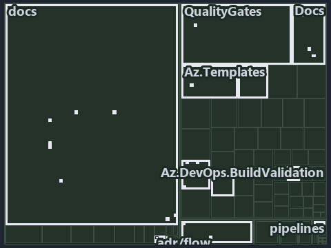

---
catzc:
  immutable:
    with_body_sha: e4886590b0ed
    repo_status: locked
    path: docs/explanation/.assets/tree/adr-flow-cd--ci-budget-is-the-only-quality-gate--governance.tree.md
    source: docs/explanation/.assets/adr-flow-cd--ci-budget-is-the-only-quality-gate--governance.drawio.png
    kind: asset-description
    language: markdown
    filetype: md
    track: docs
    tracktype: documentation
---

# The CI budget is the only promotion rule a quality gate checks: the tree minimap

```text
Which files cite ADR-FLOW-CD and ADR-FLOW-CD-TYPE: every file of the world map is a tile, grouped by top-level folder.
31 files lit in 12 groups.
```



This is the tree minimap in the sidebar of the governance diagram of [The CI budget is the only promotion rule a quality gate checks][32],
which explains [ADR-FLOW-CD][1] and [ADR-FLOW-CD-TYPE][2]. It lights every file that cites those codes, grouped by folder, so it shows which
files carry the decision. Each lit group has its reason below, naming the code that selects it.

## What the minimap shows

The tree draws every file of the world map as a tile, grouped by top-level folder (under `automation/` by module, under `docs/adr/` by ADR
domain), and lights 31 files in 12 groups, filled in ink. A lit ADR file has a white rim; a file lit only by passing mentions is a lighter
ink. Every other tile is idle, a grey box: a file the slide's ADR codes do not select.

- docs (docs/ outside docs/adr/): 8 lit files
- Az.DevOps.BuildValidation (automation/Catzc.Azure.DevOps.BuildValidation): 5 lit files
- Docs (automation/Catzc.Base.Docs): 3 lit files
- Maps (automation/Catzc.Base.Maps): 3 lit files
- adr/flow (docs/adr/flow): 3 lit files
- .claude: 2 lit files
- adr/* (the files directly in docs/adr/): 2 lit files
- Az.DevOps (automation/Catzc.Azure.DevOps): 1 lit file
- Az.Templates (automation/Catzc.Azure.Templates): 1 lit file
- ModuleSystem (automation/Catzc.Base.ModuleSystem): 1 lit file
- QualityGates (automation/Catzc.Base.QualityGates): 1 lit file
- pipelines: 1 lit file

## Why each group is lit

### docs (docs/ outside docs/adr/, 8 lit files)

The group holds the files of docs/ outside docs/adr/; each sits in its world-map cell and is lit by:

- [docs/references/automation/catzc-azure-devops-buildvalidation/configs/build-validation.yml.md][3], in the cell docs × markdown: selected
  by [ADR-FLOW-CD-TYPE][2]: the file cites it at line 18 (text) and line 32 (text).
- [docs/references/automation/catzc-azure-devops-buildvalidation/types/BuildValidationConfig.cs.md][4], in the cell docs × markdown:
  selected by [ADR-FLOW-CD-TYPE][2]: the file cites it at line 18 (text) and line 33 (text).
- [docs/references/automation/catzc-azure-devops-buildvalidation/types/BuildValidationEntry.cs.md][5], in the cell docs × markdown: selected
  by [ADR-FLOW-CD-TYPE][2]: the file cites it at line 19 (text) and line 33 (text).
- [docs/references/automation/catzc-base-docs/configs/adrs.yml.md][6], in the cell docs × markdown: selected by [ADR-FLOW-CD][1]: the file
  cites it at line 59 (text).
- [docs/references/automation/catzc-base-docs/types/AdrsConfig.cs.md][7], in the cell docs × markdown: selected by [ADR-FLOW-CD][1]: the
  file cites it at line 51 (text), line 52 (text), line 80 (text) and line 81 (text).
- [docs/references/automation/catzc-base-docs/types/GlossaryConcept.cs.md][8], in the cell docs × markdown: selected by [ADR-FLOW-CD][1]:
  the file cites it at line 20 (text) and line 57 (text).
- [docs/references/pipelines/cd-shared.yaml.md][9], in the cell docs × markdown: selected by [ADR-FLOW-CD-TYPE][2]: the file cites it at
  line 31 (text).
- [docs/references/pipelines/ci-infrastructure.yaml.md][10], in the cell docs × markdown: selected by [ADR-FLOW-CD-TYPE][2]: the file cites
  it at line 32 (text).

### Az.DevOps.BuildValidation (automation/Catzc.Azure.DevOps.BuildValidation, 5 lit files)

The group holds the files of automation/Catzc.Azure.DevOps.BuildValidation; each sits in its world-map cell and is lit by:

- [automation/Catzc.Azure.DevOps.BuildValidation/Get-AdoBuildValidations.ps1][11], in the cell automation × powershell: selected by
  [ADR-FLOW-CD-TYPE][2]: the file cites it at line 21 (header) and line 27 (header).
- [automation/Catzc.Azure.DevOps.BuildValidation/Register-AdoBuildValidation.ps1][12], in the cell automation × powershell: selected by
  [ADR-FLOW-CD-TYPE][2]: the file cites it at line 23 (header) and line 31 (header).
- [automation/Catzc.Azure.DevOps.BuildValidation/private/Get-BuildValidationPathFilter.ps1][13], in the cell automation × powershell:
  selected by [ADR-FLOW-CD-TYPE][2]: the file cites it at line 21 (header) and line 32 (header).
- [automation/Catzc.Azure.DevOps.BuildValidation/types/BuildValidationConfig.cs][14], in the cell automation × csharp: selected by
  [ADR-FLOW-CD-TYPE][2]: the file cites it at line 22 (text).
- [automation/Catzc.Azure.DevOps.BuildValidation/types/BuildValidationEntry.cs][15], in the cell automation × csharp: selected by
  [ADR-FLOW-CD-TYPE][2]: the file cites it at line 22 (text).

### Docs (automation/Catzc.Base.Docs, 3 lit files)

The group holds the files of automation/Catzc.Base.Docs; each sits in its world-map cell and is lit by:

- [automation/Catzc.Base.Docs/configs/adrs.yml][16], in the cell automation × yaml: selected by [ADR-FLOW-CD][1]: the file cites it at line
  116 (text); selected by [ADR-FLOW-CD-TYPE][2]: the file cites it at line 119 (text).
- [automation/Catzc.Base.Docs/types/AdrsConfig.cs][17], in the cell automation × csharp: selected by [ADR-FLOW-CD][1]: the file cites it at
  line 28 (text).
- [automation/Catzc.Base.Docs/types/GlossaryConcept.cs][18], in the cell automation × csharp: selected by [ADR-FLOW-CD][1]: the file cites
  it at line 23 (text).

### Maps (automation/Catzc.Base.Maps, 3 lit files)

The group holds the files of automation/Catzc.Base.Maps; each sits in its world-map cell and is lit by:

- [automation/Catzc.Base.Maps/Get-ValueChainHighlight.ps1][19], in the cell automation × powershell: selected by [ADR-FLOW-CD][1]: the file
  cites it at line 22 (header) and line 41 (header).
- [automation/Catzc.Base.Maps/Get-WorldMapHighlight.ps1][20], in the cell automation × powershell: selected by [ADR-FLOW-CD][1]: the file
  cites it at line 21 (header) and line 49 (header).
- [automation/Catzc.Base.Maps/tests/Get-WorldMapHighlight.Tests.ps1][21], in the cell automation × powershell: selected by [ADR-FLOW-CD][1]:
  the file cites it at line 20 (header), line 93 (text) and line 94 (text).

### adr/flow (docs/adr/flow, 3 lit files)

The group holds the files of docs/adr/flow; each sits in its world-map cell and is lit by:

- [docs/adr/flow/cd-discipline-and-promotion-flow.md][1], in the cell docs × markdown: selected by [ADR-FLOW-CD][1]: the ADR's own file.
- [docs/adr/flow/dora-explains.md][22], in the cell docs × markdown: selected by [ADR-FLOW-CD][1]: the file cites it at line 42 (text);
  selected by [ADR-FLOW-CD-TYPE][2]: the file cites it at line 98 (text).
- [docs/adr/flow/pipeline-types.md][2], in the cell docs × markdown: selected by [ADR-FLOW-CD-TYPE][2]: the ADR's own file.

### .claude (2 lit files)

The group holds the files of .claude; each sits in its world-map cell and is lit by:

- [.claude/CLAUDE.md][23], in the cell .claude × markdown: selected by [ADR-FLOW-CD][1]: the file cites it at line 52 (text).
- [.claude/plans/plan-module-kinds-tracks.md][24], in the cell .claude × markdown: selected by [ADR-FLOW-CD-TYPE][2]: the file cites it at
  line 565 (text) and line 568 (text).

### adr/* (the files directly in docs/adr/, 2 lit files)

The group holds the files of the files directly in docs/adr/; each sits in its world-map cell and is lit by:

- [docs/adr/glossary.md][25], in the cell docs × markdown: selected by [ADR-FLOW-CD][1]: the file cites it at line 497 (text) and line 510
  (text).
- [docs/adr/index.md][26], in the cell docs × markdown: selected by [ADR-FLOW-CD][1]: the file cites it at line 129 (text); selected by
  [ADR-FLOW-CD-TYPE][2]: the file cites it at line 132 (text).

### Az.DevOps (automation/Catzc.Azure.DevOps, 1 lit file)

The group holds the files of automation/Catzc.Azure.DevOps; each sits in its world-map cell and is lit by:

- [automation/Catzc.Azure.DevOps/New-AdoPullRequest.ps1][27], in the cell automation × powershell: selected by [ADR-FLOW-CD-TYPE][2]: the
  file cites it at line 22 (header) and line 26 (header).

### Az.Templates (automation/Catzc.Azure.Templates, 1 lit file)

The group holds the files of automation/Catzc.Azure.Templates; each sits in its world-map cell and is lit by:

- [automation/Catzc.Azure.Templates/Set-BicepTemplateConfiguration.ps1][28], in the cell automation × powershell: selected by
  [ADR-FLOW-CD-TYPE][2]: the file cites it at line 23 (header).

### ModuleSystem (automation/Catzc.Base.ModuleSystem, 1 lit file)

The group holds the files of automation/Catzc.Base.ModuleSystem; each sits in its world-map cell and is lit by:

- [automation/Catzc.Base.ModuleSystem/configs/glossary.yml][29], in the cell automation × yaml: selected by [ADR-FLOW-CD][1]: the file cites
  it at line 37 (text).

### QualityGates (automation/Catzc.Base.QualityGates, 1 lit file)

The group holds the files of automation/Catzc.Base.QualityGates; each sits in its world-map cell and is lit by:

- [automation/Catzc.Base.QualityGates/configs/glossary.yml][30], in the cell automation × yaml: selected by [ADR-FLOW-CD][1]: the file cites
  it at line 77 (text).

### pipelines (1 lit file)

The group holds the files of pipelines; each sits in its world-map cell and is lit by:

- [pipelines/ci-automation.yaml][31], in the cell pipelines × pipeline-yaml: selected by [ADR-FLOW-CD][1]: a pipeline that cites nothing
  itself carries its globset's citations, which cite it at `automation/Catzc.Base.Docs/configs/adrs.yml` line 116 (text),
  `automation/Catzc.Base.Docs/types/AdrsConfig.cs` line 28 (text), `automation/Catzc.Base.Docs/types/GlossaryConcept.cs` line 23 (text),
  `automation/Catzc.Base.Maps/Get-ValueChainHighlight.ps1` line 22 (header), `automation/Catzc.Base.Maps/Get-ValueChainHighlight.ps1` line
  41 (header), `automation/Catzc.Base.Maps/Get-WorldMapHighlight.ps1` line 21 (header),
  `automation/Catzc.Base.Maps/Get-WorldMapHighlight.ps1` line 49 (header),
  `automation/Catzc.Base.Maps/tests/Get-WorldMapHighlight.Tests.ps1` line 20 (header),
  `automation/Catzc.Base.Maps/tests/Get-WorldMapHighlight.Tests.ps1` line 93 (text),
  `automation/Catzc.Base.Maps/tests/Get-WorldMapHighlight.Tests.ps1` line 94 (text),
  `automation/Catzc.Base.ModuleSystem/configs/glossary.yml` line 37 (text) and `automation/Catzc.Base.QualityGates/configs/glossary.yml`
  line 77 (text); selected by [ADR-FLOW-CD-TYPE][2]: a pipeline that cites nothing itself carries its globset's citations, which cite it at
  `automation/Catzc.Azure.DevOps.BuildValidation/Get-AdoBuildValidations.ps1` line 21 (header),
  `automation/Catzc.Azure.DevOps.BuildValidation/Get-AdoBuildValidations.ps1` line 27 (header),
  `automation/Catzc.Azure.DevOps.BuildValidation/Register-AdoBuildValidation.ps1` line 23 (header),
  `automation/Catzc.Azure.DevOps.BuildValidation/Register-AdoBuildValidation.ps1` line 31 (header),
  `automation/Catzc.Azure.DevOps.BuildValidation/private/Get-BuildValidationPathFilter.ps1` line 21 (header),
  `automation/Catzc.Azure.DevOps.BuildValidation/private/Get-BuildValidationPathFilter.ps1` line 32 (header),
  `automation/Catzc.Azure.DevOps.BuildValidation/types/BuildValidationConfig.cs` line 22 (text),
  `automation/Catzc.Azure.DevOps.BuildValidation/types/BuildValidationEntry.cs` line 22 (text),
  `automation/Catzc.Azure.DevOps/New-AdoPullRequest.ps1` line 22 (header), `automation/Catzc.Azure.DevOps/New-AdoPullRequest.ps1` line 26
  (header), `automation/Catzc.Azure.Templates/Set-BicepTemplateConfiguration.ps1` line 23 (header) and
  `automation/Catzc.Base.Docs/configs/adrs.yml` line 119 (text).

## Keywords

- [world map][33]
- [track][34]
- [file language][35]
- [cell][36]
- [lit cell][37]
- [.claude][38]: a track
- [automation][38]: a track
- [docs][38]: a track
- [pipelines][38]: a track
- [csharp][39]: a file language
- [markdown][39]: a file language
- [pipeline-yaml][39]: a file language
- [powershell][39]: a file language
- [yaml][39]: a file language

Terms the cited ADRs define:

- [gate][40], defined by [ADR-FLOW-CD#13][41]
- [release candidate][42], defined by [ADR-FLOW-CD#14][43]

[1]: ../../../adr/flow/cd-discipline-and-promotion-flow.md
[2]: ../../../adr/flow/pipeline-types.md
[3]: ../../../references/automation/catzc-azure-devops-buildvalidation/configs/build-validation.yml.md
[4]: ../../../references/automation/catzc-azure-devops-buildvalidation/types/BuildValidationConfig.cs.md
[5]: ../../../references/automation/catzc-azure-devops-buildvalidation/types/BuildValidationEntry.cs.md
[6]: ../../../references/automation/catzc-base-docs/configs/adrs.yml.md
[7]: ../../../references/automation/catzc-base-docs/types/AdrsConfig.cs.md
[8]: ../../../references/automation/catzc-base-docs/types/GlossaryConcept.cs.md
[9]: ../../../references/pipelines/cd-shared.yaml.md
[10]: ../../../references/pipelines/ci-infrastructure.yaml.md
[11]: ../../../../automation/Catzc.Azure.DevOps.BuildValidation/Get-AdoBuildValidations.ps1
[12]: ../../../../automation/Catzc.Azure.DevOps.BuildValidation/Register-AdoBuildValidation.ps1
[13]: ../../../../automation/Catzc.Azure.DevOps.BuildValidation/private/Get-BuildValidationPathFilter.ps1
[14]: ../../../../automation/Catzc.Azure.DevOps.BuildValidation/types/BuildValidationConfig.cs
[15]: ../../../../automation/Catzc.Azure.DevOps.BuildValidation/types/BuildValidationEntry.cs
[16]: ../../../../automation/Catzc.Base.Docs/configs/adrs.yml
[17]: ../../../../automation/Catzc.Base.Docs/types/AdrsConfig.cs
[18]: ../../../../automation/Catzc.Base.Docs/types/GlossaryConcept.cs
[19]: ../../../../automation/Catzc.Base.Maps/Get-ValueChainHighlight.ps1
[20]: ../../../../automation/Catzc.Base.Maps/Get-WorldMapHighlight.ps1
[21]: ../../../../automation/Catzc.Base.Maps/tests/Get-WorldMapHighlight.Tests.ps1
[22]: ../../../adr/flow/dora-explains.md
[23]: ../../../../.claude/CLAUDE.md
[24]: ../../../../.claude/plans/plan-module-kinds-tracks.md
[25]: ../../../adr/glossary.md
[26]: ../../../adr/index.md
[27]: ../../../../automation/Catzc.Azure.DevOps/New-AdoPullRequest.ps1
[28]: ../../../../automation/Catzc.Azure.Templates/Set-BicepTemplateConfiguration.ps1
[29]: ../../../../automation/Catzc.Base.ModuleSystem/configs/glossary.yml
[30]: ../../../../automation/Catzc.Base.QualityGates/configs/glossary.yml
[31]: ../../../../pipelines/ci-automation.yaml
[32]: ../../flow/ci-budget-is-the-only-quality-gate.md
[33]: ../../../adr/glossary.md#world-map
[34]: ../../../adr/glossary.md#track
[35]: ../../../adr/glossary.md#file-language
[36]: ../../../adr/glossary.md#cell
[37]: ../../../adr/glossary.md#lit-cell
[38]: ../../../../automation/Catzc.Base.Variants/configs/variants.yml
[39]: ../../../../automation/Catzc.Base.Languages/configs/languages.yml
[40]: ../../../adr/glossary.md#gate
[41]: ../../../adr/flow/cd-discipline-and-promotion-flow.md#rule-adr-flow-cd13
[42]: ../../../adr/glossary.md#release-candidate
[43]: ../../../adr/flow/cd-discipline-and-promotion-flow.md#rule-adr-flow-cd14
