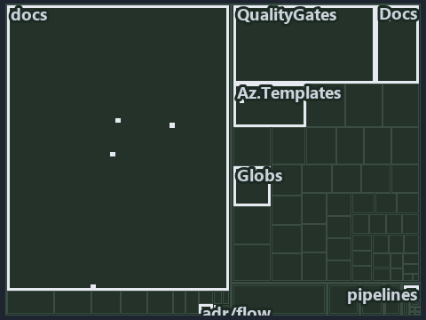

# Two variables, one reader, 24 callers, and one analyzer rule for every other read: the tree minimap

```text
Which files cite ADR-FLOW-CD-DETECT: every file of the world map is a tile, grouped by top-level folder.
13 files lit in 8 groups.
```



This is the tree minimap in the sidebar of the implementation diagram of [Two variables, one reader, 24 callers, and one analyzer rule for
every other read][14], which explains [ADR-FLOW-CD-DETECT][1]. It lights every file that cites those codes, grouped by folder, so it shows
which files carry the decision. Each lit group has its reason below, naming the code that selects it.

## What the minimap shows

The tree draws every file of the world map as a tile, grouped by top-level folder (under `automation/` by module, under `docs/adr/` by ADR
domain), and lights 13 files in 8 groups, filled in ink. A lit ADR file has a white rim; a file lit only by passing mentions is a lighter
ink. Every other tile is idle, a grey box: a file the slide's ADR codes do not select.

- docs (docs/ outside docs/adr/): 4 lit files
- Globs (automation/Catzc.Base.Globs): 2 lit files
- adr/flow (docs/adr/flow): 2 lit files
- Az.Templates (automation/Catzc.Azure.Templates): 1 lit file
- Docs (automation/Catzc.Base.Docs): 1 lit file
- QualityGates (automation/Catzc.Base.QualityGates): 1 lit file
- adr/* (the files directly in docs/adr/): 1 lit file
- pipelines: 1 lit file

## Why each group is lit

### docs (docs/ outside docs/adr/, 4 lit files)

The group holds the files of docs/ outside docs/adr/; each sits in its world-map cell and is lit by:

- [docs/references/.assets/automation/catzc-base-globs/protected-module-skip-by-hash.drawio.verify.md][2], in the cell docs × markdown:
  selected by [ADR-FLOW-CD-DETECT][1]: the file cites it at line 15 (text) and line 75 (text).
- [docs/references/automation/catzc-azure-templates/Get-BicepDeploymentName.ps1.md][3], in the cell docs × markdown: selected by
  [ADR-FLOW-CD-DETECT][1]: the file cites it at line 17 (text) and line 33 (text).
- [docs/references/automation/catzc-base-globs/protected-module-skip-by-hash.drawio.md][4], in the cell docs × markdown: selected by
  [ADR-FLOW-CD-DETECT][1]: the file cites it at line 15 (text), line 48 (text) and line 131 (text).
- [docs/references/automation/catzc-base-globs/tests/Get-GlobSetChangeRange.Tests.ps1.md][5], in the cell docs × markdown: selected by
  [ADR-FLOW-CD-DETECT][1]: the file cites it at line 27 (text).

### Globs (automation/Catzc.Base.Globs, 2 lit files)

The group holds the files of automation/Catzc.Base.Globs; each sits in its world-map cell and is lit by:

- [automation/Catzc.Base.Globs/Get-GlobSetChangeRange.ps1][6], in the cell automation × powershell: selected by [ADR-FLOW-CD-DETECT][1]: the
  file cites it at line 20 (header) and line 26 (header).
- [automation/Catzc.Base.Globs/tests/Get-GlobSetChangeRange.Tests.ps1][7], in the cell automation × powershell: selected by
  [ADR-FLOW-CD-DETECT][1]: the file cites it at line 20 (header).

### adr/flow (docs/adr/flow, 2 lit files)

The group holds the files of docs/adr/flow; each sits in its world-map cell and is lit by:

- [docs/adr/flow/dora-explains.md][8], in the cell docs × markdown: selected by [ADR-FLOW-CD-DETECT][1]: the file cites it at line 80
  (text).
- [docs/adr/flow/pipeline-detection.md][1], in the cell docs × markdown: selected by [ADR-FLOW-CD-DETECT][1]: the ADR's own file.

### Az.Templates (automation/Catzc.Azure.Templates, 1 lit file)

The group holds the files of automation/Catzc.Azure.Templates; each sits in its world-map cell and is lit by:

- [automation/Catzc.Azure.Templates/Get-BicepDeploymentName.ps1][9], in the cell automation × powershell: selected by
  [ADR-FLOW-CD-DETECT][1]: the file cites it at line 21 (header).

### Docs (automation/Catzc.Base.Docs, 1 lit file)

The group holds the files of automation/Catzc.Base.Docs; each sits in its world-map cell and is lit by:

- [automation/Catzc.Base.Docs/configs/adrs.yml][10], in the cell automation × yaml: selected by [ADR-FLOW-CD-DETECT][1]: the file cites it
  at line 118 (text).

### QualityGates (automation/Catzc.Base.QualityGates, 1 lit file)

The group holds the files of automation/Catzc.Base.QualityGates; each sits in its world-map cell and is lit by:

- [automation/Catzc.Base.QualityGates/configs/analyzer-adr-map.yml][11], in the cell automation × yaml: selected by [ADR-FLOW-CD-DETECT][1]:
  the file cites it at line 30 (text).

### adr/* (the files directly in docs/adr/, 1 lit file)

The group holds the files of the files directly in docs/adr/; each sits in its world-map cell and is lit by:

- [docs/adr/index.md][12], in the cell docs × markdown: selected by [ADR-FLOW-CD-DETECT][1]: the file cites it at line 131 (text).

### pipelines (1 lit file)

The group holds the files of pipelines; each sits in its world-map cell and is lit by:

- [pipelines/ci-automation.yaml][13], in the cell pipelines × pipeline-yaml: selected by [ADR-FLOW-CD-DETECT][1]: a pipeline that cites
  nothing itself carries its globset's citations, which cite it at `automation/Catzc.Azure.Templates/Get-BicepDeploymentName.ps1` line 21
  (header), `automation/Catzc.Base.Docs/configs/adrs.yml` line 118 (text), `automation/Catzc.Base.Globs/Get-GlobSetChangeRange.ps1` line 20
  (header), `automation/Catzc.Base.Globs/Get-GlobSetChangeRange.ps1` line 26 (header),
  `automation/Catzc.Base.Globs/tests/Get-GlobSetChangeRange.Tests.ps1` line 20 (header) and
  `automation/Catzc.Base.QualityGates/configs/analyzer-adr-map.yml` line 30 (text).

## Keywords

- [world map][15]
- [track][16]
- [file language][17]
- [cell][18]
- [lit cell][19]
- [automation][20]: a track
- [docs][20]: a track
- [pipelines][20]: a track
- [markdown][21]: a file language
- [pipeline-yaml][21]: a file language
- [powershell][21]: a file language
- [yaml][21]: a file language

[1]: ../../../adr/flow/pipeline-detection.md
[2]: ../../../references/.assets/automation/catzc-base-globs/protected-module-skip-by-hash.drawio.verify.md
[3]: ../../../references/automation/catzc-azure-templates/Get-BicepDeploymentName.ps1.md
[4]: ../../../references/automation/catzc-base-globs/protected-module-skip-by-hash.drawio.md
[5]: ../../../references/automation/catzc-base-globs/tests/Get-GlobSetChangeRange.Tests.ps1.md
[6]: ../../../../automation/Catzc.Base.Globs/Get-GlobSetChangeRange.ps1
[7]: ../../../../automation/Catzc.Base.Globs/tests/Get-GlobSetChangeRange.Tests.ps1
[8]: ../../../adr/flow/dora-explains.md
[9]: ../../../../automation/Catzc.Azure.Templates/Get-BicepDeploymentName.ps1
[10]: ../../../../automation/Catzc.Base.Docs/configs/adrs.yml
[11]: ../../../../automation/Catzc.Base.QualityGates/configs/analyzer-adr-map.yml
[12]: ../../../adr/index.md
[13]: ../../../../pipelines/ci-automation.yaml
[14]: ../../flow/two-variables-read-in-one-place.md
[15]: ../../../adr/glossary.md#world-map
[16]: ../../../adr/glossary.md#track
[17]: ../../../adr/glossary.md#file-language
[18]: ../../../adr/glossary.md#cell
[19]: ../../../adr/glossary.md#lit-cell
[20]: ../../../../automation/Catzc.Base.Variants/configs/variants.yml
[21]: ../../../../automation/Catzc.Base.Languages/configs/languages.yml
