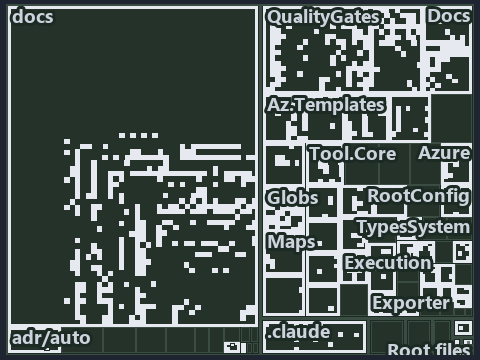

# Gates check the source of each globset and the trigger, but not the git reflection or the identity: the tree minimap

```text
Which files cite ADR-AUTO-TEST and ADR-FLOW-CD-GLOBS: every file of the world map is a tile, grouped by top-level folder.
750 files lit in 42 groups.
```



This is the tree minimap in the sidebar of the governance diagram of [Gates check the source of each globset and the trigger, but not the
git reflection or the identity][751], which explains [ADR-AUTO-TEST][1] and [ADR-FLOW-CD-GLOBS][2]. It lights every file that cites those
codes, grouped by folder, so it shows which files carry the decision. Each lit group has its reason below, naming the code that selects it.

## What the minimap shows

The tree draws every file of the world map as a tile, grouped by top-level folder (under `automation/` by module, under `docs/adr/` by ADR
domain), and lights 750 files in 42 groups, filled in ink. A lit ADR file has a white rim; a file lit only by passing mentions is a lighter
ink. Every other tile is idle, a grey box: a file the slide's ADR codes do not select.

- docs (docs/ outside docs/adr/): 316 lit files
- QualityGates (automation/Catzc.Base.QualityGates): 145 lit files
- Docs (automation/Catzc.Base.Docs): 50 lit files
- Globs (automation/Catzc.Base.Globs): 43 lit files
- Az.Templates (automation/Catzc.Azure.Templates): 29 lit files
- ModuleSystem (automation/Catzc.Base.ModuleSystem): 18 lit files
- .claude: 12 lit files
- Languages (automation/Catzc.Base.Languages): 11 lit files
- Tool.Core (automation/Catzc.Tooling.Core): 11 lit files
- Azure (automation/Catzc.Azure): 10 lit files
- Execution (automation/Catzc.Base.Execution): 10 lit files
- Maps (automation/Catzc.Base.Maps): 9 lit files
- RootConfig (automation/Catzc.Base.RootConfig): 8 lit files
- Contracts (automation/Catzc.Base.Contracts): 7 lit files
- Tool.Provisioning (automation/Catzc.Tooling.Provisioning): 7 lit files
- Az.DevOps.BuildValidation (automation/Catzc.Azure.DevOps.BuildValidation): 5 lit files
- TypesSystem (automation/Catzc.Base.TypesSystem): 5 lit files
- Exporter (automation/Catzc.Base.Exporter): 4 lit files
- Reports (automation/Catzc.Base.Reports): 4 lit files
- Repository (automation/Catzc.Base.Repository): 4 lit files
- Tool.Inspiration (automation/Catzc.Tooling.Inspiration): 4 lit files
- Root files: 3 lit files
- .internal (automation/.internal): 3 lit files
- Az.DevOps (automation/Catzc.Azure.DevOps): 3 lit files
- Config (automation/Catzc.Base.Config): 3 lit files
- ConfigExtensions (automation/Catzc.Base.ConfigExtensions): 3 lit files
- Tool.KeyHandler (automation/Catzc.Tooling.KeyHandler): 3 lit files
- Objects (automation/Catzc.Base.Objects): 2 lit files
- Tool.Toolchain (automation/Catzc.Tooling.Toolchain): 2 lit files
- adr/* (the files directly in docs/adr/): 2 lit files
- adr/auto (docs/adr/automation): 2 lit files
- adr/flow (docs/adr/flow): 2 lit files
- .github: 1 lit file
- .scriptanalyzer (automation/.scriptanalyzer): 1 lit file
- Engines (automation/Catzc.Base.Engines): 1 lit file
- Environment (automation/Catzc.Base.Environment): 1 lit file
- Files (automation/Catzc.Base.Files): 1 lit file
- Modules (automation/Catzc.Base.Modules): 1 lit file
- Overlay (automation/Catzc.Base.Overlay): 1 lit file
- Timeouts (automation/Catzc.Base.Timeouts): 1 lit file
- Tool.Python (automation/Catzc.Tooling.Python): 1 lit file
- pipelines: 1 lit file

## Why each group is lit

### docs (docs/ outside docs/adr/, 316 lit files)

The group holds the files of docs/ outside docs/adr/; each sits in its world-map cell and is lit by:

- [docs/how-to/automation/manual-test-plan.md][3], in the cell docs × markdown: selected by [ADR-AUTO-TEST][1]: the file cites it at line 83
  (text) and line 89 (text).
- [docs/how-to/automation/manual-test-plan/azure.md][4], in the cell docs × markdown: selected by [ADR-AUTO-TEST][1]: the file cites it at
  line 15 (text), line 36 (text) and line 88 (text).
- [docs/how-to/automation/manual-test-plan/pipelines-and-globs.md][5], in the cell docs × markdown: selected by [ADR-FLOW-CD-GLOBS][2]: the
  file cites it at line 15 (text) and line 35 (text).
- [docs/how-to/automation/manual-test-plan/test-harness.md][6], in the cell docs × markdown: selected by [ADR-AUTO-TEST][1]: the file cites
  it at line 15 (text) and line 34 (text).
- [docs/how-to/getting-started/automation/run-tests-and-checks.md][7], in the cell docs × markdown: selected by [ADR-AUTO-TEST][1]: the file
  cites it at line 15 (text) and line 55 (text).
- [docs/references/.assets/automation/catzc-base-execution/invoke-executable-two-paths-one-bounded.drawio.verify.md][8], in the cell docs ×
  markdown: selected by [ADR-AUTO-TEST][1]: the file cites it at line 63 (text).
- [docs/references/.assets/automation/catzc-base-globs/protected-module-skip-by-hash.drawio.verify.md][9], in the cell docs × markdown:
  selected by [ADR-FLOW-CD-GLOBS][2]: the file cites it at line 16 (text) and line 75 (text).
- [docs/references/.assets/automation/catzc-base-modulesystem/module-graph-declared-vs-observed.drawio.verify.md][10], in the cell docs ×
  markdown: selected by [ADR-AUTO-TEST][1]: the file cites it at line 17 (text) and line 74 (text).
- [docs/references/.assets/automation/catzc-base-qualitygates/test-automation-one-run-pipeline.drawio.verify.md][11], in the cell docs ×
  markdown: selected by [ADR-AUTO-TEST][1]: the file cites it at line 15 (text), line 36 (text), line 38 (text), line 67 (text) and line 80
  (text).
- [docs/references/automation/catzc-azure-devops-buildvalidation/Register-AdoBuildValidation.ps1.md][12], in the cell docs × markdown:
  selected by [ADR-FLOW-CD-GLOBS][2]: the file cites it at line 29 (text).
- [docs/references/automation/catzc-azure-devops-buildvalidation/configs/build-validation.yml.md][13], in the cell docs × markdown: selected
  by [ADR-FLOW-CD-GLOBS][2]: the file cites it at line 35 (text).
- [docs/references/automation/catzc-azure-devops-buildvalidation/tests/types/BuildValidationConfig.Tests.ps1.md][14], in the cell docs ×
  markdown: selected by [ADR-AUTO-TEST][1]: the file cites it at line 17 (text) and line 44 (text).
- [docs/references/automation/catzc-azure-devops/configs/identity-tokens.yml.md][15], in the cell docs × markdown: selected by
  [ADR-AUTO-TEST][1]: the file cites it at line 17 (text) and line 31 (text).
- [docs/references/automation/catzc-azure-devops/tests/Get-AdoYamlFiles.Tests.ps1.md][16], in the cell docs × markdown: selected by
  [ADR-AUTO-TEST][1]: the file cites it at line 17 (text) and line 43 (text).
- [docs/references/automation/catzc-azure-templates/tests/Assert-BicepTemplate.Tests.ps1.md][17], in the cell docs × markdown: selected by
  [ADR-AUTO-TEST][1]: the file cites it at line 17 (text) and line 46 (text).
- [docs/references/automation/catzc-azure-templates/tests/Build-Bicep.Integrity.Tests.ps1.md][18], in the cell docs × markdown: selected by
  [ADR-AUTO-TEST][1]: the file cites it at line 17 (text), line 37 (text), line 39 (text) and line 42 (text).
- [docs/references/automation/catzc-azure-templates/tests/Build-Bicep.L2.Tests.ps1.md][19], in the cell docs × markdown: selected by
  [ADR-AUTO-TEST][1]: the file cites it at line 17 (text), line 48 (text) and line 56 (text).
- [docs/references/automation/catzc-azure-templates/tests/Build-Bicep.SampleCustomer.Tests.ps1.md][20], in the cell docs × markdown:
  selected by [ADR-AUTO-TEST][1]: the file cites it at line 17 (text), line 35 (text), line 35 (text), line 47 (text) and line 59 (text).
- [docs/references/automation/catzc-azure-templates/tests/Build-Bicep.SampleIndexed.Tests.ps1.md][21], in the cell docs × markdown: selected
  by [ADR-AUTO-TEST][1]: the file cites it at line 17 (text), line 34 (text), line 34 (text) and line 54 (text).
- [docs/references/automation/catzc-azure-templates/tests/Build-Bicep.SampleSubscription.Tests.ps1.md][22], in the cell docs × markdown:
  selected by [ADR-AUTO-TEST][1]: the file cites it at line 17 (text), line 33 (text), line 33 (text), line 45 (text) and line 57 (text).
- [docs/references/automation/catzc-azure-templates/tests/Build-Bicep.SampleWithModule.Tests.ps1.md][23], in the cell docs × markdown:
  selected by [ADR-AUTO-TEST][1]: the file cites it at line 17 (text), line 35 (text), line 35 (text), line 47 (text) and line 59 (text).
- [docs/references/automation/catzc-azure-templates/tests/Build-Bicep.SampleWithPrepost.Tests.ps1.md][24], in the cell docs × markdown:
  selected by [ADR-AUTO-TEST][1]: the file cites it at line 17 (text), line 40 (text) and line 49 (text).
- [docs/references/automation/catzc-azure-templates/tests/Build-Bicep.Tests.ps1.md][25], in the cell docs × markdown: selected by
  [ADR-AUTO-TEST][1]: the file cites it at line 17 (text), line 34 (text), line 34 (text), line 44 (text) and line 54 (text).
- [docs/references/automation/catzc-azure-templates/tests/Deploy-Bicep.SampleSubscription.Tests.ps1.md][26], in the cell docs × markdown:
  selected by [ADR-AUTO-TEST][1]: the file cites it at line 17 (text), line 42 (text), line 60 (text) and line 69 (text).
- [docs/references/automation/catzc-azure-templates/tests/Deploy-Bicep.Tests.ps1.md][27], in the cell docs × markdown: selected by
  [ADR-AUTO-TEST][1]: the file cites it at line 17 (text), line 77 (text), line 77 (text) and line 87 (text).
- [docs/references/automation/catzc-azure-templates/tests/Get-BicepDeploymentContext.Tests.ps1.md][28], in the cell docs × markdown:
  selected by [ADR-AUTO-TEST][1]: the file cites it at line 17 (text), line 35 (text), line 35 (text), line 46 (text) and line 76 (text).
- [docs/references/automation/catzc-azure-templates/tests/Get-BicepParameterModel.Shipped.Tests.ps1.md][29], in the cell docs × markdown:
  selected by [ADR-AUTO-TEST][1]: the file cites it at line 17 (text), line 40 (text), line 43 (text), line 46 (text), line 51 (text) and
  line 60 (text).
- [docs/references/automation/catzc-azure-templates/tests/Get-BicepParameterModel.Tests.ps1.md][30], in the cell docs × markdown: selected
  by [ADR-AUTO-TEST][1]: the file cites it at line 17 (text) and line 33 (text).
- [docs/references/automation/catzc-azure-templates/tests/Get-BicepParameterViolations.Tests.ps1.md][31], in the cell docs × markdown:
  selected by [ADR-AUTO-TEST][1]: the file cites it at line 17 (text) and line 33 (text).
- [docs/references/automation/catzc-azure-templates/tests/Get-BicepResourceGroupName.Tests.ps1.md][32], in the cell docs × markdown:
  selected by [ADR-AUTO-TEST][1]: the file cites it at line 17 (text), line 32 (text) and line 32 (text).
- [docs/references/automation/catzc-azure-templates/tests/Get-BicepResourceName.Tests.ps1.md][33], in the cell docs × markdown: selected by
  [ADR-AUTO-TEST][1]: the file cites it at line 17 (text), line 36 (text) and line 36 (text).
- [docs/references/automation/catzc-azure-templates/tests/Get-BicepTemplate.Tests.ps1.md][34], in the cell docs × markdown: selected by
  [ADR-AUTO-TEST][1]: the file cites it at line 17 (text), line 32 (text) and line 32 (text).
- [docs/references/automation/catzc-azure-templates/tests/Get-BicepTemplateConfiguration.Tests.ps1.md][35], in the cell docs × markdown:
  selected by [ADR-AUTO-TEST][1]: the file cites it at line 17 (text), line 34 (text) and line 34 (text).
- [docs/references/automation/catzc-azure-templates/tests/Get-BicepTemplateCustomers.Tests.ps1.md][36], in the cell docs × markdown:
  selected by [ADR-AUTO-TEST][1]: the file cites it at line 17 (text), line 32 (text), line 32 (text), line 42 (text) and line 42 (text).
- [docs/references/automation/catzc-azure-templates/tests/Get-BicepTemplateNames.Tests.ps1.md][37], in the cell docs × markdown: selected by
  [ADR-AUTO-TEST][1]: the file cites it at line 17 (text), line 32 (text) and line 32 (text).
- [docs/references/automation/catzc-azure-templates/tests/Get-BicepTemplateSlots.Tests.ps1.md][38], in the cell docs × markdown: selected by
  [ADR-AUTO-TEST][1]: the file cites it at line 17 (text), line 32 (text), line 32 (text), line 51 (text) and line 51 (text).
- [docs/references/automation/catzc-azure-templates/tests/Get-BicepTemplates.Tests.ps1.md][39], in the cell docs × markdown: selected by
  [ADR-AUTO-TEST][1]: the file cites it at line 17 (text), line 36 (text) and line 36 (text).
- [docs/references/automation/catzc-azure-templates/tests/Get-BicepTrackTagNameSet.Tests.ps1.md][40], in the cell docs × markdown: selected
  by [ADR-AUTO-TEST][1]: the file cites it at line 17 (text), line 32 (text) and line 32 (text).
- [docs/references/automation/catzc-azure-templates/tests/Resolve-BicepParameterAddresses.Tests.ps1.md][41], in the cell docs × markdown:
  selected by [ADR-AUTO-TEST][1]: the file cites it at line 17 (text) and line 31 (text).
- [docs/references/automation/catzc-azure-templates/tests/Set-BicepTemplateConfiguration.Tests.ps1.md][42], in the cell docs × markdown:
  selected by [ADR-AUTO-TEST][1]: the file cites it at line 18 (text) and line 78 (text).
- [docs/references/automation/catzc-azure-templates/tests/types/BicepShortName.Tests.ps1.md][43], in the cell docs × markdown: selected by
  [ADR-AUTO-TEST][1]: the file cites it at line 17 (text) and line 36 (text).
- [docs/references/automation/catzc-azure/configs/identity-tokens.yml.md][44], in the cell docs × markdown: selected by [ADR-AUTO-TEST][1]:
  the file cites it at line 17 (text) and line 32 (text).
- [docs/references/automation/catzc-azure/tests/Get-AzureBicepMinVersion.Tests.ps1.md][45], in the cell docs × markdown: selected by
  [ADR-AUTO-TEST][1]: the file cites it at line 17 (text), line 32 (text) and line 32 (text).
- [docs/references/automation/catzc-azure/tests/Get-AzureCustomer.Tests.ps1.md][46], in the cell docs × markdown: selected by
  [ADR-AUTO-TEST][1]: the file cites it at line 17 (text) and line 32 (text).
- [docs/references/automation/catzc-azure/tests/Get-AzureCustomers.Tests.ps1.md][47], in the cell docs × markdown: selected by
  [ADR-AUTO-TEST][1]: the file cites it at line 17 (text), line 32 (text) and line 32 (text).
- [docs/references/automation/catzc-azure/tests/Get-AzureEnvironment.Tests.ps1.md][48], in the cell docs × markdown: selected by
  [ADR-AUTO-TEST][1]: the file cites it at line 17 (text), line 32 (text) and line 32 (text).
- [docs/references/automation/catzc-azure/tests/Get-AzureSubscription.Tests.ps1.md][49], in the cell docs × markdown: selected by
  [ADR-AUTO-TEST][1]: the file cites it at line 17 (text), line 32 (text) and line 32 (text).
- [docs/references/automation/catzc-azure/tests/Get-AzureSubscriptionEnvironment.Tests.ps1.md][50], in the cell docs × markdown: selected by
  [ADR-AUTO-TEST][1]: the file cites it at line 17 (text), line 32 (text) and line 32 (text).
- [docs/references/automation/catzc-azure/tests/Test-AzureNetworkPlan.Tests.ps1.md][51], in the cell docs × markdown: selected by
  [ADR-AUTO-TEST][1]: the file cites it at line 17 (text) and line 33 (text).
- [docs/references/automation/catzc-azure/tests/types/AzureConfig.Tests.ps1.md][52], in the cell docs × markdown: selected by
  [ADR-AUTO-TEST][1]: the file cites it at line 17 (text), line 34 (text) and line 35 (text).
- [docs/references/automation/catzc-azure/tests/types/NetworkConfig.Tests.ps1.md][53], in the cell docs × markdown: selected by
  [ADR-AUTO-TEST][1]: the file cites it at line 17 (text), line 33 (text) and line 34 (text).
- [docs/references/automation/catzc-base-config/tests/Config-Conventions.Tests.ps1.md][54], in the cell docs × markdown: selected by
  [ADR-AUTO-TEST][1]: the file cites it at line 17 (text) and line 41 (text).
- [docs/references/automation/catzc-base-config/tests/Get-Config.Tests.ps1.md][55], in the cell docs × markdown: selected by
  [ADR-AUTO-TEST][1]: the file cites it at line 17 (text), line 31 (text), line 42 (text), line 45 (text) and line 63 (text).
- [docs/references/automation/catzc-base-config/tests/Get-ConfigValue.Tests.ps1.md][56], in the cell docs × markdown: selected by
  [ADR-AUTO-TEST][1]: the file cites it at line 17 (text) and line 42 (text).
- [docs/references/automation/catzc-base-configextensions/tests/Invoke-ConfigValidator.Tests.ps1.md][57], in the cell docs × markdown:
  selected by [ADR-AUTO-TEST][1]: the file cites it at line 17 (text) and line 31 (text).
- [docs/references/automation/catzc-base-configextensions/tests/Test-ConfigValidators.Tests.ps1.md][58], in the cell docs × markdown:
  selected by [ADR-AUTO-TEST][1]: the file cites it at line 17 (text) and line 32 (text).
- [docs/references/automation/catzc-base-contracts/tests/Build-ContractReference.Tests.ps1.md][59], in the cell docs × markdown: selected by
  [ADR-AUTO-TEST][1]: the file cites it at line 17 (text) and line 35 (text).
- [docs/references/automation/catzc-base-contracts/tests/ConvertTo-ContractNoteMarkdown.Tests.ps1.md][60], in the cell docs × markdown:
  selected by [ADR-AUTO-TEST][1]: the file cites it at line 17 (text) and line 35 (text).
- [docs/references/automation/catzc-base-contracts/tests/Get-ContractAssetNote.Tests.ps1.md][61], in the cell docs × markdown: selected by
  [ADR-AUTO-TEST][1]: the file cites it at line 17 (text) and line 34 (text).
- [docs/references/automation/catzc-base-contracts/tests/Get-ContractFreezeFindings.Tests.ps1.md][62], in the cell docs × markdown: selected
  by [ADR-AUTO-TEST][1]: the file cites it at line 17 (text) and line 33 (text).
- [docs/references/automation/catzc-base-contracts/tests/Publish-ContractRelease.Tests.ps1.md][63], in the cell docs × markdown: selected by
  [ADR-AUTO-TEST][1]: the file cites it at line 17 (text) and line 35 (text).
- [docs/references/automation/catzc-base-contracts/tests/Test-Contracts.Tests.ps1.md][64], in the cell docs × markdown: selected by
  [ADR-AUTO-TEST][1]: the file cites it at line 17 (text), line 35 (text) and line 37 (text).
- [docs/references/automation/catzc-base-docs.md][65], in the cell docs × markdown: selected by [ADR-AUTO-TEST][1]: the file cites it at
  line 15 (text) and line 58 (text).
- [docs/references/automation/catzc-base-docs/configs/adr-checks.yml.md][66], in the cell docs × markdown: selected by [ADR-AUTO-TEST][1]:
  the file cites it at line 18 (text) and line 36 (text).
- [docs/references/automation/catzc-base-docs/tests/Build-Glossary.Tests.ps1.md][67], in the cell docs × markdown: selected by
  [ADR-AUTO-TEST][1]: the file cites it at line 17 (text) and line 33 (text).
- [docs/references/automation/catzc-base-docs/tests/ConvertTo-AdrDomainDiagram.Tests.ps1.md][68], in the cell docs × markdown: selected by
  [ADR-AUTO-TEST][1]: the file cites it at line 17 (text) and line 31 (text).
- [docs/references/automation/catzc-base-docs/tests/Get-AdrCitationGraphViolations.Tests.ps1.md][69], in the cell docs × markdown: selected
  by [ADR-AUTO-TEST][1]: the file cites it at line 17 (text) and line 32 (text).
- [docs/references/automation/catzc-base-docs/tests/Get-AdrCitationMap.Tests.ps1.md][70], in the cell docs × markdown: selected by
  [ADR-AUTO-TEST][1]: the file cites it at line 17 (text) and line 34 (text).
- [docs/references/automation/catzc-base-docs/tests/Get-AdrDomainEdges.Tests.ps1.md][71], in the cell docs × markdown: selected by
  [ADR-AUTO-TEST][1]: the file cites it at line 17 (text) and line 32 (text).
- [docs/references/automation/catzc-base-docs/tests/Get-AdrDoraCoverageViolations.Tests.ps1.md][72], in the cell docs × markdown: selected
  by [ADR-AUTO-TEST][1]: the file cites it at line 17 (text) and line 32 (text).
- [docs/references/automation/catzc-base-docs/tests/Get-AdrFileIndex.Tests.ps1.md][73], in the cell docs × markdown: selected by
  [ADR-AUTO-TEST][1]: the file cites it at line 17 (text) and line 32 (text).
- [docs/references/automation/catzc-base-docs/tests/Get-AdrRuleSet.Tests.ps1.md][74], in the cell docs × markdown: selected by
  [ADR-AUTO-TEST][1]: the file cites it at line 17 (text), line 32 (text) and line 41 (text).
- [docs/references/automation/catzc-base-docs/tests/Get-AdrRuleSummaryLines.Tests.ps1.md][75], in the cell docs × markdown: selected by
  [ADR-AUTO-TEST][1]: the file cites it at line 17 (text) and line 31 (text).
- [docs/references/automation/catzc-base-docs/tests/Get-AgentFrontMatter.Tests.ps1.md][76], in the cell docs × markdown: selected by
  [ADR-AUTO-TEST][1]: the file cites it at line 17 (text) and line 32 (text).
- [docs/references/automation/catzc-base-docs/tests/Get-CatsRuleEnforcers.Tests.ps1.md][77], in the cell docs × markdown: selected by
  [ADR-AUTO-TEST][1]: the file cites it at line 17 (text) and line 33 (text).
- [docs/references/automation/catzc-base-docs/tests/Get-ClaudeMdAgentNames.Tests.ps1.md][78], in the cell docs × markdown: selected by
  [ADR-AUTO-TEST][1]: the file cites it at line 17 (text) and line 32 (text).
- [docs/references/automation/catzc-base-docs/tests/Get-Glossary.Tests.ps1.md][79], in the cell docs × markdown: selected by
  [ADR-AUTO-TEST][1]: the file cites it at line 17 (text) and line 36 (text).
- [docs/references/automation/catzc-base-docs/tests/Get-GlossaryAnchorViolations.Tests.ps1.md][80], in the cell docs × markdown: selected by
  [ADR-AUTO-TEST][1]: the file cites it at line 17 (text) and line 36 (text).
- [docs/references/automation/catzc-base-docs/tests/Get-GlossaryDefinitionViolations.Tests.ps1.md][81], in the cell docs × markdown:
  selected by [ADR-AUTO-TEST][1]: the file cites it at line 17 (text) and line 35 (text).
- [docs/references/automation/catzc-base-docs/tests/Get-GlossaryEnforcementViolations.Tests.ps1.md][82], in the cell docs × markdown:
  selected by [ADR-AUTO-TEST][1]: the file cites it at line 17 (text) and line 36 (text).
- [docs/references/automation/catzc-base-docs/tests/Get-GlossaryFormViolations.Tests.ps1.md][83], in the cell docs × markdown: selected by
  [ADR-AUTO-TEST][1]: the file cites it at line 17 (text) and line 35 (text).
- [docs/references/automation/catzc-base-docs/tests/Get-GlossaryPhrasingViolations.Tests.ps1.md][84], in the cell docs × markdown: selected
  by [ADR-AUTO-TEST][1]: the file cites it at line 17 (text) and line 36 (text).
- [docs/references/automation/catzc-base-docs/tests/Get-GlossaryRuleStatements.Tests.ps1.md][85], in the cell docs × markdown: selected by
  [ADR-AUTO-TEST][1]: the file cites it at line 17 (text) and line 34 (text).
- [docs/references/automation/catzc-base-docs/tests/Get-GlossarySourceViolations.Tests.ps1.md][86], in the cell docs × markdown: selected by
  [ADR-AUTO-TEST][1]: the file cites it at line 17 (text) and line 35 (text).
- [docs/references/automation/catzc-base-docs/tests/Get-GlossarySources.Tests.ps1.md][87], in the cell docs × markdown: selected by
  [ADR-AUTO-TEST][1]: the file cites it at line 17 (text) and line 36 (text).
- [docs/references/automation/catzc-base-docs/tests/Resolve-AdrLinkTarget.Tests.ps1.md][88], in the cell docs × markdown: selected by
  [ADR-AUTO-TEST][1]: the file cites it at line 17 (text) and line 33 (text).
- [docs/references/automation/catzc-base-docs/tests/Test-AdrEngineNeutrality.Tests.ps1.md][89], in the cell docs × markdown: selected by
  [ADR-AUTO-TEST][1]: the file cites it at line 17 (text), line 27 (text) and line 32 (text).
- [docs/references/automation/catzc-base-docs/tests/Test-AdrRegistry.Tests.ps1.md][90], in the cell docs × markdown: selected by
  [ADR-AUTO-TEST][1]: the file cites it at line 17 (text), line 27 (text) and line 32 (text).
- [docs/references/automation/catzc-base-docs/tests/Test-AgentDefinitions.Tests.ps1.md][91], in the cell docs × markdown: selected by
  [ADR-AUTO-TEST][1]: the file cites it at line 17 (text) and line 32 (text).
- [docs/references/automation/catzc-base-docs/tests/Test-GeneratedReadmes.Tests.ps1.md][92], in the cell docs × markdown: selected by
  [ADR-AUTO-TEST][1]: the file cites it at line 17 (text) and line 32 (text).
- [docs/references/automation/catzc-base-docs/tests/Test-Glossary.Tests.ps1.md][93], in the cell docs × markdown: selected by
  [ADR-AUTO-TEST][1]: the file cites it at line 17 (text), line 44 (text) and line 45 (text).
- [docs/references/automation/catzc-base-docs/tests/Update-AdrCitation.Tests.ps1.md][94], in the cell docs × markdown: selected by
  [ADR-AUTO-TEST][1]: the file cites it at line 17 (text) and line 32 (text).
- [docs/references/automation/catzc-base-docs/tests/types/AdrChecksConfig.Tests.ps1.md][95], in the cell docs × markdown: selected by
  [ADR-AUTO-TEST][1]: the file cites it at line 17 (text) and line 32 (text).
- [docs/references/automation/catzc-base-docs/tests/types/AdrDomainEdge.Tests.ps1.md][96], in the cell docs × markdown: selected by
  [ADR-AUTO-TEST][1]: the file cites it at line 17 (text) and line 32 (text).
- [docs/references/automation/catzc-base-docs/tests/types/AgentEntry.Tests.ps1.md][97], in the cell docs × markdown: selected by
  [ADR-AUTO-TEST][1]: the file cites it at line 17 (text) and line 33 (text).
- [docs/references/automation/catzc-base-docs/tests/types/AgentsConfig.Tests.ps1.md][98], in the cell docs × markdown: selected by
  [ADR-AUTO-TEST][1]: the file cites it at line 17 (text) and line 33 (text).
- [docs/references/automation/catzc-base-docs/tests/types/CheckModes.Tests.ps1.md][99], in the cell docs × markdown: selected by
  [ADR-AUTO-TEST][1]: the file cites it at line 17 (text) and line 33 (text).
- [docs/references/automation/catzc-base-docs/tests/types/GlossaryConfig.Tests.ps1.md][100], in the cell docs × markdown: selected by
  [ADR-AUTO-TEST][1]: the file cites it at line 17 (text) and line 34 (text).
- [docs/references/automation/catzc-base-docs/tests/types/GlossaryEntry.Tests.ps1.md][101], in the cell docs × markdown: selected by
  [ADR-AUTO-TEST][1]: the file cites it at line 17 (text) and line 32 (text).
- [docs/references/automation/catzc-base-docs/types/AdrChecksConfig.cs.md][102], in the cell docs × markdown: selected by
  [ADR-AUTO-TEST][1]: the file cites it at line 18 (text) and line 46 (text).
- [docs/references/automation/catzc-base-docs/types/CheckMode.cs.md][103], in the cell docs × markdown: selected by [ADR-AUTO-TEST][1]: the
  file cites it at line 18 (text) and line 36 (text).
- [docs/references/automation/catzc-base-docs/types/GlossaryConcept.cs.md][104], in the cell docs × markdown: selected by
  [ADR-AUTO-TEST][1]: the file cites it at line 17 (text) and line 56 (text).
- [docs/references/automation/catzc-base-execution/Invoke-Executable.ps1.md][105], in the cell docs × markdown: selected by
  [ADR-AUTO-TEST][1]: the file cites it at line 43 (text).
- [docs/references/automation/catzc-base-execution/invoke-executable-two-paths-one-bounded.drawio.md][106], in the cell docs × markdown:
  selected by [ADR-AUTO-TEST][1]: the file cites it at line 116 (text).
- [docs/references/automation/catzc-base-execution/tests/Find-Executable.Tests.ps1.md][107], in the cell docs × markdown: selected by
  [ADR-AUTO-TEST][1]: the file cites it at line 17 (text) and line 34 (text).
- [docs/references/automation/catzc-base-execution/tests/Get-ExecutableVersion.Tests.ps1.md][108], in the cell docs × markdown: selected by
  [ADR-AUTO-TEST][1]: the file cites it at line 17 (text) and line 32 (text).
- [docs/references/automation/catzc-base-execution/tests/Resolve-EngineExecutable.Tests.ps1.md][109], in the cell docs × markdown: selected
  by [ADR-AUTO-TEST][1]: the file cites it at line 17 (text) and line 32 (text).
- [docs/references/automation/catzc-base-execution/tests/Resolve-ToolExecutable.Tests.ps1.md][110], in the cell docs × markdown: selected by
  [ADR-AUTO-TEST][1]: the file cites it at line 17 (text) and line 33 (text).
- [docs/references/automation/catzc-base-execution/tests/types/CliRunner.Tests.ps1.md][111], in the cell docs × markdown: selected by
  [ADR-AUTO-TEST][1]: the file cites it at line 17 (text) and line 32 (text).
- [docs/references/automation/catzc-base-execution/tests/types/ExecutableProbe.Tests.ps1.md][112], in the cell docs × markdown: selected by
  [ADR-AUTO-TEST][1]: the file cites it at line 17 (text) and line 31 (text).
- [docs/references/automation/catzc-base-execution/tests/types/ToolConfig.Tests.ps1.md][113], in the cell docs × markdown: selected by
  [ADR-AUTO-TEST][1]: the file cites it at line 17 (text) and line 32 (text).
- [docs/references/automation/catzc-base-execution/tests/types/ToolsConfig.Tests.ps1.md][114], in the cell docs × markdown: selected by
  [ADR-AUTO-TEST][1]: the file cites it at line 17 (text), line 31 (text), line 40 (text) and line 42 (text).
- [docs/references/automation/catzc-base-exporter/tests/Assert-CatzcBundle.Tests.ps1.md][115], in the cell docs × markdown: selected by
  [ADR-AUTO-TEST][1]: the file cites it at line 17 (text) and line 33 (text).
- [docs/references/automation/catzc-base-exporter/tests/Install-Catzc.Tests.ps1.md][116], in the cell docs × markdown: selected by
  [ADR-AUTO-TEST][1]: the file cites it at line 17 (text) and line 31 (text).
- [docs/references/automation/catzc-base-exporter/tests/New-CatzcNuGetPackage.Tests.ps1.md][117], in the cell docs × markdown: selected by
  [ADR-AUTO-TEST][1]: the file cites it at line 17 (text), line 33 (text) and line 35 (text).
- [docs/references/automation/catzc-base-files/tests/Get-GitChangedPath.Tests.ps1.md][118], in the cell docs × markdown: selected by
  [ADR-AUTO-TEST][1]: the file cites it at line 17 (text) and line 31 (text).
- [docs/references/automation/catzc-base-globs.md][119], in the cell docs × markdown: selected by [ADR-AUTO-TEST][1]: the file cites it at
  line 15 (text) and line 65 (text); selected by [ADR-FLOW-CD-GLOBS][2]: the file cites it at line 50 (text).
- [docs/references/automation/catzc-base-globs/Get-ModuleGlobSet.ps1.md][120], in the cell docs × markdown: selected by
  [ADR-FLOW-CD-GLOBS][2]: the file cites it at line 20 (text), line 35 (text), line 38 (text) and line 86 (text).
- [docs/references/automation/catzc-base-globs/Test-GlobSetIndependence.ps1.md][121], in the cell docs × markdown: selected by
  [ADR-FLOW-CD-GLOBS][2]: the file cites it at line 17 (text), line 31 (text) and line 41 (text).
- [docs/references/automation/catzc-base-globs/configs/globs.yml.md][122], in the cell docs × markdown: selected by [ADR-FLOW-CD-GLOBS][2]:
  the file cites it at line 18 (text), line 33 (text), line 38 (text), line 46 (text), line 48 (text), line 62 (text), line 92 (text) and
  line 106 (text).
- [docs/references/automation/catzc-base-globs/protected-module-skip-by-hash.drawio.md][123], in the cell docs × markdown: selected by
  [ADR-FLOW-CD-GLOBS][2]: the file cites it at line 16 (text), line 55 (text) and line 130 (text).
- [docs/references/automation/catzc-base-globs/tests/Get-ChangedFile.Tests.ps1.md][124], in the cell docs × markdown: selected by
  [ADR-FLOW-CD-GLOBS][2]: the file cites it at line 17 (text) and line 32 (text).
- [docs/references/automation/catzc-base-globs/tests/Get-ChangedGlobSet.Tests.ps1.md][125], in the cell docs × markdown: selected by
  [ADR-AUTO-TEST][1]: the file cites it at line 17 (text) and line 42 (text); selected by [ADR-FLOW-CD-GLOBS][2]: the file cites it at line
  18 (text) and line 32 (text).
- [docs/references/automation/catzc-base-globs/tests/Get-GlobSet.Tests.ps1.md][126], in the cell docs × markdown: selected by
  [ADR-AUTO-TEST][1]: the file cites it at line 17 (text) and line 32 (text).
- [docs/references/automation/catzc-base-globs/tests/Get-GlobSetFile.Tests.ps1.md][127], in the cell docs × markdown: selected by
  [ADR-FLOW-CD-GLOBS][2]: the file cites it at line 17 (text), line 31 (text) and line 32 (text).
- [docs/references/automation/catzc-base-globs/tests/Get-GlobSetHash.Tests.ps1.md][128], in the cell docs × markdown: selected by
  [ADR-FLOW-CD-GLOBS][2]: the file cites it at line 17 (text) and line 32 (text).
- [docs/references/automation/catzc-base-globs/tests/Get-GlobSetMember.Tests.ps1.md][129], in the cell docs × markdown: selected by
  [ADR-FLOW-CD-GLOBS][2]: the file cites it at line 17 (text) and line 31 (text).
- [docs/references/automation/catzc-base-globs/tests/Get-GlobSetTrigger.Tests.ps1.md][130], in the cell docs × markdown: selected by
  [ADR-FLOW-CD-GLOBS][2]: the file cites it at line 17 (text) and line 31 (text).
- [docs/references/automation/catzc-base-globs/tests/Get-ModuleGlobSet.Tests.ps1.md][131], in the cell docs × markdown: selected by
  [ADR-AUTO-TEST][1]: the file cites it at line 17 (text) and line 43 (text).
- [docs/references/automation/catzc-base-globs/tests/Get-PipelineTrigger.Tests.ps1.md][132], in the cell docs × markdown: selected by
  [ADR-FLOW-CD-GLOBS][2]: the file cites it at line 17 (text) and line 31 (text).
- [docs/references/automation/catzc-base-globs/tests/Get-TrackedFile.Tests.ps1.md][133], in the cell docs × markdown: selected by
  [ADR-FLOW-CD-GLOBS][2]: the file cites it at line 17 (text) and line 30 (text).
- [docs/references/automation/catzc-base-globs/tests/GlobSet-Independence.Tests.ps1.md][134], in the cell docs × markdown: selected by
  [ADR-FLOW-CD-GLOBS][2]: the file cites it at line 17 (text) and line 31 (text).
- [docs/references/automation/catzc-base-globs/tests/GlobSetTrigger-Coverage.Tests.ps1.md][135], in the cell docs × markdown: selected by
  [ADR-AUTO-TEST][1]: the file cites it at line 17 (text) and line 33 (text); selected by [ADR-FLOW-CD-GLOBS][2]: the file cites it at line
  18 (text) and line 32 (text).
- [docs/references/automation/catzc-base-globs/tests/PipelineTrigger-Integrity.Tests.ps1.md][136], in the cell docs × markdown: selected by
  [ADR-FLOW-CD-GLOBS][2]: the file cites it at line 17 (text) and line 32 (text).
- [docs/references/automation/catzc-base-globs/tests/Test-AdoPipelineTriggerGlob.Tests.ps1.md][137], in the cell docs × markdown: selected
  by [ADR-AUTO-TEST][1]: the file cites it at line 17 (text) and line 31 (text).
- [docs/references/automation/catzc-base-globs/tests/Test-GitHubWorkflowTriggerGlob.Tests.ps1.md][138], in the cell docs × markdown:
  selected by [ADR-AUTO-TEST][1]: the file cites it at line 17 (text), line 31 (text) and line 33 (text).
- [docs/references/automation/catzc-base-globs/tests/Test-GlobSetAffected.Tests.ps1.md][139], in the cell docs × markdown: selected by
  [ADR-AUTO-TEST][1]: the file cites it at line 17 (text) and line 42 (text).
- [docs/references/automation/catzc-base-globs/tests/Test-GlobSetIndependence.Tests.ps1.md][140], in the cell docs × markdown: selected by
  [ADR-AUTO-TEST][1]: the file cites it at line 17 (text), line 32 (text) and line 35 (text); selected by [ADR-FLOW-CD-GLOBS][2]: the file
  cites it at line 18 (text) and line 33 (text).
- [docs/references/automation/catzc-base-globs/tests/Test-GlobSetTriggerCoverage.Tests.ps1.md][141], in the cell docs × markdown: selected
  by [ADR-AUTO-TEST][1]: the file cites it at line 17 (text) and line 31 (text).
- [docs/references/automation/catzc-base-globs/tests/types/GlobPattern.Tests.ps1.md][142], in the cell docs × markdown: selected by
  [ADR-FLOW-CD-GLOBS][2]: the file cites it at line 17 (text), line 30 (text) and line 32 (text).
- [docs/references/automation/catzc-base-globs/tests/types/GlobSet.Tests.ps1.md][143], in the cell docs × markdown: selected by
  [ADR-FLOW-CD-GLOBS][2]: the file cites it at line 17 (text), line 31 (text) and line 33 (text).
- [docs/references/automation/catzc-base-globs/tests/types/GlobsConfig.Tests.ps1.md][144], in the cell docs × markdown: selected by
  [ADR-AUTO-TEST][1]: the file cites it at line 17 (text) and line 55 (text); selected by [ADR-FLOW-CD-GLOBS][2]: the file cites it at line
  18 (text), line 34 (text), line 36 (text) and line 45 (text).
- [docs/references/automation/catzc-base-globs/types/Aspect.cs.md][145], in the cell docs × markdown: selected by [ADR-FLOW-CD-GLOBS][2]:
  the file cites it at line 18 (text) and line 39 (text).
- [docs/references/automation/catzc-base-globs/types/DurableHash.cs.md][146], in the cell docs × markdown: selected by
  [ADR-FLOW-CD-GLOBS][2]: the file cites it at line 17 (text), line 30 (text) and line 36 (text).
- [docs/references/automation/catzc-base-globs/types/GlobPattern.cs.md][147], in the cell docs × markdown: selected by
  [ADR-FLOW-CD-GLOBS][2]: the file cites it at line 17 (text), line 36 (text), line 37 (text) and line 38 (text).
- [docs/references/automation/catzc-base-globs/types/GlobSet.cs.md][148], in the cell docs × markdown: selected by [ADR-FLOW-CD-GLOBS][2]:
  the file cites it at line 17 (text), line 32 (text), line 34 (text), line 35 (text), line 41 (text), line 44 (text), line 46 (text), line
  49 (text), line 57 (text), line 66 (text), line 84 (text), line 101 (text), line 111 (text), line 135 (text) and line 143 (text).
- [docs/references/automation/catzc-base-globs/types/GlobsConfig.cs.md][149], in the cell docs × markdown: selected by
  [ADR-FLOW-CD-GLOBS][2]: the file cites it at line 17 (text), line 32 (text), line 36 (text), line 39 (text) and line 58 (text).
- [docs/references/automation/catzc-base-languages.md][150], in the cell docs × markdown: selected by [ADR-AUTO-TEST][1]: the file cites it
  at line 15 (text) and line 70 (text).
- [docs/references/automation/catzc-base-languages/tests/ConvertFrom-BatsJunit.Tests.ps1.md][151], in the cell docs × markdown: selected by
  [ADR-AUTO-TEST][1]: the file cites it at line 17 (text) and line 32 (text).
- [docs/references/automation/catzc-base-languages/tests/ConvertFrom-PytestJunit.Tests.ps1.md][152], in the cell docs × markdown: selected
  by [ADR-AUTO-TEST][1]: the file cites it at line 17 (text) and line 31 (text).
- [docs/references/automation/catzc-base-languages/tests/Get-EngineContract.Tests.ps1.md][153], in the cell docs × markdown: selected by
  [ADR-AUTO-TEST][1]: the file cites it at line 17 (text) and line 32 (text).
- [docs/references/automation/catzc-base-languages/tests/Invoke-BashTest.Tests.ps1.md][154], in the cell docs × markdown: selected by
  [ADR-AUTO-TEST][1]: the file cites it at line 17 (text) and line 30 (text).
- [docs/references/automation/catzc-base-languages/tests/Invoke-GoTest.Tests.ps1.md][155], in the cell docs × markdown: selected by
  [ADR-AUTO-TEST][1]: the file cites it at line 17 (text) and line 30 (text).
- [docs/references/automation/catzc-base-languages/tests/Invoke-PythonTest.Tests.ps1.md][156], in the cell docs × markdown: selected by
  [ADR-AUTO-TEST][1]: the file cites it at line 17 (text) and line 30 (text).
- [docs/references/automation/catzc-base-languages/tests/New-GoWorkspace.Tests.ps1.md][157], in the cell docs × markdown: selected by
  [ADR-AUTO-TEST][1]: the file cites it at line 17 (text) and line 30 (text).
- [docs/references/automation/catzc-base-languages/tests/New-PythonProject.Tests.ps1.md][158], in the cell docs × markdown: selected by
  [ADR-AUTO-TEST][1]: the file cites it at line 17 (text) and line 32 (text).
- [docs/references/automation/catzc-base-languages/types/BashTestResult.cs.md][159], in the cell docs × markdown: selected by
  [ADR-AUTO-TEST][1]: the file cites it at line 17 (text) and line 38 (text).
- [docs/references/automation/catzc-base-languages/types/GoTestResult.cs.md][160], in the cell docs × markdown: selected by
  [ADR-AUTO-TEST][1]: the file cites it at line 17 (text) and line 38 (text).
- [docs/references/automation/catzc-base-languages/types/PythonTestResult.cs.md][161], in the cell docs × markdown: selected by
  [ADR-AUTO-TEST][1]: the file cites it at line 17 (text) and line 39 (text).
- [docs/references/automation/catzc-base-maps/tests/Get-ValueChainHighlight.Tests.ps1.md][162], in the cell docs × markdown: selected by
  [ADR-AUTO-TEST][1]: the file cites it at line 17 (text) and line 34 (text).
- [docs/references/automation/catzc-base-maps/tests/Get-ValueChainMap.Tests.ps1.md][163], in the cell docs × markdown: selected by
  [ADR-AUTO-TEST][1]: the file cites it at line 17 (text) and line 33 (text).
- [docs/references/automation/catzc-base-maps/tests/Test-ValueChainMap.Tests.ps1.md][164], in the cell docs × markdown: selected by
  [ADR-AUTO-TEST][1]: the file cites it at line 17 (text), line 35 (text) and line 37 (text).
- [docs/references/automation/catzc-base-maps/tests/Test-WorldMap.Tests.ps1.md][165], in the cell docs × markdown: selected by
  [ADR-AUTO-TEST][1]: the file cites it at line 17 (text), line 35 (text) and line 37 (text).
- [docs/references/automation/catzc-base-maps/tests/types/ValueChainHighlight.Tests.ps1.md][166], in the cell docs × markdown: selected by
  [ADR-AUTO-TEST][1]: the file cites it at line 17 (text) and line 34 (text).
- [docs/references/automation/catzc-base-maps/tests/types/ValueChainMap.Tests.ps1.md][167], in the cell docs × markdown: selected by
  [ADR-AUTO-TEST][1]: the file cites it at line 17 (text) and line 33 (text).
- [docs/references/automation/catzc-base-modulesystem.md][168], in the cell docs × markdown: selected by [ADR-AUTO-TEST][1]: the file cites
  it at line 15 (text) and line 62 (text).
- [docs/references/automation/catzc-base-modulesystem/Get-FunctionDependency.ps1.md][169], in the cell docs × markdown: selected by
  [ADR-AUTO-TEST][1]: the file cites it at line 18 (text) and line 40 (text).
- [docs/references/automation/catzc-base-modulesystem/configs/artifacts.yml.md][170], in the cell docs × markdown: selected by
  [ADR-AUTO-TEST][1]: the file cites it at line 30 (text).
- [docs/references/automation/catzc-base-modulesystem/module-graph-declared-vs-observed.drawio.md][171], in the cell docs × markdown:
  selected by [ADR-AUTO-TEST][1]: the file cites it at line 17 (text), line 62 (text), line 64 (text) and line 127 (text).
- [docs/references/automation/catzc-base-modulesystem/tests/Get-InternalAssetDependency.Integrity.Tests.ps1.md][172], in the cell docs ×
  markdown: selected by [ADR-AUTO-TEST][1]: the file cites it at line 18 (text) and line 33 (text).
- [docs/references/automation/catzc-base-modulesystem/tests/Get-InternalAssetDependency.Tests.ps1.md][173], in the cell docs × markdown:
  selected by [ADR-AUTO-TEST][1]: the file cites it at line 18 (text) and line 35 (text).
- [docs/references/automation/catzc-base-modulesystem/tests/Get-UncoveredInternalAssetDependency.Tests.ps1.md][174], in the cell docs ×
  markdown: selected by [ADR-AUTO-TEST][1]: the file cites it at line 18 (text) and line 37 (text).
- [docs/references/automation/catzc-base-modulesystem/tests/Test-CheckedInBinaries.Tests.ps1.md][175], in the cell docs × markdown: selected
  by [ADR-AUTO-TEST][1]: the file cites it at line 17 (text), line 32 (text) and line 41 (text).
- [docs/references/automation/catzc-base-modulesystem/tests/Test-FolderConventions.Tests.ps1.md][176], in the cell docs × markdown: selected
  by [ADR-AUTO-TEST][1]: the file cites it at line 17 (text) and line 32 (text).
- [docs/references/automation/catzc-base-modulesystem/tests/Test-FunctionDependency.Tests.ps1.md][177], in the cell docs × markdown:
  selected by [ADR-AUTO-TEST][1]: the file cites it at line 17 (text) and line 32 (text).
- [docs/references/automation/catzc-base-modulesystem/tests/Test-InternalAssetDependency.Tests.ps1.md][178], in the cell docs × markdown:
  selected by [ADR-AUTO-TEST][1]: the file cites it at line 17 (text) and line 32 (text).
- [docs/references/automation/catzc-base-modulesystem/tests/Test-ModuleCycles.Tests.ps1.md][179], in the cell docs × markdown: selected by
  [ADR-AUTO-TEST][1]: the file cites it at line 17 (text) and line 31 (text).
- [docs/references/automation/catzc-base-modulesystem/tests/Test-ModuleDependency.Tests.ps1.md][180], in the cell docs × markdown: selected
  by [ADR-AUTO-TEST][1]: the file cites it at line 17 (text) and line 33 (text).
- [docs/references/automation/catzc-base-modulesystem/types/ArtifactsConfig.cs.md][181], in the cell docs × markdown: selected by
  [ADR-AUTO-TEST][1]: the file cites it at line 17 (text) and line 33 (text).
- [docs/references/automation/catzc-base-objects/tests/types/ConsoleText.Tests.ps1.md][182], in the cell docs × markdown: selected by
  [ADR-AUTO-TEST][1]: the file cites it at line 17 (text) and line 34 (text).
- [docs/references/automation/catzc-base-objects/tests/types/DictionaryRecord.Tests.ps1.md][183], in the cell docs × markdown: selected by
  [ADR-AUTO-TEST][1]: the file cites it at line 17 (text) and line 35 (text).
- [docs/references/automation/catzc-base-overlay/tests/Overlay.Fixture.ps1.md][184], in the cell docs × markdown: selected by
  [ADR-AUTO-TEST][1]: the file cites it at line 17 (text) and line 32 (text).
- [docs/references/automation/catzc-base-qualitygates/Test-Automation.ps1.md][185], in the cell docs × markdown: selected by
  [ADR-AUTO-TEST][1]: the file cites it at line 17 (text), line 31 (text) and line 41 (text).
- [docs/references/automation/catzc-base-qualitygates/configs/generated-files.yml.md][186], in the cell docs × markdown: selected by
  [ADR-AUTO-TEST][1]: the file cites it at line 17 (text) and line 30 (text).
- [docs/references/automation/catzc-base-qualitygates/configs/source-conventions.yml.md][187], in the cell docs × markdown: selected by
  [ADR-AUTO-TEST][1]: the file cites it at line 19 (text) and line 63 (text).
- [docs/references/automation/catzc-base-qualitygates/configs/terminology.yml.md][188], in the cell docs × markdown: selected by
  [ADR-AUTO-TEST][1]: the file cites it at line 61 (text).
- [docs/references/automation/catzc-base-qualitygates/configs/test-policy.yml.md][189], in the cell docs × markdown: selected by
  [ADR-AUTO-TEST][1]: the file cites it at line 18 (text) and line 31 (text).
- [docs/references/automation/catzc-base-qualitygates/private/Get-ModuleProtectionIdentity.ps1.md][190], in the cell docs × markdown:
  selected by [ADR-FLOW-CD-GLOBS][2]: the file cites it at line 17 (text) and line 70 (text).
- [docs/references/automation/catzc-base-qualitygates/private/Invoke-TestRun.ps1.md][191], in the cell docs × markdown: selected by
  [ADR-AUTO-TEST][1]: the file cites it at line 17 (text), line 136 (text) and line 216 (text).
- [docs/references/automation/catzc-base-qualitygates/private/New-TestAutomationShardScript.ps1.md][192], in the cell docs × markdown:
  selected by [ADR-AUTO-TEST][1]: the file cites it at line 17 (text) and line 62 (text).
- [docs/references/automation/catzc-base-qualitygates/test-automation-one-run-pipeline.drawio.md][193], in the cell docs × markdown:
  selected by [ADR-AUTO-TEST][1]: the file cites it at line 15 (text), line 41 (text), line 45 (text), line 48 (text), line 116 (text) and
  line 121 (text).
- [docs/references/automation/catzc-base-qualitygates/tests/Build-EnglishDictionary.Tests.ps1.md][194], in the cell docs × markdown:
  selected by [ADR-AUTO-TEST][1]: the file cites it at line 17 (text) and line 31 (text).
- [docs/references/automation/catzc-base-qualitygates/tests/ConvertTo-PesterRunTarget.Tests.ps1.md][195], in the cell docs × markdown:
  selected by [ADR-AUTO-TEST][1]: the file cites it at line 17 (text) and line 32 (text).
- [docs/references/automation/catzc-base-qualitygates/tests/Enter-SystemTestLock.Tests.ps1.md][196], in the cell docs × markdown: selected
  by [ADR-AUTO-TEST][1]: the file cites it at line 17 (text) and line 27 (text).
- [docs/references/automation/catzc-base-qualitygates/tests/Format-Code.Tests.ps1.md][197], in the cell docs × markdown: selected by
  [ADR-AUTO-TEST][1]: the file cites it at line 18 (text), line 33 (text), line 35 (text) and line 82 (text).
- [docs/references/automation/catzc-base-qualitygates/tests/Format-Links.Tests.ps1.md][198], in the cell docs × markdown: selected by
  [ADR-AUTO-TEST][1]: the file cites it at line 17 (text) and line 34 (text).
- [docs/references/automation/catzc-base-qualitygates/tests/Format-Types.Tests.ps1.md][199], in the cell docs × markdown: selected by
  [ADR-AUTO-TEST][1]: the file cites it at line 17 (text), line 31 (text) and line 33 (text).
- [docs/references/automation/catzc-base-qualitygates/tests/Get-AnalyzerAdrCoverage.Tests.ps1.md][200], in the cell docs × markdown:
  selected by [ADR-AUTO-TEST][1]: the file cites it at line 17 (text) and line 32 (text).
- [docs/references/automation/catzc-base-qualitygates/tests/Get-BashTestCases.Tests.ps1.md][201], in the cell docs × markdown: selected by
  [ADR-AUTO-TEST][1]: the file cites it at line 17 (text) and line 32 (text).
- [docs/references/automation/catzc-base-qualitygates/tests/Get-ChangeCheckPlan.Tests.ps1.md][202], in the cell docs × markdown: selected by
  [ADR-AUTO-TEST][1]: the file cites it at line 17 (text) and line 31 (text).
- [docs/references/automation/catzc-base-qualitygates/tests/Get-ChangeTestFile.Tests.ps1.md][203], in the cell docs × markdown: selected by
  [ADR-AUTO-TEST][1]: the file cites it at line 17 (text) and line 31 (text).
- [docs/references/automation/catzc-base-qualitygates/tests/Get-EngineSetFinding.Tests.ps1.md][204], in the cell docs × markdown: selected
  by [ADR-AUTO-TEST][1]: the file cites it at line 17 (text) and line 31 (text).
- [docs/references/automation/catzc-base-qualitygates/tests/Get-FixtureIdentityTokens.Tests.ps1.md][205], in the cell docs × markdown:
  selected by [ADR-AUTO-TEST][1]: the file cites it at line 17 (text) and line 33 (text).
- [docs/references/automation/catzc-base-qualitygates/tests/Get-FormatEngineStamp.Tests.ps1.md][206], in the cell docs × markdown: selected
  by [ADR-AUTO-TEST][1]: the file cites it at line 18 (text) and line 32 (text).
- [docs/references/automation/catzc-base-qualitygates/tests/Get-FormatScope.Tests.ps1.md][207], in the cell docs × markdown: selected by
  [ADR-AUTO-TEST][1]: the file cites it at line 17 (text) and line 31 (text).
- [docs/references/automation/catzc-base-qualitygates/tests/Get-GoTestCases.Tests.ps1.md][208], in the cell docs × markdown: selected by
  [ADR-AUTO-TEST][1]: the file cites it at line 17 (text) and line 34 (text).
- [docs/references/automation/catzc-base-qualitygates/tests/Get-LanguageTestExecutable.Tests.ps1.md][209], in the cell docs × markdown:
  selected by [ADR-AUTO-TEST][1]: the file cites it at line 17 (text) and line 32 (text).
- [docs/references/automation/catzc-base-qualitygates/tests/Get-LanguageTestFolders.Tests.ps1.md][210], in the cell docs × markdown:
  selected by [ADR-AUTO-TEST][1]: the file cites it at line 17 (text) and line 33 (text).
- [docs/references/automation/catzc-base-qualitygates/tests/Get-LanguageTestOutcomes.Tests.ps1.md][211], in the cell docs × markdown:
  selected by [ADR-AUTO-TEST][1]: the file cites it at line 18 (text) and line 33 (text).
- [docs/references/automation/catzc-base-qualitygates/tests/Get-LiveIdentityTokens.Tests.ps1.md][212], in the cell docs × markdown: selected
  by [ADR-AUTO-TEST][1]: the file cites it at line 17 (text) and line 33 (text).
- [docs/references/automation/catzc-base-qualitygates/tests/Get-NeutralCodeFinding.Tests.ps1.md][213], in the cell docs × markdown: selected
  by [ADR-AUTO-TEST][1]: the file cites it at line 17 (text) and line 32 (text).
- [docs/references/automation/catzc-base-qualitygates/tests/Get-ParameterTypeConflict.Tests.ps1.md][214], in the cell docs × markdown:
  selected by [ADR-AUTO-TEST][1]: the file cites it at line 17 (text) and line 31 (text).
- [docs/references/automation/catzc-base-qualitygates/tests/Get-PythonCheckScope.Tests.ps1.md][215], in the cell docs × markdown: selected
  by [ADR-AUTO-TEST][1]: the file cites it at line 17 (text) and line 32 (text).
- [docs/references/automation/catzc-base-qualitygates/tests/Get-PythonTestCases.Tests.ps1.md][216], in the cell docs × markdown: selected by
  [ADR-AUTO-TEST][1]: the file cites it at line 17 (text) and line 32 (text).
- [docs/references/automation/catzc-base-qualitygates/tests/Get-RepositoryGuids.Tests.ps1.md][217], in the cell docs × markdown: selected by
  [ADR-AUTO-TEST][1]: the file cites it at line 17 (text) and line 41 (text).
- [docs/references/automation/catzc-base-qualitygates/tests/Get-TestAutomationTestPaths.Tests.ps1.md][218], in the cell docs × markdown:
  selected by [ADR-AUTO-TEST][1]: the file cites it at line 17 (text) and line 32 (text).
- [docs/references/automation/catzc-base-qualitygates/tests/Get-TestFileModule.Tests.ps1.md][219], in the cell docs × markdown: selected by
  [ADR-AUTO-TEST][1]: the file cites it at line 17 (text) and line 31 (text).
- [docs/references/automation/catzc-base-qualitygates/tests/Get-TestRunContext.Tests.ps1.md][220], in the cell docs × markdown: selected by
  [ADR-AUTO-TEST][1]: the file cites it at line 17 (text) and line 31 (text).
- [docs/references/automation/catzc-base-qualitygates/tests/Get-TestRunFile.Tests.ps1.md][221], in the cell docs × markdown: selected by
  [ADR-AUTO-TEST][1]: the file cites it at line 17 (text) and line 31 (text).
- [docs/references/automation/catzc-base-qualitygates/tests/Get-TestTagViolations.Tests.ps1.md][222], in the cell docs × markdown: selected
  by [ADR-AUTO-TEST][1]: the file cites it at line 29 (text).
- [docs/references/automation/catzc-base-qualitygates/tests/Invoke-BicepFormat.Tests.ps1.md][223], in the cell docs × markdown: selected by
  [ADR-AUTO-TEST][1]: the file cites it at line 17 (text), line 30 (text) and line 32 (text).
- [docs/references/automation/catzc-base-qualitygates/tests/Invoke-DotnetFormat.Tests.ps1.md][224], in the cell docs × markdown: selected by
  [ADR-AUTO-TEST][1]: the file cites it at line 17 (text), line 30 (text) and line 32 (text).
- [docs/references/automation/catzc-base-qualitygates/tests/Invoke-Gofmt.Tests.ps1.md][225], in the cell docs × markdown: selected by
  [ADR-AUTO-TEST][1]: the file cites it at line 17 (text), line 30 (text) and line 32 (text).
- [docs/references/automation/catzc-base-qualitygates/tests/Invoke-ImprintStep.Tests.ps1.md][226], in the cell docs × markdown: selected by
  [ADR-AUTO-TEST][1]: the file cites it at line 17 (text) and line 32 (text).
- [docs/references/automation/catzc-base-qualitygates/tests/Invoke-Prettier.Tests.ps1.md][227], in the cell docs × markdown: selected by
  [ADR-AUTO-TEST][1]: the file cites it at line 17 (text), line 30 (text) and line 32 (text).
- [docs/references/automation/catzc-base-qualitygates/tests/Invoke-PythonWorkspaceTool.Tests.ps1.md][228], in the cell docs × markdown:
  selected by [ADR-AUTO-TEST][1]: the file cites it at line 17 (text) and line 31 (text).
- [docs/references/automation/catzc-base-qualitygates/tests/Invoke-RuffFormat.Tests.ps1.md][229], in the cell docs × markdown: selected by
  [ADR-AUTO-TEST][1]: the file cites it at line 17 (text), line 30 (text) and line 32 (text).
- [docs/references/automation/catzc-base-qualitygates/tests/Invoke-TestFile.Tests.ps1.md][230], in the cell docs × markdown: selected by
  [ADR-AUTO-TEST][1]: the file cites it at line 17 (text), line 40 (text), line 46 (text), line 55 (text) and line 60 (text).
- [docs/references/automation/catzc-base-qualitygates/tests/Language.Bridge.ps1.md][231], in the cell docs × markdown: selected by
  [ADR-AUTO-TEST][1]: the file cites it at line 18 (text), line 38 (text), line 43 (text) and line 45 (text).
- [docs/references/automation/catzc-base-qualitygates/tests/ManualTestPlan-Coverage.Tests.ps1.md][232], in the cell docs × markdown:
  selected by [ADR-AUTO-TEST][1]: the file cites it at line 17 (text), line 31 (text) and line 33 (text).
- [docs/references/automation/catzc-base-qualitygates/tests/Measure-QualityGates.Tests.ps1.md][233], in the cell docs × markdown: selected
  by [ADR-AUTO-TEST][1]: the file cites it at line 17 (text) and line 32 (text).
- [docs/references/automation/catzc-base-qualitygates/tests/New-TestAutomationShardScript.Tests.ps1.md][234], in the cell docs × markdown:
  selected by [ADR-AUTO-TEST][1]: the file cites it at line 18 (text) and line 33 (text).
- [docs/references/automation/catzc-base-qualitygates/tests/New-TestRunFinalManifest.Tests.ps1.md][235], in the cell docs × markdown:
  selected by [ADR-AUTO-TEST][1]: the file cites it at line 17 (text) and line 40 (text).
- [docs/references/automation/catzc-base-qualitygates/tests/Save-TestDurationHistory.Tests.ps1.md][236], in the cell docs × markdown:
  selected by [ADR-AUTO-TEST][1]: the file cites it at line 17 (text) and line 31 (text).
- [docs/references/automation/catzc-base-qualitygates/tests/Select-TestShardAssignment.Tests.ps1.md][237], in the cell docs × markdown:
  selected by [ADR-AUTO-TEST][1]: the file cites it at line 17 (text) and line 31 (text).
- [docs/references/automation/catzc-base-qualitygates/tests/Split-CachedFile.Tests.ps1.md][238], in the cell docs × markdown: selected by
  [ADR-AUTO-TEST][1]: the file cites it at line 18 (text) and line 33 (text).
- [docs/references/automation/catzc-base-qualitygates/tests/Test-AnalyzerAdrMap.Tests.ps1.md][239], in the cell docs × markdown: selected by
  [ADR-AUTO-TEST][1]: the file cites it at line 17 (text) and line 31 (text).
- [docs/references/automation/catzc-base-qualitygates/tests/Test-Automation.Tests.ps1.md][240], in the cell docs × markdown: selected by
  [ADR-AUTO-TEST][1]: the file cites it at line 18 (text) and line 32 (text).
- [docs/references/automation/catzc-base-qualitygates/tests/Test-BuildArtifact.Tests.ps1.md][241], in the cell docs × markdown: selected by
  [ADR-AUTO-TEST][1]: the file cites it at line 17 (text) and line 31 (text).
- [docs/references/automation/catzc-base-qualitygates/tests/Test-Change.Tests.ps1.md][242], in the cell docs × markdown: selected by
  [ADR-AUTO-TEST][1]: the file cites it at line 17 (text) and line 33 (text).
- [docs/references/automation/catzc-base-qualitygates/tests/Test-ConfigIdentityHygiene.Tests.ps1.md][243], in the cell docs × markdown:
  selected by [ADR-AUTO-TEST][1]: the file cites it at line 17 (text), line 32 (text) and line 33 (text).
- [docs/references/automation/catzc-base-qualitygates/tests/Test-FileMetaProcessors.Tests.ps1.md][244], in the cell docs × markdown:
  selected by [ADR-AUTO-TEST][1]: the file cites it at line 17 (text) and line 32 (text).
- [docs/references/automation/catzc-base-qualitygates/tests/Test-Formatting.Tests.ps1.md][245], in the cell docs × markdown: selected by
  [ADR-AUTO-TEST][1]: the file cites it at line 17 (text), line 30 (text), line 32 (text) and line 43 (text).
- [docs/references/automation/catzc-base-qualitygates/tests/Test-GeneratedFiles.Tests.ps1.md][246], in the cell docs × markdown: selected by
  [ADR-AUTO-TEST][1]: the file cites it at line 17 (text) and line 31 (text).
- [docs/references/automation/catzc-base-qualitygates/tests/Test-Links.Tests.ps1.md][247], in the cell docs × markdown: selected by
  [ADR-AUTO-TEST][1]: the file cites it at line 17 (text), line 33 (text) and line 35 (text).
- [docs/references/automation/catzc-base-qualitygates/tests/Test-Links.Untracked.Tests.ps1.md][248], in the cell docs × markdown: selected
  by [ADR-AUTO-TEST][1]: the file cites it at line 17 (text) and line 34 (text).
- [docs/references/automation/catzc-base-qualitygates/tests/Test-LogicTestIdentity.Tests.ps1.md][249], in the cell docs × markdown: selected
  by [ADR-AUTO-TEST][1]: the file cites it at line 17 (text), line 32 (text), line 35 (text) and line 36 (text).
- [docs/references/automation/catzc-base-qualitygates/tests/Test-ManagedGuids.Tests.ps1.md][250], in the cell docs × markdown: selected by
  [ADR-AUTO-TEST][1]: the file cites it at line 17 (text) and line 31 (text).
- [docs/references/automation/catzc-base-qualitygates/tests/Test-ManualTestPlan.Tests.ps1.md][251], in the cell docs × markdown: selected by
  [ADR-AUTO-TEST][1]: the file cites it at line 17 (text) and line 32 (text).
- [docs/references/automation/catzc-base-qualitygates/tests/Test-Markdownlint.Tests.ps1.md][252], in the cell docs × markdown: selected by
  [ADR-AUTO-TEST][1]: the file cites it at line 17 (text), line 32 (text) and line 34 (text).
- [docs/references/automation/catzc-base-qualitygates/tests/Test-ParameterConsistency.Tests.ps1.md][253], in the cell docs × markdown:
  selected by [ADR-AUTO-TEST][1]: the file cites it at line 17 (text), line 30 (text) and line 33 (text).
- [docs/references/automation/catzc-base-qualitygates/tests/Test-PythonLint.Tests.ps1.md][254], in the cell docs × markdown: selected by
  [ADR-AUTO-TEST][1]: the file cites it at line 17 (text), line 30 (text), line 32 (text) and line 42 (text).
- [docs/references/automation/catzc-base-qualitygates/tests/Test-ShellScripts.Tests.ps1.md][255], in the cell docs × markdown: selected by
  [ADR-AUTO-TEST][1]: the file cites it at line 17 (text), line 30 (text), line 33 (text) and line 42 (text).
- [docs/references/automation/catzc-base-qualitygates/tests/Test-ShippedConfigs.Tests.ps1.md][256], in the cell docs × markdown: selected by
  [ADR-AUTO-TEST][1]: the file cites it at line 17 (text) and line 31 (text).
- [docs/references/automation/catzc-base-qualitygates/tests/Test-SourceConventions.Tests.ps1.md][257], in the cell docs × markdown: selected
  by [ADR-AUTO-TEST][1]: the file cites it at line 17 (text) and line 33 (text).
- [docs/references/automation/catzc-base-qualitygates/tests/Test-Spelling.Tests.ps1.md][258], in the cell docs × markdown: selected by
  [ADR-AUTO-TEST][1]: the file cites it at line 17 (text), line 43 (text) and line 45 (text).
- [docs/references/automation/catzc-base-qualitygates/tests/Test-TestTitles.Tests.ps1.md][259], in the cell docs × markdown: selected by
  [ADR-AUTO-TEST][1]: the file cites it at line 17 (text) and line 32 (text).
- [docs/references/automation/catzc-base-qualitygates/tests/TestTitle-TemplateTokens.Tests.ps1.md][260], in the cell docs × markdown:
  selected by [ADR-AUTO-TEST][1]: the file cites it at line 17 (text), line 31 (text) and line 35 (text).
- [docs/references/automation/catzc-base-qualitygates/tests/Write-TestRunFailures.Tests.ps1.md][261], in the cell docs × markdown: selected
  by [ADR-AUTO-TEST][1]: the file cites it at line 17 (text) and line 32 (text).
- [docs/references/automation/catzc-base-qualitygates/tests/types/EngineSetCheck.Tests.ps1.md][262], in the cell docs × markdown: selected
  by [ADR-AUTO-TEST][1]: the file cites it at line 18 (text) and line 33 (text).
- [docs/references/automation/catzc-base-qualitygates/tests/types/SpellingOracle.Tests.ps1.md][263], in the cell docs × markdown: selected
  by [ADR-AUTO-TEST][1]: the file cites it at line 17 (text) and line 40 (text).
- [docs/references/automation/catzc-base-qualitygates/types/IdentityTokenRule.cs.md][264], in the cell docs × markdown: selected by
  [ADR-AUTO-TEST][1]: the file cites it at line 17 (text) and line 32 (text).
- [docs/references/automation/catzc-base-qualitygates/types/SourceConventionsConfig.cs.md][265], in the cell docs × markdown: selected by
  [ADR-AUTO-TEST][1]: the file cites it at line 19 (text) and line 40 (text).
- [docs/references/automation/catzc-base-qualitygates/types/TestPolicyConfig.cs.md][266], in the cell docs × markdown: selected by
  [ADR-AUTO-TEST][1]: the file cites it at line 18 (text) and line 33 (text).
- [docs/references/automation/catzc-base-reports/configs/reports.yml.md][267], in the cell docs × markdown: selected by [ADR-AUTO-TEST][1]:
  the file cites it at line 17 (text) and line 31 (text).
- [docs/references/automation/catzc-base-reports/tests/Write-QualityGateReport.Tests.ps1.md][268], in the cell docs × markdown: selected by
  [ADR-AUTO-TEST][1]: the file cites it at line 17 (text), line 32 (text) and line 33 (text).
- [docs/references/automation/catzc-base-reports/types/ReportsConfig.cs.md][269], in the cell docs × markdown: selected by
  [ADR-AUTO-TEST][1]: the file cites it at line 17 (text) and line 34 (text).
- [docs/references/automation/catzc-base-repository/tests/Get-RepositoryFile.Tests.ps1.md][270], in the cell docs × markdown: selected by
  [ADR-AUTO-TEST][1]: the file cites it at line 17 (text) and line 31 (text).
- [docs/references/automation/catzc-base-repository/tests/Get-RepositoryFolder.Tests.ps1.md][271], in the cell docs × markdown: selected by
  [ADR-AUTO-TEST][1]: the file cites it at line 17 (text) and line 31 (text).
- [docs/references/automation/catzc-base-repository/tests/types/ParsedScripts.Tests.ps1.md][272], in the cell docs × markdown: selected by
  [ADR-AUTO-TEST][1]: the file cites it at line 17 (text) and line 31 (text).
- [docs/references/automation/catzc-base-repository/tests/types/SyntaxSearch.Tests.ps1.md][273], in the cell docs × markdown: selected by
  [ADR-AUTO-TEST][1]: the file cites it at line 17 (text) and line 31 (text).
- [docs/references/automation/catzc-base-rootconfig.md][274], in the cell docs × markdown: selected by [ADR-AUTO-TEST][1]: the file cites it
  at line 15 (text) and line 75 (text).
- [docs/references/automation/catzc-base-rootconfig/tests/Build-RootConfig.Tests.ps1.md][275], in the cell docs × markdown: selected by
  [ADR-AUTO-TEST][1]: the file cites it at line 17 (text), line 65 (text) and line 76 (text).
- [docs/references/automation/catzc-base-rootconfig/tests/Get-RootConfigRenderedFile.Tests.ps1.md][276], in the cell docs × markdown:
  selected by [ADR-AUTO-TEST][1]: the file cites it at line 17 (text) and line 32 (text).
- [docs/references/automation/catzc-base-rootconfig/tests/Test-RootAnalyzerSettings.Tests.ps1.md][277], in the cell docs × markdown:
  selected by [ADR-AUTO-TEST][1]: the file cites it at line 17 (text) and line 31 (text).
- [docs/references/automation/catzc-base-rootconfig/tests/Test-RootConfigFiles.Tests.ps1.md][278], in the cell docs × markdown: selected by
  [ADR-AUTO-TEST][1]: the file cites it at line 17 (text) and line 32 (text).
- [docs/references/automation/catzc-base-rootconfig/tests/Test-RootConfigIntegrity.Tests.ps1.md][279], in the cell docs × markdown: selected
  by [ADR-AUTO-TEST][1]: the file cites it at line 17 (text) and line 31 (text).
- [docs/references/automation/catzc-base-timeouts/types/TestTiers.cs.md][280], in the cell docs × markdown: selected by [ADR-AUTO-TEST][1]:
  the file cites it at line 17 (text), line 31 (text) and line 32 (text).
- [docs/references/automation/catzc-base-typessystem/tests/Assert-LoadedTypesCurrent.Tests.ps1.md][281], in the cell docs × markdown:
  selected by [ADR-AUTO-TEST][1]: the file cites it at line 17 (text), line 32 (text) and line 33 (text).
- [docs/references/automation/catzc-base-typessystem/tests/Test-ConsoleReadyType.Tests.ps1.md][282], in the cell docs × markdown: selected
  by [ADR-AUTO-TEST][1]: the file cites it at line 17 (text) and line 32 (text).
- [docs/references/automation/catzc-base-typessystem/tests/Test-LoadedTypesCurrent.Tests.ps1.md][283], in the cell docs × markdown: selected
  by [ADR-AUTO-TEST][1]: the file cites it at line 17 (text), line 32 (text) and line 34 (text).
- [docs/references/automation/catzc-base-typessystem/tests/Test-ShippedTypes.Tests.ps1.md][284], in the cell docs × markdown: selected by
  [ADR-AUTO-TEST][1]: the file cites it at line 17 (text) and line 32 (text).
- [docs/references/automation/catzc-tooling-core/tests/Assert-Tool.Tests.ps1.md][285], in the cell docs × markdown: selected by
  [ADR-AUTO-TEST][1]: the file cites it at line 17 (text) and line 32 (text).
- [docs/references/automation/catzc-tooling-core/tests/Assert-ToolVersion.Tests.ps1.md][286], in the cell docs × markdown: selected by
  [ADR-AUTO-TEST][1]: the file cites it at line 17 (text) and line 34 (text).
- [docs/references/automation/catzc-tooling-core/tests/Get-ToolConfig.Tests.ps1.md][287], in the cell docs × markdown: selected by
  [ADR-AUTO-TEST][1]: the file cites it at line 17 (text) and line 40 (text).
- [docs/references/automation/catzc-tooling-core/tests/Get-ToolInstallOrder.Tests.ps1.md][288], in the cell docs × markdown: selected by
  [ADR-AUTO-TEST][1]: the file cites it at line 17 (text), line 35 (text) and line 46 (text).
- [docs/references/automation/catzc-tooling-core/tests/Remove-LinuxToolInstall.Tests.ps1.md][289], in the cell docs × markdown: selected by
  [ADR-AUTO-TEST][1]: the file cites it at line 17 (text) and line 31 (text).
- [docs/references/automation/catzc-tooling-core/tests/Remove-MacToolInstall.Tests.ps1.md][290], in the cell docs × markdown: selected by
  [ADR-AUTO-TEST][1]: the file cites it at line 17 (text) and line 31 (text).
- [docs/references/automation/catzc-tooling-core/tests/Remove-SystemInstallation.Tests.ps1.md][291], in the cell docs × markdown: selected
  by [ADR-AUTO-TEST][1]: the file cites it at line 17 (text) and line 27 (text).
- [docs/references/automation/catzc-tooling-core/tests/Test-ExpectedPackageManager.Tests.ps1.md][292], in the cell docs × markdown: selected
  by [ADR-AUTO-TEST][1]: the file cites it at line 17 (text), line 30 (text) and line 39 (text).
- [docs/references/automation/catzc-tooling-core/tests/Write-ToolProbeReport.Tests.ps1.md][293], in the cell docs × markdown: selected by
  [ADR-AUTO-TEST][1]: the file cites it at line 17 (text) and line 31 (text).
- [docs/references/automation/catzc-tooling-inspiration/tests/Get-Inspiration.Tests.ps1.md][294], in the cell docs × markdown: selected by
  [ADR-AUTO-TEST][1]: the file cites it at line 17 (text) and line 32 (text).
- [docs/references/automation/catzc-tooling-inspiration/tests/Resolve-InspirationRoot.Tests.ps1.md][295], in the cell docs × markdown:
  selected by [ADR-AUTO-TEST][1]: the file cites it at line 18 (text) and line 32 (text).
- [docs/references/automation/catzc-tooling-inspiration/tests/types/InspirationConfig.Tests.ps1.md][296], in the cell docs × markdown:
  selected by [ADR-AUTO-TEST][1]: the file cites it at line 19 (text) and line 33 (text).
- [docs/references/automation/catzc-tooling-inspiration/tests/types/InspirationRoot.Tests.ps1.md][297], in the cell docs × markdown:
  selected by [ADR-AUTO-TEST][1]: the file cites it at line 18 (text) and line 32 (text).
- [docs/references/automation/catzc-tooling-keyhandler/tests/Import-PSReadLineKeyHandlerSet.Tests.ps1.md][298], in the cell docs × markdown:
  selected by [ADR-AUTO-TEST][1]: the file cites it at line 17 (text) and line 34 (text).
- [docs/references/automation/catzc-tooling-keyhandler/tests/Select-SupportedKeyHandler.Tests.ps1.md][299], in the cell docs × markdown:
  selected by [ADR-AUTO-TEST][1]: the file cites it at line 17 (text), line 27 (text) and line 32 (text).
- [docs/references/automation/catzc-tooling-provisioning/Uninstall-Chocolatey.ps1.md][300], in the cell docs × markdown: selected by
  [ADR-AUTO-TEST][1]: the file cites it at line 17 (text) and line 40 (text).
- [docs/references/automation/catzc-tooling-provisioning/tests/Get-PackageTreePlan.Tests.ps1.md][301], in the cell docs × markdown: selected
  by [ADR-AUTO-TEST][1]: the file cites it at line 17 (text) and line 31 (text).
- [docs/references/automation/catzc-tooling-provisioning/tests/Get-ToolsStatus.Tests.ps1.md][302], in the cell docs × markdown: selected by
  [ADR-AUTO-TEST][1]: the file cites it at line 17 (text) and line 33 (text).
- [docs/references/automation/catzc-tooling-provisioning/tests/Get-ZshInstallLayout.Tests.ps1.md][303], in the cell docs × markdown:
  selected by [ADR-AUTO-TEST][1]: the file cites it at line 17 (text), line 31 (text) and line 32 (text).
- [docs/references/automation/catzc-tooling-provisioning/tests/Install-Zsh.Tests.ps1.md][304], in the cell docs × markdown: selected by
  [ADR-AUTO-TEST][1]: the file cites it at line 17 (text), line 32 (text) and line 33 (text).
- [docs/references/automation/catzc-tooling-provisioning/tests/Uninstall-Chocolatey.Tests.ps1.md][305], in the cell docs × markdown:
  selected by [ADR-AUTO-TEST][1]: the file cites it at line 17 (text) and line 33 (text).
- [docs/references/automation/catzc-tooling-provisioning/tests/Uninstall-Zsh.Tests.ps1.md][306], in the cell docs × markdown: selected by
  [ADR-AUTO-TEST][1]: the file cites it at line 17 (text), line 31 (text) and line 32 (text).
- [docs/references/automation/catzc-tooling-python/tests/Install-PipTool.Tests.ps1.md][307], in the cell docs × markdown: selected by
  [ADR-AUTO-TEST][1]: the file cites it at line 17 (text) and line 30 (text).
- [docs/references/automation/catzc-tooling-toolchain/tests/Install-BicepStandalone.Tests.ps1.md][308], in the cell docs × markdown:
  selected by [ADR-AUTO-TEST][1]: the file cites it at line 17 (text) and line 31 (text).
- [docs/references/automation/catzc-tooling-toolchain/tests/Update-BatsVendor.Tests.ps1.md][309], in the cell docs × markdown: selected by
  [ADR-AUTO-TEST][1]: the file cites it at line 17 (text) and line 33 (text).
- [docs/references/automation/internal/tests/Import-AllModules.Tests.ps1.md][310], in the cell docs × markdown: selected by
  [ADR-AUTO-TEST][1]: the file cites it at line 18 (text) and line 102 (text).
- [docs/references/automation/internal/tests/New-BuiltCatzcRoot.Tests.ps1.md][311], in the cell docs × markdown: selected by
  [ADR-AUTO-TEST][1]: the file cites it at line 17 (text) and line 27 (text).
- [docs/references/automation/internal/tests/Test-FolderConventions.Tests.ps1.md][312], in the cell docs × markdown: selected by
  [ADR-AUTO-TEST][1]: the file cites it at line 17 (text) and line 31 (text).
- [docs/references/pipelines/cd-apex.yaml.md][313], in the cell docs × markdown: selected by [ADR-FLOW-CD-GLOBS][2]: the file cites it at
  line 47 (text).
- [docs/references/pipelines/cd-flux.yaml.md][314], in the cell docs × markdown: selected by [ADR-FLOW-CD-GLOBS][2]: the file cites it at
  line 46 (text).
- [docs/references/pipelines/cd-nova.yaml.md][315], in the cell docs × markdown: selected by [ADR-FLOW-CD-GLOBS][2]: the file cites it at
  line 46 (text).
- [docs/references/pipelines/cd-shared.yaml.md][316], in the cell docs × markdown: selected by [ADR-FLOW-CD-GLOBS][2]: the file cites it at
  line 41 (text).
- [docs/references/pipelines/ci-automation.yaml.md][317], in the cell docs × markdown: selected by [ADR-FLOW-CD-GLOBS][2]: the file cites it
  at line 31 (text).
- [docs/references/pipelines/ci-infrastructure.yaml.md][318], in the cell docs × markdown: selected by [ADR-AUTO-TEST][1]: the file cites it
  at line 17 (text) and line 42 (text); selected by [ADR-FLOW-CD-GLOBS][2]: the file cites it at line 33 (text).

### QualityGates (automation/Catzc.Base.QualityGates, 145 lit files)

The group holds the files of automation/Catzc.Base.QualityGates; each sits in its world-map cell and is lit by:

- [automation/Catzc.Base.QualityGates/Get-TestTargetSkipReason.ps1][319], in the cell automation × powershell: selected by
  [ADR-AUTO-TEST][1]: the file cites it at line 20 (header), line 25 (header) and line 27 (header).
- [automation/Catzc.Base.QualityGates/Invoke-TestFile.ps1][320], in the cell automation × powershell: selected by [ADR-AUTO-TEST][1]: the
  file cites it at line 22 (header), line 35 (header), line 46 (header), line 50 (header), line 56 (header) and line 57 (header).
- [automation/Catzc.Base.QualityGates/Test-AnalyzerAdrMap.ps1][321], in the cell automation × powershell: selected by [ADR-AUTO-TEST][1]:
  the file cites it at line 22 (header) and line 27 (header).
- [automation/Catzc.Base.QualityGates/Test-Automation.ps1][322], in the cell automation × powershell: selected by [ADR-AUTO-TEST][1]: the
  file cites it at line 22 (header), line 37 (header), line 47 (header), line 49 (header), line 101 (header) and line 113 (header); selected
  by [ADR-FLOW-CD-GLOBS][2]: the file cites it at line 23 (header) and line 102 (header).
- [automation/Catzc.Base.QualityGates/Test-BuildArtifact.ps1][323], in the cell automation × powershell: selected by [ADR-AUTO-TEST][1]: the
  file cites it at line 21 (header), line 27 (header) and line 28 (header).
- [automation/Catzc.Base.QualityGates/Test-CatzcBuild.ps1][324], in the cell automation × powershell: selected by [ADR-AUTO-TEST][1]: the
  file cites it at line 22 (header), line 28 (header), line 38 (header) and line 57 (header).
- [automation/Catzc.Base.QualityGates/Test-Change.ps1][325], in the cell automation × powershell: selected by [ADR-AUTO-TEST][1]: the file
  cites it at line 21 (header) and line 28 (header).
- [automation/Catzc.Base.QualityGates/Test-Comments.ps1][326], in the cell automation × powershell: selected by [ADR-AUTO-TEST][1]: the file
  cites it at line 21 (header) and line 27 (header).
- [automation/Catzc.Base.QualityGates/Test-ConfigIdentityHygiene.ps1][327], in the cell automation × powershell: selected by
  [ADR-AUTO-TEST][1]: the file cites it at line 21 (header) and line 41 (header).
- [automation/Catzc.Base.QualityGates/Test-FileMeta.ps1][328], in the cell automation × powershell: selected by [ADR-AUTO-TEST][1]: the file
  cites it at line 20 (header).
- [automation/Catzc.Base.QualityGates/Test-FileMetaProcessors.ps1][329], in the cell automation × powershell: selected by
  [ADR-AUTO-TEST][1]: the file cites it at line 21 (header).
- [automation/Catzc.Base.QualityGates/Test-Formatting.ps1][330], in the cell automation × powershell: selected by [ADR-AUTO-TEST][1]: the
  file cites it at line 21 (header) and line 26 (header).
- [automation/Catzc.Base.QualityGates/Test-GeneratedFiles.ps1][331], in the cell automation × powershell: selected by [ADR-AUTO-TEST][1]:
  the file cites it at line 21 (header) and line 26 (header).
- [automation/Catzc.Base.QualityGates/Test-Links.ps1][332], in the cell automation × powershell: selected by [ADR-AUTO-TEST][1]: the file
  cites it at line 21 (header) and line 40 (header).
- [automation/Catzc.Base.QualityGates/Test-LogicTestIdentity.ps1][333], in the cell automation × powershell: selected by [ADR-AUTO-TEST][1]:
  the file cites it at line 22 (header) and line 38 (header).
- [automation/Catzc.Base.QualityGates/Test-ManagedGuids.ps1][334], in the cell automation × powershell: selected by [ADR-AUTO-TEST][1]: the
  file cites it at line 22 (header) and line 27 (header).
- [automation/Catzc.Base.QualityGates/Test-ManualTestPlan.ps1][335], in the cell automation × powershell: selected by [ADR-AUTO-TEST][1]:
  the file cites it at line 21 (header), line 25 (header) and line 30 (header).
- [automation/Catzc.Base.QualityGates/Test-MarkdownTitle.ps1][336], in the cell automation × powershell: selected by [ADR-AUTO-TEST][1]: the
  file cites it at line 20 (header) and line 32 (header).
- [automation/Catzc.Base.QualityGates/Test-Markdownlint.ps1][337], in the cell automation × powershell: selected by [ADR-AUTO-TEST][1]: the
  file cites it at line 22 (header) and line 34 (header).
- [automation/Catzc.Base.QualityGates/Test-ParameterConsistency.ps1][338], in the cell automation × powershell: selected by
  [ADR-AUTO-TEST][1]: the file cites it at line 21 (header) and line 28 (header).
- [automation/Catzc.Base.QualityGates/Test-Plans.ps1][339], in the cell automation × powershell: selected by [ADR-AUTO-TEST][1]: the file
  cites it at line 21 (header) and line 42 (header).
- [automation/Catzc.Base.QualityGates/Test-ScriptAnalyzer.ps1][340], in the cell automation × powershell: selected by [ADR-AUTO-TEST][1]:
  the file cites it at line 24 (header) and line 39 (header).
- [automation/Catzc.Base.QualityGates/Test-ShippedConfigs.ps1][341], in the cell automation × powershell: selected by [ADR-AUTO-TEST][1]:
  the file cites it at line 21 (header) and line 26 (header).
- [automation/Catzc.Base.QualityGates/Test-SourceConventions.ps1][342], in the cell automation × powershell: selected by [ADR-AUTO-TEST][1]:
  the file cites it at line 23 (header), line 28 (header) and line 55 (header).
- [automation/Catzc.Base.QualityGates/Test-Spelling.ps1][343], in the cell automation × powershell: selected by [ADR-AUTO-TEST][1]: the file
  cites it at line 23 (header) and line 31 (header).
- [automation/Catzc.Base.QualityGates/Test-Terminology.ps1][344], in the cell automation × powershell: selected by [ADR-AUTO-TEST][1]: the
  file cites it at line 23 (header) and line 45 (header).
- [automation/Catzc.Base.QualityGates/Test-TestTitles.ps1][345], in the cell automation × powershell: selected by [ADR-AUTO-TEST][1]: the
  file cites it at line 21 (header), line 25 (header) and line 30 (header).
- [automation/Catzc.Base.QualityGates/configs/analyzer-adr-map.yml][346], in the cell automation × yaml: selected by [ADR-AUTO-TEST][1]: the
  file cites it at line 34 (text).
- [automation/Catzc.Base.QualityGates/configs/glossary.yml][347], in the cell automation × yaml: selected by [ADR-AUTO-TEST][1]: the file
  cites it at line 24 (text), line 40 (text), line 49 (text), line 59 (text), line 86 (text), line 101 (text), line 124 (text), line 136
  (text), line 146 (text), line 156 (text), line 171 (text) and line 185 (text).
- [automation/Catzc.Base.QualityGates/configs/terminology.yml][348], in the cell automation × yaml: selected by [ADR-FLOW-CD-GLOBS][2]: the
  file cites it at line 1237 (text).
- [automation/Catzc.Base.QualityGates/private/Assert-TestTagGate.ps1][349], in the cell automation × powershell: selected by
  [ADR-AUTO-TEST][1]: the file cites it at line 21 (header) and line 26 (header).
- [automation/Catzc.Base.QualityGates/private/Enter-SystemTestLock.ps1][350], in the cell automation × powershell: selected by
  [ADR-AUTO-TEST][1]: the file cites it at line 21 (header), line 27 (header) and line 32 (header).
- [automation/Catzc.Base.QualityGates/private/Enter-TestRunLocation.ps1][351], in the cell automation × powershell: selected by
  [ADR-AUTO-TEST][1]: the file cites it at line 24 (header) and line 29 (header).
- [automation/Catzc.Base.QualityGates/private/Get-GeneratedFileGenerator.ps1][352], in the cell automation × powershell: selected by
  [ADR-AUTO-TEST][1]: the file cites it at line 20 (header) and line 25 (header).
- [automation/Catzc.Base.QualityGates/private/Get-GuidScanFiles.ps1][353], in the cell automation × powershell: selected by
  [ADR-FLOW-CD-GLOBS][2]: the file cites it at line 22 (header) and line 28 (header).
- [automation/Catzc.Base.QualityGates/private/Get-LanguageTestOutcomes.ps1][354], in the cell automation × powershell: selected by
  [ADR-AUTO-TEST][1]: the file cites it at line 25 (header) and line 36 (header).
- [automation/Catzc.Base.QualityGates/private/Get-LiveIdentityTokens.ps1][355], in the cell automation × powershell: selected by
  [ADR-AUTO-TEST][1]: the file cites it at line 22 (header) and line 48 (header).
- [automation/Catzc.Base.QualityGates/private/Get-LogicTestIdentityFinding.ps1][356], in the cell automation × powershell: selected by
  [ADR-AUTO-TEST][1]: the file cites it at line 22 (header) and line 35 (header).
- [automation/Catzc.Base.QualityGates/private/Get-ModuleProtectionIdentity.ps1][357], in the cell automation × powershell: selected by
  [ADR-FLOW-CD-GLOBS][2]: the file cites it at line 23 (header).
- [automation/Catzc.Base.QualityGates/private/Get-NeutralCodeFinding.ps1][358], in the cell automation × powershell: selected by
  [ADR-AUTO-TEST][1]: the file cites it at line 21 (header) and line 27 (header).
- [automation/Catzc.Base.QualityGates/private/Get-TestOptOutExclusion.ps1][359], in the cell automation × powershell: selected by
  [ADR-AUTO-TEST][1]: the file cites it at line 22 (header) and line 27 (header).
- [automation/Catzc.Base.QualityGates/private/Get-TestRunLocationEntry.ps1][360], in the cell automation × powershell: selected by
  [ADR-AUTO-TEST][1]: the file cites it at line 22 (header) and line 26 (header).
- [automation/Catzc.Base.QualityGates/private/Invoke-BuildArtifactProbe.ps1][361], in the cell automation × powershell: selected by
  [ADR-AUTO-TEST][1]: the file cites it at line 20 (header) and line 25 (header).
- [automation/Catzc.Base.QualityGates/private/Invoke-TestAutomationWorkers.ps1][362], in the cell automation × powershell: selected by
  [ADR-AUTO-TEST][1]: the file cites it at line 22 (header) and line 28 (header).
- [automation/Catzc.Base.QualityGates/private/Invoke-TestRun.ps1][363], in the cell automation × powershell: selected by [ADR-AUTO-TEST][1]:
  the file cites it at line 22 (header), line 29 (header) and line 40 (header).
- [automation/Catzc.Base.QualityGates/private/New-PesterRunConfiguration.ps1][364], in the cell automation × powershell: selected by
  [ADR-AUTO-TEST][1]: the file cites it at line 21 (header) and line 33 (header).
- [automation/Catzc.Base.QualityGates/private/New-TestAutomationShardScript.ps1][365], in the cell automation × powershell: selected by
  [ADR-AUTO-TEST][1]: the file cites it at line 23 (header), line 33 (header) and line 61 (header).
- [automation/Catzc.Base.QualityGates/private/Resolve-TestRunMaxLevel.ps1][366], in the cell automation × powershell: selected by
  [ADR-AUTO-TEST][1]: the file cites it at line 22 (header), line 28 (header) and line 41 (header).
- [automation/Catzc.Base.QualityGates/private/Resolve-TestSuite.ps1][367], in the cell automation × powershell: selected by
  [ADR-AUTO-TEST][1]: the file cites it at line 21 (header), line 29 (header) and line 50 (text); selected by [ADR-FLOW-CD-GLOBS][2]: the
  file cites it at line 22 (header) and line 31 (header).
- [automation/Catzc.Base.QualityGates/private/Select-TestRunFiles.ps1][368], in the cell automation × powershell: selected by
  [ADR-AUTO-TEST][1]: the file cites it at line 21 (header) and line 36 (header).
- [automation/Catzc.Base.QualityGates/private/Split-TestAutomationFiles.ps1][369], in the cell automation × powershell: selected by
  [ADR-AUTO-TEST][1]: the file cites it at line 21 (header), line 40 (header) and line 44 (header).
- [automation/Catzc.Base.QualityGates/private/Test-TestRunOverBudget.ps1][370], in the cell automation × powershell: selected by
  [ADR-AUTO-TEST][1]: the file cites it at line 22 (header) and line 27 (header).
- [automation/Catzc.Base.QualityGates/private/Write-TestAutomationHeader.ps1][371], in the cell automation × powershell: selected by
  [ADR-AUTO-TEST][1]: the file cites it at line 21 (header) and line 36 (header).
- [automation/Catzc.Base.QualityGates/private/Write-TestAutomationReport.ps1][372], in the cell automation × powershell: selected by
  [ADR-AUTO-TEST][1]: the file cites it at line 22 (header) and line 46 (header).
- [automation/Catzc.Base.QualityGates/private/Write-TestOptOutExclusion.ps1][373], in the cell automation × powershell: selected by
  [ADR-AUTO-TEST][1]: the file cites it at line 20 (header).
- [automation/Catzc.Base.QualityGates/tests/Assert-TestTagGate.Tests.ps1][374], in the cell automation × powershell: selected by
  [ADR-AUTO-TEST][1]: the file cites it at line 19 (header) and line 23 (text).
- [automation/Catzc.Base.QualityGates/tests/Build-EnglishDictionary.Tests.ps1][375], in the cell automation × powershell: selected by
  [ADR-AUTO-TEST][1]: the file cites it at line 20 (header).
- [automation/Catzc.Base.QualityGates/tests/ConvertTo-PesterRunTarget.Tests.ps1][376], in the cell automation × powershell: selected by
  [ADR-AUTO-TEST][1]: the file cites it at line 20 (header).
- [automation/Catzc.Base.QualityGates/tests/Enter-SystemTestLock.Tests.ps1][377], in the cell automation × powershell: selected by
  [ADR-AUTO-TEST][1]: the file cites it at line 20 (header) and line 27 (text).
- [automation/Catzc.Base.QualityGates/tests/Format-Code.Tests.ps1][378], in the cell automation × powershell: selected by
  [ADR-AUTO-TEST][1]: the file cites it at line 22 (header).
- [automation/Catzc.Base.QualityGates/tests/Format-FileMeta.Tests.ps1][379], in the cell automation × powershell: selected by
  [ADR-AUTO-TEST][1]: the file cites it at line 19 (header) and line 119 (text).
- [automation/Catzc.Base.QualityGates/tests/Format-Links.Tests.ps1][380], in the cell automation × powershell: selected by
  [ADR-AUTO-TEST][1]: the file cites it at line 20 (header).
- [automation/Catzc.Base.QualityGates/tests/Format-MarkdownTitle.Tests.ps1][381], in the cell automation × powershell: selected by
  [ADR-AUTO-TEST][1]: the file cites it at line 20 (header) and line 76 (text).
- [automation/Catzc.Base.QualityGates/tests/Format-Types.Tests.ps1][382], in the cell automation × powershell: selected by
  [ADR-AUTO-TEST][1]: the file cites it at line 20 (header).
- [automation/Catzc.Base.QualityGates/tests/Get-AnalyzerAdrCoverage.Tests.ps1][383], in the cell automation × powershell: selected by
  [ADR-AUTO-TEST][1]: the file cites it at line 20 (header) and line 25 (text).
- [automation/Catzc.Base.QualityGates/tests/Get-BashTestCases.Tests.ps1][384], in the cell automation × powershell: selected by
  [ADR-AUTO-TEST][1]: the file cites it at line 20 (header).
- [automation/Catzc.Base.QualityGates/tests/Get-ChangeCheckPlan.Tests.ps1][385], in the cell automation × powershell: selected by
  [ADR-AUTO-TEST][1]: the file cites it at line 20 (header).
- [automation/Catzc.Base.QualityGates/tests/Get-ChangeTestFile.Tests.ps1][386], in the cell automation × powershell: selected by
  [ADR-AUTO-TEST][1]: the file cites it at line 20 (header).
- [automation/Catzc.Base.QualityGates/tests/Get-EngineSetFinding.Tests.ps1][387], in the cell automation × powershell: selected by
  [ADR-AUTO-TEST][1]: the file cites it at line 21 (header).
- [automation/Catzc.Base.QualityGates/tests/Get-FixtureIdentityTokens.Tests.ps1][388], in the cell automation × powershell: selected by
  [ADR-AUTO-TEST][1]: the file cites it at line 20 (header).
- [automation/Catzc.Base.QualityGates/tests/Get-FormatEngineStamp.Tests.ps1][389], in the cell automation × powershell: selected by
  [ADR-AUTO-TEST][1]: the file cites it at line 21 (header).
- [automation/Catzc.Base.QualityGates/tests/Get-FormatScope.Tests.ps1][390], in the cell automation × powershell: selected by
  [ADR-AUTO-TEST][1]: the file cites it at line 20 (header).
- [automation/Catzc.Base.QualityGates/tests/Get-GoTestCases.Tests.ps1][391], in the cell automation × powershell: selected by
  [ADR-AUTO-TEST][1]: the file cites it at line 20 (header).
- [automation/Catzc.Base.QualityGates/tests/Get-LanguageTestExecutable.Tests.ps1][392], in the cell automation × powershell: selected by
  [ADR-AUTO-TEST][1]: the file cites it at line 20 (header).
- [automation/Catzc.Base.QualityGates/tests/Get-LanguageTestFolders.Tests.ps1][393], in the cell automation × powershell: selected by
  [ADR-AUTO-TEST][1]: the file cites it at line 20 (header).
- [automation/Catzc.Base.QualityGates/tests/Get-LanguageTestOutcomes.Tests.ps1][394], in the cell automation × powershell: selected by
  [ADR-AUTO-TEST][1]: the file cites it at line 21 (header).
- [automation/Catzc.Base.QualityGates/tests/Get-LiveIdentityTokens.Tests.ps1][395], in the cell automation × powershell: selected by
  [ADR-AUTO-TEST][1]: the file cites it at line 20 (header).
- [automation/Catzc.Base.QualityGates/tests/Get-NeutralCodeFinding.Tests.ps1][396], in the cell automation × powershell: selected by
  [ADR-AUTO-TEST][1]: the file cites it at line 20 (header), line 36 (text), line 48 (text), line 60 (text), line 72 (text), line 85 (text),
  line 95 (text) and line 108 (text).
- [automation/Catzc.Base.QualityGates/tests/Get-ParameterTypeConflict.Tests.ps1][397], in the cell automation × powershell: selected by
  [ADR-AUTO-TEST][1]: the file cites it at line 20 (header).
- [automation/Catzc.Base.QualityGates/tests/Get-PythonCheckScope.Tests.ps1][398], in the cell automation × powershell: selected by
  [ADR-AUTO-TEST][1]: the file cites it at line 20 (header).
- [automation/Catzc.Base.QualityGates/tests/Get-PythonTestCases.Tests.ps1][399], in the cell automation × powershell: selected by
  [ADR-AUTO-TEST][1]: the file cites it at line 20 (header).
- [automation/Catzc.Base.QualityGates/tests/Get-RepositoryGuids.Tests.ps1][400], in the cell automation × powershell: selected by
  [ADR-AUTO-TEST][1]: the file cites it at line 20 (header).
- [automation/Catzc.Base.QualityGates/tests/Get-TestAutomationTestPaths.Tests.ps1][401], in the cell automation × powershell: selected by
  [ADR-AUTO-TEST][1]: the file cites it at line 20 (header).
- [automation/Catzc.Base.QualityGates/tests/Get-TestBlockTag.Tests.ps1][402], in the cell automation × powershell: selected by
  [ADR-AUTO-TEST][1]: the file cites it at line 20 (header) and line 45 (body comment).
- [automation/Catzc.Base.QualityGates/tests/Get-TestExcludeTag.Tests.ps1][403], in the cell automation × powershell: selected by
  [ADR-AUTO-TEST][1]: the file cites it at line 20 (header) and line 42 (text).
- [automation/Catzc.Base.QualityGates/tests/Get-TestFileModule.Tests.ps1][404], in the cell automation × powershell: selected by
  [ADR-AUTO-TEST][1]: the file cites it at line 20 (header).
- [automation/Catzc.Base.QualityGates/tests/Get-TestOptOutExclusion.Tests.ps1][405], in the cell automation × powershell: selected by
  [ADR-AUTO-TEST][1]: the file cites it at line 19 (header) and line 23 (text).
- [automation/Catzc.Base.QualityGates/tests/Get-TestRuleTags.Tests.ps1][406], in the cell automation × powershell: selected by
  [ADR-AUTO-TEST][1]: the file cites it at line 20 (header) and line 24 (text).
- [automation/Catzc.Base.QualityGates/tests/Get-TestRunContext.Tests.ps1][407], in the cell automation × powershell: selected by
  [ADR-AUTO-TEST][1]: the file cites it at line 20 (header).
- [automation/Catzc.Base.QualityGates/tests/Get-TestRunFile.Tests.ps1][408], in the cell automation × powershell: selected by
  [ADR-AUTO-TEST][1]: the file cites it at line 20 (header).
- [automation/Catzc.Base.QualityGates/tests/Get-TestTagViolations.Tests.ps1][409], in the cell automation × powershell: selected by
  [ADR-AUTO-TEST][1]: the file cites it at line 20 (header), line 25 (text), line 25 (body comment) and line 123 (text).
- [automation/Catzc.Base.QualityGates/tests/Get-TestTargetSkipReason.Tests.ps1][410], in the cell automation × powershell: selected by
  [ADR-AUTO-TEST][1]: the file cites it at line 19 (header) and line 23 (text).
- [automation/Catzc.Base.QualityGates/tests/Invoke-BicepFormat.Tests.ps1][411], in the cell automation × powershell: selected by
  [ADR-AUTO-TEST][1]: the file cites it at line 20 (header).
- [automation/Catzc.Base.QualityGates/tests/Invoke-DotnetFormat.Tests.ps1][412], in the cell automation × powershell: selected by
  [ADR-AUTO-TEST][1]: the file cites it at line 20 (header).
- [automation/Catzc.Base.QualityGates/tests/Invoke-Gofmt.Tests.ps1][413], in the cell automation × powershell: selected by
  [ADR-AUTO-TEST][1]: the file cites it at line 20 (header).
- [automation/Catzc.Base.QualityGates/tests/Invoke-ImprintStep.Tests.ps1][414], in the cell automation × powershell: selected by
  [ADR-AUTO-TEST][1]: the file cites it at line 20 (header).
- [automation/Catzc.Base.QualityGates/tests/Invoke-Prettier.Tests.ps1][415], in the cell automation × powershell: selected by
  [ADR-AUTO-TEST][1]: the file cites it at line 20 (header).
- [automation/Catzc.Base.QualityGates/tests/Invoke-PythonWorkspaceTool.Tests.ps1][416], in the cell automation × powershell: selected by
  [ADR-AUTO-TEST][1]: the file cites it at line 20 (header).
- [automation/Catzc.Base.QualityGates/tests/Invoke-RuffFormat.Tests.ps1][417], in the cell automation × powershell: selected by
  [ADR-AUTO-TEST][1]: the file cites it at line 20 (header).
- [automation/Catzc.Base.QualityGates/tests/Invoke-TestFile.Tests.ps1][418], in the cell automation × powershell: selected by
  [ADR-AUTO-TEST][1]: the file cites it at line 20 (header).
- [automation/Catzc.Base.QualityGates/tests/Invoke-TestRun.Tests.ps1][419], in the cell automation × powershell: selected by
  [ADR-AUTO-TEST][1]: the file cites it at line 20 (header), line 179 (text), line 204 (text), line 277 (text), line 292 (text), line 292
  (body comment) and line 332 (text).
- [automation/Catzc.Base.QualityGates/tests/Language.Bridge.ps1][420], in the cell automation × powershell: selected by [ADR-AUTO-TEST][1]:
  the file cites it at line 21 (header).
- [automation/Catzc.Base.QualityGates/tests/ManualTestPlan-Coverage.Tests.ps1][421], in the cell automation × powershell: selected by
  [ADR-AUTO-TEST][1]: the file cites it at line 20 (header).
- [automation/Catzc.Base.QualityGates/tests/Measure-QualityGates.Tests.ps1][422], in the cell automation × powershell: selected by
  [ADR-AUTO-TEST][1]: the file cites it at line 20 (header).
- [automation/Catzc.Base.QualityGates/tests/New-TestAutomationShardScript.Tests.ps1][423], in the cell automation × powershell: selected by
  [ADR-AUTO-TEST][1]: the file cites it at line 21 (header).
- [automation/Catzc.Base.QualityGates/tests/New-TestRunFinalManifest.Tests.ps1][424], in the cell automation × powershell: selected by
  [ADR-AUTO-TEST][1]: the file cites it at line 20 (header).
- [automation/Catzc.Base.QualityGates/tests/Resolve-TestSuite.Tests.ps1][425], in the cell automation × powershell: selected by
  [ADR-AUTO-TEST][1]: the file cites it at line 19 (header), line 24 (text) and line 35 (text).
- [automation/Catzc.Base.QualityGates/tests/Save-TestDurationHistory.Tests.ps1][426], in the cell automation × powershell: selected by
  [ADR-AUTO-TEST][1]: the file cites it at line 20 (header).
- [automation/Catzc.Base.QualityGates/tests/Select-RuleTaggedFiles.Tests.ps1][427], in the cell automation × powershell: selected by
  [ADR-AUTO-TEST][1]: the file cites it at line 20 (header) and line 24 (text).
- [automation/Catzc.Base.QualityGates/tests/Select-TestShardAssignment.Tests.ps1][428], in the cell automation × powershell: selected by
  [ADR-AUTO-TEST][1]: the file cites it at line 20 (header).
- [automation/Catzc.Base.QualityGates/tests/Split-CachedFile.Tests.ps1][429], in the cell automation × powershell: selected by
  [ADR-AUTO-TEST][1]: the file cites it at line 21 (header).
- [automation/Catzc.Base.QualityGates/tests/Split-TestAutomationFiles.Tests.ps1][430], in the cell automation × powershell: selected by
  [ADR-AUTO-TEST][1]: the file cites it at line 19 (header) and line 38 (text).
- [automation/Catzc.Base.QualityGates/tests/Test-AnalyzerAdrMap.Tests.ps1][431], in the cell automation × powershell: selected by
  [ADR-AUTO-TEST][1]: the file cites it at line 20 (header).
- [automation/Catzc.Base.QualityGates/tests/Test-Automation.Tests.ps1][432], in the cell automation × powershell: selected by
  [ADR-AUTO-TEST][1]: the file cites it at line 21 (header) and line 38 (body comment).
- [automation/Catzc.Base.QualityGates/tests/Test-BuildArtifact.Tests.ps1][433], in the cell automation × powershell: selected by
  [ADR-AUTO-TEST][1]: the file cites it at line 20 (header), line 75 (text), line 84 (text) and line 99 (text).
- [automation/Catzc.Base.QualityGates/tests/Test-CatzcBuild.Tests.ps1][434], in the cell automation × powershell: selected by
  [ADR-AUTO-TEST][1]: the file cites it at line 20 (header) and line 24 (text).
- [automation/Catzc.Base.QualityGates/tests/Test-Change.Tests.ps1][435], in the cell automation × powershell: selected by
  [ADR-AUTO-TEST][1]: the file cites it at line 20 (header).
- [automation/Catzc.Base.QualityGates/tests/Test-ConfigIdentityHygiene.Tests.ps1][436], in the cell automation × powershell: selected by
  [ADR-AUTO-TEST][1]: the file cites it at line 20 (header), line 72 (text), line 76 (text) and line 94 (text).
- [automation/Catzc.Base.QualityGates/tests/Test-FileMetaProcessors.Tests.ps1][437], in the cell automation × powershell: selected by
  [ADR-AUTO-TEST][1]: the file cites it at line 20 (header).
- [automation/Catzc.Base.QualityGates/tests/Test-Formatting.Tests.ps1][438], in the cell automation × powershell: selected by
  [ADR-AUTO-TEST][1]: the file cites it at line 20 (header), line 49 (text) and line 56 (text).
- [automation/Catzc.Base.QualityGates/tests/Test-GeneratedFiles.Tests.ps1][439], in the cell automation × powershell: selected by
  [ADR-AUTO-TEST][1]: the file cites it at line 20 (header), line 44 (text), line 50 (text), line 64 (text), line 88 (text) and line 101
  (text).
- [automation/Catzc.Base.QualityGates/tests/Test-Links.Tests.ps1][440], in the cell automation × powershell: selected by [ADR-AUTO-TEST][1]:
  the file cites it at line 20 (header), line 44 (body comment), line 49 (body comment) and line 62 (body comment).
- [automation/Catzc.Base.QualityGates/tests/Test-Links.Untracked.Tests.ps1][441], in the cell automation × powershell: selected by
  [ADR-AUTO-TEST][1]: the file cites it at line 20 (header).
- [automation/Catzc.Base.QualityGates/tests/Test-LogicTestIdentity.Tests.ps1][442], in the cell automation × powershell: selected by
  [ADR-AUTO-TEST][1]: the file cites it at line 20 (header), line 60 (text), line 64 (text) and line 69 (text).
- [automation/Catzc.Base.QualityGates/tests/Test-ManagedGuids.Tests.ps1][443], in the cell automation × powershell: selected by
  [ADR-AUTO-TEST][1]: the file cites it at line 20 (header).
- [automation/Catzc.Base.QualityGates/tests/Test-ManualTestPlan.Tests.ps1][444], in the cell automation × powershell: selected by
  [ADR-AUTO-TEST][1]: the file cites it at line 20 (header).
- [automation/Catzc.Base.QualityGates/tests/Test-Markdownlint.Tests.ps1][445], in the cell automation × powershell: selected by
  [ADR-AUTO-TEST][1]: the file cites it at line 20 (header), line 43 (text), line 53 (text) and line 63 (text).
- [automation/Catzc.Base.QualityGates/tests/Test-ParameterConsistency.Tests.ps1][446], in the cell automation × powershell: selected by
  [ADR-AUTO-TEST][1]: the file cites it at line 20 (header).
- [automation/Catzc.Base.QualityGates/tests/Test-Plans.Tests.ps1][447], in the cell automation × powershell: selected by [ADR-AUTO-TEST][1]:
  the file cites it at line 19 (header) and line 25 (text).
- [automation/Catzc.Base.QualityGates/tests/Test-PythonLint.Tests.ps1][448], in the cell automation × powershell: selected by
  [ADR-AUTO-TEST][1]: the file cites it at line 20 (header) and line 49 (text).
- [automation/Catzc.Base.QualityGates/tests/Test-ScriptAnalyzer.Tests.ps1][449], in the cell automation × powershell: selected by
  [ADR-AUTO-TEST][1]: the file cites it at line 22 (header), line 57 (text), line 66 (text) and line 78 (text).
- [automation/Catzc.Base.QualityGates/tests/Test-ShellScripts.Tests.ps1][450], in the cell automation × powershell: selected by
  [ADR-AUTO-TEST][1]: the file cites it at line 20 (header).
- [automation/Catzc.Base.QualityGates/tests/Test-ShippedConfigs.Tests.ps1][451], in the cell automation × powershell: selected by
  [ADR-AUTO-TEST][1]: the file cites it at line 20 (header).
- [automation/Catzc.Base.QualityGates/tests/Test-SourceConventions.Tests.ps1][452], in the cell automation × powershell: selected by
  [ADR-AUTO-TEST][1]: the file cites it at line 21 (header), line 114 (body comment) and line 125 (body comment).
- [automation/Catzc.Base.QualityGates/tests/Test-Spelling.Tests.ps1][453], in the cell automation × powershell: selected by
  [ADR-AUTO-TEST][1]: the file cites it at line 20 (header), line 44 (text), line 53 (text), line 67 (text) and line 77 (text).
- [automation/Catzc.Base.QualityGates/tests/Test-TestRunOverBudget.Tests.ps1][454], in the cell automation × powershell: selected by
  [ADR-AUTO-TEST][1]: the file cites it at line 19 (header) and line 23 (text).
- [automation/Catzc.Base.QualityGates/tests/Test-TestTitles.Tests.ps1][455], in the cell automation × powershell: selected by
  [ADR-AUTO-TEST][1]: the file cites it at line 20 (header).
- [automation/Catzc.Base.QualityGates/tests/TestTitle-TemplateTokens.Tests.ps1][456], in the cell automation × powershell: selected by
  [ADR-AUTO-TEST][1]: the file cites it at line 20 (header).
- [automation/Catzc.Base.QualityGates/tests/Write-TestAutomationRuleCoverage.Tests.ps1][457], in the cell automation × powershell: selected
  by [ADR-AUTO-TEST][1]: the file cites it at line 20 (header) and line 24 (text).
- [automation/Catzc.Base.QualityGates/tests/Write-TestRunFailures.Tests.ps1][458], in the cell automation × powershell: selected by
  [ADR-AUTO-TEST][1]: the file cites it at line 20 (header).
- [automation/Catzc.Base.QualityGates/tests/types/EngineSetCheck.Tests.ps1][459], in the cell automation × powershell: selected by
  [ADR-AUTO-TEST][1]: the file cites it at line 22 (header).
- [automation/Catzc.Base.QualityGates/tests/types/SpellingOracle.Tests.ps1][460], in the cell automation × powershell: selected by
  [ADR-AUTO-TEST][1]: the file cites it at line 21 (header).
- [automation/Catzc.Base.QualityGates/types/IdentityTokenRule.cs][461], in the cell automation × csharp: selected by [ADR-AUTO-TEST][1]: the
  file cites it at line 20 (text).
- [automation/Catzc.Base.QualityGates/types/SourceConventionsConfig.cs][462], in the cell automation × csharp: selected by
  [ADR-AUTO-TEST][1]: the file cites it at line 23 (text).
- [automation/Catzc.Base.QualityGates/types/TestPolicyConfig.cs][463], in the cell automation × csharp: selected by [ADR-AUTO-TEST][1]: the
  file cites it at line 22 (text).

### Docs (automation/Catzc.Base.Docs, 50 lit files)

The group holds the files of automation/Catzc.Base.Docs; each sits in its world-map cell and is lit by:

- [automation/Catzc.Base.Docs/Test-AdrEngineNeutrality.ps1][464], in the cell automation × powershell: selected by [ADR-AUTO-TEST][1]: the
  file cites it at line 22 (header) and line 26 (header).
- [automation/Catzc.Base.Docs/Test-AdrRegistry.ps1][465], in the cell automation × powershell: selected by [ADR-AUTO-TEST][1]: the file
  cites it at line 22 (header) and line 27 (header).
- [automation/Catzc.Base.Docs/Test-AgentDefinitions.ps1][466], in the cell automation × powershell: selected by [ADR-AUTO-TEST][1]: the file
  cites it at line 21 (header) and line 26 (header).
- [automation/Catzc.Base.Docs/Test-GeneratedReadmes.ps1][467], in the cell automation × powershell: selected by [ADR-AUTO-TEST][1]: the file
  cites it at line 21 (header) and line 26 (header).
- [automation/Catzc.Base.Docs/Test-Glossary.ps1][468], in the cell automation × powershell: selected by [ADR-AUTO-TEST][1]: the file cites
  it at line 22 (header) and line 39 (header).
- [automation/Catzc.Base.Docs/configs/adrs.yml][469], in the cell automation × yaml: selected by [ADR-AUTO-TEST][1]: the file cites it at
  line 144 (text); selected by [ADR-FLOW-CD-GLOBS][2]: the file cites it at line 120 (text).
- [automation/Catzc.Base.Docs/configs/agents.yml][470], in the cell automation × yaml: selected by [ADR-AUTO-TEST][1]: the file cites it at
  line 95 (body comment), line 116 (text), line 116 (body comment) and line 116 (body comment).
- [automation/Catzc.Base.Docs/configs/capabilities.yml][471], in the cell automation × yaml: selected by [ADR-AUTO-TEST][1]: the file cites
  it at line 28 (text), line 33 (body comment), line 38 (text), line 38 (body comment), line 38 (body comment) and line 43 (body comment).
- [automation/Catzc.Base.Docs/private/Get-GlossaryRuleStatements.ps1][472], in the cell automation × powershell: selected by
  [ADR-AUTO-TEST][1]: the file cites it at line 39 (header).
- [automation/Catzc.Base.Docs/tests/Build-Glossary.Tests.ps1][473], in the cell automation × powershell: selected by [ADR-AUTO-TEST][1]: the
  file cites it at line 20 (header).
- [automation/Catzc.Base.Docs/tests/ConvertTo-AdrDomainDiagram.Tests.ps1][474], in the cell automation × powershell: selected by
  [ADR-AUTO-TEST][1]: the file cites it at line 20 (header).
- [automation/Catzc.Base.Docs/tests/Get-AdrCitationGraphViolations.Tests.ps1][475], in the cell automation × powershell: selected by
  [ADR-AUTO-TEST][1]: the file cites it at line 20 (header) and line 24 (text).
- [automation/Catzc.Base.Docs/tests/Get-AdrCitationMap.Tests.ps1][476], in the cell automation × powershell: selected by [ADR-AUTO-TEST][1]:
  the file cites it at line 20 (header).
- [automation/Catzc.Base.Docs/tests/Get-AdrDomainEdges.Tests.ps1][477], in the cell automation × powershell: selected by [ADR-AUTO-TEST][1]:
  the file cites it at line 20 (header).
- [automation/Catzc.Base.Docs/tests/Get-AdrDoraCoverageViolations.Tests.ps1][478], in the cell automation × powershell: selected by
  [ADR-AUTO-TEST][1]: the file cites it at line 20 (header) and line 25 (text).
- [automation/Catzc.Base.Docs/tests/Get-AdrFileIndex.Tests.ps1][479], in the cell automation × powershell: selected by [ADR-AUTO-TEST][1]:
  the file cites it at line 20 (header).
- [automation/Catzc.Base.Docs/tests/Get-AdrRuleSet.Tests.ps1][480], in the cell automation × powershell: selected by [ADR-AUTO-TEST][1]: the
  file cites it at line 20 (header).
- [automation/Catzc.Base.Docs/tests/Get-AdrRuleSummaryLines.Tests.ps1][481], in the cell automation × powershell: selected by
  [ADR-AUTO-TEST][1]: the file cites it at line 20 (header).
- [automation/Catzc.Base.Docs/tests/Get-AgentFrontMatter.Tests.ps1][482], in the cell automation × powershell: selected by
  [ADR-AUTO-TEST][1]: the file cites it at line 20 (header).
- [automation/Catzc.Base.Docs/tests/Get-CatsRuleEnforcers.Tests.ps1][483], in the cell automation × powershell: selected by
  [ADR-AUTO-TEST][1]: the file cites it at line 20 (header).
- [automation/Catzc.Base.Docs/tests/Get-ClaudeMdAgentNames.Tests.ps1][484], in the cell automation × powershell: selected by
  [ADR-AUTO-TEST][1]: the file cites it at line 20 (header).
- [automation/Catzc.Base.Docs/tests/Get-Glossary.Tests.ps1][485], in the cell automation × powershell: selected by [ADR-AUTO-TEST][1]: the
  file cites it at line 20 (header).
- [automation/Catzc.Base.Docs/tests/Get-GlossaryAnchorViolations.Tests.ps1][486], in the cell automation × powershell: selected by
  [ADR-AUTO-TEST][1]: the file cites it at line 20 (header).
- [automation/Catzc.Base.Docs/tests/Get-GlossaryDefinitionViolations.Tests.ps1][487], in the cell automation × powershell: selected by
  [ADR-AUTO-TEST][1]: the file cites it at line 20 (header).
- [automation/Catzc.Base.Docs/tests/Get-GlossaryEnforcementViolations.Tests.ps1][488], in the cell automation × powershell: selected by
  [ADR-AUTO-TEST][1]: the file cites it at line 20 (header).
- [automation/Catzc.Base.Docs/tests/Get-GlossaryFormViolations.Tests.ps1][489], in the cell automation × powershell: selected by
  [ADR-AUTO-TEST][1]: the file cites it at line 20 (header).
- [automation/Catzc.Base.Docs/tests/Get-GlossaryPhrasingViolations.Tests.ps1][490], in the cell automation × powershell: selected by
  [ADR-AUTO-TEST][1]: the file cites it at line 20 (header).
- [automation/Catzc.Base.Docs/tests/Get-GlossaryRuleStatements.Tests.ps1][491], in the cell automation × powershell: selected by
  [ADR-AUTO-TEST][1]: the file cites it at line 20 (header).
- [automation/Catzc.Base.Docs/tests/Get-GlossarySourceViolations.Tests.ps1][492], in the cell automation × powershell: selected by
  [ADR-AUTO-TEST][1]: the file cites it at line 20 (header).
- [automation/Catzc.Base.Docs/tests/Get-GlossarySources.Tests.ps1][493], in the cell automation × powershell: selected by
  [ADR-AUTO-TEST][1]: the file cites it at line 20 (header).
- [automation/Catzc.Base.Docs/tests/Resolve-AdrLinkTarget.Tests.ps1][494], in the cell automation × powershell: selected by
  [ADR-AUTO-TEST][1]: the file cites it at line 20 (header).
- [automation/Catzc.Base.Docs/tests/Test-AdrEngineNeutrality.Tests.ps1][495], in the cell automation × powershell: selected by
  [ADR-AUTO-TEST][1]: the file cites it at line 21 (header), line 26 (text) and line 149 (text).
- [automation/Catzc.Base.Docs/tests/Test-AdrRegistry.Tests.ps1][496], in the cell automation × powershell: selected by [ADR-AUTO-TEST][1]:
  the file cites it at line 20 (header), line 25 (text) and line 158 (text).
- [automation/Catzc.Base.Docs/tests/Test-AgentDefinitions.Tests.ps1][497], in the cell automation × powershell: selected by
  [ADR-AUTO-TEST][1]: the file cites it at line 20 (header), line 77 (text), line 205 (text) and line 214 (text).
- [automation/Catzc.Base.Docs/tests/Test-GeneratedReadmes.Tests.ps1][498], in the cell automation × powershell: selected by
  [ADR-AUTO-TEST][1]: the file cites it at line 20 (header).
- [automation/Catzc.Base.Docs/tests/Test-Glossary.Tests.ps1][499], in the cell automation × powershell: selected by [ADR-AUTO-TEST][1]: the
  file cites it at line 21 (header), line 68 (body comment) and line 110 (text).
- [automation/Catzc.Base.Docs/tests/Update-AdrCitation.Tests.ps1][500], in the cell automation × powershell: selected by [ADR-AUTO-TEST][1]:
  the file cites it at line 22 (header).
- [automation/Catzc.Base.Docs/tests/assets/glossary/gadget/glossary.yml][501], in the cell automation × yaml: selected by
  [ADR-AUTO-TEST][1]: the file cites it at line 1 (header) and line 6 (text).
- [automation/Catzc.Base.Docs/tests/assets/glossary/widget/glossary.yml][502], in the cell automation × yaml: selected by
  [ADR-AUTO-TEST][1]: the file cites it at line 1 (header), line 8 (text) and line 16 (text).
- [automation/Catzc.Base.Docs/tests/types/AdrChecksConfig.Tests.ps1][503], in the cell automation × powershell: selected by
  [ADR-AUTO-TEST][1]: the file cites it at line 21 (header).
- [automation/Catzc.Base.Docs/tests/types/AdrDomainEdge.Tests.ps1][504], in the cell automation × powershell: selected by
  [ADR-AUTO-TEST][1]: the file cites it at line 20 (header).
- [automation/Catzc.Base.Docs/tests/types/AgentEntry.Tests.ps1][505], in the cell automation × powershell: selected by [ADR-AUTO-TEST][1]:
  the file cites it at line 20 (header).
- [automation/Catzc.Base.Docs/tests/types/AgentsConfig.Tests.ps1][506], in the cell automation × powershell: selected by [ADR-AUTO-TEST][1]:
  the file cites it at line 21 (header).
- [automation/Catzc.Base.Docs/tests/types/CapabilitiesConfig.Tests.ps1][507], in the cell automation × powershell: selected by
  [ADR-AUTO-TEST][1]: the file cites it at line 19 (header).
- [automation/Catzc.Base.Docs/tests/types/CheckModes.Tests.ps1][508], in the cell automation × powershell: selected by [ADR-AUTO-TEST][1]:
  the file cites it at line 21 (header).
- [automation/Catzc.Base.Docs/tests/types/GlossaryConfig.Tests.ps1][509], in the cell automation × powershell: selected by
  [ADR-AUTO-TEST][1]: the file cites it at line 20 (header).
- [automation/Catzc.Base.Docs/tests/types/GlossaryEntry.Tests.ps1][510], in the cell automation × powershell: selected by
  [ADR-AUTO-TEST][1]: the file cites it at line 20 (header).
- [automation/Catzc.Base.Docs/types/AdrChecksConfig.cs][511], in the cell automation × csharp: selected by [ADR-AUTO-TEST][1]: the file
  cites it at line 22 (text).
- [automation/Catzc.Base.Docs/types/CheckMode.cs][512], in the cell automation × csharp: selected by [ADR-AUTO-TEST][1]: the file cites it
  at line 21 (text).
- [automation/Catzc.Base.Docs/types/GlossaryConcept.cs][513], in the cell automation × csharp: selected by [ADR-AUTO-TEST][1]: the file
  cites it at line 20 (text).

### Globs (automation/Catzc.Base.Globs, 43 lit files)

The group holds the files of automation/Catzc.Base.Globs; each sits in its world-map cell and is lit by:

- [automation/Catzc.Base.Globs/Get-ChangedGlobSet.ps1][514], in the cell automation × powershell: selected by [ADR-FLOW-CD-GLOBS][2]: the
  file cites it at line 20 (header) and line 26 (header).
- [automation/Catzc.Base.Globs/Get-GlobSet.ps1][515], in the cell automation × powershell: selected by [ADR-FLOW-CD-GLOBS][2]: the file
  cites it at line 20 (header) and line 25 (header).
- [automation/Catzc.Base.Globs/Get-GlobSetFile.ps1][516], in the cell automation × powershell: selected by [ADR-FLOW-CD-GLOBS][2]: the file
  cites it at line 20 (header), line 25 (header) and line 28 (header).
- [automation/Catzc.Base.Globs/Get-GlobSetHash.ps1][517], in the cell automation × powershell: selected by [ADR-FLOW-CD-GLOBS][2]: the file
  cites it at line 20 (header) and line 28 (header).
- [automation/Catzc.Base.Globs/Get-GlobSetTrigger.ps1][518], in the cell automation × powershell: selected by [ADR-FLOW-CD-GLOBS][2]: the
  file cites it at line 20 (header) and line 25 (header).
- [automation/Catzc.Base.Globs/Get-MarkerBlastRadius.ps1][519], in the cell automation × powershell: selected by [ADR-FLOW-CD-GLOBS][2]: the
  file cites it at line 21 (header) and line 27 (header).
- [automation/Catzc.Base.Globs/Get-ModuleGlobSet.ps1][520], in the cell automation × powershell: selected by [ADR-FLOW-CD-GLOBS][2]: the
  file cites it at line 26 (header).
- [automation/Catzc.Base.Globs/Get-TrackedFile.ps1][521], in the cell automation × powershell: selected by [ADR-FLOW-CD-GLOBS][2]: the file
  cites it at line 21 (header) and line 26 (header).
- [automation/Catzc.Base.Globs/Test-AdoPipelineTriggerGlob.ps1][522], in the cell automation × powershell: selected by [ADR-AUTO-TEST][1]:
  the file cites it at line 21 (header) and line 36 (header); selected by [ADR-FLOW-CD-GLOBS][2]: the file cites it at line 22 (header).
- [automation/Catzc.Base.Globs/Test-GitHubWorkflowTriggerGlob.ps1][523], in the cell automation × powershell: selected by
  [ADR-AUTO-TEST][1]: the file cites it at line 21 (header) and line 36 (header); selected by [ADR-FLOW-CD-GLOBS][2]: the file cites it at
  line 22 (header).
- [automation/Catzc.Base.Globs/Test-GlobSetAffected.ps1][524], in the cell automation × powershell: selected by [ADR-FLOW-CD-GLOBS][2]: the
  file cites it at line 22 (header) and line 33 (header).
- [automation/Catzc.Base.Globs/Test-GlobSetIndependence.ps1][525], in the cell automation × powershell: selected by [ADR-AUTO-TEST][1]: the
  file cites it at line 22 (header) and line 41 (header); selected by [ADR-FLOW-CD-GLOBS][2]: the file cites it at line 23 (header), line 36
  (header) and line 95 (text).
- [automation/Catzc.Base.Globs/Test-GlobSetTriggerCoverage.ps1][526], in the cell automation × powershell: selected by [ADR-AUTO-TEST][1]:
  the file cites it at line 21 (header) and line 26 (header); selected by [ADR-FLOW-CD-GLOBS][2]: the file cites it at line 22 (header) and
  line 28 (header).
- [automation/Catzc.Base.Globs/private/Get-ChangedFile.ps1][527], in the cell automation × powershell: selected by [ADR-FLOW-CD-GLOBS][2]:
  the file cites it at line 21 (header) and line 28 (header).
- [automation/Catzc.Base.Globs/private/Get-GlobSetMember.ps1][528], in the cell automation × powershell: selected by [ADR-FLOW-CD-GLOBS][2]:
  the file cites it at line 21 (header) and line 26 (header).
- [automation/Catzc.Base.Globs/private/Get-PipelineTrigger.ps1][529], in the cell automation × powershell: selected by
  [ADR-FLOW-CD-GLOBS][2]: the file cites it at line 21 (header) and line 27 (header).
- [automation/Catzc.Base.Globs/private/Test-GlobListEqual.ps1][530], in the cell automation × powershell: selected by
  [ADR-FLOW-CD-GLOBS][2]: the file cites it at line 21 (header) and line 31 (header).
- [automation/Catzc.Base.Globs/tests/Get-ChangedFile.Tests.ps1][531], in the cell automation × powershell: selected by
  [ADR-FLOW-CD-GLOBS][2]: the file cites it at line 20 (header).
- [automation/Catzc.Base.Globs/tests/Get-ChangedGlobSet.Tests.ps1][532], in the cell automation × powershell: selected by
  [ADR-AUTO-TEST][1]: the file cites it at line 20 (header); selected by [ADR-FLOW-CD-GLOBS][2]: the file cites it at line 21 (header).
- [automation/Catzc.Base.Globs/tests/Get-GlobSet.Tests.ps1][533], in the cell automation × powershell: selected by [ADR-AUTO-TEST][1]: the
  file cites it at line 20 (header).
- [automation/Catzc.Base.Globs/tests/Get-GlobSetFile.Tests.ps1][534], in the cell automation × powershell: selected by
  [ADR-FLOW-CD-GLOBS][2]: the file cites it at line 20 (header).
- [automation/Catzc.Base.Globs/tests/Get-GlobSetHash.Tests.ps1][535], in the cell automation × powershell: selected by
  [ADR-FLOW-CD-GLOBS][2]: the file cites it at line 20 (header).
- [automation/Catzc.Base.Globs/tests/Get-GlobSetMember.Tests.ps1][536], in the cell automation × powershell: selected by
  [ADR-FLOW-CD-GLOBS][2]: the file cites it at line 20 (header).
- [automation/Catzc.Base.Globs/tests/Get-GlobSetTrigger.Tests.ps1][537], in the cell automation × powershell: selected by
  [ADR-FLOW-CD-GLOBS][2]: the file cites it at line 20 (header).
- [automation/Catzc.Base.Globs/tests/Get-ModuleGlobSet.Tests.ps1][538], in the cell automation × powershell: selected by [ADR-AUTO-TEST][1]:
  the file cites it at line 23 (header).
- [automation/Catzc.Base.Globs/tests/Get-PipelineTrigger.Tests.ps1][539], in the cell automation × powershell: selected by
  [ADR-FLOW-CD-GLOBS][2]: the file cites it at line 20 (header).
- [automation/Catzc.Base.Globs/tests/Get-TrackedFile.Tests.ps1][540], in the cell automation × powershell: selected by
  [ADR-FLOW-CD-GLOBS][2]: the file cites it at line 20 (header).
- [automation/Catzc.Base.Globs/tests/GlobSet-Independence.Tests.ps1][541], in the cell automation × powershell: selected by
  [ADR-FLOW-CD-GLOBS][2]: the file cites it at line 20 (header), line 25 (text) and line 27 (text).
- [automation/Catzc.Base.Globs/tests/GlobSetTrigger-Coverage.Tests.ps1][542], in the cell automation × powershell: selected by
  [ADR-AUTO-TEST][1]: the file cites it at line 20 (header); selected by [ADR-FLOW-CD-GLOBS][2]: the file cites it at line 21 (header).
- [automation/Catzc.Base.Globs/tests/PipelineTrigger-Integrity.Tests.ps1][543], in the cell automation × powershell: selected by
  [ADR-FLOW-CD-GLOBS][2]: the file cites it at line 20 (header).
- [automation/Catzc.Base.Globs/tests/Test-AdoPipelineTriggerGlob.Tests.ps1][544], in the cell automation × powershell: selected by
  [ADR-AUTO-TEST][1]: the file cites it at line 20 (header), line 38 (text), line 49 (text) and line 61 (text).
- [automation/Catzc.Base.Globs/tests/Test-GitHubWorkflowTriggerGlob.Tests.ps1][545], in the cell automation × powershell: selected by
  [ADR-AUTO-TEST][1]: the file cites it at line 20 (header), line 37 (text), line 44 (text) and line 55 (text).
- [automation/Catzc.Base.Globs/tests/Test-GlobSetAffected.Tests.ps1][546], in the cell automation × powershell: selected by
  [ADR-AUTO-TEST][1]: the file cites it at line 20 (header).
- [automation/Catzc.Base.Globs/tests/Test-GlobSetIndependence.Tests.ps1][547], in the cell automation × powershell: selected by
  [ADR-AUTO-TEST][1]: the file cites it at line 20 (header), line 48 (text), line 56 (text) and line 69 (text); selected by
  [ADR-FLOW-CD-GLOBS][2]: the file cites it at line 21 (header).
- [automation/Catzc.Base.Globs/tests/Test-GlobSetTriggerCoverage.Tests.ps1][548], in the cell automation × powershell: selected by
  [ADR-AUTO-TEST][1]: the file cites it at line 20 (header).
- [automation/Catzc.Base.Globs/tests/types/GlobPattern.Tests.ps1][549], in the cell automation × powershell: selected by
  [ADR-FLOW-CD-GLOBS][2]: the file cites it at line 20 (header) and line 81 (text).
- [automation/Catzc.Base.Globs/tests/types/GlobSet.Tests.ps1][550], in the cell automation × powershell: selected by [ADR-FLOW-CD-GLOBS][2]:
  the file cites it at line 20 (header) and line 32 (text).
- [automation/Catzc.Base.Globs/tests/types/GlobsConfig.Tests.ps1][551], in the cell automation × powershell: selected by [ADR-AUTO-TEST][1]:
  the file cites it at line 20 (header) and line 66 (body comment); selected by [ADR-FLOW-CD-GLOBS][2]: the file cites it at line 22
  (header), line 78 (text), line 91 (text), line 102 (text) and line 114 (text).
- [automation/Catzc.Base.Globs/types/Aspect.cs][552], in the cell automation × csharp: selected by [ADR-FLOW-CD-GLOBS][2]: the file cites it
  at line 22 (text).
- [automation/Catzc.Base.Globs/types/DurableHash.cs][553], in the cell automation × csharp: selected by [ADR-FLOW-CD-GLOBS][2]: the file
  cites it at line 20 (text).
- [automation/Catzc.Base.Globs/types/GlobPattern.cs][554], in the cell automation × csharp: selected by [ADR-FLOW-CD-GLOBS][2]: the file
  cites it at line 21 (text), line 47 (text), line 51 (text), line 55 (text), line 67 (text), line 71 (text) and line 80 (text).
- [automation/Catzc.Base.Globs/types/GlobSet.cs][555], in the cell automation × csharp: selected by [ADR-FLOW-CD-GLOBS][2]: the file cites
  it at line 21 (text) and line 79 (text).
- [automation/Catzc.Base.Globs/types/GlobsConfig.cs][556], in the cell automation × csharp: selected by [ADR-FLOW-CD-GLOBS][2]: the file
  cites it at line 21 (text), line 98 (text), line 161 (text), line 165 (text) and line 179 (text).

### Az.Templates (automation/Catzc.Azure.Templates, 29 lit files)

The group holds the files of automation/Catzc.Azure.Templates; each sits in its world-map cell and is lit by:

- [automation/Catzc.Azure.Templates/Get-BicepTemplatesOutputRoot.ps1][557], in the cell automation × powershell: selected by
  [ADR-AUTO-TEST][1]: the file cites it at line 20 (header) and line 30 (header).
- [automation/Catzc.Azure.Templates/tests/Assert-BicepTemplate.Tests.ps1][558], in the cell automation × powershell: selected by
  [ADR-AUTO-TEST][1]: the file cites it at line 20 (header).
- [automation/Catzc.Azure.Templates/tests/Build-Bicep.Integrity.Tests.ps1][559], in the cell automation × powershell: selected by
  [ADR-AUTO-TEST][1]: the file cites it at line 20 (header).
- [automation/Catzc.Azure.Templates/tests/Build-Bicep.L2.Tests.ps1][560], in the cell automation × powershell: selected by
  [ADR-AUTO-TEST][1]: the file cites it at line 20 (header).
- [automation/Catzc.Azure.Templates/tests/Build-Bicep.SampleCustomer.Tests.ps1][561], in the cell automation × powershell: selected by
  [ADR-AUTO-TEST][1]: the file cites it at line 20 (header).
- [automation/Catzc.Azure.Templates/tests/Build-Bicep.SampleIndexed.Tests.ps1][562], in the cell automation × powershell: selected by
  [ADR-AUTO-TEST][1]: the file cites it at line 20 (header).
- [automation/Catzc.Azure.Templates/tests/Build-Bicep.SampleSubscription.Tests.ps1][563], in the cell automation × powershell: selected by
  [ADR-AUTO-TEST][1]: the file cites it at line 20 (header).
- [automation/Catzc.Azure.Templates/tests/Build-Bicep.SampleWithModule.Tests.ps1][564], in the cell automation × powershell: selected by
  [ADR-AUTO-TEST][1]: the file cites it at line 20 (header).
- [automation/Catzc.Azure.Templates/tests/Build-Bicep.SampleWithPrepost.Tests.ps1][565], in the cell automation × powershell: selected by
  [ADR-AUTO-TEST][1]: the file cites it at line 20 (header).
- [automation/Catzc.Azure.Templates/tests/Build-Bicep.Tests.ps1][566], in the cell automation × powershell: selected by [ADR-AUTO-TEST][1]:
  the file cites it at line 20 (header).
- [automation/Catzc.Azure.Templates/tests/Deploy-Bicep.SampleSubscription.Tests.ps1][567], in the cell automation × powershell: selected by
  [ADR-AUTO-TEST][1]: the file cites it at line 20 (header).
- [automation/Catzc.Azure.Templates/tests/Deploy-Bicep.Tests.ps1][568], in the cell automation × powershell: selected by [ADR-AUTO-TEST][1]:
  the file cites it at line 20 (header).
- [automation/Catzc.Azure.Templates/tests/Get-BicepDeploymentContext.Tests.ps1][569], in the cell automation × powershell: selected by
  [ADR-AUTO-TEST][1]: the file cites it at line 20 (header).
- [automation/Catzc.Azure.Templates/tests/Get-BicepParameterModel.Shipped.Tests.ps1][570], in the cell automation × powershell: selected by
  [ADR-AUTO-TEST][1]: the file cites it at line 20 (header) and line 30 (body comment).
- [automation/Catzc.Azure.Templates/tests/Get-BicepParameterModel.Tests.ps1][571], in the cell automation × powershell: selected by
  [ADR-AUTO-TEST][1]: the file cites it at line 20 (header).
- [automation/Catzc.Azure.Templates/tests/Get-BicepParameterViolations.Tests.ps1][572], in the cell automation × powershell: selected by
  [ADR-AUTO-TEST][1]: the file cites it at line 20 (header).
- [automation/Catzc.Azure.Templates/tests/Get-BicepResourceGroupName.Tests.ps1][573], in the cell automation × powershell: selected by
  [ADR-AUTO-TEST][1]: the file cites it at line 20 (header).
- [automation/Catzc.Azure.Templates/tests/Get-BicepResourceName.Tests.ps1][574], in the cell automation × powershell: selected by
  [ADR-AUTO-TEST][1]: the file cites it at line 20 (header).
- [automation/Catzc.Azure.Templates/tests/Get-BicepTemplate.Tests.ps1][575], in the cell automation × powershell: selected by
  [ADR-AUTO-TEST][1]: the file cites it at line 20 (header).
- [automation/Catzc.Azure.Templates/tests/Get-BicepTemplateConfiguration.Tests.ps1][576], in the cell automation × powershell: selected by
  [ADR-AUTO-TEST][1]: the file cites it at line 20 (header).
- [automation/Catzc.Azure.Templates/tests/Get-BicepTemplateCustomers.Tests.ps1][577], in the cell automation × powershell: selected by
  [ADR-AUTO-TEST][1]: the file cites it at line 20 (header).
- [automation/Catzc.Azure.Templates/tests/Get-BicepTemplateNames.Tests.ps1][578], in the cell automation × powershell: selected by
  [ADR-AUTO-TEST][1]: the file cites it at line 20 (header).
- [automation/Catzc.Azure.Templates/tests/Get-BicepTemplateSlots.Tests.ps1][579], in the cell automation × powershell: selected by
  [ADR-AUTO-TEST][1]: the file cites it at line 20 (header).
- [automation/Catzc.Azure.Templates/tests/Get-BicepTemplates.Tests.ps1][580], in the cell automation × powershell: selected by
  [ADR-AUTO-TEST][1]: the file cites it at line 20 (header).
- [automation/Catzc.Azure.Templates/tests/Get-BicepTrackTagNameSet.Tests.ps1][581], in the cell automation × powershell: selected by
  [ADR-AUTO-TEST][1]: the file cites it at line 20 (header).
- [automation/Catzc.Azure.Templates/tests/Resolve-BicepParameterAddresses.Tests.ps1][582], in the cell automation × powershell: selected by
  [ADR-AUTO-TEST][1]: the file cites it at line 20 (header).
- [automation/Catzc.Azure.Templates/tests/Set-BicepTemplateConfiguration.Tests.ps1][583], in the cell automation × powershell: selected by
  [ADR-AUTO-TEST][1]: the file cites it at line 21 (header).
- [automation/Catzc.Azure.Templates/tests/assets/Get-AzureResourceName.Content.yml][584], in the cell automation × yaml: selected by
  [ADR-AUTO-TEST][1]: the file cites it at line 7 (header).
- [automation/Catzc.Azure.Templates/tests/types/BicepShortName.Tests.ps1][585], in the cell automation × powershell: selected by
  [ADR-AUTO-TEST][1]: the file cites it at line 20 (header).

### ModuleSystem (automation/Catzc.Base.ModuleSystem, 18 lit files)

The group holds the files of automation/Catzc.Base.ModuleSystem; each sits in its world-map cell and is lit by:

- [automation/Catzc.Base.ModuleSystem/Get-FunctionDependency.ps1][586], in the cell automation × powershell: selected by [ADR-AUTO-TEST][1]:
  the file cites it at line 22 (header).
- [automation/Catzc.Base.ModuleSystem/Test-CheckedInBinaries.ps1][587], in the cell automation × powershell: selected by [ADR-AUTO-TEST][1]:
  the file cites it at line 21 (header) and line 25 (header).
- [automation/Catzc.Base.ModuleSystem/Test-FolderConventions.ps1][588], in the cell automation × powershell: selected by [ADR-AUTO-TEST][1]:
  the file cites it at line 22 (header) and line 27 (header).
- [automation/Catzc.Base.ModuleSystem/Test-FunctionDependency.ps1][589], in the cell automation × powershell: selected by
  [ADR-AUTO-TEST][1]: the file cites it at line 22 (header) and line 38 (header).
- [automation/Catzc.Base.ModuleSystem/Test-InternalAssetDependency.ps1][590], in the cell automation × powershell: selected by
  [ADR-AUTO-TEST][1]: the file cites it at line 22 (header) and line 26 (header).
- [automation/Catzc.Base.ModuleSystem/Test-ModuleCycles.ps1][591], in the cell automation × powershell: selected by [ADR-AUTO-TEST][1]: the
  file cites it at line 21 (header) and line 25 (header).
- [automation/Catzc.Base.ModuleSystem/Test-ModuleDependency.ps1][592], in the cell automation × powershell: selected by [ADR-AUTO-TEST][1]:
  the file cites it at line 21 (header) and line 28 (header).
- [automation/Catzc.Base.ModuleSystem/private/Get-UncoveredInternalAssetDependency.ps1][593], in the cell automation × powershell: selected
  by [ADR-AUTO-TEST][1]: the file cites it at line 22 (header) and line 36 (header).
- [automation/Catzc.Base.ModuleSystem/tests/Get-InternalAssetDependency.Integrity.Tests.ps1][594], in the cell automation × powershell:
  selected by [ADR-AUTO-TEST][1]: the file cites it at line 21 (header).
- [automation/Catzc.Base.ModuleSystem/tests/Get-InternalAssetDependency.Tests.ps1][595], in the cell automation × powershell: selected by
  [ADR-AUTO-TEST][1]: the file cites it at line 21 (header).
- [automation/Catzc.Base.ModuleSystem/tests/Get-UncoveredInternalAssetDependency.Tests.ps1][596], in the cell automation × powershell:
  selected by [ADR-AUTO-TEST][1]: the file cites it at line 21 (header).
- [automation/Catzc.Base.ModuleSystem/tests/Test-CheckedInBinaries.Tests.ps1][597], in the cell automation × powershell: selected by
  [ADR-AUTO-TEST][1]: the file cites it at line 20 (header).
- [automation/Catzc.Base.ModuleSystem/tests/Test-FolderConventions.Tests.ps1][598], in the cell automation × powershell: selected by
  [ADR-AUTO-TEST][1]: the file cites it at line 20 (header).
- [automation/Catzc.Base.ModuleSystem/tests/Test-FunctionDependency.Tests.ps1][599], in the cell automation × powershell: selected by
  [ADR-AUTO-TEST][1]: the file cites it at line 20 (header), line 50 (text), line 56 (text) and line 66 (text).
- [automation/Catzc.Base.ModuleSystem/tests/Test-InternalAssetDependency.Tests.ps1][600], in the cell automation × powershell: selected by
  [ADR-AUTO-TEST][1]: the file cites it at line 20 (header).
- [automation/Catzc.Base.ModuleSystem/tests/Test-ModuleCycles.Tests.ps1][601], in the cell automation × powershell: selected by
  [ADR-AUTO-TEST][1]: the file cites it at line 20 (header).
- [automation/Catzc.Base.ModuleSystem/tests/Test-ModuleDependency.Tests.ps1][602], in the cell automation × powershell: selected by
  [ADR-AUTO-TEST][1]: the file cites it at line 20 (header), line 39 (text) and line 51 (text).
- [automation/Catzc.Base.ModuleSystem/types/ArtifactsConfig.cs][603], in the cell automation × csharp: selected by [ADR-AUTO-TEST][1]: the
  file cites it at line 21 (text).

### .claude (12 lit files)

The group holds the files of .claude; each sits in its world-map cell and is lit by:

- [.claude/CLAUDE.md][604], in the cell .claude × markdown: selected by [ADR-AUTO-TEST][1]: the file cites it at line 51 (text).
- [.claude/agents/test-optimization.md][605], in the cell .claude × markdown: selected by [ADR-AUTO-TEST][1]: the file cites it at line 5
  (text).
- [.claude/plans/decisions-2026-10-16.md][606], in the cell .claude × markdown: selected by [ADR-AUTO-TEST][1]: the file cites it at line
  112 (text) and line 115 (text).
- [.claude/plans/plan-adr-link-cleanup-prose-to-pages.md][607], in the cell .claude × markdown: selected by [ADR-AUTO-TEST][1]: the file
  cites it at line 25 (text) and line 183 (text).
- [.claude/plans/plan-assert-wait.md][608], in the cell .claude × markdown: selected by [ADR-AUTO-TEST][1]: the file cites it at line 33
  (text) and line 78 (text).
- [.claude/plans/plan-bounded-folder-enumeration.md][609], in the cell .claude × markdown: selected by [ADR-AUTO-TEST][1]: the file cites it
  at line 165 (text).
- [.claude/plans/plan-layers-vocabulary-rename-contracts.md][610], in the cell .claude × markdown: selected by [ADR-AUTO-TEST][1]: the file
  cites it at line 535 (text).
- [.claude/plans/prompt-k8s-kinds-2-implement.md][611], in the cell .claude × markdown: selected by [ADR-AUTO-TEST][1]: the file cites it at
  line 37 (text).
- [.claude/plans/prompt-module-model-2-implement.md][612], in the cell .claude × markdown: selected by [ADR-AUTO-TEST][1]: the file cites it
  at line 32 (text).
- [.claude/plans/task-import-landing-zone.md][613], in the cell .claude × markdown: selected by [ADR-AUTO-TEST][1]: the file cites it at
  line 80 (text).
- [.claude/skills/catzc-module/SKILL.md][614], in the cell .claude × markdown: selected by [ADR-AUTO-TEST][1]: the file cites it at line 28
  (text) and line 41 (text).
- [.claude/skills/test-speed/SKILL.md][615], in the cell .claude × markdown: selected by [ADR-AUTO-TEST][1]: the file cites it at line 4
  (text), line 26 (text), line 38 (text), line 39 (text), line 40 (text), line 42 (text) and line 45 (text).

### Languages (automation/Catzc.Base.Languages, 11 lit files)

The group holds the files of automation/Catzc.Base.Languages; each sits in its world-map cell and is lit by:

- [automation/Catzc.Base.Languages/tests/ConvertFrom-BatsJunit.Tests.ps1][616], in the cell automation × powershell: selected by
  [ADR-AUTO-TEST][1]: the file cites it at line 20 (header).
- [automation/Catzc.Base.Languages/tests/ConvertFrom-PytestJunit.Tests.ps1][617], in the cell automation × powershell: selected by
  [ADR-AUTO-TEST][1]: the file cites it at line 20 (header).
- [automation/Catzc.Base.Languages/tests/Get-EngineContract.Tests.ps1][618], in the cell automation × powershell: selected by
  [ADR-AUTO-TEST][1]: the file cites it at line 20 (header).
- [automation/Catzc.Base.Languages/tests/Invoke-BashTest.Tests.ps1][619], in the cell automation × powershell: selected by
  [ADR-AUTO-TEST][1]: the file cites it at line 20 (header).
- [automation/Catzc.Base.Languages/tests/Invoke-GoTest.Tests.ps1][620], in the cell automation × powershell: selected by [ADR-AUTO-TEST][1]:
  the file cites it at line 20 (header).
- [automation/Catzc.Base.Languages/tests/Invoke-PythonTest.Tests.ps1][621], in the cell automation × powershell: selected by
  [ADR-AUTO-TEST][1]: the file cites it at line 20 (header).
- [automation/Catzc.Base.Languages/tests/New-GoWorkspace.Tests.ps1][622], in the cell automation × powershell: selected by
  [ADR-AUTO-TEST][1]: the file cites it at line 20 (header).
- [automation/Catzc.Base.Languages/tests/New-PythonProject.Tests.ps1][623], in the cell automation × powershell: selected by
  [ADR-AUTO-TEST][1]: the file cites it at line 20 (header).
- [automation/Catzc.Base.Languages/types/BashTestResult.cs][624], in the cell automation × csharp: selected by [ADR-AUTO-TEST][1]: the file
  cites it at line 21 (text).
- [automation/Catzc.Base.Languages/types/GoTestResult.cs][625], in the cell automation × csharp: selected by [ADR-AUTO-TEST][1]: the file
  cites it at line 21 (text).
- [automation/Catzc.Base.Languages/types/PythonTestResult.cs][626], in the cell automation × csharp: selected by [ADR-AUTO-TEST][1]: the
  file cites it at line 21 (text).

### Tool.Core (automation/Catzc.Tooling.Core, 11 lit files)

The group holds the files of automation/Catzc.Tooling.Core; each sits in its world-map cell and is lit by:

- [automation/Catzc.Tooling.Core/Remove-SystemInstallation.ps1][627], in the cell automation × powershell: selected by [ADR-AUTO-TEST][1]:
  the file cites it at line 20 (header) and line 32 (header).
- [automation/Catzc.Tooling.Core/tests/Assert-Tool.Tests.ps1][628], in the cell automation × powershell: selected by [ADR-AUTO-TEST][1]: the
  file cites it at line 20 (header).
- [automation/Catzc.Tooling.Core/tests/Assert-ToolVersion.Tests.ps1][629], in the cell automation × powershell: selected by
  [ADR-AUTO-TEST][1]: the file cites it at line 20 (header).
- [automation/Catzc.Tooling.Core/tests/Get-ToolConfig.Tests.ps1][630], in the cell automation × powershell: selected by [ADR-AUTO-TEST][1]:
  the file cites it at line 20 (header).
- [automation/Catzc.Tooling.Core/tests/Get-ToolInstallOrder.Tests.ps1][631], in the cell automation × powershell: selected by
  [ADR-AUTO-TEST][1]: the file cites it at line 20 (header).
- [automation/Catzc.Tooling.Core/tests/Remove-LinuxToolInstall.Tests.ps1][632], in the cell automation × powershell: selected by
  [ADR-AUTO-TEST][1]: the file cites it at line 21 (header).
- [automation/Catzc.Tooling.Core/tests/Remove-MacToolInstall.Tests.ps1][633], in the cell automation × powershell: selected by
  [ADR-AUTO-TEST][1]: the file cites it at line 21 (header).
- [automation/Catzc.Tooling.Core/tests/Remove-SystemInstallation.Tests.ps1][634], in the cell automation × powershell: selected by
  [ADR-AUTO-TEST][1]: the file cites it at line 20 (header) and line 24 (text).
- [automation/Catzc.Tooling.Core/tests/Test-ExpectedPackageManager.Tests.ps1][635], in the cell automation × powershell: selected by
  [ADR-AUTO-TEST][1]: the file cites it at line 21 (header).
- [automation/Catzc.Tooling.Core/tests/Test-ToolLocationManaged.Tests.ps1][636], in the cell automation × powershell: selected by
  [ADR-AUTO-TEST][1]: the file cites it at line 20 (header) and line 97 (body comment).
- [automation/Catzc.Tooling.Core/tests/Write-ToolProbeReport.Tests.ps1][637], in the cell automation × powershell: selected by
  [ADR-AUTO-TEST][1]: the file cites it at line 20 (header).

### Azure (automation/Catzc.Azure, 10 lit files)

The group holds the files of automation/Catzc.Azure; each sits in its world-map cell and is lit by:

- [automation/Catzc.Azure/Test-AzureNetworkPlan.ps1][638], in the cell automation × powershell: selected by [ADR-AUTO-TEST][1]: the file
  cites it at line 21 (header) and line 26 (header).
- [automation/Catzc.Azure/tests/Get-AzureBicepMinVersion.Tests.ps1][639], in the cell automation × powershell: selected by
  [ADR-AUTO-TEST][1]: the file cites it at line 20 (header).
- [automation/Catzc.Azure/tests/Get-AzureCustomer.Tests.ps1][640], in the cell automation × powershell: selected by [ADR-AUTO-TEST][1]: the
  file cites it at line 20 (header).
- [automation/Catzc.Azure/tests/Get-AzureCustomers.Tests.ps1][641], in the cell automation × powershell: selected by [ADR-AUTO-TEST][1]: the
  file cites it at line 20 (header).
- [automation/Catzc.Azure/tests/Get-AzureEnvironment.Tests.ps1][642], in the cell automation × powershell: selected by [ADR-AUTO-TEST][1]:
  the file cites it at line 20 (header).
- [automation/Catzc.Azure/tests/Get-AzureSubscription.Tests.ps1][643], in the cell automation × powershell: selected by [ADR-AUTO-TEST][1]:
  the file cites it at line 20 (header).
- [automation/Catzc.Azure/tests/Get-AzureSubscriptionEnvironment.Tests.ps1][644], in the cell automation × powershell: selected by
  [ADR-AUTO-TEST][1]: the file cites it at line 20 (header).
- [automation/Catzc.Azure/tests/Test-AzureNetworkPlan.Tests.ps1][645], in the cell automation × powershell: selected by [ADR-AUTO-TEST][1]:
  the file cites it at line 20 (header).
- [automation/Catzc.Azure/tests/types/AzureConfig.Tests.ps1][646], in the cell automation × powershell: selected by [ADR-AUTO-TEST][1]: the
  file cites it at line 20 (header).
- [automation/Catzc.Azure/tests/types/NetworkConfig.Tests.ps1][647], in the cell automation × powershell: selected by [ADR-AUTO-TEST][1]:
  the file cites it at line 20 (header).

### Execution (automation/Catzc.Base.Execution, 10 lit files)

The group holds the files of automation/Catzc.Base.Execution; each sits in its world-map cell and is lit by:

- [automation/Catzc.Base.Execution/Invoke-Executable.ps1][648], in the cell automation × powershell: selected by [ADR-AUTO-TEST][1]: the
  file cites it at line 22 (header).
- [automation/Catzc.Base.Execution/tests/Find-Executable.Tests.ps1][649], in the cell automation × powershell: selected by
  [ADR-AUTO-TEST][1]: the file cites it at line 20 (header).
- [automation/Catzc.Base.Execution/tests/Get-ExecutableVersion.Tests.ps1][650], in the cell automation × powershell: selected by
  [ADR-AUTO-TEST][1]: the file cites it at line 20 (header).
- [automation/Catzc.Base.Execution/tests/Invoke-Executable.Tests.ps1][651], in the cell automation × powershell: selected by
  [ADR-AUTO-TEST][1]: the file cites it at line 20 (header), line 102 (text) and line 102 (body comment).
- [automation/Catzc.Base.Execution/tests/Resolve-EngineExecutable.Tests.ps1][652], in the cell automation × powershell: selected by
  [ADR-AUTO-TEST][1]: the file cites it at line 20 (header).
- [automation/Catzc.Base.Execution/tests/Resolve-ToolExecutable.Tests.ps1][653], in the cell automation × powershell: selected by
  [ADR-AUTO-TEST][1]: the file cites it at line 20 (header).
- [automation/Catzc.Base.Execution/tests/types/CliRunner.Tests.ps1][654], in the cell automation × powershell: selected by
  [ADR-AUTO-TEST][1]: the file cites it at line 20 (header).
- [automation/Catzc.Base.Execution/tests/types/ExecutableProbe.Tests.ps1][655], in the cell automation × powershell: selected by
  [ADR-AUTO-TEST][1]: the file cites it at line 20 (header).
- [automation/Catzc.Base.Execution/tests/types/ToolConfig.Tests.ps1][656], in the cell automation × powershell: selected by
  [ADR-AUTO-TEST][1]: the file cites it at line 22 (header).
- [automation/Catzc.Base.Execution/tests/types/ToolsConfig.Tests.ps1][657], in the cell automation × powershell: selected by
  [ADR-AUTO-TEST][1]: the file cites it at line 21 (header).

### Maps (automation/Catzc.Base.Maps, 9 lit files)

The group holds the files of automation/Catzc.Base.Maps; each sits in its world-map cell and is lit by:

- [automation/Catzc.Base.Maps/Get-ValueChainHighlight.ps1][658], in the cell automation × powershell: selected by [ADR-AUTO-TEST][1]: the
  file cites it at line 20 (header) and line 42 (header).
- [automation/Catzc.Base.Maps/Test-ValueChainMap.ps1][659], in the cell automation × powershell: selected by [ADR-AUTO-TEST][1]: the file
  cites it at line 22 (header) and line 29 (header).
- [automation/Catzc.Base.Maps/Test-WorldMap.ps1][660], in the cell automation × powershell: selected by [ADR-AUTO-TEST][1]: the file cites
  it at line 21 (header) and line 29 (header).
- [automation/Catzc.Base.Maps/tests/Get-ValueChainHighlight.Tests.ps1][661], in the cell automation × powershell: selected by
  [ADR-AUTO-TEST][1]: the file cites it at line 20 (header).
- [automation/Catzc.Base.Maps/tests/Get-ValueChainMap.Tests.ps1][662], in the cell automation × powershell: selected by [ADR-AUTO-TEST][1]:
  the file cites it at line 20 (header).
- [automation/Catzc.Base.Maps/tests/Test-ValueChainMap.Tests.ps1][663], in the cell automation × powershell: selected by [ADR-AUTO-TEST][1]:
  the file cites it at line 20 (header), line 61 (text), line 90 (text), line 96 (text) and line 104 (body comment).
- [automation/Catzc.Base.Maps/tests/Test-WorldMap.Tests.ps1][664], in the cell automation × powershell: selected by [ADR-AUTO-TEST][1]: the
  file cites it at line 20 (header), line 69 (text), line 120 (text), line 127 (text) and line 135 (body comment).
- [automation/Catzc.Base.Maps/tests/types/ValueChainHighlight.Tests.ps1][665], in the cell automation × powershell: selected by
  [ADR-AUTO-TEST][1]: the file cites it at line 20 (header).
- [automation/Catzc.Base.Maps/tests/types/ValueChainMap.Tests.ps1][666], in the cell automation × powershell: selected by
  [ADR-AUTO-TEST][1]: the file cites it at line 20 (header).

### RootConfig (automation/Catzc.Base.RootConfig, 8 lit files)

The group holds the files of automation/Catzc.Base.RootConfig; each sits in its world-map cell and is lit by:

- [automation/Catzc.Base.RootConfig/Test-RootAnalyzerSettings.ps1][667], in the cell automation × powershell: selected by
  [ADR-AUTO-TEST][1]: the file cites it at line 21 (header) and line 26 (header).
- [automation/Catzc.Base.RootConfig/Test-RootConfigFiles.ps1][668], in the cell automation × powershell: selected by [ADR-AUTO-TEST][1]: the
  file cites it at line 21 (header) and line 28 (header).
- [automation/Catzc.Base.RootConfig/assets/root/.markdownlint.yml][669], in the cell automation × yaml: selected by [ADR-AUTO-TEST][1]: the
  file cites it at line 120 (body comment) (a passing mention only).
- [automation/Catzc.Base.RootConfig/tests/Build-RootConfig.Tests.ps1][670], in the cell automation × powershell: selected by
  [ADR-AUTO-TEST][1]: the file cites it at line 21 (header).
- [automation/Catzc.Base.RootConfig/tests/Get-RootConfigRenderedFile.Tests.ps1][671], in the cell automation × powershell: selected by
  [ADR-AUTO-TEST][1]: the file cites it at line 20 (header).
- [automation/Catzc.Base.RootConfig/tests/Test-RootAnalyzerSettings.Tests.ps1][672], in the cell automation × powershell: selected by
  [ADR-AUTO-TEST][1]: the file cites it at line 20 (header).
- [automation/Catzc.Base.RootConfig/tests/Test-RootConfigFiles.Tests.ps1][673], in the cell automation × powershell: selected by
  [ADR-AUTO-TEST][1]: the file cites it at line 20 (header).
- [automation/Catzc.Base.RootConfig/tests/Test-RootConfigIntegrity.Tests.ps1][674], in the cell automation × powershell: selected by
  [ADR-AUTO-TEST][1]: the file cites it at line 20 (header).

### Contracts (automation/Catzc.Base.Contracts, 7 lit files)

The group holds the files of automation/Catzc.Base.Contracts; each sits in its world-map cell and is lit by:

- [automation/Catzc.Base.Contracts/Test-Contracts.ps1][675], in the cell automation × powershell: selected by [ADR-AUTO-TEST][1]: the file
  cites it at line 21 (header) and line 30 (header).
- [automation/Catzc.Base.Contracts/tests/Build-ContractReference.Tests.ps1][676], in the cell automation × powershell: selected by
  [ADR-AUTO-TEST][1]: the file cites it at line 20 (header).
- [automation/Catzc.Base.Contracts/tests/ConvertTo-ContractNoteMarkdown.Tests.ps1][677], in the cell automation × powershell: selected by
  [ADR-AUTO-TEST][1]: the file cites it at line 20 (header).
- [automation/Catzc.Base.Contracts/tests/Get-ContractAssetNote.Tests.ps1][678], in the cell automation × powershell: selected by
  [ADR-AUTO-TEST][1]: the file cites it at line 20 (header).
- [automation/Catzc.Base.Contracts/tests/Get-ContractFreezeFindings.Tests.ps1][679], in the cell automation × powershell: selected by
  [ADR-AUTO-TEST][1]: the file cites it at line 20 (header).
- [automation/Catzc.Base.Contracts/tests/Publish-ContractRelease.Tests.ps1][680], in the cell automation × powershell: selected by
  [ADR-AUTO-TEST][1]: the file cites it at line 20 (header).
- [automation/Catzc.Base.Contracts/tests/Test-Contracts.Tests.ps1][681], in the cell automation × powershell: selected by
  [ADR-AUTO-TEST][1]: the file cites it at line 20 (header), line 50 (text), line 70 (body comment), line 94 (text) and line 221 (body
  comment).

### Tool.Provisioning (automation/Catzc.Tooling.Provisioning, 7 lit files)

The group holds the files of automation/Catzc.Tooling.Provisioning; each sits in its world-map cell and is lit by:

- [automation/Catzc.Tooling.Provisioning/Uninstall-Chocolatey.ps1][682], in the cell automation × powershell: selected by
  [ADR-AUTO-TEST][1]: the file cites it at line 21 (header).
- [automation/Catzc.Tooling.Provisioning/tests/Get-PackageTreePlan.Tests.ps1][683], in the cell automation × powershell: selected by
  [ADR-AUTO-TEST][1]: the file cites it at line 20 (header).
- [automation/Catzc.Tooling.Provisioning/tests/Get-ToolsStatus.Tests.ps1][684], in the cell automation × powershell: selected by
  [ADR-AUTO-TEST][1]: the file cites it at line 20 (header).
- [automation/Catzc.Tooling.Provisioning/tests/Get-ZshInstallLayout.Tests.ps1][685], in the cell automation × powershell: selected by
  [ADR-AUTO-TEST][1]: the file cites it at line 20 (header).
- [automation/Catzc.Tooling.Provisioning/tests/Install-Zsh.Tests.ps1][686], in the cell automation × powershell: selected by
  [ADR-AUTO-TEST][1]: the file cites it at line 20 (header).
- [automation/Catzc.Tooling.Provisioning/tests/Uninstall-Chocolatey.Tests.ps1][687], in the cell automation × powershell: selected by
  [ADR-AUTO-TEST][1]: the file cites it at line 20 (header).
- [automation/Catzc.Tooling.Provisioning/tests/Uninstall-Zsh.Tests.ps1][688], in the cell automation × powershell: selected by
  [ADR-AUTO-TEST][1]: the file cites it at line 20 (header).

### Az.DevOps.BuildValidation (automation/Catzc.Azure.DevOps.BuildValidation, 5 lit files)

The group holds the files of automation/Catzc.Azure.DevOps.BuildValidation; each sits in its world-map cell and is lit by:

- [automation/Catzc.Azure.DevOps.BuildValidation/Get-AdoBuildValidations.ps1][689], in the cell automation × powershell: selected by
  [ADR-FLOW-CD-GLOBS][2]: the file cites it at line 20 (header) and line 30 (header).
- [automation/Catzc.Azure.DevOps.BuildValidation/Register-AdoBuildValidation.ps1][690], in the cell automation × powershell: selected by
  [ADR-FLOW-CD-GLOBS][2]: the file cites it at line 22 (header) and line 28 (header).
- [automation/Catzc.Azure.DevOps.BuildValidation/Unregister-AdoBuildValidation.ps1][691], in the cell automation × powershell: selected by
  [ADR-FLOW-CD-GLOBS][2]: the file cites it at line 21 (header) and line 26 (header).
- [automation/Catzc.Azure.DevOps.BuildValidation/private/Get-BuildValidationPathFilter.ps1][692], in the cell automation × powershell:
  selected by [ADR-FLOW-CD-GLOBS][2]: the file cites it at line 20 (header) and line 28 (header).
- [automation/Catzc.Azure.DevOps.BuildValidation/tests/types/BuildValidationConfig.Tests.ps1][693], in the cell automation × powershell:
  selected by [ADR-AUTO-TEST][1]: the file cites it at line 20 (header).

### TypesSystem (automation/Catzc.Base.TypesSystem, 5 lit files)

The group holds the files of automation/Catzc.Base.TypesSystem; each sits in its world-map cell and is lit by:

- [automation/Catzc.Base.TypesSystem/Test-ShippedTypes.ps1][694], in the cell automation × powershell: selected by [ADR-AUTO-TEST][1]: the
  file cites it at line 21 (header) and line 25 (header).
- [automation/Catzc.Base.TypesSystem/tests/Assert-LoadedTypesCurrent.Tests.ps1][695], in the cell automation × powershell: selected by
  [ADR-AUTO-TEST][1]: the file cites it at line 20 (header).
- [automation/Catzc.Base.TypesSystem/tests/Test-ConsoleReadyType.Tests.ps1][696], in the cell automation × powershell: selected by
  [ADR-AUTO-TEST][1]: the file cites it at line 20 (header).
- [automation/Catzc.Base.TypesSystem/tests/Test-LoadedTypesCurrent.Tests.ps1][697], in the cell automation × powershell: selected by
  [ADR-AUTO-TEST][1]: the file cites it at line 20 (header).
- [automation/Catzc.Base.TypesSystem/tests/Test-ShippedTypes.Tests.ps1][698], in the cell automation × powershell: selected by
  [ADR-AUTO-TEST][1]: the file cites it at line 20 (header).

### Exporter (automation/Catzc.Base.Exporter, 4 lit files)

The group holds the files of automation/Catzc.Base.Exporter; each sits in its world-map cell and is lit by:

- [automation/Catzc.Base.Exporter/Get-CatzcContentHash.ps1][699], in the cell automation × powershell: selected by [ADR-FLOW-CD-GLOBS][2]:
  the file cites it at line 21 (header) and line 27 (header).
- [automation/Catzc.Base.Exporter/tests/Assert-CatzcBundle.Tests.ps1][700], in the cell automation × powershell: selected by
  [ADR-AUTO-TEST][1]: the file cites it at line 20 (header).
- [automation/Catzc.Base.Exporter/tests/Install-Catzc.Tests.ps1][701], in the cell automation × powershell: selected by [ADR-AUTO-TEST][1]:
  the file cites it at line 20 (header).
- [automation/Catzc.Base.Exporter/tests/New-CatzcNuGetPackage.Tests.ps1][702], in the cell automation × powershell: selected by
  [ADR-AUTO-TEST][1]: the file cites it at line 20 (header).

### Reports (automation/Catzc.Base.Reports, 4 lit files)

The group holds the files of automation/Catzc.Base.Reports; each sits in its world-map cell and is lit by:

- [automation/Catzc.Base.Reports/Write-QualityGateReport.ps1][703], in the cell automation × powershell: selected by [ADR-AUTO-TEST][1]: the
  file cites it at line 21 (header) and line 27 (header).
- [automation/Catzc.Base.Reports/tests/Write-QualityGateReport.Tests.ps1][704], in the cell automation × powershell: selected by
  [ADR-AUTO-TEST][1]: the file cites it at line 20 (header), line 33 (text), line 43 (text), line 51 (text) and line 61 (text).
- [automation/Catzc.Base.Reports/tests/types/ReportsConfig.Tests.ps1][705], in the cell automation × powershell: selected by
  [ADR-AUTO-TEST][1]: the file cites it at line 19 (header), line 24 (text), line 32 (text) and line 39 (text).
- [automation/Catzc.Base.Reports/types/ReportsConfig.cs][706], in the cell automation × csharp: selected by [ADR-AUTO-TEST][1]: the file
  cites it at line 21 (text).

### Repository (automation/Catzc.Base.Repository, 4 lit files)

The group holds the files of automation/Catzc.Base.Repository; each sits in its world-map cell and is lit by:

- [automation/Catzc.Base.Repository/tests/Get-RepositoryFile.Tests.ps1][707], in the cell automation × powershell: selected by
  [ADR-AUTO-TEST][1]: the file cites it at line 20 (header).
- [automation/Catzc.Base.Repository/tests/Get-RepositoryFolder.Tests.ps1][708], in the cell automation × powershell: selected by
  [ADR-AUTO-TEST][1]: the file cites it at line 20 (header).
- [automation/Catzc.Base.Repository/tests/types/ParsedScripts.Tests.ps1][709], in the cell automation × powershell: selected by
  [ADR-AUTO-TEST][1]: the file cites it at line 20 (header).
- [automation/Catzc.Base.Repository/tests/types/SyntaxSearch.Tests.ps1][710], in the cell automation × powershell: selected by
  [ADR-AUTO-TEST][1]: the file cites it at line 20 (header).

### Tool.Inspiration (automation/Catzc.Tooling.Inspiration, 4 lit files)

The group holds the files of automation/Catzc.Tooling.Inspiration; each sits in its world-map cell and is lit by:

- [automation/Catzc.Tooling.Inspiration/tests/Get-Inspiration.Tests.ps1][711], in the cell automation × powershell: selected by
  [ADR-AUTO-TEST][1]: the file cites it at line 20 (header).
- [automation/Catzc.Tooling.Inspiration/tests/Resolve-InspirationRoot.Tests.ps1][712], in the cell automation × powershell: selected by
  [ADR-AUTO-TEST][1]: the file cites it at line 21 (header).
- [automation/Catzc.Tooling.Inspiration/tests/types/InspirationConfig.Tests.ps1][713], in the cell automation × powershell: selected by
  [ADR-AUTO-TEST][1]: the file cites it at line 22 (header).
- [automation/Catzc.Tooling.Inspiration/tests/types/InspirationRoot.Tests.ps1][714], in the cell automation × powershell: selected by
  [ADR-AUTO-TEST][1]: the file cites it at line 21 (header).

### Root files (3 lit files)

The group holds the files of Root files; each sits in its world-map cell and is lit by:

- [.gitattributes][715], in the cell Root files × Unlisted files: selected by [ADR-AUTO-TEST][1]: a root file carries the citations of its
  owner module's files (files.yml), which cite it at `automation/Catzc.Base.Repository/tests/Get-RepositoryFile.Tests.ps1` line 20 (header),
  `automation/Catzc.Base.Repository/tests/Get-RepositoryFolder.Tests.ps1` line 20 (header),
  `automation/Catzc.Base.Repository/tests/types/ParsedScripts.Tests.ps1` line 20 (header) and
  `automation/Catzc.Base.Repository/tests/types/SyntaxSearch.Tests.ps1` line 20 (header).
- [.gitignore][716], in the cell Root files × Unlisted files: selected by [ADR-AUTO-TEST][1]: a root file carries the citations of its owner
  module's files (files.yml), which cite it at `automation/Catzc.Base.Repository/tests/Get-RepositoryFile.Tests.ps1` line 20 (header),
  `automation/Catzc.Base.Repository/tests/Get-RepositoryFolder.Tests.ps1` line 20 (header),
  `automation/Catzc.Base.Repository/tests/types/ParsedScripts.Tests.ps1` line 20 (header) and
  `automation/Catzc.Base.Repository/tests/types/SyntaxSearch.Tests.ps1` line 20 (header).
- [importer.ps1][717], in the cell Root files × powershell: selected by [ADR-AUTO-TEST][1]: a root file carries the citations of its owner
  module's files (files.yml), which cite it at `automation/.internal/tests/Import-AllModules.Tests.ps1` line 20 (header),
  `automation/.internal/tests/New-BuiltCatzcRoot.Tests.ps1` line 19 (header), `automation/.internal/tests/New-BuiltCatzcRoot.Tests.ps1` line
  23 (text), `automation/.internal/tests/New-BuiltCatzcRoot.Tests.ps1` line 99 (text) and
  `automation/.internal/tests/Test-FolderConventions.Tests.ps1` line 19 (header).

### .internal (automation/.internal, 3 lit files)

The group holds the files of automation/.internal; each sits in its world-map cell and is lit by:

- [automation/.internal/tests/Import-AllModules.Tests.ps1][718], in the cell automation × powershell: selected by [ADR-AUTO-TEST][1]: the
  file cites it at line 20 (header).
- [automation/.internal/tests/New-BuiltCatzcRoot.Tests.ps1][719], in the cell automation × powershell: selected by [ADR-AUTO-TEST][1]: the
  file cites it at line 19 (header), line 23 (text) and line 99 (text).
- [automation/.internal/tests/Test-FolderConventions.Tests.ps1][720], in the cell automation × powershell: selected by [ADR-AUTO-TEST][1]:
  the file cites it at line 19 (header).

### Az.DevOps (automation/Catzc.Azure.DevOps, 3 lit files)

The group holds the files of automation/Catzc.Azure.DevOps; each sits in its world-map cell and is lit by:

- [automation/Catzc.Azure.DevOps/Test-Pipelines.ps1][721], in the cell automation × powershell: selected by [ADR-AUTO-TEST][1]: the file
  cites it at line 22 (header) and line 30 (header).
- [automation/Catzc.Azure.DevOps/tests/Get-AdoYamlFiles.Tests.ps1][722], in the cell automation × powershell: selected by
  [ADR-AUTO-TEST][1]: the file cites it at line 20 (header).
- [automation/Catzc.Azure.DevOps/tests/Test-Pipelines.Tests.ps1][723], in the cell automation × powershell: selected by [ADR-AUTO-TEST][1]:
  the file cites it at line 20 (header), line 67 (text) and line 76 (text).

### Config (automation/Catzc.Base.Config, 3 lit files)

The group holds the files of automation/Catzc.Base.Config; each sits in its world-map cell and is lit by:

- [automation/Catzc.Base.Config/tests/Config-Conventions.Tests.ps1][724], in the cell automation × powershell: selected by
  [ADR-AUTO-TEST][1]: the file cites it at line 20 (header).
- [automation/Catzc.Base.Config/tests/Get-Config.Tests.ps1][725], in the cell automation × powershell: selected by [ADR-AUTO-TEST][1]: the
  file cites it at line 21 (header).
- [automation/Catzc.Base.Config/tests/Get-ConfigValue.Tests.ps1][726], in the cell automation × powershell: selected by [ADR-AUTO-TEST][1]:
  the file cites it at line 20 (header).

### ConfigExtensions (automation/Catzc.Base.ConfigExtensions, 3 lit files)

The group holds the files of automation/Catzc.Base.ConfigExtensions; each sits in its world-map cell and is lit by:

- [automation/Catzc.Base.ConfigExtensions/Test-ConfigValidators.ps1][727], in the cell automation × powershell: selected by
  [ADR-AUTO-TEST][1]: the file cites it at line 21 (header) and line 26 (header).
- [automation/Catzc.Base.ConfigExtensions/tests/Invoke-ConfigValidator.Tests.ps1][728], in the cell automation × powershell: selected by
  [ADR-AUTO-TEST][1]: the file cites it at line 20 (header).
- [automation/Catzc.Base.ConfigExtensions/tests/Test-ConfigValidators.Tests.ps1][729], in the cell automation × powershell: selected by
  [ADR-AUTO-TEST][1]: the file cites it at line 20 (header).

### Tool.KeyHandler (automation/Catzc.Tooling.KeyHandler, 3 lit files)

The group holds the files of automation/Catzc.Tooling.KeyHandler; each sits in its world-map cell and is lit by:

- [automation/Catzc.Tooling.KeyHandler/private/Select-SupportedKeyHandler.ps1][730], in the cell automation × powershell: selected by
  [ADR-AUTO-TEST][1]: the file cites it at line 22 (header) and line 28 (header).
- [automation/Catzc.Tooling.KeyHandler/tests/Import-PSReadLineKeyHandlerSet.Tests.ps1][731], in the cell automation × powershell: selected
  by [ADR-AUTO-TEST][1]: the file cites it at line 20 (header).
- [automation/Catzc.Tooling.KeyHandler/tests/Select-SupportedKeyHandler.Tests.ps1][732], in the cell automation × powershell: selected by
  [ADR-AUTO-TEST][1]: the file cites it at line 20 (header) and line 24 (text).

### Objects (automation/Catzc.Base.Objects, 2 lit files)

The group holds the files of automation/Catzc.Base.Objects; each sits in its world-map cell and is lit by:

- [automation/Catzc.Base.Objects/tests/types/ConsoleText.Tests.ps1][733], in the cell automation × powershell: selected by
  [ADR-AUTO-TEST][1]: the file cites it at line 20 (header).
- [automation/Catzc.Base.Objects/tests/types/DictionaryRecord.Tests.ps1][734], in the cell automation × powershell: selected by
  [ADR-AUTO-TEST][1]: the file cites it at line 20 (header).

### Tool.Toolchain (automation/Catzc.Tooling.Toolchain, 2 lit files)

The group holds the files of automation/Catzc.Tooling.Toolchain; each sits in its world-map cell and is lit by:

- [automation/Catzc.Tooling.Toolchain/tests/Install-BicepStandalone.Tests.ps1][735], in the cell automation × powershell: selected by
  [ADR-AUTO-TEST][1]: the file cites it at line 20 (header).
- [automation/Catzc.Tooling.Toolchain/tests/Update-BatsVendor.Tests.ps1][736], in the cell automation × powershell: selected by
  [ADR-AUTO-TEST][1]: the file cites it at line 20 (header).

### adr/* (the files directly in docs/adr/, 2 lit files)

The group holds the files of the files directly in docs/adr/; each sits in its world-map cell and is lit by:

- [docs/adr/glossary.md][737], in the cell docs × markdown: selected by [ADR-AUTO-TEST][1]: the file cites it at line 534 (text), line 584
  (text), line 606 (text), line 729 (text), line 785 (text), line 803 (text), line 815 (text), line 829 (text), line 851 (text), line 865
  (text), line 876 (text) and line 896 (text).
- [docs/adr/index.md][738], in the cell docs × markdown: selected by [ADR-AUTO-TEST][1]: the file cites it at line 156 (text); selected by
  [ADR-FLOW-CD-GLOBS][2]: the file cites it at line 133 (text).

### adr/auto (docs/adr/automation, 2 lit files)

The group holds the files of docs/adr/automation; each sits in its world-map cell and is lit by:

- [docs/adr/automation/dora-explains.md][739], in the cell docs × markdown: selected by [ADR-AUTO-TEST][1]: the file cites it at line 210
  (text).
- [docs/adr/automation/test-automation.md][1], in the cell docs × markdown: selected by [ADR-AUTO-TEST][1]: the ADR's own file.

### adr/flow (docs/adr/flow, 2 lit files)

The group holds the files of docs/adr/flow; each sits in its world-map cell and is lit by:

- [docs/adr/flow/dora-explains.md][740], in the cell docs × markdown: selected by [ADR-FLOW-CD-GLOBS][2]: the file cites it at line 123
  (text).
- [docs/adr/flow/durable-sha-globs.md][2], in the cell docs × markdown: selected by [ADR-FLOW-CD-GLOBS][2]: the ADR's own file.

### .github (1 lit file)

The group holds the files of .github; each sits in its world-map cell and is lit by:

- [.github/workflows/ci-automation.yml][741], in the cell github-workflows × yaml: selected by [ADR-FLOW-CD-GLOBS][2]: the file cites it at
  line 20 (body comment) (a passing mention only).

### .scriptanalyzer (automation/.scriptanalyzer, 1 lit file)

The group holds the files of automation/.scriptanalyzer; each sits in its world-map cell and is lit by:

- [automation/.scriptanalyzer/tests/AnnounceStateChange.Tests.ps1][742], in the cell automation × powershell: selected by
  [ADR-AUTO-TEST][1]: the file cites it at line 17 (header) and line 168 (text).

### Engines (automation/Catzc.Base.Engines, 1 lit file)

The group holds the files of automation/Catzc.Base.Engines; each sits in its world-map cell and is lit by:

- [automation/Catzc.Base.Engines/tests/assets/engine-cases/engine-start.yml][743], in the cell automation × yaml: selected by
  [ADR-AUTO-TEST][1]: the file cites it at line 5 (header).

### Environment (automation/Catzc.Base.Environment, 1 lit file)

The group holds the files of automation/Catzc.Base.Environment; each sits in its world-map cell and is lit by:

- [automation/Catzc.Base.Environment/tests/Set-PermanentEnvironmentVariable.Tests.ps1][744], in the cell automation × powershell: selected
  by [ADR-AUTO-TEST][1]: the file cites it at line 20 (header) and line 24 (text).

### Files (automation/Catzc.Base.Files, 1 lit file)

The group holds the files of automation/Catzc.Base.Files; each sits in its world-map cell and is lit by:

- [automation/Catzc.Base.Files/tests/Get-GitChangedPath.Tests.ps1][745], in the cell automation × powershell: selected by
  [ADR-AUTO-TEST][1]: the file cites it at line 20 (header).

### Modules (automation/Catzc.Base.Modules, 1 lit file)

The group holds the files of automation/Catzc.Base.Modules; each sits in its world-map cell and is lit by:

- [automation/Catzc.Base.Modules/tests/Get-CatzcModule.Tests.ps1][746], in the cell automation × powershell: selected by [ADR-AUTO-TEST][1]:
  the file cites it at line 20 (header).

### Overlay (automation/Catzc.Base.Overlay, 1 lit file)

The group holds the files of automation/Catzc.Base.Overlay; each sits in its world-map cell and is lit by:

- [automation/Catzc.Base.Overlay/tests/Overlay.Fixture.ps1][747], in the cell automation × powershell: selected by [ADR-AUTO-TEST][1]: the
  file cites it at line 20 (header).

### Timeouts (automation/Catzc.Base.Timeouts, 1 lit file)

The group holds the files of automation/Catzc.Base.Timeouts; each sits in its world-map cell and is lit by:

- [automation/Catzc.Base.Timeouts/types/TestTiers.cs][748], in the cell automation × csharp: selected by [ADR-AUTO-TEST][1]: the file cites
  it at line 21 (text).

### Tool.Python (automation/Catzc.Tooling.Python, 1 lit file)

The group holds the files of automation/Catzc.Tooling.Python; each sits in its world-map cell and is lit by:

- [automation/Catzc.Tooling.Python/tests/Install-PipTool.Tests.ps1][749], in the cell automation × powershell: selected by
  [ADR-AUTO-TEST][1]: the file cites it at line 20 (header).

### pipelines (1 lit file)

The group holds the files of pipelines; each sits in its world-map cell and is lit by:

- [pipelines/ci-automation.yaml][750], in the cell pipelines × pipeline-yaml: selected by [ADR-AUTO-TEST][1]: a pipeline that cites nothing
  itself carries its globset's citations, which cite it at `automation/.internal/tests/Import-AllModules.Tests.ps1` line 20 (header),
  `automation/.internal/tests/New-BuiltCatzcRoot.Tests.ps1` line 19 (header), `automation/.internal/tests/New-BuiltCatzcRoot.Tests.ps1` line
  23 (text), `automation/.internal/tests/New-BuiltCatzcRoot.Tests.ps1` line 99 (text),
  `automation/.internal/tests/Test-FolderConventions.Tests.ps1` line 19 (header),
  `automation/.scriptanalyzer/tests/AnnounceStateChange.Tests.ps1` line 17 (header),
  `automation/.scriptanalyzer/tests/AnnounceStateChange.Tests.ps1` line 168 (text),
  `automation/Catzc.Azure.DevOps.BuildValidation/tests/types/BuildValidationConfig.Tests.ps1` line 20 (header),
  `automation/Catzc.Azure.DevOps/Test-Pipelines.ps1` line 22 (header), `automation/Catzc.Azure.DevOps/Test-Pipelines.ps1` line 30 (header),
  `automation/Catzc.Azure.DevOps/tests/Get-AdoYamlFiles.Tests.ps1` line 20 (header),
  `automation/Catzc.Azure.DevOps/tests/Test-Pipelines.Tests.ps1` line 20 (header),
  `automation/Catzc.Azure.DevOps/tests/Test-Pipelines.Tests.ps1` line 67 (text),
  `automation/Catzc.Azure.DevOps/tests/Test-Pipelines.Tests.ps1` line 76 (text),
  `automation/Catzc.Azure.Templates/Get-BicepTemplatesOutputRoot.ps1` line 20 (header),
  `automation/Catzc.Azure.Templates/Get-BicepTemplatesOutputRoot.ps1` line 30 (header),
  `automation/Catzc.Azure.Templates/tests/Assert-BicepTemplate.Tests.ps1` line 20 (header),
  `automation/Catzc.Azure.Templates/tests/Build-Bicep.Integrity.Tests.ps1` line 20 (header),
  `automation/Catzc.Azure.Templates/tests/Build-Bicep.L2.Tests.ps1` line 20 (header),
  `automation/Catzc.Azure.Templates/tests/Build-Bicep.SampleCustomer.Tests.ps1` line 20 (header),
  `automation/Catzc.Azure.Templates/tests/Build-Bicep.SampleIndexed.Tests.ps1` line 20 (header),
  `automation/Catzc.Azure.Templates/tests/Build-Bicep.SampleSubscription.Tests.ps1` line 20 (header),
  `automation/Catzc.Azure.Templates/tests/Build-Bicep.SampleWithModule.Tests.ps1` line 20 (header),
  `automation/Catzc.Azure.Templates/tests/Build-Bicep.SampleWithPrepost.Tests.ps1` line 20 (header),
  `automation/Catzc.Azure.Templates/tests/Build-Bicep.Tests.ps1` line 20 (header),
  `automation/Catzc.Azure.Templates/tests/Deploy-Bicep.SampleSubscription.Tests.ps1` line 20 (header),
  `automation/Catzc.Azure.Templates/tests/Deploy-Bicep.Tests.ps1` line 20 (header),
  `automation/Catzc.Azure.Templates/tests/Get-BicepDeploymentContext.Tests.ps1` line 20 (header),
  `automation/Catzc.Azure.Templates/tests/Get-BicepParameterModel.Shipped.Tests.ps1` line 20 (header),
  `automation/Catzc.Azure.Templates/tests/Get-BicepParameterModel.Shipped.Tests.ps1` line 30 (body comment),
  `automation/Catzc.Azure.Templates/tests/Get-BicepParameterModel.Tests.ps1` line 20 (header),
  `automation/Catzc.Azure.Templates/tests/Get-BicepParameterViolations.Tests.ps1` line 20 (header),
  `automation/Catzc.Azure.Templates/tests/Get-BicepResourceGroupName.Tests.ps1` line 20 (header),
  `automation/Catzc.Azure.Templates/tests/Get-BicepResourceName.Tests.ps1` line 20 (header),
  `automation/Catzc.Azure.Templates/tests/Get-BicepTemplate.Tests.ps1` line 20 (header),
  `automation/Catzc.Azure.Templates/tests/Get-BicepTemplateConfiguration.Tests.ps1` line 20 (header),
  `automation/Catzc.Azure.Templates/tests/Get-BicepTemplateCustomers.Tests.ps1` line 20 (header),
  `automation/Catzc.Azure.Templates/tests/Get-BicepTemplateNames.Tests.ps1` line 20 (header),
  `automation/Catzc.Azure.Templates/tests/Get-BicepTemplateSlots.Tests.ps1` line 20 (header),
  `automation/Catzc.Azure.Templates/tests/Get-BicepTemplates.Tests.ps1` line 20 (header),
  `automation/Catzc.Azure.Templates/tests/Get-BicepTrackTagNameSet.Tests.ps1` line 20 (header),
  `automation/Catzc.Azure.Templates/tests/Resolve-BicepParameterAddresses.Tests.ps1` line 20 (header),
  `automation/Catzc.Azure.Templates/tests/Set-BicepTemplateConfiguration.Tests.ps1` line 21 (header),
  `automation/Catzc.Azure.Templates/tests/assets/Get-AzureResourceName.Content.yml` line 7 (header),
  `automation/Catzc.Azure.Templates/tests/types/BicepShortName.Tests.ps1` line 20 (header),
  `automation/Catzc.Azure/Test-AzureNetworkPlan.ps1` line 21 (header), `automation/Catzc.Azure/Test-AzureNetworkPlan.ps1` line 26 (header),
  `automation/Catzc.Azure/tests/Get-AzureBicepMinVersion.Tests.ps1` line 20 (header),
  `automation/Catzc.Azure/tests/Get-AzureCustomer.Tests.ps1` line 20 (header), `automation/Catzc.Azure/tests/Get-AzureCustomers.Tests.ps1`
  line 20 (header), `automation/Catzc.Azure/tests/Get-AzureEnvironment.Tests.ps1` line 20 (header),
  `automation/Catzc.Azure/tests/Get-AzureSubscription.Tests.ps1` line 20 (header),
  `automation/Catzc.Azure/tests/Get-AzureSubscriptionEnvironment.Tests.ps1` line 20 (header),
  `automation/Catzc.Azure/tests/Test-AzureNetworkPlan.Tests.ps1` line 20 (header),
  `automation/Catzc.Azure/tests/types/AzureConfig.Tests.ps1` line 20 (header), `automation/Catzc.Azure/tests/types/NetworkConfig.Tests.ps1`
  line 20 (header), `automation/Catzc.Base.Config/tests/Config-Conventions.Tests.ps1` line 20 (header),
  `automation/Catzc.Base.Config/tests/Get-Config.Tests.ps1` line 21 (header), `automation/Catzc.Base.Config/tests/Get-ConfigValue.Tests.ps1`
  line 20 (header), `automation/Catzc.Base.ConfigExtensions/Test-ConfigValidators.ps1` line 21 (header),
  `automation/Catzc.Base.ConfigExtensions/Test-ConfigValidators.ps1` line 26 (header),
  `automation/Catzc.Base.ConfigExtensions/tests/Invoke-ConfigValidator.Tests.ps1` line 20 (header),
  `automation/Catzc.Base.ConfigExtensions/tests/Test-ConfigValidators.Tests.ps1` line 20 (header),
  `automation/Catzc.Base.Contracts/Test-Contracts.ps1` line 21 (header), `automation/Catzc.Base.Contracts/Test-Contracts.ps1` line 30
  (header), `automation/Catzc.Base.Contracts/tests/Build-ContractReference.Tests.ps1` line 20 (header),
  `automation/Catzc.Base.Contracts/tests/ConvertTo-ContractNoteMarkdown.Tests.ps1` line 20 (header),
  `automation/Catzc.Base.Contracts/tests/Get-ContractAssetNote.Tests.ps1` line 20 (header),
  `automation/Catzc.Base.Contracts/tests/Get-ContractFreezeFindings.Tests.ps1` line 20 (header),
  `automation/Catzc.Base.Contracts/tests/Publish-ContractRelease.Tests.ps1` line 20 (header),
  `automation/Catzc.Base.Contracts/tests/Test-Contracts.Tests.ps1` line 20 (header),
  `automation/Catzc.Base.Contracts/tests/Test-Contracts.Tests.ps1` line 50 (text),
  `automation/Catzc.Base.Contracts/tests/Test-Contracts.Tests.ps1` line 70 (body comment),
  `automation/Catzc.Base.Contracts/tests/Test-Contracts.Tests.ps1` line 94 (text),
  `automation/Catzc.Base.Contracts/tests/Test-Contracts.Tests.ps1` line 221 (body comment),
  `automation/Catzc.Base.Docs/Test-AdrEngineNeutrality.ps1` line 22 (header), `automation/Catzc.Base.Docs/Test-AdrEngineNeutrality.ps1` line
  26 (header), `automation/Catzc.Base.Docs/Test-AdrRegistry.ps1` line 22 (header), `automation/Catzc.Base.Docs/Test-AdrRegistry.ps1` line 27
  (header), `automation/Catzc.Base.Docs/Test-AgentDefinitions.ps1` line 21 (header), `automation/Catzc.Base.Docs/Test-AgentDefinitions.ps1`
  line 26 (header), `automation/Catzc.Base.Docs/Test-GeneratedReadmes.ps1` line 21 (header),
  `automation/Catzc.Base.Docs/Test-GeneratedReadmes.ps1` line 26 (header), `automation/Catzc.Base.Docs/Test-Glossary.ps1` line 22 (header),
  `automation/Catzc.Base.Docs/Test-Glossary.ps1` line 39 (header), `automation/Catzc.Base.Docs/configs/adrs.yml` line 144 (text),
  `automation/Catzc.Base.Docs/configs/agents.yml` line 95 (body comment), `automation/Catzc.Base.Docs/configs/agents.yml` line 116 (text),
  `automation/Catzc.Base.Docs/configs/agents.yml` line 116 (body comment), `automation/Catzc.Base.Docs/configs/agents.yml` line 116 (body
  comment), `automation/Catzc.Base.Docs/configs/capabilities.yml` line 28 (text), `automation/Catzc.Base.Docs/configs/capabilities.yml` line
  33 (body comment), `automation/Catzc.Base.Docs/configs/capabilities.yml` line 38 (text),
  `automation/Catzc.Base.Docs/configs/capabilities.yml` line 38 (body comment), `automation/Catzc.Base.Docs/configs/capabilities.yml` line
  38 (body comment), `automation/Catzc.Base.Docs/configs/capabilities.yml` line 43 (body comment),
  `automation/Catzc.Base.Docs/private/Get-GlossaryRuleStatements.ps1` line 39 (header),
  `automation/Catzc.Base.Docs/tests/Build-Glossary.Tests.ps1` line 20 (header),
  `automation/Catzc.Base.Docs/tests/ConvertTo-AdrDomainDiagram.Tests.ps1` line 20 (header),
  `automation/Catzc.Base.Docs/tests/Get-AdrCitationGraphViolations.Tests.ps1` line 20 (header),
  `automation/Catzc.Base.Docs/tests/Get-AdrCitationGraphViolations.Tests.ps1` line 24 (text),
  `automation/Catzc.Base.Docs/tests/Get-AdrCitationMap.Tests.ps1` line 20 (header),
  `automation/Catzc.Base.Docs/tests/Get-AdrDomainEdges.Tests.ps1` line 20 (header),
  `automation/Catzc.Base.Docs/tests/Get-AdrDoraCoverageViolations.Tests.ps1` line 20 (header),
  `automation/Catzc.Base.Docs/tests/Get-AdrDoraCoverageViolations.Tests.ps1` line 25 (text),
  `automation/Catzc.Base.Docs/tests/Get-AdrFileIndex.Tests.ps1` line 20 (header),
  `automation/Catzc.Base.Docs/tests/Get-AdrRuleSet.Tests.ps1` line 20 (header),
  `automation/Catzc.Base.Docs/tests/Get-AdrRuleSummaryLines.Tests.ps1` line 20 (header),
  `automation/Catzc.Base.Docs/tests/Get-AgentFrontMatter.Tests.ps1` line 20 (header),
  `automation/Catzc.Base.Docs/tests/Get-CatsRuleEnforcers.Tests.ps1` line 20 (header),
  `automation/Catzc.Base.Docs/tests/Get-ClaudeMdAgentNames.Tests.ps1` line 20 (header),
  `automation/Catzc.Base.Docs/tests/Get-Glossary.Tests.ps1` line 20 (header),
  `automation/Catzc.Base.Docs/tests/Get-GlossaryAnchorViolations.Tests.ps1` line 20 (header),
  `automation/Catzc.Base.Docs/tests/Get-GlossaryDefinitionViolations.Tests.ps1` line 20 (header),
  `automation/Catzc.Base.Docs/tests/Get-GlossaryEnforcementViolations.Tests.ps1` line 20 (header),
  `automation/Catzc.Base.Docs/tests/Get-GlossaryFormViolations.Tests.ps1` line 20 (header),
  `automation/Catzc.Base.Docs/tests/Get-GlossaryPhrasingViolations.Tests.ps1` line 20 (header),
  `automation/Catzc.Base.Docs/tests/Get-GlossaryRuleStatements.Tests.ps1` line 20 (header),
  `automation/Catzc.Base.Docs/tests/Get-GlossarySourceViolations.Tests.ps1` line 20 (header),
  `automation/Catzc.Base.Docs/tests/Get-GlossarySources.Tests.ps1` line 20 (header),
  `automation/Catzc.Base.Docs/tests/Resolve-AdrLinkTarget.Tests.ps1` line 20 (header),
  `automation/Catzc.Base.Docs/tests/Test-AdrEngineNeutrality.Tests.ps1` line 21 (header),
  `automation/Catzc.Base.Docs/tests/Test-AdrEngineNeutrality.Tests.ps1` line 26 (text),
  `automation/Catzc.Base.Docs/tests/Test-AdrEngineNeutrality.Tests.ps1` line 149 (text),
  `automation/Catzc.Base.Docs/tests/Test-AdrRegistry.Tests.ps1` line 20 (header),
  `automation/Catzc.Base.Docs/tests/Test-AdrRegistry.Tests.ps1` line 25 (text),
  `automation/Catzc.Base.Docs/tests/Test-AdrRegistry.Tests.ps1` line 158 (text),
  `automation/Catzc.Base.Docs/tests/Test-AgentDefinitions.Tests.ps1` line 20 (header),
  `automation/Catzc.Base.Docs/tests/Test-AgentDefinitions.Tests.ps1` line 77 (text),
  `automation/Catzc.Base.Docs/tests/Test-AgentDefinitions.Tests.ps1` line 205 (text),
  `automation/Catzc.Base.Docs/tests/Test-AgentDefinitions.Tests.ps1` line 214 (text),
  `automation/Catzc.Base.Docs/tests/Test-GeneratedReadmes.Tests.ps1` line 20 (header),
  `automation/Catzc.Base.Docs/tests/Test-Glossary.Tests.ps1` line 21 (header), `automation/Catzc.Base.Docs/tests/Test-Glossary.Tests.ps1`
  line 68 (body comment), `automation/Catzc.Base.Docs/tests/Test-Glossary.Tests.ps1` line 110 (text),
  `automation/Catzc.Base.Docs/tests/Update-AdrCitation.Tests.ps1` line 22 (header),
  `automation/Catzc.Base.Docs/tests/assets/glossary/gadget/glossary.yml` line 1 (header),
  `automation/Catzc.Base.Docs/tests/assets/glossary/gadget/glossary.yml` line 6 (text),
  `automation/Catzc.Base.Docs/tests/assets/glossary/widget/glossary.yml` line 1 (header),
  `automation/Catzc.Base.Docs/tests/assets/glossary/widget/glossary.yml` line 8 (text),
  `automation/Catzc.Base.Docs/tests/assets/glossary/widget/glossary.yml` line 16 (text),
  `automation/Catzc.Base.Docs/tests/types/AdrChecksConfig.Tests.ps1` line 21 (header),
  `automation/Catzc.Base.Docs/tests/types/AdrDomainEdge.Tests.ps1` line 20 (header),
  `automation/Catzc.Base.Docs/tests/types/AgentEntry.Tests.ps1` line 20 (header),
  `automation/Catzc.Base.Docs/tests/types/AgentsConfig.Tests.ps1` line 21 (header),
  `automation/Catzc.Base.Docs/tests/types/CapabilitiesConfig.Tests.ps1` line 19 (header),
  `automation/Catzc.Base.Docs/tests/types/CheckModes.Tests.ps1` line 21 (header),
  `automation/Catzc.Base.Docs/tests/types/GlossaryConfig.Tests.ps1` line 20 (header),
  `automation/Catzc.Base.Docs/tests/types/GlossaryEntry.Tests.ps1` line 20 (header), `automation/Catzc.Base.Docs/types/AdrChecksConfig.cs`
  line 22 (text), `automation/Catzc.Base.Docs/types/CheckMode.cs` line 21 (text), `automation/Catzc.Base.Docs/types/GlossaryConcept.cs` line
  20 (text), `automation/Catzc.Base.Engines/tests/assets/engine-cases/engine-start.yml` line 5 (header),
  `automation/Catzc.Base.Environment/tests/Set-PermanentEnvironmentVariable.Tests.ps1` line 20 (header),
  `automation/Catzc.Base.Environment/tests/Set-PermanentEnvironmentVariable.Tests.ps1` line 24 (text),
  `automation/Catzc.Base.Execution/Invoke-Executable.ps1` line 22 (header),
  `automation/Catzc.Base.Execution/tests/Find-Executable.Tests.ps1` line 20 (header),
  `automation/Catzc.Base.Execution/tests/Get-ExecutableVersion.Tests.ps1` line 20 (header),
  `automation/Catzc.Base.Execution/tests/Invoke-Executable.Tests.ps1` line 20 (header),
  `automation/Catzc.Base.Execution/tests/Invoke-Executable.Tests.ps1` line 102 (text),
  `automation/Catzc.Base.Execution/tests/Invoke-Executable.Tests.ps1` line 102 (body comment),
  `automation/Catzc.Base.Execution/tests/Resolve-EngineExecutable.Tests.ps1` line 20 (header),
  `automation/Catzc.Base.Execution/tests/Resolve-ToolExecutable.Tests.ps1` line 20 (header),
  `automation/Catzc.Base.Execution/tests/types/CliRunner.Tests.ps1` line 20 (header),
  `automation/Catzc.Base.Execution/tests/types/ExecutableProbe.Tests.ps1` line 20 (header),
  `automation/Catzc.Base.Execution/tests/types/ToolConfig.Tests.ps1` line 22 (header),
  `automation/Catzc.Base.Execution/tests/types/ToolsConfig.Tests.ps1` line 21 (header),
  `automation/Catzc.Base.Exporter/tests/Assert-CatzcBundle.Tests.ps1` line 20 (header),
  `automation/Catzc.Base.Exporter/tests/Install-Catzc.Tests.ps1` line 20 (header),
  `automation/Catzc.Base.Exporter/tests/New-CatzcNuGetPackage.Tests.ps1` line 20 (header),
  `automation/Catzc.Base.Files/tests/Get-GitChangedPath.Tests.ps1` line 20 (header),
  `automation/Catzc.Base.Globs/Test-AdoPipelineTriggerGlob.ps1` line 21 (header),
  `automation/Catzc.Base.Globs/Test-AdoPipelineTriggerGlob.ps1` line 36 (header),
  `automation/Catzc.Base.Globs/Test-GitHubWorkflowTriggerGlob.ps1` line 21 (header),
  `automation/Catzc.Base.Globs/Test-GitHubWorkflowTriggerGlob.ps1` line 36 (header),
  `automation/Catzc.Base.Globs/Test-GlobSetIndependence.ps1` line 22 (header), `automation/Catzc.Base.Globs/Test-GlobSetIndependence.ps1`
  line 41 (header), `automation/Catzc.Base.Globs/Test-GlobSetTriggerCoverage.ps1` line 21 (header),
  `automation/Catzc.Base.Globs/Test-GlobSetTriggerCoverage.ps1` line 26 (header),
  `automation/Catzc.Base.Globs/tests/Get-ChangedGlobSet.Tests.ps1` line 20 (header),
  `automation/Catzc.Base.Globs/tests/Get-GlobSet.Tests.ps1` line 20 (header),
  `automation/Catzc.Base.Globs/tests/Get-ModuleGlobSet.Tests.ps1` line 23 (header),
  `automation/Catzc.Base.Globs/tests/GlobSetTrigger-Coverage.Tests.ps1` line 20 (header),
  `automation/Catzc.Base.Globs/tests/Test-AdoPipelineTriggerGlob.Tests.ps1` line 20 (header),
  `automation/Catzc.Base.Globs/tests/Test-AdoPipelineTriggerGlob.Tests.ps1` line 38 (text),
  `automation/Catzc.Base.Globs/tests/Test-AdoPipelineTriggerGlob.Tests.ps1` line 49 (text),
  `automation/Catzc.Base.Globs/tests/Test-AdoPipelineTriggerGlob.Tests.ps1` line 61 (text),
  `automation/Catzc.Base.Globs/tests/Test-GitHubWorkflowTriggerGlob.Tests.ps1` line 20 (header),
  `automation/Catzc.Base.Globs/tests/Test-GitHubWorkflowTriggerGlob.Tests.ps1` line 37 (text),
  `automation/Catzc.Base.Globs/tests/Test-GitHubWorkflowTriggerGlob.Tests.ps1` line 44 (text),
  `automation/Catzc.Base.Globs/tests/Test-GitHubWorkflowTriggerGlob.Tests.ps1` line 55 (text),
  `automation/Catzc.Base.Globs/tests/Test-GlobSetAffected.Tests.ps1` line 20 (header),
  `automation/Catzc.Base.Globs/tests/Test-GlobSetIndependence.Tests.ps1` line 20 (header),
  `automation/Catzc.Base.Globs/tests/Test-GlobSetIndependence.Tests.ps1` line 48 (text),
  `automation/Catzc.Base.Globs/tests/Test-GlobSetIndependence.Tests.ps1` line 56 (text),
  `automation/Catzc.Base.Globs/tests/Test-GlobSetIndependence.Tests.ps1` line 69 (text),
  `automation/Catzc.Base.Globs/tests/Test-GlobSetTriggerCoverage.Tests.ps1` line 20 (header),
  `automation/Catzc.Base.Globs/tests/types/GlobsConfig.Tests.ps1` line 20 (header),
  `automation/Catzc.Base.Globs/tests/types/GlobsConfig.Tests.ps1` line 66 (body comment),
  `automation/Catzc.Base.Languages/tests/ConvertFrom-BatsJunit.Tests.ps1` line 20 (header),
  `automation/Catzc.Base.Languages/tests/ConvertFrom-PytestJunit.Tests.ps1` line 20 (header),
  `automation/Catzc.Base.Languages/tests/Get-EngineContract.Tests.ps1` line 20 (header),
  `automation/Catzc.Base.Languages/tests/Invoke-BashTest.Tests.ps1` line 20 (header),
  `automation/Catzc.Base.Languages/tests/Invoke-GoTest.Tests.ps1` line 20 (header),
  `automation/Catzc.Base.Languages/tests/Invoke-PythonTest.Tests.ps1` line 20 (header),
  `automation/Catzc.Base.Languages/tests/New-GoWorkspace.Tests.ps1` line 20 (header),
  `automation/Catzc.Base.Languages/tests/New-PythonProject.Tests.ps1` line 20 (header),
  `automation/Catzc.Base.Languages/types/BashTestResult.cs` line 21 (text), `automation/Catzc.Base.Languages/types/GoTestResult.cs` line 21
  (text), `automation/Catzc.Base.Languages/types/PythonTestResult.cs` line 21 (text),
  `automation/Catzc.Base.Maps/Get-ValueChainHighlight.ps1` line 20 (header), `automation/Catzc.Base.Maps/Get-ValueChainHighlight.ps1` line
  42 (header), `automation/Catzc.Base.Maps/Test-ValueChainMap.ps1` line 22 (header), `automation/Catzc.Base.Maps/Test-ValueChainMap.ps1`
  line 29 (header), `automation/Catzc.Base.Maps/Test-WorldMap.ps1` line 21 (header), `automation/Catzc.Base.Maps/Test-WorldMap.ps1` line 29
  (header), `automation/Catzc.Base.Maps/tests/Get-ValueChainHighlight.Tests.ps1` line 20 (header),
  `automation/Catzc.Base.Maps/tests/Get-ValueChainMap.Tests.ps1` line 20 (header),
  `automation/Catzc.Base.Maps/tests/Test-ValueChainMap.Tests.ps1` line 20 (header),
  `automation/Catzc.Base.Maps/tests/Test-ValueChainMap.Tests.ps1` line 61 (text),
  `automation/Catzc.Base.Maps/tests/Test-ValueChainMap.Tests.ps1` line 90 (text),
  `automation/Catzc.Base.Maps/tests/Test-ValueChainMap.Tests.ps1` line 96 (text),
  `automation/Catzc.Base.Maps/tests/Test-ValueChainMap.Tests.ps1` line 104 (body comment),
  `automation/Catzc.Base.Maps/tests/Test-WorldMap.Tests.ps1` line 20 (header), `automation/Catzc.Base.Maps/tests/Test-WorldMap.Tests.ps1`
  line 69 (text), `automation/Catzc.Base.Maps/tests/Test-WorldMap.Tests.ps1` line 120 (text),
  `automation/Catzc.Base.Maps/tests/Test-WorldMap.Tests.ps1` line 127 (text), `automation/Catzc.Base.Maps/tests/Test-WorldMap.Tests.ps1`
  line 135 (body comment), `automation/Catzc.Base.Maps/tests/types/ValueChainHighlight.Tests.ps1` line 20 (header),
  `automation/Catzc.Base.Maps/tests/types/ValueChainMap.Tests.ps1` line 20 (header),
  `automation/Catzc.Base.ModuleSystem/Get-FunctionDependency.ps1` line 22 (header),
  `automation/Catzc.Base.ModuleSystem/Test-CheckedInBinaries.ps1` line 21 (header),
  `automation/Catzc.Base.ModuleSystem/Test-CheckedInBinaries.ps1` line 25 (header),
  `automation/Catzc.Base.ModuleSystem/Test-FolderConventions.ps1` line 22 (header),
  `automation/Catzc.Base.ModuleSystem/Test-FolderConventions.ps1` line 27 (header),
  `automation/Catzc.Base.ModuleSystem/Test-FunctionDependency.ps1` line 22 (header),
  `automation/Catzc.Base.ModuleSystem/Test-FunctionDependency.ps1` line 38 (header),
  `automation/Catzc.Base.ModuleSystem/Test-InternalAssetDependency.ps1` line 22 (header),
  `automation/Catzc.Base.ModuleSystem/Test-InternalAssetDependency.ps1` line 26 (header),
  `automation/Catzc.Base.ModuleSystem/Test-ModuleCycles.ps1` line 21 (header), `automation/Catzc.Base.ModuleSystem/Test-ModuleCycles.ps1`
  line 25 (header), `automation/Catzc.Base.ModuleSystem/Test-ModuleDependency.ps1` line 21 (header),
  `automation/Catzc.Base.ModuleSystem/Test-ModuleDependency.ps1` line 28 (header),
  `automation/Catzc.Base.ModuleSystem/private/Get-UncoveredInternalAssetDependency.ps1` line 22 (header),
  `automation/Catzc.Base.ModuleSystem/private/Get-UncoveredInternalAssetDependency.ps1` line 36 (header),
  `automation/Catzc.Base.ModuleSystem/tests/Get-InternalAssetDependency.Integrity.Tests.ps1` line 21 (header),
  `automation/Catzc.Base.ModuleSystem/tests/Get-InternalAssetDependency.Tests.ps1` line 21 (header),
  `automation/Catzc.Base.ModuleSystem/tests/Get-UncoveredInternalAssetDependency.Tests.ps1` line 21 (header),
  `automation/Catzc.Base.ModuleSystem/tests/Test-CheckedInBinaries.Tests.ps1` line 20 (header),
  `automation/Catzc.Base.ModuleSystem/tests/Test-FolderConventions.Tests.ps1` line 20 (header),
  `automation/Catzc.Base.ModuleSystem/tests/Test-FunctionDependency.Tests.ps1` line 20 (header),
  `automation/Catzc.Base.ModuleSystem/tests/Test-FunctionDependency.Tests.ps1` line 50 (text),
  `automation/Catzc.Base.ModuleSystem/tests/Test-FunctionDependency.Tests.ps1` line 56 (text),
  `automation/Catzc.Base.ModuleSystem/tests/Test-FunctionDependency.Tests.ps1` line 66 (text),
  `automation/Catzc.Base.ModuleSystem/tests/Test-InternalAssetDependency.Tests.ps1` line 20 (header),
  `automation/Catzc.Base.ModuleSystem/tests/Test-ModuleCycles.Tests.ps1` line 20 (header),
  `automation/Catzc.Base.ModuleSystem/tests/Test-ModuleDependency.Tests.ps1` line 20 (header),
  `automation/Catzc.Base.ModuleSystem/tests/Test-ModuleDependency.Tests.ps1` line 39 (text),
  `automation/Catzc.Base.ModuleSystem/tests/Test-ModuleDependency.Tests.ps1` line 51 (text),
  `automation/Catzc.Base.ModuleSystem/types/ArtifactsConfig.cs` line 21 (text),
  `automation/Catzc.Base.Modules/tests/Get-CatzcModule.Tests.ps1` line 20 (header),
  `automation/Catzc.Base.Objects/tests/types/ConsoleText.Tests.ps1` line 20 (header),
  `automation/Catzc.Base.Objects/tests/types/DictionaryRecord.Tests.ps1` line 20 (header),
  `automation/Catzc.Base.Overlay/tests/Overlay.Fixture.ps1` line 20 (header),
  `automation/Catzc.Base.QualityGates/Get-TestTargetSkipReason.ps1` line 20 (header),
  `automation/Catzc.Base.QualityGates/Get-TestTargetSkipReason.ps1` line 25 (header),
  `automation/Catzc.Base.QualityGates/Get-TestTargetSkipReason.ps1` line 27 (header),
  `automation/Catzc.Base.QualityGates/Invoke-TestFile.ps1` line 22 (header), `automation/Catzc.Base.QualityGates/Invoke-TestFile.ps1` line
  35 (header), `automation/Catzc.Base.QualityGates/Invoke-TestFile.ps1` line 46 (header),
  `automation/Catzc.Base.QualityGates/Invoke-TestFile.ps1` line 50 (header), `automation/Catzc.Base.QualityGates/Invoke-TestFile.ps1` line
  56 (header), `automation/Catzc.Base.QualityGates/Invoke-TestFile.ps1` line 57 (header),
  `automation/Catzc.Base.QualityGates/Test-AnalyzerAdrMap.ps1` line 22 (header),
  `automation/Catzc.Base.QualityGates/Test-AnalyzerAdrMap.ps1` line 27 (header), `automation/Catzc.Base.QualityGates/Test-Automation.ps1`
  line 22 (header), `automation/Catzc.Base.QualityGates/Test-Automation.ps1` line 37 (header),
  `automation/Catzc.Base.QualityGates/Test-Automation.ps1` line 47 (header), `automation/Catzc.Base.QualityGates/Test-Automation.ps1` line
  49 (header), `automation/Catzc.Base.QualityGates/Test-Automation.ps1` line 101 (header),
  `automation/Catzc.Base.QualityGates/Test-Automation.ps1` line 113 (header), `automation/Catzc.Base.QualityGates/Test-BuildArtifact.ps1`
  line 21 (header), `automation/Catzc.Base.QualityGates/Test-BuildArtifact.ps1` line 27 (header),
  `automation/Catzc.Base.QualityGates/Test-BuildArtifact.ps1` line 28 (header), `automation/Catzc.Base.QualityGates/Test-CatzcBuild.ps1`
  line 22 (header), `automation/Catzc.Base.QualityGates/Test-CatzcBuild.ps1` line 28 (header),
  `automation/Catzc.Base.QualityGates/Test-CatzcBuild.ps1` line 38 (header), `automation/Catzc.Base.QualityGates/Test-CatzcBuild.ps1` line
  57 (header), `automation/Catzc.Base.QualityGates/Test-Change.ps1` line 21 (header), `automation/Catzc.Base.QualityGates/Test-Change.ps1`
  line 28 (header), `automation/Catzc.Base.QualityGates/Test-Comments.ps1` line 21 (header),
  `automation/Catzc.Base.QualityGates/Test-Comments.ps1` line 27 (header),
  `automation/Catzc.Base.QualityGates/Test-ConfigIdentityHygiene.ps1` line 21 (header),
  `automation/Catzc.Base.QualityGates/Test-ConfigIdentityHygiene.ps1` line 41 (header),
  `automation/Catzc.Base.QualityGates/Test-FileMeta.ps1` line 20 (header), `automation/Catzc.Base.QualityGates/Test-FileMetaProcessors.ps1`
  line 21 (header), `automation/Catzc.Base.QualityGates/Test-Formatting.ps1` line 21 (header),
  `automation/Catzc.Base.QualityGates/Test-Formatting.ps1` line 26 (header), `automation/Catzc.Base.QualityGates/Test-GeneratedFiles.ps1`
  line 21 (header), `automation/Catzc.Base.QualityGates/Test-GeneratedFiles.ps1` line 26 (header),
  `automation/Catzc.Base.QualityGates/Test-Links.ps1` line 21 (header), `automation/Catzc.Base.QualityGates/Test-Links.ps1` line 40
  (header), `automation/Catzc.Base.QualityGates/Test-LogicTestIdentity.ps1` line 22 (header),
  `automation/Catzc.Base.QualityGates/Test-LogicTestIdentity.ps1` line 38 (header),
  `automation/Catzc.Base.QualityGates/Test-ManagedGuids.ps1` line 22 (header), `automation/Catzc.Base.QualityGates/Test-ManagedGuids.ps1`
  line 27 (header), `automation/Catzc.Base.QualityGates/Test-ManualTestPlan.ps1` line 21 (header),
  `automation/Catzc.Base.QualityGates/Test-ManualTestPlan.ps1` line 25 (header),
  `automation/Catzc.Base.QualityGates/Test-ManualTestPlan.ps1` line 30 (header), `automation/Catzc.Base.QualityGates/Test-MarkdownTitle.ps1`
  line 20 (header), `automation/Catzc.Base.QualityGates/Test-MarkdownTitle.ps1` line 32 (header),
  `automation/Catzc.Base.QualityGates/Test-Markdownlint.ps1` line 22 (header), `automation/Catzc.Base.QualityGates/Test-Markdownlint.ps1`
  line 34 (header), `automation/Catzc.Base.QualityGates/Test-ParameterConsistency.ps1` line 21 (header),
  `automation/Catzc.Base.QualityGates/Test-ParameterConsistency.ps1` line 28 (header), `automation/Catzc.Base.QualityGates/Test-Plans.ps1`
  line 21 (header), `automation/Catzc.Base.QualityGates/Test-Plans.ps1` line 42 (header),
  `automation/Catzc.Base.QualityGates/Test-ScriptAnalyzer.ps1` line 24 (header),
  `automation/Catzc.Base.QualityGates/Test-ScriptAnalyzer.ps1` line 39 (header),
  `automation/Catzc.Base.QualityGates/Test-ShippedConfigs.ps1` line 21 (header),
  `automation/Catzc.Base.QualityGates/Test-ShippedConfigs.ps1` line 26 (header),
  `automation/Catzc.Base.QualityGates/Test-SourceConventions.ps1` line 23 (header),
  `automation/Catzc.Base.QualityGates/Test-SourceConventions.ps1` line 28 (header),
  `automation/Catzc.Base.QualityGates/Test-SourceConventions.ps1` line 55 (header), `automation/Catzc.Base.QualityGates/Test-Spelling.ps1`
  line 23 (header), `automation/Catzc.Base.QualityGates/Test-Spelling.ps1` line 31 (header),
  `automation/Catzc.Base.QualityGates/Test-Terminology.ps1` line 23 (header), `automation/Catzc.Base.QualityGates/Test-Terminology.ps1` line
  45 (header), `automation/Catzc.Base.QualityGates/Test-TestTitles.ps1` line 21 (header),
  `automation/Catzc.Base.QualityGates/Test-TestTitles.ps1` line 25 (header), `automation/Catzc.Base.QualityGates/Test-TestTitles.ps1` line
  30 (header), `automation/Catzc.Base.QualityGates/configs/analyzer-adr-map.yml` line 34 (text),
  `automation/Catzc.Base.QualityGates/configs/glossary.yml` line 24 (text), `automation/Catzc.Base.QualityGates/configs/glossary.yml` line
  40 (text), `automation/Catzc.Base.QualityGates/configs/glossary.yml` line 49 (text),
  `automation/Catzc.Base.QualityGates/configs/glossary.yml` line 59 (text), `automation/Catzc.Base.QualityGates/configs/glossary.yml` line
  86 (text), `automation/Catzc.Base.QualityGates/configs/glossary.yml` line 101 (text),
  `automation/Catzc.Base.QualityGates/configs/glossary.yml` line 124 (text), `automation/Catzc.Base.QualityGates/configs/glossary.yml` line
  136 (text), `automation/Catzc.Base.QualityGates/configs/glossary.yml` line 146 (text),
  `automation/Catzc.Base.QualityGates/configs/glossary.yml` line 156 (text), `automation/Catzc.Base.QualityGates/configs/glossary.yml` line
  171 (text), `automation/Catzc.Base.QualityGates/configs/glossary.yml` line 185 (text),
  `automation/Catzc.Base.QualityGates/private/Assert-TestTagGate.ps1` line 21 (header),
  `automation/Catzc.Base.QualityGates/private/Assert-TestTagGate.ps1` line 26 (header),
  `automation/Catzc.Base.QualityGates/private/Enter-SystemTestLock.ps1` line 21 (header),
  `automation/Catzc.Base.QualityGates/private/Enter-SystemTestLock.ps1` line 27 (header),
  `automation/Catzc.Base.QualityGates/private/Enter-SystemTestLock.ps1` line 32 (header),
  `automation/Catzc.Base.QualityGates/private/Enter-TestRunLocation.ps1` line 24 (header),
  `automation/Catzc.Base.QualityGates/private/Enter-TestRunLocation.ps1` line 29 (header),
  `automation/Catzc.Base.QualityGates/private/Get-GeneratedFileGenerator.ps1` line 20 (header),
  `automation/Catzc.Base.QualityGates/private/Get-GeneratedFileGenerator.ps1` line 25 (header),
  `automation/Catzc.Base.QualityGates/private/Get-LanguageTestOutcomes.ps1` line 25 (header),
  `automation/Catzc.Base.QualityGates/private/Get-LanguageTestOutcomes.ps1` line 36 (header),
  `automation/Catzc.Base.QualityGates/private/Get-LiveIdentityTokens.ps1` line 22 (header),
  `automation/Catzc.Base.QualityGates/private/Get-LiveIdentityTokens.ps1` line 48 (header),
  `automation/Catzc.Base.QualityGates/private/Get-LogicTestIdentityFinding.ps1` line 22 (header),
  `automation/Catzc.Base.QualityGates/private/Get-LogicTestIdentityFinding.ps1` line 35 (header),
  `automation/Catzc.Base.QualityGates/private/Get-NeutralCodeFinding.ps1` line 21 (header),
  `automation/Catzc.Base.QualityGates/private/Get-NeutralCodeFinding.ps1` line 27 (header),
  `automation/Catzc.Base.QualityGates/private/Get-TestOptOutExclusion.ps1` line 22 (header),
  `automation/Catzc.Base.QualityGates/private/Get-TestOptOutExclusion.ps1` line 27 (header),
  `automation/Catzc.Base.QualityGates/private/Get-TestRunLocationEntry.ps1` line 22 (header),
  `automation/Catzc.Base.QualityGates/private/Get-TestRunLocationEntry.ps1` line 26 (header),
  `automation/Catzc.Base.QualityGates/private/Invoke-BuildArtifactProbe.ps1` line 20 (header),
  `automation/Catzc.Base.QualityGates/private/Invoke-BuildArtifactProbe.ps1` line 25 (header),
  `automation/Catzc.Base.QualityGates/private/Invoke-TestAutomationWorkers.ps1` line 22 (header),
  `automation/Catzc.Base.QualityGates/private/Invoke-TestAutomationWorkers.ps1` line 28 (header),
  `automation/Catzc.Base.QualityGates/private/Invoke-TestRun.ps1` line 22 (header),
  `automation/Catzc.Base.QualityGates/private/Invoke-TestRun.ps1` line 29 (header),
  `automation/Catzc.Base.QualityGates/private/Invoke-TestRun.ps1` line 40 (header),
  `automation/Catzc.Base.QualityGates/private/New-PesterRunConfiguration.ps1` line 21 (header),
  `automation/Catzc.Base.QualityGates/private/New-PesterRunConfiguration.ps1` line 33 (header),
  `automation/Catzc.Base.QualityGates/private/New-TestAutomationShardScript.ps1` line 23 (header),
  `automation/Catzc.Base.QualityGates/private/New-TestAutomationShardScript.ps1` line 33 (header),
  `automation/Catzc.Base.QualityGates/private/New-TestAutomationShardScript.ps1` line 61 (header),
  `automation/Catzc.Base.QualityGates/private/Resolve-TestRunMaxLevel.ps1` line 22 (header),
  `automation/Catzc.Base.QualityGates/private/Resolve-TestRunMaxLevel.ps1` line 28 (header),
  `automation/Catzc.Base.QualityGates/private/Resolve-TestRunMaxLevel.ps1` line 41 (header),
  `automation/Catzc.Base.QualityGates/private/Resolve-TestSuite.ps1` line 21 (header),
  `automation/Catzc.Base.QualityGates/private/Resolve-TestSuite.ps1` line 29 (header),
  `automation/Catzc.Base.QualityGates/private/Resolve-TestSuite.ps1` line 50 (text),
  `automation/Catzc.Base.QualityGates/private/Select-TestRunFiles.ps1` line 21 (header),
  `automation/Catzc.Base.QualityGates/private/Select-TestRunFiles.ps1` line 36 (header),
  `automation/Catzc.Base.QualityGates/private/Split-TestAutomationFiles.ps1` line 21 (header),
  `automation/Catzc.Base.QualityGates/private/Split-TestAutomationFiles.ps1` line 40 (header),
  `automation/Catzc.Base.QualityGates/private/Split-TestAutomationFiles.ps1` line 44 (header),
  `automation/Catzc.Base.QualityGates/private/Test-TestRunOverBudget.ps1` line 22 (header),
  `automation/Catzc.Base.QualityGates/private/Test-TestRunOverBudget.ps1` line 27 (header),
  `automation/Catzc.Base.QualityGates/private/Write-TestAutomationHeader.ps1` line 21 (header),
  `automation/Catzc.Base.QualityGates/private/Write-TestAutomationHeader.ps1` line 36 (header),
  `automation/Catzc.Base.QualityGates/private/Write-TestAutomationReport.ps1` line 22 (header),
  `automation/Catzc.Base.QualityGates/private/Write-TestAutomationReport.ps1` line 46 (header),
  `automation/Catzc.Base.QualityGates/private/Write-TestOptOutExclusion.ps1` line 20 (header),
  `automation/Catzc.Base.QualityGates/tests/Assert-TestTagGate.Tests.ps1` line 19 (header),
  `automation/Catzc.Base.QualityGates/tests/Assert-TestTagGate.Tests.ps1` line 23 (text),
  `automation/Catzc.Base.QualityGates/tests/Build-EnglishDictionary.Tests.ps1` line 20 (header),
  `automation/Catzc.Base.QualityGates/tests/ConvertTo-PesterRunTarget.Tests.ps1` line 20 (header),
  `automation/Catzc.Base.QualityGates/tests/Enter-SystemTestLock.Tests.ps1` line 20 (header),
  `automation/Catzc.Base.QualityGates/tests/Enter-SystemTestLock.Tests.ps1` line 27 (text),
  `automation/Catzc.Base.QualityGates/tests/Format-Code.Tests.ps1` line 22 (header),
  `automation/Catzc.Base.QualityGates/tests/Format-FileMeta.Tests.ps1` line 19 (header),
  `automation/Catzc.Base.QualityGates/tests/Format-FileMeta.Tests.ps1` line 119 (text),
  `automation/Catzc.Base.QualityGates/tests/Format-Links.Tests.ps1` line 20 (header),
  `automation/Catzc.Base.QualityGates/tests/Format-MarkdownTitle.Tests.ps1` line 20 (header),
  `automation/Catzc.Base.QualityGates/tests/Format-MarkdownTitle.Tests.ps1` line 76 (text),
  `automation/Catzc.Base.QualityGates/tests/Format-Types.Tests.ps1` line 20 (header),
  `automation/Catzc.Base.QualityGates/tests/Get-AnalyzerAdrCoverage.Tests.ps1` line 20 (header),
  `automation/Catzc.Base.QualityGates/tests/Get-AnalyzerAdrCoverage.Tests.ps1` line 25 (text),
  `automation/Catzc.Base.QualityGates/tests/Get-BashTestCases.Tests.ps1` line 20 (header),
  `automation/Catzc.Base.QualityGates/tests/Get-ChangeCheckPlan.Tests.ps1` line 20 (header),
  `automation/Catzc.Base.QualityGates/tests/Get-ChangeTestFile.Tests.ps1` line 20 (header),
  `automation/Catzc.Base.QualityGates/tests/Get-EngineSetFinding.Tests.ps1` line 21 (header),
  `automation/Catzc.Base.QualityGates/tests/Get-FixtureIdentityTokens.Tests.ps1` line 20 (header),
  `automation/Catzc.Base.QualityGates/tests/Get-FormatEngineStamp.Tests.ps1` line 21 (header),
  `automation/Catzc.Base.QualityGates/tests/Get-FormatScope.Tests.ps1` line 20 (header),
  `automation/Catzc.Base.QualityGates/tests/Get-GoTestCases.Tests.ps1` line 20 (header),
  `automation/Catzc.Base.QualityGates/tests/Get-LanguageTestExecutable.Tests.ps1` line 20 (header),
  `automation/Catzc.Base.QualityGates/tests/Get-LanguageTestFolders.Tests.ps1` line 20 (header),
  `automation/Catzc.Base.QualityGates/tests/Get-LanguageTestOutcomes.Tests.ps1` line 21 (header),
  `automation/Catzc.Base.QualityGates/tests/Get-LiveIdentityTokens.Tests.ps1` line 20 (header),
  `automation/Catzc.Base.QualityGates/tests/Get-NeutralCodeFinding.Tests.ps1` line 20 (header),
  `automation/Catzc.Base.QualityGates/tests/Get-NeutralCodeFinding.Tests.ps1` line 36 (text),
  `automation/Catzc.Base.QualityGates/tests/Get-NeutralCodeFinding.Tests.ps1` line 48 (text),
  `automation/Catzc.Base.QualityGates/tests/Get-NeutralCodeFinding.Tests.ps1` line 60 (text),
  `automation/Catzc.Base.QualityGates/tests/Get-NeutralCodeFinding.Tests.ps1` line 72 (text),
  `automation/Catzc.Base.QualityGates/tests/Get-NeutralCodeFinding.Tests.ps1` line 85 (text),
  `automation/Catzc.Base.QualityGates/tests/Get-NeutralCodeFinding.Tests.ps1` line 95 (text),
  `automation/Catzc.Base.QualityGates/tests/Get-NeutralCodeFinding.Tests.ps1` line 108 (text),
  `automation/Catzc.Base.QualityGates/tests/Get-ParameterTypeConflict.Tests.ps1` line 20 (header),
  `automation/Catzc.Base.QualityGates/tests/Get-PythonCheckScope.Tests.ps1` line 20 (header),
  `automation/Catzc.Base.QualityGates/tests/Get-PythonTestCases.Tests.ps1` line 20 (header),
  `automation/Catzc.Base.QualityGates/tests/Get-RepositoryGuids.Tests.ps1` line 20 (header),
  `automation/Catzc.Base.QualityGates/tests/Get-TestAutomationTestPaths.Tests.ps1` line 20 (header),
  `automation/Catzc.Base.QualityGates/tests/Get-TestBlockTag.Tests.ps1` line 20 (header),
  `automation/Catzc.Base.QualityGates/tests/Get-TestBlockTag.Tests.ps1` line 45 (body comment),
  `automation/Catzc.Base.QualityGates/tests/Get-TestExcludeTag.Tests.ps1` line 20 (header),
  `automation/Catzc.Base.QualityGates/tests/Get-TestExcludeTag.Tests.ps1` line 42 (text),
  `automation/Catzc.Base.QualityGates/tests/Get-TestFileModule.Tests.ps1` line 20 (header),
  `automation/Catzc.Base.QualityGates/tests/Get-TestOptOutExclusion.Tests.ps1` line 19 (header),
  `automation/Catzc.Base.QualityGates/tests/Get-TestOptOutExclusion.Tests.ps1` line 23 (text),
  `automation/Catzc.Base.QualityGates/tests/Get-TestRuleTags.Tests.ps1` line 20 (header),
  `automation/Catzc.Base.QualityGates/tests/Get-TestRuleTags.Tests.ps1` line 24 (text),
  `automation/Catzc.Base.QualityGates/tests/Get-TestRunContext.Tests.ps1` line 20 (header),
  `automation/Catzc.Base.QualityGates/tests/Get-TestRunFile.Tests.ps1` line 20 (header),
  `automation/Catzc.Base.QualityGates/tests/Get-TestTagViolations.Tests.ps1` line 20 (header),
  `automation/Catzc.Base.QualityGates/tests/Get-TestTagViolations.Tests.ps1` line 25 (text),
  `automation/Catzc.Base.QualityGates/tests/Get-TestTagViolations.Tests.ps1` line 25 (body comment),
  `automation/Catzc.Base.QualityGates/tests/Get-TestTagViolations.Tests.ps1` line 123 (text),
  `automation/Catzc.Base.QualityGates/tests/Get-TestTargetSkipReason.Tests.ps1` line 19 (header),
  `automation/Catzc.Base.QualityGates/tests/Get-TestTargetSkipReason.Tests.ps1` line 23 (text),
  `automation/Catzc.Base.QualityGates/tests/Invoke-BicepFormat.Tests.ps1` line 20 (header),
  `automation/Catzc.Base.QualityGates/tests/Invoke-DotnetFormat.Tests.ps1` line 20 (header),
  `automation/Catzc.Base.QualityGates/tests/Invoke-Gofmt.Tests.ps1` line 20 (header),
  `automation/Catzc.Base.QualityGates/tests/Invoke-ImprintStep.Tests.ps1` line 20 (header),
  `automation/Catzc.Base.QualityGates/tests/Invoke-Prettier.Tests.ps1` line 20 (header),
  `automation/Catzc.Base.QualityGates/tests/Invoke-PythonWorkspaceTool.Tests.ps1` line 20 (header),
  `automation/Catzc.Base.QualityGates/tests/Invoke-RuffFormat.Tests.ps1` line 20 (header),
  `automation/Catzc.Base.QualityGates/tests/Invoke-TestFile.Tests.ps1` line 20 (header),
  `automation/Catzc.Base.QualityGates/tests/Invoke-TestRun.Tests.ps1` line 20 (header),
  `automation/Catzc.Base.QualityGates/tests/Invoke-TestRun.Tests.ps1` line 179 (text),
  `automation/Catzc.Base.QualityGates/tests/Invoke-TestRun.Tests.ps1` line 204 (text),
  `automation/Catzc.Base.QualityGates/tests/Invoke-TestRun.Tests.ps1` line 277 (text),
  `automation/Catzc.Base.QualityGates/tests/Invoke-TestRun.Tests.ps1` line 292 (text),
  `automation/Catzc.Base.QualityGates/tests/Invoke-TestRun.Tests.ps1` line 292 (body comment),
  `automation/Catzc.Base.QualityGates/tests/Invoke-TestRun.Tests.ps1` line 332 (text),
  `automation/Catzc.Base.QualityGates/tests/Language.Bridge.ps1` line 21 (header),
  `automation/Catzc.Base.QualityGates/tests/ManualTestPlan-Coverage.Tests.ps1` line 20 (header),
  `automation/Catzc.Base.QualityGates/tests/Measure-QualityGates.Tests.ps1` line 20 (header),
  `automation/Catzc.Base.QualityGates/tests/New-TestAutomationShardScript.Tests.ps1` line 21 (header),
  `automation/Catzc.Base.QualityGates/tests/New-TestRunFinalManifest.Tests.ps1` line 20 (header),
  `automation/Catzc.Base.QualityGates/tests/Resolve-TestSuite.Tests.ps1` line 19 (header),
  `automation/Catzc.Base.QualityGates/tests/Resolve-TestSuite.Tests.ps1` line 24 (text),
  `automation/Catzc.Base.QualityGates/tests/Resolve-TestSuite.Tests.ps1` line 35 (text),
  `automation/Catzc.Base.QualityGates/tests/Save-TestDurationHistory.Tests.ps1` line 20 (header),
  `automation/Catzc.Base.QualityGates/tests/Select-RuleTaggedFiles.Tests.ps1` line 20 (header),
  `automation/Catzc.Base.QualityGates/tests/Select-RuleTaggedFiles.Tests.ps1` line 24 (text),
  `automation/Catzc.Base.QualityGates/tests/Select-TestShardAssignment.Tests.ps1` line 20 (header),
  `automation/Catzc.Base.QualityGates/tests/Split-CachedFile.Tests.ps1` line 21 (header),
  `automation/Catzc.Base.QualityGates/tests/Split-TestAutomationFiles.Tests.ps1` line 19 (header),
  `automation/Catzc.Base.QualityGates/tests/Split-TestAutomationFiles.Tests.ps1` line 38 (text),
  `automation/Catzc.Base.QualityGates/tests/Test-AnalyzerAdrMap.Tests.ps1` line 20 (header),
  `automation/Catzc.Base.QualityGates/tests/Test-Automation.Tests.ps1` line 21 (header),
  `automation/Catzc.Base.QualityGates/tests/Test-Automation.Tests.ps1` line 38 (body comment),
  `automation/Catzc.Base.QualityGates/tests/Test-BuildArtifact.Tests.ps1` line 20 (header),
  `automation/Catzc.Base.QualityGates/tests/Test-BuildArtifact.Tests.ps1` line 75 (text),
  `automation/Catzc.Base.QualityGates/tests/Test-BuildArtifact.Tests.ps1` line 84 (text),
  `automation/Catzc.Base.QualityGates/tests/Test-BuildArtifact.Tests.ps1` line 99 (text),
  `automation/Catzc.Base.QualityGates/tests/Test-CatzcBuild.Tests.ps1` line 20 (header),
  `automation/Catzc.Base.QualityGates/tests/Test-CatzcBuild.Tests.ps1` line 24 (text),
  `automation/Catzc.Base.QualityGates/tests/Test-Change.Tests.ps1` line 20 (header),
  `automation/Catzc.Base.QualityGates/tests/Test-ConfigIdentityHygiene.Tests.ps1` line 20 (header),
  `automation/Catzc.Base.QualityGates/tests/Test-ConfigIdentityHygiene.Tests.ps1` line 72 (text),
  `automation/Catzc.Base.QualityGates/tests/Test-ConfigIdentityHygiene.Tests.ps1` line 76 (text),
  `automation/Catzc.Base.QualityGates/tests/Test-ConfigIdentityHygiene.Tests.ps1` line 94 (text),
  `automation/Catzc.Base.QualityGates/tests/Test-FileMetaProcessors.Tests.ps1` line 20 (header),
  `automation/Catzc.Base.QualityGates/tests/Test-Formatting.Tests.ps1` line 20 (header),
  `automation/Catzc.Base.QualityGates/tests/Test-Formatting.Tests.ps1` line 49 (text),
  `automation/Catzc.Base.QualityGates/tests/Test-Formatting.Tests.ps1` line 56 (text),
  `automation/Catzc.Base.QualityGates/tests/Test-GeneratedFiles.Tests.ps1` line 20 (header),
  `automation/Catzc.Base.QualityGates/tests/Test-GeneratedFiles.Tests.ps1` line 44 (text),
  `automation/Catzc.Base.QualityGates/tests/Test-GeneratedFiles.Tests.ps1` line 50 (text),
  `automation/Catzc.Base.QualityGates/tests/Test-GeneratedFiles.Tests.ps1` line 64 (text),
  `automation/Catzc.Base.QualityGates/tests/Test-GeneratedFiles.Tests.ps1` line 88 (text),
  `automation/Catzc.Base.QualityGates/tests/Test-GeneratedFiles.Tests.ps1` line 101 (text),
  `automation/Catzc.Base.QualityGates/tests/Test-Links.Tests.ps1` line 20 (header),
  `automation/Catzc.Base.QualityGates/tests/Test-Links.Tests.ps1` line 44 (body comment),
  `automation/Catzc.Base.QualityGates/tests/Test-Links.Tests.ps1` line 49 (body comment),
  `automation/Catzc.Base.QualityGates/tests/Test-Links.Tests.ps1` line 62 (body comment),
  `automation/Catzc.Base.QualityGates/tests/Test-Links.Untracked.Tests.ps1` line 20 (header),
  `automation/Catzc.Base.QualityGates/tests/Test-LogicTestIdentity.Tests.ps1` line 20 (header),
  `automation/Catzc.Base.QualityGates/tests/Test-LogicTestIdentity.Tests.ps1` line 60 (text),
  `automation/Catzc.Base.QualityGates/tests/Test-LogicTestIdentity.Tests.ps1` line 64 (text),
  `automation/Catzc.Base.QualityGates/tests/Test-LogicTestIdentity.Tests.ps1` line 69 (text),
  `automation/Catzc.Base.QualityGates/tests/Test-ManagedGuids.Tests.ps1` line 20 (header),
  `automation/Catzc.Base.QualityGates/tests/Test-ManualTestPlan.Tests.ps1` line 20 (header),
  `automation/Catzc.Base.QualityGates/tests/Test-Markdownlint.Tests.ps1` line 20 (header),
  `automation/Catzc.Base.QualityGates/tests/Test-Markdownlint.Tests.ps1` line 43 (text),
  `automation/Catzc.Base.QualityGates/tests/Test-Markdownlint.Tests.ps1` line 53 (text),
  `automation/Catzc.Base.QualityGates/tests/Test-Markdownlint.Tests.ps1` line 63 (text),
  `automation/Catzc.Base.QualityGates/tests/Test-ParameterConsistency.Tests.ps1` line 20 (header),
  `automation/Catzc.Base.QualityGates/tests/Test-Plans.Tests.ps1` line 19 (header),
  `automation/Catzc.Base.QualityGates/tests/Test-Plans.Tests.ps1` line 25 (text),
  `automation/Catzc.Base.QualityGates/tests/Test-PythonLint.Tests.ps1` line 20 (header),
  `automation/Catzc.Base.QualityGates/tests/Test-PythonLint.Tests.ps1` line 49 (text),
  `automation/Catzc.Base.QualityGates/tests/Test-ScriptAnalyzer.Tests.ps1` line 22 (header),
  `automation/Catzc.Base.QualityGates/tests/Test-ScriptAnalyzer.Tests.ps1` line 57 (text),
  `automation/Catzc.Base.QualityGates/tests/Test-ScriptAnalyzer.Tests.ps1` line 66 (text),
  `automation/Catzc.Base.QualityGates/tests/Test-ScriptAnalyzer.Tests.ps1` line 78 (text),
  `automation/Catzc.Base.QualityGates/tests/Test-ShellScripts.Tests.ps1` line 20 (header),
  `automation/Catzc.Base.QualityGates/tests/Test-ShippedConfigs.Tests.ps1` line 20 (header),
  `automation/Catzc.Base.QualityGates/tests/Test-SourceConventions.Tests.ps1` line 21 (header),
  `automation/Catzc.Base.QualityGates/tests/Test-SourceConventions.Tests.ps1` line 114 (body comment),
  `automation/Catzc.Base.QualityGates/tests/Test-SourceConventions.Tests.ps1` line 125 (body comment),
  `automation/Catzc.Base.QualityGates/tests/Test-Spelling.Tests.ps1` line 20 (header),
  `automation/Catzc.Base.QualityGates/tests/Test-Spelling.Tests.ps1` line 44 (text),
  `automation/Catzc.Base.QualityGates/tests/Test-Spelling.Tests.ps1` line 53 (text),
  `automation/Catzc.Base.QualityGates/tests/Test-Spelling.Tests.ps1` line 67 (text),
  `automation/Catzc.Base.QualityGates/tests/Test-Spelling.Tests.ps1` line 77 (text),
  `automation/Catzc.Base.QualityGates/tests/Test-TestRunOverBudget.Tests.ps1` line 19 (header),
  `automation/Catzc.Base.QualityGates/tests/Test-TestRunOverBudget.Tests.ps1` line 23 (text),
  `automation/Catzc.Base.QualityGates/tests/Test-TestTitles.Tests.ps1` line 20 (header),
  `automation/Catzc.Base.QualityGates/tests/TestTitle-TemplateTokens.Tests.ps1` line 20 (header),
  `automation/Catzc.Base.QualityGates/tests/Write-TestAutomationRuleCoverage.Tests.ps1` line 20 (header),
  `automation/Catzc.Base.QualityGates/tests/Write-TestAutomationRuleCoverage.Tests.ps1` line 24 (text),
  `automation/Catzc.Base.QualityGates/tests/Write-TestRunFailures.Tests.ps1` line 20 (header),
  `automation/Catzc.Base.QualityGates/tests/types/EngineSetCheck.Tests.ps1` line 22 (header),
  `automation/Catzc.Base.QualityGates/tests/types/SpellingOracle.Tests.ps1` line 21 (header),
  `automation/Catzc.Base.QualityGates/types/IdentityTokenRule.cs` line 20 (text),
  `automation/Catzc.Base.QualityGates/types/SourceConventionsConfig.cs` line 23 (text),
  `automation/Catzc.Base.QualityGates/types/TestPolicyConfig.cs` line 22 (text), `automation/Catzc.Base.Reports/Write-QualityGateReport.ps1`
  line 21 (header), `automation/Catzc.Base.Reports/Write-QualityGateReport.ps1` line 27 (header),
  `automation/Catzc.Base.Reports/tests/Write-QualityGateReport.Tests.ps1` line 20 (header),
  `automation/Catzc.Base.Reports/tests/Write-QualityGateReport.Tests.ps1` line 33 (text),
  `automation/Catzc.Base.Reports/tests/Write-QualityGateReport.Tests.ps1` line 43 (text),
  `automation/Catzc.Base.Reports/tests/Write-QualityGateReport.Tests.ps1` line 51 (text),
  `automation/Catzc.Base.Reports/tests/Write-QualityGateReport.Tests.ps1` line 61 (text),
  `automation/Catzc.Base.Reports/tests/types/ReportsConfig.Tests.ps1` line 19 (header),
  `automation/Catzc.Base.Reports/tests/types/ReportsConfig.Tests.ps1` line 24 (text),
  `automation/Catzc.Base.Reports/tests/types/ReportsConfig.Tests.ps1` line 32 (text),
  `automation/Catzc.Base.Reports/tests/types/ReportsConfig.Tests.ps1` line 39 (text), `automation/Catzc.Base.Reports/types/ReportsConfig.cs`
  line 21 (text), `automation/Catzc.Base.Repository/tests/Get-RepositoryFile.Tests.ps1` line 20 (header),
  `automation/Catzc.Base.Repository/tests/Get-RepositoryFolder.Tests.ps1` line 20 (header),
  `automation/Catzc.Base.Repository/tests/types/ParsedScripts.Tests.ps1` line 20 (header),
  `automation/Catzc.Base.Repository/tests/types/SyntaxSearch.Tests.ps1` line 20 (header),
  `automation/Catzc.Base.RootConfig/Test-RootAnalyzerSettings.ps1` line 21 (header),
  `automation/Catzc.Base.RootConfig/Test-RootAnalyzerSettings.ps1` line 26 (header),
  `automation/Catzc.Base.RootConfig/Test-RootConfigFiles.ps1` line 21 (header), `automation/Catzc.Base.RootConfig/Test-RootConfigFiles.ps1`
  line 28 (header), `automation/Catzc.Base.RootConfig/assets/root/.markdownlint.yml` line 120 (body comment),
  `automation/Catzc.Base.RootConfig/tests/Build-RootConfig.Tests.ps1` line 21 (header),
  `automation/Catzc.Base.RootConfig/tests/Get-RootConfigRenderedFile.Tests.ps1` line 20 (header),
  `automation/Catzc.Base.RootConfig/tests/Test-RootAnalyzerSettings.Tests.ps1` line 20 (header),
  `automation/Catzc.Base.RootConfig/tests/Test-RootConfigFiles.Tests.ps1` line 20 (header),
  `automation/Catzc.Base.RootConfig/tests/Test-RootConfigIntegrity.Tests.ps1` line 20 (header),
  `automation/Catzc.Base.Timeouts/types/TestTiers.cs` line 21 (text), `automation/Catzc.Base.TypesSystem/Test-ShippedTypes.ps1` line 21
  (header), `automation/Catzc.Base.TypesSystem/Test-ShippedTypes.ps1` line 25 (header),
  `automation/Catzc.Base.TypesSystem/tests/Assert-LoadedTypesCurrent.Tests.ps1` line 20 (header),
  `automation/Catzc.Base.TypesSystem/tests/Test-ConsoleReadyType.Tests.ps1` line 20 (header),
  `automation/Catzc.Base.TypesSystem/tests/Test-LoadedTypesCurrent.Tests.ps1` line 20 (header),
  `automation/Catzc.Base.TypesSystem/tests/Test-ShippedTypes.Tests.ps1` line 20 (header),
  `automation/Catzc.Tooling.Core/Remove-SystemInstallation.ps1` line 20 (header),
  `automation/Catzc.Tooling.Core/Remove-SystemInstallation.ps1` line 32 (header),
  `automation/Catzc.Tooling.Core/tests/Assert-Tool.Tests.ps1` line 20 (header),
  `automation/Catzc.Tooling.Core/tests/Assert-ToolVersion.Tests.ps1` line 20 (header),
  `automation/Catzc.Tooling.Core/tests/Get-ToolConfig.Tests.ps1` line 20 (header),
  `automation/Catzc.Tooling.Core/tests/Get-ToolInstallOrder.Tests.ps1` line 20 (header),
  `automation/Catzc.Tooling.Core/tests/Remove-LinuxToolInstall.Tests.ps1` line 21 (header),
  `automation/Catzc.Tooling.Core/tests/Remove-MacToolInstall.Tests.ps1` line 21 (header),
  `automation/Catzc.Tooling.Core/tests/Remove-SystemInstallation.Tests.ps1` line 20 (header),
  `automation/Catzc.Tooling.Core/tests/Remove-SystemInstallation.Tests.ps1` line 24 (text),
  `automation/Catzc.Tooling.Core/tests/Test-ExpectedPackageManager.Tests.ps1` line 21 (header),
  `automation/Catzc.Tooling.Core/tests/Test-ToolLocationManaged.Tests.ps1` line 20 (header),
  `automation/Catzc.Tooling.Core/tests/Test-ToolLocationManaged.Tests.ps1` line 97 (body comment),
  `automation/Catzc.Tooling.Core/tests/Write-ToolProbeReport.Tests.ps1` line 20 (header),
  `automation/Catzc.Tooling.Inspiration/tests/Get-Inspiration.Tests.ps1` line 20 (header),
  `automation/Catzc.Tooling.Inspiration/tests/Resolve-InspirationRoot.Tests.ps1` line 21 (header),
  `automation/Catzc.Tooling.Inspiration/tests/types/InspirationConfig.Tests.ps1` line 22 (header),
  `automation/Catzc.Tooling.Inspiration/tests/types/InspirationRoot.Tests.ps1` line 21 (header),
  `automation/Catzc.Tooling.KeyHandler/private/Select-SupportedKeyHandler.ps1` line 22 (header),
  `automation/Catzc.Tooling.KeyHandler/private/Select-SupportedKeyHandler.ps1` line 28 (header),
  `automation/Catzc.Tooling.KeyHandler/tests/Import-PSReadLineKeyHandlerSet.Tests.ps1` line 20 (header),
  `automation/Catzc.Tooling.KeyHandler/tests/Select-SupportedKeyHandler.Tests.ps1` line 20 (header),
  `automation/Catzc.Tooling.KeyHandler/tests/Select-SupportedKeyHandler.Tests.ps1` line 24 (text),
  `automation/Catzc.Tooling.Provisioning/Uninstall-Chocolatey.ps1` line 21 (header),
  `automation/Catzc.Tooling.Provisioning/tests/Get-PackageTreePlan.Tests.ps1` line 20 (header),
  `automation/Catzc.Tooling.Provisioning/tests/Get-ToolsStatus.Tests.ps1` line 20 (header),
  `automation/Catzc.Tooling.Provisioning/tests/Get-ZshInstallLayout.Tests.ps1` line 20 (header),
  `automation/Catzc.Tooling.Provisioning/tests/Install-Zsh.Tests.ps1` line 20 (header),
  `automation/Catzc.Tooling.Provisioning/tests/Uninstall-Chocolatey.Tests.ps1` line 20 (header),
  `automation/Catzc.Tooling.Provisioning/tests/Uninstall-Zsh.Tests.ps1` line 20 (header),
  `automation/Catzc.Tooling.Python/tests/Install-PipTool.Tests.ps1` line 20 (header),
  `automation/Catzc.Tooling.Toolchain/tests/Install-BicepStandalone.Tests.ps1` line 20 (header) and
  `automation/Catzc.Tooling.Toolchain/tests/Update-BatsVendor.Tests.ps1` line 20 (header); selected by [ADR-FLOW-CD-GLOBS][2]: a pipeline
  that cites nothing itself carries its globset's citations, which cite it at
  `automation/Catzc.Azure.DevOps.BuildValidation/Get-AdoBuildValidations.ps1` line 20 (header),
  `automation/Catzc.Azure.DevOps.BuildValidation/Get-AdoBuildValidations.ps1` line 30 (header),
  `automation/Catzc.Azure.DevOps.BuildValidation/Register-AdoBuildValidation.ps1` line 22 (header),
  `automation/Catzc.Azure.DevOps.BuildValidation/Register-AdoBuildValidation.ps1` line 28 (header),
  `automation/Catzc.Azure.DevOps.BuildValidation/Unregister-AdoBuildValidation.ps1` line 21 (header),
  `automation/Catzc.Azure.DevOps.BuildValidation/Unregister-AdoBuildValidation.ps1` line 26 (header),
  `automation/Catzc.Azure.DevOps.BuildValidation/private/Get-BuildValidationPathFilter.ps1` line 20 (header),
  `automation/Catzc.Azure.DevOps.BuildValidation/private/Get-BuildValidationPathFilter.ps1` line 28 (header),
  `automation/Catzc.Base.Docs/configs/adrs.yml` line 120 (text), `automation/Catzc.Base.Exporter/Get-CatzcContentHash.ps1` line 21 (header),
  `automation/Catzc.Base.Exporter/Get-CatzcContentHash.ps1` line 27 (header), `automation/Catzc.Base.Globs/Get-ChangedGlobSet.ps1` line 20
  (header), `automation/Catzc.Base.Globs/Get-ChangedGlobSet.ps1` line 26 (header), `automation/Catzc.Base.Globs/Get-GlobSet.ps1` line 20
  (header), `automation/Catzc.Base.Globs/Get-GlobSet.ps1` line 25 (header), `automation/Catzc.Base.Globs/Get-GlobSetFile.ps1` line 20
  (header), `automation/Catzc.Base.Globs/Get-GlobSetFile.ps1` line 25 (header), `automation/Catzc.Base.Globs/Get-GlobSetFile.ps1` line 28
  (header), `automation/Catzc.Base.Globs/Get-GlobSetHash.ps1` line 20 (header), `automation/Catzc.Base.Globs/Get-GlobSetHash.ps1` line 28
  (header), `automation/Catzc.Base.Globs/Get-GlobSetTrigger.ps1` line 20 (header), `automation/Catzc.Base.Globs/Get-GlobSetTrigger.ps1` line
  25 (header), `automation/Catzc.Base.Globs/Get-MarkerBlastRadius.ps1` line 21 (header),
  `automation/Catzc.Base.Globs/Get-MarkerBlastRadius.ps1` line 27 (header), `automation/Catzc.Base.Globs/Get-ModuleGlobSet.ps1` line 26
  (header), `automation/Catzc.Base.Globs/Get-TrackedFile.ps1` line 21 (header), `automation/Catzc.Base.Globs/Get-TrackedFile.ps1` line 26
  (header), `automation/Catzc.Base.Globs/Test-AdoPipelineTriggerGlob.ps1` line 22 (header),
  `automation/Catzc.Base.Globs/Test-GitHubWorkflowTriggerGlob.ps1` line 22 (header), `automation/Catzc.Base.Globs/Test-GlobSetAffected.ps1`
  line 22 (header), `automation/Catzc.Base.Globs/Test-GlobSetAffected.ps1` line 33 (header),
  `automation/Catzc.Base.Globs/Test-GlobSetIndependence.ps1` line 23 (header), `automation/Catzc.Base.Globs/Test-GlobSetIndependence.ps1`
  line 36 (header), `automation/Catzc.Base.Globs/Test-GlobSetIndependence.ps1` line 95 (text),
  `automation/Catzc.Base.Globs/Test-GlobSetTriggerCoverage.ps1` line 22 (header),
  `automation/Catzc.Base.Globs/Test-GlobSetTriggerCoverage.ps1` line 28 (header), `automation/Catzc.Base.Globs/private/Get-ChangedFile.ps1`
  line 21 (header), `automation/Catzc.Base.Globs/private/Get-ChangedFile.ps1` line 28 (header),
  `automation/Catzc.Base.Globs/private/Get-GlobSetMember.ps1` line 21 (header), `automation/Catzc.Base.Globs/private/Get-GlobSetMember.ps1`
  line 26 (header), `automation/Catzc.Base.Globs/private/Get-PipelineTrigger.ps1` line 21 (header),
  `automation/Catzc.Base.Globs/private/Get-PipelineTrigger.ps1` line 27 (header),
  `automation/Catzc.Base.Globs/private/Test-GlobListEqual.ps1` line 21 (header),
  `automation/Catzc.Base.Globs/private/Test-GlobListEqual.ps1` line 31 (header),
  `automation/Catzc.Base.Globs/tests/Get-ChangedFile.Tests.ps1` line 20 (header),
  `automation/Catzc.Base.Globs/tests/Get-ChangedGlobSet.Tests.ps1` line 21 (header),
  `automation/Catzc.Base.Globs/tests/Get-GlobSetFile.Tests.ps1` line 20 (header),
  `automation/Catzc.Base.Globs/tests/Get-GlobSetHash.Tests.ps1` line 20 (header),
  `automation/Catzc.Base.Globs/tests/Get-GlobSetMember.Tests.ps1` line 20 (header),
  `automation/Catzc.Base.Globs/tests/Get-GlobSetTrigger.Tests.ps1` line 20 (header),
  `automation/Catzc.Base.Globs/tests/Get-PipelineTrigger.Tests.ps1` line 20 (header),
  `automation/Catzc.Base.Globs/tests/Get-TrackedFile.Tests.ps1` line 20 (header),
  `automation/Catzc.Base.Globs/tests/GlobSet-Independence.Tests.ps1` line 20 (header),
  `automation/Catzc.Base.Globs/tests/GlobSet-Independence.Tests.ps1` line 25 (text),
  `automation/Catzc.Base.Globs/tests/GlobSet-Independence.Tests.ps1` line 27 (text),
  `automation/Catzc.Base.Globs/tests/GlobSetTrigger-Coverage.Tests.ps1` line 21 (header),
  `automation/Catzc.Base.Globs/tests/PipelineTrigger-Integrity.Tests.ps1` line 20 (header),
  `automation/Catzc.Base.Globs/tests/Test-GlobSetIndependence.Tests.ps1` line 21 (header),
  `automation/Catzc.Base.Globs/tests/types/GlobPattern.Tests.ps1` line 20 (header),
  `automation/Catzc.Base.Globs/tests/types/GlobPattern.Tests.ps1` line 81 (text),
  `automation/Catzc.Base.Globs/tests/types/GlobSet.Tests.ps1` line 20 (header), `automation/Catzc.Base.Globs/tests/types/GlobSet.Tests.ps1`
  line 32 (text), `automation/Catzc.Base.Globs/tests/types/GlobsConfig.Tests.ps1` line 22 (header),
  `automation/Catzc.Base.Globs/tests/types/GlobsConfig.Tests.ps1` line 78 (text),
  `automation/Catzc.Base.Globs/tests/types/GlobsConfig.Tests.ps1` line 91 (text),
  `automation/Catzc.Base.Globs/tests/types/GlobsConfig.Tests.ps1` line 102 (text),
  `automation/Catzc.Base.Globs/tests/types/GlobsConfig.Tests.ps1` line 114 (text), `automation/Catzc.Base.Globs/types/Aspect.cs` line 22
  (text), `automation/Catzc.Base.Globs/types/DurableHash.cs` line 20 (text), `automation/Catzc.Base.Globs/types/GlobPattern.cs` line 21
  (text), `automation/Catzc.Base.Globs/types/GlobPattern.cs` line 47 (text), `automation/Catzc.Base.Globs/types/GlobPattern.cs` line 51
  (text), `automation/Catzc.Base.Globs/types/GlobPattern.cs` line 55 (text), `automation/Catzc.Base.Globs/types/GlobPattern.cs` line 67
  (text), `automation/Catzc.Base.Globs/types/GlobPattern.cs` line 71 (text), `automation/Catzc.Base.Globs/types/GlobPattern.cs` line 80
  (text), `automation/Catzc.Base.Globs/types/GlobSet.cs` line 21 (text), `automation/Catzc.Base.Globs/types/GlobSet.cs` line 79 (text),
  `automation/Catzc.Base.Globs/types/GlobsConfig.cs` line 21 (text), `automation/Catzc.Base.Globs/types/GlobsConfig.cs` line 98 (text),
  `automation/Catzc.Base.Globs/types/GlobsConfig.cs` line 161 (text), `automation/Catzc.Base.Globs/types/GlobsConfig.cs` line 165 (text),
  `automation/Catzc.Base.Globs/types/GlobsConfig.cs` line 179 (text), `automation/Catzc.Base.QualityGates/Test-Automation.ps1` line 23
  (header), `automation/Catzc.Base.QualityGates/Test-Automation.ps1` line 102 (header),
  `automation/Catzc.Base.QualityGates/configs/terminology.yml` line 1237 (text),
  `automation/Catzc.Base.QualityGates/private/Get-GuidScanFiles.ps1` line 22 (header),
  `automation/Catzc.Base.QualityGates/private/Get-GuidScanFiles.ps1` line 28 (header),
  `automation/Catzc.Base.QualityGates/private/Get-ModuleProtectionIdentity.ps1` line 23 (header),
  `automation/Catzc.Base.QualityGates/private/Resolve-TestSuite.ps1` line 22 (header) and
  `automation/Catzc.Base.QualityGates/private/Resolve-TestSuite.ps1` line 31 (header).

## Keywords

- [world map][752]
- [track][753]
- [file language][754]
- [cell][755]
- [lit cell][756]
- [root file][757]
- [unlisted file][758]
- [.claude][759]: a track
- [automation][759]: a track
- [docs][759]: a track
- [github-workflows][759]: a track
- [pipelines][759]: a track
- [csharp][760]: a file language
- [markdown][760]: a file language
- [pipeline-yaml][760]: a file language
- [powershell][760]: a file language
- [yaml][760]: a file language

Terms the cited ADRs define:

- [all tests][761], defined by [ADR-AUTO-TEST#36][762]
- [build verification test][763], defined by [ADR-AUTO-TEST#24][764]
- [category][765], defined by [ADR-AUTO-TEST#1][766]
- [phase][767], defined by [ADR-AUTO-TEST#26][768]
- [quality gate][769], defined by [ADR-AUTO-TEST#35][770]
- [test][771], defined by [ADR-AUTO-TEST#42][772]
- [test file][773], defined by [ADR-AUTO-TEST#43][774]
- [test run][775], defined by [ADR-AUTO-TEST#34][776]
- [test suite][777], defined by [ADR-AUTO-TEST#37][778]
- [testing in production][779], defined by [ADR-AUTO-TEST#41][780]
- [tier][781], defined by [ADR-AUTO-TEST#13][782]
- [vertical test][783], defined by [ADR-AUTO-TEST#38][784]

[1]: ../../../adr/automation/test-automation.md
[2]: ../../../adr/flow/durable-sha-globs.md
[3]: ../../../how-to/automation/manual-test-plan.md
[4]: ../../../how-to/automation/manual-test-plan/azure.md
[5]: ../../../how-to/automation/manual-test-plan/pipelines-and-globs.md
[6]: ../../../how-to/automation/manual-test-plan/test-harness.md
[7]: ../../../how-to/getting-started/automation/run-tests-and-checks.md
[8]: ../../../references/.assets/automation/catzc-base-execution/invoke-executable-two-paths-one-bounded.drawio.verify.md
[9]: ../../../references/.assets/automation/catzc-base-globs/protected-module-skip-by-hash.drawio.verify.md
[10]: ../../../references/.assets/automation/catzc-base-modulesystem/module-graph-declared-vs-observed.drawio.verify.md
[11]: ../../../references/.assets/automation/catzc-base-qualitygates/test-automation-one-run-pipeline.drawio.verify.md
[12]: ../../../references/automation/catzc-azure-devops-buildvalidation/Register-AdoBuildValidation.ps1.md
[13]: ../../../references/automation/catzc-azure-devops-buildvalidation/configs/build-validation.yml.md
[14]: ../../../references/automation/catzc-azure-devops-buildvalidation/tests/types/BuildValidationConfig.Tests.ps1.md
[15]: ../../../references/automation/catzc-azure-devops/configs/identity-tokens.yml.md
[16]: ../../../references/automation/catzc-azure-devops/tests/Get-AdoYamlFiles.Tests.ps1.md
[17]: ../../../references/automation/catzc-azure-templates/tests/Assert-BicepTemplate.Tests.ps1.md
[18]: ../../../references/automation/catzc-azure-templates/tests/Build-Bicep.Integrity.Tests.ps1.md
[19]: ../../../references/automation/catzc-azure-templates/tests/Build-Bicep.L2.Tests.ps1.md
[20]: ../../../references/automation/catzc-azure-templates/tests/Build-Bicep.SampleCustomer.Tests.ps1.md
[21]: ../../../references/automation/catzc-azure-templates/tests/Build-Bicep.SampleIndexed.Tests.ps1.md
[22]: ../../../references/automation/catzc-azure-templates/tests/Build-Bicep.SampleSubscription.Tests.ps1.md
[23]: ../../../references/automation/catzc-azure-templates/tests/Build-Bicep.SampleWithModule.Tests.ps1.md
[24]: ../../../references/automation/catzc-azure-templates/tests/Build-Bicep.SampleWithPrepost.Tests.ps1.md
[25]: ../../../references/automation/catzc-azure-templates/tests/Build-Bicep.Tests.ps1.md
[26]: ../../../references/automation/catzc-azure-templates/tests/Deploy-Bicep.SampleSubscription.Tests.ps1.md
[27]: ../../../references/automation/catzc-azure-templates/tests/Deploy-Bicep.Tests.ps1.md
[28]: ../../../references/automation/catzc-azure-templates/tests/Get-BicepDeploymentContext.Tests.ps1.md
[29]: ../../../references/automation/catzc-azure-templates/tests/Get-BicepParameterModel.Shipped.Tests.ps1.md
[30]: ../../../references/automation/catzc-azure-templates/tests/Get-BicepParameterModel.Tests.ps1.md
[31]: ../../../references/automation/catzc-azure-templates/tests/Get-BicepParameterViolations.Tests.ps1.md
[32]: ../../../references/automation/catzc-azure-templates/tests/Get-BicepResourceGroupName.Tests.ps1.md
[33]: ../../../references/automation/catzc-azure-templates/tests/Get-BicepResourceName.Tests.ps1.md
[34]: ../../../references/automation/catzc-azure-templates/tests/Get-BicepTemplate.Tests.ps1.md
[35]: ../../../references/automation/catzc-azure-templates/tests/Get-BicepTemplateConfiguration.Tests.ps1.md
[36]: ../../../references/automation/catzc-azure-templates/tests/Get-BicepTemplateCustomers.Tests.ps1.md
[37]: ../../../references/automation/catzc-azure-templates/tests/Get-BicepTemplateNames.Tests.ps1.md
[38]: ../../../references/automation/catzc-azure-templates/tests/Get-BicepTemplateSlots.Tests.ps1.md
[39]: ../../../references/automation/catzc-azure-templates/tests/Get-BicepTemplates.Tests.ps1.md
[40]: ../../../references/automation/catzc-azure-templates/tests/Get-BicepTrackTagNameSet.Tests.ps1.md
[41]: ../../../references/automation/catzc-azure-templates/tests/Resolve-BicepParameterAddresses.Tests.ps1.md
[42]: ../../../references/automation/catzc-azure-templates/tests/Set-BicepTemplateConfiguration.Tests.ps1.md
[43]: ../../../references/automation/catzc-azure-templates/tests/types/BicepShortName.Tests.ps1.md
[44]: ../../../references/automation/catzc-azure/configs/identity-tokens.yml.md
[45]: ../../../references/automation/catzc-azure/tests/Get-AzureBicepMinVersion.Tests.ps1.md
[46]: ../../../references/automation/catzc-azure/tests/Get-AzureCustomer.Tests.ps1.md
[47]: ../../../references/automation/catzc-azure/tests/Get-AzureCustomers.Tests.ps1.md
[48]: ../../../references/automation/catzc-azure/tests/Get-AzureEnvironment.Tests.ps1.md
[49]: ../../../references/automation/catzc-azure/tests/Get-AzureSubscription.Tests.ps1.md
[50]: ../../../references/automation/catzc-azure/tests/Get-AzureSubscriptionEnvironment.Tests.ps1.md
[51]: ../../../references/automation/catzc-azure/tests/Test-AzureNetworkPlan.Tests.ps1.md
[52]: ../../../references/automation/catzc-azure/tests/types/AzureConfig.Tests.ps1.md
[53]: ../../../references/automation/catzc-azure/tests/types/NetworkConfig.Tests.ps1.md
[54]: ../../../references/automation/catzc-base-config/tests/Config-Conventions.Tests.ps1.md
[55]: ../../../references/automation/catzc-base-config/tests/Get-Config.Tests.ps1.md
[56]: ../../../references/automation/catzc-base-config/tests/Get-ConfigValue.Tests.ps1.md
[57]: ../../../references/automation/catzc-base-configextensions/tests/Invoke-ConfigValidator.Tests.ps1.md
[58]: ../../../references/automation/catzc-base-configextensions/tests/Test-ConfigValidators.Tests.ps1.md
[59]: ../../../references/automation/catzc-base-contracts/tests/Build-ContractReference.Tests.ps1.md
[60]: ../../../references/automation/catzc-base-contracts/tests/ConvertTo-ContractNoteMarkdown.Tests.ps1.md
[61]: ../../../references/automation/catzc-base-contracts/tests/Get-ContractAssetNote.Tests.ps1.md
[62]: ../../../references/automation/catzc-base-contracts/tests/Get-ContractFreezeFindings.Tests.ps1.md
[63]: ../../../references/automation/catzc-base-contracts/tests/Publish-ContractRelease.Tests.ps1.md
[64]: ../../../references/automation/catzc-base-contracts/tests/Test-Contracts.Tests.ps1.md
[65]: ../../../references/automation/catzc-base-docs.md
[66]: ../../../references/automation/catzc-base-docs/configs/adr-checks.yml.md
[67]: ../../../references/automation/catzc-base-docs/tests/Build-Glossary.Tests.ps1.md
[68]: ../../../references/automation/catzc-base-docs/tests/ConvertTo-AdrDomainDiagram.Tests.ps1.md
[69]: ../../../references/automation/catzc-base-docs/tests/Get-AdrCitationGraphViolations.Tests.ps1.md
[70]: ../../../references/automation/catzc-base-docs/tests/Get-AdrCitationMap.Tests.ps1.md
[71]: ../../../references/automation/catzc-base-docs/tests/Get-AdrDomainEdges.Tests.ps1.md
[72]: ../../../references/automation/catzc-base-docs/tests/Get-AdrDoraCoverageViolations.Tests.ps1.md
[73]: ../../../references/automation/catzc-base-docs/tests/Get-AdrFileIndex.Tests.ps1.md
[74]: ../../../references/automation/catzc-base-docs/tests/Get-AdrRuleSet.Tests.ps1.md
[75]: ../../../references/automation/catzc-base-docs/tests/Get-AdrRuleSummaryLines.Tests.ps1.md
[76]: ../../../references/automation/catzc-base-docs/tests/Get-AgentFrontMatter.Tests.ps1.md
[77]: ../../../references/automation/catzc-base-docs/tests/Get-CatsRuleEnforcers.Tests.ps1.md
[78]: ../../../references/automation/catzc-base-docs/tests/Get-ClaudeMdAgentNames.Tests.ps1.md
[79]: ../../../references/automation/catzc-base-docs/tests/Get-Glossary.Tests.ps1.md
[80]: ../../../references/automation/catzc-base-docs/tests/Get-GlossaryAnchorViolations.Tests.ps1.md
[81]: ../../../references/automation/catzc-base-docs/tests/Get-GlossaryDefinitionViolations.Tests.ps1.md
[82]: ../../../references/automation/catzc-base-docs/tests/Get-GlossaryEnforcementViolations.Tests.ps1.md
[83]: ../../../references/automation/catzc-base-docs/tests/Get-GlossaryFormViolations.Tests.ps1.md
[84]: ../../../references/automation/catzc-base-docs/tests/Get-GlossaryPhrasingViolations.Tests.ps1.md
[85]: ../../../references/automation/catzc-base-docs/tests/Get-GlossaryRuleStatements.Tests.ps1.md
[86]: ../../../references/automation/catzc-base-docs/tests/Get-GlossarySourceViolations.Tests.ps1.md
[87]: ../../../references/automation/catzc-base-docs/tests/Get-GlossarySources.Tests.ps1.md
[88]: ../../../references/automation/catzc-base-docs/tests/Resolve-AdrLinkTarget.Tests.ps1.md
[89]: ../../../references/automation/catzc-base-docs/tests/Test-AdrEngineNeutrality.Tests.ps1.md
[90]: ../../../references/automation/catzc-base-docs/tests/Test-AdrRegistry.Tests.ps1.md
[91]: ../../../references/automation/catzc-base-docs/tests/Test-AgentDefinitions.Tests.ps1.md
[92]: ../../../references/automation/catzc-base-docs/tests/Test-GeneratedReadmes.Tests.ps1.md
[93]: ../../../references/automation/catzc-base-docs/tests/Test-Glossary.Tests.ps1.md
[94]: ../../../references/automation/catzc-base-docs/tests/Update-AdrCitation.Tests.ps1.md
[95]: ../../../references/automation/catzc-base-docs/tests/types/AdrChecksConfig.Tests.ps1.md
[96]: ../../../references/automation/catzc-base-docs/tests/types/AdrDomainEdge.Tests.ps1.md
[97]: ../../../references/automation/catzc-base-docs/tests/types/AgentEntry.Tests.ps1.md
[98]: ../../../references/automation/catzc-base-docs/tests/types/AgentsConfig.Tests.ps1.md
[99]: ../../../references/automation/catzc-base-docs/tests/types/CheckModes.Tests.ps1.md
[100]: ../../../references/automation/catzc-base-docs/tests/types/GlossaryConfig.Tests.ps1.md
[101]: ../../../references/automation/catzc-base-docs/tests/types/GlossaryEntry.Tests.ps1.md
[102]: ../../../references/automation/catzc-base-docs/types/AdrChecksConfig.cs.md
[103]: ../../../references/automation/catzc-base-docs/types/CheckMode.cs.md
[104]: ../../../references/automation/catzc-base-docs/types/GlossaryConcept.cs.md
[105]: ../../../references/automation/catzc-base-execution/Invoke-Executable.ps1.md
[106]: ../../../references/automation/catzc-base-execution/invoke-executable-two-paths-one-bounded.drawio.md
[107]: ../../../references/automation/catzc-base-execution/tests/Find-Executable.Tests.ps1.md
[108]: ../../../references/automation/catzc-base-execution/tests/Get-ExecutableVersion.Tests.ps1.md
[109]: ../../../references/automation/catzc-base-execution/tests/Resolve-EngineExecutable.Tests.ps1.md
[110]: ../../../references/automation/catzc-base-execution/tests/Resolve-ToolExecutable.Tests.ps1.md
[111]: ../../../references/automation/catzc-base-execution/tests/types/CliRunner.Tests.ps1.md
[112]: ../../../references/automation/catzc-base-execution/tests/types/ExecutableProbe.Tests.ps1.md
[113]: ../../../references/automation/catzc-base-execution/tests/types/ToolConfig.Tests.ps1.md
[114]: ../../../references/automation/catzc-base-execution/tests/types/ToolsConfig.Tests.ps1.md
[115]: ../../../references/automation/catzc-base-exporter/tests/Assert-CatzcBundle.Tests.ps1.md
[116]: ../../../references/automation/catzc-base-exporter/tests/Install-Catzc.Tests.ps1.md
[117]: ../../../references/automation/catzc-base-exporter/tests/New-CatzcNuGetPackage.Tests.ps1.md
[118]: ../../../references/automation/catzc-base-files/tests/Get-GitChangedPath.Tests.ps1.md
[119]: ../../../references/automation/catzc-base-globs.md
[120]: ../../../references/automation/catzc-base-globs/Get-ModuleGlobSet.ps1.md
[121]: ../../../references/automation/catzc-base-globs/Test-GlobSetIndependence.ps1.md
[122]: ../../../references/automation/catzc-base-globs/configs/globs.yml.md
[123]: ../../../references/automation/catzc-base-globs/protected-module-skip-by-hash.drawio.md
[124]: ../../../references/automation/catzc-base-globs/tests/Get-ChangedFile.Tests.ps1.md
[125]: ../../../references/automation/catzc-base-globs/tests/Get-ChangedGlobSet.Tests.ps1.md
[126]: ../../../references/automation/catzc-base-globs/tests/Get-GlobSet.Tests.ps1.md
[127]: ../../../references/automation/catzc-base-globs/tests/Get-GlobSetFile.Tests.ps1.md
[128]: ../../../references/automation/catzc-base-globs/tests/Get-GlobSetHash.Tests.ps1.md
[129]: ../../../references/automation/catzc-base-globs/tests/Get-GlobSetMember.Tests.ps1.md
[130]: ../../../references/automation/catzc-base-globs/tests/Get-GlobSetTrigger.Tests.ps1.md
[131]: ../../../references/automation/catzc-base-globs/tests/Get-ModuleGlobSet.Tests.ps1.md
[132]: ../../../references/automation/catzc-base-globs/tests/Get-PipelineTrigger.Tests.ps1.md
[133]: ../../../references/automation/catzc-base-globs/tests/Get-TrackedFile.Tests.ps1.md
[134]: ../../../references/automation/catzc-base-globs/tests/GlobSet-Independence.Tests.ps1.md
[135]: ../../../references/automation/catzc-base-globs/tests/GlobSetTrigger-Coverage.Tests.ps1.md
[136]: ../../../references/automation/catzc-base-globs/tests/PipelineTrigger-Integrity.Tests.ps1.md
[137]: ../../../references/automation/catzc-base-globs/tests/Test-AdoPipelineTriggerGlob.Tests.ps1.md
[138]: ../../../references/automation/catzc-base-globs/tests/Test-GitHubWorkflowTriggerGlob.Tests.ps1.md
[139]: ../../../references/automation/catzc-base-globs/tests/Test-GlobSetAffected.Tests.ps1.md
[140]: ../../../references/automation/catzc-base-globs/tests/Test-GlobSetIndependence.Tests.ps1.md
[141]: ../../../references/automation/catzc-base-globs/tests/Test-GlobSetTriggerCoverage.Tests.ps1.md
[142]: ../../../references/automation/catzc-base-globs/tests/types/GlobPattern.Tests.ps1.md
[143]: ../../../references/automation/catzc-base-globs/tests/types/GlobSet.Tests.ps1.md
[144]: ../../../references/automation/catzc-base-globs/tests/types/GlobsConfig.Tests.ps1.md
[145]: ../../../references/automation/catzc-base-globs/types/Aspect.cs.md
[146]: ../../../references/automation/catzc-base-globs/types/DurableHash.cs.md
[147]: ../../../references/automation/catzc-base-globs/types/GlobPattern.cs.md
[148]: ../../../references/automation/catzc-base-globs/types/GlobSet.cs.md
[149]: ../../../references/automation/catzc-base-globs/types/GlobsConfig.cs.md
[150]: ../../../references/automation/catzc-base-languages.md
[151]: ../../../references/automation/catzc-base-languages/tests/ConvertFrom-BatsJunit.Tests.ps1.md
[152]: ../../../references/automation/catzc-base-languages/tests/ConvertFrom-PytestJunit.Tests.ps1.md
[153]: ../../../references/automation/catzc-base-languages/tests/Get-EngineContract.Tests.ps1.md
[154]: ../../../references/automation/catzc-base-languages/tests/Invoke-BashTest.Tests.ps1.md
[155]: ../../../references/automation/catzc-base-languages/tests/Invoke-GoTest.Tests.ps1.md
[156]: ../../../references/automation/catzc-base-languages/tests/Invoke-PythonTest.Tests.ps1.md
[157]: ../../../references/automation/catzc-base-languages/tests/New-GoWorkspace.Tests.ps1.md
[158]: ../../../references/automation/catzc-base-languages/tests/New-PythonProject.Tests.ps1.md
[159]: ../../../references/automation/catzc-base-languages/types/BashTestResult.cs.md
[160]: ../../../references/automation/catzc-base-languages/types/GoTestResult.cs.md
[161]: ../../../references/automation/catzc-base-languages/types/PythonTestResult.cs.md
[162]: ../../../references/automation/catzc-base-maps/tests/Get-ValueChainHighlight.Tests.ps1.md
[163]: ../../../references/automation/catzc-base-maps/tests/Get-ValueChainMap.Tests.ps1.md
[164]: ../../../references/automation/catzc-base-maps/tests/Test-ValueChainMap.Tests.ps1.md
[165]: ../../../references/automation/catzc-base-maps/tests/Test-WorldMap.Tests.ps1.md
[166]: ../../../references/automation/catzc-base-maps/tests/types/ValueChainHighlight.Tests.ps1.md
[167]: ../../../references/automation/catzc-base-maps/tests/types/ValueChainMap.Tests.ps1.md
[168]: ../../../references/automation/catzc-base-modulesystem.md
[169]: ../../../references/automation/catzc-base-modulesystem/Get-FunctionDependency.ps1.md
[170]: ../../../references/automation/catzc-base-modulesystem/configs/artifacts.yml.md
[171]: ../../../references/automation/catzc-base-modulesystem/module-graph-declared-vs-observed.drawio.md
[172]: ../../../references/automation/catzc-base-modulesystem/tests/Get-InternalAssetDependency.Integrity.Tests.ps1.md
[173]: ../../../references/automation/catzc-base-modulesystem/tests/Get-InternalAssetDependency.Tests.ps1.md
[174]: ../../../references/automation/catzc-base-modulesystem/tests/Get-UncoveredInternalAssetDependency.Tests.ps1.md
[175]: ../../../references/automation/catzc-base-modulesystem/tests/Test-CheckedInBinaries.Tests.ps1.md
[176]: ../../../references/automation/catzc-base-modulesystem/tests/Test-FolderConventions.Tests.ps1.md
[177]: ../../../references/automation/catzc-base-modulesystem/tests/Test-FunctionDependency.Tests.ps1.md
[178]: ../../../references/automation/catzc-base-modulesystem/tests/Test-InternalAssetDependency.Tests.ps1.md
[179]: ../../../references/automation/catzc-base-modulesystem/tests/Test-ModuleCycles.Tests.ps1.md
[180]: ../../../references/automation/catzc-base-modulesystem/tests/Test-ModuleDependency.Tests.ps1.md
[181]: ../../../references/automation/catzc-base-modulesystem/types/ArtifactsConfig.cs.md
[182]: ../../../references/automation/catzc-base-objects/tests/types/ConsoleText.Tests.ps1.md
[183]: ../../../references/automation/catzc-base-objects/tests/types/DictionaryRecord.Tests.ps1.md
[184]: ../../../references/automation/catzc-base-overlay/tests/Overlay.Fixture.ps1.md
[185]: ../../../references/automation/catzc-base-qualitygates/Test-Automation.ps1.md
[186]: ../../../references/automation/catzc-base-qualitygates/configs/generated-files.yml.md
[187]: ../../../references/automation/catzc-base-qualitygates/configs/source-conventions.yml.md
[188]: ../../../references/automation/catzc-base-qualitygates/configs/terminology.yml.md
[189]: ../../../references/automation/catzc-base-qualitygates/configs/test-policy.yml.md
[190]: ../../../references/automation/catzc-base-qualitygates/private/Get-ModuleProtectionIdentity.ps1.md
[191]: ../../../references/automation/catzc-base-qualitygates/private/Invoke-TestRun.ps1.md
[192]: ../../../references/automation/catzc-base-qualitygates/private/New-TestAutomationShardScript.ps1.md
[193]: ../../../references/automation/catzc-base-qualitygates/test-automation-one-run-pipeline.drawio.md
[194]: ../../../references/automation/catzc-base-qualitygates/tests/Build-EnglishDictionary.Tests.ps1.md
[195]: ../../../references/automation/catzc-base-qualitygates/tests/ConvertTo-PesterRunTarget.Tests.ps1.md
[196]: ../../../references/automation/catzc-base-qualitygates/tests/Enter-SystemTestLock.Tests.ps1.md
[197]: ../../../references/automation/catzc-base-qualitygates/tests/Format-Code.Tests.ps1.md
[198]: ../../../references/automation/catzc-base-qualitygates/tests/Format-Links.Tests.ps1.md
[199]: ../../../references/automation/catzc-base-qualitygates/tests/Format-Types.Tests.ps1.md
[200]: ../../../references/automation/catzc-base-qualitygates/tests/Get-AnalyzerAdrCoverage.Tests.ps1.md
[201]: ../../../references/automation/catzc-base-qualitygates/tests/Get-BashTestCases.Tests.ps1.md
[202]: ../../../references/automation/catzc-base-qualitygates/tests/Get-ChangeCheckPlan.Tests.ps1.md
[203]: ../../../references/automation/catzc-base-qualitygates/tests/Get-ChangeTestFile.Tests.ps1.md
[204]: ../../../references/automation/catzc-base-qualitygates/tests/Get-EngineSetFinding.Tests.ps1.md
[205]: ../../../references/automation/catzc-base-qualitygates/tests/Get-FixtureIdentityTokens.Tests.ps1.md
[206]: ../../../references/automation/catzc-base-qualitygates/tests/Get-FormatEngineStamp.Tests.ps1.md
[207]: ../../../references/automation/catzc-base-qualitygates/tests/Get-FormatScope.Tests.ps1.md
[208]: ../../../references/automation/catzc-base-qualitygates/tests/Get-GoTestCases.Tests.ps1.md
[209]: ../../../references/automation/catzc-base-qualitygates/tests/Get-LanguageTestExecutable.Tests.ps1.md
[210]: ../../../references/automation/catzc-base-qualitygates/tests/Get-LanguageTestFolders.Tests.ps1.md
[211]: ../../../references/automation/catzc-base-qualitygates/tests/Get-LanguageTestOutcomes.Tests.ps1.md
[212]: ../../../references/automation/catzc-base-qualitygates/tests/Get-LiveIdentityTokens.Tests.ps1.md
[213]: ../../../references/automation/catzc-base-qualitygates/tests/Get-NeutralCodeFinding.Tests.ps1.md
[214]: ../../../references/automation/catzc-base-qualitygates/tests/Get-ParameterTypeConflict.Tests.ps1.md
[215]: ../../../references/automation/catzc-base-qualitygates/tests/Get-PythonCheckScope.Tests.ps1.md
[216]: ../../../references/automation/catzc-base-qualitygates/tests/Get-PythonTestCases.Tests.ps1.md
[217]: ../../../references/automation/catzc-base-qualitygates/tests/Get-RepositoryGuids.Tests.ps1.md
[218]: ../../../references/automation/catzc-base-qualitygates/tests/Get-TestAutomationTestPaths.Tests.ps1.md
[219]: ../../../references/automation/catzc-base-qualitygates/tests/Get-TestFileModule.Tests.ps1.md
[220]: ../../../references/automation/catzc-base-qualitygates/tests/Get-TestRunContext.Tests.ps1.md
[221]: ../../../references/automation/catzc-base-qualitygates/tests/Get-TestRunFile.Tests.ps1.md
[222]: ../../../references/automation/catzc-base-qualitygates/tests/Get-TestTagViolations.Tests.ps1.md
[223]: ../../../references/automation/catzc-base-qualitygates/tests/Invoke-BicepFormat.Tests.ps1.md
[224]: ../../../references/automation/catzc-base-qualitygates/tests/Invoke-DotnetFormat.Tests.ps1.md
[225]: ../../../references/automation/catzc-base-qualitygates/tests/Invoke-Gofmt.Tests.ps1.md
[226]: ../../../references/automation/catzc-base-qualitygates/tests/Invoke-ImprintStep.Tests.ps1.md
[227]: ../../../references/automation/catzc-base-qualitygates/tests/Invoke-Prettier.Tests.ps1.md
[228]: ../../../references/automation/catzc-base-qualitygates/tests/Invoke-PythonWorkspaceTool.Tests.ps1.md
[229]: ../../../references/automation/catzc-base-qualitygates/tests/Invoke-RuffFormat.Tests.ps1.md
[230]: ../../../references/automation/catzc-base-qualitygates/tests/Invoke-TestFile.Tests.ps1.md
[231]: ../../../references/automation/catzc-base-qualitygates/tests/Language.Bridge.ps1.md
[232]: ../../../references/automation/catzc-base-qualitygates/tests/ManualTestPlan-Coverage.Tests.ps1.md
[233]: ../../../references/automation/catzc-base-qualitygates/tests/Measure-QualityGates.Tests.ps1.md
[234]: ../../../references/automation/catzc-base-qualitygates/tests/New-TestAutomationShardScript.Tests.ps1.md
[235]: ../../../references/automation/catzc-base-qualitygates/tests/New-TestRunFinalManifest.Tests.ps1.md
[236]: ../../../references/automation/catzc-base-qualitygates/tests/Save-TestDurationHistory.Tests.ps1.md
[237]: ../../../references/automation/catzc-base-qualitygates/tests/Select-TestShardAssignment.Tests.ps1.md
[238]: ../../../references/automation/catzc-base-qualitygates/tests/Split-CachedFile.Tests.ps1.md
[239]: ../../../references/automation/catzc-base-qualitygates/tests/Test-AnalyzerAdrMap.Tests.ps1.md
[240]: ../../../references/automation/catzc-base-qualitygates/tests/Test-Automation.Tests.ps1.md
[241]: ../../../references/automation/catzc-base-qualitygates/tests/Test-BuildArtifact.Tests.ps1.md
[242]: ../../../references/automation/catzc-base-qualitygates/tests/Test-Change.Tests.ps1.md
[243]: ../../../references/automation/catzc-base-qualitygates/tests/Test-ConfigIdentityHygiene.Tests.ps1.md
[244]: ../../../references/automation/catzc-base-qualitygates/tests/Test-FileMetaProcessors.Tests.ps1.md
[245]: ../../../references/automation/catzc-base-qualitygates/tests/Test-Formatting.Tests.ps1.md
[246]: ../../../references/automation/catzc-base-qualitygates/tests/Test-GeneratedFiles.Tests.ps1.md
[247]: ../../../references/automation/catzc-base-qualitygates/tests/Test-Links.Tests.ps1.md
[248]: ../../../references/automation/catzc-base-qualitygates/tests/Test-Links.Untracked.Tests.ps1.md
[249]: ../../../references/automation/catzc-base-qualitygates/tests/Test-LogicTestIdentity.Tests.ps1.md
[250]: ../../../references/automation/catzc-base-qualitygates/tests/Test-ManagedGuids.Tests.ps1.md
[251]: ../../../references/automation/catzc-base-qualitygates/tests/Test-ManualTestPlan.Tests.ps1.md
[252]: ../../../references/automation/catzc-base-qualitygates/tests/Test-Markdownlint.Tests.ps1.md
[253]: ../../../references/automation/catzc-base-qualitygates/tests/Test-ParameterConsistency.Tests.ps1.md
[254]: ../../../references/automation/catzc-base-qualitygates/tests/Test-PythonLint.Tests.ps1.md
[255]: ../../../references/automation/catzc-base-qualitygates/tests/Test-ShellScripts.Tests.ps1.md
[256]: ../../../references/automation/catzc-base-qualitygates/tests/Test-ShippedConfigs.Tests.ps1.md
[257]: ../../../references/automation/catzc-base-qualitygates/tests/Test-SourceConventions.Tests.ps1.md
[258]: ../../../references/automation/catzc-base-qualitygates/tests/Test-Spelling.Tests.ps1.md
[259]: ../../../references/automation/catzc-base-qualitygates/tests/Test-TestTitles.Tests.ps1.md
[260]: ../../../references/automation/catzc-base-qualitygates/tests/TestTitle-TemplateTokens.Tests.ps1.md
[261]: ../../../references/automation/catzc-base-qualitygates/tests/Write-TestRunFailures.Tests.ps1.md
[262]: ../../../references/automation/catzc-base-qualitygates/tests/types/EngineSetCheck.Tests.ps1.md
[263]: ../../../references/automation/catzc-base-qualitygates/tests/types/SpellingOracle.Tests.ps1.md
[264]: ../../../references/automation/catzc-base-qualitygates/types/IdentityTokenRule.cs.md
[265]: ../../../references/automation/catzc-base-qualitygates/types/SourceConventionsConfig.cs.md
[266]: ../../../references/automation/catzc-base-qualitygates/types/TestPolicyConfig.cs.md
[267]: ../../../references/automation/catzc-base-reports/configs/reports.yml.md
[268]: ../../../references/automation/catzc-base-reports/tests/Write-QualityGateReport.Tests.ps1.md
[269]: ../../../references/automation/catzc-base-reports/types/ReportsConfig.cs.md
[270]: ../../../references/automation/catzc-base-repository/tests/Get-RepositoryFile.Tests.ps1.md
[271]: ../../../references/automation/catzc-base-repository/tests/Get-RepositoryFolder.Tests.ps1.md
[272]: ../../../references/automation/catzc-base-repository/tests/types/ParsedScripts.Tests.ps1.md
[273]: ../../../references/automation/catzc-base-repository/tests/types/SyntaxSearch.Tests.ps1.md
[274]: ../../../references/automation/catzc-base-rootconfig.md
[275]: ../../../references/automation/catzc-base-rootconfig/tests/Build-RootConfig.Tests.ps1.md
[276]: ../../../references/automation/catzc-base-rootconfig/tests/Get-RootConfigRenderedFile.Tests.ps1.md
[277]: ../../../references/automation/catzc-base-rootconfig/tests/Test-RootAnalyzerSettings.Tests.ps1.md
[278]: ../../../references/automation/catzc-base-rootconfig/tests/Test-RootConfigFiles.Tests.ps1.md
[279]: ../../../references/automation/catzc-base-rootconfig/tests/Test-RootConfigIntegrity.Tests.ps1.md
[280]: ../../../references/automation/catzc-base-timeouts/types/TestTiers.cs.md
[281]: ../../../references/automation/catzc-base-typessystem/tests/Assert-LoadedTypesCurrent.Tests.ps1.md
[282]: ../../../references/automation/catzc-base-typessystem/tests/Test-ConsoleReadyType.Tests.ps1.md
[283]: ../../../references/automation/catzc-base-typessystem/tests/Test-LoadedTypesCurrent.Tests.ps1.md
[284]: ../../../references/automation/catzc-base-typessystem/tests/Test-ShippedTypes.Tests.ps1.md
[285]: ../../../references/automation/catzc-tooling-core/tests/Assert-Tool.Tests.ps1.md
[286]: ../../../references/automation/catzc-tooling-core/tests/Assert-ToolVersion.Tests.ps1.md
[287]: ../../../references/automation/catzc-tooling-core/tests/Get-ToolConfig.Tests.ps1.md
[288]: ../../../references/automation/catzc-tooling-core/tests/Get-ToolInstallOrder.Tests.ps1.md
[289]: ../../../references/automation/catzc-tooling-core/tests/Remove-LinuxToolInstall.Tests.ps1.md
[290]: ../../../references/automation/catzc-tooling-core/tests/Remove-MacToolInstall.Tests.ps1.md
[291]: ../../../references/automation/catzc-tooling-core/tests/Remove-SystemInstallation.Tests.ps1.md
[292]: ../../../references/automation/catzc-tooling-core/tests/Test-ExpectedPackageManager.Tests.ps1.md
[293]: ../../../references/automation/catzc-tooling-core/tests/Write-ToolProbeReport.Tests.ps1.md
[294]: ../../../references/automation/catzc-tooling-inspiration/tests/Get-Inspiration.Tests.ps1.md
[295]: ../../../references/automation/catzc-tooling-inspiration/tests/Resolve-InspirationRoot.Tests.ps1.md
[296]: ../../../references/automation/catzc-tooling-inspiration/tests/types/InspirationConfig.Tests.ps1.md
[297]: ../../../references/automation/catzc-tooling-inspiration/tests/types/InspirationRoot.Tests.ps1.md
[298]: ../../../references/automation/catzc-tooling-keyhandler/tests/Import-PSReadLineKeyHandlerSet.Tests.ps1.md
[299]: ../../../references/automation/catzc-tooling-keyhandler/tests/Select-SupportedKeyHandler.Tests.ps1.md
[300]: ../../../references/automation/catzc-tooling-provisioning/Uninstall-Chocolatey.ps1.md
[301]: ../../../references/automation/catzc-tooling-provisioning/tests/Get-PackageTreePlan.Tests.ps1.md
[302]: ../../../references/automation/catzc-tooling-provisioning/tests/Get-ToolsStatus.Tests.ps1.md
[303]: ../../../references/automation/catzc-tooling-provisioning/tests/Get-ZshInstallLayout.Tests.ps1.md
[304]: ../../../references/automation/catzc-tooling-provisioning/tests/Install-Zsh.Tests.ps1.md
[305]: ../../../references/automation/catzc-tooling-provisioning/tests/Uninstall-Chocolatey.Tests.ps1.md
[306]: ../../../references/automation/catzc-tooling-provisioning/tests/Uninstall-Zsh.Tests.ps1.md
[307]: ../../../references/automation/catzc-tooling-python/tests/Install-PipTool.Tests.ps1.md
[308]: ../../../references/automation/catzc-tooling-toolchain/tests/Install-BicepStandalone.Tests.ps1.md
[309]: ../../../references/automation/catzc-tooling-toolchain/tests/Update-BatsVendor.Tests.ps1.md
[310]: ../../../references/automation/internal/tests/Import-AllModules.Tests.ps1.md
[311]: ../../../references/automation/internal/tests/New-BuiltCatzcRoot.Tests.ps1.md
[312]: ../../../references/automation/internal/tests/Test-FolderConventions.Tests.ps1.md
[313]: ../../../references/pipelines/cd-apex.yaml.md
[314]: ../../../references/pipelines/cd-flux.yaml.md
[315]: ../../../references/pipelines/cd-nova.yaml.md
[316]: ../../../references/pipelines/cd-shared.yaml.md
[317]: ../../../references/pipelines/ci-automation.yaml.md
[318]: ../../../references/pipelines/ci-infrastructure.yaml.md
[319]: ../../../../automation/Catzc.Base.QualityGates/Get-TestTargetSkipReason.ps1
[320]: ../../../../automation/Catzc.Base.QualityGates/Invoke-TestFile.ps1
[321]: ../../../../automation/Catzc.Base.QualityGates/Test-AnalyzerAdrMap.ps1
[322]: ../../../../automation/Catzc.Base.QualityGates/Test-Automation.ps1
[323]: ../../../../automation/Catzc.Base.QualityGates/Test-BuildArtifact.ps1
[324]: ../../../../automation/Catzc.Base.QualityGates/Test-CatzcBuild.ps1
[325]: ../../../../automation/Catzc.Base.QualityGates/Test-Change.ps1
[326]: ../../../../automation/Catzc.Base.QualityGates/Test-Comments.ps1
[327]: ../../../../automation/Catzc.Base.QualityGates/Test-ConfigIdentityHygiene.ps1
[328]: ../../../../automation/Catzc.Base.QualityGates/Test-FileMeta.ps1
[329]: ../../../../automation/Catzc.Base.QualityGates/Test-FileMetaProcessors.ps1
[330]: ../../../../automation/Catzc.Base.QualityGates/Test-Formatting.ps1
[331]: ../../../../automation/Catzc.Base.QualityGates/Test-GeneratedFiles.ps1
[332]: ../../../../automation/Catzc.Base.QualityGates/Test-Links.ps1
[333]: ../../../../automation/Catzc.Base.QualityGates/Test-LogicTestIdentity.ps1
[334]: ../../../../automation/Catzc.Base.QualityGates/Test-ManagedGuids.ps1
[335]: ../../../../automation/Catzc.Base.QualityGates/Test-ManualTestPlan.ps1
[336]: ../../../../automation/Catzc.Base.QualityGates/Test-MarkdownTitle.ps1
[337]: ../../../../automation/Catzc.Base.QualityGates/Test-Markdownlint.ps1
[338]: ../../../../automation/Catzc.Base.QualityGates/Test-ParameterConsistency.ps1
[339]: ../../../../automation/Catzc.Base.QualityGates/Test-Plans.ps1
[340]: ../../../../automation/Catzc.Base.QualityGates/Test-ScriptAnalyzer.ps1
[341]: ../../../../automation/Catzc.Base.QualityGates/Test-ShippedConfigs.ps1
[342]: ../../../../automation/Catzc.Base.QualityGates/Test-SourceConventions.ps1
[343]: ../../../../automation/Catzc.Base.QualityGates/Test-Spelling.ps1
[344]: ../../../../automation/Catzc.Base.QualityGates/Test-Terminology.ps1
[345]: ../../../../automation/Catzc.Base.QualityGates/Test-TestTitles.ps1
[346]: ../../../../automation/Catzc.Base.QualityGates/configs/analyzer-adr-map.yml
[347]: ../../../../automation/Catzc.Base.QualityGates/configs/glossary.yml
[348]: ../../../../automation/Catzc.Base.QualityGates/configs/terminology.yml
[349]: ../../../../automation/Catzc.Base.QualityGates/private/Assert-TestTagGate.ps1
[350]: ../../../../automation/Catzc.Base.QualityGates/private/Enter-SystemTestLock.ps1
[351]: ../../../../automation/Catzc.Base.QualityGates/private/Enter-TestRunLocation.ps1
[352]: ../../../../automation/Catzc.Base.QualityGates/private/Get-GeneratedFileGenerator.ps1
[353]: ../../../../automation/Catzc.Base.QualityGates/private/Get-GuidScanFiles.ps1
[354]: ../../../../automation/Catzc.Base.QualityGates/private/Get-LanguageTestOutcomes.ps1
[355]: ../../../../automation/Catzc.Base.QualityGates/private/Get-LiveIdentityTokens.ps1
[356]: ../../../../automation/Catzc.Base.QualityGates/private/Get-LogicTestIdentityFinding.ps1
[357]: ../../../../automation/Catzc.Base.QualityGates/private/Get-ModuleProtectionIdentity.ps1
[358]: ../../../../automation/Catzc.Base.QualityGates/private/Get-NeutralCodeFinding.ps1
[359]: ../../../../automation/Catzc.Base.QualityGates/private/Get-TestOptOutExclusion.ps1
[360]: ../../../../automation/Catzc.Base.QualityGates/private/Get-TestRunLocationEntry.ps1
[361]: ../../../../automation/Catzc.Base.QualityGates/private/Invoke-BuildArtifactProbe.ps1
[362]: ../../../../automation/Catzc.Base.QualityGates/private/Invoke-TestAutomationWorkers.ps1
[363]: ../../../../automation/Catzc.Base.QualityGates/private/Invoke-TestRun.ps1
[364]: ../../../../automation/Catzc.Base.QualityGates/private/New-PesterRunConfiguration.ps1
[365]: ../../../../automation/Catzc.Base.QualityGates/private/New-TestAutomationShardScript.ps1
[366]: ../../../../automation/Catzc.Base.QualityGates/private/Resolve-TestRunMaxLevel.ps1
[367]: ../../../../automation/Catzc.Base.QualityGates/private/Resolve-TestSuite.ps1
[368]: ../../../../automation/Catzc.Base.QualityGates/private/Select-TestRunFiles.ps1
[369]: ../../../../automation/Catzc.Base.QualityGates/private/Split-TestAutomationFiles.ps1
[370]: ../../../../automation/Catzc.Base.QualityGates/private/Test-TestRunOverBudget.ps1
[371]: ../../../../automation/Catzc.Base.QualityGates/private/Write-TestAutomationHeader.ps1
[372]: ../../../../automation/Catzc.Base.QualityGates/private/Write-TestAutomationReport.ps1
[373]: ../../../../automation/Catzc.Base.QualityGates/private/Write-TestOptOutExclusion.ps1
[374]: ../../../../automation/Catzc.Base.QualityGates/tests/Assert-TestTagGate.Tests.ps1
[375]: ../../../../automation/Catzc.Base.QualityGates/tests/Build-EnglishDictionary.Tests.ps1
[376]: ../../../../automation/Catzc.Base.QualityGates/tests/ConvertTo-PesterRunTarget.Tests.ps1
[377]: ../../../../automation/Catzc.Base.QualityGates/tests/Enter-SystemTestLock.Tests.ps1
[378]: ../../../../automation/Catzc.Base.QualityGates/tests/Format-Code.Tests.ps1
[379]: ../../../../automation/Catzc.Base.QualityGates/tests/Format-FileMeta.Tests.ps1
[380]: ../../../../automation/Catzc.Base.QualityGates/tests/Format-Links.Tests.ps1
[381]: ../../../../automation/Catzc.Base.QualityGates/tests/Format-MarkdownTitle.Tests.ps1
[382]: ../../../../automation/Catzc.Base.QualityGates/tests/Format-Types.Tests.ps1
[383]: ../../../../automation/Catzc.Base.QualityGates/tests/Get-AnalyzerAdrCoverage.Tests.ps1
[384]: ../../../../automation/Catzc.Base.QualityGates/tests/Get-BashTestCases.Tests.ps1
[385]: ../../../../automation/Catzc.Base.QualityGates/tests/Get-ChangeCheckPlan.Tests.ps1
[386]: ../../../../automation/Catzc.Base.QualityGates/tests/Get-ChangeTestFile.Tests.ps1
[387]: ../../../../automation/Catzc.Base.QualityGates/tests/Get-EngineSetFinding.Tests.ps1
[388]: ../../../../automation/Catzc.Base.QualityGates/tests/Get-FixtureIdentityTokens.Tests.ps1
[389]: ../../../../automation/Catzc.Base.QualityGates/tests/Get-FormatEngineStamp.Tests.ps1
[390]: ../../../../automation/Catzc.Base.QualityGates/tests/Get-FormatScope.Tests.ps1
[391]: ../../../../automation/Catzc.Base.QualityGates/tests/Get-GoTestCases.Tests.ps1
[392]: ../../../../automation/Catzc.Base.QualityGates/tests/Get-LanguageTestExecutable.Tests.ps1
[393]: ../../../../automation/Catzc.Base.QualityGates/tests/Get-LanguageTestFolders.Tests.ps1
[394]: ../../../../automation/Catzc.Base.QualityGates/tests/Get-LanguageTestOutcomes.Tests.ps1
[395]: ../../../../automation/Catzc.Base.QualityGates/tests/Get-LiveIdentityTokens.Tests.ps1
[396]: ../../../../automation/Catzc.Base.QualityGates/tests/Get-NeutralCodeFinding.Tests.ps1
[397]: ../../../../automation/Catzc.Base.QualityGates/tests/Get-ParameterTypeConflict.Tests.ps1
[398]: ../../../../automation/Catzc.Base.QualityGates/tests/Get-PythonCheckScope.Tests.ps1
[399]: ../../../../automation/Catzc.Base.QualityGates/tests/Get-PythonTestCases.Tests.ps1
[400]: ../../../../automation/Catzc.Base.QualityGates/tests/Get-RepositoryGuids.Tests.ps1
[401]: ../../../../automation/Catzc.Base.QualityGates/tests/Get-TestAutomationTestPaths.Tests.ps1
[402]: ../../../../automation/Catzc.Base.QualityGates/tests/Get-TestBlockTag.Tests.ps1
[403]: ../../../../automation/Catzc.Base.QualityGates/tests/Get-TestExcludeTag.Tests.ps1
[404]: ../../../../automation/Catzc.Base.QualityGates/tests/Get-TestFileModule.Tests.ps1
[405]: ../../../../automation/Catzc.Base.QualityGates/tests/Get-TestOptOutExclusion.Tests.ps1
[406]: ../../../../automation/Catzc.Base.QualityGates/tests/Get-TestRuleTags.Tests.ps1
[407]: ../../../../automation/Catzc.Base.QualityGates/tests/Get-TestRunContext.Tests.ps1
[408]: ../../../../automation/Catzc.Base.QualityGates/tests/Get-TestRunFile.Tests.ps1
[409]: ../../../../automation/Catzc.Base.QualityGates/tests/Get-TestTagViolations.Tests.ps1
[410]: ../../../../automation/Catzc.Base.QualityGates/tests/Get-TestTargetSkipReason.Tests.ps1
[411]: ../../../../automation/Catzc.Base.QualityGates/tests/Invoke-BicepFormat.Tests.ps1
[412]: ../../../../automation/Catzc.Base.QualityGates/tests/Invoke-DotnetFormat.Tests.ps1
[413]: ../../../../automation/Catzc.Base.QualityGates/tests/Invoke-Gofmt.Tests.ps1
[414]: ../../../../automation/Catzc.Base.QualityGates/tests/Invoke-ImprintStep.Tests.ps1
[415]: ../../../../automation/Catzc.Base.QualityGates/tests/Invoke-Prettier.Tests.ps1
[416]: ../../../../automation/Catzc.Base.QualityGates/tests/Invoke-PythonWorkspaceTool.Tests.ps1
[417]: ../../../../automation/Catzc.Base.QualityGates/tests/Invoke-RuffFormat.Tests.ps1
[418]: ../../../../automation/Catzc.Base.QualityGates/tests/Invoke-TestFile.Tests.ps1
[419]: ../../../../automation/Catzc.Base.QualityGates/tests/Invoke-TestRun.Tests.ps1
[420]: ../../../../automation/Catzc.Base.QualityGates/tests/Language.Bridge.ps1
[421]: ../../../../automation/Catzc.Base.QualityGates/tests/ManualTestPlan-Coverage.Tests.ps1
[422]: ../../../../automation/Catzc.Base.QualityGates/tests/Measure-QualityGates.Tests.ps1
[423]: ../../../../automation/Catzc.Base.QualityGates/tests/New-TestAutomationShardScript.Tests.ps1
[424]: ../../../../automation/Catzc.Base.QualityGates/tests/New-TestRunFinalManifest.Tests.ps1
[425]: ../../../../automation/Catzc.Base.QualityGates/tests/Resolve-TestSuite.Tests.ps1
[426]: ../../../../automation/Catzc.Base.QualityGates/tests/Save-TestDurationHistory.Tests.ps1
[427]: ../../../../automation/Catzc.Base.QualityGates/tests/Select-RuleTaggedFiles.Tests.ps1
[428]: ../../../../automation/Catzc.Base.QualityGates/tests/Select-TestShardAssignment.Tests.ps1
[429]: ../../../../automation/Catzc.Base.QualityGates/tests/Split-CachedFile.Tests.ps1
[430]: ../../../../automation/Catzc.Base.QualityGates/tests/Split-TestAutomationFiles.Tests.ps1
[431]: ../../../../automation/Catzc.Base.QualityGates/tests/Test-AnalyzerAdrMap.Tests.ps1
[432]: ../../../../automation/Catzc.Base.QualityGates/tests/Test-Automation.Tests.ps1
[433]: ../../../../automation/Catzc.Base.QualityGates/tests/Test-BuildArtifact.Tests.ps1
[434]: ../../../../automation/Catzc.Base.QualityGates/tests/Test-CatzcBuild.Tests.ps1
[435]: ../../../../automation/Catzc.Base.QualityGates/tests/Test-Change.Tests.ps1
[436]: ../../../../automation/Catzc.Base.QualityGates/tests/Test-ConfigIdentityHygiene.Tests.ps1
[437]: ../../../../automation/Catzc.Base.QualityGates/tests/Test-FileMetaProcessors.Tests.ps1
[438]: ../../../../automation/Catzc.Base.QualityGates/tests/Test-Formatting.Tests.ps1
[439]: ../../../../automation/Catzc.Base.QualityGates/tests/Test-GeneratedFiles.Tests.ps1
[440]: ../../../../automation/Catzc.Base.QualityGates/tests/Test-Links.Tests.ps1
[441]: ../../../../automation/Catzc.Base.QualityGates/tests/Test-Links.Untracked.Tests.ps1
[442]: ../../../../automation/Catzc.Base.QualityGates/tests/Test-LogicTestIdentity.Tests.ps1
[443]: ../../../../automation/Catzc.Base.QualityGates/tests/Test-ManagedGuids.Tests.ps1
[444]: ../../../../automation/Catzc.Base.QualityGates/tests/Test-ManualTestPlan.Tests.ps1
[445]: ../../../../automation/Catzc.Base.QualityGates/tests/Test-Markdownlint.Tests.ps1
[446]: ../../../../automation/Catzc.Base.QualityGates/tests/Test-ParameterConsistency.Tests.ps1
[447]: ../../../../automation/Catzc.Base.QualityGates/tests/Test-Plans.Tests.ps1
[448]: ../../../../automation/Catzc.Base.QualityGates/tests/Test-PythonLint.Tests.ps1
[449]: ../../../../automation/Catzc.Base.QualityGates/tests/Test-ScriptAnalyzer.Tests.ps1
[450]: ../../../../automation/Catzc.Base.QualityGates/tests/Test-ShellScripts.Tests.ps1
[451]: ../../../../automation/Catzc.Base.QualityGates/tests/Test-ShippedConfigs.Tests.ps1
[452]: ../../../../automation/Catzc.Base.QualityGates/tests/Test-SourceConventions.Tests.ps1
[453]: ../../../../automation/Catzc.Base.QualityGates/tests/Test-Spelling.Tests.ps1
[454]: ../../../../automation/Catzc.Base.QualityGates/tests/Test-TestRunOverBudget.Tests.ps1
[455]: ../../../../automation/Catzc.Base.QualityGates/tests/Test-TestTitles.Tests.ps1
[456]: ../../../../automation/Catzc.Base.QualityGates/tests/TestTitle-TemplateTokens.Tests.ps1
[457]: ../../../../automation/Catzc.Base.QualityGates/tests/Write-TestAutomationRuleCoverage.Tests.ps1
[458]: ../../../../automation/Catzc.Base.QualityGates/tests/Write-TestRunFailures.Tests.ps1
[459]: ../../../../automation/Catzc.Base.QualityGates/tests/types/EngineSetCheck.Tests.ps1
[460]: ../../../../automation/Catzc.Base.QualityGates/tests/types/SpellingOracle.Tests.ps1
[461]: ../../../../automation/Catzc.Base.QualityGates/types/IdentityTokenRule.cs
[462]: ../../../../automation/Catzc.Base.QualityGates/types/SourceConventionsConfig.cs
[463]: ../../../../automation/Catzc.Base.QualityGates/types/TestPolicyConfig.cs
[464]: ../../../../automation/Catzc.Base.Docs/Test-AdrEngineNeutrality.ps1
[465]: ../../../../automation/Catzc.Base.Docs/Test-AdrRegistry.ps1
[466]: ../../../../automation/Catzc.Base.Docs/Test-AgentDefinitions.ps1
[467]: ../../../../automation/Catzc.Base.Docs/Test-GeneratedReadmes.ps1
[468]: ../../../../automation/Catzc.Base.Docs/Test-Glossary.ps1
[469]: ../../../../automation/Catzc.Base.Docs/configs/adrs.yml
[470]: ../../../../automation/Catzc.Base.Docs/configs/agents.yml
[471]: ../../../../automation/Catzc.Base.Docs/configs/capabilities.yml
[472]: ../../../../automation/Catzc.Base.Docs/private/Get-GlossaryRuleStatements.ps1
[473]: ../../../../automation/Catzc.Base.Docs/tests/Build-Glossary.Tests.ps1
[474]: ../../../../automation/Catzc.Base.Docs/tests/ConvertTo-AdrDomainDiagram.Tests.ps1
[475]: ../../../../automation/Catzc.Base.Docs/tests/Get-AdrCitationGraphViolations.Tests.ps1
[476]: ../../../../automation/Catzc.Base.Docs/tests/Get-AdrCitationMap.Tests.ps1
[477]: ../../../../automation/Catzc.Base.Docs/tests/Get-AdrDomainEdges.Tests.ps1
[478]: ../../../../automation/Catzc.Base.Docs/tests/Get-AdrDoraCoverageViolations.Tests.ps1
[479]: ../../../../automation/Catzc.Base.Docs/tests/Get-AdrFileIndex.Tests.ps1
[480]: ../../../../automation/Catzc.Base.Docs/tests/Get-AdrRuleSet.Tests.ps1
[481]: ../../../../automation/Catzc.Base.Docs/tests/Get-AdrRuleSummaryLines.Tests.ps1
[482]: ../../../../automation/Catzc.Base.Docs/tests/Get-AgentFrontMatter.Tests.ps1
[483]: ../../../../automation/Catzc.Base.Docs/tests/Get-CatsRuleEnforcers.Tests.ps1
[484]: ../../../../automation/Catzc.Base.Docs/tests/Get-ClaudeMdAgentNames.Tests.ps1
[485]: ../../../../automation/Catzc.Base.Docs/tests/Get-Glossary.Tests.ps1
[486]: ../../../../automation/Catzc.Base.Docs/tests/Get-GlossaryAnchorViolations.Tests.ps1
[487]: ../../../../automation/Catzc.Base.Docs/tests/Get-GlossaryDefinitionViolations.Tests.ps1
[488]: ../../../../automation/Catzc.Base.Docs/tests/Get-GlossaryEnforcementViolations.Tests.ps1
[489]: ../../../../automation/Catzc.Base.Docs/tests/Get-GlossaryFormViolations.Tests.ps1
[490]: ../../../../automation/Catzc.Base.Docs/tests/Get-GlossaryPhrasingViolations.Tests.ps1
[491]: ../../../../automation/Catzc.Base.Docs/tests/Get-GlossaryRuleStatements.Tests.ps1
[492]: ../../../../automation/Catzc.Base.Docs/tests/Get-GlossarySourceViolations.Tests.ps1
[493]: ../../../../automation/Catzc.Base.Docs/tests/Get-GlossarySources.Tests.ps1
[494]: ../../../../automation/Catzc.Base.Docs/tests/Resolve-AdrLinkTarget.Tests.ps1
[495]: ../../../../automation/Catzc.Base.Docs/tests/Test-AdrEngineNeutrality.Tests.ps1
[496]: ../../../../automation/Catzc.Base.Docs/tests/Test-AdrRegistry.Tests.ps1
[497]: ../../../../automation/Catzc.Base.Docs/tests/Test-AgentDefinitions.Tests.ps1
[498]: ../../../../automation/Catzc.Base.Docs/tests/Test-GeneratedReadmes.Tests.ps1
[499]: ../../../../automation/Catzc.Base.Docs/tests/Test-Glossary.Tests.ps1
[500]: ../../../../automation/Catzc.Base.Docs/tests/Update-AdrCitation.Tests.ps1
[501]: ../../../../automation/Catzc.Base.Docs/tests/assets/glossary/gadget/glossary.yml
[502]: ../../../../automation/Catzc.Base.Docs/tests/assets/glossary/widget/glossary.yml
[503]: ../../../../automation/Catzc.Base.Docs/tests/types/AdrChecksConfig.Tests.ps1
[504]: ../../../../automation/Catzc.Base.Docs/tests/types/AdrDomainEdge.Tests.ps1
[505]: ../../../../automation/Catzc.Base.Docs/tests/types/AgentEntry.Tests.ps1
[506]: ../../../../automation/Catzc.Base.Docs/tests/types/AgentsConfig.Tests.ps1
[507]: ../../../../automation/Catzc.Base.Docs/tests/types/CapabilitiesConfig.Tests.ps1
[508]: ../../../../automation/Catzc.Base.Docs/tests/types/CheckModes.Tests.ps1
[509]: ../../../../automation/Catzc.Base.Docs/tests/types/GlossaryConfig.Tests.ps1
[510]: ../../../../automation/Catzc.Base.Docs/tests/types/GlossaryEntry.Tests.ps1
[511]: ../../../../automation/Catzc.Base.Docs/types/AdrChecksConfig.cs
[512]: ../../../../automation/Catzc.Base.Docs/types/CheckMode.cs
[513]: ../../../../automation/Catzc.Base.Docs/types/GlossaryConcept.cs
[514]: ../../../../automation/Catzc.Base.Globs/Get-ChangedGlobSet.ps1
[515]: ../../../../automation/Catzc.Base.Globs/Get-GlobSet.ps1
[516]: ../../../../automation/Catzc.Base.Globs/Get-GlobSetFile.ps1
[517]: ../../../../automation/Catzc.Base.Globs/Get-GlobSetHash.ps1
[518]: ../../../../automation/Catzc.Base.Globs/Get-GlobSetTrigger.ps1
[519]: ../../../../automation/Catzc.Base.Globs/Get-MarkerBlastRadius.ps1
[520]: ../../../../automation/Catzc.Base.Globs/Get-ModuleGlobSet.ps1
[521]: ../../../../automation/Catzc.Base.Globs/Get-TrackedFile.ps1
[522]: ../../../../automation/Catzc.Base.Globs/Test-AdoPipelineTriggerGlob.ps1
[523]: ../../../../automation/Catzc.Base.Globs/Test-GitHubWorkflowTriggerGlob.ps1
[524]: ../../../../automation/Catzc.Base.Globs/Test-GlobSetAffected.ps1
[525]: ../../../../automation/Catzc.Base.Globs/Test-GlobSetIndependence.ps1
[526]: ../../../../automation/Catzc.Base.Globs/Test-GlobSetTriggerCoverage.ps1
[527]: ../../../../automation/Catzc.Base.Globs/private/Get-ChangedFile.ps1
[528]: ../../../../automation/Catzc.Base.Globs/private/Get-GlobSetMember.ps1
[529]: ../../../../automation/Catzc.Base.Globs/private/Get-PipelineTrigger.ps1
[530]: ../../../../automation/Catzc.Base.Globs/private/Test-GlobListEqual.ps1
[531]: ../../../../automation/Catzc.Base.Globs/tests/Get-ChangedFile.Tests.ps1
[532]: ../../../../automation/Catzc.Base.Globs/tests/Get-ChangedGlobSet.Tests.ps1
[533]: ../../../../automation/Catzc.Base.Globs/tests/Get-GlobSet.Tests.ps1
[534]: ../../../../automation/Catzc.Base.Globs/tests/Get-GlobSetFile.Tests.ps1
[535]: ../../../../automation/Catzc.Base.Globs/tests/Get-GlobSetHash.Tests.ps1
[536]: ../../../../automation/Catzc.Base.Globs/tests/Get-GlobSetMember.Tests.ps1
[537]: ../../../../automation/Catzc.Base.Globs/tests/Get-GlobSetTrigger.Tests.ps1
[538]: ../../../../automation/Catzc.Base.Globs/tests/Get-ModuleGlobSet.Tests.ps1
[539]: ../../../../automation/Catzc.Base.Globs/tests/Get-PipelineTrigger.Tests.ps1
[540]: ../../../../automation/Catzc.Base.Globs/tests/Get-TrackedFile.Tests.ps1
[541]: ../../../../automation/Catzc.Base.Globs/tests/GlobSet-Independence.Tests.ps1
[542]: ../../../../automation/Catzc.Base.Globs/tests/GlobSetTrigger-Coverage.Tests.ps1
[543]: ../../../../automation/Catzc.Base.Globs/tests/PipelineTrigger-Integrity.Tests.ps1
[544]: ../../../../automation/Catzc.Base.Globs/tests/Test-AdoPipelineTriggerGlob.Tests.ps1
[545]: ../../../../automation/Catzc.Base.Globs/tests/Test-GitHubWorkflowTriggerGlob.Tests.ps1
[546]: ../../../../automation/Catzc.Base.Globs/tests/Test-GlobSetAffected.Tests.ps1
[547]: ../../../../automation/Catzc.Base.Globs/tests/Test-GlobSetIndependence.Tests.ps1
[548]: ../../../../automation/Catzc.Base.Globs/tests/Test-GlobSetTriggerCoverage.Tests.ps1
[549]: ../../../../automation/Catzc.Base.Globs/tests/types/GlobPattern.Tests.ps1
[550]: ../../../../automation/Catzc.Base.Globs/tests/types/GlobSet.Tests.ps1
[551]: ../../../../automation/Catzc.Base.Globs/tests/types/GlobsConfig.Tests.ps1
[552]: ../../../../automation/Catzc.Base.Globs/types/Aspect.cs
[553]: ../../../../automation/Catzc.Base.Globs/types/DurableHash.cs
[554]: ../../../../automation/Catzc.Base.Globs/types/GlobPattern.cs
[555]: ../../../../automation/Catzc.Base.Globs/types/GlobSet.cs
[556]: ../../../../automation/Catzc.Base.Globs/types/GlobsConfig.cs
[557]: ../../../../automation/Catzc.Azure.Templates/Get-BicepTemplatesOutputRoot.ps1
[558]: ../../../../automation/Catzc.Azure.Templates/tests/Assert-BicepTemplate.Tests.ps1
[559]: ../../../../automation/Catzc.Azure.Templates/tests/Build-Bicep.Integrity.Tests.ps1
[560]: ../../../../automation/Catzc.Azure.Templates/tests/Build-Bicep.L2.Tests.ps1
[561]: ../../../../automation/Catzc.Azure.Templates/tests/Build-Bicep.SampleCustomer.Tests.ps1
[562]: ../../../../automation/Catzc.Azure.Templates/tests/Build-Bicep.SampleIndexed.Tests.ps1
[563]: ../../../../automation/Catzc.Azure.Templates/tests/Build-Bicep.SampleSubscription.Tests.ps1
[564]: ../../../../automation/Catzc.Azure.Templates/tests/Build-Bicep.SampleWithModule.Tests.ps1
[565]: ../../../../automation/Catzc.Azure.Templates/tests/Build-Bicep.SampleWithPrepost.Tests.ps1
[566]: ../../../../automation/Catzc.Azure.Templates/tests/Build-Bicep.Tests.ps1
[567]: ../../../../automation/Catzc.Azure.Templates/tests/Deploy-Bicep.SampleSubscription.Tests.ps1
[568]: ../../../../automation/Catzc.Azure.Templates/tests/Deploy-Bicep.Tests.ps1
[569]: ../../../../automation/Catzc.Azure.Templates/tests/Get-BicepDeploymentContext.Tests.ps1
[570]: ../../../../automation/Catzc.Azure.Templates/tests/Get-BicepParameterModel.Shipped.Tests.ps1
[571]: ../../../../automation/Catzc.Azure.Templates/tests/Get-BicepParameterModel.Tests.ps1
[572]: ../../../../automation/Catzc.Azure.Templates/tests/Get-BicepParameterViolations.Tests.ps1
[573]: ../../../../automation/Catzc.Azure.Templates/tests/Get-BicepResourceGroupName.Tests.ps1
[574]: ../../../../automation/Catzc.Azure.Templates/tests/Get-BicepResourceName.Tests.ps1
[575]: ../../../../automation/Catzc.Azure.Templates/tests/Get-BicepTemplate.Tests.ps1
[576]: ../../../../automation/Catzc.Azure.Templates/tests/Get-BicepTemplateConfiguration.Tests.ps1
[577]: ../../../../automation/Catzc.Azure.Templates/tests/Get-BicepTemplateCustomers.Tests.ps1
[578]: ../../../../automation/Catzc.Azure.Templates/tests/Get-BicepTemplateNames.Tests.ps1
[579]: ../../../../automation/Catzc.Azure.Templates/tests/Get-BicepTemplateSlots.Tests.ps1
[580]: ../../../../automation/Catzc.Azure.Templates/tests/Get-BicepTemplates.Tests.ps1
[581]: ../../../../automation/Catzc.Azure.Templates/tests/Get-BicepTrackTagNameSet.Tests.ps1
[582]: ../../../../automation/Catzc.Azure.Templates/tests/Resolve-BicepParameterAddresses.Tests.ps1
[583]: ../../../../automation/Catzc.Azure.Templates/tests/Set-BicepTemplateConfiguration.Tests.ps1
[584]: ../../../../automation/Catzc.Azure.Templates/tests/assets/Get-AzureResourceName.Content.yml
[585]: ../../../../automation/Catzc.Azure.Templates/tests/types/BicepShortName.Tests.ps1
[586]: ../../../../automation/Catzc.Base.ModuleSystem/Get-FunctionDependency.ps1
[587]: ../../../../automation/Catzc.Base.ModuleSystem/Test-CheckedInBinaries.ps1
[588]: ../../../../automation/Catzc.Base.ModuleSystem/Test-FolderConventions.ps1
[589]: ../../../../automation/Catzc.Base.ModuleSystem/Test-FunctionDependency.ps1
[590]: ../../../../automation/Catzc.Base.ModuleSystem/Test-InternalAssetDependency.ps1
[591]: ../../../../automation/Catzc.Base.ModuleSystem/Test-ModuleCycles.ps1
[592]: ../../../../automation/Catzc.Base.ModuleSystem/Test-ModuleDependency.ps1
[593]: ../../../../automation/Catzc.Base.ModuleSystem/private/Get-UncoveredInternalAssetDependency.ps1
[594]: ../../../../automation/Catzc.Base.ModuleSystem/tests/Get-InternalAssetDependency.Integrity.Tests.ps1
[595]: ../../../../automation/Catzc.Base.ModuleSystem/tests/Get-InternalAssetDependency.Tests.ps1
[596]: ../../../../automation/Catzc.Base.ModuleSystem/tests/Get-UncoveredInternalAssetDependency.Tests.ps1
[597]: ../../../../automation/Catzc.Base.ModuleSystem/tests/Test-CheckedInBinaries.Tests.ps1
[598]: ../../../../automation/Catzc.Base.ModuleSystem/tests/Test-FolderConventions.Tests.ps1
[599]: ../../../../automation/Catzc.Base.ModuleSystem/tests/Test-FunctionDependency.Tests.ps1
[600]: ../../../../automation/Catzc.Base.ModuleSystem/tests/Test-InternalAssetDependency.Tests.ps1
[601]: ../../../../automation/Catzc.Base.ModuleSystem/tests/Test-ModuleCycles.Tests.ps1
[602]: ../../../../automation/Catzc.Base.ModuleSystem/tests/Test-ModuleDependency.Tests.ps1
[603]: ../../../../automation/Catzc.Base.ModuleSystem/types/ArtifactsConfig.cs
[604]: ../../../../.claude/CLAUDE.md
[605]: ../../../../.claude/agents/test-optimization.md
[606]: ../../../../.claude/plans/decisions-2026-10-16.md
[607]: ../../../../.claude/plans/plan-adr-link-cleanup-prose-to-pages.md
[608]: ../../../../.claude/plans/plan-assert-wait.md
[609]: ../../../../.claude/plans/plan-bounded-folder-enumeration.md
[610]: ../../../../.claude/plans/plan-layers-vocabulary-rename-contracts.md
[611]: ../../../../.claude/plans/prompt-k8s-kinds-2-implement.md
[612]: ../../../../.claude/plans/prompt-module-model-2-implement.md
[613]: ../../../../.claude/plans/task-import-landing-zone.md
[614]: ../../../../.claude/skills/catzc-module/SKILL.md
[615]: ../../../../.claude/skills/test-speed/SKILL.md
[616]: ../../../../automation/Catzc.Base.Languages/tests/ConvertFrom-BatsJunit.Tests.ps1
[617]: ../../../../automation/Catzc.Base.Languages/tests/ConvertFrom-PytestJunit.Tests.ps1
[618]: ../../../../automation/Catzc.Base.Languages/tests/Get-EngineContract.Tests.ps1
[619]: ../../../../automation/Catzc.Base.Languages/tests/Invoke-BashTest.Tests.ps1
[620]: ../../../../automation/Catzc.Base.Languages/tests/Invoke-GoTest.Tests.ps1
[621]: ../../../../automation/Catzc.Base.Languages/tests/Invoke-PythonTest.Tests.ps1
[622]: ../../../../automation/Catzc.Base.Languages/tests/New-GoWorkspace.Tests.ps1
[623]: ../../../../automation/Catzc.Base.Languages/tests/New-PythonProject.Tests.ps1
[624]: ../../../../automation/Catzc.Base.Languages/types/BashTestResult.cs
[625]: ../../../../automation/Catzc.Base.Languages/types/GoTestResult.cs
[626]: ../../../../automation/Catzc.Base.Languages/types/PythonTestResult.cs
[627]: ../../../../automation/Catzc.Tooling.Core/Remove-SystemInstallation.ps1
[628]: ../../../../automation/Catzc.Tooling.Core/tests/Assert-Tool.Tests.ps1
[629]: ../../../../automation/Catzc.Tooling.Core/tests/Assert-ToolVersion.Tests.ps1
[630]: ../../../../automation/Catzc.Tooling.Core/tests/Get-ToolConfig.Tests.ps1
[631]: ../../../../automation/Catzc.Tooling.Core/tests/Get-ToolInstallOrder.Tests.ps1
[632]: ../../../../automation/Catzc.Tooling.Core/tests/Remove-LinuxToolInstall.Tests.ps1
[633]: ../../../../automation/Catzc.Tooling.Core/tests/Remove-MacToolInstall.Tests.ps1
[634]: ../../../../automation/Catzc.Tooling.Core/tests/Remove-SystemInstallation.Tests.ps1
[635]: ../../../../automation/Catzc.Tooling.Core/tests/Test-ExpectedPackageManager.Tests.ps1
[636]: ../../../../automation/Catzc.Tooling.Core/tests/Test-ToolLocationManaged.Tests.ps1
[637]: ../../../../automation/Catzc.Tooling.Core/tests/Write-ToolProbeReport.Tests.ps1
[638]: ../../../../automation/Catzc.Azure/Test-AzureNetworkPlan.ps1
[639]: ../../../../automation/Catzc.Azure/tests/Get-AzureBicepMinVersion.Tests.ps1
[640]: ../../../../automation/Catzc.Azure/tests/Get-AzureCustomer.Tests.ps1
[641]: ../../../../automation/Catzc.Azure/tests/Get-AzureCustomers.Tests.ps1
[642]: ../../../../automation/Catzc.Azure/tests/Get-AzureEnvironment.Tests.ps1
[643]: ../../../../automation/Catzc.Azure/tests/Get-AzureSubscription.Tests.ps1
[644]: ../../../../automation/Catzc.Azure/tests/Get-AzureSubscriptionEnvironment.Tests.ps1
[645]: ../../../../automation/Catzc.Azure/tests/Test-AzureNetworkPlan.Tests.ps1
[646]: ../../../../automation/Catzc.Azure/tests/types/AzureConfig.Tests.ps1
[647]: ../../../../automation/Catzc.Azure/tests/types/NetworkConfig.Tests.ps1
[648]: ../../../../automation/Catzc.Base.Execution/Invoke-Executable.ps1
[649]: ../../../../automation/Catzc.Base.Execution/tests/Find-Executable.Tests.ps1
[650]: ../../../../automation/Catzc.Base.Execution/tests/Get-ExecutableVersion.Tests.ps1
[651]: ../../../../automation/Catzc.Base.Execution/tests/Invoke-Executable.Tests.ps1
[652]: ../../../../automation/Catzc.Base.Execution/tests/Resolve-EngineExecutable.Tests.ps1
[653]: ../../../../automation/Catzc.Base.Execution/tests/Resolve-ToolExecutable.Tests.ps1
[654]: ../../../../automation/Catzc.Base.Execution/tests/types/CliRunner.Tests.ps1
[655]: ../../../../automation/Catzc.Base.Execution/tests/types/ExecutableProbe.Tests.ps1
[656]: ../../../../automation/Catzc.Base.Execution/tests/types/ToolConfig.Tests.ps1
[657]: ../../../../automation/Catzc.Base.Execution/tests/types/ToolsConfig.Tests.ps1
[658]: ../../../../automation/Catzc.Base.Maps/Get-ValueChainHighlight.ps1
[659]: ../../../../automation/Catzc.Base.Maps/Test-ValueChainMap.ps1
[660]: ../../../../automation/Catzc.Base.Maps/Test-WorldMap.ps1
[661]: ../../../../automation/Catzc.Base.Maps/tests/Get-ValueChainHighlight.Tests.ps1
[662]: ../../../../automation/Catzc.Base.Maps/tests/Get-ValueChainMap.Tests.ps1
[663]: ../../../../automation/Catzc.Base.Maps/tests/Test-ValueChainMap.Tests.ps1
[664]: ../../../../automation/Catzc.Base.Maps/tests/Test-WorldMap.Tests.ps1
[665]: ../../../../automation/Catzc.Base.Maps/tests/types/ValueChainHighlight.Tests.ps1
[666]: ../../../../automation/Catzc.Base.Maps/tests/types/ValueChainMap.Tests.ps1
[667]: ../../../../automation/Catzc.Base.RootConfig/Test-RootAnalyzerSettings.ps1
[668]: ../../../../automation/Catzc.Base.RootConfig/Test-RootConfigFiles.ps1
[669]: ../../../../automation/Catzc.Base.RootConfig/assets/root/.markdownlint.yml
[670]: ../../../../automation/Catzc.Base.RootConfig/tests/Build-RootConfig.Tests.ps1
[671]: ../../../../automation/Catzc.Base.RootConfig/tests/Get-RootConfigRenderedFile.Tests.ps1
[672]: ../../../../automation/Catzc.Base.RootConfig/tests/Test-RootAnalyzerSettings.Tests.ps1
[673]: ../../../../automation/Catzc.Base.RootConfig/tests/Test-RootConfigFiles.Tests.ps1
[674]: ../../../../automation/Catzc.Base.RootConfig/tests/Test-RootConfigIntegrity.Tests.ps1
[675]: ../../../../automation/Catzc.Base.Contracts/Test-Contracts.ps1
[676]: ../../../../automation/Catzc.Base.Contracts/tests/Build-ContractReference.Tests.ps1
[677]: ../../../../automation/Catzc.Base.Contracts/tests/ConvertTo-ContractNoteMarkdown.Tests.ps1
[678]: ../../../../automation/Catzc.Base.Contracts/tests/Get-ContractAssetNote.Tests.ps1
[679]: ../../../../automation/Catzc.Base.Contracts/tests/Get-ContractFreezeFindings.Tests.ps1
[680]: ../../../../automation/Catzc.Base.Contracts/tests/Publish-ContractRelease.Tests.ps1
[681]: ../../../../automation/Catzc.Base.Contracts/tests/Test-Contracts.Tests.ps1
[682]: ../../../../automation/Catzc.Tooling.Provisioning/Uninstall-Chocolatey.ps1
[683]: ../../../../automation/Catzc.Tooling.Provisioning/tests/Get-PackageTreePlan.Tests.ps1
[684]: ../../../../automation/Catzc.Tooling.Provisioning/tests/Get-ToolsStatus.Tests.ps1
[685]: ../../../../automation/Catzc.Tooling.Provisioning/tests/Get-ZshInstallLayout.Tests.ps1
[686]: ../../../../automation/Catzc.Tooling.Provisioning/tests/Install-Zsh.Tests.ps1
[687]: ../../../../automation/Catzc.Tooling.Provisioning/tests/Uninstall-Chocolatey.Tests.ps1
[688]: ../../../../automation/Catzc.Tooling.Provisioning/tests/Uninstall-Zsh.Tests.ps1
[689]: ../../../../automation/Catzc.Azure.DevOps.BuildValidation/Get-AdoBuildValidations.ps1
[690]: ../../../../automation/Catzc.Azure.DevOps.BuildValidation/Register-AdoBuildValidation.ps1
[691]: ../../../../automation/Catzc.Azure.DevOps.BuildValidation/Unregister-AdoBuildValidation.ps1
[692]: ../../../../automation/Catzc.Azure.DevOps.BuildValidation/private/Get-BuildValidationPathFilter.ps1
[693]: ../../../../automation/Catzc.Azure.DevOps.BuildValidation/tests/types/BuildValidationConfig.Tests.ps1
[694]: ../../../../automation/Catzc.Base.TypesSystem/Test-ShippedTypes.ps1
[695]: ../../../../automation/Catzc.Base.TypesSystem/tests/Assert-LoadedTypesCurrent.Tests.ps1
[696]: ../../../../automation/Catzc.Base.TypesSystem/tests/Test-ConsoleReadyType.Tests.ps1
[697]: ../../../../automation/Catzc.Base.TypesSystem/tests/Test-LoadedTypesCurrent.Tests.ps1
[698]: ../../../../automation/Catzc.Base.TypesSystem/tests/Test-ShippedTypes.Tests.ps1
[699]: ../../../../automation/Catzc.Base.Exporter/Get-CatzcContentHash.ps1
[700]: ../../../../automation/Catzc.Base.Exporter/tests/Assert-CatzcBundle.Tests.ps1
[701]: ../../../../automation/Catzc.Base.Exporter/tests/Install-Catzc.Tests.ps1
[702]: ../../../../automation/Catzc.Base.Exporter/tests/New-CatzcNuGetPackage.Tests.ps1
[703]: ../../../../automation/Catzc.Base.Reports/Write-QualityGateReport.ps1
[704]: ../../../../automation/Catzc.Base.Reports/tests/Write-QualityGateReport.Tests.ps1
[705]: ../../../../automation/Catzc.Base.Reports/tests/types/ReportsConfig.Tests.ps1
[706]: ../../../../automation/Catzc.Base.Reports/types/ReportsConfig.cs
[707]: ../../../../automation/Catzc.Base.Repository/tests/Get-RepositoryFile.Tests.ps1
[708]: ../../../../automation/Catzc.Base.Repository/tests/Get-RepositoryFolder.Tests.ps1
[709]: ../../../../automation/Catzc.Base.Repository/tests/types/ParsedScripts.Tests.ps1
[710]: ../../../../automation/Catzc.Base.Repository/tests/types/SyntaxSearch.Tests.ps1
[711]: ../../../../automation/Catzc.Tooling.Inspiration/tests/Get-Inspiration.Tests.ps1
[712]: ../../../../automation/Catzc.Tooling.Inspiration/tests/Resolve-InspirationRoot.Tests.ps1
[713]: ../../../../automation/Catzc.Tooling.Inspiration/tests/types/InspirationConfig.Tests.ps1
[714]: ../../../../automation/Catzc.Tooling.Inspiration/tests/types/InspirationRoot.Tests.ps1
[715]: ../../../../.gitattributes
[716]: ../../../../.gitignore
[717]: ../../../../importer.ps1
[718]: ../../../../automation/.internal/tests/Import-AllModules.Tests.ps1
[719]: ../../../../automation/.internal/tests/New-BuiltCatzcRoot.Tests.ps1
[720]: ../../../../automation/.internal/tests/Test-FolderConventions.Tests.ps1
[721]: ../../../../automation/Catzc.Azure.DevOps/Test-Pipelines.ps1
[722]: ../../../../automation/Catzc.Azure.DevOps/tests/Get-AdoYamlFiles.Tests.ps1
[723]: ../../../../automation/Catzc.Azure.DevOps/tests/Test-Pipelines.Tests.ps1
[724]: ../../../../automation/Catzc.Base.Config/tests/Config-Conventions.Tests.ps1
[725]: ../../../../automation/Catzc.Base.Config/tests/Get-Config.Tests.ps1
[726]: ../../../../automation/Catzc.Base.Config/tests/Get-ConfigValue.Tests.ps1
[727]: ../../../../automation/Catzc.Base.ConfigExtensions/Test-ConfigValidators.ps1
[728]: ../../../../automation/Catzc.Base.ConfigExtensions/tests/Invoke-ConfigValidator.Tests.ps1
[729]: ../../../../automation/Catzc.Base.ConfigExtensions/tests/Test-ConfigValidators.Tests.ps1
[730]: ../../../../automation/Catzc.Tooling.KeyHandler/private/Select-SupportedKeyHandler.ps1
[731]: ../../../../automation/Catzc.Tooling.KeyHandler/tests/Import-PSReadLineKeyHandlerSet.Tests.ps1
[732]: ../../../../automation/Catzc.Tooling.KeyHandler/tests/Select-SupportedKeyHandler.Tests.ps1
[733]: ../../../../automation/Catzc.Base.Objects/tests/types/ConsoleText.Tests.ps1
[734]: ../../../../automation/Catzc.Base.Objects/tests/types/DictionaryRecord.Tests.ps1
[735]: ../../../../automation/Catzc.Tooling.Toolchain/tests/Install-BicepStandalone.Tests.ps1
[736]: ../../../../automation/Catzc.Tooling.Toolchain/tests/Update-BatsVendor.Tests.ps1
[737]: ../../../adr/glossary.md
[738]: ../../../adr/index.md
[739]: ../../../adr/automation/dora-explains.md
[740]: ../../../adr/flow/dora-explains.md
[741]: ../../../../.github/workflows/ci-automation.yml
[742]: ../../../../automation/.scriptanalyzer/tests/AnnounceStateChange.Tests.ps1
[743]: ../../../../automation/Catzc.Base.Engines/tests/assets/engine-cases/engine-start.yml
[744]: ../../../../automation/Catzc.Base.Environment/tests/Set-PermanentEnvironmentVariable.Tests.ps1
[745]: ../../../../automation/Catzc.Base.Files/tests/Get-GitChangedPath.Tests.ps1
[746]: ../../../../automation/Catzc.Base.Modules/tests/Get-CatzcModule.Tests.ps1
[747]: ../../../../automation/Catzc.Base.Overlay/tests/Overlay.Fixture.ps1
[748]: ../../../../automation/Catzc.Base.Timeouts/types/TestTiers.cs
[749]: ../../../../automation/Catzc.Tooling.Python/tests/Install-PipTool.Tests.ps1
[750]: ../../../../pipelines/ci-automation.yaml
[751]: ../../flow/gates-check-source-and-trigger.md
[752]: ../../../adr/glossary.md#world-map
[753]: ../../../adr/glossary.md#track
[754]: ../../../adr/glossary.md#file-language
[755]: ../../../adr/glossary.md#cell
[756]: ../../../adr/glossary.md#lit-cell
[757]: ../../../adr/glossary.md#root-file
[758]: ../../../adr/glossary.md#unlisted-file
[759]: ../../../../automation/Catzc.Base.Variants/configs/variants.yml
[760]: ../../../../automation/Catzc.Base.Languages/configs/languages.yml
[761]: ../../../adr/glossary.md#all-tests
[762]: ../../../adr/automation/test-automation.md#rule-adr-auto-test36
[763]: ../../../adr/glossary.md#build-verification-test
[764]: ../../../adr/automation/test-automation.md#rule-adr-auto-test24
[765]: ../../../adr/glossary.md#category
[766]: ../../../adr/automation/test-automation.md#rule-adr-auto-test1
[767]: ../../../adr/glossary.md#phase
[768]: ../../../adr/automation/test-automation.md#rule-adr-auto-test26
[769]: ../../../adr/glossary.md#quality-gate
[770]: ../../../adr/automation/test-automation.md#rule-adr-auto-test35
[771]: ../../../adr/glossary.md#test
[772]: ../../../adr/automation/test-automation.md#rule-adr-auto-test42
[773]: ../../../adr/glossary.md#test-file
[774]: ../../../adr/automation/test-automation.md#rule-adr-auto-test43
[775]: ../../../adr/glossary.md#test-run
[776]: ../../../adr/automation/test-automation.md#rule-adr-auto-test34
[777]: ../../../adr/glossary.md#test-suite
[778]: ../../../adr/automation/test-automation.md#rule-adr-auto-test37
[779]: ../../../adr/glossary.md#testing-in-production
[780]: ../../../adr/automation/test-automation.md#rule-adr-auto-test41
[781]: ../../../adr/glossary.md#tier
[782]: ../../../adr/automation/test-automation.md#rule-adr-auto-test13
[783]: ../../../adr/glossary.md#vertical-test
[784]: ../../../adr/automation/test-automation.md#rule-adr-auto-test38
