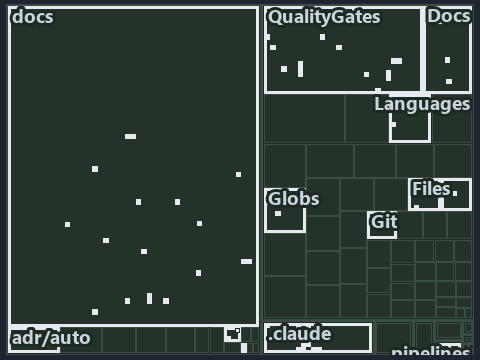

---
catzc:
  immutable:
    with_body_sha: c98d634fdb9e
    repo_status: locked
    path: docs/explanation/.assets/tree/adr-prin-onelive--a-sibling-is-an-idea-never-a-reference--meta.tree.md
    source: docs/explanation/.assets/adr-prin-onelive--a-sibling-is-an-idea-never-a-reference--meta.drawio.png
    kind: asset-description
    language: markdown
    filetype: md
    track: docs
    tracktype: documentation
---

# A sibling is an idea, never a reference: the tree minimap

```text
Which files cite ADR-AUTO-GO and ADR-PRIN-ONELIVE: every file of the world map is a tile, grouped by top-level folder.
74 files lit in 13 groups.
```



This is the tree minimap in the sidebar of the meta diagram of [A sibling is an idea, never a reference][75], which explains
[ADR-AUTO-GO][1] and [ADR-PRIN-ONELIVE][2]. It lights every file that cites those codes, grouped by folder, so it shows which files carry
the decision. Each lit group has its reason below, naming the code that selects it.

## What the minimap shows

The tree draws every file of the world map as a tile, grouped by top-level folder (under `automation/` by module, under `docs/adr/` by ADR
domain), and lights 74 files in 13 groups, filled in ink. A lit ADR file has a white rim; a file lit only by passing mentions is a lighter
ink. Every other tile is idle, a grey box: a file the slide's ADR codes do not select.

- docs (docs/ outside docs/adr/): 19 lit files
- .claude: 17 lit files
- QualityGates (automation/Catzc.Base.QualityGates): 16 lit files
- Docs (automation/Catzc.Base.Docs): 5 lit files
- Languages (automation/Catzc.Base.Languages): 4 lit files
- Files (automation/Catzc.Base.Files): 2 lit files
- Globs (automation/Catzc.Base.Globs): 2 lit files
- adr/* (the files directly in docs/adr/): 2 lit files
- adr/auto (docs/adr/automation): 2 lit files
- adr/prin (docs/adr/principles): 2 lit files
- Git (automation/Catzc.Base.Git): 1 lit file
- RootConfig (automation/Catzc.Base.RootConfig): 1 lit file
- pipelines: 1 lit file

## Why each group is lit

### docs (docs/ outside docs/adr/, 19 lit files)

The group holds the files of docs/ outside docs/adr/; each sits in its world-map cell and is lit by:

- [docs/how-to/getting-started/automation/go/index.md][3], in the cell docs × markdown: selected by [ADR-AUTO-GO][1]: the file cites it at
  line 21 (text).
- [docs/references/.assets/automation/catzc-tooling-provisioning/tools-yml-install-dispatch.drawio.verify.md][4], in the cell docs ×
  markdown: selected by [ADR-PRIN-ONELIVE][2]: the file cites it at line 90 (text).
- [docs/references/agent-contracts.md][5], in the cell docs × markdown: selected by [ADR-PRIN-ONELIVE][2]: the file cites it at line 45
  (text).
- [docs/references/automation/catzc-base-docs/tests/types/CheckModes.Tests.ps1.md][6], in the cell docs × markdown: selected by
  [ADR-PRIN-ONELIVE][2]: the file cites it at line 18 (text) and line 28 (text).
- [docs/references/automation/catzc-base-docs/types/CheckModes.cs.md][7], in the cell docs × markdown: selected by [ADR-PRIN-ONELIVE][2]:
  the file cites it at line 18 (text) and line 33 (text).
- [docs/references/automation/catzc-base-globs/Get-ModuleGlobSet.ps1.md][8], in the cell docs × markdown: selected by [ADR-AUTO-GO][1]: the
  file cites it at line 18 (text) and line 59 (text).
- [docs/references/automation/catzc-base-languages/Invoke-GoTest.ps1.md][9], in the cell docs × markdown: selected by [ADR-AUTO-GO][1]: the
  file cites it at line 18 (text) and line 44 (text).
- [docs/references/automation/catzc-base-qualitygates/configs/comments.yml.md][10], in the cell docs × markdown: selected by
  [ADR-PRIN-ONELIVE][2]: the file cites it at line 19 (text) and line 38 (text).
- [docs/references/automation/catzc-base-qualitygates/tests/Build-CommentView.Tests.ps1.md][11], in the cell docs × markdown: selected by
  [ADR-PRIN-ONELIVE][2]: the file cites it at line 17 (text) and line 34 (text).
- [docs/references/automation/catzc-base-qualitygates/tests/Export-Comments.Tests.ps1.md][12], in the cell docs × markdown: selected by
  [ADR-PRIN-ONELIVE][2]: the file cites it at line 18 (text) and line 34 (text).
- [docs/references/automation/catzc-base-qualitygates/tests/Test-Comments.Tests.ps1.md][13], in the cell docs × markdown: selected by
  [ADR-PRIN-ONELIVE][2]: the file cites it at line 17 (text) and line 31 (text).
- [docs/references/automation/catzc-base-qualitygates/types/CommentPageMap.cs.md][14], in the cell docs × markdown: selected by
  [ADR-PRIN-ONELIVE][2]: the file cites it at line 18 (text) and line 34 (text).
- [docs/references/automation/catzc-base-qualitygates/types/CommentsConfig.cs.md][15], in the cell docs × markdown: selected by
  [ADR-PRIN-ONELIVE][2]: the file cites it at line 20 (text) and line 38 (text).
- [docs/references/automation/catzc-base-rootconfig/private/Invoke-RootConfigGenerator.ps1.md][16], in the cell docs × markdown: selected by
  [ADR-AUTO-GO][1]: the file cites it at line 17 (text) and line 65 (text).
- [docs/references/automation/catzc-base-vscode/configs/vscode-settings.yml.md][17], in the cell docs × markdown: selected by
  [ADR-AUTO-GO][1]: the file cites it at line 17 (text) and line 204 (text).
- [docs/references/automation/internal/Catzc.Internal.Importer.psm1.md][18], in the cell docs × markdown: selected by [ADR-PRIN-ONELIVE][2]:
  the file cites it at line 37 (text).
- [docs/references/automation/internal/Catzc.Internal.Loader.psm1.md][19], in the cell docs × markdown: selected by [ADR-PRIN-ONELIVE][2]:
  the file cites it at line 32 (text).
- [docs/references/automation/internal/Catzc.Internal.Vendor.psm1.md][20], in the cell docs × markdown: selected by [ADR-PRIN-ONELIVE][2]:
  the file cites it at line 38 (text).
- [docs/references/note-file-kind.md][21], in the cell docs × markdown: selected by [ADR-PRIN-ONELIVE][2]: the file cites it at line 54
  (text).

### .claude (17 lit files)

The group holds the files of .claude; each sits in its world-map cell and is lit by:

- [.claude/CLAUDE.md][22], in the cell .claude × markdown: selected by [ADR-AUTO-GO][1]: the file cites it at line 56 (text); selected by
  [ADR-PRIN-ONELIVE][2]: the file cites it at line 58 (text) and line 140 (text).
- [.claude/plans/decisions-2026-10-16.md][23], in the cell .claude × markdown: selected by [ADR-AUTO-GO][1]: the file cites it at line 77
  (text); selected by [ADR-PRIN-ONELIVE][2]: the file cites it at line 30 (text), line 146 (text) and line 192 (text).
- [.claude/plans/plan-adr-link-cleanup-prose-to-pages.md][24], in the cell .claude × markdown: selected by [ADR-PRIN-ONELIVE][2]: the file
  cites it at line 131 (text) and line 353 (text).
- [.claude/plans/plan-assert-wait.md][25], in the cell .claude × markdown: selected by [ADR-PRIN-ONELIVE][2]: the file cites it at line 97
  (text), line 102 (text), line 106 (text) and line 168 (text).
- [.claude/plans/plan-bounded-folder-enumeration.md][26], in the cell .claude × markdown: selected by [ADR-PRIN-ONELIVE][2]: the file cites
  it at line 188 (text), line 230 (text) and line 370 (text).
- [.claude/plans/plan-config-defaults.md][27], in the cell .claude × markdown: selected by [ADR-PRIN-ONELIVE][2]: the file cites it at line
  88 (text) and line 160 (text).
- [.claude/plans/plan-file-head-immutable-edges-classes.md][28], in the cell .claude × markdown: selected by [ADR-PRIN-ONELIVE][2]: the file
  cites it at line 170 (text), line 302 (text) and line 411 (text).
- [.claude/plans/plan-file-meta-head-policy.md][29], in the cell .claude × markdown: selected by [ADR-PRIN-ONELIVE][2]: the file cites it at
  line 68 (text).
- [.claude/plans/plan-layers-vocabulary-rename-contracts.md][30], in the cell .claude × markdown: selected by [ADR-AUTO-GO][1]: the file
  cites it at line 428 (text) and line 762 (text); selected by [ADR-PRIN-ONELIVE][2]: the file cites it at line 133 (text), line 258 (text)
  and line 710 (text).
- [.claude/plans/plan-materialization-of-knowledge.md][31], in the cell .claude × markdown: selected by [ADR-PRIN-ONELIVE][2]: the file
  cites it at line 46 (text).
- [.claude/plans/plan-module-kinds-tracks.md][32], in the cell .claude × markdown: selected by [ADR-AUTO-GO][1]: the file cites it at line
  321 (text) and line 467 (text); selected by [ADR-PRIN-ONELIVE][2]: the file cites it at line 242 (text), line 283 (text), line 423 (text),
  line 551 (text), line 590 (text), line 692 (text) and line 1058 (text).
- [.claude/plans/prompt-automation-layers-continue.md][33], in the cell .claude × markdown: selected by [ADR-PRIN-ONELIVE][2]: the file
  cites it at line 76 (text).
- [.claude/plans/prompt-config-defaults-continue.md][34], in the cell .claude × markdown: selected by [ADR-PRIN-ONELIVE][2]: the file cites
  it at line 76 (text).
- [.claude/plans/prompt-k8s-kinds-1-prepare.md][35], in the cell .claude × markdown: selected by [ADR-PRIN-ONELIVE][2]: the file cites it at
  line 40 (text).
- [.claude/plans/prompt-module-model-1-prepare.md][36], in the cell .claude × markdown: selected by [ADR-PRIN-ONELIVE][2]: the file cites it
  at line 41 (text).
- [.claude/plans/questionnaire-2026-10-16.md][37], in the cell .claude × markdown: selected by [ADR-AUTO-GO][1]: the file cites it at line
  173 (text); selected by [ADR-PRIN-ONELIVE][2]: the file cites it at line 523 (text) and line 622 (text).
- [.claude/plans/task-adr-auto-material.md][38], in the cell .claude × markdown: selected by [ADR-PRIN-ONELIVE][2]: the file cites it at
  line 44 (text).

### QualityGates (automation/Catzc.Base.QualityGates, 16 lit files)

The group holds the files of automation/Catzc.Base.QualityGates; each sits in its world-map cell and is lit by:

- [automation/Catzc.Base.QualityGates/Build-CommentView.ps1][39], in the cell automation × powershell: selected by [ADR-PRIN-ONELIVE][2]:
  the file cites it at line 21 (header) and line 29 (header).
- [automation/Catzc.Base.QualityGates/Export-Comments.ps1][40], in the cell automation × powershell: selected by [ADR-PRIN-ONELIVE][2]: the
  file cites it at line 21 (header) and line 28 (header).
- [automation/Catzc.Base.QualityGates/Test-Comments.ps1][41], in the cell automation × powershell: selected by [ADR-PRIN-ONELIVE][2]: the
  file cites it at line 23 (header) and line 29 (header).
- [automation/Catzc.Base.QualityGates/configs/terminology.yml][42], in the cell automation × yaml: selected by [ADR-PRIN-ONELIVE][2]: the
  file cites it at line 574 (text).
- [automation/Catzc.Base.QualityGates/private/Get-LanguageTestExecutable.ps1][43], in the cell automation × powershell: selected by
  [ADR-AUTO-GO][1]: the file cites it at line 23 (header) and line 32 (header).
- [automation/Catzc.Base.QualityGates/private/Get-LanguageTestFolders.ps1][44], in the cell automation × powershell: selected by
  [ADR-AUTO-GO][1]: the file cites it at line 23 (header) and line 36 (header).
- [automation/Catzc.Base.QualityGates/private/Get-LanguageTestOutcomes.ps1][45], in the cell automation × powershell: selected by
  [ADR-AUTO-GO][1]: the file cites it at line 23 (header) and line 144 (text).
- [automation/Catzc.Base.QualityGates/private/Invoke-Gofmt.ps1][46], in the cell automation × powershell: selected by [ADR-AUTO-GO][1]: the
  file cites it at line 21 (header) and line 30 (header).
- [automation/Catzc.Base.QualityGates/tests/Build-CommentView.Tests.ps1][47], in the cell automation × powershell: selected by
  [ADR-PRIN-ONELIVE][2]: the file cites it at line 21 (header).
- [automation/Catzc.Base.QualityGates/tests/Export-Comments.Tests.ps1][48], in the cell automation × powershell: selected by
  [ADR-PRIN-ONELIVE][2]: the file cites it at line 23 (header).
- [automation/Catzc.Base.QualityGates/tests/Test-Comments.Tests.ps1][49], in the cell automation × powershell: selected by
  [ADR-PRIN-ONELIVE][2]: the file cites it at line 20 (header).
- [automation/Catzc.Base.QualityGates/tests/types/CommentEngine.Tests.ps1][50], in the cell automation × powershell: selected by
  [ADR-PRIN-ONELIVE][2]: the file cites it at line 21 (header).
- [automation/Catzc.Base.QualityGates/types/CommentBlockKind.cs][51], in the cell automation × csharp: selected by [ADR-PRIN-ONELIVE][2]:
  the file cites it at line 19 (text).
- [automation/Catzc.Base.QualityGates/types/CommentEngine.cs][52], in the cell automation × csharp: selected by [ADR-PRIN-ONELIVE][2]: the
  file cites it at line 21 (text).
- [automation/Catzc.Base.QualityGates/types/CommentPageMap.cs][53], in the cell automation × csharp: selected by [ADR-PRIN-ONELIVE][2]: the
  file cites it at line 21 (text).
- [automation/Catzc.Base.QualityGates/types/CommentsConfig.cs][54], in the cell automation × csharp: selected by [ADR-PRIN-ONELIVE][2]: the
  file cites it at line 24 (text).

### Docs (automation/Catzc.Base.Docs, 5 lit files)

The group holds the files of automation/Catzc.Base.Docs; each sits in its world-map cell and is lit by:

- [automation/Catzc.Base.Docs/configs/adrs.yml][55], in the cell automation × yaml: selected by [ADR-AUTO-GO][1]: the file cites it at line
  168 (text); selected by [ADR-PRIN-ONELIVE][2]: the file cites it at line 53 (text).
- [automation/Catzc.Base.Docs/configs/agents.yml][56], in the cell automation × yaml: selected by [ADR-PRIN-ONELIVE][2]: the file cites it
  at line 79 (body comment) and line 85 (text).
- [automation/Catzc.Base.Docs/configs/capabilities.yml][57], in the cell automation × yaml: selected by [ADR-PRIN-ONELIVE][2]: the file
  cites it at line 106 (text) and line 111 (text).
- [automation/Catzc.Base.Docs/tests/types/CheckModes.Tests.ps1][58], in the cell automation × powershell: selected by [ADR-PRIN-ONELIVE][2]:
  the file cites it at line 22 (header) and line 26 (text).
- [automation/Catzc.Base.Docs/types/CheckModes.cs][59], in the cell automation × csharp: selected by [ADR-PRIN-ONELIVE][2]: the file cites
  it at line 22 (text).

### Languages (automation/Catzc.Base.Languages, 4 lit files)

The group holds the files of automation/Catzc.Base.Languages; each sits in its world-map cell and is lit by:

- [automation/Catzc.Base.Languages/Invoke-GoTest.ps1][60], in the cell automation × powershell: selected by [ADR-AUTO-GO][1]: the file cites
  it at line 23 (header).
- [automation/Catzc.Base.Languages/Test-GeneratedFileCurrent.ps1][61], in the cell automation × powershell: selected by
  [ADR-PRIN-ONELIVE][2]: the file cites it at line 21 (header).
- [automation/Catzc.Base.Languages/configs/glossary.yml][62], in the cell automation × yaml: selected by [ADR-AUTO-GO][1]: the file cites it
  at line 35 (text).
- [automation/Catzc.Base.Languages/private/Get-EngineContract.ps1][63], in the cell automation × powershell: selected by [ADR-AUTO-GO][1]:
  the file cites it at line 23 (header) and line 31 (header).

### Files (automation/Catzc.Base.Files, 2 lit files)

The group holds the files of automation/Catzc.Base.Files; each sits in its world-map cell and is lit by:

- [automation/Catzc.Base.Files/Get-InputStamp.ps1][64], in the cell automation × powershell: selected by [ADR-PRIN-ONELIVE][2]: the file
  cites it at line 20 (header).
- [automation/Catzc.Base.Files/Write-FileIfChanged.ps1][65], in the cell automation × powershell: selected by [ADR-PRIN-ONELIVE][2]: the
  file cites it at line 23 (header) and line 43 (header).

### Globs (automation/Catzc.Base.Globs, 2 lit files)

The group holds the files of automation/Catzc.Base.Globs; each sits in its world-map cell and is lit by:

- [automation/Catzc.Base.Globs/Get-ModuleGlobSet.ps1][66], in the cell automation × powershell: selected by [ADR-AUTO-GO][1]: the file cites
  it at line 22 (header) and line 39 (header).
- [automation/Catzc.Base.Globs/tests/Get-ModuleGlobSet.Tests.ps1][67], in the cell automation × powershell: selected by [ADR-AUTO-GO][1]:
  the file cites it at line 21 (header) and line 73 (text).

### adr/* (the files directly in docs/adr/, 2 lit files)

The group holds the files of the files directly in docs/adr/; each sits in its world-map cell and is lit by:

- [docs/adr/glossary.md][68], in the cell docs × markdown: selected by [ADR-AUTO-GO][1]: the file cites it at line 659 (text).
- [docs/adr/index.md][69], in the cell docs × markdown: selected by [ADR-AUTO-GO][1]: the file cites it at line 180 (text); selected by
  [ADR-PRIN-ONELIVE][2]: the file cites it at line 72 (text).

### adr/auto (docs/adr/automation, 2 lit files)

The group holds the files of docs/adr/automation; each sits in its world-map cell and is lit by:

- [docs/adr/automation/dora-explains.md][70], in the cell docs × markdown: selected by [ADR-AUTO-GO][1]: the file cites it at line 633
  (text).
- [docs/adr/automation/go/go-test-artifacts.md][1], in the cell docs × markdown: selected by [ADR-AUTO-GO][1]: the ADR's own file.

### adr/prin (docs/adr/principles, 2 lit files)

The group holds the files of docs/adr/principles; each sits in its world-map cell and is lit by:

- [docs/adr/principles/dora-explains.md][71], in the cell docs × markdown: selected by [ADR-PRIN-ONELIVE][2]: the file cites it at line 115
  (text).
- [docs/adr/principles/one-living-version.md][2], in the cell docs × markdown: selected by [ADR-PRIN-ONELIVE][2]: the ADR's own file.

### Git (automation/Catzc.Base.Git, 1 lit file)

The group holds the files of automation/Catzc.Base.Git; each sits in its world-map cell and is lit by:

- [automation/Catzc.Base.Git/configs/gitignore.yml][72], in the cell automation × yaml: selected by [ADR-AUTO-GO][1]: the file cites it at
  line 120 (text).

### RootConfig (automation/Catzc.Base.RootConfig, 1 lit file)

The group holds the files of automation/Catzc.Base.RootConfig; each sits in its world-map cell and is lit by:

- [automation/Catzc.Base.RootConfig/private/Invoke-RootConfigGenerator.ps1][73], in the cell automation × powershell: selected by
  [ADR-AUTO-GO][1]: the file cites it at line 21 (header).

### pipelines (1 lit file)

The group holds the files of pipelines; each sits in its world-map cell and is lit by:

- [pipelines/ci-automation.yaml][74], in the cell pipelines × pipeline-yaml: selected by [ADR-AUTO-GO][1]: a pipeline that cites nothing
  itself carries its globset's citations, which cite it at `automation/Catzc.Base.Docs/configs/adrs.yml` line 168 (text),
  `automation/Catzc.Base.Git/configs/gitignore.yml` line 120 (text), `automation/Catzc.Base.Globs/Get-ModuleGlobSet.ps1` line 22 (header),
  `automation/Catzc.Base.Globs/Get-ModuleGlobSet.ps1` line 39 (header), `automation/Catzc.Base.Globs/tests/Get-ModuleGlobSet.Tests.ps1` line
  21 (header), `automation/Catzc.Base.Globs/tests/Get-ModuleGlobSet.Tests.ps1` line 73 (text),
  `automation/Catzc.Base.Languages/Invoke-GoTest.ps1` line 23 (header), `automation/Catzc.Base.Languages/configs/glossary.yml` line 35
  (text), `automation/Catzc.Base.Languages/private/Get-EngineContract.ps1` line 23 (header),
  `automation/Catzc.Base.Languages/private/Get-EngineContract.ps1` line 31 (header),
  `automation/Catzc.Base.QualityGates/private/Get-LanguageTestExecutable.ps1` line 23 (header),
  `automation/Catzc.Base.QualityGates/private/Get-LanguageTestExecutable.ps1` line 32 (header),
  `automation/Catzc.Base.QualityGates/private/Get-LanguageTestFolders.ps1` line 23 (header),
  `automation/Catzc.Base.QualityGates/private/Get-LanguageTestFolders.ps1` line 36 (header),
  `automation/Catzc.Base.QualityGates/private/Get-LanguageTestOutcomes.ps1` line 23 (header),
  `automation/Catzc.Base.QualityGates/private/Get-LanguageTestOutcomes.ps1` line 144 (text),
  `automation/Catzc.Base.QualityGates/private/Invoke-Gofmt.ps1` line 21 (header),
  `automation/Catzc.Base.QualityGates/private/Invoke-Gofmt.ps1` line 30 (header) and
  `automation/Catzc.Base.RootConfig/private/Invoke-RootConfigGenerator.ps1` line 21 (header); selected by [ADR-PRIN-ONELIVE][2]: a pipeline
  that cites nothing itself carries its globset's citations, which cite it at `automation/Catzc.Base.Docs/configs/adrs.yml` line 53 (text),
  `automation/Catzc.Base.Docs/configs/agents.yml` line 79 (body comment), `automation/Catzc.Base.Docs/configs/agents.yml` line 85 (text),
  `automation/Catzc.Base.Docs/configs/capabilities.yml` line 106 (text), `automation/Catzc.Base.Docs/configs/capabilities.yml` line 111
  (text), `automation/Catzc.Base.Docs/tests/types/CheckModes.Tests.ps1` line 22 (header),
  `automation/Catzc.Base.Docs/tests/types/CheckModes.Tests.ps1` line 26 (text), `automation/Catzc.Base.Docs/types/CheckModes.cs` line 22
  (text), `automation/Catzc.Base.Files/Get-InputStamp.ps1` line 20 (header), `automation/Catzc.Base.Files/Write-FileIfChanged.ps1` line 23
  (header), `automation/Catzc.Base.Files/Write-FileIfChanged.ps1` line 43 (header),
  `automation/Catzc.Base.Languages/Test-GeneratedFileCurrent.ps1` line 21 (header),
  `automation/Catzc.Base.QualityGates/Build-CommentView.ps1` line 21 (header), `automation/Catzc.Base.QualityGates/Build-CommentView.ps1`
  line 29 (header), `automation/Catzc.Base.QualityGates/Export-Comments.ps1` line 21 (header),
  `automation/Catzc.Base.QualityGates/Export-Comments.ps1` line 28 (header), `automation/Catzc.Base.QualityGates/Test-Comments.ps1` line 23
  (header), `automation/Catzc.Base.QualityGates/Test-Comments.ps1` line 29 (header),
  `automation/Catzc.Base.QualityGates/configs/terminology.yml` line 574 (text),
  `automation/Catzc.Base.QualityGates/tests/Build-CommentView.Tests.ps1` line 21 (header),
  `automation/Catzc.Base.QualityGates/tests/Export-Comments.Tests.ps1` line 23 (header),
  `automation/Catzc.Base.QualityGates/tests/Test-Comments.Tests.ps1` line 20 (header),
  `automation/Catzc.Base.QualityGates/tests/types/CommentEngine.Tests.ps1` line 21 (header),
  `automation/Catzc.Base.QualityGates/types/CommentBlockKind.cs` line 19 (text), `automation/Catzc.Base.QualityGates/types/CommentEngine.cs`
  line 21 (text), `automation/Catzc.Base.QualityGates/types/CommentPageMap.cs` line 21 (text) and
  `automation/Catzc.Base.QualityGates/types/CommentsConfig.cs` line 24 (text).

## Keywords

- [world map][76]
- [track][77]
- [file language][78]
- [cell][79]
- [lit cell][80]
- [.claude][81]: a track
- [automation][81]: a track
- [docs][81]: a track
- [pipelines][81]: a track
- [csharp][82]: a file language
- [markdown][82]: a file language
- [pipeline-yaml][82]: a file language
- [powershell][82]: a file language
- [yaml][82]: a file language

Terms the cited ADRs define:

- [go test module][83], defined by [ADR-AUTO-GO#2][84]

[1]: ../../../adr/automation/go/go-test-artifacts.md
[2]: ../../../adr/principles/one-living-version.md
[3]: ../../../how-to/getting-started/automation/go/index.md
[4]: ../../../references/.assets/automation/catzc-tooling-provisioning/tools-yml-install-dispatch.drawio.verify.md
[5]: ../../../references/agent-contracts.md
[6]: ../../../references/automation/catzc-base-docs/tests/types/CheckModes.Tests.ps1.md
[7]: ../../../references/automation/catzc-base-docs/types/CheckModes.cs.md
[8]: ../../../references/automation/catzc-base-globs/Get-ModuleGlobSet.ps1.md
[9]: ../../../references/automation/catzc-base-languages/Invoke-GoTest.ps1.md
[10]: ../../../references/automation/catzc-base-qualitygates/configs/comments.yml.md
[11]: ../../../references/automation/catzc-base-qualitygates/tests/Build-CommentView.Tests.ps1.md
[12]: ../../../references/automation/catzc-base-qualitygates/tests/Export-Comments.Tests.ps1.md
[13]: ../../../references/automation/catzc-base-qualitygates/tests/Test-Comments.Tests.ps1.md
[14]: ../../../references/automation/catzc-base-qualitygates/types/CommentPageMap.cs.md
[15]: ../../../references/automation/catzc-base-qualitygates/types/CommentsConfig.cs.md
[16]: ../../../references/automation/catzc-base-rootconfig/private/Invoke-RootConfigGenerator.ps1.md
[17]: ../../../references/automation/catzc-base-vscode/configs/vscode-settings.yml.md
[18]: ../../../references/automation/internal/Catzc.Internal.Importer.psm1.md
[19]: ../../../references/automation/internal/Catzc.Internal.Loader.psm1.md
[20]: ../../../references/automation/internal/Catzc.Internal.Vendor.psm1.md
[21]: ../../../references/note-file-kind.md
[22]: ../../../../.claude/CLAUDE.md
[23]: ../../../../.claude/plans/decisions-2026-10-16.md
[24]: ../../../../.claude/plans/plan-adr-link-cleanup-prose-to-pages.md
[25]: ../../../../.claude/plans/plan-assert-wait.md
[26]: ../../../../.claude/plans/plan-bounded-folder-enumeration.md
[27]: ../../../../.claude/plans/plan-config-defaults.md
[28]: ../../../../.claude/plans/plan-file-head-immutable-edges-classes.md
[29]: ../../../../.claude/plans/plan-file-meta-head-policy.md
[30]: ../../../../.claude/plans/plan-layers-vocabulary-rename-contracts.md
[31]: ../../../../.claude/plans/plan-materialization-of-knowledge.md
[32]: ../../../../.claude/plans/plan-module-kinds-tracks.md
[33]: ../../../../.claude/plans/prompt-automation-layers-continue.md
[34]: ../../../../.claude/plans/prompt-config-defaults-continue.md
[35]: ../../../../.claude/plans/prompt-k8s-kinds-1-prepare.md
[36]: ../../../../.claude/plans/prompt-module-model-1-prepare.md
[37]: ../../../../.claude/plans/questionnaire-2026-10-16.md
[38]: ../../../../.claude/plans/task-adr-auto-material.md
[39]: ../../../../automation/Catzc.Base.QualityGates/Build-CommentView.ps1
[40]: ../../../../automation/Catzc.Base.QualityGates/Export-Comments.ps1
[41]: ../../../../automation/Catzc.Base.QualityGates/Test-Comments.ps1
[42]: ../../../../automation/Catzc.Base.QualityGates/configs/terminology.yml
[43]: ../../../../automation/Catzc.Base.QualityGates/private/Get-LanguageTestExecutable.ps1
[44]: ../../../../automation/Catzc.Base.QualityGates/private/Get-LanguageTestFolders.ps1
[45]: ../../../../automation/Catzc.Base.QualityGates/private/Get-LanguageTestOutcomes.ps1
[46]: ../../../../automation/Catzc.Base.QualityGates/private/Invoke-Gofmt.ps1
[47]: ../../../../automation/Catzc.Base.QualityGates/tests/Build-CommentView.Tests.ps1
[48]: ../../../../automation/Catzc.Base.QualityGates/tests/Export-Comments.Tests.ps1
[49]: ../../../../automation/Catzc.Base.QualityGates/tests/Test-Comments.Tests.ps1
[50]: ../../../../automation/Catzc.Base.QualityGates/tests/types/CommentEngine.Tests.ps1
[51]: ../../../../automation/Catzc.Base.QualityGates/types/CommentBlockKind.cs
[52]: ../../../../automation/Catzc.Base.QualityGates/types/CommentEngine.cs
[53]: ../../../../automation/Catzc.Base.QualityGates/types/CommentPageMap.cs
[54]: ../../../../automation/Catzc.Base.QualityGates/types/CommentsConfig.cs
[55]: ../../../../automation/Catzc.Base.Docs/configs/adrs.yml
[56]: ../../../../automation/Catzc.Base.Docs/configs/agents.yml
[57]: ../../../../automation/Catzc.Base.Docs/configs/capabilities.yml
[58]: ../../../../automation/Catzc.Base.Docs/tests/types/CheckModes.Tests.ps1
[59]: ../../../../automation/Catzc.Base.Docs/types/CheckModes.cs
[60]: ../../../../automation/Catzc.Base.Languages/Invoke-GoTest.ps1
[61]: ../../../../automation/Catzc.Base.Languages/Test-GeneratedFileCurrent.ps1
[62]: ../../../../automation/Catzc.Base.Languages/configs/glossary.yml
[63]: ../../../../automation/Catzc.Base.Languages/private/Get-EngineContract.ps1
[64]: ../../../../automation/Catzc.Base.Files/Get-InputStamp.ps1
[65]: ../../../../automation/Catzc.Base.Files/Write-FileIfChanged.ps1
[66]: ../../../../automation/Catzc.Base.Globs/Get-ModuleGlobSet.ps1
[67]: ../../../../automation/Catzc.Base.Globs/tests/Get-ModuleGlobSet.Tests.ps1
[68]: ../../../adr/glossary.md
[69]: ../../../adr/index.md
[70]: ../../../adr/automation/dora-explains.md
[71]: ../../../adr/principles/dora-explains.md
[72]: ../../../../automation/Catzc.Base.Git/configs/gitignore.yml
[73]: ../../../../automation/Catzc.Base.RootConfig/private/Invoke-RootConfigGenerator.ps1
[74]: ../../../../pipelines/ci-automation.yaml
[75]: ../../design/a-sibling-is-an-idea-never-a-reference.md
[76]: ../../../adr/glossary.md#world-map
[77]: ../../../adr/glossary.md#track
[78]: ../../../adr/glossary.md#file-language
[79]: ../../../adr/glossary.md#cell
[80]: ../../../adr/glossary.md#lit-cell
[81]: ../../../../automation/Catzc.Base.Variants/configs/variants.yml
[82]: ../../../../automation/Catzc.Base.Languages/configs/languages.yml
[83]: ../../../adr/glossary.md#go-test-module
[84]: ../../../adr/automation/go/go-test-artifacts.md#rule-adr-auto-go2
