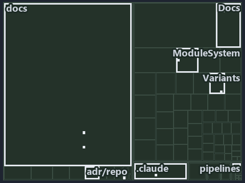

# Values and module edges have a gate; the no-direct-read rule is left to review: the tree minimap

```text
Which files cite ADR-REPO-VARIANT: every file of the world map is a tile, grouped by top-level folder.
10 files lit in 8 groups.
```



This is the tree minimap in the sidebar of the governance diagram of [Values and module edges have a gate; the no-direct-read rule is left
to review][11], which explains [ADR-REPO-VARIANT][1]. It lights every file that cites those codes, grouped by folder, so it shows which
files carry the decision. Each lit group has its reason below, naming the code that selects it.

## What the minimap shows

The tree draws every file of the world map as a tile, grouped by top-level folder (under `automation/` by module, under `docs/adr/` by ADR
domain), and lights 10 files in 8 groups, filled in ink. A lit ADR file has a white rim; a file lit only by passing mentions is a lighter
ink. Every other tile is idle, a grey box: a file the slide's ADR codes do not select.

- adr/repo (docs/adr/repository): 2 lit files
- docs (docs/ outside docs/adr/): 2 lit files
- .claude: 1 lit file
- Docs (automation/Catzc.Base.Docs): 1 lit file
- ModuleSystem (automation/Catzc.Base.ModuleSystem): 1 lit file
- Variants (automation/Catzc.Base.Variants): 1 lit file
- adr/* (the files directly in docs/adr/): 1 lit file
- pipelines: 1 lit file

## Why each group is lit

### adr/repo (docs/adr/repository, 2 lit files)

The group holds the files of docs/adr/repository; each sits in its world-map cell and is lit by:

- [docs/adr/repository/dora-explains.md][2], in the cell docs × markdown: selected by [ADR-REPO-VARIANT][1]: the file cites it at line 221
  (text).
- [docs/adr/repository/repo-variants.md][1], in the cell docs × markdown: selected by [ADR-REPO-VARIANT][1]: the ADR's own file.

### docs (docs/ outside docs/adr/, 2 lit files)

The group holds the files of docs/ outside docs/adr/; each sits in its world-map cell and is lit by:

- [docs/references/automation/catzc-base-variants/configs/variants.yml.md][3], in the cell docs × markdown: selected by
  [ADR-REPO-VARIANT][1]: the file cites it at line 30 (text).
- [docs/references/automation/catzc-base-variants/types/VariantsConfig.cs.md][4], in the cell docs × markdown: selected by
  [ADR-REPO-VARIANT][1]: the file cites it at line 31 (text).

### .claude (1 lit file)

The group holds the files of .claude; each sits in its world-map cell and is lit by:

- [.claude/plans/plan-module-kinds-tracks.md][5], in the cell .claude × markdown: selected by [ADR-REPO-VARIANT][1]: the file cites it at
  line 896 (text) and line 950 (text).

### Docs (automation/Catzc.Base.Docs, 1 lit file)

The group holds the files of automation/Catzc.Base.Docs; each sits in its world-map cell and is lit by:

- [automation/Catzc.Base.Docs/configs/adrs.yml][6], in the cell automation × yaml: selected by [ADR-REPO-VARIANT][1]: the file cites it at
  line 322 (text).

### ModuleSystem (automation/Catzc.Base.ModuleSystem, 1 lit file)

The group holds the files of automation/Catzc.Base.ModuleSystem; each sits in its world-map cell and is lit by:

- [automation/Catzc.Base.ModuleSystem/Sync-GeneratedFile.ps1][7], in the cell automation × powershell: selected by [ADR-REPO-VARIANT][1]:
  the file cites it at line 24 (header), line 52 (header) and line 125 (text).

### Variants (automation/Catzc.Base.Variants, 1 lit file)

The group holds the files of automation/Catzc.Base.Variants; each sits in its world-map cell and is lit by:

- [automation/Catzc.Base.Variants/types/VariantsConfig.cs][8], in the cell automation × csharp: selected by [ADR-REPO-VARIANT][1]: the file
  cites it at line 24 (text).

### adr/* (the files directly in docs/adr/, 1 lit file)

The group holds the files of the files directly in docs/adr/; each sits in its world-map cell and is lit by:

- [docs/adr/index.md][9], in the cell docs × markdown: selected by [ADR-REPO-VARIANT][1]: the file cites it at line 327 (text).

### pipelines (1 lit file)

The group holds the files of pipelines; each sits in its world-map cell and is lit by:

- [pipelines/ci-automation.yaml][10], in the cell pipelines × pipeline-yaml: selected by [ADR-REPO-VARIANT][1]: a pipeline that cites
  nothing itself carries its globset's citations, which cite it at `automation/Catzc.Base.Docs/configs/adrs.yml` line 322 (text),
  `automation/Catzc.Base.ModuleSystem/Sync-GeneratedFile.ps1` line 24 (header), `automation/Catzc.Base.ModuleSystem/Sync-GeneratedFile.ps1`
  line 52 (header), `automation/Catzc.Base.ModuleSystem/Sync-GeneratedFile.ps1` line 125 (text) and
  `automation/Catzc.Base.Variants/types/VariantsConfig.cs` line 24 (text).

## Keywords

- [world map][12]
- [track][13]
- [file language][14]
- [cell][15]
- [lit cell][16]
- [.claude][17]: a track
- [automation][17]: a track
- [docs][17]: a track
- [pipelines][17]: a track
- [csharp][18]: a file language
- [markdown][18]: a file language
- [pipeline-yaml][18]: a file language
- [powershell][18]: a file language
- [yaml][18]: a file language

[1]: ../../../adr/repository/repo-variants.md
[2]: ../../../adr/repository/dora-explains.md
[3]: ../../../references/automation/catzc-base-variants/configs/variants.yml.md
[4]: ../../../references/automation/catzc-base-variants/types/VariantsConfig.cs.md
[5]: ../../../../.claude/plans/plan-module-kinds-tracks.md
[6]: ../../../../automation/Catzc.Base.Docs/configs/adrs.yml
[7]: ../../../../automation/Catzc.Base.ModuleSystem/Sync-GeneratedFile.ps1
[8]: ../../../../automation/Catzc.Base.Variants/types/VariantsConfig.cs
[9]: ../../../adr/index.md
[10]: ../../../../pipelines/ci-automation.yaml
[11]: ../../repository/values-and-edges-gated-reads-reviewed.md
[12]: ../../../adr/glossary.md#world-map
[13]: ../../../adr/glossary.md#track
[14]: ../../../adr/glossary.md#file-language
[15]: ../../../adr/glossary.md#cell
[16]: ../../../adr/glossary.md#lit-cell
[17]: ../../../../automation/Catzc.Base.Variants/configs/variants.yml
[18]: ../../../../automation/Catzc.Base.Languages/configs/languages.yml
