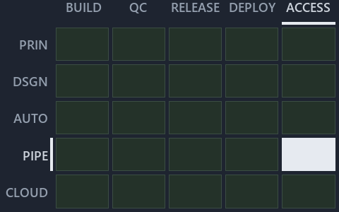

---
catzc:
  immutable:
    with_body_sha: "9af21ba3a15b"
    warning: "Do Not Edit, this file is generated"
    repo_status: locked
    path: docs/explanation/ado/.assets/configured-credential-proves-its-org/chain.md
    source: docs/explanation/ado/.assets/configured-credential-proves-its-org/diagram.drawio.png
    role: asset-description
    language: markdown
    filetype: md
    track: docs
    tracktype: documentation
---

# The first configured credential wins, and it must prove its org: the value-chain minimap

```text
Where ADR-PIPE-AUTH sits in the value chain: value-chain stack down, value-chain concerns across.
1 of 25 cells lit.
```



This is the value-chain minimap in the sidebar of the meta diagram of [The first configured credential wins, and it must prove its org][3],
which explains [ADR-PIPE-AUTH][1]. It lights the cells of the value-chain map where the cited ADRs' value-chain concerns land, so it shows
the part of the value chain the decision governs. Each lit cell has its reason below, naming the code that selects it.

## What the minimap shows

Value-chain map: value-chain stack × value-chain concerns. The grid crosses the 5 rows of the value-chain stack (PRIN, DSGN, AUTO, PIPE,
CLOUD) with the 5 value-chain concerns (build, quality-control, release, deploy, access) and lights 1 cell, filled in ink. Every other cell
is idle, a grey box: it holds ADRs the slide does not cite, or none, because no ADR's value-chain concern lands there (5 of the 25 cells
hold none). The minimap shows where the slide sits, not how many ADRs a cell holds; that count belongs to the full value-chain map.

- PIPE × access: 1 lit of 1 ADR

## Key

Rows are the value-chain stack and columns the value-chain concerns, each printed as a capital code:

- `PRIN`: the PRIN row of the value-chain stack
- `DSGN`: the DSGN row of the value-chain stack
- `AUTO`: the AUTO row of the value-chain stack
- `PIPE`: the PIPE row of the value-chain stack
- `CLOUD`: the CLOUD row of the value-chain stack
- `BUILD`: build
- `QC`: quality-control
- `RELEASE`: release
- `DEPLOY`: deploy
- `ACCESS`: access

## Why each cell is lit

### PIPE × access (1 ADR)

Lit ([ADR-DSGN-TRACK-LITCELL][2]) by:

- [ADR-PIPE-AUTH][1]: selected by [ADR-PIPE-AUTH][1]; its ADR domain `ado` sits on the PIPE row of the value-chain stack
  ([ADR-DSGN-TRACK-VALUECHAINSTACK][2]); its own value-chain concerns (access) override its ADR domain's default (build, quality-control,
  release and deploy), so it lights the access column ([ADR-DSGN-TRACK-VALUECHAINCONCERN][2]).

## Keywords

- [value-chain map][4]
- [value-chain stack][5]
- [value-chain concern][6]
- [cell][7]
- [lit cell][8]

[1]: ../../../../adr/ado/dual-authentication.md
[2]: ../../../../adr/design/tracks.md
[3]: ../../configured-credential-proves-its-org.md
[4]: ../../../../adr/glossary.md#value-chain-map
[5]: ../../../../adr/glossary.md#value-chain-stack
[6]: ../../../../adr/glossary.md#value-chain-concern
[7]: ../../../../adr/glossary.md#cell
[8]: ../../../../adr/glossary.md#lit-cell
