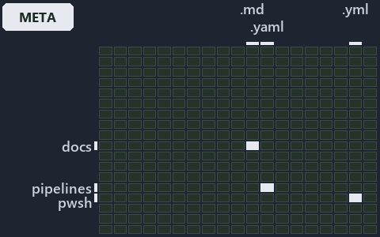

---
catzc:
  immutable:
    with_body_sha: "37d08ad65339"
    repo_status: locked
    path: docs/explanation/pipelines/.assets/configured-credential-proves-its-org/grid.md
    source: docs/explanation/pipelines/.assets/configured-credential-proves-its-org/diagram.drawio.png
    role: asset-description
    language: markdown
    filetype: md
    track: docs
    tracktype: documentation
---

# The first configured credential wins, and it must prove its org: the world-map minimap

```text
Where the files that cite ADR-PIPE-AUTH sit in the repository: tracks down, file languages across.
3 of 342 cells lit, holding 5 files.
```



This is the world-map minimap in the sidebar of the meta diagram of [The first configured credential wins, and it must prove its org][7],
which explains [ADR-PIPE-AUTH][1]. It lights every cell of the world map that holds a file citing those codes, so it shows where the
decision lives in the repository. Each lit cell has its reason below, naming the code that selects it.

## What the minimap shows

The grid crosses the 18 tracks (rows) with the 19 file languages (columns) of the world map and lights 3 cells, filled in ink. A cell lit
only by passing mentions (citations in body comments, not in a file's header or text) is touched: a lighter ink. Every other cell is idle, a
grey box: it holds files the slide's ADR codes do not select, or no file at all (288 of the 342 cells hold none). The minimap shows where
the slide sits, not how many files a cell holds; the world-map PDFs show the counts.

- docs × markdown: 3 lit of 2767 files
- pipelines × pipeline-yaml: 1 lit of 14 files
- pwsh × yaml: 1 lit of 115 files

## Key

A lit row prints its track's name; a lit column prints a short code, the first extension of its file language:

- `.md`: markdown
- `.yaml`: pipeline-yaml
- `.yml`: yaml

## Why each cell is lit

### docs × markdown (3 lit files)

Placed: the root folder `docs/` names the track docs ([ADR-DSGN-TRACK-TRACKISPLACEDCLUSTER][2]); the extension `.md` names the file language
markdown ([ADR-DSGN-TRACK-FILELANGUAGE][2]). Lit ([ADR-DSGN-TRACK-LITCELL][2]) by:

- [docs/adr/index.md][3]: selected by [ADR-PIPE-AUTH][1]: the file cites it at line 250 (text).
- [docs/adr/pipelines/dora-explains.md][4]: selected by [ADR-PIPE-AUTH][1]: the file cites it at line 11 (text).
- [docs/adr/pipelines/dual-authentication.md][1]: selected by [ADR-PIPE-AUTH][1]: the ADR's own file.

### pipelines × pipeline-yaml (1 lit file)

Placed: the root folder `pipelines/` names the track pipelines ([ADR-DSGN-TRACK-TRACKISPLACEDCLUSTER][2]); the extension `.yaml` names the
file language pipeline-yaml ([ADR-DSGN-TRACK-FILELANGUAGE][2]). Lit ([ADR-DSGN-TRACK-LITCELL][2]) by:

- [pipelines/ci-automation.yaml][5]: selected by [ADR-PIPE-AUTH][1]: a pipeline that cites nothing itself carries its globset's citations,
  which cite it at `pwsh/Catzc.Base.Docs/configs/adrs.yml` line 223 (text).

### pwsh × yaml (1 lit file)

Placed: the root folder `pwsh/` names the track pwsh ([ADR-DSGN-TRACK-TRACKISPLACEDCLUSTER][2]); the extension `.yml` names the file
language yaml ([ADR-DSGN-TRACK-FILELANGUAGE][2]). Lit ([ADR-DSGN-TRACK-LITCELL][2]) by:

- [pwsh/Catzc.Base.Docs/configs/adrs.yml][6]: selected by [ADR-PIPE-AUTH][1]: the file cites it at line 223 (text).

## Keywords

- [world map][8]
- [track][9]
- [file language][10]
- [cell][11]
- [lit cell][12]
- [docs][13]: a track
- [pipelines][13]: a track
- [pwsh][13]: a track
- [markdown][14]: a file language
- [pipeline-yaml][14]: a file language
- [yaml][14]: a file language

[1]: ../../../../adr/pipelines/dual-authentication.md
[2]: ../../../../adr/design/tracks.md
[3]: ../../../../adr/index.md
[4]: ../../../../adr/pipelines/dora-explains.md
[5]: ../../../../../pipelines/ci-automation.yaml
[6]: ../../../../../pwsh/Catzc.Base.Docs/configs/adrs.yml
[7]: ../../configured-credential-proves-its-org.md
[8]: ../../../../adr/glossary.md#world-map
[9]: ../../../../adr/glossary.md#track
[10]: ../../../../adr/glossary.md#file-language
[11]: ../../../../adr/glossary.md#cell
[12]: ../../../../adr/glossary.md#lit-cell
[13]: ../../../../../pwsh/Catzc.Base.Variants/configs/variants.yml
[14]: ../../../../../pwsh/Catzc.Base.Languages/configs/languages.yml
