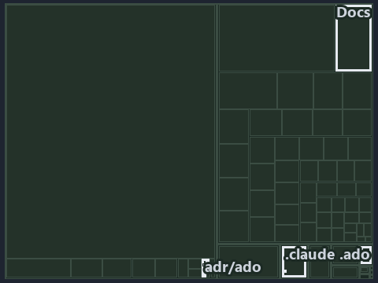

---
catzc:
  immutable:
    with_body_sha: "2062e97d4665"
    warning: "Do Not Edit, this file is generated"
    repo_status: locked
    path: docs/explanation/ado/.assets/configured-credential-proves-its-org/tree.md
    source: docs/explanation/ado/.assets/configured-credential-proves-its-org/diagram.drawio.png
    role: asset-description
    language: markdown
    filetype: md
    track: docs
    tracktype: documentation
---

# The first configured credential wins, and it must prove its org: the tree minimap

```text
Which files cite ADR-ADO-AUTH: every file of the world map is a tile, grouped by top-level folder.
6 files lit in 5 groups.
```



This is the tree minimap in the sidebar of the meta diagram of [The first configured credential wins, and it must prove its org][7], which
explains [ADR-ADO-AUTH][1]. It lights every file that cites those codes, grouped by folder, so it shows which files carry the decision. Each
lit group has its reason below, naming the code that selects it.

## What the minimap shows

The tree draws every file of the world map as a tile, grouped by top-level folder (under `pwsh/` by module, under `docs/adr/` by ADR
domain), and lights 6 files in 5 groups, filled in ink. A lit ADR file has a white rim; a file lit only by passing mentions is a lighter
ink. Every other tile is idle, a grey box: a file the slide's ADR codes do not select.

- adr/ado (docs/adr/ado): 2 lit files
- .ado: 1 lit file
- .claude: 1 lit file
- adr/* (the files directly in docs/adr/): 1 lit file
- Docs (pwsh/Catzc.Base.Docs): 1 lit file

## Why each group is lit

### adr/ado (docs/adr/ado, 2 lit files)

The group holds the files of docs/adr/ado; each sits in its world-map cell and is lit by:

- [docs/adr/ado/dora-explains.md][2], in the cell docs × markdown: selected by [ADR-ADO-AUTH][1]: the file cites it at line 11 (text).
- [docs/adr/ado/dual-authentication.md][1], in the cell docs × markdown: selected by [ADR-ADO-AUTH][1]: the ADR's own file.

### .ado (1 lit file)

The group holds the files of .ado; each sits in its world-map cell and is lit by:

- [.ado/pipelines/ci-automation.yaml][3], in the cell ado-pipelines × pipeline-yaml: selected by [ADR-ADO-AUTH][1]: a pipeline that cites
  nothing itself carries its globset's citations, which cite it at `pwsh/Catzc.Base.Docs/configs/adrs.yml` line 225 (text).

### .claude (1 lit file)

The group holds the files of .claude; each sits in its world-map cell and is lit by:

- [.claude/plans/plan-ado-and-cicd-docs.md][4], in the cell .claude × markdown: selected by [ADR-ADO-AUTH][1]: the file cites it at line 42
  (text).

### adr/* (the files directly in docs/adr/, 1 lit file)

The group holds the files of the files directly in docs/adr/; each sits in its world-map cell and is lit by:

- [docs/adr/index.md][5], in the cell docs × markdown: selected by [ADR-ADO-AUTH][1]: the file cites it at line 252 (text).

### Docs (pwsh/Catzc.Base.Docs, 1 lit file)

The group holds the files of pwsh/Catzc.Base.Docs; each sits in its world-map cell and is lit by:

- [pwsh/Catzc.Base.Docs/configs/adrs.yml][6], in the cell pwsh × yaml: selected by [ADR-ADO-AUTH][1]: the file cites it at line 225 (text).

## Keywords

- [world map][8]
- [track][9]
- [file language][10]
- [cell][11]
- [lit cell][12]
- [.claude][13]: a track
- [ado-pipelines][13]: a track
- [docs][13]: a track
- [pwsh][13]: a track
- [markdown][14]: a file language
- [pipeline-yaml][14]: a file language
- [yaml][14]: a file language

[1]: ../../../../adr/ado/dual-authentication.md
[2]: ../../../../adr/ado/dora-explains.md
[3]: ../../../../../.ado/pipelines/ci-automation.yaml
[4]: ../../../../../.claude/plans/plan-ado-and-cicd-docs.md
[5]: ../../../../adr/index.md
[6]: ../../../../../pwsh/Catzc.Base.Docs/configs/adrs.yml
[7]: ../../configured-credential-proves-its-org.md
[8]: ../../../../adr/glossary.md#world-map
[9]: ../../../../adr/glossary.md#track
[10]: ../../../../adr/glossary.md#file-language
[11]: ../../../../adr/glossary.md#cell
[12]: ../../../../adr/glossary.md#lit-cell
[13]: ../../../../../pwsh/Catzc.Base.Variants/configs/variants.yml
[14]: ../../../../../pwsh/Catzc.Base.Languages/configs/languages.yml
