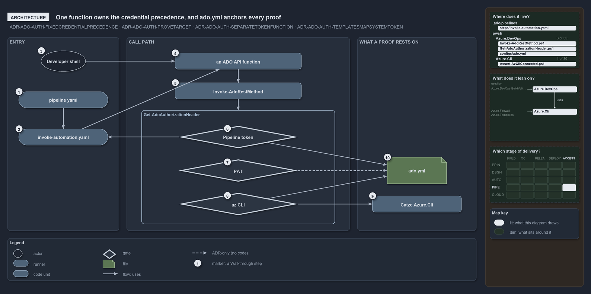

# One function owns the credential precedence, and ado.yml anchors every proof

```text
One function owns the credential precedence, and ado.yml anchors every proof.

1  pipeline yaml           the usual start: a pipeline runs a catzc command as a step
2  invoke-automation.yaml  the step template every pipeline step goes through; it maps the pipeline token in
3  Developer shell         the other start: a developer runs the same command locally
4  an ADO API function     the command's call to the Azure DevOps REST API
5  Invoke-AdoRestMethod    the one caller of the header function
6  Pipeline token          the first source, proved against the ado.yml organization
7  PAT                     the second source, bound to the org only by the ADR
8  az CLI                  the last source, proved against the ado.yml tenant
9  Catzc.Azure.Cli         the module whose Assert-AzCliConnected checks the session
10 ado.yml                 the config every proof is checked against

Supports ADR-ADO-AUTH-FIXEDCREDENTIALPRECEDENCE, ADR-ADO-AUTH-PROVETARGET, ADR-ADO-AUTH-SEPARATETOKENFUNCTION and ADR-ADO-AUTH-TEMPLATESMAPSYSTEMTOKEN (architecture lens).
```

Cats calls the Azure DevOps REST API from several modules, but only one function, `Get-AdoAuthorizationHeader`, decides which credential a
call uses. Most calls start in a pipeline, as a step run through the `invoke-automation.yaml` template; the rest start in a developer's
shell. Either way the call reaches the header function through one wrapper, and the API functions never touch a credential themselves.
Around the header function sit the parts its proofs rest on: the step template that supplies the pipeline token, the az CLI module, and
`ado.yml`, which every proof is checked against.



## Walkthrough

1. **pipeline yaml.** Most calls start here. A pipeline (`ci-pwsh`, `ci-infrastructure`, `cd-shared`, `cd-customer` and the `deploy-unit`
   stage) runs a catzc command as a step.
2. **invoke-automation.yaml.** Every such step goes through this template, which runs the command in `Invoke-AdoScript.ps1` in one of three
   modes (plain PowerShell, az CLI or Azure PowerShell). When the step sets `ExposeAccessToken`, the template maps `SYSTEM_ACCESSTOKEN` into
   it; that mapping is the only reason the pipeline token exists.
3. **Developer shell.** The other start: a developer runs the same command in a local session, where no pipeline token exists.
4. **an ADO API function.** The command reaches the REST API through one of the API functions: `New-AdoPullRequest`, `Register-AdoPipeline`
   and `Get-AdoPipelineDefinitions` in `Catzc.Azure.DevOps`, and `Get-AdoBuildValidations`, `Register-AdoBuildValidation`,
   `Unregister-AdoBuildValidation` and the private `Resolve-AdoBuildValidationContext` in `Catzc.Azure.DevOps.BuildValidation`.
5. **Invoke-AdoRestMethod.** Every API function calls through `Invoke-AdoRestMethod`, the only caller of the header function.
6. **Pipeline token.** The header function's first source is the agent token. It is guarded by `Test-IsRunningInPipeline` from
   `Catzc.Base.Repository`, uses the token the step template mapped in, and is proved against the `ado.yml` `organization`.
7. **PAT.** The second source is an operator-set environment variable. It has no runtime proof; the ADR binds it to the org because API
   addresses are built from the `ado.yml` `organization`, which no code checks against the header.
8. **az CLI.** The last source is used when neither of the first two is configured. It is proved against the `ado.yml` `tenant`.
9. **Catzc.Azure.Cli.** The source for the az CLI rests on that module's `Assert-AzCliConnected`, which checks the session against the
   tenant.
10. **ado.yml.** The config is the proof anchor: `organization` for the pipeline token and the PAT, `tenant` for the az CLI.
    `Get-Config -Config ado` loads it as the typed `AdoConfig` record, which requires both keys.

## Why it holds

- The precedence is fixed, top to bottom, and a source that fails raises its own error (ADR-ADO-AUTH-FIXEDCREDENTIALPRECEDENCE).
- Each source proves it targets the configured organization or tenant before it returns a header (ADR-ADO-AUTH-PROVETARGET).
- Token acquisition lives in one separate function, and API-calling functions never inline it (ADR-ADO-AUTH-SEPARATETOKENFUNCTION).
- The step template maps the system token, and functions read only the mapped `$env:SYSTEM_ACCESSTOKEN`
  (ADR-ADO-AUTH-TEMPLATESMAPSYSTEMTOKEN).

## Where the code and the ADR differ

The ADR says a PAT is bound to the configured org by construction. The API functions default `-Organization` from `ado.yml` but accept any
value, and nothing checks it against the header's source.

## See also

- [Dual authentication](../../drs/ado/dual-authentication.md) — the decision this article explains.
- The other lenses on the same precedence: [meta](configured-credential-proves-its-org.md),
  [implementation](three-guarded-early-returns.md), [operations](what-you-set-decides-the-credential.md) and
  [governance](which-auth-rungs-have-a-gate.md).
- [The ado explanations](index.md) · [How to read the diagrams](../index.md#how-to-read-the-diagrams)
