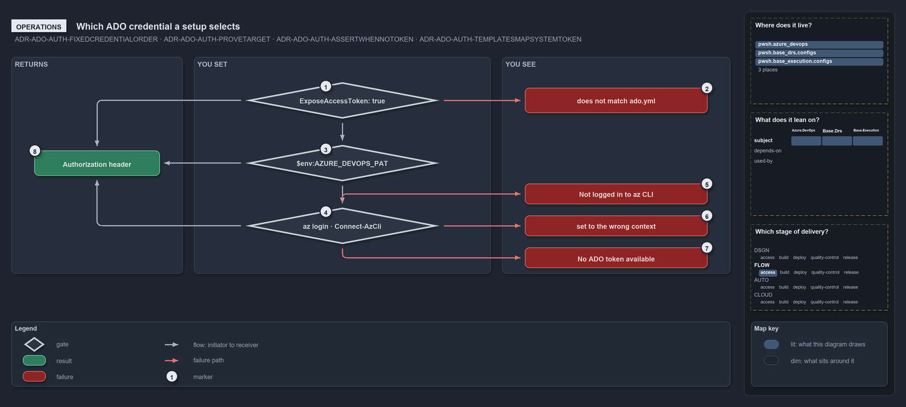

# Which ADO credential a setup selects

```text
Which ADO credential a setup selects.

1  ExposeAccessToken: true    the step flag that maps the pipeline token in
2  does not match ado.yml     the message when the collection is not the configured org
3  $env:AZURE_DEVOPS_PAT      a PAT set locally or in CI, used next
4  az login, Connect-AzCli    the az CLI session, used last
5  Not logged in to az CLI    the message when there is no session
6  set to the wrong context   the message when the session is in another tenant
7  No ADO token available     the message when the session yields no token
8  Authorization header       what a working setup gives the REST call

Supports ADR-ADO-AUTH-FIXEDCREDENTIALORDER, ADR-ADO-AUTH-PROVETARGET, ADR-ADO-AUTH-ASSERTWHENNOTOKEN
and ADR-ADO-AUTH-TEMPLATESMAPSYSTEMTOKEN (operations lens).
```

Anyone who runs an Azure DevOps REST function in cats, from a pipeline or a terminal, gets its credential from one ladder. The first thing
you have set is used, from the top down. When that setup is wrong you see its own message, and cats does not quietly try the next one: to
switch credentials, unset the one above.

```yml drawio
description:
  What an operator sets decides the Azure DevOps credential, in a fixed order; each wrong setup stops with its own message, and a working
  one gives the REST call its Authorization header.
about:
  rules:
    - ADR-ADO-AUTH-FIXEDCREDENTIALORDER
    - ADR-ADO-AUTH-PROVETARGET
    - ADR-ADO-AUTH-ASSERTWHENNOTOKEN
    - ADR-ADO-AUTH-TEMPLATESMAPSYSTEMTOKEN
  lens: operations
content:
  title: Which ADO credential a setup selects
  kind: explanation
  flow: left-to-right
  theme: dark
  bands:
    - { id: band-returns, label: RETURNS }
    - { id: band-set, label: YOU SET }
    - { id: band-see, label: YOU SEE }
  glyphs:
    - { id: g-expose, kind: gate, label: "ExposeAccessToken: true", in: band-set }
    - { id: g-pat, kind: gate, label: "$env:AZURE_DEVOPS_PAT", in: band-set }
    - { id: g-az-login, kind: gate, label: az login · Connect-AzCli, in: band-set }
    - { id: r-header, kind: result, label: Authorization header, in: band-returns }
    - { id: f-mismatch, kind: failure, label: does not match ado.yml, in: band-see }
    - { id: f-no-login, kind: failure, label: Not logged in to az CLI, in: band-see }
    - { id: f-context, kind: failure, label: set to the wrong context, in: band-see }
    - { id: f-no-token, kind: failure, label: No ADO token available, in: band-see }
  edges:
    - { from: g-expose, to: g-pat, kind: flow, label: "" }
    - { from: g-pat, to: g-az-login, kind: flow, label: "" }
    - { from: g-expose, to: r-header, kind: flow, label: "" }
    - { from: g-pat, to: r-header, kind: flow, label: "" }
    - { from: g-az-login, to: r-header, kind: flow, label: "" }
    - { from: g-expose, to: f-mismatch, kind: fail, label: "" }
    - { from: g-az-login, to: f-no-login, kind: fail, label: "" }
    - { from: g-az-login, to: f-context, kind: fail, label: "" }
    - { from: g-az-login, to: f-no-token, kind: fail, label: "" }
  markers:
    - { at: g-expose, number: 1 }
    - { at: f-mismatch, number: 2 }
    - { at: g-pat, number: 3 }
    - { at: g-az-login, number: 4 }
    - { at: f-no-login, number: 5 }
    - { at: f-context, number: 6 }
    - { at: f-no-token, number: 7 }
    - { at: r-header, number: 8 }
  legend: auto
  minimaps: [code-locations, module-neighbourhood, axis]
layout:
  band-returns: { x: 20, y: 84, w: 300, h: 380 }
  band-set: { x: 340, y: 84, w: 520, h: 380 }
  band-see: { x: 880, y: 84, w: 400, h: 380 }
  g-expose: { x: 430, y: 128, w: 340, h: 64 }
  g-pat: { x: 430, y: 238, w: 340, h: 64 }
  g-az-login: { x: 430, y: 348, w: 340, h: 64 }
  r-header: { x: 60, y: 248, w: 220, h: 44 }
  f-mismatch: { x: 920, y: 138, w: 320, h: 44 }
  f-no-login: { x: 920, y: 306, w: 320, h: 36 }
  f-context: { x: 920, y: 362, w: 320, h: 36 }
  f-no-token: { x: 920, y: 418, w: 320, h: 36 }
```



Each failure carries a verbatim fragment of its message; the full messages are quoted below.

## Walkthrough

1. **ExposeAccessToken: true.** In an ado pipeline, a step built on `.ado/pipelines/steps/invoke-automation.yaml` with
   `ExposeAccessToken: true` maps `SYSTEM_ACCESSTOKEN` into that step, in every Mode, and the step log shows the line "ExposeAccessToken:
   true". A step without the flag never sees the token, so the YAML itself shows which steps have API access.
2. **does not match ado.yml.** If the pipeline's collection is not the organization in `ado.yml`, the call stops with "Pipeline collection
   '&lt;uri&gt;' does not match ado.yml organization '&lt;org&gt;' — refusing the agent token for a different org."
3. **$env:AZURE_DEVOPS_PAT.** Outside a pipeline, or with the token not exposed, a PAT you have set locally or in CI is used. Nothing checks
   it up front: a rejected PAT shows up as the REST call's own error.
4. **az login · Connect-AzCli.** With neither set, your az CLI session is used. Log in with `az login --tenant <ado.yml tenant>`, or with
   `Connect-AzCli`.
5. **Not logged in to az CLI.** With no session, you see "Not logged in to az CLI. Run: az login --tenant &lt;tenant&gt;".
6. **set to the wrong context.** With a session in another tenant, you see "az CLI is set to the wrong context. Expected
   tenant=&lt;tenant&gt;; got sub=&lt;subscription&gt; tenant=&lt;tenant&gt;. Run: az login --tenant &lt;tenant&gt;".
7. **No ADO token available.** When the session yields no token, you see "No ADO token available. Set $env:AZURE_DEVOPS_PAT, or run
   Connect-AzCli with an Entra ID account."
8. **Authorization header.** Whichever setup is used, a working one gives the REST call its header, and the call goes ahead.

## Why it holds

- The first configured credential is used, and a configured one that fails stops the call rather than dropping to the next
  (ADR-ADO-AUTH-FIXEDCREDENTIALORDER).
- The pipeline token and the az CLI session must prove they belong to the organization and tenant in `ado.yml` (ADR-ADO-AUTH-PROVETARGET).
- When nothing yields a token, the message names the two fixes (ADR-ADO-AUTH-ASSERTWHENNOTOKEN).
- The step template, not the function, decides whether a step gets the token, so the pipeline YAML is the audit trail
  (ADR-ADO-AUTH-TEMPLATESMAPSYSTEMTOKEN).

## Where the code and the decision record differ

The record's step-template sample shows only the `PowerShell@2` task, while `invoke-automation.yaml` maps the token in all three Modes
(`PowerShell@2`, `AzureCLI@2` and `AzurePowerShell@5`).

## See also

- [Dual authentication](../../drs/ado/dual-authentication.md) — the decision this article explains.
- The other lenses on the same precedence: [meta](which-ado-credential-wins.md),
  [architecture](where-the-ado-credential-precedence-lives.md), [implementation](how-the-ado-header-function-checks-a-credential.md) and
  [governance](which-ado-auth-checks-have-a-gate.md).
- [The ado explanations](index.md) · [How to read the diagrams](../index.md#how-to-read-the-diagrams)
