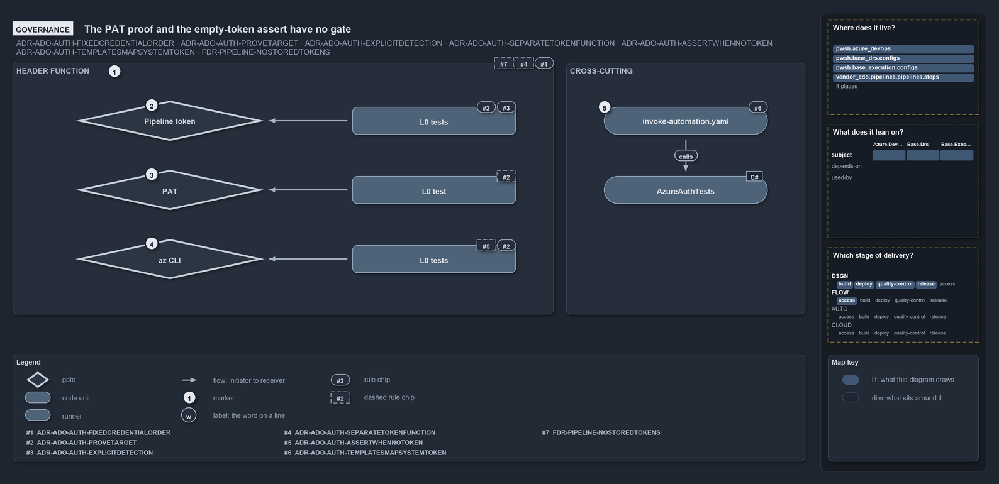

# The PAT proof and the empty-token assert have no gate

```text
The PAT proof and the empty-token assert have no gate, and neither do #4 and #7.

1  Header function         #1 checked by the throw tests; #4 and #7 have no gate
2  Pipeline token          #3 and #2, checked by two L0 tests
3  PAT                     one L0 test for the Basic header; the #2 org binding has no gate
4  az CLI                  #2 checked by two L0 tests; the #5 empty-token assert has none
5  invoke-automation.yaml  #6, checked by a step in the AzureAuthTests job

Supports ADR-ADO-AUTH-FIXEDCREDENTIALPRECEDENCE, ADR-ADO-AUTH-PROVETARGET, ADR-ADO-AUTH-EXPLICITDETECTION,
ADR-ADO-AUTH-SEPARATETOKENFUNCTION, ADR-ADO-AUTH-ASSERTWHENNOTOKEN, ADR-ADO-AUTH-TEMPLATESMAPSYSTEMTOKEN
and FDR-CD-PIPELINE-NOSTOREDTOKENS (governance lens).
```

ADR-ADO-AUTH has six rules and FDR-CD-PIPELINE-NOSTOREDTOKENS adds the seventh, and tests check only some of them. The L0 tests of
`Get-AdoAuthorizationHeader` cover the pipeline and az CLI proofs, and one CI step checks that the token mapping works. The PAT's binding to
the org, the empty-token assert, the one-function rule and the no-caching rule have no gate at all.

```yml drawio
description:
  "Which rules of the credential ladder a gate checks: each rung's tests and the step template's check, with the rules no gate checks drawn
  dashed, the PAT's org binding and the empty-token assert among them."
about:
  adrs:
    - ADR-ADO-AUTH-FIXEDCREDENTIALPRECEDENCE
    - ADR-ADO-AUTH-PROVETARGET
    - ADR-ADO-AUTH-EXPLICITDETECTION
    - ADR-ADO-AUTH-SEPARATETOKENFUNCTION
    - ADR-ADO-AUTH-ASSERTWHENNOTOKEN
    - ADR-ADO-AUTH-TEMPLATESMAPSYSTEMTOKEN
    - FDR-CD-PIPELINE-NOSTOREDTOKENS
  lens: governance
content:
  title: The PAT proof and the empty-token assert have no gate
  kind: explanation
  flow: left-to-right
  theme: dark
  bands:
    - { id: band-header, label: HEADER FUNCTION }
    - { id: band-cross, label: CROSS-CUTTING }
  glyphs:
    - { id: g-pipeline, kind: gate, label: Pipeline token, in: band-header }
    - { id: g-pat, kind: gate, label: PAT, in: band-header }
    - { id: g-azcli, kind: gate, label: az CLI, in: band-header }
    - { id: t-pipeline, kind: code, label: L0 tests, in: band-header }
    - { id: t-pat, kind: code, label: L0 test, in: band-header }
    - { id: t-azcli, kind: code, label: L0 tests, in: band-header }
    - { id: g-template, kind: runner, label: invoke-automation.yaml, in: band-cross }
    - { id: g-job, kind: runner, label: AzureAuthTests, in: band-cross }
  edges:
    - { from: t-pipeline, to: g-pipeline, kind: flow, label: "" }
    - { from: t-pat, to: g-pat, kind: flow, label: "" }
    - { from: t-azcli, to: g-azcli, kind: flow, label: "" }
    - { from: g-template, to: g-job, kind: flow, label: calls }
  markers:
    - { at: band-header, number: 1 }
    - { at: g-pipeline, number: 2 }
    - { at: g-pat, number: 3 }
    - { at: g-azcli, number: 4 }
    - { at: g-template, number: 5 }
  chips:
    - { at: band-header, kind: rule, rule: ADR-ADO-AUTH-FIXEDCREDENTIALPRECEDENCE }
    - { at: band-header, kind: rule, rule: ADR-ADO-AUTH-SEPARATETOKENFUNCTION, gated: false }
    - { at: band-header, kind: rule, rule: FDR-CD-PIPELINE-NOSTOREDTOKENS, gated: false }
    - { at: t-pipeline, kind: rule, rule: ADR-ADO-AUTH-EXPLICITDETECTION }
    - { at: t-pipeline, kind: rule, rule: ADR-ADO-AUTH-PROVETARGET }
    - { at: t-pat, kind: rule, rule: ADR-ADO-AUTH-PROVETARGET, gated: false }
    - { at: t-azcli, kind: rule, rule: ADR-ADO-AUTH-PROVETARGET }
    - { at: t-azcli, kind: rule, rule: ADR-ADO-AUTH-ASSERTWHENNOTOKEN, gated: false }
    - { at: g-template, kind: rule, rule: ADR-ADO-AUTH-TEMPLATESMAPSYSTEMTOKEN }
  legend: auto
  minimaps: [code-locations, module-neighbourhood, axis]
layout:
  band-header: { x: 20, y: 84, w: 860, h: 400 }
  band-cross: { x: 900, y: 84, w: 380, h: 400 }
  g-pipeline: { x: 120, y: 144, w: 300, h: 64 }
  g-pat: { x: 120, y: 254, w: 300, h: 64 }
  g-azcli: { x: 120, y: 364, w: 300, h: 64 }
  t-pipeline: { x: 560, y: 154, w: 260, h: 44 }
  t-pat: { x: 560, y: 264, w: 260, h: 44 }
  t-azcli: { x: 560, y: 374, w: 260, h: 44 }
  g-template: { x: 960, y: 154, w: 260, h: 44 }
  g-job: { x: 960, y: 264, w: 260, h: 44 }
```



## Walkthrough

1. **The header function's own rules.** #1 governs the whole ladder: a fixed order, and no fallback when the source it picks fails. The two
   throw tests check that a failing pipeline rung and a failing az CLI rung raise. #4 (callers use the header function) and #7 (no token
   caching) are conventions the code follows today, but no test or analyzer rule checks them.
2. **Pipeline token.** Governed by #3 (explicit pipeline detection) and #2 (collection equals org). Two L0 tests check it: "uses
   SYSTEM_ACCESSTOKEN when the collection matches the configured org" and "throws when the pipeline collection does not match the configured
   org".
3. **PAT.** One L0 test, "uses AZURE_DEVOPS_PAT with Basic auth", checks the Basic header. The #2 binding to the org, by building API
   addresses from `ado.yml`, has no gate.
4. **az CLI.** Two L0 tests check the #2 tenant proof: "asserts the session is in ado.yml's tenant, then returns a Bearer token" and
   "propagates the assertion failure when the session is in the wrong tenant". The #5 empty-token assert runs in the code, but no test
   covers it.
5. **invoke-automation.yaml.** #6, the token mapping in the step template, is checked by the step "ExposeAccessToken: token available" in
   the `AzureAuthTests` job of `.ado/pipelines/ci-pwsh.yaml`. It asserts only that the token is non-empty when `ExposeAccessToken` is true.

No analyzer rule cites ADR-ADO-AUTH. The analyzer rule `Measure-NoRawPipelineDetection` forbids raw reads of the pipeline variables outside
`Test-IsRunningInPipeline`, which supports #3, but it is mapped to FDR-CD-DETECT-NODIRECTVARIABLECHECK.

## Why it holds

- The credential is chosen in a fixed order with no fallback on failure (ADR-ADO-AUTH-FIXEDCREDENTIALPRECEDENCE).
- Each source proves its org or tenant before it returns a header (ADR-ADO-AUTH-PROVETARGET).
- Pipeline detection goes through `Test-IsRunningInPipeline` (ADR-ADO-AUTH-EXPLICITDETECTION).
- API functions call the header function and never inline token logic (ADR-ADO-AUTH-SEPARATETOKENFUNCTION).
- An empty az CLI result raises an actionable error (ADR-ADO-AUTH-ASSERTWHENNOTOKEN).
- The step template maps the system token when `ExposeAccessToken` is set (ADR-ADO-AUTH-TEMPLATESMAPSYSTEMTOKEN).
- Tokens are never kept beyond the request (FDR-CD-PIPELINE-NOSTOREDTOKENS).

## Where the code and the decision record differ

- ADR-ADO-AUTH-SEPARATETOKENFUNCTION, ADR-ADO-AUTH-ASSERTWHENNOTOKEN and FDR-CD-PIPELINE-NOSTOREDTOKENS have no gate: no test and no
  analyzer rule.
- The PAT half of ADR-ADO-AUTH-PROVETARGET holds only by default, because every API function accepts an `-Organization` override.

## See also

- [Dual authentication](../../drs/ado/dual-authentication.md) — the decision this article explains.
- The other lenses on the same precedence: [meta](configured-credential-proves-its-org.md),
  [architecture](one-header-function-owns-precedence.md), [implementation](three-guarded-early-returns.md) and
  [operations](what-you-set-decides-the-credential.md).
- [The ado explanations](index.md) · [How to read the diagrams](../index.md#how-to-read-the-diagrams)
