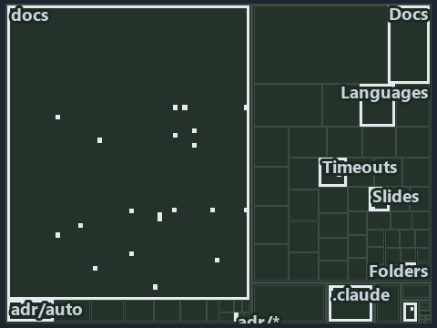

---
catzc:
  immutable:
    with_body_sha: b018b6812dbf
    repo_status: locked
    path: docs/explanation/automation/.assets/decide-returns-null-or-a-reason/tree.md
    source: docs/explanation/automation/.assets/decide-returns-null-or-a-reason/diagram.drawio.png
    role: asset-description
    language: markdown
    filetype: md
    track: docs
    tracktype: documentation
---

# Main loads the limits and the run environment, then Decide returns null or a reason: the tree minimap

```text
Which files cite ADR-AUTO-FAILFAST: every file of the world map is a tile, grouped by top-level folder.
35 files lit in 10 groups.
```



This is the tree minimap in the sidebar of the implementation diagram of [Main loads the limits and the run environment, then Decide returns
null or a reason][36], which explains [ADR-AUTO-FAILFAST][1]. It lights every file that cites those codes, grouped by folder, so it shows
which files carry the decision. Each lit group has its reason below, naming the code that selects it.

## What the minimap shows

The tree draws every file of the world map as a tile, grouped by top-level folder (under `pwsh/` by module, under `docs/adr/` by ADR
domain), and lights 35 files in 10 groups, filled in ink. A lit ADR file has a white rim; a file lit only by passing mentions is a lighter
ink. Every other tile is idle, a grey box: a file the slide's ADR codes do not select.

- docs (docs/ outside docs/adr/): 20 lit files
- Docs (pwsh/Catzc.Base.Docs): 3 lit files
- .claude: 2 lit files
- adr/auto (docs/adr/automation): 2 lit files
- Folders (pwsh/Catzc.Base.Folders): 2 lit files
- Slides (pwsh/Catzc.Base.Slides): 2 lit files
- adr/* (the files directly in docs/adr/): 1 lit file
- pipelines: 1 lit file
- Languages (pwsh/Catzc.Base.Languages): 1 lit file
- Timeouts (pwsh/Catzc.Base.Timeouts): 1 lit file

## Why each group is lit

### docs (docs/ outside docs/adr/, 20 lit files)

The group holds the files of docs/ outside docs/adr/; each sits in its world-map cell and is lit by:

- [docs/references/pwsh/.assets/az-cli-test-assert-share-one-state/diagram.drawio.md][2], in the cell docs × markdown: selected by
  [ADR-AUTO-FAILFAST][1]: the file cites it at line 102 (text).
- [docs/references/pwsh/.assets/az-cli-test-assert-share-one-state/diagram.drawio.verify.md][3], in the cell docs × markdown: selected by
  [ADR-AUTO-FAILFAST][1]: the file cites it at line 63 (text).
- [docs/references/pwsh/.assets/invoke-executable-two-paths-one-bounded/diagram.drawio.md][4], in the cell docs × markdown: selected by
  [ADR-AUTO-FAILFAST][1]: the file cites it at line 32 (text) and line 100 (text).
- [docs/references/pwsh/.assets/invoke-executable-two-paths-one-bounded/diagram.drawio.verify.md][5], in the cell docs × markdown: selected
  by [ADR-AUTO-FAILFAST][1]: the file cites it at line 45 (text), line 58 (text), line 61 (text), line 62 (text) and line 62 (text).
- [docs/references/pwsh/catzc-azure-cli/Assert-AzCliSubscriptionAccessible.ps1.md][6], in the cell docs × markdown: selected by
  [ADR-AUTO-FAILFAST][1]: the file cites it at line 22 (text).
- [docs/references/pwsh/catzc-base-docs/Test-Glossary.ps1.md][7], in the cell docs × markdown: selected by [ADR-AUTO-FAILFAST][1]: the file
  cites it at line 27 (text).
- [docs/references/pwsh/catzc-base-docs/private/Import-AdrCitationMapFile.ps1.md][8], in the cell docs × markdown: selected by
  [ADR-AUTO-FAILFAST][1]: the file cites it at line 15 (text).
- [docs/references/pwsh/catzc-base-docs/tests/Test-Glossary.Tests.ps1.md][9], in the cell docs × markdown: selected by
  [ADR-AUTO-FAILFAST][1]: the file cites it at line 13 (text).
- [docs/references/pwsh/catzc-base-engines/types/ExecutionEngine.cs.md][10], in the cell docs × markdown: selected by
  [ADR-AUTO-FAILFAST][1]: the file cites it at line 37 (text).
- [docs/references/pwsh/catzc-base-git/Import-RepositoryWithHistory.ps1.md][11], in the cell docs × markdown: selected by
  [ADR-AUTO-FAILFAST][1]: the file cites it at line 23 (text).
- [docs/references/pwsh/catzc-base-globs/Test-GlobSetAffected.ps1.md][12], in the cell docs × markdown: selected by [ADR-AUTO-FAILFAST][1]:
  the file cites it at line 26 (text).
- [docs/references/pwsh/catzc-base-qualitygates/private/Test-TestRunOverBudget.ps1.md][13], in the cell docs × markdown: selected by
  [ADR-AUTO-FAILFAST][1]: the file cites it at line 17 (text).
- [docs/references/pwsh/catzc-base-qualitygates/private/Write-TestAutomationVerdict.ps1.md][14], in the cell docs × markdown: selected by
  [ADR-AUTO-FAILFAST][1]: the file cites it at line 26 (text).
- [docs/references/pwsh/catzc-base-timeouts/Get-TestTimeLimits.ps1.md][15], in the cell docs × markdown: selected by [ADR-AUTO-FAILFAST][1]:
  the file cites it at line 16 (text).
- [docs/references/pwsh/catzc-base-timeouts/Watch-Blocking.ps1.md][16], in the cell docs × markdown: selected by [ADR-AUTO-FAILFAST][1]: the
  file cites it at line 24 (text), line 25 (text) and line 27 (text).
- [docs/references/pwsh/catzc-base-timeouts/types/BashSafeguard.cs.md][17], in the cell docs × markdown: selected by [ADR-AUTO-FAILFAST][1]:
  the file cites it at line 12 (text).
- [docs/references/pwsh/catzc-base-typessystem.md][18], in the cell docs × markdown: selected by [ADR-AUTO-FAILFAST][1]: the file cites it
  at line 64 (text).
- [docs/references/pwsh/catzc-base-typessystem/Assert-LoadedTypesCurrent.ps1.md][19], in the cell docs × markdown: selected by
  [ADR-AUTO-FAILFAST][1]: the file cites it at line 15 (text).
- [docs/references/pwsh/catzc-base-typessystem/Build-BashTimeoutHook.ps1.md][20], in the cell docs × markdown: selected by
  [ADR-AUTO-FAILFAST][1]: the file cites it at line 15 (text).
- [docs/references/pwsh/claude-hooks/Assert-BashTimeout/Program.cs.md][21], in the cell docs × markdown: selected by [ADR-AUTO-FAILFAST][1]:
  the file cites it at line 12 (text) and line 39 (text).

### Docs (pwsh/Catzc.Base.Docs, 3 lit files)

The group holds the files of pwsh/Catzc.Base.Docs; each sits in its world-map cell and is lit by:

- [pwsh/Catzc.Base.Docs/configs/adrs.yml][22], in the cell pwsh × yaml: selected by [ADR-AUTO-FAILFAST][1]: the file cites it at line 132
  (text).
- [pwsh/Catzc.Base.Docs/configs/agents.yml][23], in the cell pwsh × yaml: selected by [ADR-AUTO-FAILFAST][1]: the file cites it at line 55
  (text) and line 76 (text).
- [pwsh/Catzc.Base.Docs/configs/capabilities.yml][24], in the cell pwsh × yaml: selected by [ADR-AUTO-FAILFAST][1]: the file cites it at
  line 4 (text).

### .claude (2 lit files)

The group holds the files of .claude; each sits in its world-map cell and is lit by:

- [.claude/CLAUDE.md][25], in the cell .claude × markdown: selected by [ADR-AUTO-FAILFAST][1]: the file cites it at line 121 (text).
- [.claude/plans/plan-test-run-budget.md][26], in the cell .claude × markdown: selected by [ADR-AUTO-FAILFAST][1]: the file cites it at line
  84 (text).

### adr/auto (docs/adr/automation, 2 lit files)

The group holds the files of docs/adr/automation; each sits in its world-map cell and is lit by:

- [docs/adr/automation/dora-explains.md][27], in the cell docs × markdown: selected by [ADR-AUTO-FAILFAST][1]: the file cites it at line 260
  (text).
- [docs/adr/automation/fail-fast-with-asserts.md][1], in the cell docs × markdown: selected by [ADR-AUTO-FAILFAST][1]: the ADR's own file.

### Folders (pwsh/Catzc.Base.Folders, 2 lit files)

The group holds the files of pwsh/Catzc.Base.Folders; each sits in its world-map cell and is lit by:

- [pwsh/Catzc.Base.Folders/tests/Get-ChildPath.Tests.ps1][28], in the cell pwsh × powershell: selected by [ADR-AUTO-FAILFAST][1]: the file
  cites it at line 47 (text).
- [pwsh/Catzc.Base.Folders/tests/types/FolderWalker.Tests.ps1][29], in the cell pwsh × powershell: selected by [ADR-AUTO-FAILFAST][1]: the
  file cites it at line 64 (text).

### Slides (pwsh/Catzc.Base.Slides, 2 lit files)

The group holds the files of pwsh/Catzc.Base.Slides; each sits in its world-map cell and is lit by:

- [pwsh/Catzc.Base.Slides/tests/Build-SlideDeck.Tests.ps1][30], in the cell pwsh × powershell: selected by [ADR-AUTO-FAILFAST][1]: the file
  cites it at line 152 (text) and line 160 (text).
- [pwsh/Catzc.Base.Slides/tests/Test-Slides.Tests.ps1][31], in the cell pwsh × powershell: selected by [ADR-AUTO-FAILFAST][1]: the file
  cites it at line 46 (text).

### adr/* (the files directly in docs/adr/, 1 lit file)

The group holds the files of the files directly in docs/adr/; each sits in its world-map cell and is lit by:

- [docs/adr/index.md][32], in the cell docs × markdown: selected by [ADR-AUTO-FAILFAST][1]: the file cites it at line 163 (text).

### pipelines (1 lit file)

The group holds the files of pipelines; each sits in its world-map cell and is lit by:

- [pipelines/ci-automation.yaml][33], in the cell pipelines × pipeline-yaml: selected by [ADR-AUTO-FAILFAST][1]: a pipeline that cites
  nothing itself carries its globset's citations, which cite it at `pwsh/Catzc.Base.Docs/configs/adrs.yml` line 132 (text),
  `pwsh/Catzc.Base.Docs/configs/agents.yml` line 55 (text), `pwsh/Catzc.Base.Docs/configs/agents.yml` line 76 (text),
  `pwsh/Catzc.Base.Docs/configs/capabilities.yml` line 4 (text), `pwsh/Catzc.Base.Folders/tests/Get-ChildPath.Tests.ps1` line 47 (text),
  `pwsh/Catzc.Base.Folders/tests/types/FolderWalker.Tests.ps1` line 64 (text),
  `pwsh/Catzc.Base.Languages/tests/Get-EngineContract.Tests.ps1` line 30 (text), `pwsh/Catzc.Base.Slides/tests/Build-SlideDeck.Tests.ps1`
  line 152 (text), `pwsh/Catzc.Base.Slides/tests/Build-SlideDeck.Tests.ps1` line 160 (text),
  `pwsh/Catzc.Base.Slides/tests/Test-Slides.Tests.ps1` line 46 (text) and `pwsh/Catzc.Base.Timeouts/tests/types/TimeoutsConfig.Tests.ps1`
  line 133 (text).

### Languages (pwsh/Catzc.Base.Languages, 1 lit file)

The group holds the files of pwsh/Catzc.Base.Languages; each sits in its world-map cell and is lit by:

- [pwsh/Catzc.Base.Languages/tests/Get-EngineContract.Tests.ps1][34], in the cell pwsh × powershell: selected by [ADR-AUTO-FAILFAST][1]: the
  file cites it at line 30 (text).

### Timeouts (pwsh/Catzc.Base.Timeouts, 1 lit file)

The group holds the files of pwsh/Catzc.Base.Timeouts; each sits in its world-map cell and is lit by:

- [pwsh/Catzc.Base.Timeouts/tests/types/TimeoutsConfig.Tests.ps1][35], in the cell pwsh × powershell: selected by [ADR-AUTO-FAILFAST][1]:
  the file cites it at line 133 (text).

## Keywords

- [world map][37]
- [track][38]
- [file language][39]
- [cell][40]
- [lit cell][41]
- [.claude][42]: a track
- [docs][42]: a track
- [pipelines][42]: a track
- [pwsh][42]: a track
- [markdown][43]: a file language
- [pipeline-yaml][43]: a file language
- [powershell][43]: a file language
- [yaml][43]: a file language

[1]: ../../../../adr/automation/fail-fast-with-asserts.md
[2]: ../../../../references/pwsh/.assets/az-cli-test-assert-share-one-state/diagram.drawio.md
[3]: ../../../../references/pwsh/.assets/az-cli-test-assert-share-one-state/diagram.drawio.verify.md
[4]: ../../../../references/pwsh/.assets/invoke-executable-two-paths-one-bounded/diagram.drawio.md
[5]: ../../../../references/pwsh/.assets/invoke-executable-two-paths-one-bounded/diagram.drawio.verify.md
[6]: ../../../../references/pwsh/catzc-azure-cli/Assert-AzCliSubscriptionAccessible.ps1.md
[7]: ../../../../references/pwsh/catzc-base-docs/Test-Glossary.ps1.md
[8]: ../../../../references/pwsh/catzc-base-docs/private/Import-AdrCitationMapFile.ps1.md
[9]: ../../../../references/pwsh/catzc-base-docs/tests/Test-Glossary.Tests.ps1.md
[10]: ../../../../references/pwsh/catzc-base-engines/types/ExecutionEngine.cs.md
[11]: ../../../../references/pwsh/catzc-base-git/Import-RepositoryWithHistory.ps1.md
[12]: ../../../../references/pwsh/catzc-base-globs/Test-GlobSetAffected.ps1.md
[13]: ../../../../references/pwsh/catzc-base-qualitygates/private/Test-TestRunOverBudget.ps1.md
[14]: ../../../../references/pwsh/catzc-base-qualitygates/private/Write-TestAutomationVerdict.ps1.md
[15]: ../../../../references/pwsh/catzc-base-timeouts/Get-TestTimeLimits.ps1.md
[16]: ../../../../references/pwsh/catzc-base-timeouts/Watch-Blocking.ps1.md
[17]: ../../../../references/pwsh/catzc-base-timeouts/types/BashSafeguard.cs.md
[18]: ../../../../references/pwsh/catzc-base-typessystem.md
[19]: ../../../../references/pwsh/catzc-base-typessystem/Assert-LoadedTypesCurrent.ps1.md
[20]: ../../../../references/pwsh/catzc-base-typessystem/Build-BashTimeoutHook.ps1.md
[21]: ../../../../references/pwsh/claude-hooks/Assert-BashTimeout/Program.cs.md
[22]: ../../../../../pwsh/Catzc.Base.Docs/configs/adrs.yml
[23]: ../../../../../pwsh/Catzc.Base.Docs/configs/agents.yml
[24]: ../../../../../pwsh/Catzc.Base.Docs/configs/capabilities.yml
[25]: ../../../../../.claude/CLAUDE.md
[26]: ../../../../../.claude/plans/plan-test-run-budget.md
[27]: ../../../../adr/automation/dora-explains.md
[28]: ../../../../../pwsh/Catzc.Base.Folders/tests/Get-ChildPath.Tests.ps1
[29]: ../../../../../pwsh/Catzc.Base.Folders/tests/types/FolderWalker.Tests.ps1
[30]: ../../../../../pwsh/Catzc.Base.Slides/tests/Build-SlideDeck.Tests.ps1
[31]: ../../../../../pwsh/Catzc.Base.Slides/tests/Test-Slides.Tests.ps1
[32]: ../../../../adr/index.md
[33]: ../../../../../pipelines/ci-automation.yaml
[34]: ../../../../../pwsh/Catzc.Base.Languages/tests/Get-EngineContract.Tests.ps1
[35]: ../../../../../pwsh/Catzc.Base.Timeouts/tests/types/TimeoutsConfig.Tests.ps1
[36]: ../../decide-returns-null-or-a-reason.md
[37]: ../../../../adr/glossary.md#world-map
[38]: ../../../../adr/glossary.md#track
[39]: ../../../../adr/glossary.md#file-language
[40]: ../../../../adr/glossary.md#cell
[41]: ../../../../adr/glossary.md#lit-cell
[42]: ../../../../../pwsh/Catzc.Base.Variants/configs/variants.yml
[43]: ../../../../../pwsh/Catzc.Base.Languages/configs/languages.yml
