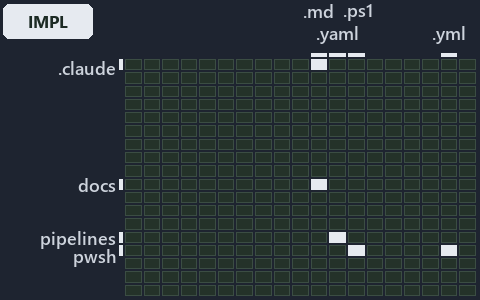

---
catzc:
  immutable:
    with_body_sha: "1d52999dbfd0"
    repo_status: locked
    path: docs/explanation/automation/.assets/output-root-first-then-repo-root/grid.md
    source: docs/explanation/automation/.assets/output-root-first-then-repo-root/diagram.drawio.png
    role: asset-description
    language: markdown
    filetype: md
    track: docs
    tracktype: documentation
---

# Output root first, then repository root, else absolute, and out/ re-anchors on the output root: the world-map minimap

```text
Where the files that cite ADR-AUTO-PATH sit in the repository: tracks down, file languages across.
5 of 342 cells lit, holding 37 files.
```



This is the world-map minimap in the sidebar of the implementation diagram of [Output root first, then repository root, else absolute, and
out/ re-anchors on the output root][41], which explains [ADR-AUTO-PATH][1]. It lights every cell of the world map that holds a file citing
those codes, so it shows where the decision lives in the repository. Each lit cell has its reason below, naming the code that selects it.

## What the minimap shows

The grid crosses the 18 tracks (rows) with the 19 file languages (columns) of the world map and lights 5 cells, filled in ink. A cell lit
only by passing mentions (citations in body comments, not in a file's header or text) is touched: a lighter ink. Every other cell is idle, a
grey box: it holds files the slide's ADR codes do not select, or no file at all (288 of the 342 cells hold none). The minimap shows where
the slide sits, not how many files a cell holds; the world-map PDFs show the counts.

- .claude × markdown: 2 lit of 89 files
- docs × markdown: 28 lit of 2757 files
- pipelines × pipeline-yaml: 1 lit of 9 files
- pwsh × powershell: 4 lit of 1649 files
- pwsh × yaml: 2 lit of 115 files

## Key

A lit row prints its track's name; a lit column prints a short code, the first extension of its file language:

- `.md`: markdown
- `.yaml`: pipeline-yaml
- `.ps1`: powershell
- `.yml`: yaml

## Why each cell is lit

### .claude × markdown (2 lit files)

Placed: the root folder `.claude/` names the track .claude ([ADR-DSGN-TRACK#1][2]); the extension `.md` names the file language markdown
([ADR-DSGN-TRACK#6][3]). Lit ([ADR-DSGN-TRACK#12][4]) by:

- [.claude/plans/plan-explanation-drift-gaps.md][5]: selected by [ADR-AUTO-PATH][1]: the file cites it at line 61 (text) and line 110
  (text).
- [.claude/skills/catzc-module/SKILL.md][6]: selected by [ADR-AUTO-PATH][1]: the file cites it at line 27 (text), line 40 (text) and line 40
  (text).

### docs × markdown (28 lit files)

Placed: the root folder `docs/` names the track docs ([ADR-DSGN-TRACK#1][2]); the extension `.md` names the file language markdown
([ADR-DSGN-TRACK#6][3]). Lit ([ADR-DSGN-TRACK#12][4]) by:

- [docs/adr/automation/dora-explains.md][7]: selected by [ADR-AUTO-PATH][1]: the file cites it at line 401 (text).
- [docs/adr/automation/path-representation.md][1]: selected by [ADR-AUTO-PATH][1]: the ADR's own file.
- [docs/adr/glossary.md][8]: selected by [ADR-AUTO-PATH][1]: the file cites it at line 784 (text).
- [docs/adr/index.md][9]: selected by [ADR-AUTO-PATH][1]: the file cites it at line 171 (text).
- [docs/references/pwsh/catzc-base-contracts/Get-Contract.ps1.md][10]: selected by [ADR-AUTO-PATH][1]: the file cites it at line 21 (text).
- [docs/references/pwsh/catzc-base-contracts/Publish-ContractRelease.ps1.md][11]: selected by [ADR-AUTO-PATH][1]: the file cites it at line
  44 (text).
- [docs/references/pwsh/catzc-base-contracts/private/Get-ContractFileHashes.ps1.md][12]: selected by [ADR-AUTO-PATH][1]: the file cites it
  at line 29 (text).
- [docs/references/pwsh/catzc-base-contracts/tests/types/ContractAsset.Tests.ps1.md][13]: selected by [ADR-AUTO-PATH][1]: the file cites it
  at line 12 (text).
- [docs/references/pwsh/catzc-base-contracts/types/ContractAsset.cs.md][14]: selected by [ADR-AUTO-PATH][1]: the file cites it at line 17
  (text) and line 18 (text).
- [docs/references/pwsh/catzc-base-docs/configs/readme.yml.md][15]: selected by [ADR-AUTO-PATH][1]: the file cites it at line 30 (text).
- [docs/references/pwsh/catzc-base-docs/types/DocMapping.cs.md][16]: selected by [ADR-AUTO-PATH][1]: the file cites it at line 13 (text).
- [docs/references/pwsh/catzc-base-docs/types/DocPattern.cs.md][17]: selected by [ADR-AUTO-PATH][1]: the file cites it at line 14 (text).
- [docs/references/pwsh/catzc-base-modulesystem/Copy-CatzcModule.ps1.md][18]: selected by [ADR-AUTO-PATH][1]: the file cites it at line 42
  (text).
- [docs/references/pwsh/catzc-base-objects/types/ArtifactRef.cs.md][19]: selected by [ADR-AUTO-PATH][1]: the file cites it at line 17
  (text).
- [docs/references/pwsh/catzc-base-objects/types/RepoRelativePath.cs.md][20]: selected by [ADR-AUTO-PATH][1]: the file cites it at line 11
  (text), line 16 (text), line 17 (text), line 21 (text) and line 40 (text).
- [docs/references/pwsh/catzc-base-repository/ConvertTo-RepoRelativePath.ps1.md][21]: selected by [ADR-AUTO-PATH][1]: the file cites it at
  line 15 (text) and line 23 (text).
- [docs/references/pwsh/catzc-base-repository/Get-RepositoryFile.ps1.md][22]: selected by [ADR-AUTO-PATH][1]: the file cites it at line 14
  (text).
- [docs/references/pwsh/catzc-base-repository/Get-RepositoryFolder.ps1.md][23]: selected by [ADR-AUTO-PATH][1]: the file cites it at line 14
  (text).
- [docs/references/pwsh/catzc-base-repository/Resolve-RepoPath.ps1.md][24]: selected by [ADR-AUTO-PATH][1]: the file cites it at line 15
  (text).
- [docs/references/pwsh/catzc-base-rootconfig/configs/rootconfig.yml.md][25]: selected by [ADR-AUTO-PATH][1]: the file cites it at line 28
  (text).
- [docs/references/pwsh/catzc-base-rootconfig/types/RootConfigFile.cs.md][26]: selected by [ADR-AUTO-PATH][1]: the file cites it at line 23
  (text).
- [docs/references/pwsh/catzc-tooling-inspiration/configs/inspiration.yml.md][27]: selected by [ADR-AUTO-PATH][1]: the file cites it at line
  24 (text).
- [docs/references/pwsh/catzc-tooling-inspiration/private/Resolve-InspirationRoot.ps1.md][28]: selected by [ADR-AUTO-PATH][1]: the file
  cites it at line 15 (text), line 16 (text) and line 19 (text).
- [docs/references/pwsh/catzc-tooling-inspiration/tests/Resolve-InspirationRoot.Tests.ps1.md][29]: selected by [ADR-AUTO-PATH][1]: the file
  cites it at line 14 (text).
- [docs/references/pwsh/catzc-tooling-inspiration/tests/types/InspirationConfig.Tests.ps1.md][30]: selected by [ADR-AUTO-PATH][1]: the file
  cites it at line 14 (text).
- [docs/references/pwsh/catzc-tooling-inspiration/tests/types/InspirationRoot.Tests.ps1.md][31]: selected by [ADR-AUTO-PATH][1]: the file
  cites it at line 13 (text).
- [docs/references/pwsh/catzc-tooling-inspiration/types/Inspiration.cs.md][32]: selected by [ADR-AUTO-PATH][1]: the file cites it at line 17
  (text).
- [docs/references/pwsh/catzc-tooling-inspiration/types/InspirationRoot.cs.md][33]: selected by [ADR-AUTO-PATH][1]: the file cites it at
  line 12 (text), line 14 (text) and line 15 (text).

### pipelines × pipeline-yaml (1 lit file)

Placed: the root folder `pipelines/` names the track pipelines ([ADR-DSGN-TRACK#1][2]); the extension `.yaml` names the file language
pipeline-yaml ([ADR-DSGN-TRACK#6][3]). Lit ([ADR-DSGN-TRACK#12][4]) by:

- [pipelines/ci-automation.yaml][34]: selected by [ADR-AUTO-PATH][1]: a pipeline that cites nothing itself carries its globset's citations,
  which cite it at `pwsh/Catzc.Base.Contracts/tests/Get-Contract.Tests.ps1` line 27 (body comment),
  `pwsh/Catzc.Base.Contracts/tests/types/ContractAsset.Tests.ps1` line 13 (text), `pwsh/Catzc.Base.Docs/configs/adrs.yml` line 140 (text),
  `pwsh/Catzc.Base.ModuleSystem/configs/glossary.yml` line 37 (text), `pwsh/Catzc.Base.Objects/tests/types/ArtifactRef.Tests.ps1` line 1
  (text) and `pwsh/Catzc.Base.Slides/tests/types/SlidesConfig.Tests.ps1` line 36 (text).

### pwsh × powershell (4 lit files)

Placed: the root folder `pwsh/` names the track pwsh ([ADR-DSGN-TRACK#1][2]); the extension `.ps1` names the file language powershell
([ADR-DSGN-TRACK#6][3]). Lit ([ADR-DSGN-TRACK#12][4]) by:

- [pwsh/Catzc.Base.Contracts/tests/Get-Contract.Tests.ps1][35]: selected by [ADR-AUTO-PATH][1]: the file cites it at line 27 (body comment)
  (a passing mention only).
- [pwsh/Catzc.Base.Contracts/tests/types/ContractAsset.Tests.ps1][36]: selected by [ADR-AUTO-PATH][1]: the file cites it at line 13 (text).
- [pwsh/Catzc.Base.Objects/tests/types/ArtifactRef.Tests.ps1][37]: selected by [ADR-AUTO-PATH][1]: the file cites it at line 1 (text).
- [pwsh/Catzc.Base.Slides/tests/types/SlidesConfig.Tests.ps1][38]: selected by [ADR-AUTO-PATH][1]: the file cites it at line 36 (text).

### pwsh × yaml (2 lit files)

Placed: the root folder `pwsh/` names the track pwsh ([ADR-DSGN-TRACK#1][2]); the extension `.yml` names the file language yaml
([ADR-DSGN-TRACK#6][3]). Lit ([ADR-DSGN-TRACK#12][4]) by:

- [pwsh/Catzc.Base.Docs/configs/adrs.yml][39]: selected by [ADR-AUTO-PATH][1]: the file cites it at line 140 (text).
- [pwsh/Catzc.Base.ModuleSystem/configs/glossary.yml][40]: selected by [ADR-AUTO-PATH][1]: the file cites it at line 37 (text).

## Keywords

- [world map][42]
- [track][43]
- [file language][44]
- [cell][45]
- [lit cell][46]
- [.claude][47]: a track
- [docs][47]: a track
- [pipelines][47]: a track
- [pwsh][47]: a track
- [markdown][48]: a file language
- [pipeline-yaml][48]: a file language
- [powershell][48]: a file language
- [yaml][48]: a file language

Terms the cited ADRs define:

- [published artifact][49], defined by [ADR-AUTO-PATH#10][50]

[1]: ../../../../adr/automation/path-representation.md
[2]: ../../../../adr/design/tracks.md#rule-adr-dsgn-track1
[3]: ../../../../adr/design/tracks.md#rule-adr-dsgn-track6
[4]: ../../../../adr/design/tracks.md#rule-adr-dsgn-track12
[5]: ../../../../../.claude/plans/plan-explanation-drift-gaps.md
[6]: ../../../../../.claude/skills/catzc-module/SKILL.md
[7]: ../../../../adr/automation/dora-explains.md
[8]: ../../../../adr/glossary.md
[9]: ../../../../adr/index.md
[10]: ../../../../references/pwsh/catzc-base-contracts/Get-Contract.ps1.md
[11]: ../../../../references/pwsh/catzc-base-contracts/Publish-ContractRelease.ps1.md
[12]: ../../../../references/pwsh/catzc-base-contracts/private/Get-ContractFileHashes.ps1.md
[13]: ../../../../references/pwsh/catzc-base-contracts/tests/types/ContractAsset.Tests.ps1.md
[14]: ../../../../references/pwsh/catzc-base-contracts/types/ContractAsset.cs.md
[15]: ../../../../references/pwsh/catzc-base-docs/configs/readme.yml.md
[16]: ../../../../references/pwsh/catzc-base-docs/types/DocMapping.cs.md
[17]: ../../../../references/pwsh/catzc-base-docs/types/DocPattern.cs.md
[18]: ../../../../references/pwsh/catzc-base-modulesystem/Copy-CatzcModule.ps1.md
[19]: ../../../../references/pwsh/catzc-base-objects/types/ArtifactRef.cs.md
[20]: ../../../../references/pwsh/catzc-base-objects/types/RepoRelativePath.cs.md
[21]: ../../../../references/pwsh/catzc-base-repository/ConvertTo-RepoRelativePath.ps1.md
[22]: ../../../../references/pwsh/catzc-base-repository/Get-RepositoryFile.ps1.md
[23]: ../../../../references/pwsh/catzc-base-repository/Get-RepositoryFolder.ps1.md
[24]: ../../../../references/pwsh/catzc-base-repository/Resolve-RepoPath.ps1.md
[25]: ../../../../references/pwsh/catzc-base-rootconfig/configs/rootconfig.yml.md
[26]: ../../../../references/pwsh/catzc-base-rootconfig/types/RootConfigFile.cs.md
[27]: ../../../../references/pwsh/catzc-tooling-inspiration/configs/inspiration.yml.md
[28]: ../../../../references/pwsh/catzc-tooling-inspiration/private/Resolve-InspirationRoot.ps1.md
[29]: ../../../../references/pwsh/catzc-tooling-inspiration/tests/Resolve-InspirationRoot.Tests.ps1.md
[30]: ../../../../references/pwsh/catzc-tooling-inspiration/tests/types/InspirationConfig.Tests.ps1.md
[31]: ../../../../references/pwsh/catzc-tooling-inspiration/tests/types/InspirationRoot.Tests.ps1.md
[32]: ../../../../references/pwsh/catzc-tooling-inspiration/types/Inspiration.cs.md
[33]: ../../../../references/pwsh/catzc-tooling-inspiration/types/InspirationRoot.cs.md
[34]: ../../../../../pipelines/ci-automation.yaml
[35]: ../../../../../pwsh/Catzc.Base.Contracts/tests/Get-Contract.Tests.ps1
[36]: ../../../../../pwsh/Catzc.Base.Contracts/tests/types/ContractAsset.Tests.ps1
[37]: ../../../../../pwsh/Catzc.Base.Objects/tests/types/ArtifactRef.Tests.ps1
[38]: ../../../../../pwsh/Catzc.Base.Slides/tests/types/SlidesConfig.Tests.ps1
[39]: ../../../../../pwsh/Catzc.Base.Docs/configs/adrs.yml
[40]: ../../../../../pwsh/Catzc.Base.ModuleSystem/configs/glossary.yml
[41]: ../../output-root-first-then-repo-root.md
[42]: ../../../../adr/glossary.md#world-map
[43]: ../../../../adr/glossary.md#track
[44]: ../../../../adr/glossary.md#file-language
[45]: ../../../../adr/glossary.md#cell
[46]: ../../../../adr/glossary.md#lit-cell
[47]: ../../../../../pwsh/Catzc.Base.Variants/configs/variants.yml
[48]: ../../../../../pwsh/Catzc.Base.Languages/configs/languages.yml
[49]: ../../../../adr/glossary.md#published-artifact
[50]: ../../../../adr/automation/path-representation.md#rule-adr-auto-path10
