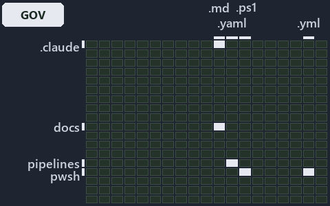

---
catzc:
  immutable:
    with_body_sha: d062353b61ab
    repo_status: locked
    path: docs/explanation/automation/.assets/rule-and-gate-per-load-stage/grid.md
    source: docs/explanation/automation/.assets/rule-and-gate-per-load-stage/diagram.drawio.png
    role: asset-description
    language: markdown
    filetype: md
    track: docs
    tracktype: documentation
---

# Every load stage but the unload has an ADR rule and a gate: the world-map minimap

```text
Where the files that cite ADR-AUTO-BUNDLE sit in the repository: tracks down, file languages across.
5 of 342 cells lit, holding 23 files.
```



This is the world-map minimap in the sidebar of the governance diagram of [Every load stage but the unload has an ADR rule and a gate][25],
which explains [ADR-AUTO-BUNDLE][1]. It lights every cell of the world map that holds a file citing those codes, so it shows where the
decision lives in the repository. Each lit cell has its reason below, naming the code that selects it.

## What the minimap shows

The grid crosses the 18 tracks (rows) with the 19 file languages (columns) of the world map and lights 5 cells, filled in ink. A cell lit
only by passing mentions (citations in body comments, not in a file's header or text) is touched: a lighter ink. Every other cell is idle, a
grey box: it holds files the slide's ADR codes do not select, or no file at all (288 of the 342 cells hold none). The minimap shows where
the slide sits, not how many files a cell holds; the world-map PDFs show the counts.

- .claude × markdown: 1 lit of 89 files
- docs × markdown: 18 lit of 2763 files
- pipelines × pipeline-yaml: 1 lit of 14 files
- pwsh × powershell: 1 lit of 1651 files
- pwsh × yaml: 2 lit of 115 files

## Key

A lit row prints its track's name; a lit column prints a short code, the first extension of its file language:

- `.md`: markdown
- `.yaml`: pipeline-yaml
- `.ps1`: powershell
- `.yml`: yaml

## Why each cell is lit

### .claude × markdown (1 lit file)

Placed: the root folder `.claude/` names the track .claude ([ADR-DSGN-TRACK-TRACKISPLACEDCLUSTER][2]); the extension `.md` names the file
language markdown ([ADR-DSGN-TRACK-FILELANGUAGE][2]). Lit ([ADR-DSGN-TRACK-LITCELL][2]) by:

- [.claude/plans/task-layers-classification-flip.md][3]: selected by [ADR-AUTO-BUNDLE][1]: the file cites it at line 32 (text).

### docs × markdown (18 lit files)

Placed: the root folder `docs/` names the track docs ([ADR-DSGN-TRACK-TRACKISPLACEDCLUSTER][2]); the extension `.md` names the file language
markdown ([ADR-DSGN-TRACK-FILELANGUAGE][2]). Lit ([ADR-DSGN-TRACK-LITCELL][2]) by:

- [docs/adr/automation/dora-explains.md][4]: selected by [ADR-AUTO-BUNDLE][1]: the file cites it at line 437 (text).
- [docs/adr/automation/platform-bundle.md][1]: selected by [ADR-AUTO-BUNDLE][1]: the ADR's own file.
- [docs/adr/glossary.md][5]: selected by [ADR-AUTO-BUNDLE][1]: the file cites it at line 612 (text).
- [docs/adr/index.md][6]: selected by [ADR-AUTO-BUNDLE][1]: the file cites it at line 173 (text).
- [docs/references/pipelines/github-workflows/ci-automation.yml.md][7]: selected by [ADR-AUTO-BUNDLE][1]: the file cites it at line 42
  (text).
- [docs/references/pwsh/catzc-base-contracts/Publish-ContractRelease.ps1.md][8]: selected by [ADR-AUTO-BUNDLE][1]: the file cites it at line
  20 (text).
- [docs/references/pwsh/catzc-base-exporter/Assert-CatzcBundle.ps1.md][9]: selected by [ADR-AUTO-BUNDLE][1]: the file cites it at line 14
  (text).
- [docs/references/pwsh/catzc-base-exporter/Build-Modules.ps1.md][10]: selected by [ADR-AUTO-BUNDLE][1]: the file cites it at line 14
  (text).
- [docs/references/pwsh/catzc-base-exporter/Export-Catzc.ps1.md][11]: selected by [ADR-AUTO-BUNDLE][1]: the file cites it at line 14 (text).
- [docs/references/pwsh/catzc-base-exporter/Install-Catzc.ps1.md][12]: selected by [ADR-AUTO-BUNDLE][1]: the file cites it at line 15
  (text).
- [docs/references/pwsh/catzc-base-exporter/Resolve-CatzcBuildVersion.ps1.md][13]: selected by [ADR-AUTO-BUNDLE][1]: the file cites it at
  line 14 (text).
- [docs/references/pwsh/catzc-base-exporter/configs/exporter.yml.md][14]: selected by [ADR-AUTO-BUNDLE][1]: the file cites it at line 17
  (text).
- [docs/references/pwsh/catzc-base-exporter/private/Assert-BundleFootprint.ps1.md][15]: selected by [ADR-AUTO-BUNDLE][1]: the file cites it
  at line 15 (text).
- [docs/references/pwsh/catzc-base-exporter/private/New-CatzcNuGetPackage.ps1.md][16]: selected by [ADR-AUTO-BUNDLE][1]: the file cites it
  at line 14 (text).
- [docs/references/pwsh/catzc-base-exporter/types/ExporterBundle.cs.md][17]: selected by [ADR-AUTO-BUNDLE][1]: the file cites it at line 13
  (text).
- [docs/references/pwsh/catzc-base-exporter/types/ExporterConfig.cs.md][18]: selected by [ADR-AUTO-BUNDLE][1]: the file cites it at line 12
  (text).
- [docs/references/pwsh/internal/Catzc.Internal.Builder.psm1.md][19]: selected by [ADR-AUTO-BUNDLE][1]: the file cites it at line 14 (text).
- [docs/references/pwsh/internal/assets/Import-Catzc.ps1.md][20]: selected by [ADR-AUTO-BUNDLE][1]: the file cites it at line 15 (text).

### pipelines × pipeline-yaml (1 lit file)

Placed: the root folder `pipelines/` names the track pipelines ([ADR-DSGN-TRACK-TRACKISPLACEDCLUSTER][2]); the extension `.yaml` names the
file language pipeline-yaml ([ADR-DSGN-TRACK-FILELANGUAGE][2]). Lit ([ADR-DSGN-TRACK-LITCELL][2]) by:

- [pipelines/ci-automation.yaml][21]: selected by [ADR-AUTO-BUNDLE][1]: a pipeline that cites nothing itself carries its globset's
  citations, which cite it at `pwsh/Catzc.Base.Docs/configs/adrs.yml` line 142 (text), `pwsh/Catzc.Base.Docs/configs/glossary.yml` line 506
  (text) and `pwsh/Catzc.Base.Exporter/Build-Modules.ps1` line 2 (text).

### pwsh × powershell (1 lit file)

Placed: the root folder `pwsh/` names the track pwsh ([ADR-DSGN-TRACK-TRACKISPLACEDCLUSTER][2]); the extension `.ps1` names the file
language powershell ([ADR-DSGN-TRACK-FILELANGUAGE][2]). Lit ([ADR-DSGN-TRACK-LITCELL][2]) by:

- [pwsh/Catzc.Base.Exporter/Build-Modules.ps1][22]: selected by [ADR-AUTO-BUNDLE][1]: the file cites it at line 2 (text).

### pwsh × yaml (2 lit files)

Placed: the root folder `pwsh/` names the track pwsh ([ADR-DSGN-TRACK-TRACKISPLACEDCLUSTER][2]); the extension `.yml` names the file
language yaml ([ADR-DSGN-TRACK-FILELANGUAGE][2]). Lit ([ADR-DSGN-TRACK-LITCELL][2]) by:

- [pwsh/Catzc.Base.Docs/configs/adrs.yml][23]: selected by [ADR-AUTO-BUNDLE][1]: the file cites it at line 142 (text).
- [pwsh/Catzc.Base.Docs/configs/glossary.yml][24]: selected by [ADR-AUTO-BUNDLE][1]: the file cites it at line 506 (text).

## Keywords

- [world map][26]
- [track][27]
- [file language][28]
- [cell][29]
- [lit cell][30]
- [.claude][31]: a track
- [docs][31]: a track
- [pipelines][31]: a track
- [pwsh][31]: a track
- [markdown][32]: a file language
- [pipeline-yaml][32]: a file language
- [powershell][32]: a file language
- [yaml][32]: a file language

[1]: ../../../../adr/automation/platform-bundle.md
[2]: ../../../../adr/design/tracks.md
[3]: ../../../../../.claude/plans/task-layers-classification-flip.md
[4]: ../../../../adr/automation/dora-explains.md
[5]: ../../../../adr/glossary.md
[6]: ../../../../adr/index.md
[7]: ../../../../references/pipelines/github-workflows/ci-automation.yml.md
[8]: ../../../../references/pwsh/catzc-base-contracts/Publish-ContractRelease.ps1.md
[9]: ../../../../references/pwsh/catzc-base-exporter/Assert-CatzcBundle.ps1.md
[10]: ../../../../references/pwsh/catzc-base-exporter/Build-Modules.ps1.md
[11]: ../../../../references/pwsh/catzc-base-exporter/Export-Catzc.ps1.md
[12]: ../../../../references/pwsh/catzc-base-exporter/Install-Catzc.ps1.md
[13]: ../../../../references/pwsh/catzc-base-exporter/Resolve-CatzcBuildVersion.ps1.md
[14]: ../../../../references/pwsh/catzc-base-exporter/configs/exporter.yml.md
[15]: ../../../../references/pwsh/catzc-base-exporter/private/Assert-BundleFootprint.ps1.md
[16]: ../../../../references/pwsh/catzc-base-exporter/private/New-CatzcNuGetPackage.ps1.md
[17]: ../../../../references/pwsh/catzc-base-exporter/types/ExporterBundle.cs.md
[18]: ../../../../references/pwsh/catzc-base-exporter/types/ExporterConfig.cs.md
[19]: ../../../../references/pwsh/internal/Catzc.Internal.Builder.psm1.md
[20]: ../../../../references/pwsh/internal/assets/Import-Catzc.ps1.md
[21]: ../../../../../pipelines/ci-automation.yaml
[22]: ../../../../../pwsh/Catzc.Base.Exporter/Build-Modules.ps1
[23]: ../../../../../pwsh/Catzc.Base.Docs/configs/adrs.yml
[24]: ../../../../../pwsh/Catzc.Base.Docs/configs/glossary.yml
[25]: ../../rule-and-gate-per-load-stage.md
[26]: ../../../../adr/glossary.md#world-map
[27]: ../../../../adr/glossary.md#track
[28]: ../../../../adr/glossary.md#file-language
[29]: ../../../../adr/glossary.md#cell
[30]: ../../../../adr/glossary.md#lit-cell
[31]: ../../../../../pwsh/Catzc.Base.Variants/configs/variants.yml
[32]: ../../../../../pwsh/Catzc.Base.Languages/configs/languages.yml
